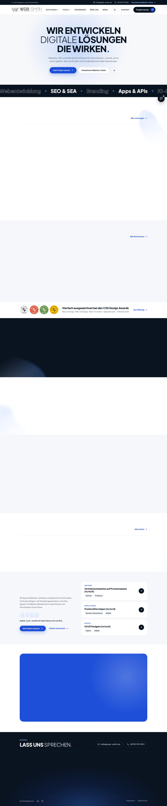
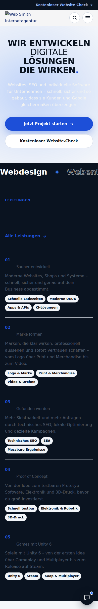

# UI Design System & Master Generation Blueprint: web-smith-de

> **Internetagentur Ostwestfalen: Websites & SEO · Web Smith** (https://web-smith.de) — Websites, SEO und individuelle Software: Web Smith ist deine Internetagentur aus Ostwestfalen – mit kostenlosem Website-Check und Konfigu...



---

## 1. Executive Visual Persona & Design Archetype

- **Brand Essence & Persona**: **Internetagentur Ostwestfalen: Websites & SEO · Web Smith** (`https://web-smith.de`). Websites, SEO und individuelle Software: Web Smith ist deine Internetagentur aus Ostwestfalen – mit kostenlosem Website-Check und Konfigu...
- **Visual Archetype**: **High-Contrast Obsidian / Atmospheric Design System (`#0a1320` canvas, `#8fb5fa` ink, `#163faf` accent)**.
- **Anti-AI-Slop Differentiators**:
  - **Source-Grounded Chromatic Polarity**: Anchors the viewport in `#0a1320` (`var(--navy)` in `:root`) paired with `#8fb5fa` primary typography and `#163faf` accents.
  - **Extracted Typographic Hierarchy**: Pairs `Plus Jakarta Sans` for display copy (`Wir entwickeln digitale Lösungen die`) with `Plus Jakarta Sans` and not declared in static CSS (uses primary stack / `ui-monospace`).
  - **Calibrated Spatial Grid & Motion**: Combines `var(--wrap)` container bounds (`gap: 24px`, padding `var(--gutter)`) with `cubic-bezier(.22,1,.36,1)` easing.

---

## 2. Spatial Architecture & Modular Grid Mathematics



### Viewport Allocation & Container Geometry
- **Captured Viewport Dimensions**: Desktop `1440×6955px` (`assets/desktop.png`, full-page scroll capture), Mobile `390×2400px` (`assets/mobile.png`, capped at 2400px multi-section capture).
- **Master Container Bounds**: `var(--wrap)` extracted from `web-smith-de` stylesheet.
- **Canvas Lateral Padding & Spacing**: `var(--gutter)` lateral canvas padding with `24px` grid gap.
- **Border Radius Scale**: `6px`, `10px`, `999px`, `50%`.

### Responsive Breakpoint Architecture
- **Desktop Layout**: Multi-column CSS Grid / Flexbox layout at `1440px` (`max-width: var(--wrap)`, `gap: 24px`).
- **Mobile Layout**: Single-column vertical stack at `390px` viewport width with `var(--gutter)` horizontal padding.
- **Extracted CSS Media Queries**: `@media (prefers-reduced-motion:reduce)`, `@media (max-width:1100px)`, `@media (max-width:900px)`, `@media (max-width:1240px)`.

---

## 3. Color System, Materiality & Atmospheric Lighting

### Semantic Palette & Source Grounding
| Semantic Role | Ground-Truth Value | Extracted CSS Source / Selector |
|---|---|---|
| **Primary Canvas Substrate** | `#0a1320` | `var(--navy)` in `:root` |
| **Primary Typography Ink** | `#121e31` | `var(--navy-2)` in `:root` |
| **Elevated Surface / Card Substrate** | `#1d4fd8` | `var(--blue)` in `:root` |
| **Interactive Accent / Highlight** | `#163faf` | `var(--blue-dark)` in `:root` |
| **Secondary / Muted Copy** | `#3478f6` | `var(--brand)` in `:root` |
| **Structural Hairline Border** | `#8fb5fa` | `var(--blue-soft)` in `:root` |
| **Variable Token (`--text`)** | `#4a5566` | `var(--text)` in `:root` |
| **Variable Token (`--muted`)** | `#aeb8c7` | `var(--muted)` in `:root` |
| **Variable Token (`--line`)** | `#dce2ea` | `var(--line)` in `:root` |
| **Variable Token (`--line-2`)** | `#cbd3df` | `var(--line-2)` in `:root` |
| **Variable Token (`--bg-soft`)** | `#f5f7fa` | `var(--bg-soft)` in `:root` |
| **Variable Token (`--bg-hero`)** | `#f7f8fa` | `var(--bg-hero)` in `:root` |
| **Variable Token (`--chip`)** | `#f2f5f9` | `var(--chip)` in `:root` |
| **Variable Token (`--white`)** | `#fff` | `var(--white)` in `:root` |

### Sanitized Root CSS Variables (`ui-ux.md` Ground Truth)
| Variable Name | Extracted Value | Semantic Role |
|---|---|---|
| `--navy` | `#0a1320` | Layout / Spatial Grid Token |
| `--navy-2` | `#121e31` | Layout / Spatial Grid Token |
| `--blue` | `#1d4fd8` | Color / Atmospheric Token |
| `--blue-dark` | `#163faf` | Canvas / Surface Token |
| `--brand` | `#3478f6` | Brand / Palette Token |
| `--blue-soft` | `#8fb5fa` | Color / Atmospheric Token |
| `--text` | `#4a5566` | Typography Ink Token |
| `--muted` | `#aeb8c7` | Color / Atmospheric Token |
| `--line` | `#dce2ea` | Color / Atmospheric Token |
| `--line-2` | `#cbd3df` | Color / Atmospheric Token |
| `--bg-soft` | `#f5f7fa` | Canvas / Surface Token |
| `--bg-hero` | `#f7f8fa` | Canvas / Surface Token |
| `--chip` | `#f2f5f9` | Color / Atmospheric Token |
| `--white` | `#fff` | Canvas / Surface Token |
| `--radius` | `28px` | Elevation / Border Token |
| `--wrap` | `1180px` | Layout / Spatial Grid Token |

---

## 4. Typographic Scale & Editorial Hierarchy

### Font Family Stacks
- **Display Typography**: `Plus Jakarta Sans`.
- **Primary Body Stack**: `Plus Jakarta Sans`.
- **Technical / Metadata Stack**: not declared in static CSS (uses primary stack / `ui-monospace`).

### Typographic Scale & Rules (Extracted from Stylesheet & Variables)
- **Hero Display (`H1`)**: not explicitly declared on tag in static CSS (stylesheet font-size ladder: `16px`, `12.5px`, `clamp(23px,min(2.9vw,5.4vh)`, `15px`, `14px`).
- **Section Heading (`H2`)**: not explicitly declared on tag in static CSS (stylesheet font-size ladder: `16px`, `12.5px`, `clamp(23px,min(2.9vw,5.4vh)`, `15px`, `14px`).
- **Body Copy**: not explicitly declared on tag in static CSS (stylesheet font-size ladder: `16px`, `12.5px`, `clamp(23px,min(2.9vw,5.4vh)`, `15px`, `14px`).
- **Metadata & Navigation Labels**: not explicitly declared on tag in static CSS (stylesheet font-size ladder: `16px`, `12.5px`, `clamp(23px,min(2.9vw,5.4vh)`, `15px`, `14px`).

---

## 5. Choreographed Motion & Interaction Physics

### Primary Easing Curves
- **Extracted Timing Functions**: `cubic-bezier(.22,1,.36,1)`, `cubic-bezier(.34,1.56,.64,1)`.

### Per-Element Transition & Choreography Rules
- **Selector `.more svg`**: `transition: transform .2s` extracted from `web-smith-de` stylesheet.
- **Selector `.btn`**: `transition: background-color .2s,color .2s,border-color .2s,transform .2s,...` extracted from `web-smith-de` stylesheet.
- **Selector `.btn-start`**: `transition: background-color .2s` extracted from `web-smith-de` stylesheet.
- **Extracted Easing Curve (`cubic-bezier(.22,1,.36,1)`)**: Governs interactive state transitions across `<header.hd>` and `<section.mq>`.
- **State & Hover Choreography**: Opacity and transform transitions on `<section.hero>` and `<section.mq>` interactive targets.

---

## 6. Component Wireframe & Structural DOM Map

### Visual Layout Schematic (Grounded in `dom.html` — `1440px` Desktop & `390px` Mobile Reflow)
```
┌────────────────────────────────────────────────────────────────────────┐
│ DESKTOP VIEWPORT (1440px) — Internetagentur Ostwestfalen: Websites & S │
│ ====================================================================== │
│ [ <header.hd>              | Overview · Index · Archive · About · C ]  │
│ ---------------------------------------------------------------------- │
│ | HERO STAGE: <section.hero>                                       |   │
│ | H1: Wir entwickeln digitale Lösungen die wirken .                |   │
│ | Substrate: #0a1320    | Ink: #8fb5fa    | Accent: #163faf        |   │
│ ---------------------------------------------------------------------- │
│ | SHOWCASE GRID (<section.mq>              ) max-w: var(--wrap)    |   │
│ | +------------------------------+  +------------------------------+ | │
│ | | Alles, was dein Unternehmen  |  | Webentwicklung               | | │
│ | +------------------------------+  +------------------------------+ | │
│ ---------------------------------------------------------------------- │
│ | MOBILE VIEWPORT REFLOW (390px) — Single-Column Stack (gap: 24px  ) | │
│ | [<header.hd>] -> [<section.hero>] -> [<section.mq>] |                │
│ ---------------------------------------------------------------------- │
│ [ FOOTER (<footer.ft>           ) | https://web-smith.de               │
└────────────────────────────────────────────────────────────────────────┘
```

### Granular DOM Region Breakdown
1. **Brand Header & Navigation Bar (<header.hd> — `web-smith-de`)**:
   - Landmark `<header class="hd">` hosting `Internetagentur Ostwestfalen: Websit` navigation (`Overview · Index · Archive · About · Contact`), DOM attributes (`data-astro-cid-nen7h5rs`, `data-hd`, `data-dd-item`, `data-dd-btn`), and stylesheet rule `after { box-sizing:border-box }`.
2. **Hero Stage & Focal Lead (<section.hero> — `Wir entwickeln digitale Lösungen d`)**:
   - Landmark `<section class="hero">` presenting display lead `Wir entwickeln digitale Lösungen die wirken .` and copy excerpt *"Zum Inhalt springen"* over `#0a1320` canvas and `#8fb5fa` ink.
3. **Primary Showcase & Content Grid (<section.mq> — `Alles, was dein Unternehmen online`)**:
   - Landmark `<section class="mq">` rendering section `Alles, was dein Unternehmen online sichtbar macht.` with copy *"Internetagentur aus Ostwestfalen"*, asset references (`favicon.ico`, `favicon.svg`, `favicon-32.png`, `favicon-192.png`), and grid rule `html { -webkit-text-size-adjust:100%;scroll-behavior:smooth;scroll-padding-top:... }`.
4. **Interactive Detail & Feature Matrix (<section.sec> — `Webentwicklung`)**:
   - Landmark `<section class="sec sec--blob">` framing `Webentwicklung` and `Branding` (*"hello@web-smith.de"*) with `#1d4fd8` surface cards, `#163faf` accents, and `svg { max-width:100%;display:block }`.
5. **Colophon & Global Directory Footer (<footer.ft> — `https://web-smith.de`)**:
   - Landmark `<footer class="ft">` anchoring `Internetagentur Ostwestfalen: We` footer links (`Overview · Index · Archive · About · Contact`), copy *"Kostenloser Website-Check"*, and `#8fb5fa` structural dividers.

---

## 7. Master Zero-Shot AI Generation Prompt

```markdown
# Master Zero-Shot Frontend Generation Prompt: web-smith-de (Internetagentur Ostwestfalen: Websites & SEO · Web Smith)

You are a principal frontend architect and design systems engineer. Build a complete, production-ready web application replicating the exact design system, DOM landmarks, typographic hierarchy, color tokens, and motion physics of `web-smith-de` (**Internetagentur Ostwestfalen: Websites & SEO · Web Smith** — `https://web-smith.de`).

### 1. Visual Archetype & Anti-AI-Slop Mandates
- **Archetype**: High-Contrast Obsidian / Atmospheric Design System (`#0a1320` canvas, `#8fb5fa` ink, `#163faf` accent).
- **Identity & Domain Context**: Websites, SEO und individuelle Software: Web Smith ist deine Internetagentur aus Ostwestfalen – mit kostenlosem Website-Check und Konfigu...
- **Primary Substrate**: `#0a1320` (`var(--navy)` in `:root`), **Primary Ink**: `#8fb5fa`, **Accent / Highlight**: `#163faf`.
- **Site-Specific Differentiators**:
  - **Source-Grounded Chromatic Polarity**: Anchors the viewport in `#0a1320` (`var(--navy)` in `:root`) paired with `#8fb5fa` primary typography and `#163faf` accents.
  - **Extracted Typographic Hierarchy**: Pairs `Plus Jakarta Sans` for display copy (`Wir entwickeln digitale Lösungen die`) with `Plus Jakarta Sans` and not declared in static CSS (uses primary stack / `ui-monospace`).
  - **Calibrated Spatial Grid & Motion**: Combines `var(--wrap)` container bounds (`gap: 24px`, padding `var(--gutter)`) with `cubic-bezier(.22,1,.36,1)` easing.

### 2. Ground-Truth CSS Variables (`:root` Token Contract)
Declare and consume these exact custom properties extracted from `web-smith-de` in your global stylesheet:

:root {
  /* Internetagentur Ostwestfalen: Websites & SEO · Web Smith (web-smith-de) — Ground-Truth Extracted CSS Variables */
  --navy: #0a1320; /* Layout / Spatial Grid Token (web-smith-de) */
  --navy-2: #121e31; /* Layout / Spatial Grid Token (web-smith-de) */
  --blue: #1d4fd8; /* Color / Atmospheric Token (web-smith-de) */
  --blue-dark: #163faf; /* Canvas / Surface Token (web-smith-de) */
  --brand: #3478f6; /* Brand / Palette Token (web-smith-de) */
  --blue-soft: #8fb5fa; /* Color / Atmospheric Token (web-smith-de) */
  --text: #4a5566; /* Typography Ink Token (web-smith-de) */
  --muted: #aeb8c7; /* Color / Atmospheric Token (web-smith-de) */
  --line: #dce2ea; /* Color / Atmospheric Token (web-smith-de) */
  --line-2: #cbd3df; /* Color / Atmospheric Token (web-smith-de) */
  --bg-soft: #f5f7fa; /* Canvas / Surface Token (web-smith-de) */
  --bg-hero: #f7f8fa; /* Canvas / Surface Token (web-smith-de) */
  --chip: #f2f5f9; /* Color / Atmospheric Token (web-smith-de) */
  --white: #fff; /* Canvas / Surface Token (web-smith-de) */
  --radius: 28px; /* Elevation / Border Token (web-smith-de) */
  --wrap: 1180px; /* Layout / Spatial Grid Token (web-smith-de) */
}

### 3. Semantic Color & Materiality Contract
Map every surface, ink, and border strictly to these source-grounded tokens:
- **Primary Canvas Substrate**: `#0a1320` — grounded in `var(--navy)` in `:root`
- **Primary Typography Ink**: `#121e31` — grounded in `var(--navy-2)` in `:root`
- **Elevated Surface / Card Substrate**: `#1d4fd8` — grounded in `var(--blue)` in `:root`
- **Interactive Accent / Highlight**: `#163faf` — grounded in `var(--blue-dark)` in `:root`
- **Secondary / Muted Copy**: `#3478f6` — grounded in `var(--brand)` in `:root`
- **Structural Hairline Border**: `#8fb5fa` — grounded in `var(--blue-soft)` in `:root`
- **Variable Token (`--text`)**: `#4a5566` — grounded in `var(--text)` in `:root`
- **Variable Token (`--muted`)**: `#aeb8c7` — grounded in `var(--muted)` in `:root`
- **Variable Token (`--line`)**: `#dce2ea` — grounded in `var(--line)` in `:root`
- **Variable Token (`--line-2`)**: `#cbd3df` — grounded in `var(--line-2)` in `:root`
- **Variable Token (`--bg-soft`)**: `#f5f7fa` — grounded in `var(--bg-soft)` in `:root`
- **Variable Token (`--bg-hero`)**: `#f7f8fa` — grounded in `var(--bg-hero)` in `:root`
- **Variable Token (`--chip`)**: `#f2f5f9` — grounded in `var(--chip)` in `:root`
- **Variable Token (`--white`)**: `#fff` — grounded in `var(--white)` in `:root`

### 4. Spatial Grid, Container Bounds & Responsive Breakpoints
- **Desktop Viewport Reference**: `1440×6955px` (full-page scroll capture, `1440px` standard desktop width).
- **Mobile Viewport Reference**: `390×2400px` (capped at 2400px multi-section capture, `390px` standard mobile width).
- **Container Max-Width**: `var(--wrap)` extracted from `web-smith-de` stylesheet
- **Padding & Gutters**: `var(--gutter)` lateral canvas padding with `24px` grid gap
- **Desktop Grid**: Multi-column CSS Grid / Flexbox layout at `1440px` (`max-width: var(--wrap)`, `gap: 24px`)
- **Mobile Adaptation**: Single-column vertical stack at `390px` viewport width with `var(--gutter)` horizontal padding
- **Media Queries**: `@media (prefers-reduced-motion:reduce)`, `@media (max-width:1100px)`, `@media (max-width:900px)`, `@media (max-width:1240px)`
- **Corner Radii**: `6px`, `10px`, `999px`, `50%`

### 5. Typography & Editorial Scale Contract
- **Display Font Stack**: `Plus Jakarta Sans`
- **Body Font Stack**: `Plus Jakarta Sans`
- **Monospace / Technical Font Stack**: not declared in static CSS (uses primary stack / `ui-monospace`)
- **H1 Display Rule**: not explicitly declared on tag in static CSS (stylesheet font-size ladder: `16px`, `12.5px`, `clamp(23px,min(2.9vw,5.4vh)`, `15px`, `14px`)
- **H2 Section Rule**: not explicitly declared on tag in static CSS (stylesheet font-size ladder: `16px`, `12.5px`, `clamp(23px,min(2.9vw,5.4vh)`, `15px`, `14px`)
- **Body Copy Rule**: not explicitly declared on tag in static CSS (stylesheet font-size ladder: `16px`, `12.5px`, `clamp(23px,min(2.9vw,5.4vh)`, `15px`, `14px`)
- **Metadata & Index Rule**: not explicitly declared on tag in static CSS (stylesheet font-size ladder: `16px`, `12.5px`, `clamp(23px,min(2.9vw,5.4vh)`, `15px`, `14px`)

### 6. Component Hierarchy, Verbatim Copy & Real DOM Landmarks
Scaffold `web-smith-de` (`Internetagentur Ostwestfalen: Websites & SEO · Web Smith`) with these exact structural regions, extracted copy, and CSS rules from `dom.html`:
1. **Brand Header & Navigation Bar (<header.hd> — `web-smith-de`)**:
   - DOM & Selectors: Landmark `<header class="hd">` hosting `Internetagentur Ostwestfalen: Websit` navigation (`Overview · Index · Archive · About · Contact`), DOM attributes (`data-astro-cid-nen7h5rs`, `data-hd`, `data-dd-item`, `data-dd-btn`), and stylesheet rule `after { box-sizing:border-box }`.
   - Responsive Contract: Header `Brand Header & Navigation Bar (<header.hd> — `web-smith-de`)` (`web-smith-de`) adapts across `@media (prefers-reduced-motion:reduce)`, `@media (max-width:1100px)`, `@media (max-width:900px)`, `@media (max-width:1240px)` with `cubic-bezier(.22,1,.36,1)`, `cubic-bezier(.34,1.56,.64,1)` transitions and links `Overview · Index · Archive · About · Contact`.
2. **Hero Stage & Focal Lead (<section.hero> — `Wir entwickeln digitale Lösungen d`)**:
   - DOM & Selectors: Landmark `<section class="hero">` presenting display lead `Wir entwickeln digitale Lösungen die wirken .` and copy excerpt *"Zum Inhalt springen"* over `#0a1320` canvas and `#8fb5fa` ink.
   - Responsive Contract: Hero stage (`1440×6955px` desktop / `390×2400px` mobile) sets `#0a1320` background with `#8fb5fa` headline `Wir entwickeln digitale Lösungen die wirken .`.
3. **Primary Showcase & Content Grid (<section.mq> — `Alles, was dein Unternehmen online`)**:
   - DOM & Selectors: Landmark `<section class="mq">` rendering section `Alles, was dein Unternehmen online sichtbar macht.` with copy *"Internetagentur aus Ostwestfalen"*, asset references (`favicon.ico`, `favicon.svg`, `favicon-32.png`, `favicon-192.png`), and grid rule `html { -webkit-text-size-adjust:100%;scroll-behavior:smooth;scroll-padding-top:... }`.
   - Responsive Contract: Showcase grid `Primary Showcase & Content Grid (<section.mq> — `Alles, was dein Unternehmen online`)` applies Multi-column CSS Grid / Flexbox layout at `1440px` (`max-width: var(--wrap)`, `gap: 24px`) on desktop and Single-column vertical stack at `390px` viewport width with `var(--gutter)` horizontal padding on mobile.
4. **Interactive Detail & Feature Matrix (<section.sec> — `Webentwicklung`)**:
   - DOM & Selectors: Landmark `<section class="sec sec--blob">` framing `Webentwicklung` and `Branding` (*"hello@web-smith.de"*) with `#1d4fd8` surface cards, `#163faf` accents, and `svg { max-width:100%;display:block }`.
   - Responsive Contract: Detail module `Interactive Detail & Feature Matrix (<section.sec> — `Webentwicklung`)` uses `6px`, `10px`, `999px`, `50%` radii, `#163faf` highlights, and assets (favicon.ico, favicon.svg, favicon-32.png).
5. **Colophon & Global Directory Footer (<footer.ft> — `https://web-smith.de`)**:
   - DOM & Selectors: Landmark `<footer class="ft">` anchoring `Internetagentur Ostwestfalen: We` footer links (`Overview · Index · Archive · About · Contact`), copy *"Kostenloser Website-Check"*, and `#8fb5fa` structural dividers.
   - Responsive Contract: Footer `Colophon & Global Directory Footer (<footer.ft> — `https://web-smith.de`)` aligns to `var(--wrap)` extracted from `web-smith-de` stylesheet with `var(--gutter)` lateral canvas padding with `24px` grid gap and attributes (data-astro-cid-nen7h5rs, data-hd, data-dd-item).

#### Verbatim DOM Copy Excerpts (`dom.html`)
- Copy Excerpt 1: *"Zum Inhalt springen"*
- Copy Excerpt 2: *"Internetagentur aus Ostwestfalen"*
- Copy Excerpt 3: *"hello@web-smith.de"*
- Copy Excerpt 4: *"Kostenloser Website-Check"*

### 7. Motion, Extracted Stylesheet Rules & Interaction Choreography
- **Primary Easing Functions**: `cubic-bezier(.22,1,.36,1)`, `cubic-bezier(.34,1.56,.64,1)`
- **Extracted Stylesheet Rules (`web-smith-de`)**:
- `after { box-sizing:border-box }`
- `html { -webkit-text-size-adjust:100%;scroll-behavior:smooth;scroll-padding-top:... }`
- `svg { max-width:100%;display:block }`
- `img { height:auto }`
- `a:hover { color:var(--blue-dark) }`
- **Per-Selector Transition Rules**:
- **Selector `.more svg`**: `transition: transform .2s` extracted from `web-smith-de` stylesheet.
- **Selector `.btn`**: `transition: background-color .2s,color .2s,border-color .2s,transform .2s,...` extracted from `web-smith-de` stylesheet.
- **Selector `.btn-start`**: `transition: background-color .2s` extracted from `web-smith-de` stylesheet.
- **Extracted Easing Curve (`cubic-bezier(.22,1,.36,1)`)**: Governs interactive state transitions across `<header.hd>` and `<section.mq>`.
- **State & Hover Choreography**: Opacity and transform transitions on `<section.hero>` and `<section.mq>` interactive targets.

### 8. Technical Deliverables
- Implement in Next.js (App Router) with TypeScript and Tailwind CSS consuming the `:root` custom properties defined above for `web-smith-de`.
- Reproduce both the `1440px` desktop architecture and `390px` mobile breakpoint transitions, preserving semantic HTML5 landmarks (`<header>`, `<nav>`, `<main>`, `<section>`, `<footer>`) and `prefers-reduced-motion` accessibility guards.
```
