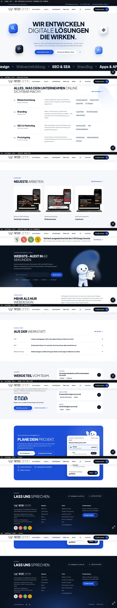
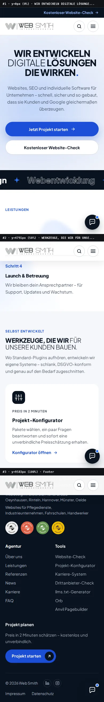

# UI Design System & Master Generation Blueprint: web-smith-de

> **Internetagentur Ostwestfalen: Websites & SEO · Web Smith** (https://web-smith.de) — Websites, SEO und individuelle Software: Web Smith ist deine Internetagentur aus Ostwestfalen – mit kostenlosem Website-Check und Konfigu...





---

## 1. Executive Visual Persona & Design Archetype

- **Brand Essence & Persona**: **Internetagentur Ostwestfalen: Websites & SEO · Web Smith** (`https://web-smith.de`). Websites, SEO und individuelle Software: Web Smith ist deine Internetagentur aus Ostwestfalen – mit kostenlosem Website-Check und Konfigu...
- **Capture Provenance**: Live browser capture (`tier1_fast`, HTTP `200`, captured `2026-11-24`).
- **Visual Archetype**: **Light-Substrate Editorial & Modular Grid System (`#ffffff` canvas, `#0a1320` ink, `#0000ff` accent)**.
- **Anti-AI-Slop Differentiators**:
  - **Live-Computed Chromatic Polarity**: Anchors the viewport in `#ffffff` (live computed `body` `background-color` (`computed_styles.json`)) paired with `#0a1320` primary typography and `#0000ff` accents.
  - **Grounded Typographic Hierarchy**: Uses `Plus Jakarta Sans` across display (`WIR ENTWICKELN DIGITALE LÖSUNGEN DIE`) and body copy.
  - **Calibrated Spatial Grid & Motion**: Combines `1440px` container bounds (`gap: 24px`, padding `var(--gutter)`) with `cubic-bezier(.22,1,.36,1)` easing.

---

## 2. Spatial Architecture & Modular Grid Mathematics

### Viewport Allocation & Container Geometry
- **Captured Journey Filmstrips**: Desktop `1280×6624px` (`assets/desktop-journey.webp`, `8` keyframes up to `y=6043px` / doc `6955px`), Mobile `390×2616px` (`assets/mobile-journey.webp`, `3` keyframes).
- **Master Container Bounds**: `1440px` (full-bleed `100%` desktop stage measured on `1440px` viewport).
- **Canvas Lateral Padding & Spacing**: `var(--gutter)` lateral canvas padding with `24px` grid gap.
- **Border Radius Scale**: `10px`, `6px`, `999px`, `50%`.

### Responsive Breakpoint Architecture
- **Desktop Layout**: Multi-column CSS Grid / Flexbox layout at `1440px` (`max-width: 1440px`, `gap: 24px`).
- **Mobile Layout**: Single-column vertical stack at `390px` viewport width with `var(--gutter)` horizontal padding.
- **Extracted CSS Media Queries**: `@media (prefers-reduced-motion:reduce)`, `@media (max-width:1100px)`, `@media (max-width:900px)`, `@media (max-width:1240px)`.

---

## 3. Color System, Materiality & Atmospheric Lighting

### Semantic Palette & Source Grounding
| Semantic Role | Ground-Truth Value | Extracted Live / CSS Source |
|---|---|---|
| **Primary Canvas Substrate** | `#ffffff` | live computed `body` `background-color` (`computed_styles.json`) |
| **Primary Typography Ink** | `#0a1320` | live computed `h1` `color` (`computed_styles.json`) |
| **Elevated Surface / Card Substrate** | `#f7f8fa` | live computed `section` `background-color` (`computed_styles.json`) |
| **Interactive Accent / Highlight** | `#0000ff` | `a:hover { color: blue }` (`#0000ff`) |
| **Secondary / Muted Copy** | `#aeb8c7` | live computed `footer` `color` (`computed_styles.json`) |
| **Structural Hairline Border** | `#dce2ea` | `var(--line)` in `:root` |
| **Variable Token (`--navy-2`)** | `#121e31` | `var(--navy-2)` in `:root` |
| **Variable Token (`--blue`)** | `#1d4fd8` | `var(--blue)` in `:root` |
| **Variable Token (`--blue-dark`)** | `#163faf` | `var(--blue-dark)` in `:root` |
| **Variable Token (`--brand`)** | `#3478f6` | `var(--brand)` in `:root` |
| **Variable Token (`--blue-soft`)** | `#8fb5fa` | `var(--blue-soft)` in `:root` |
| **Variable Token (`--text`)** | `#4a5566` | `var(--text)` in `:root` |
| **Variable Token (`--line-2`)** | `#cbd3df` | `var(--line-2)` in `:root` |
| **Variable Token (`--bg-soft`)** | `#f5f7fa` | `var(--bg-soft)` in `:root` |
| **Variable Token (`--chip`)** | `#f2f5f9` | `var(--chip)` in `:root` |

### Sanitized Root CSS Variables (`ui-ux.md` Ground Truth)
| Variable Name | Extracted Value | Semantic Role |
|---|---|---|
| `--navy` | `#0a1320` | Layout / Spatial Grid Token |
| `--navy-2` | `#121e31` | Layout / Spatial Grid Token |
| `--blue` | `#1d4fd8` | Color / Atmospheric Token |
| `--blue-dark` | `#163faf` | Canvas / Surface Token |
| `--brand` | `#3478f6` | Brand / Palette Token |
| `--blue-soft` | `#8fb5fa` | Color / Atmospheric Token |
| `--text` | `#4a5566` | Typography Ink Token |
| `--muted` | `#aeb8c7` | Color / Atmospheric Token |
| `--line` | `#dce2ea` | Color / Atmospheric Token |
| `--line-2` | `#cbd3df` | Color / Atmospheric Token |
| `--bg-soft` | `#f5f7fa` | Canvas / Surface Token |
| `--bg-hero` | `#f7f8fa` | Canvas / Surface Token |
| `--chip` | `#f2f5f9` | Color / Atmospheric Token |
| `--white` | `#fff` | Canvas / Surface Token |
| `--radius` | `28px` | Elevation / Border Token |
| `--wrap` | `1180px` | Layout / Spatial Grid Token |

---

## 4. Typographic Scale & Editorial Hierarchy

### Font Family Stacks
- **Display Typography**: `Plus Jakarta Sans`.
- **Primary Body Stack**: `Plus Jakarta Sans`.
- **Technical / Metadata Stack**: not declared in live computed styles (uses primary stack / `ui-monospace`).

### Typographic Scale & Rules (Live Computed & Stylesheet Grounded)
- **Hero Display (`H1`)**: live computed `h1` (`font-size: 76px`, `line-height: 79.04px`, `font-weight: 800`, `letter-spacing: -1.52px`).
- **Section Heading (`H2`)**: live computed `h2` (`font-size: 40px`, `line-height: 42.4px`, `font-weight: 800`, `letter-spacing: -0.8px`).
- **Body Copy**: live computed `body` (`font-size: 16px`, `line-height: 26.4px`, `font-weight: 400`).
- **Metadata & Navigation Labels**: live computed `nav/a` (`font-size: 16px`, `line-height: 26.4px`, `font-weight: 400`).

---

## 5. Choreographed Motion & Interaction Physics

### Primary Easing Curves
- **Extracted Timing Functions**: `cubic-bezier(.22,1,.36,1)`, `cubic-bezier(.34,1.56,.64,1)`, `cubic-bezier(.45,.05,.25,1)`.

### Per-Element Transition & Choreography Rules
- **Selector `.more svg`**: `transition: transform .2s` extracted from `web-smith-de` stylesheet.
- **Selector `.btn`**: `transition: background-color .2s,color .2s,border-color .2s,transform .2s,...` extracted from `web-smith-de` stylesheet.
- **Selector `.btn-start`**: `transition: background-color .2s` extracted from `web-smith-de` stylesheet.
- **Extracted Easing Curve (`cubic-bezier(.22,1,.36,1)`)**: Governs interactive state transitions across `<header.hd>` and `<section.mq>`.
- **State & Hover Choreography**: Opacity and transform transitions on `<section.hero>` and `<section.mq>` interactive targets.
### Measured Runtime Scroll & Interaction Telemetry (`behavioral_journey_v2`)
- **Scroll Driver Mode**: `native` (max document height `6955px`, deepest scrollY reached `6043px` across `8` desktop keyframes).
- **Detected Scroll / Motion Libraries**: Native browser scroll / standard CSS transitions.
- **Nav / Drawer Probe (`LEISTUNGEN`)**: Triggered visual change (pixel diff `24.086`, captured in `assets/state-nav.webp`); revealed links: hello@web-smith.de, 05733 970 785 1, Kostenloser Website-C..., Web Smith – zur Start..., REFERENZEN, ÜBER UNS.
- **Hover Physics (`primary_cta` · `Jetzt Projekt starten`)**: `backgroundColor`: `rgb(29, 79, 216)` -> `rgb(22, 63, 175)` (`transition-duration: 0.2s, 0.2s, 0.2s, 0.2s, 0.2s`, `timing: ease, ease, ease, ease, ease`).
- **Route Transition Architecture**: First internal navigation (`/unsere-leistungen/webentwicklung/`) measured as `direct` in `1166ms`.

---

## 6. Component Wireframe & Structural DOM Map

### Visual Layout Schematic — Desktop (`1440px`, Grounded in `dom.html` & Landmark Bounding Boxes)
```
┌────────────────────────────────────────────────────────────────────────┐
│ DESKTOP VIEWPORT (1440px) — Internetagentur Ostwestfalen: Websites & S │
│ ====================================================================== │
│ [ <header.hd> (1440x84px)             | Referenzen · Über uns        ] │
│ ---------------------------------------------------------------------- │
│ | HERO STAGE: <section.hero> (w=1440px)                              | │
│ | H1: WIR ENTWICKELN DIGITALE LÖSUNGEN DIE WIRKEN.                   | │
│ | Substrate: #ffffff | Ink: #0a1320 | Accent: #0000ff                | │
│ ---------------------------------------------------------------------- │
│ | SHOWCASE GRID (<section.mq>) max-w: 1440px                         | │
│ | +------------------------------+  +------------------------------+ | │
│ | | Wir entwickeln digitale Lösu |  | Alles, was dein Unternehmen  | | │
│ | +------------------------------+  +------------------------------+ | │
│ ---------------------------------------------------------------------- │
│ | DETAIL MODULE (<section.sec>) — Webentwicklung                     | │
│ ---------------------------------------------------------------------- │
│ [ FOOTER (<footer.ft>         ) | https://web-smith.de                 │
└────────────────────────────────────────────────────────────────────────┘
```

### Visual Layout Schematic — Mobile Reflow (`390px`)
```
┌────────────────────────────────────────────────────────────────────────┐
│ MOBILE VIEWPORT REFLOW (390px) — Single-Column Stack (gap: 24px)       │
│ ====================================================================== │
│ [ HEADER BAR (<header.hd>             ) | Compact Menu (390px)         │
│ ---------------------------------------------------------------------- │
│ | HERO STAGE (<section.hero>) — 390px Vertical Lead                  | │
│ | H1: WIR ENTWICKELN DIGITALE LÖSUNGEN DIE WIRKEN.                   | │
│ ---------------------------------------------------------------------- │
│ | SHOWCASE STACK (<section.mq>) — 1-Col Stack                        | │
│ | [ Item 1: Wir entwickeln digitale Lösungen die wirken .          ] | │
│ | [ Item 2: Alles, was dein Unternehmen online sichtbar macht.     ] | │
│ ---------------------------------------------------------------------- │
│ | DETAIL STACK (<section.sec>) — 1-Col (Webentwicklung)              | │
│ ---------------------------------------------------------------------- │
│ [ FOOTER (<footer.ft>         ) | Stacked 390px Colophon               │
└────────────────────────────────────────────────────────────────────────┘
```

### Granular DOM Region Breakdown
1. **Brand Header & Navigation Bar (<header.hd> — `web-smith-de`)**:
   - Landmark `<header class="hd">` (`1440x84px`) hosting `Internetagentur Ostwestfalen: Websit` navigation (`Referenzen · Über uns`), DOM attributes (`data-astro-cid-nen7h5rs`, `data-hd`, `data-dd-item`, `data-dd-btn`), and stylesheet rule `after { box-sizing:border-box }`.
2. **Hero Stage & Focal Lead (<section.hero> — `WIR ENTWICKELN DIGITALE LÖSUNGEN D`)**:
   - Landmark `<section class="hero">` presenting display lead `WIR ENTWICKELN DIGITALE LÖSUNGEN DIE WIRKEN.` and copy excerpt *"Websites, SEO und individuelle Software für Unternehmen – schnell"* over `#ffffff` canvas and `#0a1320` ink.
3. **Primary Showcase & Content Grid (<section.mq> — `Wir entwickeln digitale Lösungen d`)**:
   - Landmark `<section class="mq">` rendering section `Wir entwickeln digitale Lösungen die wirken .` with copy *"Webdesign, Webentwicklung, SEO & SEA, Branding, Apps & APIs, KI-L"*, asset references (`favicon.ico`, `favicon.svg`, `favicon-32.png`, `favicon-192.png`), and grid rule `html { -webkit-text-size-adjust:100%;scroll-behavior:smooth;scroll-padding-top:... }`.
4. **Interactive Detail & Feature Matrix (<section.sec> — `Alles, was dein Unternehmen online`)**:
   - Landmark `<section class="sec sec--blob">` framing `Alles, was dein Unternehmen online sichtbar macht.` and `Webentwicklung` (*"online sichtbar macht."*) with `#f7f8fa` surface cards, `#0000ff` accents, and `svg { max-width:100%;display:block }`.
5. **Colophon & Global Directory Footer (<footer.ft> — `https://web-smith.de`)**:
   - Landmark `<footer class="ft">` anchoring `Internetagentur Ostwestfalen: We` footer links (`Referenzen · Über uns`), copy *"Moderne Websites, Shops und Systeme – schnell, sicher und ge"*, and `#dce2ea` structural dividers.
### Full Vertical Scroll Sequence (Desktop `1440×900` Keyframes)
- **Step 01** (`y=0px`, `0%`): Active landmark `WIR ENTWICKELN DIGITALE LÖSUNGEN DIE WIRKEN.` · sticky/fixed elements: `2`
- **Step 02** (`y=850px`, `14%`): Active landmark `Webentwicklung` · sticky/fixed elements: `2`
- **Step 03** (`y=1700px`, `28%`): Active landmark `NEUESTE ARBEITEN.` · sticky/fixed elements: `2`
- **Step 04** (`y=2550px`, `42%`): Active landmark `WEBSITE-AUDIT IN 60 SEKUNDEN.` · sticky/fixed elements: `2`
- **Step 05** (`y=4250px`, `70%`): Active landmark `AUS DER WERKSTATT.` · sticky/fixed elements: `2`
- **Step 06** (`y=5100px`, `84%`): Active landmark `WERDE TEIL VOM TEAM.` · sticky/fixed elements: `2`
- **Step 07** (`y=5950px`, `98%`): Active landmark `Footer` · sticky/fixed elements: `2`
- **Step 08** (`y=6043px`, `100%`): Active landmark `Footer` · sticky/fixed elements: `2`

### Multi-Page Internal Route Map
- **Detail Route (`/unsere-leistungen/webentwicklung/`)**: `https://web-smith.de/unsere-leistungen/webentwicklung/` — H1: `WEBSITES UND SOFTWARE, DIE FÜR DICH ARBEITEN.`, scrollHeight `6468px`, transition `direct` (`1166ms`)
- **Detail Route (`/unsere-leistungen/branding/`)**: `https://web-smith.de/unsere-leistungen/branding/` — H1: `EINE MARKE, ÜBERALL WIEDERERKENNBAR.`, scrollHeight `5814px`, transition `direct` (`562ms`)
- **Detail Route (`/unsere-leistungen/seo-marketing/`)**: `https://web-smith.de/unsere-leistungen/seo-marketing/` — H1: `GEFUNDEN WERDEN, WENN KUNDEN SUCHEN.`, scrollHeight `6594px`, transition `direct` (`480ms`)

---

## 7. Master Zero-Shot AI Generation Prompt

```markdown
# Master Zero-Shot Frontend Generation Prompt: web-smith-de (Internetagentur Ostwestfalen: Websites & SEO · Web Smith)

You are a principal frontend architect and design systems engineer. Build a complete, production-ready web application replicating the exact design system, DOM landmarks, typographic hierarchy, color tokens, and motion physics of `web-smith-de` (**Internetagentur Ostwestfalen: Websites & SEO · Web Smith** — `https://web-smith.de`).

### 1. Visual Archetype & Anti-AI-Slop Mandates
- **Archetype**: Light-Substrate Editorial & Modular Grid System (`#ffffff` canvas, `#0a1320` ink, `#0000ff` accent).
- **Identity & Domain Context**: Websites, SEO und individuelle Software: Web Smith ist deine Internetagentur aus Ostwestfalen – mit kostenlosem Website-Check und Konfigu...
- **Primary Substrate**: `#ffffff` (live computed `body` `background-color` (`computed_styles.json`)), **Primary Ink**: `#0a1320`, **Accent / Highlight**: `#0000ff`.
- **Site-Specific Differentiators**:
  - **Live-Computed Chromatic Polarity**: Anchors the viewport in `#ffffff` (live computed `body` `background-color` (`computed_styles.json`)) paired with `#0a1320` primary typography and `#0000ff` accents.
  - **Grounded Typographic Hierarchy**: Uses `Plus Jakarta Sans` across display (`WIR ENTWICKELN DIGITALE LÖSUNGEN DIE`) and body copy.
  - **Calibrated Spatial Grid & Motion**: Combines `1440px` container bounds (`gap: 24px`, padding `var(--gutter)`) with `cubic-bezier(.22,1,.36,1)` easing.

### 2. Ground-Truth CSS Variables (`:root` Token Contract)
Declare and consume these exact custom properties extracted from `web-smith-de` in your global stylesheet:

:root {
  /* Internetagentur Ostwestfalen: Websites & SEO · Web Smith (web-smith-de) — Live-Grounded CSS Variables */
  --navy: #0a1320; /* Layout / Spatial Grid Token (web-smith-de) */
  --navy-2: #121e31; /* Layout / Spatial Grid Token (web-smith-de) */
  --blue: #1d4fd8; /* Color / Atmospheric Token (web-smith-de) */
  --blue-dark: #163faf; /* Canvas / Surface Token (web-smith-de) */
  --brand: #3478f6; /* Brand / Palette Token (web-smith-de) */
  --blue-soft: #8fb5fa; /* Color / Atmospheric Token (web-smith-de) */
  --text: #4a5566; /* Typography Ink Token (web-smith-de) */
  --muted: #aeb8c7; /* Color / Atmospheric Token (web-smith-de) */
  --line: #dce2ea; /* Color / Atmospheric Token (web-smith-de) */
  --line-2: #cbd3df; /* Color / Atmospheric Token (web-smith-de) */
  --bg-soft: #f5f7fa; /* Canvas / Surface Token (web-smith-de) */
  --bg-hero: #f7f8fa; /* Canvas / Surface Token (web-smith-de) */
  --chip: #f2f5f9; /* Color / Atmospheric Token (web-smith-de) */
  --white: #fff; /* Canvas / Surface Token (web-smith-de) */
  --radius: 28px; /* Elevation / Border Token (web-smith-de) */
  --wrap: 1180px; /* Layout / Spatial Grid Token (web-smith-de) */
}

### 3. Semantic Color & Materiality Contract
Map every surface, ink, and border strictly to these source-grounded tokens:
- **Primary Canvas Substrate**: `#ffffff` — grounded in live computed `body` `background-color` (`computed_styles.json`)
- **Primary Typography Ink**: `#0a1320` — grounded in live computed `h1` `color` (`computed_styles.json`)
- **Elevated Surface / Card Substrate**: `#f7f8fa` — grounded in live computed `section` `background-color` (`computed_styles.json`)
- **Interactive Accent / Highlight**: `#0000ff` — grounded in `a:hover { color: blue }` (`#0000ff`)
- **Secondary / Muted Copy**: `#aeb8c7` — grounded in live computed `footer` `color` (`computed_styles.json`)
- **Structural Hairline Border**: `#dce2ea` — grounded in `var(--line)` in `:root`
- **Variable Token (`--navy-2`)**: `#121e31` — grounded in `var(--navy-2)` in `:root`
- **Variable Token (`--blue`)**: `#1d4fd8` — grounded in `var(--blue)` in `:root`
- **Variable Token (`--blue-dark`)**: `#163faf` — grounded in `var(--blue-dark)` in `:root`
- **Variable Token (`--brand`)**: `#3478f6` — grounded in `var(--brand)` in `:root`
- **Variable Token (`--blue-soft`)**: `#8fb5fa` — grounded in `var(--blue-soft)` in `:root`
- **Variable Token (`--text`)**: `#4a5566` — grounded in `var(--text)` in `:root`
- **Variable Token (`--line-2`)**: `#cbd3df` — grounded in `var(--line-2)` in `:root`
- **Variable Token (`--bg-soft`)**: `#f5f7fa` — grounded in `var(--bg-soft)` in `:root`
- **Variable Token (`--chip`)**: `#f2f5f9` — grounded in `var(--chip)` in `:root`

### 4. Spatial Grid, Container Bounds & Responsive Breakpoints
- **Desktop Viewport Reference**: `1280×6624px` (multi-frame vertical journey filmstrip (6624px), `1440px` standard desktop width).
- **Mobile Viewport Reference**: `390×2616px` (multi-frame vertical journey filmstrip (2616px), `390px` standard mobile width).
- **Container Max-Width**: `1440px` (full-bleed `100%` desktop stage measured on `1440px` viewport)
- **Padding & Gutters**: `var(--gutter)` lateral canvas padding with `24px` grid gap
- **Desktop Grid**: Multi-column CSS Grid / Flexbox layout at `1440px` (`max-width: 1440px`, `gap: 24px`)
- **Mobile Adaptation**: Single-column vertical stack at `390px` viewport width with `var(--gutter)` horizontal padding
- **Media Queries**: `@media (prefers-reduced-motion:reduce)`, `@media (max-width:1100px)`, `@media (max-width:900px)`, `@media (max-width:1240px)`
- **Corner Radii**: `10px`, `6px`, `999px`, `50%`

### 5. Typography & Editorial Scale Contract
- **Display Font Stack**: `Plus Jakarta Sans`
- **Body Font Stack**: `Plus Jakarta Sans`
- **Monospace / Technical Font Stack**: not declared in live computed styles (uses primary stack / `ui-monospace`)
- **H1 Display Rule**: live computed `h1` (`font-size: 76px`, `line-height: 79.04px`, `font-weight: 800`, `letter-spacing: -1.52px`)
- **H2 Section Rule**: live computed `h2` (`font-size: 40px`, `line-height: 42.4px`, `font-weight: 800`, `letter-spacing: -0.8px`)
- **Body Copy Rule**: live computed `body` (`font-size: 16px`, `line-height: 26.4px`, `font-weight: 400`)
- **Metadata & Index Rule**: live computed `nav/a` (`font-size: 16px`, `line-height: 26.4px`, `font-weight: 400`)

### 6. Component Hierarchy, Verbatim Copy & Real DOM Landmarks
Scaffold `web-smith-de` (`Internetagentur Ostwestfalen: Websites & SEO · Web Smith`) with these exact structural regions, extracted copy, and CSS rules from `dom.html`:
1. **Brand Header & Navigation Bar (<header.hd> — `web-smith-de`)**:
   - DOM & Selectors: Landmark `<header class="hd">` (`1440x84px`) hosting `Internetagentur Ostwestfalen: Websit` navigation (`Referenzen · Über uns`), DOM attributes (`data-astro-cid-nen7h5rs`, `data-hd`, `data-dd-item`, `data-dd-btn`), and stylesheet rule `after { box-sizing:border-box }`.
   - Responsive Contract: Header `Brand Header & Navigation Bar (<header.hd> — `web-smith-de`)` (`web-smith-de`) adapts across `@media (prefers-reduced-motion:reduce)`, `@media (max-width:1100px)`, `@media (max-width:900px)`, `@media (max-width:1240px)` with `cubic-bezier(.22,1,.36,1)`, `cubic-bezier(.34,1.56,.64,1)`, `cubic-bezier(.45,.05,.25,1)` transitions and links `Referenzen · Über uns`.
2. **Hero Stage & Focal Lead (<section.hero> — `WIR ENTWICKELN DIGITALE LÖSUNGEN D`)**:
   - DOM & Selectors: Landmark `<section class="hero">` presenting display lead `WIR ENTWICKELN DIGITALE LÖSUNGEN DIE WIRKEN.` and copy excerpt *"Websites, SEO und individuelle Software für Unternehmen – schnell"* over `#ffffff` canvas and `#0a1320` ink.
   - Responsive Contract: Hero stage (`1280×6624px` desktop / `390×2616px` mobile) sets `#ffffff` background with `#0a1320` headline `WIR ENTWICKELN DIGITALE LÖSUNGEN DIE WIRKEN.`.
3. **Primary Showcase & Content Grid (<section.mq> — `Wir entwickeln digitale Lösungen d`)**:
   - DOM & Selectors: Landmark `<section class="mq">` rendering section `Wir entwickeln digitale Lösungen die wirken .` with copy *"Webdesign, Webentwicklung, SEO & SEA, Branding, Apps & APIs, KI-L"*, asset references (`favicon.ico`, `favicon.svg`, `favicon-32.png`, `favicon-192.png`), and grid rule `html { -webkit-text-size-adjust:100%;scroll-behavior:smooth;scroll-padding-top:... }`.
   - Responsive Contract: Showcase grid `Primary Showcase & Content Grid (<section.mq> — `Wir entwickeln digitale Lösungen d`)` applies Multi-column CSS Grid / Flexbox layout at `1440px` (`max-width: 1440px`, `gap: 24px`) on desktop and Single-column vertical stack at `390px` viewport width with `var(--gutter)` horizontal padding on mobile.
4. **Interactive Detail & Feature Matrix (<section.sec> — `Alles, was dein Unternehmen online`)**:
   - DOM & Selectors: Landmark `<section class="sec sec--blob">` framing `Alles, was dein Unternehmen online sichtbar macht.` and `Webentwicklung` (*"online sichtbar macht."*) with `#f7f8fa` surface cards, `#0000ff` accents, and `svg { max-width:100%;display:block }`.
   - Responsive Contract: Detail module `Interactive Detail & Feature Matrix (<section.sec> — `Alles, was dein Unternehmen online`)` uses `10px`, `6px`, `999px`, `50%` radii, `#0000ff` highlights, and assets (favicon.ico, favicon.svg, favicon-32.png).
5. **Colophon & Global Directory Footer (<footer.ft> — `https://web-smith.de`)**:
   - DOM & Selectors: Landmark `<footer class="ft">` anchoring `Internetagentur Ostwestfalen: We` footer links (`Referenzen · Über uns`), copy *"Moderne Websites, Shops und Systeme – schnell, sicher und ge"*, and `#dce2ea` structural dividers.
   - Responsive Contract: Footer `Colophon & Global Directory Footer (<footer.ft> — `https://web-smith.de`)` aligns to `1440px` (full-bleed `100%` desktop stage measured on `1440px` viewport) with `var(--gutter)` lateral canvas padding with `24px` grid gap and attributes (data-astro-cid-nen7h5rs, data-hd, data-dd-item).

#### Verbatim DOM Copy Excerpts (`dom.html`)
- Copy Excerpt 1: *"Websites, SEO und individuelle Software für Unternehmen – schnell, sicher und so g..."*
- Copy Excerpt 2: *"Webdesign, Webentwicklung, SEO & SEA, Branding, Apps & APIs, KI-Lösungen, Prototyp..."*
- Copy Excerpt 3: *"online sichtbar macht."*
- Copy Excerpt 4: *"Moderne Websites, Shops und Systeme – schnell, sicher und genau auf dein Business..."*

### 7. Motion, Extracted Stylesheet Rules & Interaction Choreography
- **Primary Easing Functions**: `cubic-bezier(.22,1,.36,1)`, `cubic-bezier(.34,1.56,.64,1)`, `cubic-bezier(.45,.05,.25,1)`
- **Extracted Stylesheet Rules (`web-smith-de`)**:
- `after { box-sizing:border-box }`
- `html { -webkit-text-size-adjust:100%;scroll-behavior:smooth;scroll-padding-top:... }`
- `svg { max-width:100%;display:block }`
- `img { height:auto }`
- `a:hover { color:var(--blue-dark) }`
- **Per-Selector Transition Rules**:
- **Selector `.more svg`**: `transition: transform .2s` extracted from `web-smith-de` stylesheet.
- **Selector `.btn`**: `transition: background-color .2s,color .2s,border-color .2s,transform .2s,...` extracted from `web-smith-de` stylesheet.
- **Selector `.btn-start`**: `transition: background-color .2s` extracted from `web-smith-de` stylesheet.
- **Extracted Easing Curve (`cubic-bezier(.22,1,.36,1)`)**: Governs interactive state transitions across `<header.hd>` and `<section.mq>`.
- **State & Hover Choreography**: Opacity and transform transitions on `<section.hero>` and `<section.mq>` interactive targets.
### 7b. Full-Page Scroll Choreography, Interactive States & Multi-Page Routes
- **Scroll Mechanics**: Implement `native` vertical progression up to `6955px` across 8 distinct viewport chapters.
- **Vertical Chapter Sequence**: WIR ENTWICKELN DIGITALE LÖS... (0%) -> Webentwicklung (14%) -> NEUESTE ARBEITEN. (28%) -> WEBSITE-AUDIT IN 60 SEKUNDEN. (42%) -> AUS DER WERKSTATT. (70%) -> WERDE TEIL VOM TEAM. (84%) -> Footer (98%) -> Footer (100%).
- **Navigation Drawer / Menu State**: Replicate interactive menu toggle (`LEISTUNGEN`) with Escape-to-close keyboard handling.
- **Hover Micro-Interaction (`primary_cta`)**: Animate `backgroundColor` with `0.2s, 0.2s, 0.2s, 0.2s, 0.2s ease, ease, ease, ease, ease`.
- **Multi-Page Routes**: Scaffold internal routes `/unsere-leistungen/webentwicklung/` (detail, direct), `/unsere-leistungen/branding/` (detail, direct), `/unsere-leistungen/seo-marketing/` (detail, direct) sharing the global header/footer shell and design tokens.

### 8. Technical Deliverables
- Implement in Next.js (App Router) with TypeScript and Tailwind CSS consuming the `:root` custom properties defined above for `web-smith-de`.
- Reproduce both the `1440px` desktop architecture and `390px` mobile breakpoint transitions, preserving semantic HTML5 landmarks (`<header>`, `<nav>`, `<main>`, `<section>`, `<footer>`) and `prefers-reduced-motion` accessibility guards.
```
---

## 8. Full-Page Scroll Journey, Interactive States & Subpage Inventory

### Desktop Scroll Keyframes (`1440×900` WebP)
| Step | Scroll Y | Progress | Active Landmark / Section | Sticky/Fixed | Visual Asset |
| :---: | :---: | :---: | :--- | :---: | :--- |
| `#01` | `0px` | `0%` | WIR ENTWICKELN DIGITALE LÖSUNGEN DIE WIRKEN. | `2` | [desktop-step-01.webp](assets/desktop-step-01.webp) |
| `#02` | `850px` | `14%` | Webentwicklung | `2` | [desktop-step-02.webp](assets/desktop-step-02.webp) |
| `#03` | `1700px` | `28%` | NEUESTE ARBEITEN. | `2` | [desktop-step-03.webp](assets/desktop-step-03.webp) |
| `#04` | `2550px` | `42%` | WEBSITE-AUDIT IN 60 SEKUNDEN. | `2` | [desktop-step-04.webp](assets/desktop-step-04.webp) |
| `#05` | `4250px` | `70%` | AUS DER WERKSTATT. | `2` | [desktop-step-05.webp](assets/desktop-step-05.webp) |
| `#06` | `5100px` | `84%` | WERDE TEIL VOM TEAM. | `2` | [desktop-step-06.webp](assets/desktop-step-06.webp) |
| `#07` | `5950px` | `98%` | Footer | `2` | [desktop-step-07.webp](assets/desktop-step-07.webp) |
| `#08` | `6043px` | `100%` | Footer | `2` | [desktop-step-08.webp](assets/desktop-step-08.webp) |

### Mobile Condensed Keyframes (`390×844` WebP)
| Step | Scroll Y | Progress | Active Landmark | Visual Asset |
| :---: | :---: | :---: | :--- | :--- |
| `#01` | `0px` | `0%` | WIR ENTWICKELN DIGITALE LÖSUNGEN DIE WIRKEN. | [mobile-step-01.webp](assets/mobile-step-01.webp) |
| `#02` | `4791px` | `50%` | WERKZEUGE, DIE WIR FÜR UNSERE KUNDEN BAUEN. | [mobile-step-02.webp](assets/mobile-step-02.webp) |
| `#03` | `9583px` | `100%` | Footer | [mobile-step-03.webp](assets/mobile-step-03.webp) |

### Interactive UI State Captures (`1440×900` WebP)
| State Type | Trigger / Observation | Visual Asset |
| :--- | :--- | :--- |
| `nav_menu` | Nav/Menu opened (`LEISTUNGEN`, diff `24.086`) | [state-nav.webp](assets/state-nav.webp) |

### Internal Subpage Filmstrips (`1080px` Wide WebP)
| # | Template | Route URL | H1 / Title | Scroll Height | Transition | Filmstrip Asset |
| :-: | :---: | :--- | :--- | :---: | :---: | :--- |
| `1` | `detail` | `https://web-smith.de/unsere-leistungen/webentwicklung/` | WEBSITES UND SOFTWARE, DIE FÜR DICH A... | `6468px` | `direct` (`1166ms`) | [subpage-01-unsere-leistungen-webentwicklung.webp](assets/subpage-01-unsere-leistungen-webentwicklung.webp) |
| `2` | `detail` | `https://web-smith.de/unsere-leistungen/branding/` | EINE MARKE, ÜBERALL WIEDERERKENNBAR. | `5814px` | `direct` (`562ms`) | [subpage-02-unsere-leistungen-branding.webp](assets/subpage-02-unsere-leistungen-branding.webp) |
| `3` | `detail` | `https://web-smith.de/unsere-leistungen/seo-marketing/` | GEFUNDEN WERDEN, WENN KUNDEN SUCHEN. | `6594px` | `direct` (`480ms`) | [subpage-03-unsere-leistungen-seo-marketing.webp](assets/subpage-03-unsere-leistungen-seo-marketing.webp) |

