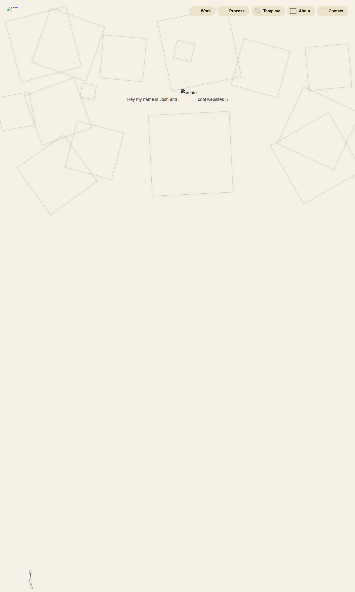
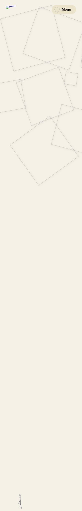

# UI Design System & Master Generation Blueprint: webdesign-kernjosh-com

> **Josh Kern** (https://webdesign.kernjosh.com) — Josh Kern - webdesign and dev. Some work, info, and how to get in touch.



---

## 1. Executive Visual Persona & Design Archetype

- **Brand Essence & Persona**: **Josh Kern** (`https://webdesign.kernjosh.com`). Josh Kern - webdesign and dev. Some work, info, and how to get in touch.
- **Visual Archetype**: **Light-Gallery WebGL / Canvas Interactive Experience (`#f5f1e6` / `#3f3f3f`)**.
- **Anti-AI-Slop Differentiators**:
  - **Source-Grounded Chromatic Polarity**: Anchors the viewport in `#f5f1e6` (`var(--base-100)` in `:root`) paired with `#0c0908` primary typography and `#3f3f3f` accents.
  - **Extracted Typographic Hierarchy**: Pairs `UglyDave` for display copy (`Hey my name is Josh and I cool websi`) with `Outfit` and not declared in static CSS (uses primary stack / `ui-monospace`).
  - **Calibrated Spatial Grid & Motion**: Combines `6rem` container bounds (`gap: .5rem`, padding `.45rem`) with `cubic-bezier(.22,1,.36,1)` easing and Lenis Smooth Scroll (`data-lenis`), Three.js / WebGL Canvas Pipeline.

---

## 2. Spatial Architecture & Modular Grid Mathematics



### Viewport Allocation & Container Geometry
- **Captured Viewport Dimensions**: Desktop `1440×2400px` (`assets/desktop.png`, capped at 2400px multi-section capture), Mobile `390×2400px` (`assets/mobile.png`, capped at 2400px multi-section capture).
- **Master Container Bounds**: `6rem` extracted from `webdesign-kernjosh-com` stylesheet.
- **Canvas Lateral Padding & Spacing**: `.45rem` lateral canvas padding with `.5rem` grid gap.
- **Border Radius Scale**: `999px`, `6px`, `4px`, `1px`.

### Responsive Breakpoint Architecture
- **Desktop Layout**: Multi-column CSS Grid / Flexbox layout at `1440px` (`max-width: 6rem`, `gap: .5rem`).
- **Mobile Layout**: Single-column vertical stack at `390px` viewport width with `.45rem` horizontal padding.
- **Extracted CSS Media Queries**: `@media (prefers-reduced-motion:reduce)`, `@media (width<=600px)`, `@media (width<=1000px)`, `@media (width<=560px)`.

---

## 3. Color System, Materiality & Atmospheric Lighting

### Semantic Palette & Source Grounding
| Semantic Role | Ground-Truth Value | Extracted CSS Source / Selector |
|---|---|---|
| **Primary Canvas Substrate** | `#f5f1e6` | `var(--base-100)` in `:root` |
| **Primary Typography Ink** | `#e0dfd7` | `var(--base-200)` in `:root` |
| **Elevated Surface / Card Substrate** | `#5f5f5f` | `var(--base-300)` in `:root` |
| **Interactive Accent / Highlight** | `#3f3f3f` | `var(--base-350)` in `:root` |
| **Secondary / Muted Copy** | `#0c0908` | `var(--base-400)` in `:root` |
| **Structural Hairline Border** | `#e6dfd0` | `var(--kuli-ground)` in `:root` |
| **Variable Token (`--buy-bg`)** | `#2a1d15` | `var(--buy-bg)` in `:root` |

### Sanitized Root CSS Variables (`ui-ux.md` Ground Truth)
| Variable Name | Extracted Value | Semantic Role |
|---|---|---|
| `--base-100` | `#f5f1e6` | Color / Atmospheric Token |
| `--base-200` | `#e0dfd7` | Color / Atmospheric Token |
| `--base-300` | `#5f5f5f` | Color / Atmospheric Token |
| `--base-350` | `#3f3f3f` | Color / Atmospheric Token |
| `--base-400` | `#0c0908` | Color / Atmospheric Token |
| `--kuli-pad-top` | `clamp(8.5rem, 18vh, 11.5rem)` | Layout / Spatial Grid Token |
| `--kuli-thumb-h` | `clamp(3rem, 7vh, 4.5rem)` | Dimension / Scale Token |
| `--kuli-ground` | `#e6dfd0` | Color / Atmospheric Token |
| `--kuli-line-h` | `9px` | Dimension / Scale Token |
| `--buy-bg` | `#2a1d15` | Canvas / Surface Token |
| `--kuli-box-ink` | `6px` | Typography Ink Token |
| `--kuli-phone-ratio` | `720 / 1278` | Design System Custom Token |
| `--ease` | `cubic-bezier(.22, 1, .36, 1)` | Motion / Easing Token |
| `--ease-spring` | `cubic-bezier(.34, 1.56, .64, 1)` | Motion / Easing Token |
| `--frame-w` | `min(calc(62vh * 16 / 10), 88vw)` | Dimension / Scale Token |
| `--enter-op` | `1` | Design System Custom Token |

---

## 4. Typographic Scale & Editorial Hierarchy

### Font Family Stacks
- **Display Typography**: `UglyDave`.
- **Primary Body Stack**: `Outfit`.
- **Technical / Metadata Stack**: not declared in static CSS (uses primary stack / `ui-monospace`).

### Typographic Scale & Rules (Extracted from Stylesheet & Variables)
- **Hero Display (`H1`)**: CSS variables `--about-font-display: "UglyDave", cursive`; rule `h1` (`font-size: clamp(.9rem,1.7vmin,1.1rem)`, `line-height: 1.75`, `font-weight: inherit`).
- **Section Heading (`H2`)**: not explicitly declared on tag in static CSS (stylesheet font-size ladder: `1rem`, `1.075rem`, `1.15rem`, `.75rem`, `34px`).
- **Body Copy**: CSS variables `--about-font-body: "DM Sans", sans-serif`.
- **Metadata & Navigation Labels**: CSS variables `--about-font-label: "DM Sans", sans-serif`, `--about-label-size: .98rem`, `--about-label-tracking: -.005em`.

---

## 5. Choreographed Motion & Interaction Physics

### Primary Easing Curves
- **Extracted Timing Functions**: `cubic-bezier(.22,1,.36,1)`, `cubic-bezier(.34,1.56,.64,1)`, `cubic-bezier(.33,1,.68,1)`.

### Per-Element Transition & Choreography Rules
- **Selector `.loader`**: `transition: opacity .12s` extracted from `webdesign-kernjosh-com` stylesheet.
- **Selector `media (prefers-reduced-motion:red...`**: `transition: none` extracted from `webdesign-kernjosh-com` stylesheet.
- **Selector `.loader .loading-hint`**: `transition: none` extracted from `webdesign-kernjosh-com` stylesheet.
- **Extracted Easing Curve (`cubic-bezier(.22,1,.36,1)`)**: Governs interactive state transitions across `<nav.nav>` and `<section.work-stage>`.
- **Runtime Interaction Engine**: Integrates Lenis Smooth Scroll (`data-lenis`), Three.js / WebGL Canvas Pipeline with `prefers-reduced-motion: reduce` fallback guards.

---

## 6. Component Wireframe & Structural DOM Map

### Visual Layout Schematic (Grounded in `dom.html` — `1440px` Desktop & `390px` Mobile Reflow)
```
┌────────────────────────────────────────────────────────────────────────┐
│ DESKTOP VIEWPORT (1440px) — Josh Kern                                  │
│ ====================================================================== │
│ [ <nav.nav>                | Overview · Index · Archive · About · C ]  │
│ ---------------------------------------------------------------------- │
│ | HERO STAGE: <section.desk>                                       |   │
│ | H1: Hey my name is Josh and I cool websites :)                   |   │
│ | Substrate: #f5f1e6    | Ink: #0c0908    | Accent: #3f3f3f        |   │
│ ---------------------------------------------------------------------- │
│ | SHOWCASE GRID (<section.work-stage>      ) max-w: 6rem           |   │
│ | +------------------------------+  +------------------------------+ | │
│ | | Getting to know you          |  | Designing the site           | | │
│ | +------------------------------+  +------------------------------+ | │
│ ---------------------------------------------------------------------- │
│ | MOBILE VIEWPORT REFLOW (390px) — Single-Column Stack (gap: .5rem ) | │
│ | [<nav.nav>] -> [<section.desk>] -> [<section.work-stag] |            │
│ ---------------------------------------------------------------------- │
│ [ FOOTER (<footer.legal-footer> ) | https://webdesign.kernjosh.com     │
└────────────────────────────────────────────────────────────────────────┘
```

### Granular DOM Region Breakdown
1. **Brand Header & Navigation Bar (<nav.nav> — `webdesign-kernjosh-com`)**:
   - Landmark `<nav class="nav">` hosting `Josh Kern` navigation (`Overview · Index · Archive · About · Contact`), DOM attributes (`data-landscape="primary"`, `data-back-pill`, `data-back-arrow-path`, `data-work-open`), and stylesheet rule `selection { color:0a0a0a;background:fff19a }`.
2. **Hero Stage & Focal Lead (<section.desk> — `Hey my name is Josh and I cool web`)**:
   - Landmark `<section class="desk">` presenting display lead `Hey my name is Josh and I cool websites :)` and copy excerpt *"c e d r i c c a r r . c o m"* over `#f5f1e6` canvas and `#0c0908` ink.
3. **Primary Showcase & Content Grid (<section.work-stage> — `Getting to know you`)**:
   - Landmark `<section class="work-stage">` rendering section `Getting to know you` with copy *"C l i c k t o o p e n p r o j e c t"*, asset references (`favicon.png`, `apple-touch-icon.png`, `challenges.cloudflare.com`, `main-CwptEoZ4.js`), and grid rule `font-face { font-family:Outfit;src:url(/assets/Outfit-Variable-D6ftewdU.woff2)format... }`.
4. **Interactive Detail & Feature Matrix (<section.process-shell> — `Designing the site`)**:
   - Landmark `<section class="process-shell">` framing `Designing the site` and `Building the site` (*"1 Getting to know you I ask a lot of questions because I want the"*) with `#5f5f5f` surface cards, `#3f3f3f` accents, and `root { --base-100:f5f1e6;--base-200:e0dfd7;--base-300:5f5f5f;--base-350:3f3f3f;... }`.
5. **Colophon & Global Directory Footer (<footer.legal-footer> — `https://webdesign.kernjosh.com`)**:
   - Landmark `<footer class="legal-footer">` anchoring `Josh Kern` footer links (`Overview · Index · Archive · About · Contact`), copy *"I ask a lot of questions because I want the website to feel "*, and `#e6dfd0` structural dividers.

---

## 7. Master Zero-Shot AI Generation Prompt

```markdown
# Master Zero-Shot Frontend Generation Prompt: webdesign-kernjosh-com (Josh Kern)

You are a principal frontend architect and design systems engineer. Build a complete, production-ready web application replicating the exact design system, DOM landmarks, typographic hierarchy, color tokens, and motion physics of `webdesign-kernjosh-com` (**Josh Kern** — `https://webdesign.kernjosh.com`).

### 1. Visual Archetype & Anti-AI-Slop Mandates
- **Archetype**: Light-Gallery WebGL / Canvas Interactive Experience (`#f5f1e6` / `#3f3f3f`).
- **Identity & Domain Context**: Josh Kern - webdesign and dev. Some work, info, and how to get in touch.
- **Primary Substrate**: `#f5f1e6` (`var(--base-100)` in `:root`), **Primary Ink**: `#0c0908`, **Accent / Highlight**: `#3f3f3f`.
- **Site-Specific Differentiators**:
  - **Source-Grounded Chromatic Polarity**: Anchors the viewport in `#f5f1e6` (`var(--base-100)` in `:root`) paired with `#0c0908` primary typography and `#3f3f3f` accents.
  - **Extracted Typographic Hierarchy**: Pairs `UglyDave` for display copy (`Hey my name is Josh and I cool websi`) with `Outfit` and not declared in static CSS (uses primary stack / `ui-monospace`).
  - **Calibrated Spatial Grid & Motion**: Combines `6rem` container bounds (`gap: .5rem`, padding `.45rem`) with `cubic-bezier(.22,1,.36,1)` easing and Lenis Smooth Scroll (`data-lenis`), Three.js / WebGL Canvas Pipeline.

### 2. Ground-Truth CSS Variables (`:root` Token Contract)
Declare and consume these exact custom properties extracted from `webdesign-kernjosh-com` in your global stylesheet:

:root {
  /* Josh Kern (webdesign-kernjosh-com) — Ground-Truth Extracted CSS Variables */
  --base-100: #f5f1e6; /* Color / Atmospheric Token (webdesign-kernjosh-com) */
  --base-200: #e0dfd7; /* Color / Atmospheric Token (webdesign-kernjosh-com) */
  --base-300: #5f5f5f; /* Color / Atmospheric Token (webdesign-kernjosh-com) */
  --base-350: #3f3f3f; /* Color / Atmospheric Token (webdesign-kernjosh-com) */
  --base-400: #0c0908; /* Color / Atmospheric Token (webdesign-kernjosh-com) */
  --kuli-pad-top: clamp(8.5rem, 18vh, 11.5rem); /* Layout / Spatial Grid Token (webdesign-kernjosh-com) */
  --kuli-thumb-h: clamp(3rem, 7vh, 4.5rem); /* Dimension / Scale Token (webdesign-kernjosh-com) */
  --kuli-ground: #e6dfd0; /* Color / Atmospheric Token (webdesign-kernjosh-com) */
  --kuli-line-h: 9px; /* Dimension / Scale Token (webdesign-kernjosh-com) */
  --buy-bg: #2a1d15; /* Canvas / Surface Token (webdesign-kernjosh-com) */
  --kuli-box-ink: 6px; /* Typography Ink Token (webdesign-kernjosh-com) */
  --kuli-phone-ratio: 720 / 1278; /* Design System Custom Token (webdesign-kernjosh-com) */
  --ease: cubic-bezier(.22, 1, .36, 1); /* Motion / Easing Token (webdesign-kernjosh-com) */
  --ease-spring: cubic-bezier(.34, 1.56, .64, 1); /* Motion / Easing Token (webdesign-kernjosh-com) */
  --frame-w: min(calc(62vh * 16 / 10), 88vw); /* Dimension / Scale Token (webdesign-kernjosh-com) */
  --enter-op: 1; /* Design System Custom Token (webdesign-kernjosh-com) */
}

### 3. Semantic Color & Materiality Contract
Map every surface, ink, and border strictly to these source-grounded tokens:
- **Primary Canvas Substrate**: `#f5f1e6` — grounded in `var(--base-100)` in `:root`
- **Primary Typography Ink**: `#e0dfd7` — grounded in `var(--base-200)` in `:root`
- **Elevated Surface / Card Substrate**: `#5f5f5f` — grounded in `var(--base-300)` in `:root`
- **Interactive Accent / Highlight**: `#3f3f3f` — grounded in `var(--base-350)` in `:root`
- **Secondary / Muted Copy**: `#0c0908` — grounded in `var(--base-400)` in `:root`
- **Structural Hairline Border**: `#e6dfd0` — grounded in `var(--kuli-ground)` in `:root`
- **Variable Token (`--buy-bg`)**: `#2a1d15` — grounded in `var(--buy-bg)` in `:root`

### 4. Spatial Grid, Container Bounds & Responsive Breakpoints
- **Desktop Viewport Reference**: `1440×2400px` (capped at 2400px multi-section capture, `1440px` standard desktop width).
- **Mobile Viewport Reference**: `390×2400px` (capped at 2400px multi-section capture, `390px` standard mobile width).
- **Container Max-Width**: `6rem` extracted from `webdesign-kernjosh-com` stylesheet
- **Padding & Gutters**: `.45rem` lateral canvas padding with `.5rem` grid gap
- **Desktop Grid**: Multi-column CSS Grid / Flexbox layout at `1440px` (`max-width: 6rem`, `gap: .5rem`)
- **Mobile Adaptation**: Single-column vertical stack at `390px` viewport width with `.45rem` horizontal padding
- **Media Queries**: `@media (prefers-reduced-motion:reduce)`, `@media (width<=600px)`, `@media (width<=1000px)`, `@media (width<=560px)`
- **Corner Radii**: `999px`, `6px`, `4px`, `1px`

### 5. Typography & Editorial Scale Contract
- **Display Font Stack**: `UglyDave`
- **Body Font Stack**: `Outfit`
- **Monospace / Technical Font Stack**: not declared in static CSS (uses primary stack / `ui-monospace`)
- **H1 Display Rule**: CSS variables `--about-font-display: "UglyDave", cursive`; rule `h1` (`font-size: clamp(.9rem,1.7vmin,1.1rem)`, `line-height: 1.75`, `font-weight: inherit`)
- **H2 Section Rule**: not explicitly declared on tag in static CSS (stylesheet font-size ladder: `1rem`, `1.075rem`, `1.15rem`, `.75rem`, `34px`)
- **Body Copy Rule**: CSS variables `--about-font-body: "DM Sans", sans-serif`
- **Metadata & Index Rule**: CSS variables `--about-font-label: "DM Sans", sans-serif`, `--about-label-size: .98rem`, `--about-label-tracking: -.005em`

### 6. Component Hierarchy, Verbatim Copy & Real DOM Landmarks
Scaffold `webdesign-kernjosh-com` (`Josh Kern`) with these exact structural regions, extracted copy, and CSS rules from `dom.html`:
1. **Brand Header & Navigation Bar (<nav.nav> — `webdesign-kernjosh-com`)**:
   - DOM & Selectors: Landmark `<nav class="nav">` hosting `Josh Kern` navigation (`Overview · Index · Archive · About · Contact`), DOM attributes (`data-landscape="primary"`, `data-back-pill`, `data-back-arrow-path`, `data-work-open`), and stylesheet rule `selection { color:0a0a0a;background:fff19a }`.
   - Responsive Contract: Header `Brand Header & Navigation Bar (<nav.nav> — `webdesign-kernjosh-com`)` (`webdesign-kernjosh-com`) adapts across `@media (prefers-reduced-motion:reduce)`, `@media (width<=600px)`, `@media (width<=1000px)`, `@media (width<=560px)` with `cubic-bezier(.22,1,.36,1)`, `cubic-bezier(.34,1.56,.64,1)`, `cubic-bezier(.33,1,.68,1)` transitions and links `Overview · Index · Archive · About · Contact`.
2. **Hero Stage & Focal Lead (<section.desk> — `Hey my name is Josh and I cool web`)**:
   - DOM & Selectors: Landmark `<section class="desk">` presenting display lead `Hey my name is Josh and I cool websites :)` and copy excerpt *"c e d r i c c a r r . c o m"* over `#f5f1e6` canvas and `#0c0908` ink.
   - Responsive Contract: Hero stage (`1440×2400px` desktop / `390×2400px` mobile) sets `#f5f1e6` background with `#0c0908` headline `Hey my name is Josh and I cool websites :)`.
3. **Primary Showcase & Content Grid (<section.work-stage> — `Getting to know you`)**:
   - DOM & Selectors: Landmark `<section class="work-stage">` rendering section `Getting to know you` with copy *"C l i c k t o o p e n p r o j e c t"*, asset references (`favicon.png`, `apple-touch-icon.png`, `challenges.cloudflare.com`, `main-CwptEoZ4.js`), and grid rule `font-face { font-family:Outfit;src:url(/assets/Outfit-Variable-D6ftewdU.woff2)format... }`.
   - Responsive Contract: Showcase grid `Primary Showcase & Content Grid (<section.work-stage> — `Getting to know you`)` applies Multi-column CSS Grid / Flexbox layout at `1440px` (`max-width: 6rem`, `gap: .5rem`) on desktop and Single-column vertical stack at `390px` viewport width with `.45rem` horizontal padding on mobile.
4. **Interactive Detail & Feature Matrix (<section.process-shell> — `Designing the site`)**:
   - DOM & Selectors: Landmark `<section class="process-shell">` framing `Designing the site` and `Building the site` (*"1 Getting to know you I ask a lot of questions because I want the"*) with `#5f5f5f` surface cards, `#3f3f3f` accents, and `root { --base-100:f5f1e6;--base-200:e0dfd7;--base-300:5f5f5f;--base-350:3f3f3f;... }`.
   - Responsive Contract: Detail module `Interactive Detail & Feature Matrix (<section.process-shell> — `Designing the site`)` uses `999px`, `6px`, `4px`, `1px` radii, `#3f3f3f` highlights, and assets (favicon.png, apple-touch-icon.png, challenges.cloudflare.com).
5. **Colophon & Global Directory Footer (<footer.legal-footer> — `https://webdesign.kernjosh.com`)**:
   - DOM & Selectors: Landmark `<footer class="legal-footer">` anchoring `Josh Kern` footer links (`Overview · Index · Archive · About · Contact`), copy *"I ask a lot of questions because I want the website to feel "*, and `#e6dfd0` structural dividers.
   - Responsive Contract: Footer `Colophon & Global Directory Footer (<footer.legal-footer> — `https://webdesign.kernjosh.com`)` aligns to `6rem` extracted from `webdesign-kernjosh-com` stylesheet with `.45rem` lateral canvas padding with `.5rem` grid gap and attributes (data-landscape="primary", data-back-pill, data-back-arrow-path).

#### Verbatim DOM Copy Excerpts (`dom.html`)
- Copy Excerpt 1: *"c e d r i c c a r r . c o m"*
- Copy Excerpt 2: *"C l i c k t o o p e n p r o j e c t"*
- Copy Excerpt 3: *"1 Getting to know you I ask a lot of questions because I want the website to feel..."*
- Copy Excerpt 4: *"I ask a lot of questions because I want the website to feel like something that is..."*

### 7. Motion, Extracted Stylesheet Rules & Interaction Choreography
- **Primary Easing Functions**: `cubic-bezier(.22,1,.36,1)`, `cubic-bezier(.34,1.56,.64,1)`, `cubic-bezier(.33,1,.68,1)`
- **Extracted Stylesheet Rules (`webdesign-kernjosh-com`)**:
- `selection { color:0a0a0a;background:fff19a }`
- `font-face { font-family:Outfit;src:url(/assets/Outfit-Variable-D6ftewdU.woff2)format... }`
- `root { --base-100:f5f1e6;--base-200:e0dfd7;--base-300:5f5f5f;--base-350:3f3f3f;... }`
- `html { -webkit-text-size-adjust:100%;-moz-text-size-adjust:100%;text-size-adjus... }`
- `body { background:var(--base-100);color:var(--base-400);overscroll-behavior:non... }`
- **Per-Selector Transition Rules**:
- **Selector `.loader`**: `transition: opacity .12s` extracted from `webdesign-kernjosh-com` stylesheet.
- **Selector `media (prefers-reduced-motion:red...`**: `transition: none` extracted from `webdesign-kernjosh-com` stylesheet.
- **Selector `.loader .loading-hint`**: `transition: none` extracted from `webdesign-kernjosh-com` stylesheet.
- **Extracted Easing Curve (`cubic-bezier(.22,1,.36,1)`)**: Governs interactive state transitions across `<nav.nav>` and `<section.work-stage>`.
- **Runtime Interaction Engine**: Integrates Lenis Smooth Scroll (`data-lenis`), Three.js / WebGL Canvas Pipeline with `prefers-reduced-motion: reduce` fallback guards.

### 8. Technical Deliverables
- Implement in Next.js (App Router) with TypeScript and Tailwind CSS consuming the `:root` custom properties defined above for `webdesign-kernjosh-com`.
- Reproduce both the `1440px` desktop architecture and `390px` mobile breakpoint transitions, preserving semantic HTML5 landmarks (`<header>`, `<nav>`, `<main>`, `<section>`, `<footer>`) and `prefers-reduced-motion` accessibility guards.
```
