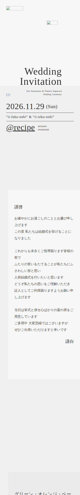

# UI Design System & Master Generation Blueprint: wedding-s-tmro-com

> **Wedding Invitation · Yuri & Tomoro** (https://wedding.s-tmro.com/) — 結婚式へのご招待です。日時は2026年11月29日（いい肉の日）、10:00に受付、10:30に開始です。会場は桜通線「国際センター」駅近くのレストラン「recipe」です。


---

## 1. Executive Visual Persona & Design Archetype

- **Brand Essence & Persona**: **Wedding Invitation · Yuri & Tomoro** (`https://wedding.s-tmro.com/`). 結婚式へのご招待です。日時は2026年11月29日（いい肉の日）、10:00に受付、10:30に開始です。会場は桜通線「国際センター」駅近くのレストラン「recipe」です。
- **Visual Archetype**: **Dark-Substrate WebGL / Canvas Interactive Experience (`#333333` / `#f2f2f2`)**.
- **Anti-AI-Slop Differentiators**:
  - **Source-Grounded Chromatic Polarity**: Anchors the viewport in `#333333` (`var(--s-color-e2b900cc)` in `:root`) paired with `#fff` primary typography and `#f2f2f2` accents.
  - **Extracted Typographic Hierarchy**: Pairs `Italianno` for display copy (`Wedding Invitation · Yuri & Tomoro`) with `Stack Sans Headline` and not declared in static CSS (uses primary stack / `ui-monospace`).
  - **Calibrated Spatial Grid & Motion**: Combines `240px` container bounds (`gap: 40px`, padding `10px`) with `cubic-bezier(0.4,0.4,0,1)` easing and Lenis Smooth Scroll (`data-lenis`), HTML5 `<canvas>` Interactive Viewport Surface.

---

## 2. Spatial Architecture & Modular Grid Mathematics



### Viewport Allocation & Container Geometry
- **Captured Viewport Dimensions**: Desktop `1440×11372px` (`assets/desktop.png`, full-page scroll capture), Mobile `390×2400px` (`assets/mobile.png`, capped at 2400px multi-section capture).
- **Master Container Bounds**: `240px` extracted from `wedding-s-tmro-com` stylesheet.
- **Canvas Lateral Padding & Spacing**: `10px` lateral canvas padding with `40px` grid gap.
- **Border Radius Scale**: `2px`, `6px`, `8px`, `0px`.

### Responsive Breakpoint Architecture
- **Desktop Layout**: Multi-column CSS Grid / Flexbox layout at `1440px` (`max-width: 240px`, `gap: 40px`).
- **Mobile Layout**: Single-column vertical stack at `390px` viewport width with `10px` horizontal padding.
- **Extracted CSS Media Queries**: `@media (prefers-reduced-motion: reduce)`, `@media (min-resolution: 1.5dppx)`, `@media (min-resolution: 1dppx) and (max-resolution: 1.5dppx)`, `@media (max-resolution: 1dppx)`.

---

## 3. Color System, Materiality & Atmospheric Lighting

### Semantic Palette & Source Grounding
| Semantic Role | Ground-Truth Value | Extracted CSS Source / Selector |
|---|---|---|
| **Primary Canvas Substrate** | `#333333` | `var(--s-color-e2b900cc)` in `:root` |
| **Primary Typography Ink** | `#fff` | `body { background: #fff }` |
| **Elevated Surface / Card Substrate** | `#ccc` | `hr { border-top: #ccc }` |
| **Interactive Accent / Highlight** | `#f2f2f2` | `table { border: #f2f2f2 }` |
| **Secondary / Muted Copy** | `#1a1a1a` | `table { color: #1a1a1a }` |
| **Structural Hairline Border** | `#eee` | `p > code { background: #eee }` |
| **Variable Token (`--s-color-34930474`)** | `#333333ff` | `var(--s-color-34930474)` in `:root` |
| **Variable Token (`--s-color-27b6cb51`)** | `#f2f2f2ff` | `var(--s-color-27b6cb51)` in `:root` |
| **Variable Token (`--s-color-c8b6c400`)** | `#f7f7f7ff` | `var(--s-color-c8b6c400)` in `:root` |
| **Variable Token (`--s-color-54b90296`)** | `#ffffffff` | `var(--s-color-54b90296)` in `:root` |

### Sanitized Root CSS Variables (`ui-ux.md` Ground Truth)
| Variable Name | Extracted Value | Semantic Role |
|---|---|---|
| `--s-font-c796e0a2` | `'Stack Sans Notch'` | Typography / Scale Token |
| `--s-font-c89837a8` | `'Stack Sans Headline'` | Typography / Scale Token |
| `--s-font-e28f2a0c` | `'Stack Sans Text'` | Typography / Scale Token |
| `--s-font-75b0f13c` | `Italianno` | Typography / Scale Token |
| `--s-font-11bbee0d` | `'Zen Old Mincho'` | Typography / Scale Token |
| `--img-current` | `var(--img-small)` | Design System Custom Token |
| `--s-color-34930474` | `#333333ff` | Brand / Palette Token |
| `--s-color-27b6cb51` | `#f2f2f2ff` | Brand / Palette Token |
| `--s-color-c8b6c400` | `#f7f7f7ff` | Brand / Palette Token |
| `--s-color-c69a0a1a` | `rgb(240, 240, 240)` | Brand / Palette Token |
| `--s-color-54b90296` | `linear-gradient(90deg, #ffffffff, #ffffffff)` | Brand / Palette Token |
| `--s-color-eea30069` | `rgba(150, 150, 150, 0)` | Brand / Palette Token |
| `--s-color-e2b900cc` | `#333333` | Brand / Palette Token |
| `--gap-h` | `0px` | Layout / Spatial Grid Token |
| `--gap-v` | `0px` | Layout / Spatial Grid Token |
| `--ha` | `1` | Design System Custom Token |

---

## 4. Typographic Scale & Editorial Hierarchy

### Font Family Stacks
- **Display Typography**: `Italianno`.
- **Primary Body Stack**: `Stack Sans Headline`.
- **Technical / Metadata Stack**: not declared in static CSS (uses primary stack / `ui-monospace`).

### Typographic Scale & Rules (Extracted from Stylesheet & Variables)
- **Hero Display (`H1`)**: rule `h1` (`font-size: 3em`, `font-weight: 700`).
- **Section Heading (`H2`)**: rule `h2` (`font-size: 2em`).
- **Body Copy**: rule `body` (`line-height: 1`).
- **Metadata & Navigation Labels**: not explicitly declared on tag in static CSS (stylesheet font-size ladder: `100%`, `3em`, `2em`, `1em`, `16px`).

---

## 5. Choreographed Motion & Interaction Physics

### Primary Easing Curves
- **Extracted Timing Functions**: `cubic-bezier(0.4,0.4,0,1)`, `cubic-bezier(.4,.4,0,1)`.

### Per-Element Transition & Choreography Rules
- **Selector `.lenis.lenis-autoToggle`**: `transition: 1ms` extracted from `wedding-s-tmro-com` stylesheet.
- **Selector `body`**: `transition: background 0.5s cubic-bezier(0.4,0.4,0,1)` extracted from `wedding-s-tmro-com` stylesheet.
- **Selector `.video-container`**: `transition: all 0.3s cubic-bezier(0.4,0.4,0,1)` extracted from `wedding-s-tmro-com` stylesheet.
- **Extracted Easing Curve (`cubic-bezier(0.4,0.4,0,1)`)**: Governs interactive state transitions across `<header.lenis>` and `<section.section>`.
- **Runtime Interaction Engine**: Integrates Lenis Smooth Scroll (`data-lenis`), HTML5 `<canvas>` Interactive Viewport Surface with `prefers-reduced-motion: reduce` fallback guards.

---

## 6. Component Wireframe & Structural DOM Map

### Visual Layout Schematic (Grounded in `dom.html` — `1440px` Desktop & `390px` Mobile Reflow)
```
┌────────────────────────────────────────────────────────────────────────┐
│ DESKTOP VIEWPORT (1440px) — Wedding Invitation · Yuri & Tomoro         │
│ ====================================================================== │
│ [ <header.lenis>           | @recipe · MESSAGE · INFORMATION · YOUR ]  │
│ ---------------------------------------------------------------------- │
│ | HERO STAGE: <section.section>                                    |   │
│ | H1: Wedding Invitation · Yuri & Tomoro                           |   │
│ | Substrate: #333333    | Ink: #fff       | Accent: #f2f2f2        |   │
│ ---------------------------------------------------------------------- │
│ | SHOWCASE GRID (<section.section>         ) max-w: 240px          |   │
│ | +------------------------------+  +------------------------------+ | │
│ | | Featured Work & Interactive  |  | Technical Architecture & Nar | | │
│ | +------------------------------+  +------------------------------+ | │
│ ---------------------------------------------------------------------- │
│ | MOBILE VIEWPORT REFLOW (390px) — Single-Column Stack (gap: 40px  ) | │
│ | [<header.lenis>] -> [<section.section>] -> [<section.section>] |     │
│ ---------------------------------------------------------------------- │
│ [ FOOTER (<footer.text>         ) | https://wedding.s-tmro.com/        │
└────────────────────────────────────────────────────────────────────────┘
```

### Granular DOM Region Breakdown
1. **Brand Header & Navigation Bar (<header.lenis> — `wedding-s-tmro-com`)**:
   - Landmark `<header class="lenis">` hosting `Wedding Invitation · Yuri & Tomoro` navigation (`@recipe · MESSAGE · INFORMATION · YOUR REPLY · @recipe @recipe`), DOM attributes (`data-appear`, `data-inited-appear`, `data-sd-img-src="https://storage.googl..."`, `data-sd-img-src="https://storage.googl..."`), and stylesheet rule `html.lenis body { height: auto; }`.
2. **Hero Stage & Focal Lead (<section.section> — `Wedding Invitation · Yuri & Tomoro`)**:
   - Landmark `<section class="section">` presenting display lead `Wedding Invitation · Yuri & Tomoro` and copy excerpt *"Yuri Kunimatsu & Tomoro Sugawara Wedding Ceremony"* over `#333333` canvas and `#fff` ink.
3. **Primary Showcase & Content Grid (<section.section> — `Featured Work & Interactive Showca`)**:
   - Landmark `<section class="section">` rendering section `Featured Work & Interactive Showcase` with copy *"“ii-fuku-nohi” & “ii-niku-nohi”"*, asset references (`84a82c89-316b-4152-8b5a-bb944f91e1b1`, `fonts.googleapis.com`, `fonts.gstatic.com`, `css2`), and grid rule `.lenis-stopped { overflow: clip; }`.
4. **Interactive Detail & Feature Matrix (<section.section> — `Technical Architecture & Narrative`)**:
   - Landmark `<section class="section">` framing `Technical Architecture & Narrative` and `Global Directory & Contact` (*"mixture restaurant"*) with `#ccc` surface cards, `#f2f2f2` accents, and `.lenis.lenis-smooth iframe { pointer-events: none; }`.
5. **Colophon & Global Directory Footer (<footer.text> — `https://wedding.s-tmro.com/`)**:
   - Landmark `<footer class="text">` anchoring `Wedding Invitation · Yuri & Tomo` footer links (`@recipe · MESSAGE · INFORMATION · YOUR REPLY · @recipe @recipe`), copy *"Good clothes Good meats Good Fortunes"*, and `#eee` structural dividers.

---

## 7. Master Zero-Shot AI Generation Prompt

```markdown
# Master Zero-Shot Frontend Generation Prompt: wedding-s-tmro-com (Wedding Invitation · Yuri & Tomoro)

You are a principal frontend architect and design systems engineer. Build a complete, production-ready web application replicating the exact design system, DOM landmarks, typographic hierarchy, color tokens, and motion physics of `wedding-s-tmro-com` (**Wedding Invitation · Yuri & Tomoro** — `https://wedding.s-tmro.com/`).

### 1. Visual Archetype & Anti-AI-Slop Mandates
- **Archetype**: Dark-Substrate WebGL / Canvas Interactive Experience (`#333333` / `#f2f2f2`).
- **Identity & Domain Context**: 結婚式へのご招待です。日時は2026年11月29日（いい肉の日）、10:00に受付、10:30に開始です。会場は桜通線「国際センター」駅近くのレストラン「recipe」です。
- **Primary Substrate**: `#333333` (`var(--s-color-e2b900cc)` in `:root`), **Primary Ink**: `#fff`, **Accent / Highlight**: `#f2f2f2`.
- **Site-Specific Differentiators**:
  - **Source-Grounded Chromatic Polarity**: Anchors the viewport in `#333333` (`var(--s-color-e2b900cc)` in `:root`) paired with `#fff` primary typography and `#f2f2f2` accents.
  - **Extracted Typographic Hierarchy**: Pairs `Italianno` for display copy (`Wedding Invitation · Yuri & Tomoro`) with `Stack Sans Headline` and not declared in static CSS (uses primary stack / `ui-monospace`).
  - **Calibrated Spatial Grid & Motion**: Combines `240px` container bounds (`gap: 40px`, padding `10px`) with `cubic-bezier(0.4,0.4,0,1)` easing and Lenis Smooth Scroll (`data-lenis`), HTML5 `<canvas>` Interactive Viewport Surface.

### 2. Ground-Truth CSS Variables (`:root` Token Contract)
Declare and consume these exact custom properties extracted from `wedding-s-tmro-com` in your global stylesheet:

:root {
  /* Wedding Invitation · Yuri & Tomoro (wedding-s-tmro-com) — Ground-Truth Extracted CSS Variables */
  --s-font-c796e0a2: 'Stack Sans Notch'; /* Typography / Scale Token (wedding-s-tmro-com) */
  --s-font-c89837a8: 'Stack Sans Headline'; /* Typography / Scale Token (wedding-s-tmro-com) */
  --s-font-e28f2a0c: 'Stack Sans Text'; /* Typography / Scale Token (wedding-s-tmro-com) */
  --s-font-75b0f13c: Italianno; /* Typography / Scale Token (wedding-s-tmro-com) */
  --s-font-11bbee0d: 'Zen Old Mincho'; /* Typography / Scale Token (wedding-s-tmro-com) */
  --img-current: var(--img-small); /* Design System Custom Token (wedding-s-tmro-com) */
  --s-color-34930474: #333333ff; /* Brand / Palette Token (wedding-s-tmro-com) */
  --s-color-27b6cb51: #f2f2f2ff; /* Brand / Palette Token (wedding-s-tmro-com) */
  --s-color-c8b6c400: #f7f7f7ff; /* Brand / Palette Token (wedding-s-tmro-com) */
  --s-color-c69a0a1a: rgb(240, 240, 240); /* Brand / Palette Token (wedding-s-tmro-com) */
  --s-color-54b90296: linear-gradient(90deg, #ffffffff, #ffffffff); /* Brand / Palette Token (wedding-s-tmro-com) */
  --s-color-eea30069: rgba(150, 150, 150, 0); /* Brand / Palette Token (wedding-s-tmro-com) */
  --s-color-e2b900cc: #333333; /* Brand / Palette Token (wedding-s-tmro-com) */
  --gap-h: 0px; /* Layout / Spatial Grid Token (wedding-s-tmro-com) */
  --gap-v: 0px; /* Layout / Spatial Grid Token (wedding-s-tmro-com) */
  --ha: 1; /* Design System Custom Token (wedding-s-tmro-com) */
}

### 3. Semantic Color & Materiality Contract
Map every surface, ink, and border strictly to these source-grounded tokens:
- **Primary Canvas Substrate**: `#333333` — grounded in `var(--s-color-e2b900cc)` in `:root`
- **Primary Typography Ink**: `#fff` — grounded in `body { background: #fff }`
- **Elevated Surface / Card Substrate**: `#ccc` — grounded in `hr { border-top: #ccc }`
- **Interactive Accent / Highlight**: `#f2f2f2` — grounded in `table { border: #f2f2f2 }`
- **Secondary / Muted Copy**: `#1a1a1a` — grounded in `table { color: #1a1a1a }`
- **Structural Hairline Border**: `#eee` — grounded in `p > code { background: #eee }`
- **Variable Token (`--s-color-34930474`)**: `#333333ff` — grounded in `var(--s-color-34930474)` in `:root`
- **Variable Token (`--s-color-27b6cb51`)**: `#f2f2f2ff` — grounded in `var(--s-color-27b6cb51)` in `:root`
- **Variable Token (`--s-color-c8b6c400`)**: `#f7f7f7ff` — grounded in `var(--s-color-c8b6c400)` in `:root`
- **Variable Token (`--s-color-54b90296`)**: `#ffffffff` — grounded in `var(--s-color-54b90296)` in `:root`

### 4. Spatial Grid, Container Bounds & Responsive Breakpoints
- **Desktop Viewport Reference**: `1440×11372px` (full-page scroll capture, `1440px` standard desktop width).
- **Mobile Viewport Reference**: `390×2400px` (capped at 2400px multi-section capture, `390px` standard mobile width).
- **Container Max-Width**: `240px` extracted from `wedding-s-tmro-com` stylesheet
- **Padding & Gutters**: `10px` lateral canvas padding with `40px` grid gap
- **Desktop Grid**: Multi-column CSS Grid / Flexbox layout at `1440px` (`max-width: 240px`, `gap: 40px`)
- **Mobile Adaptation**: Single-column vertical stack at `390px` viewport width with `10px` horizontal padding
- **Media Queries**: `@media (prefers-reduced-motion: reduce)`, `@media (min-resolution: 1.5dppx)`, `@media (min-resolution: 1dppx) and (max-resolution: 1.5dppx)`, `@media (max-resolution: 1dppx)`
- **Corner Radii**: `2px`, `6px`, `8px`, `0px`

### 5. Typography & Editorial Scale Contract
- **Display Font Stack**: `Italianno`
- **Body Font Stack**: `Stack Sans Headline`
- **Monospace / Technical Font Stack**: not declared in static CSS (uses primary stack / `ui-monospace`)
- **H1 Display Rule**: rule `h1` (`font-size: 3em`, `font-weight: 700`)
- **H2 Section Rule**: rule `h2` (`font-size: 2em`)
- **Body Copy Rule**: rule `body` (`line-height: 1`)
- **Metadata & Index Rule**: not explicitly declared on tag in static CSS (stylesheet font-size ladder: `100%`, `3em`, `2em`, `1em`, `16px`)

### 6. Component Hierarchy, Verbatim Copy & Real DOM Landmarks
Scaffold `wedding-s-tmro-com` (`Wedding Invitation · Yuri & Tomoro`) with these exact structural regions, extracted copy, and CSS rules from `dom.html`:
1. **Brand Header & Navigation Bar (<header.lenis> — `wedding-s-tmro-com`)**:
   - DOM & Selectors: Landmark `<header class="lenis">` hosting `Wedding Invitation · Yuri & Tomoro` navigation (`@recipe · MESSAGE · INFORMATION · YOUR REPLY · @recipe @recipe`), DOM attributes (`data-appear`, `data-inited-appear`, `data-sd-img-src="https://storage.googl..."`, `data-sd-img-src="https://storage.googl..."`), and stylesheet rule `html.lenis body { height: auto; }`.
   - Responsive Contract: Header `Brand Header & Navigation Bar (<header.lenis> — `wedding-s-tmro-com`)` (`wedding-s-tmro-com`) adapts across `@media (prefers-reduced-motion: reduce)`, `@media (min-resolution: 1.5dppx)`, `@media (min-resolution: 1dppx) and (max-resolution: 1.5dppx)`, `@media (max-resolution: 1dppx)` with `cubic-bezier(0.4,0.4,0,1)`, `cubic-bezier(.4,.4,0,1)` transitions and links `@recipe · MESSAGE · INFORMATION · YOUR REPLY · @recipe @recipe`.
2. **Hero Stage & Focal Lead (<section.section> — `Wedding Invitation · Yuri & Tomoro`)**:
   - DOM & Selectors: Landmark `<section class="section">` presenting display lead `Wedding Invitation · Yuri & Tomoro` and copy excerpt *"Yuri Kunimatsu & Tomoro Sugawara Wedding Ceremony"* over `#333333` canvas and `#fff` ink.
   - Responsive Contract: Hero stage (`1440×11372px` desktop / `390×2400px` mobile) sets `#333333` background with `#fff` headline `Wedding Invitation · Yuri & Tomoro`.
3. **Primary Showcase & Content Grid (<section.section> — `Featured Work & Interactive Showca`)**:
   - DOM & Selectors: Landmark `<section class="section">` rendering section `Featured Work & Interactive Showcase` with copy *"“ii-fuku-nohi” & “ii-niku-nohi”"*, asset references (`84a82c89-316b-4152-8b5a-bb944f91e1b1`, `fonts.googleapis.com`, `fonts.gstatic.com`, `css2`), and grid rule `.lenis-stopped { overflow: clip; }`.
   - Responsive Contract: Showcase grid `Primary Showcase & Content Grid (<section.section> — `Featured Work & Interactive Showca`)` applies Multi-column CSS Grid / Flexbox layout at `1440px` (`max-width: 240px`, `gap: 40px`) on desktop and Single-column vertical stack at `390px` viewport width with `10px` horizontal padding on mobile.
4. **Interactive Detail & Feature Matrix (<section.section> — `Technical Architecture & Narrative`)**:
   - DOM & Selectors: Landmark `<section class="section">` framing `Technical Architecture & Narrative` and `Global Directory & Contact` (*"mixture restaurant"*) with `#ccc` surface cards, `#f2f2f2` accents, and `.lenis.lenis-smooth iframe { pointer-events: none; }`.
   - Responsive Contract: Detail module `Interactive Detail & Feature Matrix (<section.section> — `Technical Architecture & Narrative`)` uses `2px`, `6px`, `8px`, `0px` radii, `#f2f2f2` highlights, and assets (84a82c89-316b-4152-8b5a-bb944f91e1b1, fonts.googleapis.com, fonts.gstatic.com).
5. **Colophon & Global Directory Footer (<footer.text> — `https://wedding.s-tmro.com/`)**:
   - DOM & Selectors: Landmark `<footer class="text">` anchoring `Wedding Invitation · Yuri & Tomo` footer links (`@recipe · MESSAGE · INFORMATION · YOUR REPLY · @recipe @recipe`), copy *"Good clothes Good meats Good Fortunes"*, and `#eee` structural dividers.
   - Responsive Contract: Footer `Colophon & Global Directory Footer (<footer.text> — `https://wedding.s-tmro.com/`)` aligns to `240px` extracted from `wedding-s-tmro-com` stylesheet with `10px` lateral canvas padding with `40px` grid gap and attributes (data-appear, data-inited-appear, data-sd-img-src="https://storage.googl...").

#### Verbatim DOM Copy Excerpts (`dom.html`)
- Copy Excerpt 1: *"Yuri Kunimatsu & Tomoro Sugawara Wedding Ceremony"*
- Copy Excerpt 2: *"“ii-fuku-nohi” & “ii-niku-nohi”"*
- Copy Excerpt 3: *"mixture restaurant"*
- Copy Excerpt 4: *"Good clothes Good meats Good Fortunes"*

### 7. Motion, Extracted Stylesheet Rules & Interaction Choreography
- **Primary Easing Functions**: `cubic-bezier(0.4,0.4,0,1)`, `cubic-bezier(.4,.4,0,1)`
- **Extracted Stylesheet Rules (`wedding-s-tmro-com`)**:
- `html.lenis body { height: auto; }`
- `.lenis-stopped { overflow: clip; }`
- `.lenis.lenis-smooth iframe { pointer-events: none; }`
- `.lenis.lenis-autoToggle { transition-property: overflow; transition-duration: 1ms; transition-beha... }`
- `html { height: 100%; padding: 0; margin: 0; scroll-behavior: smooth; -webkit-fo... }`
- **Per-Selector Transition Rules**:
- **Selector `.lenis.lenis-autoToggle`**: `transition: 1ms` extracted from `wedding-s-tmro-com` stylesheet.
- **Selector `body`**: `transition: background 0.5s cubic-bezier(0.4,0.4,0,1)` extracted from `wedding-s-tmro-com` stylesheet.
- **Selector `.video-container`**: `transition: all 0.3s cubic-bezier(0.4,0.4,0,1)` extracted from `wedding-s-tmro-com` stylesheet.
- **Extracted Easing Curve (`cubic-bezier(0.4,0.4,0,1)`)**: Governs interactive state transitions across `<header.lenis>` and `<section.section>`.
- **Runtime Interaction Engine**: Integrates Lenis Smooth Scroll (`data-lenis`), HTML5 `<canvas>` Interactive Viewport Surface with `prefers-reduced-motion: reduce` fallback guards.

### 8. Technical Deliverables
- Implement in Next.js (App Router) with TypeScript and Tailwind CSS consuming the `:root` custom properties defined above for `wedding-s-tmro-com`.
- Reproduce both the `1440px` desktop architecture and `390px` mobile breakpoint transitions, preserving semantic HTML5 landmarks (`<header>`, `<nav>`, `<main>`, `<section>`, `<footer>`) and `prefers-reduced-motion` accessibility guards.
```
