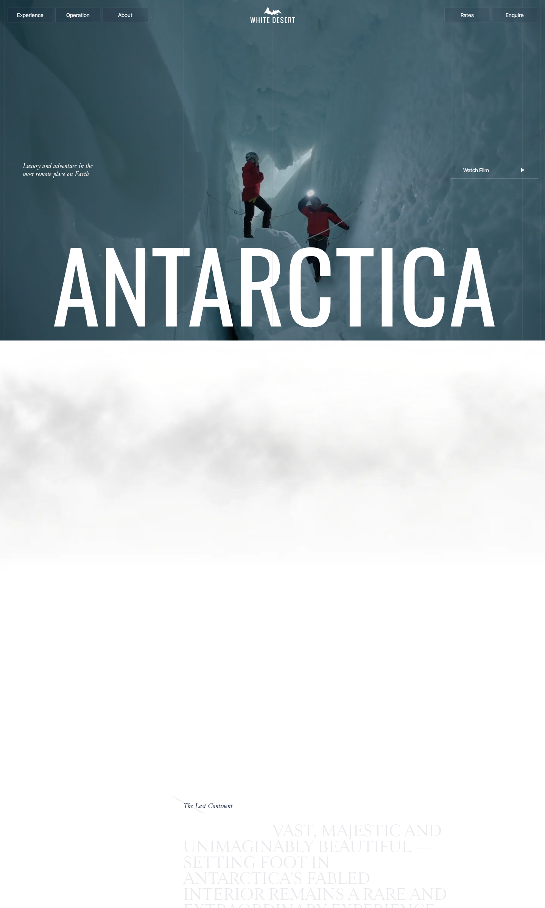
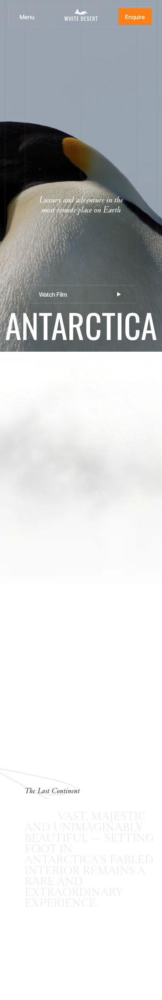

# UI Design System & Master Generation Blueprint: white-desert-com

> **Luxury Adventures in Antarctica · White Desert** (https://white-desert.com/) — White Desert is the world’s leading luxury Antarctic expedition company, offering once-in-a-lifetime journeys to the South Pole and Emper...



---

## 1. Executive Visual Persona & Design Archetype

- **Brand Essence & Persona**: **Luxury Adventures in Antarctica · White Desert** (`https://white-desert.com/`). White Desert is the world’s leading luxury Antarctic expedition company, offering once-in-a-lifetime journeys to the South Pole and Emper...
- **Visual Archetype**: **Light-Substrate Editorial & Modular Grid System (`#fff` canvas, `#0b0c0f` ink, `#6aa5ff` accent)**.
- **Anti-AI-Slop Differentiators**:
  - **Source-Grounded Chromatic Polarity**: Anchors the viewport in `#fff` (`var(--bg)` in `:root`) paired with `#0b0c0f` primary typography and `#6aa5ff` accents.
  - **Extracted Typographic Hierarchy**: Pairs `Inter Tight` for display copy (`Antarctica`) with `Cardinal Classic Long` and not declared in static CSS (uses primary stack / `ui-monospace`).
  - **Calibrated Spatial Grid & Motion**: Combines `768px` container bounds (`gap: var(--spacing-md)`, padding `var(--size-3)`) with `cubic-bezier(.16,1,.3,1)` easing and Lenis Smooth Scroll (`data-lenis`), Three.js / WebGL Canvas Pipeline.

---

## 2. Spatial Architecture & Modular Grid Mathematics



### Viewport Allocation & Container Geometry
- **Captured Viewport Dimensions**: Desktop `1440×2400px` (`assets/desktop.png`, capped at 2400px multi-section capture), Mobile `390×2400px` (`assets/mobile.png`, capped at 2400px multi-section capture).
- **Master Container Bounds**: `768px` extracted from `white-desert-com` stylesheet.
- **Canvas Lateral Padding & Spacing**: `var(--size-3)` lateral canvas padding with `var(--spacing-md)` grid gap.
- **Border Radius Scale**: `var(--radius-sm)`, `50%`, `var(--radius-0375)`, `100%`.

### Responsive Breakpoint Architecture
- **Desktop Layout**: Multi-column CSS Grid / Flexbox layout at `1440px` (`max-width: 768px`, `gap: var(--spacing-md)`).
- **Mobile Layout**: Single-column vertical stack at `390px` viewport width with `var(--size-3)` horizontal padding.
- **Extracted CSS Media Queries**: `@media (max-width:768px)`, `@media (min-width:768px)`, `@media (max-width:1279px)`, `@media (max-width:1023px)`.

---

## 3. Color System, Materiality & Atmospheric Lighting

### Semantic Palette & Source Grounding
| Semantic Role | Ground-Truth Value | Extracted CSS Source / Selector |
|---|---|---|
| **Primary Canvas Substrate** | `#fff` | `var(--bg)` in `:root` |
| **Primary Typography Ink** | `#12141a` | `var(--surface)` in `:root` |
| **Elevated Surface / Card Substrate** | `#a8acb3` | `var(--muted)` in `:root` |
| **Interactive Accent / Highlight** | `#6aa5ff` | `var(--primary)` in `:root` |
| **Secondary / Muted Copy** | `#0b0c0f` | `var(--primary-contrast)` in `:root` |
| **Structural Hairline Border** | `#1f2330` | `var(--border)` in `:root` |
| **Variable Token (`--quote-accent`)** | `#1f2a44` | `var(--quote-accent)` in `:root` |

### Sanitized Root CSS Variables (`ui-ux.md` Ground Truth)
| Variable Name | Extracted Value | Semantic Role |
|---|---|---|
| `--pulse-duration` | `2s` | Motion / Easing Token |
| `--pulse-stagger` | `.2s` | Motion / Timing Token |
| `--max-h` | `calc(100svh - var(--space-4)*2 - var(--space-4) - 2.5rem)` | Dimension / Scale Token |
| `--mask-position` | `-40` | Design System Custom Token |
| `--btn-border` | `.03125rem solid rgba(255,255,255,.2)` | Elevation / Border Token |
| `--glass-scale` | `1` | Design System Custom Token |
| `--glass-depth` | `.4` | Design System Custom Token |
| `--glass-highlight` | `rgba(255,255,255,.2)` | Canvas / Surface Token |
| `--bg` | `#fff` | Canvas / Surface Token |
| `--surface` | `#12141a` | Canvas / Surface Token |
| `--text` | `var(--wd_dark-blue)` | Typography Ink Token |
| `--quote-accent` | `var(--WD_Dark-Blue,#1f2a44)` | Brand / Palette Token |
| `--muted` | `#a8acb3` | Color / Atmospheric Token |
| `--primary` | `#6aa5ff` | Brand / Palette Token |
| `--primary-contrast` | `#0b0c0f` | Brand / Palette Token |
| `--border` | `#1f2330` | Elevation / Border Token |

---

## 4. Typographic Scale & Editorial Hierarchy

### Font Family Stacks
- **Display Typography**: `Inter Tight`.
- **Primary Body Stack**: `Cardinal Classic Long`.
- **Technical / Metadata Stack**: not declared in static CSS (uses primary stack / `ui-monospace`).

### Typographic Scale & Rules (Extracted from Stylesheet & Variables)
- **Hero Display (`H1`)**: rule `.title` (`font-size: var(--size-225)`).
- **Section Heading (`H2`)**: rule `h2` (`font-size: var(--size-2)`, `line-height: var(--lh-120)`, `font-weight: 500`).
- **Body Copy**: rule `p` (`font-size: 14px`, `line-height: 1.4`).
- **Metadata & Navigation Labels**: not explicitly declared on tag in static CSS (stylesheet font-size ladder: `var(--size-2)`, `var(--size-0625)`, `14px`, `.875rem`, `var(--size-0875)`).

---

## 5. Choreographed Motion & Interaction Physics

### Primary Easing Curves
- **Extracted Timing Functions**: `cubic-bezier(.16,1,.3,1)`, `cubic-bezier(.5,1,.89,1)`, `cubic-bezier(.76,0,.24,1)`.

### Per-Element Transition & Choreography Rules
- **Selector `ut_container.is-sticky .flyout-vi...`**: `transition: var(--transition-wd)` extracted from `white-desert-com` stylesheet.
- **Selector `.flyout_container .btn-popup-open`**: `transition: var(--transition-wd)` extracted from `white-desert-com` stylesheet.
- **Selector `lyout_container .btn-popup-open ....`**: `transition: var(--transition-wd)` extracted from `white-desert-com` stylesheet.
- **Extracted Easing Curve (`cubic-bezier(.16,1,.3,1)`)**: Governs interactive state transitions across `<nav.lenis>` and `<section.tall-parallax-banner>`.
- **Runtime Interaction Engine**: Integrates Lenis Smooth Scroll (`data-lenis`), Three.js / WebGL Canvas Pipeline with `prefers-reduced-motion: reduce` fallback guards.

---

## 6. Component Wireframe & Structural DOM Map

### Visual Layout Schematic (Grounded in `dom.html` — `1440px` Desktop & `390px` Mobile Reflow)
```
┌────────────────────────────────────────────────────────────────────────┐
│ DESKTOP VIEWPORT (1440px) — Luxury Adventures in Antarctica · White De │
│ ====================================================================== │
│ [ <nav.lenis>              | Rates · Enquire · Home · Enquire now · ]  │
│ ---------------------------------------------------------------------- │
│ | HERO STAGE: <section.padding-top-large-bottom-medium>            |   │
│ | H1: Antarctica                                                   |   │
│ | Substrate: #fff       | Ink: #0b0c0f    | Accent: #6aa5ff        |   │
│ ---------------------------------------------------------------------- │
│ | SHOWCASE GRID (<section.tall-parallax-ban) max-w: 768px          |   │
│ | +------------------------------+  +------------------------------+ | │
│ | | Vast, majestic and unimagina |  | Our Trips                    | | │
│ | +------------------------------+  +------------------------------+ | │
│ ---------------------------------------------------------------------- │
│ | MOBILE VIEWPORT REFLOW (390px) — Single-Column Stack (gap: var(--) | │
│ | [<nav.lenis>] -> [<section.padding-t] -> [<section.tall-para] |      │
│ ---------------------------------------------------------------------- │
│ [ FOOTER (<footer.custom-cursor_) | https://white-desert.com/          │
└────────────────────────────────────────────────────────────────────────┘
```

### Granular DOM Region Breakdown
1. **Brand Header & Navigation Bar (<nav.lenis> — `white-desert-com`)**:
   - Landmark `<nav class="lenis">` hosting `Luxury Adventures in Antarctica · Wh` navigation (`Rates · Enquire · Home · Enquire now · Dates & Prices`), DOM attributes (`data-precedence="next"`, `data-precedence="next"`, `data-precedence="next"`, `data-precedence="next"`), and stylesheet rule `.basic-banner_bg { z-index:0;position:absolute;top:0;bottom:0;left:0;right:0 }`.
2. **Hero Stage & Focal Lead (<section.padding-top-large-bottom-medium> — `Antarctica`)**:
   - Landmark `<section class="padding-top-large-bottom-medium m-pb-625">` presenting display lead `Antarctica` and copy excerpt *"Luxury and adventure in the most remote place on Earth"* over `#fff` canvas and `#0b0c0f` ink.
3. **Primary Showcase & Content Grid (<section.tall-parallax-banner> — `Vast, majestic and unimaginably be`)**:
   - Landmark `<section class="tall-parallax-banner">` rendering section `Vast, majestic and unimaginably beautiful — setti...` with copy *"The Last Continent"*, asset references (`cabcbbbe485680be.css`, `7e7f4251c3582625.css`, `5dd7b716df5564d7.css`, `112bdbe21ebfd0e0.css`), and grid rule `.basic-banner_overlay { z-index:1;background-color:rgba(0,0,0,.2);position:absolute;top:0;bottom... }`.
4. **Interactive Detail & Feature Matrix (<section.padding-top-large-bottom-medium> — `Our Trips`)**:
   - Landmark `<section class="padding-top-large-bottom-medium bg-white">` framing `Our Trips` and `Baby Penguins & Blue Tunnels` (*"Between November and February, during the short polar summer, we "*) with `#a8acb3` surface cards, `#6aa5ff` accents, and `.basic-banner_content { z-index:2;width:100%;color:var(--white);text-align:center;position:relative }`.
5. **Colophon & Global Directory Footer (<footer.custom-cursor_dot> — `https://white-desert.com/`)**:
   - Landmark `<footer class="custom-cursor_dot">` anchoring `Luxury Adventures in Antarctica ` footer links (`Rates · Enquire · Home · Enquire now · Dates & Prices`), copy *"Baby Penguins & Blue Tunnels US $75,250 Early Season Witness"*, and `#1f2330` structural dividers.

---

## 7. Master Zero-Shot AI Generation Prompt

```markdown
# Master Zero-Shot Frontend Generation Prompt: white-desert-com (Luxury Adventures in Antarctica · White Desert)

You are a principal frontend architect and design systems engineer. Build a complete, production-ready web application replicating the exact design system, DOM landmarks, typographic hierarchy, color tokens, and motion physics of `white-desert-com` (**Luxury Adventures in Antarctica · White Desert** — `https://white-desert.com/`).

### 1. Visual Archetype & Anti-AI-Slop Mandates
- **Archetype**: Light-Substrate Editorial & Modular Grid System (`#fff` canvas, `#0b0c0f` ink, `#6aa5ff` accent).
- **Identity & Domain Context**: White Desert is the world’s leading luxury Antarctic expedition company, offering once-in-a-lifetime journeys to the South Pole and Emper...
- **Primary Substrate**: `#fff` (`var(--bg)` in `:root`), **Primary Ink**: `#0b0c0f`, **Accent / Highlight**: `#6aa5ff`.
- **Site-Specific Differentiators**:
  - **Source-Grounded Chromatic Polarity**: Anchors the viewport in `#fff` (`var(--bg)` in `:root`) paired with `#0b0c0f` primary typography and `#6aa5ff` accents.
  - **Extracted Typographic Hierarchy**: Pairs `Inter Tight` for display copy (`Antarctica`) with `Cardinal Classic Long` and not declared in static CSS (uses primary stack / `ui-monospace`).
  - **Calibrated Spatial Grid & Motion**: Combines `768px` container bounds (`gap: var(--spacing-md)`, padding `var(--size-3)`) with `cubic-bezier(.16,1,.3,1)` easing and Lenis Smooth Scroll (`data-lenis`), Three.js / WebGL Canvas Pipeline.

### 2. Ground-Truth CSS Variables (`:root` Token Contract)
Declare and consume these exact custom properties extracted from `white-desert-com` in your global stylesheet:

:root {
  /* Luxury Adventures in Antarctica · White Desert (white-desert-com) — Ground-Truth Extracted CSS Variables */
  --pulse-duration: 2s; /* Motion / Easing Token (white-desert-com) */
  --pulse-stagger: .2s; /* Motion / Timing Token (white-desert-com) */
  --max-h: calc(100svh - var(--space-4)*2 - var(--space-4) - 2.5rem); /* Dimension / Scale Token (white-desert-com) */
  --mask-position: -40; /* Design System Custom Token (white-desert-com) */
  --btn-border: .03125rem solid rgba(255,255,255,.2); /* Elevation / Border Token (white-desert-com) */
  --glass-scale: 1; /* Design System Custom Token (white-desert-com) */
  --glass-depth: .4; /* Design System Custom Token (white-desert-com) */
  --glass-highlight: rgba(255,255,255,.2); /* Canvas / Surface Token (white-desert-com) */
  --bg: #fff; /* Canvas / Surface Token (white-desert-com) */
  --surface: #12141a; /* Canvas / Surface Token (white-desert-com) */
  --text: var(--wd_dark-blue); /* Typography Ink Token (white-desert-com) */
  --quote-accent: var(--WD_Dark-Blue,#1f2a44); /* Brand / Palette Token (white-desert-com) */
  --muted: #a8acb3; /* Color / Atmospheric Token (white-desert-com) */
  --primary: #6aa5ff; /* Brand / Palette Token (white-desert-com) */
  --primary-contrast: #0b0c0f; /* Brand / Palette Token (white-desert-com) */
  --border: #1f2330; /* Elevation / Border Token (white-desert-com) */
}

### 3. Semantic Color & Materiality Contract
Map every surface, ink, and border strictly to these source-grounded tokens:
- **Primary Canvas Substrate**: `#fff` — grounded in `var(--bg)` in `:root`
- **Primary Typography Ink**: `#12141a` — grounded in `var(--surface)` in `:root`
- **Elevated Surface / Card Substrate**: `#a8acb3` — grounded in `var(--muted)` in `:root`
- **Interactive Accent / Highlight**: `#6aa5ff` — grounded in `var(--primary)` in `:root`
- **Secondary / Muted Copy**: `#0b0c0f` — grounded in `var(--primary-contrast)` in `:root`
- **Structural Hairline Border**: `#1f2330` — grounded in `var(--border)` in `:root`
- **Variable Token (`--quote-accent`)**: `#1f2a44` — grounded in `var(--quote-accent)` in `:root`

### 4. Spatial Grid, Container Bounds & Responsive Breakpoints
- **Desktop Viewport Reference**: `1440×2400px` (capped at 2400px multi-section capture, `1440px` standard desktop width).
- **Mobile Viewport Reference**: `390×2400px` (capped at 2400px multi-section capture, `390px` standard mobile width).
- **Container Max-Width**: `768px` extracted from `white-desert-com` stylesheet
- **Padding & Gutters**: `var(--size-3)` lateral canvas padding with `var(--spacing-md)` grid gap
- **Desktop Grid**: Multi-column CSS Grid / Flexbox layout at `1440px` (`max-width: 768px`, `gap: var(--spacing-md)`)
- **Mobile Adaptation**: Single-column vertical stack at `390px` viewport width with `var(--size-3)` horizontal padding
- **Media Queries**: `@media (max-width:768px)`, `@media (min-width:768px)`, `@media (max-width:1279px)`, `@media (max-width:1023px)`
- **Corner Radii**: `var(--radius-sm)`, `50%`, `var(--radius-0375)`, `100%`

### 5. Typography & Editorial Scale Contract
- **Display Font Stack**: `Inter Tight`
- **Body Font Stack**: `Cardinal Classic Long`
- **Monospace / Technical Font Stack**: not declared in static CSS (uses primary stack / `ui-monospace`)
- **H1 Display Rule**: rule `.title` (`font-size: var(--size-225)`)
- **H2 Section Rule**: rule `h2` (`font-size: var(--size-2)`, `line-height: var(--lh-120)`, `font-weight: 500`)
- **Body Copy Rule**: rule `p` (`font-size: 14px`, `line-height: 1.4`)
- **Metadata & Index Rule**: not explicitly declared on tag in static CSS (stylesheet font-size ladder: `var(--size-2)`, `var(--size-0625)`, `14px`, `.875rem`, `var(--size-0875)`)

### 6. Component Hierarchy, Verbatim Copy & Real DOM Landmarks
Scaffold `white-desert-com` (`Luxury Adventures in Antarctica · White Desert`) with these exact structural regions, extracted copy, and CSS rules from `dom.html`:
1. **Brand Header & Navigation Bar (<nav.lenis> — `white-desert-com`)**:
   - DOM & Selectors: Landmark `<nav class="lenis">` hosting `Luxury Adventures in Antarctica · Wh` navigation (`Rates · Enquire · Home · Enquire now · Dates & Prices`), DOM attributes (`data-precedence="next"`, `data-precedence="next"`, `data-precedence="next"`, `data-precedence="next"`), and stylesheet rule `.basic-banner_bg { z-index:0;position:absolute;top:0;bottom:0;left:0;right:0 }`.
   - Responsive Contract: Header `Brand Header & Navigation Bar (<nav.lenis> — `white-desert-com`)` (`white-desert-com`) adapts across `@media (max-width:768px)`, `@media (min-width:768px)`, `@media (max-width:1279px)`, `@media (max-width:1023px)` with `cubic-bezier(.16,1,.3,1)`, `cubic-bezier(.5,1,.89,1)`, `cubic-bezier(.76,0,.24,1)` transitions and links `Rates · Enquire · Home · Enquire now · Dates & Prices`.
2. **Hero Stage & Focal Lead (<section.padding-top-large-bottom-medium> — `Antarctica`)**:
   - DOM & Selectors: Landmark `<section class="padding-top-large-bottom-medium m-pb-625">` presenting display lead `Antarctica` and copy excerpt *"Luxury and adventure in the most remote place on Earth"* over `#fff` canvas and `#0b0c0f` ink.
   - Responsive Contract: Hero stage (`1440×2400px` desktop / `390×2400px` mobile) sets `#fff` background with `#0b0c0f` headline `Antarctica`.
3. **Primary Showcase & Content Grid (<section.tall-parallax-banner> — `Vast, majestic and unimaginably be`)**:
   - DOM & Selectors: Landmark `<section class="tall-parallax-banner">` rendering section `Vast, majestic and unimaginably beautiful — setti...` with copy *"The Last Continent"*, asset references (`cabcbbbe485680be.css`, `7e7f4251c3582625.css`, `5dd7b716df5564d7.css`, `112bdbe21ebfd0e0.css`), and grid rule `.basic-banner_overlay { z-index:1;background-color:rgba(0,0,0,.2);position:absolute;top:0;bottom... }`.
   - Responsive Contract: Showcase grid `Primary Showcase & Content Grid (<section.tall-parallax-banner> — `Vast, majestic and unimaginably be`)` applies Multi-column CSS Grid / Flexbox layout at `1440px` (`max-width: 768px`, `gap: var(--spacing-md)`) on desktop and Single-column vertical stack at `390px` viewport width with `var(--size-3)` horizontal padding on mobile.
4. **Interactive Detail & Feature Matrix (<section.padding-top-large-bottom-medium> — `Our Trips`)**:
   - DOM & Selectors: Landmark `<section class="padding-top-large-bottom-medium bg-white">` framing `Our Trips` and `Baby Penguins & Blue Tunnels` (*"Between November and February, during the short polar summer, we "*) with `#a8acb3` surface cards, `#6aa5ff` accents, and `.basic-banner_content { z-index:2;width:100%;color:var(--white);text-align:center;position:relative }`.
   - Responsive Contract: Detail module `Interactive Detail & Feature Matrix (<section.padding-top-large-bottom-medium> — `Our Trips`)` uses `var(--radius-sm)`, `50%`, `var(--radius-0375)`, `100%` radii, `#6aa5ff` highlights, and assets (cabcbbbe485680be.css, 7e7f4251c3582625.css, 5dd7b716df5564d7.css).
5. **Colophon & Global Directory Footer (<footer.custom-cursor_dot> — `https://white-desert.com/`)**:
   - DOM & Selectors: Landmark `<footer class="custom-cursor_dot">` anchoring `Luxury Adventures in Antarctica ` footer links (`Rates · Enquire · Home · Enquire now · Dates & Prices`), copy *"Baby Penguins & Blue Tunnels US $75,250 Early Season Witness"*, and `#1f2330` structural dividers.
   - Responsive Contract: Footer `Colophon & Global Directory Footer (<footer.custom-cursor_dot> — `https://white-desert.com/`)` aligns to `768px` extracted from `white-desert-com` stylesheet with `var(--size-3)` lateral canvas padding with `var(--spacing-md)` grid gap and attributes (data-precedence="next", data-precedence="next", data-precedence="next").

#### Verbatim DOM Copy Excerpts (`dom.html`)
- Copy Excerpt 1: *"Luxury and adventure in the most remote place on Earth"*
- Copy Excerpt 2: *"The Last Continent"*
- Copy Excerpt 3: *"Between November and February, during the short polar summer, we fly guests and sc..."*
- Copy Excerpt 4: *"Baby Penguins & Blue Tunnels US $75,250 Early Season Witness the Emperor chicks as..."*

### 7. Motion, Extracted Stylesheet Rules & Interaction Choreography
- **Primary Easing Functions**: `cubic-bezier(.16,1,.3,1)`, `cubic-bezier(.5,1,.89,1)`, `cubic-bezier(.76,0,.24,1)`
- **Extracted Stylesheet Rules (`white-desert-com`)**:
- `.basic-banner_bg { z-index:0;position:absolute;top:0;bottom:0;left:0;right:0 }`
- `.basic-banner_overlay { z-index:1;background-color:rgba(0,0,0,.2);position:absolute;top:0;bottom... }`
- `.basic-banner_content { z-index:2;width:100%;color:var(--white);text-align:center;position:relative }`
- `.basic-banner_layout { width:100% }`
- `.basic-banner_inner { align-items:center;gap:var(--spacing-md);flex-direction:column;display:flex }`
- **Per-Selector Transition Rules**:
- **Selector `ut_container.is-sticky .flyout-vi...`**: `transition: var(--transition-wd)` extracted from `white-desert-com` stylesheet.
- **Selector `.flyout_container .btn-popup-open`**: `transition: var(--transition-wd)` extracted from `white-desert-com` stylesheet.
- **Selector `lyout_container .btn-popup-open ....`**: `transition: var(--transition-wd)` extracted from `white-desert-com` stylesheet.
- **Extracted Easing Curve (`cubic-bezier(.16,1,.3,1)`)**: Governs interactive state transitions across `<nav.lenis>` and `<section.tall-parallax-banner>`.
- **Runtime Interaction Engine**: Integrates Lenis Smooth Scroll (`data-lenis`), Three.js / WebGL Canvas Pipeline with `prefers-reduced-motion: reduce` fallback guards.

### 8. Technical Deliverables
- Implement in Next.js (App Router) with TypeScript and Tailwind CSS consuming the `:root` custom properties defined above for `white-desert-com`.
- Reproduce both the `1440px` desktop architecture and `390px` mobile breakpoint transitions, preserving semantic HTML5 landmarks (`<header>`, `<nav>`, `<main>`, `<section>`, `<footer>`) and `prefers-reduced-motion` accessibility guards.
```
