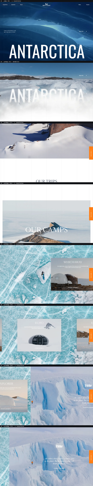
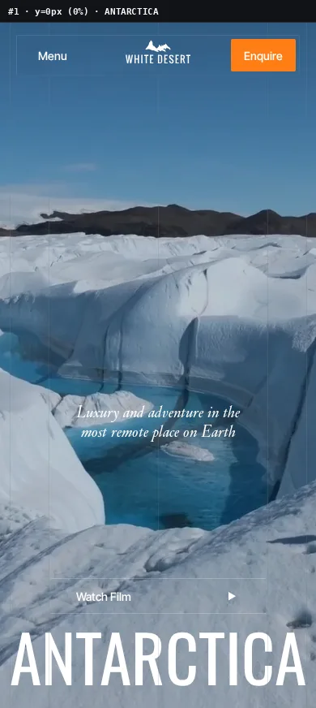

# UI Design System & Master Generation Blueprint: white-desert-com

> **Luxury Adventures in Antarctica · White Desert** (https://white-desert.com/) — White Desert is the world’s leading luxury Antarctic expedition company, offering once-in-a-lifetime journeys to the South Pole and Emper...





---

## 1. Executive Visual Persona & Design Archetype

- **Brand Essence & Persona**: **Luxury Adventures in Antarctica · White Desert** (`https://white-desert.com/`). White Desert is the world’s leading luxury Antarctic expedition company, offering once-in-a-lifetime journeys to the South Pole and Emper...
- **Capture Provenance**: Live browser capture (`tier1_fast`, HTTP `200`, captured `2026-11-24`).
- **Visual Archetype**: **Light-Substrate Editorial & Modular Grid System (`#ffffff` canvas, `#1f2a44` ink, `#0000ff` accent)**.
- **Anti-AI-Slop Differentiators**:
  - **Live-Computed Chromatic Polarity**: Anchors the viewport in `#ffffff` (live computed `body` `background-color` (`computed_styles.json`)) paired with `#1f2a44` primary typography and `#0000ff` accents.
  - **Grounded Typographic Hierarchy**: Pairs `Oswald` for display copy (`ANTARCTICA`) with `Inter Tight`.
  - **Calibrated Spatial Grid & Motion**: Combines `1440px` container bounds (`gap: 24px`, padding `1.5rem`) with `cubic-bezier(.16,1,.3,1)` easing and Lenis Smooth Scroll (`data-lenis`), Three.js / WebGL Canvas Pipeline.

---

## 2. Spatial Architecture & Modular Grid Mathematics

### Viewport Allocation & Container Geometry
- **Captured Journey Filmstrips**: Desktop `1280×6624px` (`assets/desktop-journey.webp`, `8` keyframes up to `y=14400px` / doc `20782px`), Mobile `390×872px` (`assets/mobile-journey.webp`, `1` keyframes).
- **Master Container Bounds**: `1440px` (live computed `body` `max-width`).
- **Canvas Lateral Padding & Spacing**: `1.5rem` lateral canvas padding with `24px` grid gap.
- **Border Radius Scale**: `2px`, `var(--radius-sm)`, `var(--radius-0125)`, `8px`.

### Responsive Breakpoint Architecture
- **Desktop Layout**: Multi-column CSS Grid / Flexbox layout at `1440px` (`max-width: 1440px`, `gap: 24px`).
- **Mobile Layout**: Single-column vertical stack at `390px` viewport width with `1.5rem` horizontal padding.
- **Extracted CSS Media Queries**: `@media (max-width:768px)`, `@media (max-width:540px)`, `@media (max-width:767px)`, `@media (min-width:768px)`.

---

## 3. Color System, Materiality & Atmospheric Lighting

### Semantic Palette & Source Grounding
| Semantic Role | Ground-Truth Value | Extracted Live / CSS Source |
|---|---|---|
| **Primary Canvas Substrate** | `#ffffff` | live computed `body` `background-color` (`computed_styles.json`) |
| **Primary Typography Ink** | `#1f2a44` | live computed `main` `color` (`computed_styles.json`) |
| **Elevated Surface / Card Substrate** | `#f5f5f5` | `.global-flyout_content-item { background-color: #f5f5f5 }` |
| **Interactive Accent / Highlight** | `#0000ff` | `.nav-link { color: blue }` (`#0000ff`) |
| **Secondary / Muted Copy** | `#a8acb3` | `var(--muted)` in `:root` |
| **Structural Hairline Border** | `#1f2330` | `var(--border)` in `:root` |
| **Variable Token (`--surface`)** | `#12141a` | `var(--surface)` in `:root` |
| **Variable Token (`--primary`)** | `#6aa5ff` | `var(--primary)` in `:root` |
| **Variable Token (`--primary-contrast`)** | `#0b0c0f` | `var(--primary-contrast)` in `:root` |
| **Variable Token (`--black`)** | `#000000` | `var(--black)` in `:root` |
| **Variable Token (`--dark-bg`)** | `#090b10` | `var(--dark-bg)` in `:root` |
| **Variable Token (`--wd_deep-blue`)** | `#0e1118` | `var(--wd_deep-blue)` in `:root` |

### Sanitized Root CSS Variables (`ui-ux.md` Ground Truth)
| Variable Name | Extracted Value | Semantic Role |
|---|---|---|
| `--bg` | `#fff` | Canvas / Surface Token |
| `--surface` | `#12141a` | Canvas / Surface Token |
| `--text` | `var(--wd_dark-blue)` | Typography Ink Token |
| `--quote-accent` | `var(--WD_Dark-Blue,#1f2a44)` | Brand / Palette Token |
| `--muted` | `#a8acb3` | Color / Atmospheric Token |
| `--primary` | `#6aa5ff` | Brand / Palette Token |
| `--primary-contrast` | `#0b0c0f` | Brand / Palette Token |
| `--border` | `#1f2330` | Elevation / Border Token |
| `--white` | `#fff` | Canvas / Surface Token |
| `--black` | `#000` | Canvas / Surface Token |
| `--black-faded` | `rgba(0,0,0,.5)` | Canvas / Surface Token |
| `--dark-bg` | `#090b10` | Canvas / Surface Token |
| `--background` | `var(--bg)` | Canvas / Surface Token |
| `--foreground` | `var(--text)` | Typography Ink Token |
| `--wd_dark-blue` | `#1f2a44` | Canvas / Surface Token |
| `--wd_deep-blue` | `#0e1118` | Color / Atmospheric Token |

---

## 4. Typographic Scale & Editorial Hierarchy

### Font Family Stacks
- **Display Typography**: `Oswald`.
- **Primary Body Stack**: `Inter Tight`.
- **Technical / Metadata Stack**: not declared in live computed styles (uses primary stack / `ui-monospace`).

### Typographic Scale & Rules (Live Computed & Stylesheet Grounded)
- **Hero Display (`H1`)**: live computed `h1` (`font-size: 256px`, `line-height: 256px`, `font-weight: 400`); rule `h1` (`font-size: var(--size-375)`, `line-height: 100%`, `font-weight: 400`).
- **Section Heading (`H2`)**: live computed `h2` (`font-size: 320px`, `line-height: 288px`, `font-weight: 400`); rule `h2` (`font-size: var(--size-2)`, `line-height: var(--lh-120)`, `font-weight: 500`).
- **Body Copy**: live computed `body` (`font-size: 16px`, `line-height: normal`, `font-weight: 400`); rule `p` (`font-size: 14px`, `line-height: 1.4`).
- **Metadata & Navigation Labels**: live computed `nav/a` (`font-size: 16px`, `line-height: normal`, `font-weight: 400`).

---

## 5. Choreographed Motion & Interaction Physics

### Primary Easing Curves
- **Extracted Timing Functions**: `cubic-bezier(.16,1,.3,1)`, `cubic-bezier(.5,1,.89,1)`, `cubic-bezier(.76,0,.24,1)`.

### Per-Element Transition & Choreography Rules
- **Selector `.cookie-banner`**: `transition: transform 1s cubic-bezier(.16,1,.3,1)` extracted from `white-desert-com` stylesheet.
- **Selector `.cookie-banner .actions .consent-btn`**: `transition: var(--transition-ease-out)` extracted from `white-desert-com` stylesheet.
- **Selector `.cookie-banner .actions .consent-...`**: `transition: var(--transition-ease-out)` extracted from `white-desert-com` stylesheet.
- **Extracted Easing Curve (`cubic-bezier(.16,1,.3,1)`)**: Governs interactive state transitions across `<nav.lenis>` and `<section.tall-parallax-banner>`.
- **Runtime Interaction Engine**: Integrates Lenis Smooth Scroll (`data-lenis`), Three.js / WebGL Canvas Pipeline with `prefers-reduced-motion: reduce` fallback guards.
### Measured Runtime Scroll & Interaction Telemetry (`behavioral_journey_v2`)
- **Scroll Driver Mode**: `native` (max document height `20782px`, deepest scrollY reached `14400px` across `8` desktop keyframes).
- **Detected Scroll / Motion Libraries**: `Lenis`, `GSAP/ScrollTrigger`.
- **Hover Physics (`primary_cta` · `Watch Film`)**: `borderColor`: `rgba(255, 255, 255, 0.2...` -> `rgba(255, 255, 255, 0.0...` (`transition-duration: 0.3s`, `timing: cubic-bezier(0.5, 1, 0.89, 1)`).
- **Route Transition Architecture**: First internal navigation (`/itineraries/early-emperor-penguins`) measured as `direct` in `1986ms`.

---

## 6. Component Wireframe & Structural DOM Map

### Visual Layout Schematic — Desktop (`1440px`, Grounded in `dom.html` & Landmark Bounding Boxes)
```
┌────────────────────────────────────────────────────────────────────────┐
│ DESKTOP VIEWPORT (1440px) — Luxury Adventures in Antarctica · White De │
│ ====================================================================== │
│ [ <nav.lenis> (1440x80px)             | Rates · Enquire · Home · Enq ] │
│ ---------------------------------------------------------------------- │
│ | HERO STAGE: <section.padding-top-large-bottom-me (w=1440px)        | │
│ | H1: ANTARCTICA                                                     | │
│ | Substrate: #ffffff | Ink: #1f2a44 | Accent: #0000ff                | │
│ ---------------------------------------------------------------------- │
│ | SHOWCASE GRID (<section.tall-parallax-ban) max-w: 1440px           | │
│ | +------------------------------+  +------------------------------+ | │
│ | | Antarctica                   |  | Vast, majestic and unimagina | | │
│ | +------------------------------+  +------------------------------+ | │
│ ---------------------------------------------------------------------- │
│ | DETAIL MODULE (<section.bg-white>) — Baby Penguins & Blue          | │
│ ---------------------------------------------------------------------- │
│ [ FOOTER (<footer.custom-curso) | https://white-desert.com/            │
└────────────────────────────────────────────────────────────────────────┘
```

### Visual Layout Schematic — Mobile Reflow (`390px`)
```
┌────────────────────────────────────────────────────────────────────────┐
│ MOBILE VIEWPORT REFLOW (390px) — Single-Column Stack (gap: 24px)       │
│ ====================================================================== │
│ [ HEADER BAR (<nav.lenis>             ) | Compact Menu (390px)         │
│ ---------------------------------------------------------------------- │
│ | HERO STAGE (<section.padding-top-lar) — 390px Vertical Lead        | │
│ | H1: ANTARCTICA                                                     | │
│ ---------------------------------------------------------------------- │
│ | SHOWCASE STACK (<section.tall-parallax) — 1-Col Stack              | │
│ | [ Item 1: Antarctica                                             ] | │
│ | [ Item 2: Vast, majestic and unimaginably beautiful — setti...   ] | │
│ ---------------------------------------------------------------------- │
│ | DETAIL STACK (<section.bg-white>) — 1-Col (Baby Penguins & Bl)     | │
│ ---------------------------------------------------------------------- │
│ [ FOOTER (<footer.custom-curso) | Stacked 390px Colophon               │
└────────────────────────────────────────────────────────────────────────┘
```

### Granular DOM Region Breakdown
1. **Brand Header & Navigation Bar (<nav.lenis> — `white-desert-com`)**:
   - Landmark `<nav class="lenis">` (`1440x80px`) hosting `Luxury Adventures in Antarctica · Wh` navigation (`Rates · Enquire · Home · Enquire now · Dates & Prices`), DOM attributes (`data-precedence="next"`, `data-precedence="next"`, `data-precedence="next"`, `data-precedence="next"`), and stylesheet rule `.cookie-banner { width:calc(100% - 30px);max-width:unset;flex-direction:column;gap:8px }`.
2. **Hero Stage & Focal Lead (<section.padding-top-large-bottom-medium> — `ANTARCTICA`)**:
   - Landmark `<section class="padding-top-large-bottom-medium m-pb-625">` presenting display lead `ANTARCTICA` and copy excerpt *"Luxury and adventure in the most remote place on Earth"* over `#ffffff` canvas and `#1f2a44` ink.
3. **Primary Showcase & Content Grid (<section.tall-parallax-banner> — `Antarctica`)**:
   - Landmark `<section class="tall-parallax-banner">` rendering section `Antarctica` with copy *"The Last Continent"*, asset references (`cabcbbbe485680be.css`, `7e7f4251c3582625.css`, `5dd7b716df5564d7.css`, `112bdbe21ebfd0e0.css`), and grid rule `.cookie-banner.visible { transform:translateY(0) }`.
4. **Interactive Detail & Feature Matrix (<section.bg-white> — `Vast, majestic and unimaginably be`)**:
   - Landmark `<section class="padding-top-large-bottom-medium bg-white">` framing `Vast, majestic and unimaginably beautiful — setti...` and `Baby Penguins & Blue Tunnels` (*"Between November and February, during the short polar summer, we "*) with `#f5f5f5` surface cards, `#0000ff` accents, and `.cookie-banner p { color:var(--wd_dark-blue);z-index:3;font-size:14px;line-height:1.4;posit... }`.
5. **Colophon & Global Directory Footer (<footer.custom-cursor_dot> — `https://white-desert.com/`)**:
   - Landmark `<footer class="custom-cursor_dot">` anchoring `Luxury Adventures in Antarctica ` footer links (`Rates · Enquire · Home · Enquire now · Dates & Prices`), copy *"Witness the Emperor chicks as they take their first steps an"*, and `#1f2330` structural dividers.
### Full Vertical Scroll Sequence (Desktop `1440×900` Keyframes)
- **Step 01** (`y=0px`, `0%`): Active landmark `1. Consultation` · sticky/fixed elements: `2`
- **Step 02** (`y=850px`, `4%`): Active landmark `ANTARCTICA` · sticky/fixed elements: `2`
- **Step 03** (`y=3400px`, `17%`): Active landmark `1. Consultation` · sticky/fixed elements: `1`
- **Step 04** (`y=5950px`, `30%`): Active landmark `1. Consultation` · sticky/fixed elements: `1`
- **Step 05** (`y=8500px`, `43%`): Active landmark `1. Consultation` · sticky/fixed elements: `1`
- **Step 06** (`y=11050px`, `56%`): Active landmark `1. Consultation` · sticky/fixed elements: `1`
- **Step 07** (`y=13600px`, `68%`): Active landmark `1. Consultation` · sticky/fixed elements: `1`
- **Step 08** (`y=14400px`, `72%`): Active landmark `1. Consultation` · sticky/fixed elements: `1`

### Multi-Page Internal Route Map
- **Detail Route (`/itineraries/early-emperor-penguins`)**: `https://white-desert.com/itineraries/early-emperor-penguins` — H1: `Baby Penguins & Blue Tunnels`, scrollHeight `21984px`, transition `direct` (`1986ms`)
- **Detail Route (`/itineraries/south-pole-emperor-penguins`)**: `https://white-desert.com/itineraries/south-pole-emperor-penguins` — H1: `South Pole & Penguins`, scrollHeight `23331px`, transition `direct` (`1237ms`)
- **Detail Route (`/itineraries/south-pole-blue-rivers`)**: `https://white-desert.com/itineraries/south-pole-blue-rivers` — H1: `South Pole & Blue Rivers`, scrollHeight `23635px`, transition `direct` (`1445ms`)

---

## 7. Master Zero-Shot AI Generation Prompt

```markdown
# Master Zero-Shot Frontend Generation Prompt: white-desert-com (Luxury Adventures in Antarctica · White Desert)

You are a principal frontend architect and design systems engineer. Build a complete, production-ready web application replicating the exact design system, DOM landmarks, typographic hierarchy, color tokens, and motion physics of `white-desert-com` (**Luxury Adventures in Antarctica · White Desert** — `https://white-desert.com/`).

### 1. Visual Archetype & Anti-AI-Slop Mandates
- **Archetype**: Light-Substrate Editorial & Modular Grid System (`#ffffff` canvas, `#1f2a44` ink, `#0000ff` accent).
- **Identity & Domain Context**: White Desert is the world’s leading luxury Antarctic expedition company, offering once-in-a-lifetime journeys to the South Pole and Emper...
- **Primary Substrate**: `#ffffff` (live computed `body` `background-color` (`computed_styles.json`)), **Primary Ink**: `#1f2a44`, **Accent / Highlight**: `#0000ff`.
- **Site-Specific Differentiators**:
  - **Live-Computed Chromatic Polarity**: Anchors the viewport in `#ffffff` (live computed `body` `background-color` (`computed_styles.json`)) paired with `#1f2a44` primary typography and `#0000ff` accents.
  - **Grounded Typographic Hierarchy**: Pairs `Oswald` for display copy (`ANTARCTICA`) with `Inter Tight`.
  - **Calibrated Spatial Grid & Motion**: Combines `1440px` container bounds (`gap: 24px`, padding `1.5rem`) with `cubic-bezier(.16,1,.3,1)` easing and Lenis Smooth Scroll (`data-lenis`), Three.js / WebGL Canvas Pipeline.

### 2. Ground-Truth CSS Variables (`:root` Token Contract)
Declare and consume these exact custom properties extracted from `white-desert-com` in your global stylesheet:

:root {
  /* Luxury Adventures in Antarctica · White Desert (white-desert-com) — Live-Grounded CSS Variables */
  --bg: #fff; /* Canvas / Surface Token (white-desert-com) */
  --surface: #12141a; /* Canvas / Surface Token (white-desert-com) */
  --text: var(--wd_dark-blue); /* Typography Ink Token (white-desert-com) */
  --quote-accent: var(--WD_Dark-Blue,#1f2a44); /* Brand / Palette Token (white-desert-com) */
  --muted: #a8acb3; /* Color / Atmospheric Token (white-desert-com) */
  --primary: #6aa5ff; /* Brand / Palette Token (white-desert-com) */
  --primary-contrast: #0b0c0f; /* Brand / Palette Token (white-desert-com) */
  --border: #1f2330; /* Elevation / Border Token (white-desert-com) */
  --white: #fff; /* Canvas / Surface Token (white-desert-com) */
  --black: #000; /* Canvas / Surface Token (white-desert-com) */
  --black-faded: rgba(0,0,0,.5); /* Canvas / Surface Token (white-desert-com) */
  --dark-bg: #090b10; /* Canvas / Surface Token (white-desert-com) */
  --background: var(--bg); /* Canvas / Surface Token (white-desert-com) */
  --foreground: var(--text); /* Typography Ink Token (white-desert-com) */
  --wd_dark-blue: #1f2a44; /* Canvas / Surface Token (white-desert-com) */
  --wd_deep-blue: #0e1118; /* Color / Atmospheric Token (white-desert-com) */
}

### 3. Semantic Color & Materiality Contract
Map every surface, ink, and border strictly to these source-grounded tokens:
- **Primary Canvas Substrate**: `#ffffff` — grounded in live computed `body` `background-color` (`computed_styles.json`)
- **Primary Typography Ink**: `#1f2a44` — grounded in live computed `main` `color` (`computed_styles.json`)
- **Elevated Surface / Card Substrate**: `#f5f5f5` — grounded in `.global-flyout_content-item { background-color: #f5f5f5 }`
- **Interactive Accent / Highlight**: `#0000ff` — grounded in `.nav-link { color: blue }` (`#0000ff`)
- **Secondary / Muted Copy**: `#a8acb3` — grounded in `var(--muted)` in `:root`
- **Structural Hairline Border**: `#1f2330` — grounded in `var(--border)` in `:root`
- **Variable Token (`--surface`)**: `#12141a` — grounded in `var(--surface)` in `:root`
- **Variable Token (`--primary`)**: `#6aa5ff` — grounded in `var(--primary)` in `:root`
- **Variable Token (`--primary-contrast`)**: `#0b0c0f` — grounded in `var(--primary-contrast)` in `:root`
- **Variable Token (`--black`)**: `#000000` — grounded in `var(--black)` in `:root`
- **Variable Token (`--dark-bg`)**: `#090b10` — grounded in `var(--dark-bg)` in `:root`
- **Variable Token (`--wd_deep-blue`)**: `#0e1118` — grounded in `var(--wd_deep-blue)` in `:root`

### 4. Spatial Grid, Container Bounds & Responsive Breakpoints
- **Desktop Viewport Reference**: `1280×6624px` (multi-frame vertical journey filmstrip (6624px), `1440px` standard desktop width).
- **Mobile Viewport Reference**: `390×872px` (full-page live capture (872px), `390px` standard mobile width).
- **Container Max-Width**: `1440px` (live computed `body` `max-width`)
- **Padding & Gutters**: `1.5rem` lateral canvas padding with `24px` grid gap
- **Desktop Grid**: Multi-column CSS Grid / Flexbox layout at `1440px` (`max-width: 1440px`, `gap: 24px`)
- **Mobile Adaptation**: Single-column vertical stack at `390px` viewport width with `1.5rem` horizontal padding
- **Media Queries**: `@media (max-width:768px)`, `@media (max-width:540px)`, `@media (max-width:767px)`, `@media (min-width:768px)`
- **Corner Radii**: `2px`, `var(--radius-sm)`, `var(--radius-0125)`, `8px`

### 5. Typography & Editorial Scale Contract
- **Display Font Stack**: `Oswald`
- **Body Font Stack**: `Inter Tight`
- **Monospace / Technical Font Stack**: not declared in live computed styles (uses primary stack / `ui-monospace`)
- **H1 Display Rule**: live computed `h1` (`font-size: 256px`, `line-height: 256px`, `font-weight: 400`); rule `h1` (`font-size: var(--size-375)`, `line-height: 100%`, `font-weight: 400`)
- **H2 Section Rule**: live computed `h2` (`font-size: 320px`, `line-height: 288px`, `font-weight: 400`); rule `h2` (`font-size: var(--size-2)`, `line-height: var(--lh-120)`, `font-weight: 500`)
- **Body Copy Rule**: live computed `body` (`font-size: 16px`, `line-height: normal`, `font-weight: 400`); rule `p` (`font-size: 14px`, `line-height: 1.4`)
- **Metadata & Index Rule**: live computed `nav/a` (`font-size: 16px`, `line-height: normal`, `font-weight: 400`)

### 6. Component Hierarchy, Verbatim Copy & Real DOM Landmarks
Scaffold `white-desert-com` (`Luxury Adventures in Antarctica · White Desert`) with these exact structural regions, extracted copy, and CSS rules from `dom.html`:
1. **Brand Header & Navigation Bar (<nav.lenis> — `white-desert-com`)**:
   - DOM & Selectors: Landmark `<nav class="lenis">` (`1440x80px`) hosting `Luxury Adventures in Antarctica · Wh` navigation (`Rates · Enquire · Home · Enquire now · Dates & Prices`), DOM attributes (`data-precedence="next"`, `data-precedence="next"`, `data-precedence="next"`, `data-precedence="next"`), and stylesheet rule `.cookie-banner { width:calc(100% - 30px);max-width:unset;flex-direction:column;gap:8px }`.
   - Responsive Contract: Header `Brand Header & Navigation Bar (<nav.lenis> — `white-desert-com`)` (`white-desert-com`) adapts across `@media (max-width:768px)`, `@media (max-width:540px)`, `@media (max-width:767px)`, `@media (min-width:768px)` with `cubic-bezier(.16,1,.3,1)`, `cubic-bezier(.5,1,.89,1)`, `cubic-bezier(.76,0,.24,1)` transitions and links `Rates · Enquire · Home · Enquire now · Dates & Prices`.
2. **Hero Stage & Focal Lead (<section.padding-top-large-bottom-medium> — `ANTARCTICA`)**:
   - DOM & Selectors: Landmark `<section class="padding-top-large-bottom-medium m-pb-625">` presenting display lead `ANTARCTICA` and copy excerpt *"Luxury and adventure in the most remote place on Earth"* over `#ffffff` canvas and `#1f2a44` ink.
   - Responsive Contract: Hero stage (`1280×6624px` desktop / `390×872px` mobile) sets `#ffffff` background with `#1f2a44` headline `ANTARCTICA`.
3. **Primary Showcase & Content Grid (<section.tall-parallax-banner> — `Antarctica`)**:
   - DOM & Selectors: Landmark `<section class="tall-parallax-banner">` rendering section `Antarctica` with copy *"The Last Continent"*, asset references (`cabcbbbe485680be.css`, `7e7f4251c3582625.css`, `5dd7b716df5564d7.css`, `112bdbe21ebfd0e0.css`), and grid rule `.cookie-banner.visible { transform:translateY(0) }`.
   - Responsive Contract: Showcase grid `Primary Showcase & Content Grid (<section.tall-parallax-banner> — `Antarctica`)` applies Multi-column CSS Grid / Flexbox layout at `1440px` (`max-width: 1440px`, `gap: 24px`) on desktop and Single-column vertical stack at `390px` viewport width with `1.5rem` horizontal padding on mobile.
4. **Interactive Detail & Feature Matrix (<section.bg-white> — `Vast, majestic and unimaginably be`)**:
   - DOM & Selectors: Landmark `<section class="padding-top-large-bottom-medium bg-white">` framing `Vast, majestic and unimaginably beautiful — setti...` and `Baby Penguins & Blue Tunnels` (*"Between November and February, during the short polar summer, we "*) with `#f5f5f5` surface cards, `#0000ff` accents, and `.cookie-banner p { color:var(--wd_dark-blue);z-index:3;font-size:14px;line-height:1.4;posit... }`.
   - Responsive Contract: Detail module `Interactive Detail & Feature Matrix (<section.bg-white> — `Vast, majestic and unimaginably be`)` uses `2px`, `var(--radius-sm)`, `var(--radius-0125)`, `8px` radii, `#0000ff` highlights, and assets (cabcbbbe485680be.css, 7e7f4251c3582625.css, 5dd7b716df5564d7.css).
5. **Colophon & Global Directory Footer (<footer.custom-cursor_dot> — `https://white-desert.com/`)**:
   - DOM & Selectors: Landmark `<footer class="custom-cursor_dot">` anchoring `Luxury Adventures in Antarctica ` footer links (`Rates · Enquire · Home · Enquire now · Dates & Prices`), copy *"Witness the Emperor chicks as they take their first steps an"*, and `#1f2330` structural dividers.
   - Responsive Contract: Footer `Colophon & Global Directory Footer (<footer.custom-cursor_dot> — `https://white-desert.com/`)` aligns to `1440px` (live computed `body` `max-width`) with `1.5rem` lateral canvas padding with `24px` grid gap and attributes (data-precedence="next", data-precedence="next", data-precedence="next").

#### Verbatim DOM Copy Excerpts (`dom.html`)
- Copy Excerpt 1: *"Luxury and adventure in the most remote place on Earth"*
- Copy Excerpt 2: *"The Last Continent"*
- Copy Excerpt 3: *"Between November and February, during the short polar summer, we fly guests and sc..."*
- Copy Excerpt 4: *"Witness the Emperor chicks as they take their first steps and explore the ethereal..."*

### 7. Motion, Extracted Stylesheet Rules & Interaction Choreography
- **Primary Easing Functions**: `cubic-bezier(.16,1,.3,1)`, `cubic-bezier(.5,1,.89,1)`, `cubic-bezier(.76,0,.24,1)`
- **Extracted Stylesheet Rules (`white-desert-com`)**:
- `.cookie-banner { width:calc(100% - 30px);max-width:unset;flex-direction:column;gap:8px }`
- `.cookie-banner.visible { transform:translateY(0) }`
- `.cookie-banner p { color:var(--wd_dark-blue);z-index:3;font-size:14px;line-height:1.4;posit... }`
- `.cookie-banner a { text-decoration:underline }`
- `.cookie-banner .actions { z-index:3;flex-wrap:wrap;flex-shrink:0;gap:18px;display:flex;position:re... }`
- **Per-Selector Transition Rules**:
- **Selector `.cookie-banner`**: `transition: transform 1s cubic-bezier(.16,1,.3,1)` extracted from `white-desert-com` stylesheet.
- **Selector `.cookie-banner .actions .consent-btn`**: `transition: var(--transition-ease-out)` extracted from `white-desert-com` stylesheet.
- **Selector `.cookie-banner .actions .consent-...`**: `transition: var(--transition-ease-out)` extracted from `white-desert-com` stylesheet.
- **Extracted Easing Curve (`cubic-bezier(.16,1,.3,1)`)**: Governs interactive state transitions across `<nav.lenis>` and `<section.tall-parallax-banner>`.
- **Runtime Interaction Engine**: Integrates Lenis Smooth Scroll (`data-lenis`), Three.js / WebGL Canvas Pipeline with `prefers-reduced-motion: reduce` fallback guards.
### 7b. Full-Page Scroll Choreography, Interactive States & Multi-Page Routes
- **Scroll Mechanics**: Implement `native` vertical progression up to `20782px` across 8 distinct viewport chapters using Lenis, GSAP/ScrollTrigger.
- **Vertical Chapter Sequence**: 1. Consultation (0%) -> ANTARCTICA (4%) -> 1. Consultation (17%) -> 1. Consultation (30%) -> 1. Consultation (43%) -> 1. Consultation (56%) -> 1. Consultation (68%) -> 1. Consultation (72%).
- **Hover Micro-Interaction (`primary_cta`)**: Animate `borderColor` with `0.3s cubic-bezier(0.5, 1, 0.89, 1)`.
- **Multi-Page Routes**: Scaffold internal routes `/itineraries/early-emperor-penguins` (detail, direct), `/itineraries/south-pole-emperor-penguins` (detail, direct), `/itineraries/south-pole-blue-rivers` (detail, direct) sharing the global header/footer shell and design tokens.

### 8. Technical Deliverables
- Implement in Next.js (App Router) with TypeScript and Tailwind CSS consuming the `:root` custom properties defined above for `white-desert-com`.
- Reproduce both the `1440px` desktop architecture and `390px` mobile breakpoint transitions, preserving semantic HTML5 landmarks (`<header>`, `<nav>`, `<main>`, `<section>`, `<footer>`) and `prefers-reduced-motion` accessibility guards.
```
---

## 8. Full-Page Scroll Journey, Interactive States & Subpage Inventory

### Desktop Scroll Keyframes (`1440×900` WebP)
| Step | Scroll Y | Progress | Active Landmark / Section | Sticky/Fixed | Visual Asset |
| :---: | :---: | :---: | :--- | :---: | :--- |
| `#01` | `0px` | `0%` | 1. Consultation | `2` | [desktop-step-01.webp](assets/desktop-step-01.webp) |
| `#02` | `850px` | `4%` | ANTARCTICA | `2` | [desktop-step-02.webp](assets/desktop-step-02.webp) |
| `#03` | `3400px` | `17%` | 1. Consultation | `1` | [desktop-step-03.webp](assets/desktop-step-03.webp) |
| `#04` | `5950px` | `30%` | 1. Consultation | `1` | [desktop-step-04.webp](assets/desktop-step-04.webp) |
| `#05` | `8500px` | `43%` | 1. Consultation | `1` | [desktop-step-05.webp](assets/desktop-step-05.webp) |
| `#06` | `11050px` | `56%` | 1. Consultation | `1` | [desktop-step-06.webp](assets/desktop-step-06.webp) |
| `#07` | `13600px` | `68%` | 1. Consultation | `1` | [desktop-step-07.webp](assets/desktop-step-07.webp) |
| `#08` | `14400px` | `72%` | 1. Consultation | `1` | [desktop-step-08.webp](assets/desktop-step-08.webp) |

### Mobile Condensed Keyframes (`390×844` WebP)
| Step | Scroll Y | Progress | Active Landmark | Visual Asset |
| :---: | :---: | :---: | :--- | :--- |
| `#01` | `0px` | `0%` | ANTARCTICA | [mobile-step-01.webp](assets/mobile-step-01.webp) |

### Internal Subpage Filmstrips (`1080px` Wide WebP)
| # | Template | Route URL | H1 / Title | Scroll Height | Transition | Filmstrip Asset |
| :-: | :---: | :--- | :--- | :---: | :---: | :--- |
| `1` | `detail` | `https://white-desert.com/itineraries/early-emperor-penguins` | Baby Penguins & Blue Tunnels | `21984px` | `direct` (`1986ms`) | [subpage-01-itineraries-early-emperor-penguins.webp](assets/subpage-01-itineraries-early-emperor-penguins.webp) |
| `2` | `detail` | `https://white-desert.com/itineraries/south-pole-emperor-penguins` | South Pole & Penguins | `23331px` | `direct` (`1237ms`) | [subpage-02-itineraries-south-pole-emperor-pengu.webp](assets/subpage-02-itineraries-south-pole-emperor-pengu.webp) |
| `3` | `detail` | `https://white-desert.com/itineraries/south-pole-blue-rivers` | South Pole & Blue Rivers | `23635px` | `direct` (`1445ms`) | [subpage-03-itineraries-south-pole-blue-rivers.webp](assets/subpage-03-itineraries-south-pole-blue-rivers.webp) |

