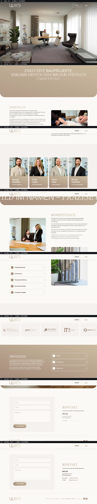
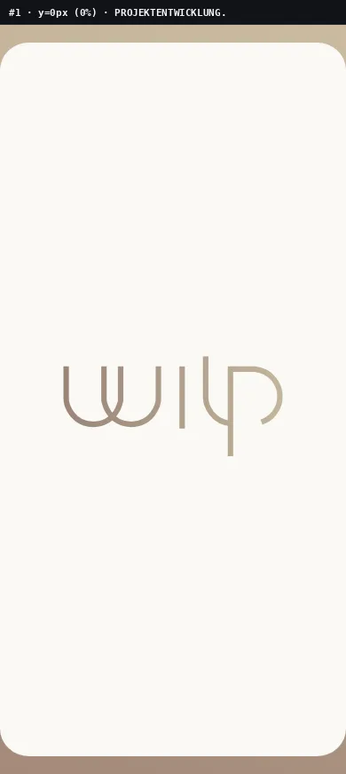

# UI Design System & Master Generation Blueprint: wild-ag-ch

> **Wild AG – Entwicklung von Liegenschaften & Immobilien** (https://wild-ag.ch/) — Die Wild AG analysiert und entwickelt Grundstücke mit Potenzial. Wir bewerten Areale strategisch und mit dem Ziel, Eigentümer eine nachha...





---

## 1. Executive Visual Persona & Design Archetype

- **Brand Essence & Persona**: **Wild AG – Entwicklung von Liegenschaften & Immobilien** (`https://wild-ag.ch/`). Die Wild AG analysiert und entwickelt Grundstücke mit Potenzial. Wir bewerten Areale strategisch und mit dem Ziel, Eigentümer eine nachha...
- **Capture Provenance**: Live browser capture (`tier1_fast`, HTTP `200`, captured `2026-11-24`).
- **Visual Archetype**: **Light-Substrate Editorial & Modular Grid System (`#faf9f4` canvas, `#0000ee` ink, `#0082f3` accent)**.
- **Anti-AI-Slop Differentiators**:
  - **Live-Computed Chromatic Polarity**: Anchors the viewport in `#faf9f4` (live computed `body` `background-color` (`computed_styles.json`)) paired with `#0000ee` primary typography and `#0082f3` accents.
  - **Grounded Typographic Hierarchy**: Uses `Inter` across display (`EXKLUSIVE BAUPROJEKTE, VON DER ERSTE`) and body copy.
  - **Calibrated Spatial Grid & Motion**: Combines `1440px` container bounds (`gap: 16px`, padding `9px`) with `cubic-bezier(.25,.46,.45,.94)` easing and GSAP Timeline & ScrollTrigger, Lottie Vector Animation Player.

---

## 2. Spatial Architecture & Modular Grid Mathematics

### Viewport Allocation & Container Geometry
- **Captured Journey Filmstrips**: Desktop `1280×6624px` (`assets/desktop-journey.webp`, `8` keyframes up to `y=8580px` / doc `9480px`), Mobile `390×872px` (`assets/mobile-journey.webp`, `1` keyframes).
- **Master Container Bounds**: `1440px` (full-bleed `100%` desktop stage measured on `1440px` viewport).
- **Canvas Lateral Padding & Spacing**: `9px` lateral canvas padding with `16px` grid gap.
- **Border Radius Scale**: `3px`, `100%`, `50%`, `var(--_other---element-border-radius)`.

### Responsive Breakpoint Architecture
- **Desktop Layout**: Multi-column CSS Grid / Flexbox layout at `1440px` (`max-width: 1440px`, `gap: 16px`).
- **Mobile Layout**: Single-column vertical stack at `390px` viewport width with `9px` horizontal padding.
- **Extracted CSS Media Queries**: `@media screen and (max-width: 991px)`, `@media screen and (max-width: 767px)`, `@media screen and (max-width: 479px)`, `@media (min-width: 768px)`.

---

## 3. Color System, Materiality & Atmospheric Lighting

### Semantic Palette & Source Grounding
| Semantic Role | Ground-Truth Value | Extracted Live / CSS Source |
|---|---|---|
| **Primary Canvas Substrate** | `#faf9f4` | live computed `body` `background-color` (`computed_styles.json`) |
| **Primary Typography Ink** | `#0000ee` | live computed `a` `color` (`computed_styles.json`) |
| **Elevated Surface / Card Substrate** | `#ffff00` | `mark { background: #ffff00 }` |
| **Interactive Accent / Highlight** | `#0082f3` | `.w-dropdown-link.w--current { color: #0082f3 }` |
| **Secondary / Muted Copy** | `#6b6561` | live computed `p` `color` (`computed_styles.json`) |
| **Structural Hairline Border** | `#e2e2e2` | `blockquote { border-left: #e2e2e2 }` |
| **Variable Token (`--black`)** | `#2b221c` | `var(--black)` in `:root` |
| **Variable Token (`--brown`)** | `#a48a7a` | `var(--brown)` in `:root` |
| **Variable Token (`--beige`)** | `#cbbba0` | `var(--beige)` in `:root` |

### Sanitized Root CSS Variables (`ui-ux.md` Ground Truth)
| Variable Name | Extracted Value | Semantic Role |
|---|---|---|
| `--white` | `#faf9f4` | Canvas / Surface Token |
| `--_fonts---inter` | `Inter, Arial, sans-serif` | Typography / Scale Token |
| `--grey` | `#6b6561` | Color / Atmospheric Token |
| `--_other---main-size` | `1.51vw` | Layout / Spatial Grid Token |
| `--black` | `#2b221c` | Canvas / Surface Token |
| `--_fonts---label` | `.8em` | Typography / Scale Token |
| `--brown` | `#a48a7a` | Color / Atmospheric Token |
| `--_other---section-horizontal` | `1.66em` | Dimension / Scale Token |
| `--_fonts---heading-1` | `3.33em` | Typography Ink Token |
| `--_fonts---inria-serif` | `Inriaserif, "Times New Roman", sans-serif` | Typography / Scale Token |
| `--_fonts---heading-1-secondary` | `1.08em` | Typography Ink Token |
| `--_fonts---paragraph` | `1em` | Typography / Scale Token |
| `--_fonts---heading-2-serif` | `3.06em` | Typography Ink Token |
| `--beige` | `#cbbba0` | Color / Atmospheric Token |
| `--_fonts---heading-4` | `1.33em` | Typography Ink Token |
| `--_other---element-border-radius` | `1em` | Elevation / Border Token |

---

## 4. Typographic Scale & Editorial Hierarchy

### Font Family Stacks
- **Display Typography**: `Inter`.
- **Primary Body Stack**: `Inter`.
- **Technical / Metadata Stack**: not declared in live computed styles (uses primary stack / `ui-monospace`).

### Typographic Scale & Rules (Live Computed & Stylesheet Grounded)
- **Hero Display (`H1`)**: live computed `h1` (`font-size: 56.1038px`, `line-height: 56.1038px`, `font-weight: 400`, `letter-spacing: -0.16848px`); CSS variables `--_fonts---heading-1: 3.33em`, `--_fonts---heading-1-secondary: 1.08em`, `--_fonts---display: 7.06em`; rule `h1` (`font-size: 2em`).
- **Section Heading (`H2`)**: live computed `h2` (`font-size: 51.5549px`, `line-height: 48.9771px`, `font-weight: 400`, `letter-spacing: -0.16848px`); CSS variables `--_fonts---heading-2-serif: 3.06em`; rule `h2` (`font-size: 32px`, `line-height: 36px`).
- **Body Copy**: live computed `body` (`font-size: 16.848px`, `line-height: 23.5872px`, `font-weight: 500`, `letter-spacing: -0.16848px`); CSS variables `--_fonts---paragraph: 1em`; rule `body` (`font-size: 14px`, `line-height: 20px`).
- **Metadata & Navigation Labels**: live computed `nav/a` (`font-size: 16.848px`, `line-height: 23.5872px`, `font-weight: 500`, `letter-spacing: -0.16848px`); CSS variables `--_fonts---label: .8em`; rule `small` (`font-size: 80%`).

---

## 5. Choreographed Motion & Interaction Physics

### Primary Easing Curves
- **Extracted Timing Functions**: `cubic-bezier(.25,.46,.45,.94)`, `cubic-bezier(.25,1,.5,1)`, `cubic-bezier(0.25,1,0.5,1)`.

### Per-Element Transition & Choreography Rules
- **Selector `.w-webflow-badge > img`**: `transition: unset` extracted from `wild-ag-ch` stylesheet.
- **Selector `.w-slider-dot`**: `transition: background-color .1s, color .1s` extracted from `wild-ag-ch` stylesheet.
- **Selector `.w-lightbox-control`**: `transition: all .3s` extracted from `wild-ag-ch` stylesheet.
- **Extracted Easing Curve (`cubic-bezier(.25,.46,.45,.94)`)**: Governs interactive state transitions across `<header.w-mod-js>` and `<section.about>`.
- **Runtime Interaction Engine**: Integrates GSAP Timeline & ScrollTrigger, Lottie Vector Animation Player with `prefers-reduced-motion: reduce` fallback guards.
### Measured Runtime Scroll & Interaction Telemetry (`behavioral_journey_v2`)
- **Scroll Driver Mode**: `native` (max document height `9480px`, deepest scrollY reached `8580px` across `8` desktop keyframes).
- **Detected Scroll / Motion Libraries**: `GSAP/ScrollTrigger`.
- **Hover Physics (`primary_cta` · `KONTAKT`)**: `color`: `rgb(250, 249, 244)` -> `rgb(45, 36, 30)`; `backgroundColor`: `rgba(0, 0, 0, 0)` -> `rgba(250, 249, 244, 0.992)` (`transition-duration: 0.3s, 0.3s`, `timing: cubic-bezier(0.25, 0.46, 0.45, 0.94), cubic-bezier(0.25, 0.46, 0.45, 0.94)`).
- **Route Transition Architecture**: First internal navigation (`/rychenberg-winterthur`) measured as `direct` in `522ms`.

---

## 6. Component Wireframe & Structural DOM Map

### Visual Layout Schematic — Desktop (`1440px`, Grounded in `dom.html` & Landmark Bounding Boxes)
```
┌────────────────────────────────────────────────────────────────────────┐
│ DESKTOP VIEWPORT (1440px) — Wild AG – Entwicklung von Liegenschaften & │
│ ====================================================================== │
│ [ <header.w-mod-js> (1440px)          | Kontakt · Über uns · Team ·  ] │
│ ---------------------------------------------------------------------- │
│ | HERO STAGE: <section.hero> (w=1440px)                              | │
│ | H1: EXKLUSIVE BAUPROJEKTE, VON DER ERSTEN IDEE BIS ZU...           | │
│ | Substrate: #faf9f4 | Ink: #0000ee | Accent: #0082f3                | │
│ ---------------------------------------------------------------------- │
│ | SHOWCASE GRID (<section.about>) max-w: 1440px                      | │
│ | +------------------------------+  +------------------------------+ | │
│ | | Exklusive Bauprojekte, von d |  | Zuverlässigkeit              | | │
│ | +------------------------------+  +------------------------------+ | │
│ ---------------------------------------------------------------------- │
│ | DETAIL MODULE (<section.team>) — Individualität                    | │
│ ---------------------------------------------------------------------- │
│ [ FOOTER (<footer.footer>     ) | https://wild-ag.ch/                  │
└────────────────────────────────────────────────────────────────────────┘
```

### Visual Layout Schematic — Mobile Reflow (`390px`)
```
┌────────────────────────────────────────────────────────────────────────┐
│ MOBILE VIEWPORT REFLOW (390px) — Single-Column Stack (gap: 16px)       │
│ ====================================================================== │
│ [ HEADER BAR (<header.w-mod-js>       ) | Compact Menu (390px)         │
│ ---------------------------------------------------------------------- │
│ | HERO STAGE (<section.hero>) — 390px Vertical Lead                  | │
│ | H1: EXKLUSIVE BAUPROJEKTE, VON DER ERSTEN IDEE BIS ZU...           | │
│ ---------------------------------------------------------------------- │
│ | SHOWCASE STACK (<section.about>) — 1-Col Stack                     | │
│ | [ Item 1: Exklusive Bauprojekte, von der ersten Idee bis zu...   ] | │
│ | [ Item 2: Zuverlässigkeit                                        ] | │
│ ---------------------------------------------------------------------- │
│ | DETAIL STACK (<section.team>) — 1-Col (Individualität)             | │
│ ---------------------------------------------------------------------- │
│ [ FOOTER (<footer.footer>     ) | Stacked 390px Colophon               │
└────────────────────────────────────────────────────────────────────────┘
```

### Granular DOM Region Breakdown
1. **Brand Header & Navigation Bar (<header.w-mod-js> — `wild-ag-ch`)**:
   - Landmark `<header class="w-mod-js">` (`1440px`) hosting `Wild AG – Entwicklung von Liegenscha` navigation (`Kontakt · Über uns · Team · Kompetenzen · Projekte`), DOM attributes (`data-wf-domain="wild-ag.ch"`, `data-wf-page="68ffa3d7dcafaaf81d62a851"`, `data-wf-site="68ffa3d5dcafaaf81d62a778"`, `data-w-id="e44b81a6-fdee-2457-52..."`), and stylesheet rule `html { -webkit-text-size-adjust: 100%; -ms-text-size-adjust: 100%; font-family:... }`.
2. **Hero Stage & Focal Lead (<section.hero> — `EXKLUSIVE BAUPROJEKTE, VON DER ERS`)**:
   - Landmark `<section class="hero">` presenting display lead `EXKLUSIVE BAUPROJEKTE, VON DER ERSTEN IDEE BIS ZU...` and copy excerpt *"Wir realisieren Bauvorhaben von der Vision bis zur Baureife, mit "* over `#faf9f4` canvas and `#0000ee` ink.
3. **Primary Showcase & Content Grid (<section.about> — `Exklusive Bauprojekte, von der ers`)**:
   - Landmark `<section class="about">` rendering section `Exklusive Bauprojekte, von der ersten Idee bis zu...` with copy *"Wir entwickeln, planen und realisieren anspruchsvolle Hochbau-Pro"*, asset references (`cdn.prod.website-files.com`, `wild-ag.webflow.shared.2b6b1ba80.css`, `693bea2fa812933b3861e659_favicon.png`, `693bea2af69043311afaf385_webclip.png`), and grid rule `body { margin: 0; }`.
4. **Interactive Detail & Feature Matrix (<section.team> — `Zuverlässigkeit`)**:
   - Landmark `<section class="team">` framing `Zuverlässigkeit` and `Individualität` (*"Unser Fokus liegt auf Grundstücken mit ungenutztem Entwicklungspo"*) with `#ffff00` surface cards, `#0082f3` accents, and `summary { display: block; }`.
5. **Colophon & Global Directory Footer (<footer.footer> — `https://wild-ag.ch/`)**:
   - Landmark `<footer class="footer">` anchoring `Wild AG – Entwicklung von Liegen` footer links (`Kontakt · Über uns · Team · Kompetenzen · Projekte`), copy *"Viele Eigentümerinnen und Eigentümer besitzen Liegenschaften"*, and `#e2e2e2` structural dividers.
### Full Vertical Scroll Sequence (Desktop `1440×900` Keyframes)
- **Step 01** (`y=0px`, `0%`): Active landmark `PLANUNG & AUSFÜHRUNG.` · sticky/fixed elements: `12`
- **Step 02** (`y=850px`, `10%`): Active landmark `PLANUNG & AUSFÜHRUNG.` · sticky/fixed elements: `11`
- **Step 03** (`y=2550px`, `30%`): Active landmark `PLANUNG & AUSFÜHRUNG.` · sticky/fixed elements: `11`
- **Step 04** (`y=4250px`, `50%`): Active landmark `PLANUNG & AUSFÜHRUNG.` · sticky/fixed elements: `11`
- **Step 05** (`y=5100px`, `59%`): Active landmark `PLANUNG & AUSFÜHRUNG.` · sticky/fixed elements: `11`
- **Step 06** (`y=6800px`, `79%`): Active landmark `PLANUNG & AUSFÜHRUNG.` · sticky/fixed elements: `11`
- **Step 07** (`y=8500px`, `99%`): Active landmark `PLANUNG & AUSFÜHRUNG.` · sticky/fixed elements: `11`
- **Step 08** (`y=8580px`, `100%`): Active landmark `PLANUNG & AUSFÜHRUNG.` · sticky/fixed elements: `11`

### Multi-Page Internal Route Map
- **Other Route (`/rychenberg-winterthur`)**: `https://wild-ag.ch/rychenberg-winterthur` — H1: `RYCHENBERG, WINTERTHUR`, scrollHeight `3919px`, transition `direct` (`522ms`)
- **Other Route (`/cholhoelzli-im-limmattal`)**: `https://wild-ag.ch/cholhoelzli-im-limmattal` — H1: `CHOLHÖLZLI IM LIMMATTAL`, scrollHeight `3353px`, transition `direct` (`770ms`)

---

## 7. Master Zero-Shot AI Generation Prompt

```markdown
# Master Zero-Shot Frontend Generation Prompt: wild-ag-ch (Wild AG – Entwicklung von Liegenschaften & Immobilien)

You are a principal frontend architect and design systems engineer. Build a complete, production-ready web application replicating the exact design system, DOM landmarks, typographic hierarchy, color tokens, and motion physics of `wild-ag-ch` (**Wild AG – Entwicklung von Liegenschaften & Immobilien** — `https://wild-ag.ch/`).

### 1. Visual Archetype & Anti-AI-Slop Mandates
- **Archetype**: Light-Substrate Editorial & Modular Grid System (`#faf9f4` canvas, `#0000ee` ink, `#0082f3` accent).
- **Identity & Domain Context**: Die Wild AG analysiert und entwickelt Grundstücke mit Potenzial. Wir bewerten Areale strategisch und mit dem Ziel, Eigentümer eine nachha...
- **Primary Substrate**: `#faf9f4` (live computed `body` `background-color` (`computed_styles.json`)), **Primary Ink**: `#0000ee`, **Accent / Highlight**: `#0082f3`.
- **Site-Specific Differentiators**:
  - **Live-Computed Chromatic Polarity**: Anchors the viewport in `#faf9f4` (live computed `body` `background-color` (`computed_styles.json`)) paired with `#0000ee` primary typography and `#0082f3` accents.
  - **Grounded Typographic Hierarchy**: Uses `Inter` across display (`EXKLUSIVE BAUPROJEKTE, VON DER ERSTE`) and body copy.
  - **Calibrated Spatial Grid & Motion**: Combines `1440px` container bounds (`gap: 16px`, padding `9px`) with `cubic-bezier(.25,.46,.45,.94)` easing and GSAP Timeline & ScrollTrigger, Lottie Vector Animation Player.

### 2. Ground-Truth CSS Variables (`:root` Token Contract)
Declare and consume these exact custom properties extracted from `wild-ag-ch` in your global stylesheet:

:root {
  /* Wild AG – Entwicklung von Liegenschaften & Immobilien (wild-ag-ch) — Live-Grounded CSS Variables */
  --white: #faf9f4; /* Canvas / Surface Token (wild-ag-ch) */
  --_fonts---inter: Inter, Arial, sans-serif; /* Typography / Scale Token (wild-ag-ch) */
  --grey: #6b6561; /* Color / Atmospheric Token (wild-ag-ch) */
  --_other---main-size: 1.51vw; /* Layout / Spatial Grid Token (wild-ag-ch) */
  --black: #2b221c; /* Canvas / Surface Token (wild-ag-ch) */
  --_fonts---label: .8em; /* Typography / Scale Token (wild-ag-ch) */
  --brown: #a48a7a; /* Color / Atmospheric Token (wild-ag-ch) */
  --_other---section-horizontal: 1.66em; /* Dimension / Scale Token (wild-ag-ch) */
  --_fonts---heading-1: 3.33em; /* Typography Ink Token (wild-ag-ch) */
  --_fonts---inria-serif: Inriaserif, "Times New Roman", sans-serif; /* Typography / Scale Token (wild-ag-ch) */
  --_fonts---heading-1-secondary: 1.08em; /* Typography Ink Token (wild-ag-ch) */
  --_fonts---paragraph: 1em; /* Typography / Scale Token (wild-ag-ch) */
  --_fonts---heading-2-serif: 3.06em; /* Typography Ink Token (wild-ag-ch) */
  --beige: #cbbba0; /* Color / Atmospheric Token (wild-ag-ch) */
  --_fonts---heading-4: 1.33em; /* Typography Ink Token (wild-ag-ch) */
  --_other---element-border-radius: 1em; /* Elevation / Border Token (wild-ag-ch) */
}

### 3. Semantic Color & Materiality Contract
Map every surface, ink, and border strictly to these source-grounded tokens:
- **Primary Canvas Substrate**: `#faf9f4` — grounded in live computed `body` `background-color` (`computed_styles.json`)
- **Primary Typography Ink**: `#0000ee` — grounded in live computed `a` `color` (`computed_styles.json`)
- **Elevated Surface / Card Substrate**: `#ffff00` — grounded in `mark { background: #ffff00 }`
- **Interactive Accent / Highlight**: `#0082f3` — grounded in `.w-dropdown-link.w--current { color: #0082f3 }`
- **Secondary / Muted Copy**: `#6b6561` — grounded in live computed `p` `color` (`computed_styles.json`)
- **Structural Hairline Border**: `#e2e2e2` — grounded in `blockquote { border-left: #e2e2e2 }`
- **Variable Token (`--black`)**: `#2b221c` — grounded in `var(--black)` in `:root`
- **Variable Token (`--brown`)**: `#a48a7a` — grounded in `var(--brown)` in `:root`
- **Variable Token (`--beige`)**: `#cbbba0` — grounded in `var(--beige)` in `:root`

### 4. Spatial Grid, Container Bounds & Responsive Breakpoints
- **Desktop Viewport Reference**: `1280×6624px` (multi-frame vertical journey filmstrip (6624px), `1440px` standard desktop width).
- **Mobile Viewport Reference**: `390×872px` (full-page live capture (872px), `390px` standard mobile width).
- **Container Max-Width**: `1440px` (full-bleed `100%` desktop stage measured on `1440px` viewport)
- **Padding & Gutters**: `9px` lateral canvas padding with `16px` grid gap
- **Desktop Grid**: Multi-column CSS Grid / Flexbox layout at `1440px` (`max-width: 1440px`, `gap: 16px`)
- **Mobile Adaptation**: Single-column vertical stack at `390px` viewport width with `9px` horizontal padding
- **Media Queries**: `@media screen and (max-width: 991px)`, `@media screen and (max-width: 767px)`, `@media screen and (max-width: 479px)`, `@media (min-width: 768px)`
- **Corner Radii**: `3px`, `100%`, `50%`, `var(--_other---element-border-radius)`

### 5. Typography & Editorial Scale Contract
- **Display Font Stack**: `Inter`
- **Body Font Stack**: `Inter`
- **Monospace / Technical Font Stack**: not declared in live computed styles (uses primary stack / `ui-monospace`)
- **H1 Display Rule**: live computed `h1` (`font-size: 56.1038px`, `line-height: 56.1038px`, `font-weight: 400`, `letter-spacing: -0.16848px`); CSS variables `--_fonts---heading-1: 3.33em`, `--_fonts---heading-1-secondary: 1.08em`, `--_fonts---display: 7.06em`; rule `h1` (`font-size: 2em`)
- **H2 Section Rule**: live computed `h2` (`font-size: 51.5549px`, `line-height: 48.9771px`, `font-weight: 400`, `letter-spacing: -0.16848px`); CSS variables `--_fonts---heading-2-serif: 3.06em`; rule `h2` (`font-size: 32px`, `line-height: 36px`)
- **Body Copy Rule**: live computed `body` (`font-size: 16.848px`, `line-height: 23.5872px`, `font-weight: 500`, `letter-spacing: -0.16848px`); CSS variables `--_fonts---paragraph: 1em`; rule `body` (`font-size: 14px`, `line-height: 20px`)
- **Metadata & Index Rule**: live computed `nav/a` (`font-size: 16.848px`, `line-height: 23.5872px`, `font-weight: 500`, `letter-spacing: -0.16848px`); CSS variables `--_fonts---label: .8em`; rule `small` (`font-size: 80%`)

### 6. Component Hierarchy, Verbatim Copy & Real DOM Landmarks
Scaffold `wild-ag-ch` (`Wild AG – Entwicklung von Liegenschaften & Immobilien`) with these exact structural regions, extracted copy, and CSS rules from `dom.html`:
1. **Brand Header & Navigation Bar (<header.w-mod-js> — `wild-ag-ch`)**:
   - DOM & Selectors: Landmark `<header class="w-mod-js">` (`1440px`) hosting `Wild AG – Entwicklung von Liegenscha` navigation (`Kontakt · Über uns · Team · Kompetenzen · Projekte`), DOM attributes (`data-wf-domain="wild-ag.ch"`, `data-wf-page="68ffa3d7dcafaaf81d62a851"`, `data-wf-site="68ffa3d5dcafaaf81d62a778"`, `data-w-id="e44b81a6-fdee-2457-52..."`), and stylesheet rule `html { -webkit-text-size-adjust: 100%; -ms-text-size-adjust: 100%; font-family:... }`.
   - Responsive Contract: Header `Brand Header & Navigation Bar (<header.w-mod-js> — `wild-ag-ch`)` (`wild-ag-ch`) adapts across `@media screen and (max-width: 991px)`, `@media screen and (max-width: 767px)`, `@media screen and (max-width: 479px)`, `@media (min-width: 768px)` with `cubic-bezier(.25,.46,.45,.94)`, `cubic-bezier(.25,1,.5,1)`, `cubic-bezier(0.25,1,0.5,1)` transitions and links `Kontakt · Über uns · Team · Kompetenzen · Projekte`.
2. **Hero Stage & Focal Lead (<section.hero> — `EXKLUSIVE BAUPROJEKTE, VON DER ERS`)**:
   - DOM & Selectors: Landmark `<section class="hero">` presenting display lead `EXKLUSIVE BAUPROJEKTE, VON DER ERSTEN IDEE BIS ZU...` and copy excerpt *"Wir realisieren Bauvorhaben von der Vision bis zur Baureife, mit "* over `#faf9f4` canvas and `#0000ee` ink.
   - Responsive Contract: Hero stage (`1280×6624px` desktop / `390×872px` mobile) sets `#faf9f4` background with `#0000ee` headline `EXKLUSIVE BAUPROJEKTE, VON DER ERSTEN IDEE BIS ZU...`.
3. **Primary Showcase & Content Grid (<section.about> — `Exklusive Bauprojekte, von der ers`)**:
   - DOM & Selectors: Landmark `<section class="about">` rendering section `Exklusive Bauprojekte, von der ersten Idee bis zu...` with copy *"Wir entwickeln, planen und realisieren anspruchsvolle Hochbau-Pro"*, asset references (`cdn.prod.website-files.com`, `wild-ag.webflow.shared.2b6b1ba80.css`, `693bea2fa812933b3861e659_favicon.png`, `693bea2af69043311afaf385_webclip.png`), and grid rule `body { margin: 0; }`.
   - Responsive Contract: Showcase grid `Primary Showcase & Content Grid (<section.about> — `Exklusive Bauprojekte, von der ers`)` applies Multi-column CSS Grid / Flexbox layout at `1440px` (`max-width: 1440px`, `gap: 16px`) on desktop and Single-column vertical stack at `390px` viewport width with `9px` horizontal padding on mobile.
4. **Interactive Detail & Feature Matrix (<section.team> — `Zuverlässigkeit`)**:
   - DOM & Selectors: Landmark `<section class="team">` framing `Zuverlässigkeit` and `Individualität` (*"Unser Fokus liegt auf Grundstücken mit ungenutztem Entwicklungspo"*) with `#ffff00` surface cards, `#0082f3` accents, and `summary { display: block; }`.
   - Responsive Contract: Detail module `Interactive Detail & Feature Matrix (<section.team> — `Zuverlässigkeit`)` uses `3px`, `100%`, `50%`, `var(--_other---element-border-radius)` radii, `#0082f3` highlights, and assets (cdn.prod.website-files.com, wild-ag.webflow.shared.2b6b1ba80.css, 693bea2fa812933b3861e659_favicon.png).
5. **Colophon & Global Directory Footer (<footer.footer> — `https://wild-ag.ch/`)**:
   - DOM & Selectors: Landmark `<footer class="footer">` anchoring `Wild AG – Entwicklung von Liegen` footer links (`Kontakt · Über uns · Team · Kompetenzen · Projekte`), copy *"Viele Eigentümerinnen und Eigentümer besitzen Liegenschaften"*, and `#e2e2e2` structural dividers.
   - Responsive Contract: Footer `Colophon & Global Directory Footer (<footer.footer> — `https://wild-ag.ch/`)` aligns to `1440px` (full-bleed `100%` desktop stage measured on `1440px` viewport) with `9px` lateral canvas padding with `16px` grid gap and attributes (data-wf-domain="wild-ag.ch", data-wf-page="68ffa3d7dcafaaf81d62a851", data-wf-site="68ffa3d5dcafaaf81d62a778").

#### Verbatim DOM Copy Excerpts (`dom.html`)
- Copy Excerpt 1: *"Wir realisieren Bauvorhaben von der Vision bis zur Baureife, mit klarem Fokus auf..."*
- Copy Excerpt 2: *"Wir entwickeln, planen und realisieren anspruchsvolle Hochbau-Projekte im Kanton Z..."*
- Copy Excerpt 3: *"Unser Fokus liegt auf Grundstücken mit ungenutztem Entwicklungspotenzial, auch und..."*
- Copy Excerpt 4: *"Viele Eigentümerinnen und Eigentümer besitzen Liegenschaften oder Freiflächen mit..."*

### 7. Motion, Extracted Stylesheet Rules & Interaction Choreography
- **Primary Easing Functions**: `cubic-bezier(.25,.46,.45,.94)`, `cubic-bezier(.25,1,.5,1)`, `cubic-bezier(0.25,1,0.5,1)`
- **Extracted Stylesheet Rules (`wild-ag-ch`)**:
- `html { -webkit-text-size-adjust: 100%; -ms-text-size-adjust: 100%; font-family:... }`
- `body { margin: 0; }`
- `summary { display: block; }`
- `video { vertical-align: baseline; display: inline-block; }`
- `template { display: none; }`
- **Per-Selector Transition Rules**:
- **Selector `.w-webflow-badge > img`**: `transition: unset` extracted from `wild-ag-ch` stylesheet.
- **Selector `.w-slider-dot`**: `transition: background-color .1s, color .1s` extracted from `wild-ag-ch` stylesheet.
- **Selector `.w-lightbox-control`**: `transition: all .3s` extracted from `wild-ag-ch` stylesheet.
- **Extracted Easing Curve (`cubic-bezier(.25,.46,.45,.94)`)**: Governs interactive state transitions across `<header.w-mod-js>` and `<section.about>`.
- **Runtime Interaction Engine**: Integrates GSAP Timeline & ScrollTrigger, Lottie Vector Animation Player with `prefers-reduced-motion: reduce` fallback guards.
### 7b. Full-Page Scroll Choreography, Interactive States & Multi-Page Routes
- **Scroll Mechanics**: Implement `native` vertical progression up to `9480px` across 8 distinct viewport chapters using GSAP/ScrollTrigger.
- **Vertical Chapter Sequence**: PLANUNG & AUSFÜHRUNG. (0%) -> PLANUNG & AUSFÜHRUNG. (10%) -> PLANUNG & AUSFÜHRUNG. (30%) -> PLANUNG & AUSFÜHRUNG. (50%) -> PLANUNG & AUSFÜHRUNG. (59%) -> PLANUNG & AUSFÜHRUNG. (79%) -> PLANUNG & AUSFÜHRUNG. (99%) -> PLANUNG & AUSFÜHRUNG. (100%).
- **Hover Micro-Interaction (`primary_cta`)**: Animate `color, backgroundColor` with `0.3s, 0.3s cubic-bezier(0.25, 0.46, 0.45, 0.94), cubic-bezier(0.25, 0.46, 0.45, 0.94)`.
- **Multi-Page Routes**: Scaffold internal routes `/rychenberg-winterthur` (other, direct), `/cholhoelzli-im-limmattal` (other, direct) sharing the global header/footer shell and design tokens.

### 8. Technical Deliverables
- Implement in Next.js (App Router) with TypeScript and Tailwind CSS consuming the `:root` custom properties defined above for `wild-ag-ch`.
- Reproduce both the `1440px` desktop architecture and `390px` mobile breakpoint transitions, preserving semantic HTML5 landmarks (`<header>`, `<nav>`, `<main>`, `<section>`, `<footer>`) and `prefers-reduced-motion` accessibility guards.
```
---

## 8. Full-Page Scroll Journey, Interactive States & Subpage Inventory

### Desktop Scroll Keyframes (`1440×900` WebP)
| Step | Scroll Y | Progress | Active Landmark / Section | Sticky/Fixed | Visual Asset |
| :---: | :---: | :---: | :--- | :---: | :--- |
| `#01` | `0px` | `0%` | PLANUNG & AUSFÜHRUNG. | `12` | [desktop-step-01.webp](assets/desktop-step-01.webp) |
| `#02` | `850px` | `10%` | PLANUNG & AUSFÜHRUNG. | `11` | [desktop-step-02.webp](assets/desktop-step-02.webp) |
| `#03` | `2550px` | `30%` | PLANUNG & AUSFÜHRUNG. | `11` | [desktop-step-03.webp](assets/desktop-step-03.webp) |
| `#04` | `4250px` | `50%` | PLANUNG & AUSFÜHRUNG. | `11` | [desktop-step-04.webp](assets/desktop-step-04.webp) |
| `#05` | `5100px` | `59%` | PLANUNG & AUSFÜHRUNG. | `11` | [desktop-step-05.webp](assets/desktop-step-05.webp) |
| `#06` | `6800px` | `79%` | PLANUNG & AUSFÜHRUNG. | `11` | [desktop-step-06.webp](assets/desktop-step-06.webp) |
| `#07` | `8500px` | `99%` | PLANUNG & AUSFÜHRUNG. | `11` | [desktop-step-07.webp](assets/desktop-step-07.webp) |
| `#08` | `8580px` | `100%` | PLANUNG & AUSFÜHRUNG. | `11` | [desktop-step-08.webp](assets/desktop-step-08.webp) |

### Mobile Condensed Keyframes (`390×844` WebP)
| Step | Scroll Y | Progress | Active Landmark | Visual Asset |
| :---: | :---: | :---: | :--- | :--- |
| `#01` | `0px` | `0%` | PROJEKT­ENTWICKLUNG. | [mobile-step-01.webp](assets/mobile-step-01.webp) |

### Internal Subpage Filmstrips (`1080px` Wide WebP)
| # | Template | Route URL | H1 / Title | Scroll Height | Transition | Filmstrip Asset |
| :-: | :---: | :--- | :--- | :---: | :---: | :--- |
| `1` | `other` | `https://wild-ag.ch/rychenberg-winterthur` | RYCHENBERG, WINTERTHUR | `3919px` | `direct` (`522ms`) | [subpage-01-rychenberg-winterthur.webp](assets/subpage-01-rychenberg-winterthur.webp) |
| `2` | `other` | `https://wild-ag.ch/cholhoelzli-im-limmattal` | CHOLHÖLZLI IM LIMMATTAL | `3353px` | `direct` (`770ms`) | [subpage-02-cholhoelzli-im-limmattal.webp](assets/subpage-02-cholhoelzli-im-limmattal.webp) |

