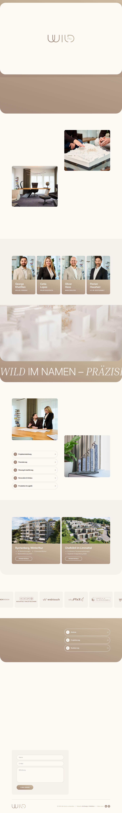
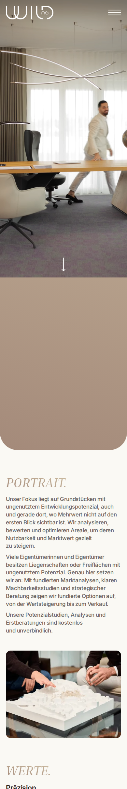

# UI Design System & Master Generation Blueprint: wild-ag-ch

> **Wild AG – Entwicklung von Liegenschaften & Immobilien** (https://wild-ag.ch/) — Die Wild AG analysiert und entwickelt Grundstücke mit Potenzial. Wir bewerten Areale strategisch und mit dem Ziel, Eigentümer eine nachha...



---

## 1. Executive Visual Persona & Design Archetype

- **Brand Essence & Persona**: **Wild AG – Entwicklung von Liegenschaften & Immobilien** (`https://wild-ag.ch/`). Die Wild AG analysiert und entwickelt Grundstücke mit Potenzial. Wir bewerten Areale strategisch und mit dem Ziel, Eigentümer eine nachha...
- **Visual Archetype**: **Light-Substrate Editorial & Modular Grid System (`#faf9f4` canvas, `#2b221c` ink, `#a48a7a` accent)**.
- **Anti-AI-Slop Differentiators**:
  - **Source-Grounded Chromatic Polarity**: Anchors the viewport in `#faf9f4` (`var(--white)` in `:root`) paired with `#2b221c` primary typography and `#a48a7a` accents.
  - **Extracted Typographic Hierarchy**: Pairs `Inriaserif` for display copy (`Projekt­entwicklung.`) with `Inter` and not declared in static CSS (uses primary stack / `ui-monospace`).
  - **Calibrated Spatial Grid & Motion**: Combines `940px` container bounds (`gap: 16px`, padding `9px`) with `cubic-bezier(.25,.46,.45,.94)` easing and GSAP Timeline & ScrollTrigger, Lottie Vector Animation Player.

---

## 2. Spatial Architecture & Modular Grid Mathematics



### Viewport Allocation & Container Geometry
- **Captured Viewport Dimensions**: Desktop `1440×9480px` (`assets/desktop.png`, full-page scroll capture), Mobile `390×2400px` (`assets/mobile.png`, capped at 2400px multi-section capture).
- **Master Container Bounds**: `940px` extracted from `wild-ag-ch` stylesheet.
- **Canvas Lateral Padding & Spacing**: `9px` lateral canvas padding with `16px` grid gap.
- **Border Radius Scale**: `3px`, `100%`, `50%`, `var(--_other---element-border-radius)`.

### Responsive Breakpoint Architecture
- **Desktop Layout**: Multi-column CSS Grid / Flexbox layout at `1440px` (`max-width: 940px`, `gap: 16px`).
- **Mobile Layout**: Single-column vertical stack at `390px` viewport width with `9px` horizontal padding.
- **Extracted CSS Media Queries**: `@media screen and (max-width: 991px)`, `@media screen and (max-width: 767px)`, `@media screen and (max-width: 479px)`, `@media (min-width: 768px)`.

---

## 3. Color System, Materiality & Atmospheric Lighting

### Semantic Palette & Source Grounding
| Semantic Role | Ground-Truth Value | Extracted CSS Source / Selector |
|---|---|---|
| **Primary Canvas Substrate** | `#faf9f4` | `var(--white)` in `:root` |
| **Primary Typography Ink** | `#6b6561` | `var(--grey)` in `:root` |
| **Elevated Surface / Card Substrate** | `#2b221c` | `var(--black)` in `:root` |
| **Interactive Accent / Highlight** | `#a48a7a` | `var(--brown)` in `:root` |
| **Secondary / Muted Copy** | `#cbbba0` | `var(--beige)` in `:root` |
| **Structural Hairline Border** | `#f5f1ed` | `var(--light)` in `:root` |

### Sanitized Root CSS Variables (`ui-ux.md` Ground Truth)
| Variable Name | Extracted Value | Semantic Role |
|---|---|---|
| `--w-backdrop-animation` | `initial` | Motion / Easing Token |
| `--white` | `#faf9f4` | Canvas / Surface Token |
| `--_fonts---inter` | `Inter, Arial, sans-serif` | Typography / Scale Token |
| `--grey` | `#6b6561` | Color / Atmospheric Token |
| `--_other---main-size` | `1.51vw` | Layout / Spatial Grid Token |
| `--black` | `#2b221c` | Canvas / Surface Token |
| `--_fonts---label` | `.8em` | Typography / Scale Token |
| `--brown` | `#a48a7a` | Color / Atmospheric Token |
| `--_other---section-horizontal` | `1.66em` | Dimension / Scale Token |
| `--_fonts---heading-1` | `3.33em` | Typography Ink Token |
| `--_fonts---inria-serif` | `Inriaserif, "Times New Roman", sans-serif` | Typography / Scale Token |
| `--_fonts---heading-1-secondary` | `1.08em` | Typography Ink Token |
| `--_fonts---paragraph` | `1em` | Typography / Scale Token |
| `--_fonts---heading-2-serif` | `3.06em` | Typography Ink Token |
| `--beige` | `#cbbba0` | Color / Atmospheric Token |
| `--_fonts---heading-4` | `1.33em` | Typography Ink Token |

---

## 4. Typographic Scale & Editorial Hierarchy

### Font Family Stacks
- **Display Typography**: `Inriaserif`.
- **Primary Body Stack**: `Inter`.
- **Technical / Metadata Stack**: not declared in static CSS (uses primary stack / `ui-monospace`).

### Typographic Scale & Rules (Extracted from Stylesheet & Variables)
- **Hero Display (`H1`)**: CSS variables `--_fonts---heading-1: 3.33em`, `--_fonts---heading-1-secondary: 1.08em`, `--_fonts---display: 7.06em`; rule `h1` (`font-size: 2em`).
- **Section Heading (`H2`)**: CSS variables `--_fonts---heading-2-serif: 3.06em`; rule `h2` (`font-size: 32px`, `line-height: 36px`).
- **Body Copy**: CSS variables `--_fonts---paragraph: 1em`; rule `body` (`font-size: 14px`, `line-height: 20px`).
- **Metadata & Navigation Labels**: CSS variables `--_fonts---label: .8em`; rule `small` (`font-size: 80%`).

---

## 5. Choreographed Motion & Interaction Physics

### Primary Easing Curves
- **Extracted Timing Functions**: `cubic-bezier(.25,.46,.45,.94)`, `cubic-bezier(.25,1,.5,1)`, `cubic-bezier(0.25,1,0.5,1)`.

### Per-Element Transition & Choreography Rules
- **Selector `.w-webflow-badge > img`**: `transition: unset` extracted from `wild-ag-ch` stylesheet.
- **Selector `.w-slider-dot`**: `transition: background-color .1s, color .1s` extracted from `wild-ag-ch` stylesheet.
- **Selector `.w-lightbox-control`**: `transition: all .3s` extracted from `wild-ag-ch` stylesheet.
- **Extracted Easing Curve (`cubic-bezier(.25,.46,.45,.94)`)**: Governs interactive state transitions across `<header.w-mod-js>` and `<section.about>`.
- **Runtime Interaction Engine**: Integrates GSAP Timeline & ScrollTrigger, Lottie Vector Animation Player with `prefers-reduced-motion: reduce` fallback guards.

---

## 6. Component Wireframe & Structural DOM Map

### Visual Layout Schematic (Grounded in `dom.html` — `1440px` Desktop & `390px` Mobile Reflow)
```
┌────────────────────────────────────────────────────────────────────────┐
│ DESKTOP VIEWPORT (1440px) — Wild AG – Entwicklung von Liegenschaften & │
│ ====================================================================== │
│ [ <header.w-mod-js>        | Kontakt · Über uns · Team · Kompetenze ]  │
│ ---------------------------------------------------------------------- │
│ | HERO STAGE: <section.hero>                                       |   │
│ | H1: Projekt­entwicklung.                                         |   │
│ | Substrate: #faf9f4    | Ink: #2b221c    | Accent: #a48a7a        |   │
│ ---------------------------------------------------------------------- │
│ | SHOWCASE GRID (<section.about>           ) max-w: 940px          |   │
│ | +------------------------------+  +------------------------------+ | │
│ | | Finanzierung.                |  | Planung & Ausführung.        | | │
│ | +------------------------------+  +------------------------------+ | │
│ ---------------------------------------------------------------------- │
│ | MOBILE VIEWPORT REFLOW (390px) — Single-Column Stack (gap: 16px  ) | │
│ | [<header.w-mod-js>] -> [<section.hero>] -> [<section.about>] |       │
│ ---------------------------------------------------------------------- │
│ [ FOOTER (<footer.footer>       ) | https://wild-ag.ch/                │
└────────────────────────────────────────────────────────────────────────┘
```

### Granular DOM Region Breakdown
1. **Brand Header & Navigation Bar (<header.w-mod-js> — `wild-ag-ch`)**:
   - Landmark `<header class="w-mod-js">` hosting `Wild AG – Entwicklung von Liegenscha` navigation (`Kontakt · Über uns · Team · Kompetenzen · Projekte`), DOM attributes (`data-wf-domain="wild-ag.ch"`, `data-wf-page="68ffa3d7dcafaaf81d62a851"`, `data-wf-site="68ffa3d5dcafaaf81d62a778"`, `data-w-id="e44b81a6-fdee-2457-52..."`), and stylesheet rule `html { -webkit-text-size-adjust: 100%; -ms-text-size-adjust: 100%; font-family:... }`.
2. **Hero Stage & Focal Lead (<section.hero> — `Projekt­entwicklung.`)**:
   - Landmark `<section class="hero">` presenting display lead `Projekt­entwicklung.` and copy excerpt *"Wir realisieren Bauvorhaben von der Vision bis zur Baureife, mit "* over `#faf9f4` canvas and `#2b221c` ink.
3. **Primary Showcase & Content Grid (<section.about> — `Finanzierung.`)**:
   - Landmark `<section class="about">` rendering section `Finanzierung.` with copy *"Dabei analysieren wir Standorte, erstellen Nutzungskonzepte, begl"*, asset references (`cdn.prod.website-files.com`, `wild-ag.webflow.shared.2b6b1ba80.css`, `693bea2fa812933b3861e659_favicon.png`, `693bea2af69043311afaf385_webclip.png`), and grid rule `body { margin: 0; }`.
4. **Interactive Detail & Feature Matrix (<section.team> — `Planung & Ausführung.`)**:
   - Landmark `<section class="team">` framing `Planung & Ausführung.` and `Renovation & Umbau.` (*"Wir unterstützen Bauherrschaften und Investoren bei der optimalen"*) with `#2b221c` surface cards, `#a48a7a` accents, and `summary { display: block; }`.
5. **Colophon & Global Directory Footer (<footer.footer> — `https://wild-ag.ch/`)**:
   - Landmark `<footer class="footer">` anchoring `Wild AG – Entwicklung von Liegen` footer links (`Kontakt · Über uns · Team · Kompetenzen · Projekte`), copy *"Durch massgeschneiderte Finanzierungsmodelle und ein starkes"*, and `#f5f1ed` structural dividers.

---

## 7. Master Zero-Shot AI Generation Prompt

```markdown
# Master Zero-Shot Frontend Generation Prompt: wild-ag-ch (Wild AG – Entwicklung von Liegenschaften & Immobilien)

You are a principal frontend architect and design systems engineer. Build a complete, production-ready web application replicating the exact design system, DOM landmarks, typographic hierarchy, color tokens, and motion physics of `wild-ag-ch` (**Wild AG – Entwicklung von Liegenschaften & Immobilien** — `https://wild-ag.ch/`).

### 1. Visual Archetype & Anti-AI-Slop Mandates
- **Archetype**: Light-Substrate Editorial & Modular Grid System (`#faf9f4` canvas, `#2b221c` ink, `#a48a7a` accent).
- **Identity & Domain Context**: Die Wild AG analysiert und entwickelt Grundstücke mit Potenzial. Wir bewerten Areale strategisch und mit dem Ziel, Eigentümer eine nachha...
- **Primary Substrate**: `#faf9f4` (`var(--white)` in `:root`), **Primary Ink**: `#2b221c`, **Accent / Highlight**: `#a48a7a`.
- **Site-Specific Differentiators**:
  - **Source-Grounded Chromatic Polarity**: Anchors the viewport in `#faf9f4` (`var(--white)` in `:root`) paired with `#2b221c` primary typography and `#a48a7a` accents.
  - **Extracted Typographic Hierarchy**: Pairs `Inriaserif` for display copy (`Projekt­entwicklung.`) with `Inter` and not declared in static CSS (uses primary stack / `ui-monospace`).
  - **Calibrated Spatial Grid & Motion**: Combines `940px` container bounds (`gap: 16px`, padding `9px`) with `cubic-bezier(.25,.46,.45,.94)` easing and GSAP Timeline & ScrollTrigger, Lottie Vector Animation Player.

### 2. Ground-Truth CSS Variables (`:root` Token Contract)
Declare and consume these exact custom properties extracted from `wild-ag-ch` in your global stylesheet:

:root {
  /* Wild AG – Entwicklung von Liegenschaften & Immobilien (wild-ag-ch) — Ground-Truth Extracted CSS Variables */
  --w-backdrop-animation: initial; /* Motion / Easing Token (wild-ag-ch) */
  --white: #faf9f4; /* Canvas / Surface Token (wild-ag-ch) */
  --_fonts---inter: Inter, Arial, sans-serif; /* Typography / Scale Token (wild-ag-ch) */
  --grey: #6b6561; /* Color / Atmospheric Token (wild-ag-ch) */
  --_other---main-size: 1.51vw; /* Layout / Spatial Grid Token (wild-ag-ch) */
  --black: #2b221c; /* Canvas / Surface Token (wild-ag-ch) */
  --_fonts---label: .8em; /* Typography / Scale Token (wild-ag-ch) */
  --brown: #a48a7a; /* Color / Atmospheric Token (wild-ag-ch) */
  --_other---section-horizontal: 1.66em; /* Dimension / Scale Token (wild-ag-ch) */
  --_fonts---heading-1: 3.33em; /* Typography Ink Token (wild-ag-ch) */
  --_fonts---inria-serif: Inriaserif, "Times New Roman", sans-serif; /* Typography / Scale Token (wild-ag-ch) */
  --_fonts---heading-1-secondary: 1.08em; /* Typography Ink Token (wild-ag-ch) */
  --_fonts---paragraph: 1em; /* Typography / Scale Token (wild-ag-ch) */
  --_fonts---heading-2-serif: 3.06em; /* Typography Ink Token (wild-ag-ch) */
  --beige: #cbbba0; /* Color / Atmospheric Token (wild-ag-ch) */
  --_fonts---heading-4: 1.33em; /* Typography Ink Token (wild-ag-ch) */
}

### 3. Semantic Color & Materiality Contract
Map every surface, ink, and border strictly to these source-grounded tokens:
- **Primary Canvas Substrate**: `#faf9f4` — grounded in `var(--white)` in `:root`
- **Primary Typography Ink**: `#6b6561` — grounded in `var(--grey)` in `:root`
- **Elevated Surface / Card Substrate**: `#2b221c` — grounded in `var(--black)` in `:root`
- **Interactive Accent / Highlight**: `#a48a7a` — grounded in `var(--brown)` in `:root`
- **Secondary / Muted Copy**: `#cbbba0` — grounded in `var(--beige)` in `:root`
- **Structural Hairline Border**: `#f5f1ed` — grounded in `var(--light)` in `:root`

### 4. Spatial Grid, Container Bounds & Responsive Breakpoints
- **Desktop Viewport Reference**: `1440×9480px` (full-page scroll capture, `1440px` standard desktop width).
- **Mobile Viewport Reference**: `390×2400px` (capped at 2400px multi-section capture, `390px` standard mobile width).
- **Container Max-Width**: `940px` extracted from `wild-ag-ch` stylesheet
- **Padding & Gutters**: `9px` lateral canvas padding with `16px` grid gap
- **Desktop Grid**: Multi-column CSS Grid / Flexbox layout at `1440px` (`max-width: 940px`, `gap: 16px`)
- **Mobile Adaptation**: Single-column vertical stack at `390px` viewport width with `9px` horizontal padding
- **Media Queries**: `@media screen and (max-width: 991px)`, `@media screen and (max-width: 767px)`, `@media screen and (max-width: 479px)`, `@media (min-width: 768px)`
- **Corner Radii**: `3px`, `100%`, `50%`, `var(--_other---element-border-radius)`

### 5. Typography & Editorial Scale Contract
- **Display Font Stack**: `Inriaserif`
- **Body Font Stack**: `Inter`
- **Monospace / Technical Font Stack**: not declared in static CSS (uses primary stack / `ui-monospace`)
- **H1 Display Rule**: CSS variables `--_fonts---heading-1: 3.33em`, `--_fonts---heading-1-secondary: 1.08em`, `--_fonts---display: 7.06em`; rule `h1` (`font-size: 2em`)
- **H2 Section Rule**: CSS variables `--_fonts---heading-2-serif: 3.06em`; rule `h2` (`font-size: 32px`, `line-height: 36px`)
- **Body Copy Rule**: CSS variables `--_fonts---paragraph: 1em`; rule `body` (`font-size: 14px`, `line-height: 20px`)
- **Metadata & Index Rule**: CSS variables `--_fonts---label: .8em`; rule `small` (`font-size: 80%`)

### 6. Component Hierarchy, Verbatim Copy & Real DOM Landmarks
Scaffold `wild-ag-ch` (`Wild AG – Entwicklung von Liegenschaften & Immobilien`) with these exact structural regions, extracted copy, and CSS rules from `dom.html`:
1. **Brand Header & Navigation Bar (<header.w-mod-js> — `wild-ag-ch`)**:
   - DOM & Selectors: Landmark `<header class="w-mod-js">` hosting `Wild AG – Entwicklung von Liegenscha` navigation (`Kontakt · Über uns · Team · Kompetenzen · Projekte`), DOM attributes (`data-wf-domain="wild-ag.ch"`, `data-wf-page="68ffa3d7dcafaaf81d62a851"`, `data-wf-site="68ffa3d5dcafaaf81d62a778"`, `data-w-id="e44b81a6-fdee-2457-52..."`), and stylesheet rule `html { -webkit-text-size-adjust: 100%; -ms-text-size-adjust: 100%; font-family:... }`.
   - Responsive Contract: Header `Brand Header & Navigation Bar (<header.w-mod-js> — `wild-ag-ch`)` (`wild-ag-ch`) adapts across `@media screen and (max-width: 991px)`, `@media screen and (max-width: 767px)`, `@media screen and (max-width: 479px)`, `@media (min-width: 768px)` with `cubic-bezier(.25,.46,.45,.94)`, `cubic-bezier(.25,1,.5,1)`, `cubic-bezier(0.25,1,0.5,1)` transitions and links `Kontakt · Über uns · Team · Kompetenzen · Projekte`.
2. **Hero Stage & Focal Lead (<section.hero> — `Projekt­entwicklung.`)**:
   - DOM & Selectors: Landmark `<section class="hero">` presenting display lead `Projekt­entwicklung.` and copy excerpt *"Wir realisieren Bauvorhaben von der Vision bis zur Baureife, mit "* over `#faf9f4` canvas and `#2b221c` ink.
   - Responsive Contract: Hero stage (`1440×9480px` desktop / `390×2400px` mobile) sets `#faf9f4` background with `#2b221c` headline `Projekt­entwicklung.`.
3. **Primary Showcase & Content Grid (<section.about> — `Finanzierung.`)**:
   - DOM & Selectors: Landmark `<section class="about">` rendering section `Finanzierung.` with copy *"Dabei analysieren wir Standorte, erstellen Nutzungskonzepte, begl"*, asset references (`cdn.prod.website-files.com`, `wild-ag.webflow.shared.2b6b1ba80.css`, `693bea2fa812933b3861e659_favicon.png`, `693bea2af69043311afaf385_webclip.png`), and grid rule `body { margin: 0; }`.
   - Responsive Contract: Showcase grid `Primary Showcase & Content Grid (<section.about> — `Finanzierung.`)` applies Multi-column CSS Grid / Flexbox layout at `1440px` (`max-width: 940px`, `gap: 16px`) on desktop and Single-column vertical stack at `390px` viewport width with `9px` horizontal padding on mobile.
4. **Interactive Detail & Feature Matrix (<section.team> — `Planung & Ausführung.`)**:
   - DOM & Selectors: Landmark `<section class="team">` framing `Planung & Ausführung.` and `Renovation & Umbau.` (*"Wir unterstützen Bauherrschaften und Investoren bei der optimalen"*) with `#2b221c` surface cards, `#a48a7a` accents, and `summary { display: block; }`.
   - Responsive Contract: Detail module `Interactive Detail & Feature Matrix (<section.team> — `Planung & Ausführung.`)` uses `3px`, `100%`, `50%`, `var(--_other---element-border-radius)` radii, `#a48a7a` highlights, and assets (cdn.prod.website-files.com, wild-ag.webflow.shared.2b6b1ba80.css, 693bea2fa812933b3861e659_favicon.png).
5. **Colophon & Global Directory Footer (<footer.footer> — `https://wild-ag.ch/`)**:
   - DOM & Selectors: Landmark `<footer class="footer">` anchoring `Wild AG – Entwicklung von Liegen` footer links (`Kontakt · Über uns · Team · Kompetenzen · Projekte`), copy *"Durch massgeschneiderte Finanzierungsmodelle und ein starkes"*, and `#f5f1ed` structural dividers.
   - Responsive Contract: Footer `Colophon & Global Directory Footer (<footer.footer> — `https://wild-ag.ch/`)` aligns to `940px` extracted from `wild-ag-ch` stylesheet with `9px` lateral canvas padding with `16px` grid gap and attributes (data-wf-domain="wild-ag.ch", data-wf-page="68ffa3d7dcafaaf81d62a851", data-wf-site="68ffa3d5dcafaaf81d62a778").

#### Verbatim DOM Copy Excerpts (`dom.html`)
- Copy Excerpt 1: *"Wir realisieren Bauvorhaben von der Vision bis zur Baureife, mit klarem Fokus auf..."*
- Copy Excerpt 2: *"Dabei analysieren wir Standorte, erstellen Nutzungskonzepte, begleiten Architektur..."*
- Copy Excerpt 3: *"Wir unterstützen Bauherrschaften und Investoren bei der optimalen finanziellen Str..."*
- Copy Excerpt 4: *"Durch massgeschneiderte Finanzierungsmodelle und ein starkes Investorennetzwerk sc..."*

### 7. Motion, Extracted Stylesheet Rules & Interaction Choreography
- **Primary Easing Functions**: `cubic-bezier(.25,.46,.45,.94)`, `cubic-bezier(.25,1,.5,1)`, `cubic-bezier(0.25,1,0.5,1)`
- **Extracted Stylesheet Rules (`wild-ag-ch`)**:
- `html { -webkit-text-size-adjust: 100%; -ms-text-size-adjust: 100%; font-family:... }`
- `body { margin: 0; }`
- `summary { display: block; }`
- `video { vertical-align: baseline; display: inline-block; }`
- `template { display: none; }`
- **Per-Selector Transition Rules**:
- **Selector `.w-webflow-badge > img`**: `transition: unset` extracted from `wild-ag-ch` stylesheet.
- **Selector `.w-slider-dot`**: `transition: background-color .1s, color .1s` extracted from `wild-ag-ch` stylesheet.
- **Selector `.w-lightbox-control`**: `transition: all .3s` extracted from `wild-ag-ch` stylesheet.
- **Extracted Easing Curve (`cubic-bezier(.25,.46,.45,.94)`)**: Governs interactive state transitions across `<header.w-mod-js>` and `<section.about>`.
- **Runtime Interaction Engine**: Integrates GSAP Timeline & ScrollTrigger, Lottie Vector Animation Player with `prefers-reduced-motion: reduce` fallback guards.

### 8. Technical Deliverables
- Implement in Next.js (App Router) with TypeScript and Tailwind CSS consuming the `:root` custom properties defined above for `wild-ag-ch`.
- Reproduce both the `1440px` desktop architecture and `390px` mobile breakpoint transitions, preserving semantic HTML5 landmarks (`<header>`, `<nav>`, `<main>`, `<section>`, `<footer>`) and `prefers-reduced-motion` accessibility guards.
```
