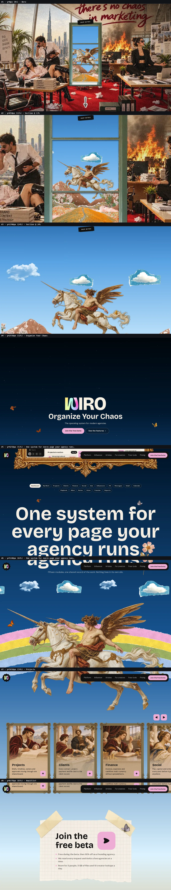
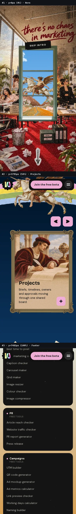

# UI Design System & Master Generation Blueprint: wiro-ae

> **Wiro · Operating System for All Agencies** (https://wiro.ae/) — Projects, clients, invoices, social, ads, influencers and PR in one place. The operating system for marketing agencies and in-house marke...





---

## 1. Executive Visual Persona & Design Archetype

- **Brand Essence & Persona**: **Wiro · Operating System for All Agencies** (`https://wiro.ae/`). Projects, clients, invoices, social, ads, influencers and PR in one place. The operating system for marketing agencies and in-house marke...
- **Capture Provenance**: Live browser capture (`tier1_fast`, HTTP `200`, captured `2026-11-24`).
- **Visual Archetype**: **Dark-Substrate WebGL / Canvas Interactive Experience (`#000000` / `#efacd4`)**.
- **Anti-AI-Slop Differentiators**:
  - **Live-Computed Chromatic Polarity**: Anchors the viewport in `#000000` (live computed `body` `background-color` (`computed_styles.json`)) paired with `#f6f0e4` primary typography and `#efacd4` accents.
  - **Grounded Typographic Hierarchy**: Pairs `__bricolage_29b70e` for display copy (`Organize Your Chaos`) with `__dmSans_224c19` and `SFMono-Regular`.
  - **Calibrated Spatial Grid & Motion**: Combines `1536px` container bounds (`gap: 4px`, padding `48px`) with `cubic-bezier(.34,1.56,.64,1)` easing and HTML5 `<canvas>` Interactive Viewport Surface.

---

## 2. Spatial Architecture & Modular Grid Mathematics

### Viewport Allocation & Container Geometry
- **Captured Journey Filmstrips**: Desktop `1280×6624px` (`assets/desktop-journey.webp`, `8` keyframes up to `y=6778px` / doc `8894px`), Mobile `390×2616px` (`assets/mobile-journey.webp`, `3` keyframes).
- **Master Container Bounds**: `1536px` (non-`@media` desktop container stylesheet rule).
- **Canvas Lateral Padding & Spacing**: `48px` lateral canvas padding with `4px` grid gap.
- **Border Radius Scale**: `10px`, `var(--lp-radius-lg)`, `24%`, `50%`.

### Responsive Breakpoint Architecture
- **Desktop Layout**: Multi-column CSS Grid / Flexbox layout at `1440px` (`max-width: 1536px`, `gap: 4px`).
- **Mobile Layout**: Single-column vertical stack at `390px` viewport width with `48px` horizontal padding.
- **Extracted CSS Media Queries**: `@media (prefers-reduced-motion:reduce)`, `@media (max-width:900px)`, `@media (max-width:1100px)`, `@media (min-width:761px) and (max-width:1100px)`.

---

## 3. Color System, Materiality & Atmospheric Lighting

### Semantic Palette & Source Grounding
| Semantic Role | Ground-Truth Value | Extracted Live / CSS Source |
|---|---|---|
| **Primary Canvas Substrate** | `#000000` | live computed `body` `background-color` (`computed_styles.json`) |
| **Primary Typography Ink** | `#f6f0e4` | live computed `p` `color` (`computed_styles.json`) |
| **Elevated Surface / Card Substrate** | `#10100f` | live computed `button` `background-color` (`computed_styles.json`) |
| **Interactive Accent / Highlight** | `#efacd4` | `var(--c-inverse-accent)` in `:root` |
| **Secondary / Muted Copy** | `#b8b5ac` | `var(--c-inverse-muted)` in `:root` |
| **Structural Hairline Border** | `#222220` | `var(--c-inverse-border)` in `:root` |
| **Variable Token (`--wiro-canvas`)** | `#f6efe3` | `var(--wiro-canvas)` in `:root` |
| **Variable Token (`--wiro-surface-2`)** | `#ece5da` | `var(--wiro-surface-2)` in `:root` |
| **Variable Token (`--wiro-yellow`)** | `#f6d94e` | `var(--wiro-yellow)` in `:root` |
| **Variable Token (`--wiro-sage`)** | `#9caf63` | `var(--wiro-sage)` in `:root` |
| **Variable Token (`--wiro-blue`)** | `#a9c5e9` | `var(--wiro-blue)` in `:root` |

### Sanitized Root CSS Variables (`ui-ux.md` Ground Truth)
| Variable Name | Extracted Value | Semantic Role |
|---|---|---|
| `--font-heading` | `var(--font-bricolage),"Bricolage Grotesque",sans-serif` | Typography Ink Token |
| `--font-ui` | `var(--font-dmsans),"DM Sans",Arial,Helvetica,sans-serif` | Typography / Scale Token |
| `--solar-stroke-width` | `2.5` | Layout / Spatial Grid Token |
| `--wiro-ink` | `#10100f` | Typography Ink Token |
| `--wiro-muted` | `rgba(16,16,15,.52)` | Color / Atmospheric Token |
| `--wiro-canvas` | `#f6efe3` | Canvas / Surface Token |
| `--wiro-surface` | `#f6efe3` | Canvas / Surface Token |
| `--wiro-surface-2` | `#ece5da` | Canvas / Surface Token |
| `--wiro-border` | `rgba(16,16,15,.12)` | Elevation / Border Token |
| `--wiro-pink` | `#efacd4` | Typography Ink Token |
| `--wiro-yellow` | `#f6d94e` | Color / Atmospheric Token |
| `--wiro-sage` | `#9caf63` | Color / Atmospheric Token |
| `--wiro-blue` | `#a9c5e9` | Color / Atmospheric Token |
| `--wiro-radius-lg` | `18px` | Elevation / Border Token |
| `--wiro-radius-md` | `12px` | Elevation / Border Token |
| `--wiro-radius-sm` | `10px` | Elevation / Border Token |

---

## 4. Typographic Scale & Editorial Hierarchy

### Font Family Stacks
- **Display Typography**: `__bricolage_29b70e`.
- **Primary Body Stack**: `__dmSans_224c19`.
- **Technical / Metadata Stack**: `SFMono-Regular`.

### Typographic Scale & Rules (Live Computed & Stylesheet Grounded)
- **Hero Display (`H1`)**: live computed `h1` (`font-size: 62px`, `line-height: 62px`, `font-weight: 700`); rule `h1` (`font-size: clamp(27px,4.4vw,62px)`, `line-height: 1`).
- **Section Heading (`H2`)**: live computed `h2` (`font-size: 158.4px`, `line-height: 148.896px`, `font-weight: 700`); rule `h2` (`font-size: clamp(82px,11vw,220px)`, `line-height: .94`).
- **Body Copy**: live computed `body` (`font-size: 16px`, `line-height: 24px`, `font-weight: 400`); rule `p` (`font-size: clamp(16px,1.2vw,19px)`, `line-height: 1.5`).
- **Metadata & Navigation Labels**: live computed `nav/a` (`font-size: 16px`, `line-height: 24px`, `font-weight: 400`).

---

## 5. Choreographed Motion & Interaction Physics

### Primary Easing Curves
- **Extracted Timing Functions**: `cubic-bezier(.34,1.56,.64,1)`, `cubic-bezier(.4,0,.6,1)`, `cubic-bezier(.4,0,.2,1)`.

### Per-Element Transition & Choreography Rules
- **Selector `.lp-morph-btn`**: `transition: transform .2s ease` extracted from `wiro-ae` stylesheet.
- **Selector `.lp-btn-square`**: `transition: opacity .2s ease,transform .22s ease,border-radius .22s ease` extracted from `wiro-ae` stylesheet.
- **Selector `.lp-morph-btn .lp-flower`**: `transition: opacity .18s ease,transform .26s cubic-bezier(.34,1.56,.64,1)` extracted from `wiro-ae` stylesheet.
- **Extracted Easing Curve (`cubic-bezier(.34,1.56,.64,1)`)**: Governs interactive state transitions across `<header.mkt-header>` and `<section.lp-hero>`.
- **Runtime Interaction Engine**: Integrates HTML5 `<canvas>` Interactive Viewport Surface with `prefers-reduced-motion: reduce` fallback guards.
### Measured Runtime Scroll & Interaction Telemetry (`behavioral_journey_v2`)
- **Scroll Driver Mode**: `native` (max document height `8894px`, deepest scrollY reached `6778px` across `8` desktop keyframes).
- **Detected Scroll / Motion Libraries**: `WebGL/Canvas`.
- **Hover Physics (`primary_cta` · `SKIP INTRO`)**: `transform`: `matrix(0.997564, -0.069...` -> `matrix(1.02937, -0.0359...` (`transition-duration: 0.16s`, `timing: ease`).
- **Interactive Control Probe (`carousel_next` · `Next pages`)**: Triggered visual diff `24.381` (attr ` -> `, captured in `assets/state-interactive.webp`).
- **Route Transition Architecture**: First internal navigation (`/articles`) measured as `direct` in `936ms`.

---

## 6. Component Wireframe & Structural DOM Map

### Visual Layout Schematic — Desktop (`1440px`, Grounded in `dom.html` & Landmark Bounding Boxes)
```
┌────────────────────────────────────────────────────────────────────────┐
│ DESKTOP VIEWPORT (1440px) — Wiro · Operating System for All Agencies   │
│ ====================================================================== │
│ [ <header.mkt-header> (1440x68px)     | Platform · Influencer · Arti ] │
│ ---------------------------------------------------------------------- │
│ | HERO STAGE: <section.wi> (w=1440px)                                | │
│ | H1: Organize Your Chaos                                            | │
│ | Substrate: #000000 | Ink: #f6f0e4 | Accent: #efacd4                | │
│ ---------------------------------------------------------------------- │
│ | SHOWCASE GRID (<section.lp-hero>) max-w: 1536px                    | │
│ | +------------------------------+  +------------------------------+ | │
│ | | One system for every page yo |  | Projects                     | | │
│ | +------------------------------+  +------------------------------+ | │
│ ---------------------------------------------------------------------- │
│ | DETAIL MODULE (<section.lp-section>) — Clients                     | │
│ ---------------------------------------------------------------------- │
│ [ FOOTER (<footer.lp-footer>  ) | https://wiro.ae/                     │
└────────────────────────────────────────────────────────────────────────┘
```

### Visual Layout Schematic — Mobile Reflow (`390px`)
```
┌────────────────────────────────────────────────────────────────────────┐
│ MOBILE VIEWPORT REFLOW (390px) — Single-Column Stack (gap: 4px)        │
│ ====================================================================== │
│ [ HEADER BAR (<header.mkt-header>     ) | Compact Menu (390px)         │
│ ---------------------------------------------------------------------- │
│ | HERO STAGE (<section.wi>) — 390px Vertical Lead                    | │
│ | H1: Organize Your Chaos                                            | │
│ ---------------------------------------------------------------------- │
│ | SHOWCASE STACK (<section.lp-hero>) — 1-Col Stack                   | │
│ | [ Item 1: One system for every page your agency runs.            ] | │
│ | [ Item 2: Projects                                               ] | │
│ ---------------------------------------------------------------------- │
│ | DETAIL STACK (<section.lp-section>) — 1-Col (Clients)              | │
│ ---------------------------------------------------------------------- │
│ [ FOOTER (<footer.lp-footer>  ) | Stacked 390px Colophon               │
└────────────────────────────────────────────────────────────────────────┘
```

### Granular DOM Region Breakdown
1. **Brand Header & Navigation Bar (<header.mkt-header> — `wiro-ae`)**:
   - Landmark `<header class="mkt-header">` (`1440x68px`) hosting `Wiro · Operating System for All Agen` navigation (`Platform · Influencer · Articles · For creators · Free tools`), DOM attributes (`data-precedence="next"`, `data-precedence="next"`, `data-precedence="next"`, `data-precedence="next"`), and stylesheet rule `html { scroll-behavior:smooth }`.
2. **Hero Stage & Focal Lead (<section.wi> — `Organize Your Chaos`)**:
   - Landmark `<section class="wi">` presenting display lead `Organize Your Chaos` and copy excerpt *"The operating system for modern agencies."* over `#000000` canvas and `#f6f0e4` ink.
3. **Primary Showcase & Content Grid (<section.lp-hero> — `One system for every page your age`)**:
   - Landmark `<section class="lp-hero">` rendering section `One system for every page your agency runs.` with copy *"Fifteen modules, one shared record of the work. Nothing lives in "*, asset references (`intro-arrow.webp`, `intro-window-2.webp`, `logo-icon.svg`, `landscape-bg.webp`), and grid rule `.lp-page { position:relative;min-height:100vh;color:var(--lp-ink);font-family:var(-... }`.
4. **Interactive Detail & Feature Matrix (<section.lp-section> — `Projects`)**:
   - Landmark `<section class="lp-section lp-pages">` framing `Projects` and `Clients` (*"Progress 7 of 9 8 of 9"*) with `#10100f` surface cards, `#efacd4` accents, and `.lp-page strong { font-family:var(--lp-heading);font-weight:700;letter-spacing:0 }`.
5. **Colophon & Global Directory Footer (<footer.lp-footer> — `https://wiro.ae/`)**:
   - Landmark `<footer class="lp-footer lp-footer-scatter">` anchoring `Wiro · Operating System for All ` footer links (`Platform · Influencer · Articles · For creators · Free tools`), copy *"Briefs, timelines, owners and approvals moving through one s"*, and `#222220` structural dividers.
### Full Vertical Scroll Sequence (Desktop `1440×900` Keyframes)
- **Step 01** (`y=0px`, `0%`): Active landmark `Hero` · sticky/fixed elements: `2`
- **Step 02** (`y=850px`, `13%`): Active landmark `Section @ 13%` · sticky/fixed elements: `2`
- **Step 03** (`y=1700px`, `24%`): Active landmark `Section @ 24%` · sticky/fixed elements: `2`
- **Step 04** (`y=2550px`, `32%`): Active landmark `Organize Your Chaos` · sticky/fixed elements: `1`
- **Step 05** (`y=4250px`, `53%`): Active landmark `One system for every page your agency runs.` · sticky/fixed elements: `1`
- **Step 06** (`y=5100px`, `64%`): Active landmark `One system for every page your agency runs.` · sticky/fixed elements: `1`
- **Step 07** (`y=5950px`, `74%`): Active landmark `Projects` · sticky/fixed elements: `1`
- **Step 08** (`y=6778px`, `85%`): Active landmark `#waitlist` · sticky/fixed elements: `1`

### Multi-Page Internal Route Map
- **Listing Route (`/articles`)**: `https://wiro.ae/articles` — H1: `How agencies actually run`, scrollHeight `30453px`, transition `direct` (`936ms`)
- **Detail Route (`/features/projects`)**: `https://wiro.ae/features/projects` — H1: `From the client's request to their sign-off`, scrollHeight `17536px`, transition `direct` (`968ms`)
- **About Route (`/about`)**: `https://wiro.ae/about` — H1: `Built for marketing agencies and in-house teams,...`, scrollHeight `4557px`, transition `direct` (`1389ms`)

---

## 7. Master Zero-Shot AI Generation Prompt

```markdown
# Master Zero-Shot Frontend Generation Prompt: wiro-ae (Wiro · Operating System for All Agencies)

You are a principal frontend architect and design systems engineer. Build a complete, production-ready web application replicating the exact design system, DOM landmarks, typographic hierarchy, color tokens, and motion physics of `wiro-ae` (**Wiro · Operating System for All Agencies** — `https://wiro.ae/`).

### 1. Visual Archetype & Anti-AI-Slop Mandates
- **Archetype**: Dark-Substrate WebGL / Canvas Interactive Experience (`#000000` / `#efacd4`).
- **Identity & Domain Context**: Projects, clients, invoices, social, ads, influencers and PR in one place. The operating system for marketing agencies and in-house marke...
- **Primary Substrate**: `#000000` (live computed `body` `background-color` (`computed_styles.json`)), **Primary Ink**: `#f6f0e4`, **Accent / Highlight**: `#efacd4`.
- **Site-Specific Differentiators**:
  - **Live-Computed Chromatic Polarity**: Anchors the viewport in `#000000` (live computed `body` `background-color` (`computed_styles.json`)) paired with `#f6f0e4` primary typography and `#efacd4` accents.
  - **Grounded Typographic Hierarchy**: Pairs `__bricolage_29b70e` for display copy (`Organize Your Chaos`) with `__dmSans_224c19` and `SFMono-Regular`.
  - **Calibrated Spatial Grid & Motion**: Combines `1536px` container bounds (`gap: 4px`, padding `48px`) with `cubic-bezier(.34,1.56,.64,1)` easing and HTML5 `<canvas>` Interactive Viewport Surface.

### 2. Ground-Truth CSS Variables (`:root` Token Contract)
Declare and consume these exact custom properties extracted from `wiro-ae` in your global stylesheet:

:root {
  /* Wiro · Operating System for All Agencies (wiro-ae) — Live-Grounded CSS Variables */
  --font-heading: var(--font-bricolage),"Bricolage Grotesque",sans-serif; /* Typography Ink Token (wiro-ae) */
  --font-ui: var(--font-dmsans),"DM Sans",Arial,Helvetica,sans-serif; /* Typography / Scale Token (wiro-ae) */
  --solar-stroke-width: 2.5; /* Layout / Spatial Grid Token (wiro-ae) */
  --wiro-ink: #10100f; /* Typography Ink Token (wiro-ae) */
  --wiro-muted: rgba(16,16,15,.52); /* Color / Atmospheric Token (wiro-ae) */
  --wiro-canvas: #f6efe3; /* Canvas / Surface Token (wiro-ae) */
  --wiro-surface: #f6efe3; /* Canvas / Surface Token (wiro-ae) */
  --wiro-surface-2: #ece5da; /* Canvas / Surface Token (wiro-ae) */
  --wiro-border: rgba(16,16,15,.12); /* Elevation / Border Token (wiro-ae) */
  --wiro-pink: #efacd4; /* Typography Ink Token (wiro-ae) */
  --wiro-yellow: #f6d94e; /* Color / Atmospheric Token (wiro-ae) */
  --wiro-sage: #9caf63; /* Color / Atmospheric Token (wiro-ae) */
  --wiro-blue: #a9c5e9; /* Color / Atmospheric Token (wiro-ae) */
  --wiro-radius-lg: 18px; /* Elevation / Border Token (wiro-ae) */
  --wiro-radius-md: 12px; /* Elevation / Border Token (wiro-ae) */
  --wiro-radius-sm: 10px; /* Elevation / Border Token (wiro-ae) */
}

### 3. Semantic Color & Materiality Contract
Map every surface, ink, and border strictly to these source-grounded tokens:
- **Primary Canvas Substrate**: `#000000` — grounded in live computed `body` `background-color` (`computed_styles.json`)
- **Primary Typography Ink**: `#f6f0e4` — grounded in live computed `p` `color` (`computed_styles.json`)
- **Elevated Surface / Card Substrate**: `#10100f` — grounded in live computed `button` `background-color` (`computed_styles.json`)
- **Interactive Accent / Highlight**: `#efacd4` — grounded in `var(--c-inverse-accent)` in `:root`
- **Secondary / Muted Copy**: `#b8b5ac` — grounded in `var(--c-inverse-muted)` in `:root`
- **Structural Hairline Border**: `#222220` — grounded in `var(--c-inverse-border)` in `:root`
- **Variable Token (`--wiro-canvas`)**: `#f6efe3` — grounded in `var(--wiro-canvas)` in `:root`
- **Variable Token (`--wiro-surface-2`)**: `#ece5da` — grounded in `var(--wiro-surface-2)` in `:root`
- **Variable Token (`--wiro-yellow`)**: `#f6d94e` — grounded in `var(--wiro-yellow)` in `:root`
- **Variable Token (`--wiro-sage`)**: `#9caf63` — grounded in `var(--wiro-sage)` in `:root`
- **Variable Token (`--wiro-blue`)**: `#a9c5e9` — grounded in `var(--wiro-blue)` in `:root`

### 4. Spatial Grid, Container Bounds & Responsive Breakpoints
- **Desktop Viewport Reference**: `1280×6624px` (multi-frame vertical journey filmstrip (6624px), `1440px` standard desktop width).
- **Mobile Viewport Reference**: `390×2616px` (multi-frame vertical journey filmstrip (2616px), `390px` standard mobile width).
- **Container Max-Width**: `1536px` (non-`@media` desktop container stylesheet rule)
- **Padding & Gutters**: `48px` lateral canvas padding with `4px` grid gap
- **Desktop Grid**: Multi-column CSS Grid / Flexbox layout at `1440px` (`max-width: 1536px`, `gap: 4px`)
- **Mobile Adaptation**: Single-column vertical stack at `390px` viewport width with `48px` horizontal padding
- **Media Queries**: `@media (prefers-reduced-motion:reduce)`, `@media (max-width:900px)`, `@media (max-width:1100px)`, `@media (min-width:761px) and (max-width:1100px)`
- **Corner Radii**: `10px`, `var(--lp-radius-lg)`, `24%`, `50%`

### 5. Typography & Editorial Scale Contract
- **Display Font Stack**: `__bricolage_29b70e`
- **Body Font Stack**: `__dmSans_224c19`
- **Monospace / Technical Font Stack**: `SFMono-Regular`
- **H1 Display Rule**: live computed `h1` (`font-size: 62px`, `line-height: 62px`, `font-weight: 700`); rule `h1` (`font-size: clamp(27px,4.4vw,62px)`, `line-height: 1`)
- **H2 Section Rule**: live computed `h2` (`font-size: 158.4px`, `line-height: 148.896px`, `font-weight: 700`); rule `h2` (`font-size: clamp(82px,11vw,220px)`, `line-height: .94`)
- **Body Copy Rule**: live computed `body` (`font-size: 16px`, `line-height: 24px`, `font-weight: 400`); rule `p` (`font-size: clamp(16px,1.2vw,19px)`, `line-height: 1.5`)
- **Metadata & Index Rule**: live computed `nav/a` (`font-size: 16px`, `line-height: 24px`, `font-weight: 400`)

### 6. Component Hierarchy, Verbatim Copy & Real DOM Landmarks
Scaffold `wiro-ae` (`Wiro · Operating System for All Agencies`) with these exact structural regions, extracted copy, and CSS rules from `dom.html`:
1. **Brand Header & Navigation Bar (<header.mkt-header> — `wiro-ae`)**:
   - DOM & Selectors: Landmark `<header class="mkt-header">` (`1440x68px`) hosting `Wiro · Operating System for All Agen` navigation (`Platform · Influencer · Articles · For creators · Free tools`), DOM attributes (`data-precedence="next"`, `data-precedence="next"`, `data-precedence="next"`, `data-precedence="next"`), and stylesheet rule `html { scroll-behavior:smooth }`.
   - Responsive Contract: Header `Brand Header & Navigation Bar (<header.mkt-header> — `wiro-ae`)` (`wiro-ae`) adapts across `@media (prefers-reduced-motion:reduce)`, `@media (max-width:900px)`, `@media (max-width:1100px)`, `@media (min-width:761px) and (max-width:1100px)` with `cubic-bezier(.34,1.56,.64,1)`, `cubic-bezier(.4,0,.6,1)`, `cubic-bezier(.4,0,.2,1)` transitions and links `Platform · Influencer · Articles · For creators · Free tools`.
2. **Hero Stage & Focal Lead (<section.wi> — `Organize Your Chaos`)**:
   - DOM & Selectors: Landmark `<section class="wi">` presenting display lead `Organize Your Chaos` and copy excerpt *"The operating system for modern agencies."* over `#000000` canvas and `#f6f0e4` ink.
   - Responsive Contract: Hero stage (`1280×6624px` desktop / `390×2616px` mobile) sets `#000000` background with `#f6f0e4` headline `Organize Your Chaos`.
3. **Primary Showcase & Content Grid (<section.lp-hero> — `One system for every page your age`)**:
   - DOM & Selectors: Landmark `<section class="lp-hero">` rendering section `One system for every page your agency runs.` with copy *"Fifteen modules, one shared record of the work. Nothing lives in "*, asset references (`intro-arrow.webp`, `intro-window-2.webp`, `logo-icon.svg`, `landscape-bg.webp`), and grid rule `.lp-page { position:relative;min-height:100vh;color:var(--lp-ink);font-family:var(-... }`.
   - Responsive Contract: Showcase grid `Primary Showcase & Content Grid (<section.lp-hero> — `One system for every page your age`)` applies Multi-column CSS Grid / Flexbox layout at `1440px` (`max-width: 1536px`, `gap: 4px`) on desktop and Single-column vertical stack at `390px` viewport width with `48px` horizontal padding on mobile.
4. **Interactive Detail & Feature Matrix (<section.lp-section> — `Projects`)**:
   - DOM & Selectors: Landmark `<section class="lp-section lp-pages">` framing `Projects` and `Clients` (*"Progress 7 of 9 8 of 9"*) with `#10100f` surface cards, `#efacd4` accents, and `.lp-page strong { font-family:var(--lp-heading);font-weight:700;letter-spacing:0 }`.
   - Responsive Contract: Detail module `Interactive Detail & Feature Matrix (<section.lp-section> — `Projects`)` uses `10px`, `var(--lp-radius-lg)`, `24%`, `50%` radii, `#efacd4` highlights, and assets (intro-arrow.webp, intro-window-2.webp, logo-icon.svg).
5. **Colophon & Global Directory Footer (<footer.lp-footer> — `https://wiro.ae/`)**:
   - DOM & Selectors: Landmark `<footer class="lp-footer lp-footer-scatter">` anchoring `Wiro · Operating System for All ` footer links (`Platform · Influencer · Articles · For creators · Free tools`), copy *"Briefs, timelines, owners and approvals moving through one s"*, and `#222220` structural dividers.
   - Responsive Contract: Footer `Colophon & Global Directory Footer (<footer.lp-footer> — `https://wiro.ae/`)` aligns to `1536px` (non-`@media` desktop container stylesheet rule) with `48px` lateral canvas padding with `4px` grid gap and attributes (data-precedence="next", data-precedence="next", data-precedence="next").

#### Verbatim DOM Copy Excerpts (`dom.html`)
- Copy Excerpt 1: *"The operating system for modern agencies."*
- Copy Excerpt 2: *"Fifteen modules, one shared record of the work. Nothing lives in its own silo."*
- Copy Excerpt 3: *"Progress 7 of 9 8 of 9"*
- Copy Excerpt 4: *"Briefs, timelines, owners and approvals moving through one shared board."*

### 7. Motion, Extracted Stylesheet Rules & Interaction Choreography
- **Primary Easing Functions**: `cubic-bezier(.34,1.56,.64,1)`, `cubic-bezier(.4,0,.6,1)`, `cubic-bezier(.4,0,.2,1)`
- **Extracted Stylesheet Rules (`wiro-ae`)**:
- `html { scroll-behavior:smooth }`
- `.lp-page { position:relative;min-height:100vh;color:var(--lp-ink);font-family:var(-... }`
- `.lp-page strong { font-family:var(--lp-heading);font-weight:700;letter-spacing:0 }`
- `.lp-stars { position:absolute;inset:0;z-index:1;overflow:hidden;pointer-events:none }`
- `.lp-stars-canvas { display:block;width:100%;height:100% }`
- **Per-Selector Transition Rules**:
- **Selector `.lp-morph-btn`**: `transition: transform .2s ease` extracted from `wiro-ae` stylesheet.
- **Selector `.lp-btn-square`**: `transition: opacity .2s ease,transform .22s ease,border-radius .22s ease` extracted from `wiro-ae` stylesheet.
- **Selector `.lp-morph-btn .lp-flower`**: `transition: opacity .18s ease,transform .26s cubic-bezier(.34,1.56,.64,1)` extracted from `wiro-ae` stylesheet.
- **Extracted Easing Curve (`cubic-bezier(.34,1.56,.64,1)`)**: Governs interactive state transitions across `<header.mkt-header>` and `<section.lp-hero>`.
- **Runtime Interaction Engine**: Integrates HTML5 `<canvas>` Interactive Viewport Surface with `prefers-reduced-motion: reduce` fallback guards.
### 7b. Full-Page Scroll Choreography, Interactive States & Multi-Page Routes
- **Scroll Mechanics**: Implement `native` vertical progression up to `8894px` across 8 distinct viewport chapters using WebGL/Canvas.
- **Vertical Chapter Sequence**: Hero (0%) -> Section @ 13% (13%) -> Section @ 24% (24%) -> Organize Your Chaos (32%) -> One system for every page y... (53%) -> One system for every page y... (64%) -> Projects (74%) -> #waitlist (85%).
- **Hover Micro-Interaction (`primary_cta`)**: Animate `transform` with `0.16s ease`.
- **Multi-Page Routes**: Scaffold internal routes `/articles` (listing, direct), `/features/projects` (detail, direct), `/about` (about, direct) sharing the global header/footer shell and design tokens.

### 8. Technical Deliverables
- Implement in Next.js (App Router) with TypeScript and Tailwind CSS consuming the `:root` custom properties defined above for `wiro-ae`.
- Reproduce both the `1440px` desktop architecture and `390px` mobile breakpoint transitions, preserving semantic HTML5 landmarks (`<header>`, `<nav>`, `<main>`, `<section>`, `<footer>`) and `prefers-reduced-motion` accessibility guards.
```
---

## 8. Full-Page Scroll Journey, Interactive States & Subpage Inventory

### Desktop Scroll Keyframes (`1440×900` WebP)
| Step | Scroll Y | Progress | Active Landmark / Section | Sticky/Fixed | Visual Asset |
| :---: | :---: | :---: | :--- | :---: | :--- |
| `#01` | `0px` | `0%` | Hero | `2` | [desktop-step-01.webp](assets/desktop-step-01.webp) |
| `#02` | `850px` | `13%` | Section @ 13% | `2` | [desktop-step-02.webp](assets/desktop-step-02.webp) |
| `#03` | `1700px` | `24%` | Section @ 24% | `2` | [desktop-step-03.webp](assets/desktop-step-03.webp) |
| `#04` | `2550px` | `32%` | Organize Your Chaos | `1` | [desktop-step-04.webp](assets/desktop-step-04.webp) |
| `#05` | `4250px` | `53%` | One system for every page your agency runs. | `1` | [desktop-step-05.webp](assets/desktop-step-05.webp) |
| `#06` | `5100px` | `64%` | One system for every page your agency runs. | `1` | [desktop-step-06.webp](assets/desktop-step-06.webp) |
| `#07` | `5950px` | `74%` | Projects | `1` | [desktop-step-07.webp](assets/desktop-step-07.webp) |
| `#08` | `6778px` | `85%` | #waitlist | `1` | [desktop-step-08.webp](assets/desktop-step-08.webp) |

### Mobile Condensed Keyframes (`390×844` WebP)
| Step | Scroll Y | Progress | Active Landmark | Visual Asset |
| :---: | :---: | :---: | :--- | :--- |
| `#01` | `0px` | `0%` | Hero | [mobile-step-01.webp](assets/mobile-step-01.webp) |
| `#02` | `3795px` | `50%` | Projects | [mobile-step-02.webp](assets/mobile-step-02.webp) |
| `#03` | `7402px` | `100%` | Footer | [mobile-step-03.webp](assets/mobile-step-03.webp) |

### Interactive UI State Captures (`1440×900` WebP)
| State Type | Trigger / Observation | Visual Asset |
| :--- | :--- | :--- |
| `interactive_control` | Control `carousel_next` (`Next pages`, diff `24.381`) | [state-interactive.webp](assets/state-interactive.webp) |

### Internal Subpage Filmstrips (`1080px` Wide WebP)
| # | Template | Route URL | H1 / Title | Scroll Height | Transition | Filmstrip Asset |
| :-: | :---: | :--- | :--- | :---: | :---: | :--- |
| `1` | `listing` | `https://wiro.ae/articles` | How agencies actually run | `30453px` | `direct` (`936ms`) | [subpage-01-articles.webp](assets/subpage-01-articles.webp) |
| `2` | `detail` | `https://wiro.ae/features/projects` | From the client's request to their si... | `17536px` | `direct` (`968ms`) | [subpage-02-features-projects.webp](assets/subpage-02-features-projects.webp) |
| `3` | `about` | `https://wiro.ae/about` | Built for marketing agencies and in-h... | `4557px` | `direct` (`1389ms`) | [subpage-03-about.webp](assets/subpage-03-about.webp) |

