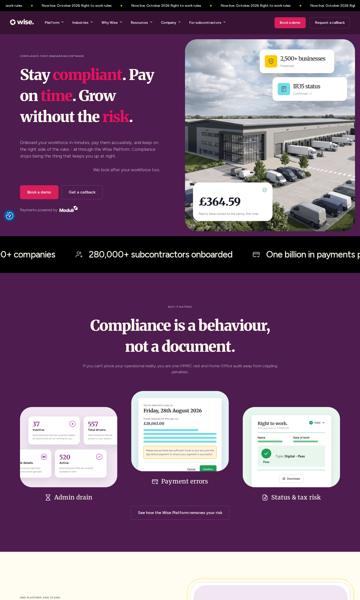
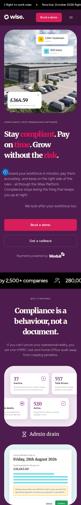

# UI Design System & Master Generation Blueprint: withwise-com

> **Compliance-First Onboarding Software · Wise** (https://withwise.com/) — Wise is built for self-employed workforces. We protect you from compliance risks, help you onboard users digitally, and pay them securely.



---

## 1. Executive Visual Persona & Design Archetype

- **Brand Essence & Persona**: **Compliance-First Onboarding Software · Wise** (`https://withwise.com/`). Wise is built for self-employed workforces. We protect you from compliance risks, help you onboard users digitally, and pay them securely.
- **Capture Provenance**: Live browser capture (`tier1_fast`, HTTP `200`, captured `2026-11-23`).
- **Visual Archetype**: **High-Contrast Obsidian / Atmospheric Design System (`#4e1c4f` canvas, `#ffffff` ink, `#00c2ff` accent)**.
- **Anti-AI-Slop Differentiators**:
  - **Live-Computed Chromatic Polarity**: Anchors the viewport in `#4e1c4f` (live computed `body` `background-color` (`computed_styles.json`)) paired with `#ffffff` primary typography and `#00c2ff` accents.
  - **Grounded Typographic Hierarchy**: Pairs `Merriweather` for display copy (`Stay compliant. Pay on time. Grow wi`) with `Figtree` and `Consolas`.
  - **Calibrated Spatial Grid & Motion**: Combines `1440px` container bounds (`gap: 6px`, padding `12px`) with `cubic-bezier(0.47,0,0.74,0.71)` easing and GSAP Timeline & ScrollTrigger, Three.js / WebGL Canvas Pipeline.

---

## 2. Spatial Architecture & Modular Grid Mathematics



### Viewport Allocation & Container Geometry
- **Captured Viewport Dimensions**: Desktop `1440×2400px` (`assets/desktop.png`, clamped at 2400px live multi-section capture), Mobile `390×2400px` (`assets/mobile.png`, clamped at 2400px live multi-section capture).
- **Master Container Bounds**: `1440px` (non-`@media` desktop container stylesheet rule).
- **Canvas Lateral Padding & Spacing**: `12px` lateral canvas padding with `6px` grid gap.
- **Border Radius Scale**: `8px`, `0px`, `2px`, `4px`.

### Responsive Breakpoint Architecture
- **Desktop Layout**: Multi-column CSS Grid / Flexbox layout at `1440px` (`max-width: 1440px`, `gap: 6px`).
- **Mobile Layout**: Single-column vertical stack at `390px` viewport width with `12px` horizontal padding.
- **Extracted CSS Media Queries**: `@media only screen and (min-width: 1025px)`, `@media only screen and (max-width: 1024px)`, `@media all and (max-height: 576px)`, `@media all and (max-width: 576px)`.

---

## 3. Color System, Materiality & Atmospheric Lighting

### Semantic Palette & Source Grounding
| Semantic Role | Ground-Truth Value | Extracted Live / CSS Source |
|---|---|---|
| **Primary Canvas Substrate** | `#4e1c4f` | live computed `body` `background-color` (`computed_styles.json`) |
| **Primary Typography Ink** | `#ffffff` | live computed `p` `color` (`computed_styles.json`) |
| **Elevated Surface / Card Substrate** | `#381334` | live computed `header` `background-color` (`computed_styles.json`) |
| **Interactive Accent / Highlight** | `#00c2ff` | `var(--gf-field-pg-prog-bar-bg-gradient-blues)` in `:root` |
| **Secondary / Muted Copy** | `#f2f3f5` | `var(--gf-color-secondary-darker)` in `:root` |
| **Structural Hairline Border** | `#cc4b37` | `var(--gf-ctrl-border-color-error)` in `:root` |

### Sanitized Root CSS Variables (`ui-ux.md` Ground Truth)
| Variable Name | Extracted Value | Semantic Role |
|---|---|---|
| `--wp--style--global--content-size` | `1170px` | Layout / Spatial Grid Token |
| `--wp--style--global--wide-size` | `1170px` | Layout / Spatial Grid Token |
| `--wp--style--block-gap` | `24px` | Layout / Spatial Grid Token |
| `--fa-family-brands` | `"Font Awesome 7 Brands"` | Brand / Palette Token |
| `--fa-font-brands` | `normal 400 1em/1 var(--fa-family-brands)` | Brand / Palette Token |
| `--fa-family-classic` | `"Font Awesome 7 Free"` | Typography / Scale Token |
| `--fa-font-regular` | `normal 400 1em/1 var(--fa-family-classic)` | Typography / Scale Token |
| `--fa-style-family-classic` | `var(--fa-family-classic)` | Typography / Scale Token |
| `--fa-font-solid` | `normal 900 1em/1 var(--fa-family-classic)` | Typography / Scale Token |
| `--input-fz` | `1rem` | Dimension / Scale Token |
| `--input-lh` | `1.5` | Design System Custom Token |
| `--input-pt` | `0.6875rem` | Dimension / Scale Token |
| `--input-pb` | `0.6875rem` | Dimension / Scale Token |
| `--input-pl` | `1rem` | Dimension / Scale Token |
| `--input-pr` | `1rem` | Dimension / Scale Token |
| `--input-bd` | `1px` | Dimension / Scale Token |

---

## 4. Typographic Scale & Editorial Hierarchy

### Font Family Stacks
- **Display Typography**: `Merriweather`.
- **Primary Body Stack**: `Figtree`.
- **Technical / Metadata Stack**: `Consolas`.

### Typographic Scale & Rules (Live Computed & Stylesheet Grounded)
- **Hero Display (`H1`)**: live computed `h1` (`font-size: 60px`, `line-height: 84px`, `font-weight: 900`, `letter-spacing: -2px`); CSS variables `--gf-field-pwd-str-ind-display: inline-block`, `--gf-local-display: block`; rule `h1` (`font-size: 35px`, `font-weight: 700`).
- **Section Heading (`H2`)**: live computed `h3 (primary section heading)` (`font-size: 60px`, `line-height: 84px`, `font-weight: 900`, `letter-spacing: -2px`); rule `,.h2` (`font-size: 1.8125rem`, `line-height: 1.4`).
- **Body Copy**: live computed `body` (`font-size: 16px`, `line-height: 24px`, `font-weight: 300`); rule `p` (`font-size: 16px`, `line-height: 20px`).
- **Metadata & Navigation Labels**: live computed `nav/a` (`font-size: 16px`, `line-height: 24px`, `font-weight: 300`); CSS variables `--gf-ctrl-label-font-size-primary: inherit`, `--gf-ctrl-label-font-size-secondary: inherit`, `--gf-ctrl-label-font-size-tertiary: inherit`; rule `small` (`line-height: 0`).

---

## 5. Choreographed Motion & Interaction Physics

### Primary Easing Curves
- **Extracted Timing Functions**: `cubic-bezier(0.47,0,0.74,0.71)`, `cubic-bezier(0.22,0.61,0.36,1)`, `cubic-bezier(0.5,0,0.14,1)`.

### Per-Element Transition & Choreography Rules
- **Selector `rap-header-menu button.mega-toggl...`**: `transition: none` extracted from `withwise-com` stylesheet.
- **Selector `ga-menu-header-menu .mega-descrip...`**: `transition: none` extracted from `withwise-com` stylesheet.
- **Selector `ga-description-group .mega-menu-d...`**: `transition: none` extracted from `withwise-com` stylesheet.
- **Extracted Easing Curve (`cubic-bezier(0.47,0,0.74,0.71)`)**: Governs interactive state transitions across `<header.header>` and `<section.bg-type-dark>`.
- **Runtime Interaction Engine**: Integrates GSAP Timeline & ScrollTrigger, Three.js / WebGL Canvas Pipeline, Swiper Touch Carousel Engine, Barba.js Page Transition Router with `prefers-reduced-motion: reduce` fallback guards.

---

## 6. Component Wireframe & Structural DOM Map

### Visual Layout Schematic — Desktop (`1440px`, Grounded in `dom.html` & Landmark Bounding Boxes)
```
┌────────────────────────────────────────────────────────────────────────┐
│ DESKTOP VIEWPORT (1440px) — Compliance-First Onboarding Software · Wis │
│ ====================================================================== │
│ [ <header.header> (1440x92px)         | Request a callback · Platfor ] │
│ ---------------------------------------------------------------------- │
│ | HERO STAGE: <section.flx-section> (w=1440px)                       | │
│ | H1: Stay compliant. Pay on time. Grow without the risk.            | │
│ | Substrate: #4e1c4f | Ink: #ffffff | Accent: #00c2ff                | │
│ ---------------------------------------------------------------------- │
│ | SHOWCASE GRID (<section.bg-type-dark>) max-w: 1440px               | │
│ | +------------------------------+  +------------------------------+ | │
│ | | Compliance-First Onboarding  |  | Stay compliant . Pay on time | | │
│ | +------------------------------+  +------------------------------+ | │
│ ---------------------------------------------------------------------- │
│ | DETAIL MODULE (<section.flx-ft-grid>) — Why It Matters             | │
│ ---------------------------------------------------------------------- │
│ [ FOOTER (<footer.footer>     ) | https://withwise.com/                │
└────────────────────────────────────────────────────────────────────────┘
```

### Visual Layout Schematic — Mobile Reflow (`390px`)
```
┌────────────────────────────────────────────────────────────────────────┐
│ MOBILE VIEWPORT REFLOW (390px) — Single-Column Stack (gap: 6px)        │
│ ====================================================================== │
│ [ HEADER BAR (<header.header>         ) | Compact Menu (390px)         │
│ ---------------------------------------------------------------------- │
│ | HERO STAGE (<section.flx-section>) — 390px Vertical Lead           | │
│ | H1: Stay compliant. Pay on time. Grow without the risk.            | │
│ ---------------------------------------------------------------------- │
│ | SHOWCASE STACK (<section.bg-type-dark>) — 1-Col Stack              | │
│ | [ Item 1: Compliance-First Onboarding software                   ] | │
│ | [ Item 2: Stay compliant . Pay on time . Grow without the r...   ] | │
│ ---------------------------------------------------------------------- │
│ | DETAIL STACK (<section.flx-ft-grid>) — 1-Col (Why It Matters)      | │
│ ---------------------------------------------------------------------- │
│ [ FOOTER (<footer.footer>     ) | Stacked 390px Colophon               │
└────────────────────────────────────────────────────────────────────────┘
```

### Granular DOM Region Breakdown
1. **Brand Header & Navigation Bar (<header.header> — `withwise-com`)**:
   - Landmark `<header class="header">` (`1440x92px`) hosting `Compliance-First Onboarding Software` navigation (`Request a callback · Platform · See article · Industries · Why Wise`), DOM attributes (`data-scroll-dir-x="0"`, `data-scroll-dir-y="-1"`, `data-cookieconsent="ignore"`, `data-hs-ignore="true"`), and stylesheet rule `.mega-menu-last-modified-1790669576 { content: 'Tuesday 29th September 2026 08:12:56 UTC'; }`.
2. **Hero Stage & Focal Lead (<section.flx-section> — `Stay compliant. Pay on time. Grow `)**:
   - Landmark `<section class="flx-section flx-masthead-1">` presenting display lead `Stay compliant. Pay on time. Grow without the risk.` and copy excerpt *"Now live: October 2026 Right to work rules"* over `#4e1c4f` canvas and `#ffffff` ink.
3. **Primary Showcase & Content Grid (<section.bg-type-dark> — `Compliance-First Onboarding softwa`)**:
   - Landmark `<section class="flx-section bg-type-dark">` rendering section `Compliance-First Onboarding software` with copy *"Onboard your workforce in minutes, pay them accurately, and keep "*, asset references (`banner.js`, `collectedforms.js`, `pixels.js`, `145539501.js`), and grid rule `menu button.mega-toggle-standard:... { display: none; }`.
4. **Interactive Detail & Feature Matrix (<section.flx-ft-grid> — `Stay compliant . Pay on time . Gro`)**:
   - Landmark `<section class="flx-section bg-type-dark">` framing `Stay compliant . Pay on time . Grow without the r...` and `Why It Matters` (*"We look after your workforce too."*) with `#381334` surface cards, `#00c2ff` accents, and `mega-menu-wrap-header-menu { font-family: var(--wp--preset--font-family--figtree); border-radius: 0px; }`.
5. **Colophon & Global Directory Footer (<footer.footer> — `https://withwise.com/`)**:
   - Landmark `<footer class="footer">` anchoring `Compliance-First Onboarding Soft` footer links (`Request a callback · Platform · See article · Industries · Why Wise`), copy *"Payments powered by"*, and `#cc4b37` structural dividers.

---

## 7. Master Zero-Shot AI Generation Prompt

```markdown
# Master Zero-Shot Frontend Generation Prompt: withwise-com (Compliance-First Onboarding Software · Wise)

You are a principal frontend architect and design systems engineer. Build a complete, production-ready web application replicating the exact design system, DOM landmarks, typographic hierarchy, color tokens, and motion physics of `withwise-com` (**Compliance-First Onboarding Software · Wise** — `https://withwise.com/`).

### 1. Visual Archetype & Anti-AI-Slop Mandates
- **Archetype**: High-Contrast Obsidian / Atmospheric Design System (`#4e1c4f` canvas, `#ffffff` ink, `#00c2ff` accent).
- **Identity & Domain Context**: Wise is built for self-employed workforces. We protect you from compliance risks, help you onboard users digitally, and pay them securely.
- **Primary Substrate**: `#4e1c4f` (live computed `body` `background-color` (`computed_styles.json`)), **Primary Ink**: `#ffffff`, **Accent / Highlight**: `#00c2ff`.
- **Site-Specific Differentiators**:
  - **Live-Computed Chromatic Polarity**: Anchors the viewport in `#4e1c4f` (live computed `body` `background-color` (`computed_styles.json`)) paired with `#ffffff` primary typography and `#00c2ff` accents.
  - **Grounded Typographic Hierarchy**: Pairs `Merriweather` for display copy (`Stay compliant. Pay on time. Grow wi`) with `Figtree` and `Consolas`.
  - **Calibrated Spatial Grid & Motion**: Combines `1440px` container bounds (`gap: 6px`, padding `12px`) with `cubic-bezier(0.47,0,0.74,0.71)` easing and GSAP Timeline & ScrollTrigger, Three.js / WebGL Canvas Pipeline.

### 2. Ground-Truth CSS Variables (`:root` Token Contract)
Declare and consume these exact custom properties extracted from `withwise-com` in your global stylesheet:

:root {
  /* Compliance-First Onboarding Software · Wise (withwise-com) — Live-Grounded CSS Variables */
  --wp--style--global--content-size: 1170px; /* Layout / Spatial Grid Token (withwise-com) */
  --wp--style--global--wide-size: 1170px; /* Layout / Spatial Grid Token (withwise-com) */
  --wp--style--block-gap: 24px; /* Layout / Spatial Grid Token (withwise-com) */
  --fa-family-brands: "Font Awesome 7 Brands"; /* Brand / Palette Token (withwise-com) */
  --fa-font-brands: normal 400 1em/1 var(--fa-family-brands); /* Brand / Palette Token (withwise-com) */
  --fa-family-classic: "Font Awesome 7 Free"; /* Typography / Scale Token (withwise-com) */
  --fa-font-regular: normal 400 1em/1 var(--fa-family-classic); /* Typography / Scale Token (withwise-com) */
  --fa-style-family-classic: var(--fa-family-classic); /* Typography / Scale Token (withwise-com) */
  --fa-font-solid: normal 900 1em/1 var(--fa-family-classic); /* Typography / Scale Token (withwise-com) */
  --input-fz: 1rem; /* Dimension / Scale Token (withwise-com) */
  --input-lh: 1.5; /* Design System Custom Token (withwise-com) */
  --input-pt: 0.6875rem; /* Dimension / Scale Token (withwise-com) */
  --input-pb: 0.6875rem; /* Dimension / Scale Token (withwise-com) */
  --input-pl: 1rem; /* Dimension / Scale Token (withwise-com) */
  --input-pr: 1rem; /* Dimension / Scale Token (withwise-com) */
  --input-bd: 1px; /* Dimension / Scale Token (withwise-com) */
}

### 3. Semantic Color & Materiality Contract
Map every surface, ink, and border strictly to these source-grounded tokens:
- **Primary Canvas Substrate**: `#4e1c4f` — grounded in live computed `body` `background-color` (`computed_styles.json`)
- **Primary Typography Ink**: `#ffffff` — grounded in live computed `p` `color` (`computed_styles.json`)
- **Elevated Surface / Card Substrate**: `#381334` — grounded in live computed `header` `background-color` (`computed_styles.json`)
- **Interactive Accent / Highlight**: `#00c2ff` — grounded in `var(--gf-field-pg-prog-bar-bg-gradient-blues)` in `:root`
- **Secondary / Muted Copy**: `#f2f3f5` — grounded in `var(--gf-color-secondary-darker)` in `:root`
- **Structural Hairline Border**: `#cc4b37` — grounded in `var(--gf-ctrl-border-color-error)` in `:root`

### 4. Spatial Grid, Container Bounds & Responsive Breakpoints
- **Desktop Viewport Reference**: `1440×2400px` (clamped at 2400px live multi-section capture, `1440px` standard desktop width).
- **Mobile Viewport Reference**: `390×2400px` (clamped at 2400px live multi-section capture, `390px` standard mobile width).
- **Container Max-Width**: `1440px` (non-`@media` desktop container stylesheet rule)
- **Padding & Gutters**: `12px` lateral canvas padding with `6px` grid gap
- **Desktop Grid**: Multi-column CSS Grid / Flexbox layout at `1440px` (`max-width: 1440px`, `gap: 6px`)
- **Mobile Adaptation**: Single-column vertical stack at `390px` viewport width with `12px` horizontal padding
- **Media Queries**: `@media only screen and (min-width: 1025px)`, `@media only screen and (max-width: 1024px)`, `@media all and (max-height: 576px)`, `@media all and (max-width: 576px)`
- **Corner Radii**: `8px`, `0px`, `2px`, `4px`

### 5. Typography & Editorial Scale Contract
- **Display Font Stack**: `Merriweather`
- **Body Font Stack**: `Figtree`
- **Monospace / Technical Font Stack**: `Consolas`
- **H1 Display Rule**: live computed `h1` (`font-size: 60px`, `line-height: 84px`, `font-weight: 900`, `letter-spacing: -2px`); CSS variables `--gf-field-pwd-str-ind-display: inline-block`, `--gf-local-display: block`; rule `h1` (`font-size: 35px`, `font-weight: 700`)
- **H2 Section Rule**: live computed `h3 (primary section heading)` (`font-size: 60px`, `line-height: 84px`, `font-weight: 900`, `letter-spacing: -2px`); rule `,.h2` (`font-size: 1.8125rem`, `line-height: 1.4`)
- **Body Copy Rule**: live computed `body` (`font-size: 16px`, `line-height: 24px`, `font-weight: 300`); rule `p` (`font-size: 16px`, `line-height: 20px`)
- **Metadata & Index Rule**: live computed `nav/a` (`font-size: 16px`, `line-height: 24px`, `font-weight: 300`); CSS variables `--gf-ctrl-label-font-size-primary: inherit`, `--gf-ctrl-label-font-size-secondary: inherit`, `--gf-ctrl-label-font-size-tertiary: inherit`; rule `small` (`line-height: 0`)

### 6. Component Hierarchy, Verbatim Copy & Real DOM Landmarks
Scaffold `withwise-com` (`Compliance-First Onboarding Software · Wise`) with these exact structural regions, extracted copy, and CSS rules from `dom.html`:
1. **Brand Header & Navigation Bar (<header.header> — `withwise-com`)**:
   - DOM & Selectors: Landmark `<header class="header">` (`1440x92px`) hosting `Compliance-First Onboarding Software` navigation (`Request a callback · Platform · See article · Industries · Why Wise`), DOM attributes (`data-scroll-dir-x="0"`, `data-scroll-dir-y="-1"`, `data-cookieconsent="ignore"`, `data-hs-ignore="true"`), and stylesheet rule `.mega-menu-last-modified-1790669576 { content: 'Tuesday 29th September 2026 08:12:56 UTC'; }`.
   - Responsive Contract: Header `Brand Header & Navigation Bar (<header.header> — `withwise-com`)` (`withwise-com`) adapts across `@media only screen and (min-width: 1025px)`, `@media only screen and (max-width: 1024px)`, `@media all and (max-height: 576px)`, `@media all and (max-width: 576px)` with `cubic-bezier(0.47,0,0.74,0.71)`, `cubic-bezier(0.22,0.61,0.36,1)`, `cubic-bezier(0.5,0,0.14,1)` transitions and links `Request a callback · Platform · See article · Industries · Why Wise`.
2. **Hero Stage & Focal Lead (<section.flx-section> — `Stay compliant. Pay on time. Grow `)**:
   - DOM & Selectors: Landmark `<section class="flx-section flx-masthead-1">` presenting display lead `Stay compliant. Pay on time. Grow without the risk.` and copy excerpt *"Now live: October 2026 Right to work rules"* over `#4e1c4f` canvas and `#ffffff` ink.
   - Responsive Contract: Hero stage (`1440×2400px` desktop / `390×2400px` mobile) sets `#4e1c4f` background with `#ffffff` headline `Stay compliant. Pay on time. Grow without the risk.`.
3. **Primary Showcase & Content Grid (<section.bg-type-dark> — `Compliance-First Onboarding softwa`)**:
   - DOM & Selectors: Landmark `<section class="flx-section bg-type-dark">` rendering section `Compliance-First Onboarding software` with copy *"Onboard your workforce in minutes, pay them accurately, and keep "*, asset references (`banner.js`, `collectedforms.js`, `pixels.js`, `145539501.js`), and grid rule `menu button.mega-toggle-standard:... { display: none; }`.
   - Responsive Contract: Showcase grid `Primary Showcase & Content Grid (<section.bg-type-dark> — `Compliance-First Onboarding softwa`)` applies Multi-column CSS Grid / Flexbox layout at `1440px` (`max-width: 1440px`, `gap: 6px`) on desktop and Single-column vertical stack at `390px` viewport width with `12px` horizontal padding on mobile.
4. **Interactive Detail & Feature Matrix (<section.flx-ft-grid> — `Stay compliant . Pay on time . Gro`)**:
   - DOM & Selectors: Landmark `<section class="flx-section bg-type-dark">` framing `Stay compliant . Pay on time . Grow without the r...` and `Why It Matters` (*"We look after your workforce too."*) with `#381334` surface cards, `#00c2ff` accents, and `mega-menu-wrap-header-menu { font-family: var(--wp--preset--font-family--figtree); border-radius: 0px; }`.
   - Responsive Contract: Detail module `Interactive Detail & Feature Matrix (<section.flx-ft-grid> — `Stay compliant . Pay on time . Gro`)` uses `8px`, `0px`, `2px`, `4px` radii, `#00c2ff` highlights, and assets (banner.js, collectedforms.js, pixels.js).
5. **Colophon & Global Directory Footer (<footer.footer> — `https://withwise.com/`)**:
   - DOM & Selectors: Landmark `<footer class="footer">` anchoring `Compliance-First Onboarding Soft` footer links (`Request a callback · Platform · See article · Industries · Why Wise`), copy *"Payments powered by"*, and `#cc4b37` structural dividers.
   - Responsive Contract: Footer `Colophon & Global Directory Footer (<footer.footer> — `https://withwise.com/`)` aligns to `1440px` (non-`@media` desktop container stylesheet rule) with `12px` lateral canvas padding with `6px` grid gap and attributes (data-scroll-dir-x="0", data-scroll-dir-y="-1", data-cookieconsent="ignore").

#### Verbatim DOM Copy Excerpts (`dom.html`)
- Copy Excerpt 1: *"Now live: October 2026 Right to work rules"*
- Copy Excerpt 2: *"Onboard your workforce in minutes, pay them accurately, and keep on the right side..."*
- Copy Excerpt 3: *"We look after your workforce too."*
- Copy Excerpt 4: *"Payments powered by"*

### 7. Motion, Extracted Stylesheet Rules & Interaction Choreography
- **Primary Easing Functions**: `cubic-bezier(0.47,0,0.74,0.71)`, `cubic-bezier(0.22,0.61,0.36,1)`, `cubic-bezier(0.5,0,0.14,1)`
- **Extracted Stylesheet Rules (`withwise-com`)**:
- `.mega-menu-last-modified-1790669576 { content: 'Tuesday 29th September 2026 08:12:56 UTC'; }`
- `menu button.mega-toggle-standard:... { display: none; }`
- `mega-menu-wrap-header-menu { font-family: var(--wp--preset--font-family--figtree); border-radius: 0px; }`
- `r-menu .mega-mobile-back > button... { outline-style: solid; outline-width: 3px; outline-color: 109cde; outline... }`
- `block button.mega-toggle-animated... { outline-offset: 2px; }`
- **Per-Selector Transition Rules**:
- **Selector `rap-header-menu button.mega-toggl...`**: `transition: none` extracted from `withwise-com` stylesheet.
- **Selector `ga-menu-header-menu .mega-descrip...`**: `transition: none` extracted from `withwise-com` stylesheet.
- **Selector `ga-description-group .mega-menu-d...`**: `transition: none` extracted from `withwise-com` stylesheet.
- **Extracted Easing Curve (`cubic-bezier(0.47,0,0.74,0.71)`)**: Governs interactive state transitions across `<header.header>` and `<section.bg-type-dark>`.
- **Runtime Interaction Engine**: Integrates GSAP Timeline & ScrollTrigger, Three.js / WebGL Canvas Pipeline, Swiper Touch Carousel Engine, Barba.js Page Transition Router with `prefers-reduced-motion: reduce` fallback guards.

### 8. Technical Deliverables
- Implement in Next.js (App Router) with TypeScript and Tailwind CSS consuming the `:root` custom properties defined above for `withwise-com`.
- Reproduce both the `1440px` desktop architecture and `390px` mobile breakpoint transitions, preserving semantic HTML5 landmarks (`<header>`, `<nav>`, `<main>`, `<section>`, `<footer>`) and `prefers-reduced-motion` accessibility guards.
```
