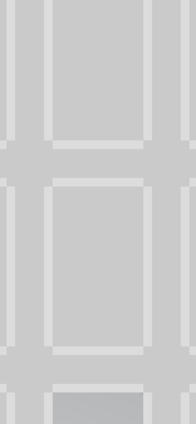

# UI Design System & Master Generation Blueprint: wndws-space

> **windows · place is temporary. you are not.** (https://wndws.space/) — Upload your window — tell what chapter of life you're living through.


---

## 1. Executive Visual Persona & Design Archetype

- **Brand Essence & Persona**: **windows · place is temporary. you are not.** (`https://wndws.space/`). Upload your window — tell what chapter of life you're living through.
- **Capture Provenance**: Live browser capture (`tier2_webgl`, HTTP `200`, captured `2026-11-23`).
- **Visual Archetype**: **Light-Gallery WebGL / Canvas Interactive Experience (`#cacaca` / `#efefef`)**.
- **Anti-AI-Slop Differentiators**:
  - **Live-Computed Chromatic Polarity**: Anchors the viewport in `#cacaca` (live computed `body` `background-color` (`computed_styles.json`)) paired with `#000000` primary typography and `#efefef` accents.
  - **Grounded Typographic Hierarchy**: Pairs `Inter` for display copy (`105 windows`) with `Inter` and not declared in live computed styles (uses primary stack / `ui-monospace`).
  - **Calibrated Spatial Grid & Motion**: Combines `1440px` container bounds (`gap: 20px`, padding `9px`) with `cubic-bezier(.22,1,.36,1)` easing and Three.js / WebGL Canvas Pipeline.

---

## 2. Spatial Architecture & Modular Grid Mathematics



### Viewport Allocation & Container Geometry
- **Captured Viewport Dimensions**: Desktop `1440×900px` (`assets/desktop.png`, single-viewport 100vh live capture (900px)), Mobile `390×844px` (`assets/mobile.png`, single-viewport 100vh live capture (844px)).
- **Master Container Bounds**: `1440px` (full-bleed `100%` viewport stage).
- **Canvas Lateral Padding & Spacing**: `9px` lateral canvas padding with `20px` grid gap.
- **Border Radius Scale**: `999px`, `2px`, `6px`, `5px`.

### Responsive Breakpoint Architecture
- **Desktop Layout**: Multi-column CSS Grid / Flexbox layout at `1440px` (`max-width: 1440px`, `gap: 20px`).
- **Mobile Layout**: Single-column vertical stack at `390px` viewport width with `9px` horizontal padding.
- **Extracted CSS Media Queries**: `@media (max-width:700px)`, `@media (max-width:900px)`, `@media (prefers-reduced-motion:reduce)`, `@media (max-width:430px)`.

---

## 3. Color System, Materiality & Atmospheric Lighting

### Semantic Palette & Source Grounding
| Semantic Role | Ground-Truth Value | Extracted Live / CSS Source |
|---|---|---|
| **Primary Canvas Substrate** | `#cacaca` | live computed `body` `background-color` (`computed_styles.json`) |
| **Primary Typography Ink** | `#000000` | live computed `body` `color` (`computed_styles.json`) |
| **Elevated Surface / Card Substrate** | `#efefef` | live computed `button` `background-color` (`computed_styles.json`) |
| **Interactive Accent / Highlight** | `#efefef` | live computed `button` `background-color` (`computed_styles.json`) |
| **Secondary / Muted Copy** | `#ffffff` | `.prelude-route ::-moz-selection { color: #ffffff }` |
| **Structural Hairline Border** | `#ffffff` | `tml.prelude-route::-webkit-scro... { border-color: #ffffff }` |

### Sanitized Root CSS Variables (`ui-ux.md` Ground Truth)
| Variable Name | Extracted Value | Semantic Role |
|---|---|---|
| `--text-reveal-duration` | `.92s` | Typography Ink Token |
| `--text-reveal-ease` | `cubic-bezier(.22,1,.36,1)` | Typography Ink Token |
| `--frame` | `10px` | Dimension / Scale Token |
| `--frame-radius` | `6px` | Elevation / Border Token |
| `--nav-drop` | `8px` | Layout / Spatial Grid Token |
| `--fr` | `var(--frame-radius)` | Dimension / Scale Token |
| `--edge` | `linear-gradient(#000,#000)` | Color / Atmospheric Token |
| `--band` | `10px` | Dimension / Scale Token |
| `--logo-h` | `25px` | Dimension / Scale Token |
| `--lift` | `0px` | Dimension / Scale Token |
| `--slide` | `-7px` | Dimension / Scale Token |
| `--tilt` | `-2.5deg` | Design System Custom Token |
| `--teaser-i` | `0` | Motion / Easing Token |
| `--wndws-space-bg` | `#cacaca` | Canvas Substrate (from live computed `body` `background-color` (`computed_styles.json`)) |
| `--wndws-space-ink` | `#000000` | Primary Typography Ink (computed-derived) |
| `--wndws-space-surface` | `#efefef` | Surface Substrate (computed-derived) |

---

## 4. Typographic Scale & Editorial Hierarchy

### Font Family Stacks
- **Display Typography**: `Inter`.
- **Primary Body Stack**: `Inter`.
- **Technical / Metadata Stack**: not declared in live computed styles (uses primary stack / `ui-monospace`).

### Typographic Scale & Rules (Live Computed & Stylesheet Grounded)
- **Hero Display (`H1`)**: observed font-size ladder: `24px`, `16px`, `13px`, `13.3333px`, `64px`.
- **Section Heading (`H2`)**: live computed `h2` (`font-size: 24px`, `line-height: normal`, `font-weight: 700`).
- **Body Copy**: live computed `body` (`font-size: 16px`, `line-height: normal`, `font-weight: 400`).
- **Metadata & Navigation Labels**: live computed `nav/a` (`font-size: 16px`, `line-height: normal`, `font-weight: 400`).

---

## 5. Choreographed Motion & Interaction Physics

### Primary Easing Curves
- **Extracted Timing Functions**: `cubic-bezier(.22,1,.36,1)`, `cubic-bezier(.4,0,.4,1)`, `cubic-bezier(.34,1.4,.5,1)`.

### Per-Element Transition & Choreography Rules
- **Selector `.slide-label-face`**: `transition: transform .34s cubic-bezier(.22,1,.36,1)` extracted from `wndws-space` stylesheet.
- **Selector `.route-outgoing.up.closing[data-v...`**: `transition: opacity .45s cubic-bezier(.22,1,.36,1)` extracted from `wndws-space` stylesheet.
- **Selector `media(prefers-reduced-motion:reduce)`**: `transition: 1ms` extracted from `wndws-space` stylesheet.
- **Extracted Easing Curve (`cubic-bezier(.22,1,.36,1)`)**: Governs interactive state transitions across `<nav.nav>` and `<div.nuxt-route-announcer>`.
- **Runtime Interaction Engine**: Integrates Three.js / WebGL Canvas Pipeline with `prefers-reduced-motion: reduce` fallback guards.

---

## 6. Component Wireframe & Structural DOM Map

### Visual Layout Schematic — Desktop (`1440px`, Grounded in `dom.html` & Landmark Bounding Boxes)
```
┌────────────────────────────────────────────────────────────────────────┐
│ DESKTOP VIEWPORT (1440px) — windows · place is temporary. you are not. │
│ ====================================================================== │
│ [ <nav.nav> (1x1px)                   | prelude prelude              ] │
│ ---------------------------------------------------------------------- │
│ | HERO STAGE: <div.custom-cursor-enabled> (w=1440px)                 | │
│ | H1: 105 windows                                                    | │
│ | Substrate: #cacaca | Ink: #000000 | Accent: #efefef                | │
│ ---------------------------------------------------------------------- │
│ | SHOWCASE GRID (<div.nuxt-route-announcer>) max-w: 1440px           | │
│ | +------------------------------+  +------------------------------+ | │
│ | | windows · place is temporary |  | Areg — Yerevan, Armenia      | | │
│ | +------------------------------+  +------------------------------+ | │
│ ---------------------------------------------------------------------- │
│ | DETAIL MODULE (<div.route-stage>) — Maria — Saint Petersb          | │
│ ---------------------------------------------------------------------- │
│ [ FOOTER (<footer.site-footer>) | https://wndws.space/                 │
└────────────────────────────────────────────────────────────────────────┘
```

### Visual Layout Schematic — Mobile Reflow (`390px`)
```
┌────────────────────────────────────────────────────────────────────────┐
│ MOBILE VIEWPORT REFLOW (390px) — Single-Column Stack (gap: 20px)       │
│ ====================================================================== │
│ [ HEADER BAR (<nav.nav>               ) | Compact Menu (390px)         │
│ ---------------------------------------------------------------------- │
│ | HERO STAGE (<div.custom-cursor-enabl) — 390px Vertical Lead        | │
│ | H1: 105 windows                                                    | │
│ ---------------------------------------------------------------------- │
│ | SHOWCASE STACK (<div.nuxt-route-announ) — 1-Col Stack              | │
│ | [ Item 1: windows · place is temporary. you are not.             ] | │
│ | [ Item 2: Areg — Yerevan, Armenia                                ] | │
│ ---------------------------------------------------------------------- │
│ | DETAIL STACK (<div.route-stage>) — 1-Col (Maria — Saint Pete)      | │
│ ---------------------------------------------------------------------- │
│ [ FOOTER (<footer.site-footer>) | Stacked 390px Colophon               │
└────────────────────────────────────────────────────────────────────────┘
```

### Granular DOM Region Breakdown
1. **Brand Header & Navigation Bar (<nav.nav> — `wndws-space`)**:
   - Landmark `<nav class="nav">` (`1x1px`) hosting `windows · place is temporary. you ar` navigation (`prelude prelude`), DOM attributes (`data-v-20a15833`, `data-v-045ed839`, `data-v-feaf1087`, `data-v-d791c00f`), and stylesheet rule `before { box-sizing:border-box;margin:0;padding:0 }`.
2. **Hero Stage & Focal Lead (<div.custom-cursor-enabled> — `105 windows`)**:
   - Landmark `<div class="custom-cursor-enabled">` presenting display lead `105 windows` and copy excerpt *"windows · place is temporary. you are not."* over `#cacaca` canvas and `#000000` ink.
3. **Primary Showcase & Content Grid (<div.nuxt-route-announcer> — `windows · place is temporary. you `)**:
   - Landmark `<div class="nuxt-route-announcer">` rendering section `windows · place is temporary. you are not.` with copy *"Areg — Yerevan, Armenia"*, asset references (`fonts.googleapis.com`, `fonts.gstatic.com`, `css2`, `entry.DtyUHzly.css`), and grid rule `html::-webkit-scrollbar { width:10px }`.
4. **Interactive Detail & Feature Matrix (<div.route-stage> — `Areg — Yerevan, Armenia`)**:
   - Landmark `<div class="route-stage">` framing `Areg — Yerevan, Armenia` and `Maria — Saint Petersburg, Russia` (*"Maria — Saint Petersburg, Russia"*) with `#efefef` surface cards, `#efefef` accents, and `html::-webkit-scrollbar-track { background:transparent }`.
5. **Colophon & Global Directory Footer (<footer.site-footer> — `https://wndws.space/`)**:
   - Landmark `<footer class="site-footer">` anchoring `windows · place is temporary. yo` footer links (`prelude prelude`), copy *"VESTAHAHA — Guangzhou, China"*, and `#ffffff` structural dividers.

---

## 7. Master Zero-Shot AI Generation Prompt

```markdown
# Master Zero-Shot Frontend Generation Prompt: wndws-space (windows · place is temporary. you are not.)

You are a principal frontend architect and design systems engineer. Build a complete, production-ready web application replicating the exact design system, DOM landmarks, typographic hierarchy, color tokens, and motion physics of `wndws-space` (**windows · place is temporary. you are not.** — `https://wndws.space/`).

### 1. Visual Archetype & Anti-AI-Slop Mandates
- **Archetype**: Light-Gallery WebGL / Canvas Interactive Experience (`#cacaca` / `#efefef`).
- **Identity & Domain Context**: Upload your window — tell what chapter of life you're living through.
- **Primary Substrate**: `#cacaca` (live computed `body` `background-color` (`computed_styles.json`)), **Primary Ink**: `#000000`, **Accent / Highlight**: `#efefef`.
- **Site-Specific Differentiators**:
  - **Live-Computed Chromatic Polarity**: Anchors the viewport in `#cacaca` (live computed `body` `background-color` (`computed_styles.json`)) paired with `#000000` primary typography and `#efefef` accents.
  - **Grounded Typographic Hierarchy**: Pairs `Inter` for display copy (`105 windows`) with `Inter` and not declared in live computed styles (uses primary stack / `ui-monospace`).
  - **Calibrated Spatial Grid & Motion**: Combines `1440px` container bounds (`gap: 20px`, padding `9px`) with `cubic-bezier(.22,1,.36,1)` easing and Three.js / WebGL Canvas Pipeline.

### 2. Ground-Truth CSS Variables (`:root` Token Contract)
Declare and consume these exact custom properties extracted from `wndws-space` in your global stylesheet:

:root {
  /* windows · place is temporary. you are not. (wndws-space) — Live-Grounded CSS Variables */
  --text-reveal-duration: .92s; /* Typography Ink Token (wndws-space) */
  --text-reveal-ease: cubic-bezier(.22,1,.36,1); /* Typography Ink Token (wndws-space) */
  --frame: 10px; /* Dimension / Scale Token (wndws-space) */
  --frame-radius: 6px; /* Elevation / Border Token (wndws-space) */
  --nav-drop: 8px; /* Layout / Spatial Grid Token (wndws-space) */
  --fr: var(--frame-radius); /* Dimension / Scale Token (wndws-space) */
  --edge: linear-gradient(#000,#000); /* Color / Atmospheric Token (wndws-space) */
  --band: 10px; /* Dimension / Scale Token (wndws-space) */
  --logo-h: 25px; /* Dimension / Scale Token (wndws-space) */
  --lift: 0px; /* Dimension / Scale Token (wndws-space) */
  --slide: -7px; /* Dimension / Scale Token (wndws-space) */
  --tilt: -2.5deg; /* Design System Custom Token (wndws-space) */
  --teaser-i: 0; /* Motion / Easing Token (wndws-space) */
  --wndws-space-bg: #cacaca; /* Canvas Substrate (from live computed `body` `background-color` (`computed_styles.json`)) (wndws-space) */
  --wndws-space-ink: #000000; /* Primary Typography Ink (computed-derived) (wndws-space) */
  --wndws-space-surface: #efefef; /* Surface Substrate (computed-derived) (wndws-space) */
}

### 3. Semantic Color & Materiality Contract
Map every surface, ink, and border strictly to these source-grounded tokens:
- **Primary Canvas Substrate**: `#cacaca` — grounded in live computed `body` `background-color` (`computed_styles.json`)
- **Primary Typography Ink**: `#000000` — grounded in live computed `body` `color` (`computed_styles.json`)
- **Elevated Surface / Card Substrate**: `#efefef` — grounded in live computed `button` `background-color` (`computed_styles.json`)
- **Interactive Accent / Highlight**: `#efefef` — grounded in live computed `button` `background-color` (`computed_styles.json`)
- **Secondary / Muted Copy**: `#ffffff` — grounded in `.prelude-route ::-moz-selection { color: #ffffff }`
- **Structural Hairline Border**: `#ffffff` — grounded in `tml.prelude-route::-webkit-scro... { border-color: #ffffff }`

### 4. Spatial Grid, Container Bounds & Responsive Breakpoints
- **Desktop Viewport Reference**: `1440×900px` (single-viewport 100vh live capture (900px), `1440px` standard desktop width).
- **Mobile Viewport Reference**: `390×844px` (single-viewport 100vh live capture (844px), `390px` standard mobile width).
- **Container Max-Width**: `1440px` (full-bleed `100%` viewport stage)
- **Padding & Gutters**: `9px` lateral canvas padding with `20px` grid gap
- **Desktop Grid**: Multi-column CSS Grid / Flexbox layout at `1440px` (`max-width: 1440px`, `gap: 20px`)
- **Mobile Adaptation**: Single-column vertical stack at `390px` viewport width with `9px` horizontal padding
- **Media Queries**: `@media (max-width:700px)`, `@media (max-width:900px)`, `@media (prefers-reduced-motion:reduce)`, `@media (max-width:430px)`
- **Corner Radii**: `999px`, `2px`, `6px`, `5px`

### 5. Typography & Editorial Scale Contract
- **Display Font Stack**: `Inter`
- **Body Font Stack**: `Inter`
- **Monospace / Technical Font Stack**: not declared in live computed styles (uses primary stack / `ui-monospace`)
- **H1 Display Rule**: observed font-size ladder: `24px`, `16px`, `13px`, `13.3333px`, `64px`
- **H2 Section Rule**: live computed `h2` (`font-size: 24px`, `line-height: normal`, `font-weight: 700`)
- **Body Copy Rule**: live computed `body` (`font-size: 16px`, `line-height: normal`, `font-weight: 400`)
- **Metadata & Index Rule**: live computed `nav/a` (`font-size: 16px`, `line-height: normal`, `font-weight: 400`)

### 6. Component Hierarchy, Verbatim Copy & Real DOM Landmarks
Scaffold `wndws-space` (`windows · place is temporary. you are not.`) with these exact structural regions, extracted copy, and CSS rules from `dom.html`:
1. **Brand Header & Navigation Bar (<nav.nav> — `wndws-space`)**:
   - DOM & Selectors: Landmark `<nav class="nav">` (`1x1px`) hosting `windows · place is temporary. you ar` navigation (`prelude prelude`), DOM attributes (`data-v-20a15833`, `data-v-045ed839`, `data-v-feaf1087`, `data-v-d791c00f`), and stylesheet rule `before { box-sizing:border-box;margin:0;padding:0 }`.
   - Responsive Contract: Header `Brand Header & Navigation Bar (<nav.nav> — `wndws-space`)` (`wndws-space`) adapts across `@media (max-width:700px)`, `@media (max-width:900px)`, `@media (prefers-reduced-motion:reduce)`, `@media (max-width:430px)` with `cubic-bezier(.22,1,.36,1)`, `cubic-bezier(.4,0,.4,1)`, `cubic-bezier(.34,1.4,.5,1)` transitions and links `prelude prelude`.
2. **Hero Stage & Focal Lead (<div.custom-cursor-enabled> — `105 windows`)**:
   - DOM & Selectors: Landmark `<div class="custom-cursor-enabled">` presenting display lead `105 windows` and copy excerpt *"windows · place is temporary. you are not."* over `#cacaca` canvas and `#000000` ink.
   - Responsive Contract: Hero stage (`1440×900px` desktop / `390×844px` mobile) sets `#cacaca` background with `#000000` headline `105 windows`.
3. **Primary Showcase & Content Grid (<div.nuxt-route-announcer> — `windows · place is temporary. you `)**:
   - DOM & Selectors: Landmark `<div class="nuxt-route-announcer">` rendering section `windows · place is temporary. you are not.` with copy *"Areg — Yerevan, Armenia"*, asset references (`fonts.googleapis.com`, `fonts.gstatic.com`, `css2`, `entry.DtyUHzly.css`), and grid rule `html::-webkit-scrollbar { width:10px }`.
   - Responsive Contract: Showcase grid `Primary Showcase & Content Grid (<div.nuxt-route-announcer> — `windows · place is temporary. you `)` applies Multi-column CSS Grid / Flexbox layout at `1440px` (`max-width: 1440px`, `gap: 20px`) on desktop and Single-column vertical stack at `390px` viewport width with `9px` horizontal padding on mobile.
4. **Interactive Detail & Feature Matrix (<div.route-stage> — `Areg — Yerevan, Armenia`)**:
   - DOM & Selectors: Landmark `<div class="route-stage">` framing `Areg — Yerevan, Armenia` and `Maria — Saint Petersburg, Russia` (*"Maria — Saint Petersburg, Russia"*) with `#efefef` surface cards, `#efefef` accents, and `html::-webkit-scrollbar-track { background:transparent }`.
   - Responsive Contract: Detail module `Interactive Detail & Feature Matrix (<div.route-stage> — `Areg — Yerevan, Armenia`)` uses `999px`, `2px`, `6px`, `5px` radii, `#efefef` highlights, and assets (fonts.googleapis.com, fonts.gstatic.com, css2).
5. **Colophon & Global Directory Footer (<footer.site-footer> — `https://wndws.space/`)**:
   - DOM & Selectors: Landmark `<footer class="site-footer">` anchoring `windows · place is temporary. yo` footer links (`prelude prelude`), copy *"VESTAHAHA — Guangzhou, China"*, and `#ffffff` structural dividers.
   - Responsive Contract: Footer `Colophon & Global Directory Footer (<footer.site-footer> — `https://wndws.space/`)` aligns to `1440px` (full-bleed `100%` viewport stage) with `9px` lateral canvas padding with `20px` grid gap and attributes (data-v-20a15833, data-v-045ed839, data-v-feaf1087).

#### Verbatim DOM Copy Excerpts (`dom.html`)
- Copy Excerpt 1: *"windows · place is temporary. you are not."*
- Copy Excerpt 2: *"Areg — Yerevan, Armenia"*
- Copy Excerpt 3: *"Maria — Saint Petersburg, Russia"*
- Copy Excerpt 4: *"VESTAHAHA — Guangzhou, China"*

### 7. Motion, Extracted Stylesheet Rules & Interaction Choreography
- **Primary Easing Functions**: `cubic-bezier(.22,1,.36,1)`, `cubic-bezier(.4,0,.4,1)`, `cubic-bezier(.34,1.4,.5,1)`
- **Extracted Stylesheet Rules (`wndws-space`)**:
- `before { box-sizing:border-box;margin:0;padding:0 }`
- `html::-webkit-scrollbar { width:10px }`
- `html::-webkit-scrollbar-track { background:transparent }`
- `html::-webkit-scrollbar-thumb { background:dcdcdc;border-radius:999px;border:2px solid cacaca;background... }`
- `.prelude-route::-webkit-scrollbar... { border-color:fff }`
- **Per-Selector Transition Rules**:
- **Selector `.slide-label-face`**: `transition: transform .34s cubic-bezier(.22,1,.36,1)` extracted from `wndws-space` stylesheet.
- **Selector `.route-outgoing.up.closing[data-v...`**: `transition: opacity .45s cubic-bezier(.22,1,.36,1)` extracted from `wndws-space` stylesheet.
- **Selector `media(prefers-reduced-motion:reduce)`**: `transition: 1ms` extracted from `wndws-space` stylesheet.
- **Extracted Easing Curve (`cubic-bezier(.22,1,.36,1)`)**: Governs interactive state transitions across `<nav.nav>` and `<div.nuxt-route-announcer>`.
- **Runtime Interaction Engine**: Integrates Three.js / WebGL Canvas Pipeline with `prefers-reduced-motion: reduce` fallback guards.

### 8. Technical Deliverables
- Implement in Next.js (App Router) with TypeScript and Tailwind CSS consuming the `:root` custom properties defined above for `wndws-space`.
- Reproduce both the `1440px` desktop architecture and `390px` mobile breakpoint transitions, preserving semantic HTML5 landmarks (`<header>`, `<nav>`, `<main>`, `<section>`, `<footer>`) and `prefers-reduced-motion` accessibility guards.
```
