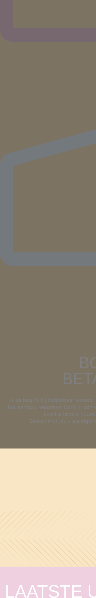

# UI Design System & Master Generation Blueprint: woonpact-gent

> **Home - Woonpact** (https://woonpact.gent/) — Alles begint bij betaalbaar wonen. En waar doe je dat liever dan in Gent? De vraag werd groter dan het aanbod, waardoor Gent in een woonc...


---

## 1. Executive Visual Persona & Design Archetype

- **Brand Essence & Persona**: **Home - Woonpact** (`https://woonpact.gent/`). Alles begint bij betaalbaar wonen. En waar doe je dat liever dan in Gent? De vraag werd groter dan het aanbod, waardoor Gent in een woonc...
- **Visual Archetype**: **High-Contrast Obsidian / Atmospheric Design System (`#000` canvas, `#fff` ink, `#fff4e0` accent)**.
- **Anti-AI-Slop Differentiators**:
  - **Source-Grounded Chromatic Polarity**: Anchors the viewport in `#000` (`var(--color-black)` in `:root`) paired with `#fff` primary typography and `#fff4e0` accents.
  - **Extracted Typographic Hierarchy**: Pairs `Inter` for display copy (`Bouwen aan betaalbaarheid`) with `Satochi` and `SFMono-Regular`.
  - **Calibrated Spatial Grid & Motion**: Combines `103.75rem` container bounds (`gap: 10%`, padding `1rem`) with `cubic-bezier(.4,0,.2,1)` easing and Lenis Smooth Scroll (`data-lenis`), Barba.js Page Transition Router.

---

## 2. Spatial Architecture & Modular Grid Mathematics



### Viewport Allocation & Container Geometry
- **Captured Viewport Dimensions**: Desktop `1440×11932px` (`assets/desktop.png`, full-page scroll capture), Mobile `390×2400px` (`assets/mobile.png`, capped at 2400px multi-section capture).
- **Master Container Bounds**: `103.75rem` extracted from `woonpact-gent` stylesheet.
- **Canvas Lateral Padding & Spacing**: `1rem` lateral canvas padding with `10%` grid gap.
- **Border Radius Scale**: `var(--radius-md)`, `var(--radius-sm)`, `.3125rem`, `var(--radius-lg)`.

### Responsive Breakpoint Architecture
- **Desktop Layout**: Multi-column CSS Grid / Flexbox layout at `1440px` (`max-width: 103.75rem`, `gap: 10%`).
- **Mobile Layout**: Single-column vertical stack at `390px` viewport width with `1rem` horizontal padding.
- **Extracted CSS Media Queries**: `@media (min-width:48rem)`, `@media (min-width:80rem)`, `@media (min-width:64rem)`, `@media (min-width:768px)`.

---

## 3. Color System, Materiality & Atmospheric Lighting

### Semantic Palette & Source Grounding
| Semantic Role | Ground-Truth Value | Extracted CSS Source / Selector |
|---|---|---|
| **Primary Canvas Substrate** | `#000` | `var(--color-black)` in `:root` |
| **Primary Typography Ink** | `#fff` | `var(--color-white)` in `:root` |
| **Elevated Surface / Card Substrate** | `#f8e6c4` | `var(--color-beige)` in `:root` |
| **Interactive Accent / Highlight** | `#fff4e0` | `var(--color-eggshell)` in `:root` |
| **Secondary / Muted Copy** | `#c9a96e` | `var(--color-sand)` in `:root` |
| **Structural Hairline Border** | `#e6f2fb` | `var(--color-sky)` in `:root` |

### Sanitized Root CSS Variables (`ui-ux.md` Ground Truth)
| Variable Name | Extracted Value | Semantic Role |
|---|---|---|
| `--font-sans` | `"Satochi", sans-serif` | Typography / Scale Token |
| `--color-black` | `#000` | Canvas / Surface Token |
| `--color-white` | `#fff` | Canvas / Surface Token |
| `--spacing` | `.25rem` | Layout / Spatial Grid Token |
| `--text-sm` | `.875rem` | Typography Ink Token |
| `--text-sm--line-height` | `calc(1.25 / .875)` | Typography Ink Token |
| `--text-base` | `1rem` | Typography Ink Token |
| `--text-base--line-height` | `1.5` | Typography Ink Token |
| `--text-lg` | `1.125rem` | Typography Ink Token |
| `--text-lg--line-height` | `calc(1.75 / 1.125)` | Typography Ink Token |
| `--text-xl` | `1.25rem` | Typography Ink Token |
| `--text-xl--line-height` | `calc(1.75 / 1.25)` | Typography Ink Token |
| `--text-2xl` | `1.5rem` | Typography Ink Token |
| `--text-2xl--line-height` | `calc(2 / 1.5)` | Typography Ink Token |
| `--font-weight-normal` | `400` | Typography / Scale Token |
| `--font-weight-bold` | `700` | Typography / Scale Token |

---

## 4. Typographic Scale & Editorial Hierarchy

### Font Family Stacks
- **Display Typography**: `Inter`.
- **Primary Body Stack**: `Satochi`.
- **Technical / Metadata Stack**: `SFMono-Regular`.

### Typographic Scale & Rules (Extracted from Stylesheet & Variables)
- **Hero Display (`H1`)**: rule `h1` (`font-size: var(--text-extralarge)`).
- **Section Heading (`H2`)**: CSS variables `--text-2xl: 1.5rem`, `--text-2xl--line-height: calc(2 / 1.5)`; rule `h2` (`font-size: var(--text-large)`).
- **Body Copy**: CSS variables `--text-base: 1rem`, `--text-base--line-height: 1.5`, `--text-baseline: clamp(1rem, 1.375vw, 1.375rem)`.
- **Metadata & Navigation Labels**: CSS variables `--text-sm: .875rem`, `--text-sm--line-height: calc(1.25 / .875)`, `--default-mono-font-family: var(--font-mono)`.

---

## 5. Choreographed Motion & Interaction Physics

### Primary Easing Curves
- **Extracted Timing Functions**: `cubic-bezier(.4,0,.2,1)`, `cubic-bezier(.625,.05,0,1)`, `cubic-bezier(.65,.01,.05,.99)`.

### Per-Element Transition & Choreography Rules
- **Selector `layer theme`**: `transition: .15s` extracted from `woonpact-gent` stylesheet.
- **Selector `.c-button-contact`**: `transition: all .6s var(--ease-default)` extracted from `woonpact-gent` stylesheet.
- **Selector `.c-button-contact__icon`**: `transition: all .6s var(--ease-default)` extracted from `woonpact-gent` stylesheet.
- **Extracted Easing Curve (`cubic-bezier(.4,0,.2,1)`)**: Governs interactive state transitions across `<header.c-site-header>` and `<main.transition-fade>`.
- **Runtime Interaction Engine**: Integrates Lenis Smooth Scroll (`data-lenis`), Barba.js Page Transition Router with `prefers-reduced-motion: reduce` fallback guards.

---

## 6. Component Wireframe & Structural DOM Map

### Visual Layout Schematic (Grounded in `dom.html` — `1440px` Desktop & `390px` Mobile Reflow)
```
┌────────────────────────────────────────────────────────────────────────┐
│ DESKTOP VIEWPORT (1440px) — Home - Woonpact                            │
│ ====================================================================== │
│ [ <header.c-site-header>   | Open oproep · Nieuws · Partners · Agen ]  │
│ ---------------------------------------------------------------------- │
│ | HERO STAGE: <main.transition-fade>                               |   │
│ | H1: Bouwen aan betaalbaarheid                                    |   │
│ | Substrate: #000       | Ink: #fff       | Accent: #fff4e0        |   │
│ ---------------------------------------------------------------------- │
│ | SHOWCASE GRID (<main.transition-fade>    ) max-w: 103.75rem      |   │
│ | +------------------------------+  +------------------------------+ | │
│ | | Laatste updates              |  | Eerste Woonpactpioniers dien | | │
│ | +------------------------------+  +------------------------------+ | │
│ ---------------------------------------------------------------------- │
│ | MOBILE VIEWPORT REFLOW (390px) — Single-Column Stack (gap: 10%   ) | │
│ | [<header.c-site-hea] -> [<main.transition-f] -> [<main.transition-f] │
│ ---------------------------------------------------------------------- │
│ [ FOOTER (<footer.c-site-footer>) | https://woonpact.gent/             │
└────────────────────────────────────────────────────────────────────────┘
```

### Granular DOM Region Breakdown
1. **Brand Header & Navigation Bar (<header.c-site-header> — `woonpact-gent`)**:
   - Landmark `<header class="c-site-header">` hosting `Home - Woonpact` navigation (`Open oproep · Nieuws · Partners · Agenda`), DOM attributes (`data-category="analytics"`, `data-category="analytics"`, `data-barba="wrapper"`, `data-page-theme="none"`), and stylesheet rule `backdrop { box-sizing:border-box;border:0 solid;margin:0;padding:0 }`.
2. **Hero Stage & Focal Lead (<main.transition-fade> — `Bouwen aan betaalbaarheid`)**:
   - Landmark `<main class="transition-fade">` presenting display lead `Bouwen aan betaalbaarheid` and copy excerpt *"E v e n g e d u l d"* over `#000` canvas and `#fff` ink.
3. **Primary Showcase & Content Grid (<main.transition-fade> — `Laatste updates`)**:
   - Landmark `<main class="transition-fade">` rendering section `Laatste updates` with copy *"Skip to main content"*, asset references (`favicon-96x96.png`, `favicon.svg`, `favicon.ico`, `apple-touch-icon.png`), and grid rule `file-selector-button { box-sizing:border-box;border:0 solid;margin:0;padding:0 }`.
4. **Interactive Detail & Feature Matrix (<main.transition-fade> — `Eerste Woonpactpioniers dienen pro`)**:
   - Landmark `<main class="transition-fade">` framing `Eerste Woonpactpioniers dienen project in` and `Heb je grond of plannen voor wonen in Gent? Dien...` (*"Bouwen aan betaalbaarheid"*) with `#f8e6c4` surface cards, `#fff4e0` accents, and `strong { font-weight:bolder }`.
5. **Colophon & Global Directory Footer (<footer.c-site-footer> — `https://woonpact.gent/`)**:
   - Landmark `<footer class="c-site-footer">` anchoring `Home - Woonpact` footer links (`Open oproep · Nieuws · Partners · Agenda`), copy *"Alles begint bij betaalbaar wonen. En waar doe je dat liever"*, and `#e6f2fb` structural dividers.

---

## 7. Master Zero-Shot AI Generation Prompt

```markdown
# Master Zero-Shot Frontend Generation Prompt: woonpact-gent (Home - Woonpact)

You are a principal frontend architect and design systems engineer. Build a complete, production-ready web application replicating the exact design system, DOM landmarks, typographic hierarchy, color tokens, and motion physics of `woonpact-gent` (**Home - Woonpact** — `https://woonpact.gent/`).

### 1. Visual Archetype & Anti-AI-Slop Mandates
- **Archetype**: High-Contrast Obsidian / Atmospheric Design System (`#000` canvas, `#fff` ink, `#fff4e0` accent).
- **Identity & Domain Context**: Alles begint bij betaalbaar wonen. En waar doe je dat liever dan in Gent? De vraag werd groter dan het aanbod, waardoor Gent in een woonc...
- **Primary Substrate**: `#000` (`var(--color-black)` in `:root`), **Primary Ink**: `#fff`, **Accent / Highlight**: `#fff4e0`.
- **Site-Specific Differentiators**:
  - **Source-Grounded Chromatic Polarity**: Anchors the viewport in `#000` (`var(--color-black)` in `:root`) paired with `#fff` primary typography and `#fff4e0` accents.
  - **Extracted Typographic Hierarchy**: Pairs `Inter` for display copy (`Bouwen aan betaalbaarheid`) with `Satochi` and `SFMono-Regular`.
  - **Calibrated Spatial Grid & Motion**: Combines `103.75rem` container bounds (`gap: 10%`, padding `1rem`) with `cubic-bezier(.4,0,.2,1)` easing and Lenis Smooth Scroll (`data-lenis`), Barba.js Page Transition Router.

### 2. Ground-Truth CSS Variables (`:root` Token Contract)
Declare and consume these exact custom properties extracted from `woonpact-gent` in your global stylesheet:

:root {
  /* Home - Woonpact (woonpact-gent) — Ground-Truth Extracted CSS Variables */
  --font-sans: "Satochi", sans-serif; /* Typography / Scale Token (woonpact-gent) */
  --color-black: #000; /* Canvas / Surface Token (woonpact-gent) */
  --color-white: #fff; /* Canvas / Surface Token (woonpact-gent) */
  --spacing: .25rem; /* Layout / Spatial Grid Token (woonpact-gent) */
  --text-sm: .875rem; /* Typography Ink Token (woonpact-gent) */
  --text-sm--line-height: calc(1.25 / .875); /* Typography Ink Token (woonpact-gent) */
  --text-base: 1rem; /* Typography Ink Token (woonpact-gent) */
  --text-base--line-height: 1.5; /* Typography Ink Token (woonpact-gent) */
  --text-lg: 1.125rem; /* Typography Ink Token (woonpact-gent) */
  --text-lg--line-height: calc(1.75 / 1.125); /* Typography Ink Token (woonpact-gent) */
  --text-xl: 1.25rem; /* Typography Ink Token (woonpact-gent) */
  --text-xl--line-height: calc(1.75 / 1.25); /* Typography Ink Token (woonpact-gent) */
  --text-2xl: 1.5rem; /* Typography Ink Token (woonpact-gent) */
  --text-2xl--line-height: calc(2 / 1.5); /* Typography Ink Token (woonpact-gent) */
  --font-weight-normal: 400; /* Typography / Scale Token (woonpact-gent) */
  --font-weight-bold: 700; /* Typography / Scale Token (woonpact-gent) */
}

### 3. Semantic Color & Materiality Contract
Map every surface, ink, and border strictly to these source-grounded tokens:
- **Primary Canvas Substrate**: `#000` — grounded in `var(--color-black)` in `:root`
- **Primary Typography Ink**: `#fff` — grounded in `var(--color-white)` in `:root`
- **Elevated Surface / Card Substrate**: `#f8e6c4` — grounded in `var(--color-beige)` in `:root`
- **Interactive Accent / Highlight**: `#fff4e0` — grounded in `var(--color-eggshell)` in `:root`
- **Secondary / Muted Copy**: `#c9a96e` — grounded in `var(--color-sand)` in `:root`
- **Structural Hairline Border**: `#e6f2fb` — grounded in `var(--color-sky)` in `:root`

### 4. Spatial Grid, Container Bounds & Responsive Breakpoints
- **Desktop Viewport Reference**: `1440×11932px` (full-page scroll capture, `1440px` standard desktop width).
- **Mobile Viewport Reference**: `390×2400px` (capped at 2400px multi-section capture, `390px` standard mobile width).
- **Container Max-Width**: `103.75rem` extracted from `woonpact-gent` stylesheet
- **Padding & Gutters**: `1rem` lateral canvas padding with `10%` grid gap
- **Desktop Grid**: Multi-column CSS Grid / Flexbox layout at `1440px` (`max-width: 103.75rem`, `gap: 10%`)
- **Mobile Adaptation**: Single-column vertical stack at `390px` viewport width with `1rem` horizontal padding
- **Media Queries**: `@media (min-width:48rem)`, `@media (min-width:80rem)`, `@media (min-width:64rem)`, `@media (min-width:768px)`
- **Corner Radii**: `var(--radius-md)`, `var(--radius-sm)`, `.3125rem`, `var(--radius-lg)`

### 5. Typography & Editorial Scale Contract
- **Display Font Stack**: `Inter`
- **Body Font Stack**: `Satochi`
- **Monospace / Technical Font Stack**: `SFMono-Regular`
- **H1 Display Rule**: rule `h1` (`font-size: var(--text-extralarge)`)
- **H2 Section Rule**: CSS variables `--text-2xl: 1.5rem`, `--text-2xl--line-height: calc(2 / 1.5)`; rule `h2` (`font-size: var(--text-large)`)
- **Body Copy Rule**: CSS variables `--text-base: 1rem`, `--text-base--line-height: 1.5`, `--text-baseline: clamp(1rem, 1.375vw, 1.375rem)`
- **Metadata & Index Rule**: CSS variables `--text-sm: .875rem`, `--text-sm--line-height: calc(1.25 / .875)`, `--default-mono-font-family: var(--font-mono)`

### 6. Component Hierarchy, Verbatim Copy & Real DOM Landmarks
Scaffold `woonpact-gent` (`Home - Woonpact`) with these exact structural regions, extracted copy, and CSS rules from `dom.html`:
1. **Brand Header & Navigation Bar (<header.c-site-header> — `woonpact-gent`)**:
   - DOM & Selectors: Landmark `<header class="c-site-header">` hosting `Home - Woonpact` navigation (`Open oproep · Nieuws · Partners · Agenda`), DOM attributes (`data-category="analytics"`, `data-category="analytics"`, `data-barba="wrapper"`, `data-page-theme="none"`), and stylesheet rule `backdrop { box-sizing:border-box;border:0 solid;margin:0;padding:0 }`.
   - Responsive Contract: Header `Brand Header & Navigation Bar (<header.c-site-header> — `woonpact-gent`)` (`woonpact-gent`) adapts across `@media (min-width:48rem)`, `@media (min-width:80rem)`, `@media (min-width:64rem)`, `@media (min-width:768px)` with `cubic-bezier(.4,0,.2,1)`, `cubic-bezier(.625,.05,0,1)`, `cubic-bezier(.65,.01,.05,.99)` transitions and links `Open oproep · Nieuws · Partners · Agenda`.
2. **Hero Stage & Focal Lead (<main.transition-fade> — `Bouwen aan betaalbaarheid`)**:
   - DOM & Selectors: Landmark `<main class="transition-fade">` presenting display lead `Bouwen aan betaalbaarheid` and copy excerpt *"E v e n g e d u l d"* over `#000` canvas and `#fff` ink.
   - Responsive Contract: Hero stage (`1440×11932px` desktop / `390×2400px` mobile) sets `#000` background with `#fff` headline `Bouwen aan betaalbaarheid`.
3. **Primary Showcase & Content Grid (<main.transition-fade> — `Laatste updates`)**:
   - DOM & Selectors: Landmark `<main class="transition-fade">` rendering section `Laatste updates` with copy *"Skip to main content"*, asset references (`favicon-96x96.png`, `favicon.svg`, `favicon.ico`, `apple-touch-icon.png`), and grid rule `file-selector-button { box-sizing:border-box;border:0 solid;margin:0;padding:0 }`.
   - Responsive Contract: Showcase grid `Primary Showcase & Content Grid (<main.transition-fade> — `Laatste updates`)` applies Multi-column CSS Grid / Flexbox layout at `1440px` (`max-width: 103.75rem`, `gap: 10%`) on desktop and Single-column vertical stack at `390px` viewport width with `1rem` horizontal padding on mobile.
4. **Interactive Detail & Feature Matrix (<main.transition-fade> — `Eerste Woonpactpioniers dienen pro`)**:
   - DOM & Selectors: Landmark `<main class="transition-fade">` framing `Eerste Woonpactpioniers dienen project in` and `Heb je grond of plannen voor wonen in Gent? Dien...` (*"Bouwen aan betaalbaarheid"*) with `#f8e6c4` surface cards, `#fff4e0` accents, and `strong { font-weight:bolder }`.
   - Responsive Contract: Detail module `Interactive Detail & Feature Matrix (<main.transition-fade> — `Eerste Woonpactpioniers dienen pro`)` uses `var(--radius-md)`, `var(--radius-sm)`, `.3125rem`, `var(--radius-lg)` radii, `#fff4e0` highlights, and assets (favicon-96x96.png, favicon.svg, favicon.ico).
5. **Colophon & Global Directory Footer (<footer.c-site-footer> — `https://woonpact.gent/`)**:
   - DOM & Selectors: Landmark `<footer class="c-site-footer">` anchoring `Home - Woonpact` footer links (`Open oproep · Nieuws · Partners · Agenda`), copy *"Alles begint bij betaalbaar wonen. En waar doe je dat liever"*, and `#e6f2fb` structural dividers.
   - Responsive Contract: Footer `Colophon & Global Directory Footer (<footer.c-site-footer> — `https://woonpact.gent/`)` aligns to `103.75rem` extracted from `woonpact-gent` stylesheet with `1rem` lateral canvas padding with `10%` grid gap and attributes (data-category="analytics", data-category="analytics", data-barba="wrapper").

#### Verbatim DOM Copy Excerpts (`dom.html`)
- Copy Excerpt 1: *"E v e n g e d u l d"*
- Copy Excerpt 2: *"Skip to main content"*
- Copy Excerpt 3: *"Bouwen aan betaalbaarheid"*
- Copy Excerpt 4: *"Alles begint bij betaalbaar wonen. En waar doe je dat liever dan in Gent? De vraag..."*

### 7. Motion, Extracted Stylesheet Rules & Interaction Choreography
- **Primary Easing Functions**: `cubic-bezier(.4,0,.2,1)`, `cubic-bezier(.625,.05,0,1)`, `cubic-bezier(.65,.01,.05,.99)`
- **Extracted Stylesheet Rules (`woonpact-gent`)**:
- `backdrop { box-sizing:border-box;border:0 solid;margin:0;padding:0 }`
- `file-selector-button { box-sizing:border-box;border:0 solid;margin:0;padding:0 }`
- `strong { font-weight:bolder }`
- `small { font-size:80% }`
- `sup { vertical-align:baseline;font-size:75%;line-height:0;position:relative }`
- **Per-Selector Transition Rules**:
- **Selector `layer theme`**: `transition: .15s` extracted from `woonpact-gent` stylesheet.
- **Selector `.c-button-contact`**: `transition: all .6s var(--ease-default)` extracted from `woonpact-gent` stylesheet.
- **Selector `.c-button-contact__icon`**: `transition: all .6s var(--ease-default)` extracted from `woonpact-gent` stylesheet.
- **Extracted Easing Curve (`cubic-bezier(.4,0,.2,1)`)**: Governs interactive state transitions across `<header.c-site-header>` and `<main.transition-fade>`.
- **Runtime Interaction Engine**: Integrates Lenis Smooth Scroll (`data-lenis`), Barba.js Page Transition Router with `prefers-reduced-motion: reduce` fallback guards.

### 8. Technical Deliverables
- Implement in Next.js (App Router) with TypeScript and Tailwind CSS consuming the `:root` custom properties defined above for `woonpact-gent`.
- Reproduce both the `1440px` desktop architecture and `390px` mobile breakpoint transitions, preserving semantic HTML5 landmarks (`<header>`, `<nav>`, `<main>`, `<section>`, `<footer>`) and `prefers-reduced-motion` accessibility guards.
```
