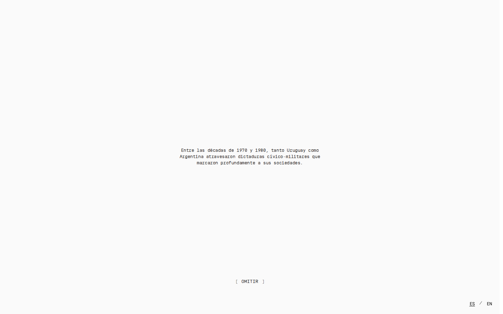
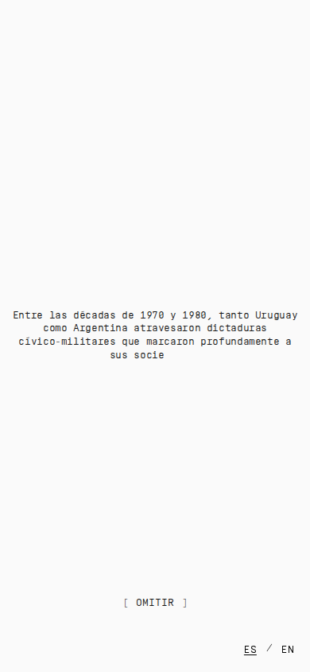

# UI Design System & Master Generation Blueprint: www-197historiasilustradas-com

> **197 Historias Ilustradas** (https://www.197historiasilustradas.com/) — 197 historias ilustradas es un proyecto que busca dar a conocer la vida de cada una de las personas detenidas desaparecidas nacidas en Ur...



---

## 1. Executive Visual Persona & Design Archetype

- **Brand Essence & Persona**: **197 Historias Ilustradas** (`https://www.197historiasilustradas.com/`). 197 historias ilustradas es un proyecto que busca dar a conocer la vida de cada una de las personas detenidas desaparecidas nacidas en Ur...
- **Capture Provenance**: Live browser capture (`tier1_fast`, HTTP `200`, captured `2026-11-23`).
- **Visual Archetype**: **Light-Substrate Editorial & Modular Grid System (`#ffffff` canvas, `#171717` ink, `#171717` accent)**.
- **Anti-AI-Slop Differentiators**:
  - **Live-Computed Chromatic Polarity**: Anchors the viewport in `#ffffff` (live computed `body` `background-color` (`computed_styles.json`)) paired with `#171717` primary typography and `#171717` accents.
  - **Grounded Typographic Hierarchy**: Pairs `font` for display copy (`197 Historias Ilustradas`) with `font` and `SFMono-Regular`.
  - **Calibrated Spatial Grid & Motion**: Combines `96rem` container bounds (`gap: 17px`, padding `17px`) with `cubic-bezier(.4,0,1,1)` easing and Lenis Smooth Scroll (`data-lenis`).

---

## 2. Spatial Architecture & Modular Grid Mathematics



### Viewport Allocation & Container Geometry
- **Captured Viewport Dimensions**: Desktop `1440×900px` (`assets/desktop.png`, single-viewport 100vh live capture (900px)), Mobile `390×844px` (`assets/mobile.png`, single-viewport 100vh live capture (844px)).
- **Master Container Bounds**: `96rem` (non-`@media` desktop container stylesheet rule).
- **Canvas Lateral Padding & Spacing**: `17px` lateral canvas padding with `17px` grid gap.
- **Border Radius Scale**: `0px` (sharp unrounded corners).

### Responsive Breakpoint Architecture
- **Desktop Layout**: Multi-column CSS Grid / Flexbox layout at `1440px` (`max-width: 96rem`, `gap: 17px`).
- **Mobile Layout**: Single-column vertical stack at `390px` viewport width with `17px` horizontal padding.
- **Extracted CSS Media Queries**: `@media screen and (max-width:1920px)`, `@media screen and (max-width:1440px)`, `@media screen and (max-width:479px)`, `@media (prefers-reduced-motion:reduce)`.

---

## 3. Color System, Materiality & Atmospheric Lighting

### Semantic Palette & Source Grounding
| Semantic Role | Ground-Truth Value | Extracted Live / CSS Source |
|---|---|---|
| **Primary Canvas Substrate** | `#ffffff` | live computed `body` `background-color` (`computed_styles.json`) |
| **Primary Typography Ink** | `#171717` | live computed `h1` `color` (`computed_styles.json`) |
| **Elevated Surface / Card Substrate** | `#000000` | `.bg-black { background-color: black }` (`#000000`) |
| **Interactive Accent / Highlight** | `#171717` | live computed `button` `color` (`computed_styles.json`) |
| **Secondary / Muted Copy** | `#737373` | `var(--muted)` in `:root` |
| **Structural Hairline Border** | `#b2b2b2` | `30 { border-color: #b2b2b2 }` |
| **Variable Token (`--color-neutral-300`)** | `#d4d4d4` | `var(--color-neutral-300)` in `:root` |
| **Variable Token (`--color-neutral-400`)** | `#a1a1a1` | `var(--color-neutral-400)` in `:root` |

### Sanitized Root CSS Variables (`ui-ux.md` Ground Truth)
| Variable Name | Extracted Value | Semantic Role |
|---|---|---|
| `--background` | `#fff` | Canvas / Surface Token |
| `--foreground` | `#171717` | Typography Ink Token |
| `--muted` | `#737373` | Color / Atmospheric Token |
| `--ease` | `cubic-bezier(.645,.045,.355,1)` | Motion / Easing Token |
| `--ease-out-expo` | `cubic-bezier(.19,1,.22,1)` | Motion / Easing Token |
| `--ease-base` | `cubic-bezier(.46,.03,.12,1)` | Motion / Easing Token |
| `--ease-magic` | `cubic-bezier(.33,0,0,1)` | Motion / Easing Token |
| `--ease-quart` | `cubic-bezier(.41,.35,.2,1)` | Motion / Easing Token |
| `--ease-overshoot` | `cubic-bezier(.175,.885,.43,1.6)` | Motion / Easing Token |
| `--ease-anticipate` | `cubic-bezier(1,-.4,.35,.95)` | Motion / Easing Token |
| `--scrollbar-gutter` | `0px` | Layout / Spatial Grid Token |
| `--color-neutral-300` | `#d4d4d4` | Brand / Palette Token |
| `--color-neutral-400` | `#a1a1a1` | Brand / Palette Token |
| `--color-black` | `#000` | Canvas / Surface Token |
| `--color-white` | `#fff` | Canvas / Surface Token |
| `--spacing` | `.25rem` | Layout / Spatial Grid Token |

---

## 4. Typographic Scale & Editorial Hierarchy

### Font Family Stacks
- **Display Typography**: `font`.
- **Primary Body Stack**: `font`.
- **Technical / Metadata Stack**: `SFMono-Regular`.

### Typographic Scale & Rules (Live Computed & Stylesheet Grounded)
- **Hero Display (`H1`)**: live computed `h1` (`font-size: 17px`, `line-height: 25.5px`, `font-weight: 400`).
- **Section Heading (`H2`)**: observed font-size ladder: `17px`, `13.8125px`, `1em`, `80%`, `75%`.
- **Body Copy**: live computed `body` (`font-size: 17px`, `line-height: 25.5px`, `font-weight: 400`).
- **Metadata & Navigation Labels**: live computed `nav/a` (`font-size: 13.8125px`, `line-height: 17.9563px`, `font-weight: 400`, `letter-spacing: -3%`); CSS variables `--default-mono-font-family: var(--font-mono)`.

---

## 5. Choreographed Motion & Interaction Physics

### Primary Easing Curves
- **Extracted Timing Functions**: `cubic-bezier(.4,0,1,1)`, `cubic-bezier(0,0,.2,1)`, `cubic-bezier(.4,0,.2,1)`.

### Per-Element Transition & Choreography Rules
- **Selector `layer theme`**: `transition: .15s` extracted from `www-197historiasilustradas-com` stylesheet.
- **Selector `.reveal-lines .line-mask:before`**: `transition: var(--reveal-duration)` extracted from `www-197historiasilustradas-com` stylesheet.
- **Selector `.reveal-lines .line-mask:after`**: `transition: var(--reveal-duration)` extracted from `www-197historiasilustradas-com` stylesheet.
- **Extracted Easing Curve (`cubic-bezier(.4,0,1,1)`)**: Governs interactive state transitions across `<header.px-global>` and `<div.px-global>`.
- **Runtime Interaction Engine**: Integrates Lenis Smooth Scroll (`data-lenis`) with `prefers-reduced-motion: reduce` fallback guards.

---

## 6. Component Wireframe & Structural DOM Map

### Visual Layout Schematic — Desktop (`1440px`, Grounded in `dom.html` & Landmark Bounding Boxes)
```
┌────────────────────────────────────────────────────────────────────────┐
│ DESKTOP VIEWPORT (1440px) — 197 Historias Ilustradas                   │
│ ====================================================================== │
│ [ <header.px-global> (1430x52px)      | [ Grilla ] · [ Listado ] · [ ] │
│ ---------------------------------------------------------------------- │
│ | HERO STAGE: <div.is-ready> (w=1440px)                              | │
│ | H1: 197 Historias Ilustradas                                       | │
│ | Substrate: #ffffff | Ink: #171717 | Accent: #171717                | │
│ ---------------------------------------------------------------------- │
│ | SHOWCASE GRID (<div.px-global>) max-w: 96rem                       | │
│ | +------------------------------+  +------------------------------+ | │
│ | | Entre las décadas de 1970 y  |  | Historias Ilustradas         | | │
│ | +------------------------------+  +------------------------------+ | │
│ ---------------------------------------------------------------------- │
│ | DETAIL MODULE (<div.fixed>) — E n t r e l a s d é c                | │
│ ---------------------------------------------------------------------- │
│ [ FOOTER (<footer.top-0>      ) | https://www.197historiasilustradas.  │
└────────────────────────────────────────────────────────────────────────┘
```

### Visual Layout Schematic — Mobile Reflow (`390px`)
```
┌────────────────────────────────────────────────────────────────────────┐
│ MOBILE VIEWPORT REFLOW (390px) — Single-Column Stack (gap: 17px)       │
│ ====================================================================== │
│ [ HEADER BAR (<header.px-global>      ) | Compact Menu (390px)         │
│ ---------------------------------------------------------------------- │
│ | HERO STAGE (<div.is-ready>) — 390px Vertical Lead                  | │
│ | H1: 197 Historias Ilustradas                                       | │
│ ---------------------------------------------------------------------- │
│ | SHOWCASE STACK (<div.px-global>) — 1-Col Stack                     | │
│ | [ Item 1: Entre las décadas de 1970 y 1980, tanto Uruguay        ] | │
│ | [ Item 2: Historias Ilustradas                                   ] | │
│ ---------------------------------------------------------------------- │
│ | DETAIL STACK (<div.fixed>) — 1-Col (E n t r e l a s d )            | │
│ ---------------------------------------------------------------------- │
│ [ FOOTER (<footer.top-0>      ) | Stacked 390px Colophon               │
└────────────────────────────────────────────────────────────────────────┘
```

### Granular DOM Region Breakdown
1. **Brand Header & Navigation Bar (<header.px-global> — `www-197historiasilustradas-com`)**:
   - Landmark `<header class="px-global top-0">` (`1430x52px`) hosting `197 Historias Ilustradas` navigation (`[ Grilla ] · [ Listado ] · [ Galería ]`), DOM attributes (`data-precedence="next"`, `data-precedence="next"`, `data-sdkn="@vercel/analytics/next"`, `data-sdkv="2.0.1"`), and stylesheet rule `font_1f361888-module__Z4XWVW__cla... { font-family:font,font Fallback }`.
2. **Hero Stage & Focal Lead (<div.is-ready> — `197 Historias Ilustradas`)**:
   - Landmark `<div class="is-ready">` presenting display lead `197 Historias Ilustradas` and copy excerpt *"Entre las décadas de 1970 y 1980, tanto Uruguay como Argentina at"* over `#ffffff` canvas and `#171717` ink.
3. **Primary Showcase & Content Grid (<div.px-global> — `Entre las décadas de 1970 y 1980, `)**:
   - Landmark `<div class="px-global">` rendering section `Entre las décadas de 1970 y 1980, tanto Uruguay ` with copy *"Historias Ilustradas"*, asset references (`882aee3e7e5fa64f.css`, `3068344f6b59fc28.css`, `a6a883b7ec42f0a6.js`, `1c40893e27076bb9.js`), and grid rule `host { --color-neutral-300:lab(84.92% 0 -.0000119209);--color-neutral-400:lab(6... }`.
4. **Interactive Detail & Feature Matrix (<div.fixed> — `Historias Ilustradas`)**:
   - Landmark `<div class="fixed">` framing `Historias Ilustradas` and `E n t r e l a s d é c a d a s d e 1 9 7 0 y 1 9 ` (*"E n t r e l a s d é c a d a s d e 1 9 7 0 y 1 9 8 0 , t a n t o U"*) with `#000000` surface cards, `#171717` accents, and `backdrop { box-sizing:border-box;border:0 solid;margin:0;padding:0 }`.
5. **Colophon & Global Directory Footer (<footer.top-0> — `https://www.197historiasilustradas.com/`)**:
   - Landmark `<footer class="top-0">` anchoring `197 Historias Ilustradas` footer links (`[ Grilla ] · [ Listado ] · [ Galería ]`), copy *"R e c o r d a r e s v o l v e r a d a r v i d a ; p o r q u "*, and `#b2b2b2` structural dividers.

---

## 7. Master Zero-Shot AI Generation Prompt

```markdown
# Master Zero-Shot Frontend Generation Prompt: www-197historiasilustradas-com (197 Historias Ilustradas)

You are a principal frontend architect and design systems engineer. Build a complete, production-ready web application replicating the exact design system, DOM landmarks, typographic hierarchy, color tokens, and motion physics of `www-197historiasilustradas-com` (**197 Historias Ilustradas** — `https://www.197historiasilustradas.com/`).

### 1. Visual Archetype & Anti-AI-Slop Mandates
- **Archetype**: Light-Substrate Editorial & Modular Grid System (`#ffffff` canvas, `#171717` ink, `#171717` accent).
- **Identity & Domain Context**: 197 historias ilustradas es un proyecto que busca dar a conocer la vida de cada una de las personas detenidas desaparecidas nacidas en Ur...
- **Primary Substrate**: `#ffffff` (live computed `body` `background-color` (`computed_styles.json`)), **Primary Ink**: `#171717`, **Accent / Highlight**: `#171717`.
- **Site-Specific Differentiators**:
  - **Live-Computed Chromatic Polarity**: Anchors the viewport in `#ffffff` (live computed `body` `background-color` (`computed_styles.json`)) paired with `#171717` primary typography and `#171717` accents.
  - **Grounded Typographic Hierarchy**: Pairs `font` for display copy (`197 Historias Ilustradas`) with `font` and `SFMono-Regular`.
  - **Calibrated Spatial Grid & Motion**: Combines `96rem` container bounds (`gap: 17px`, padding `17px`) with `cubic-bezier(.4,0,1,1)` easing and Lenis Smooth Scroll (`data-lenis`).

### 2. Ground-Truth CSS Variables (`:root` Token Contract)
Declare and consume these exact custom properties extracted from `www-197historiasilustradas-com` in your global stylesheet:

:root {
  /* 197 Historias Ilustradas (www-197historiasilustradas-com) — Live-Grounded CSS Variables */
  --background: #fff; /* Canvas / Surface Token (www-197historiasilustradas-com) */
  --foreground: #171717; /* Typography Ink Token (www-197historiasilustradas-com) */
  --muted: #737373; /* Color / Atmospheric Token (www-197historiasilustradas-com) */
  --ease: cubic-bezier(.645,.045,.355,1); /* Motion / Easing Token (www-197historiasilustradas-com) */
  --ease-out-expo: cubic-bezier(.19,1,.22,1); /* Motion / Easing Token (www-197historiasilustradas-com) */
  --ease-base: cubic-bezier(.46,.03,.12,1); /* Motion / Easing Token (www-197historiasilustradas-com) */
  --ease-magic: cubic-bezier(.33,0,0,1); /* Motion / Easing Token (www-197historiasilustradas-com) */
  --ease-quart: cubic-bezier(.41,.35,.2,1); /* Motion / Easing Token (www-197historiasilustradas-com) */
  --ease-overshoot: cubic-bezier(.175,.885,.43,1.6); /* Motion / Easing Token (www-197historiasilustradas-com) */
  --ease-anticipate: cubic-bezier(1,-.4,.35,.95); /* Motion / Easing Token (www-197historiasilustradas-com) */
  --scrollbar-gutter: 0px; /* Layout / Spatial Grid Token (www-197historiasilustradas-com) */
  --color-neutral-300: #d4d4d4; /* Brand / Palette Token (www-197historiasilustradas-com) */
  --color-neutral-400: #a1a1a1; /* Brand / Palette Token (www-197historiasilustradas-com) */
  --color-black: #000; /* Canvas / Surface Token (www-197historiasilustradas-com) */
  --color-white: #fff; /* Canvas / Surface Token (www-197historiasilustradas-com) */
  --spacing: .25rem; /* Layout / Spatial Grid Token (www-197historiasilustradas-com) */
}

### 3. Semantic Color & Materiality Contract
Map every surface, ink, and border strictly to these source-grounded tokens:
- **Primary Canvas Substrate**: `#ffffff` — grounded in live computed `body` `background-color` (`computed_styles.json`)
- **Primary Typography Ink**: `#171717` — grounded in live computed `h1` `color` (`computed_styles.json`)
- **Elevated Surface / Card Substrate**: `#000000` — grounded in `.bg-black { background-color: black }` (`#000000`)
- **Interactive Accent / Highlight**: `#171717` — grounded in live computed `button` `color` (`computed_styles.json`)
- **Secondary / Muted Copy**: `#737373` — grounded in `var(--muted)` in `:root`
- **Structural Hairline Border**: `#b2b2b2` — grounded in `30 { border-color: #b2b2b2 }`
- **Variable Token (`--color-neutral-300`)**: `#d4d4d4` — grounded in `var(--color-neutral-300)` in `:root`
- **Variable Token (`--color-neutral-400`)**: `#a1a1a1` — grounded in `var(--color-neutral-400)` in `:root`

### 4. Spatial Grid, Container Bounds & Responsive Breakpoints
- **Desktop Viewport Reference**: `1440×900px` (single-viewport 100vh live capture (900px), `1440px` standard desktop width).
- **Mobile Viewport Reference**: `390×844px` (single-viewport 100vh live capture (844px), `390px` standard mobile width).
- **Container Max-Width**: `96rem` (non-`@media` desktop container stylesheet rule)
- **Padding & Gutters**: `17px` lateral canvas padding with `17px` grid gap
- **Desktop Grid**: Multi-column CSS Grid / Flexbox layout at `1440px` (`max-width: 96rem`, `gap: 17px`)
- **Mobile Adaptation**: Single-column vertical stack at `390px` viewport width with `17px` horizontal padding
- **Media Queries**: `@media screen and (max-width:1920px)`, `@media screen and (max-width:1440px)`, `@media screen and (max-width:479px)`, `@media (prefers-reduced-motion:reduce)`
- **Corner Radii**: `0px` (sharp unrounded corners)

### 5. Typography & Editorial Scale Contract
- **Display Font Stack**: `font`
- **Body Font Stack**: `font`
- **Monospace / Technical Font Stack**: `SFMono-Regular`
- **H1 Display Rule**: live computed `h1` (`font-size: 17px`, `line-height: 25.5px`, `font-weight: 400`)
- **H2 Section Rule**: observed font-size ladder: `17px`, `13.8125px`, `1em`, `80%`, `75%`
- **Body Copy Rule**: live computed `body` (`font-size: 17px`, `line-height: 25.5px`, `font-weight: 400`)
- **Metadata & Index Rule**: live computed `nav/a` (`font-size: 13.8125px`, `line-height: 17.9563px`, `font-weight: 400`, `letter-spacing: -3%`); CSS variables `--default-mono-font-family: var(--font-mono)`

### 6. Component Hierarchy, Verbatim Copy & Real DOM Landmarks
Scaffold `www-197historiasilustradas-com` (`197 Historias Ilustradas`) with these exact structural regions, extracted copy, and CSS rules from `dom.html`:
1. **Brand Header & Navigation Bar (<header.px-global> — `www-197historiasilustradas-com`)**:
   - DOM & Selectors: Landmark `<header class="px-global top-0">` (`1430x52px`) hosting `197 Historias Ilustradas` navigation (`[ Grilla ] · [ Listado ] · [ Galería ]`), DOM attributes (`data-precedence="next"`, `data-precedence="next"`, `data-sdkn="@vercel/analytics/next"`, `data-sdkv="2.0.1"`), and stylesheet rule `font_1f361888-module__Z4XWVW__cla... { font-family:font,font Fallback }`.
   - Responsive Contract: Header `Brand Header & Navigation Bar (<header.px-global> — `www-197historiasilustradas-com`)` (`www-197historiasilustradas-com`) adapts across `@media screen and (max-width:1920px)`, `@media screen and (max-width:1440px)`, `@media screen and (max-width:479px)`, `@media (prefers-reduced-motion:reduce)` with `cubic-bezier(.4,0,1,1)`, `cubic-bezier(0,0,.2,1)`, `cubic-bezier(.4,0,.2,1)` transitions and links `[ Grilla ] · [ Listado ] · [ Galería ]`.
2. **Hero Stage & Focal Lead (<div.is-ready> — `197 Historias Ilustradas`)**:
   - DOM & Selectors: Landmark `<div class="is-ready">` presenting display lead `197 Historias Ilustradas` and copy excerpt *"Entre las décadas de 1970 y 1980, tanto Uruguay como Argentina at"* over `#ffffff` canvas and `#171717` ink.
   - Responsive Contract: Hero stage (`1440×900px` desktop / `390×844px` mobile) sets `#ffffff` background with `#171717` headline `197 Historias Ilustradas`.
3. **Primary Showcase & Content Grid (<div.px-global> — `Entre las décadas de 1970 y 1980, `)**:
   - DOM & Selectors: Landmark `<div class="px-global">` rendering section `Entre las décadas de 1970 y 1980, tanto Uruguay ` with copy *"Historias Ilustradas"*, asset references (`882aee3e7e5fa64f.css`, `3068344f6b59fc28.css`, `a6a883b7ec42f0a6.js`, `1c40893e27076bb9.js`), and grid rule `host { --color-neutral-300:lab(84.92% 0 -.0000119209);--color-neutral-400:lab(6... }`.
   - Responsive Contract: Showcase grid `Primary Showcase & Content Grid (<div.px-global> — `Entre las décadas de 1970 y 1980, `)` applies Multi-column CSS Grid / Flexbox layout at `1440px` (`max-width: 96rem`, `gap: 17px`) on desktop and Single-column vertical stack at `390px` viewport width with `17px` horizontal padding on mobile.
4. **Interactive Detail & Feature Matrix (<div.fixed> — `Historias Ilustradas`)**:
   - DOM & Selectors: Landmark `<div class="fixed">` framing `Historias Ilustradas` and `E n t r e l a s d é c a d a s d e 1 9 7 0 y 1 9 ` (*"E n t r e l a s d é c a d a s d e 1 9 7 0 y 1 9 8 0 , t a n t o U"*) with `#000000` surface cards, `#171717` accents, and `backdrop { box-sizing:border-box;border:0 solid;margin:0;padding:0 }`.
   - Responsive Contract: Detail module `Interactive Detail & Feature Matrix (<div.fixed> — `Historias Ilustradas`)` uses `0px` (sharp unrounded corners) radii, `#171717` highlights, and assets (882aee3e7e5fa64f.css, 3068344f6b59fc28.css, a6a883b7ec42f0a6.js).
5. **Colophon & Global Directory Footer (<footer.top-0> — `https://www.197historiasilustradas.com/`)**:
   - DOM & Selectors: Landmark `<footer class="top-0">` anchoring `197 Historias Ilustradas` footer links (`[ Grilla ] · [ Listado ] · [ Galería ]`), copy *"R e c o r d a r e s v o l v e r a d a r v i d a ; p o r q u "*, and `#b2b2b2` structural dividers.
   - Responsive Contract: Footer `Colophon & Global Directory Footer (<footer.top-0> — `https://www.197historiasilustradas.com/`)` aligns to `96rem` (non-`@media` desktop container stylesheet rule) with `17px` lateral canvas padding with `17px` grid gap and attributes (data-precedence="next", data-precedence="next", data-sdkn="@vercel/analytics/next").

#### Verbatim DOM Copy Excerpts (`dom.html`)
- Copy Excerpt 1: *"Entre las décadas de 1970 y 1980, tanto Uruguay como Argentina atravesaron dictadu..."*
- Copy Excerpt 2: *"Historias Ilustradas"*
- Copy Excerpt 3: *"E n t r e l a s d é c a d a s d e 1 9 7 0 y 1 9 8 0 , t a n t o U r u g u a y c o..."*
- Copy Excerpt 4: *"R e c o r d a r e s v o l v e r a d a r v i d a ; p o r q u e s o l o l o q u e n..."*

### 7. Motion, Extracted Stylesheet Rules & Interaction Choreography
- **Primary Easing Functions**: `cubic-bezier(.4,0,1,1)`, `cubic-bezier(0,0,.2,1)`, `cubic-bezier(.4,0,.2,1)`
- **Extracted Stylesheet Rules (`www-197historiasilustradas-com`)**:
- `font_1f361888-module__Z4XWVW__cla... { font-family:font,font Fallback }`
- `host { --color-neutral-300:lab(84.92% 0 -.0000119209);--color-neutral-400:lab(6... }`
- `backdrop { box-sizing:border-box;border:0 solid;margin:0;padding:0 }`
- `file-selector-button { box-sizing:border-box;border:0 solid;margin:0;padding:0 }`
- `strong { font-weight:bolder }`
- **Per-Selector Transition Rules**:
- **Selector `layer theme`**: `transition: .15s` extracted from `www-197historiasilustradas-com` stylesheet.
- **Selector `.reveal-lines .line-mask:before`**: `transition: var(--reveal-duration)` extracted from `www-197historiasilustradas-com` stylesheet.
- **Selector `.reveal-lines .line-mask:after`**: `transition: var(--reveal-duration)` extracted from `www-197historiasilustradas-com` stylesheet.
- **Extracted Easing Curve (`cubic-bezier(.4,0,1,1)`)**: Governs interactive state transitions across `<header.px-global>` and `<div.px-global>`.
- **Runtime Interaction Engine**: Integrates Lenis Smooth Scroll (`data-lenis`) with `prefers-reduced-motion: reduce` fallback guards.

### 8. Technical Deliverables
- Implement in Next.js (App Router) with TypeScript and Tailwind CSS consuming the `:root` custom properties defined above for `www-197historiasilustradas-com`.
- Reproduce both the `1440px` desktop architecture and `390px` mobile breakpoint transitions, preserving semantic HTML5 landmarks (`<header>`, `<nav>`, `<main>`, `<section>`, `<footer>`) and `prefers-reduced-motion` accessibility guards.
```
