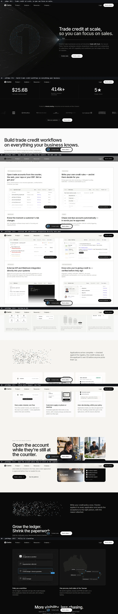
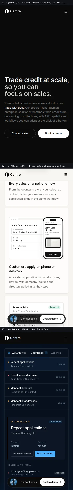

# UI Design System & Master Generation Blueprint: www-1centre-com

> **1Centre — Trade Credit Software for NZ & Australia** (https://www.1centre.com/) — Trade credit software for suppliers in New Zealand and Australia: digital account applications, ID checks, credit decisions, 24/7 monitor...





---

## 1. Executive Visual Persona & Design Archetype

- **Brand Essence & Persona**: **1Centre — Trade Credit Software for NZ & Australia** (`https://www.1centre.com/`). Trade credit software for suppliers in New Zealand and Australia: digital account applications, ID checks, credit decisions, 24/7 monitor...
- **Capture Provenance**: Live browser capture (`tier1_fast`, HTTP `200`, captured `2026-11-24`).
- **Visual Archetype**: **Light-Gallery WebGL / Canvas Interactive Experience (`#fafbfa` / `#4ab0ff`)**.
- **Anti-AI-Slop Differentiators**:
  - **Live-Computed Chromatic Polarity**: Anchors the viewport in `#fafbfa` (live computed `body` `background-color` (`computed_styles.json`)) paired with `#101112` primary typography and `#4ab0ff` accents.
  - **Grounded Typographic Hierarchy**: Uses `Inter` across display (`Trade credit at scale, so you can fo`) and body copy, paired with `SFMono-Regular` for monospace/code.
  - **Calibrated Spatial Grid & Motion**: Combines `1400px` container bounds (`gap: 36px`, padding `1.25rem`) with `cubic-bezier(0,0,.2,1)` easing and HTML5 `<canvas>` Interactive Viewport Surface.

---

## 2. Spatial Architecture & Modular Grid Mathematics

### Viewport Allocation & Container Geometry
- **Captured Journey Filmstrips**: Desktop `1280×6624px` (`assets/desktop-journey.webp`, `8` keyframes up to `y=6799px` / doc `18757px`), Mobile `390×2616px` (`assets/mobile-journey.webp`, `3` keyframes).
- **Master Container Bounds**: `1400px` (measured widest bounded `<section>` landmark width on `1440px` desktop).
- **Canvas Lateral Padding & Spacing**: `1.25rem` lateral canvas padding with `36px` grid gap.
- **Border Radius Scale**: `4px`, `12px`, `2px`, `6px`.

### Responsive Breakpoint Architecture
- **Desktop Layout**: Multi-column CSS Grid / Flexbox layout at `1440px` (`max-width: 1400px`, `gap: 36px`).
- **Mobile Layout**: Single-column vertical stack at `390px` viewport width with `1.25rem` horizontal padding.
- **Extracted CSS Media Queries**: `@media (prefers-reduced-motion:reduce)`, `@media (max-width:479px)`, `@media (max-width:639px)`, `@media (min-width:1024px)`.

---

## 3. Color System, Materiality & Atmospheric Lighting

### Semantic Palette & Source Grounding
| Semantic Role | Ground-Truth Value | Extracted Live / CSS Source |
|---|---|---|
| **Primary Canvas Substrate** | `#fafbfa` | live computed `body` `background-color` (`computed_styles.json`) |
| **Primary Typography Ink** | `#101112` | live computed `main` `color` (`computed_styles.json`) |
| **Elevated Surface / Card Substrate** | `#f6f5f2` | `var(--color-paper)` in `:root` |
| **Interactive Accent / Highlight** | `#4ab0ff` | `.btn-dots.btn-candy { background-color: #4ab0ff }` |
| **Secondary / Muted Copy** | `#9a9da0` | `var(--color-muted-2)` in `:root` |
| **Structural Hairline Border** | `#e7e9e8` | `var(--color-line)` in `:root` |
| **Variable Token (`--color-amber-500`)** | `#f99c00` | `var(--color-amber-500)` in `:root` |
| **Variable Token (`--color-amber-700`)** | `#b75000` | `var(--color-amber-700)` in `:root` |
| **Variable Token (`--color-black`)** | `#000000` | `var(--color-black)` in `:root` |
| **Variable Token (`--color-white`)** | `#ffffff` | `var(--color-white)` in `:root` |

### Sanitized Root CSS Variables (`ui-ux.md` Ground Truth)
| Variable Name | Extracted Value | Semantic Role |
|---|---|---|
| `--font-inter` | `"Inter", "Inter Fallback"` | Typography / Scale Token |
| `--font-archivo` | `"Archivo Black", "Archivo Black Fallback"` | Typography / Scale Token |
| `--dot-r` | `0px` | Dimension / Scale Token |
| `--qc-r` | `60%` | Dimension / Scale Token |
| `--qc-r2` | `70%` | Dimension / Scale Token |
| `--font-sans` | `var(--font-inter), ui-sans-serif, system-ui, -apple-system, sans-serif` | Typography / Scale Token |
| `--font-serif` | `ui-serif, Georgia, Cambria, "Times New Roman", Times, serif` | Typography / Scale Token |
| `--color-amber-500` | `#f99c00` | Brand / Palette Token |
| `--color-amber-700` | `#b75000` | Brand / Palette Token |
| `--color-black` | `#000` | Canvas / Surface Token |
| `--color-white` | `#fff` | Canvas / Surface Token |
| `--spacing` | `.25rem` | Layout / Spatial Grid Token |
| `--text-4xl` | `2.25rem` | Typography Ink Token |
| `--text-4xl--line-height` | `calc(2.5 / 2.25)` | Typography Ink Token |
| `--text-5xl` | `3rem` | Typography Ink Token |
| `--text-5xl--line-height` | `1` | Typography Ink Token |

---

## 4. Typographic Scale & Editorial Hierarchy

### Font Family Stacks
- **Display Typography**: `Inter`.
- **Primary Body Stack**: `Inter`.
- **Technical / Metadata Stack**: `SFMono-Regular`.

### Typographic Scale & Rules (Live Computed & Stylesheet Grounded)
- **Hero Display (`H1`)**: live computed `h1` (`font-size: 55.6667px`, `line-height: 54.5533px`, `font-weight: 500`, `letter-spacing: -1.94833px`); CSS variables `--text-4xl: 2.25rem`, `--text-4xl--line-height: calc(2.5 / 2.25)`, `--text-5xl: 3rem`.
- **Section Heading (`H2`)**: live computed `h2` (`font-size: 86.4px`, `line-height: 84.672px`, `font-weight: 500`, `letter-spacing: -3.888px`).
- **Body Copy**: live computed `body` (`font-size: 16px`, `line-height: 24px`, `font-weight: 400`).
- **Metadata & Navigation Labels**: live computed `nav/a` (`font-size: 16px`, `line-height: 24px`, `font-weight: 400`); CSS variables `--default-mono-font-family: var(--font-mono)`.

---

## 5. Choreographed Motion & Interaction Physics

### Primary Easing Curves
- **Extracted Timing Functions**: `cubic-bezier(0,0,.2,1)`, `cubic-bezier(.4,0,.6,1)`, `cubic-bezier(.4,0,.2,1)`.

### Per-Element Transition & Choreography Rules
- **Selector `layer theme`**: `transition: .15s` extracted from `www-1centre-com` stylesheet.
- **Selector `.policy-toc a`**: `transition: color .15s` extracted from `www-1centre-com` stylesheet.
- **Selector `.v10-art`**: `transition: opacity .4s` extracted from `www-1centre-com` stylesheet.
- **Extracted Easing Curve (`cubic-bezier(0,0,.2,1)`)**: Governs interactive state transitions across `<header.top-0>` and `<section.group>`.
- **Runtime Interaction Engine**: Integrates HTML5 `<canvas>` Interactive Viewport Surface with `prefers-reduced-motion: reduce` fallback guards.
### Measured Runtime Scroll & Interaction Telemetry (`behavioral_journey_v2`)
- **Scroll Driver Mode**: `native` (max document height `18757px`, deepest scrollY reached `6799px` across `8` desktop keyframes).
- **Detected Scroll / Motion Libraries**: `WebGL/Canvas`.
- **Nav / Drawer Probe (`Product`)**: Triggered visual change (pixel diff `7.712`, captured in `assets/state-nav.webp`); revealed links: APPLICATION TO ACCOUN..., RISK, CONTINUOUSLY Ac..., ACCOUNTS RECEIVABLE A..., CONNECT YOUR SYSTEMS..., Our customers.
- **Hover Physics (`primary_cta` · `Contact sales`)**: `borderColor`: `oklab(0.999994 0.000045...` -> `oklab(0.999994 0.000045...` (`transition-duration: 0.15s`, `timing: cubic-bezier(0.4, 0, 0.2, 1)`).
- **Interactive Control Probe (`accordion` · `02 Foodservice & Beverage`)**: Triggered visual diff `30.315` (attr `false -> true`, captured in `assets/state-interactive.webp`).
- **Route Transition Architecture**: First internal navigation (`/pricing`) measured as `direct` in `1517ms`.

---

## 6. Component Wireframe & Structural DOM Map

### Visual Layout Schematic — Desktop (`1440px`, Grounded in `dom.html` & Landmark Bounding Boxes)
```
┌────────────────────────────────────────────────────────────────────────┐
│ DESKTOP VIEWPORT (1440px) — 1Centre — Trade Credit Software for NZ & A │
│ ====================================================================== │
│ [ <header.top-0> (1440x64px)          | Overview · Index · Archive · ] │
│ ---------------------------------------------------------------------- │
│ | HERO STAGE: <section.relative> (w=1440px)                          | │
│ | H1: Trade credit at scale, so you can focus on sales.              | │
│ | Substrate: #fafbfa | Ink: #101112 | Accent: #4ab0ff                | │
│ ---------------------------------------------------------------------- │
│ | SHOWCASE GRID (<section.group>) max-w: 1400px                      | │
│ | +------------------------------+  +------------------------------+ | │
│ | | Build trade credit workflows |  | Open trade accounts from the | | │
│ | +------------------------------+  +------------------------------+ | │
│ ---------------------------------------------------------------------- │
│ | DETAIL MODULE (<section.scroll-mt-20>) — Write your own credit     | │
│ ---------------------------------------------------------------------- │
│ [ FOOTER (<footer.relative>   ) | https://www.1centre.com/             │
└────────────────────────────────────────────────────────────────────────┘
```

### Visual Layout Schematic — Mobile Reflow (`390px`)
```
┌────────────────────────────────────────────────────────────────────────┐
│ MOBILE VIEWPORT REFLOW (390px) — Single-Column Stack (gap: 36px)       │
│ ====================================================================== │
│ [ HEADER BAR (<header.top-0>          ) | Compact Menu (390px)         │
│ ---------------------------------------------------------------------- │
│ | HERO STAGE (<section.relative>) — 390px Vertical Lead              | │
│ | H1: Trade credit at scale, so you can focus on sales.              | │
│ ---------------------------------------------------------------------- │
│ | SHOWCASE STACK (<section.group>) — 1-Col Stack                     | │
│ | [ Item 1: Build trade credit workflows on everything your b...   ] | │
│ | [ Item 2: Open trade accounts from the counter, the web, yo...   ] | │
│ ---------------------------------------------------------------------- │
│ | DETAIL STACK (<section.scroll-mt-20>) — 1-Col (Write your own cre) | │
│ ---------------------------------------------------------------------- │
│ [ FOOTER (<footer.relative>   ) | Stacked 390px Colophon               │
└────────────────────────────────────────────────────────────────────────┘
```

### Granular DOM Region Breakdown
1. **Brand Header & Navigation Bar (<header.top-0> — `www-1centre-com`)**:
   - Landmark `<header class="top-0 transition-colors">` (`1440x64px`) hosting `1Centre — Trade Credit Software for ` navigation (`Overview · Index · Archive · About · Contact`), DOM attributes (`data-precedence="next"`, `data-precedence="next"`, `data-nimg="1"`, `data-dark="true"`), and stylesheet rule `nter_7b064e0d-module__MOT0tq__cla... { font-family:Inter,Inter Fallback;font-style:normal }`.
2. **Hero Stage & Focal Lead (<section.relative> — `Trade credit at scale, so you can `)**:
   - Landmark `<section class="relative overflow-hidden">` presenting display lead `Trade credit at scale, so you can focus on sales.` and copy excerpt *"1Centre helps businesses across all industries trade with trust. "* over `#fafbfa` canvas and `#101112` ink.
3. **Primary Showcase & Content Grid (<section.group> — `Build trade credit workflows on ev`)**:
   - Landmark `<section class="group border-y">` rendering section `Build trade credit workflows on everything your b...` with copy *"Trade credit at scale,"*, asset references (`5e4d537aaa9e154b-s.p.0g9-.3zp53cu...`, `83afe278b6a6bb3c-s.p.0q-301v4kxxn...`, `logo-mark.svg`, `mitre10.svg`), and grid rule `inter_7b064e0d-module__MOT0tq__va... { --font-inter:"Inter", "Inter Fallback" }`.
4. **Interactive Detail & Feature Matrix (<section.scroll-mt-20> — `Open trade accounts from the count`)**:
   - Landmark `<section class="scroll-mt-20 pb-16">` framing `Open trade accounts from the counter, the web, yo...` and `Write your own credit rules — and let them decide...` (*"so you can focus on sales."*) with `#f6f5f2` surface cards, `#4ab0ff` accents, and `lack_857642da-module__iF7jea__cla... { font-family:Archivo Black,Archivo Black Fallback;font-style:normal;font-... }`.
5. **Colophon & Global Directory Footer (<footer.relative> — `https://www.1centre.com/`)**:
   - Landmark `<footer class="relative overflow-hidden">` anchoring `1Centre — Trade Credit Software ` footer links (`Overview · Index · Archive · About · Contact`), copy *"1Centre helps businesses across all industries"*, and `#e7e9e8` structural dividers.
### Full Vertical Scroll Sequence (Desktop `1440×900` Keyframes)
- **Step 01** (`y=0px`, `0%`): Active landmark `Trade credit at scale, so you can focus on sales.` · sticky/fixed elements: `1`
- **Step 02** (`y=850px`, `5%`): Active landmark `Build trade credit workflows on everything your b...` · sticky/fixed elements: `1`
- **Step 03** (`y=1701px`, `10%`): Active landmark `Open trade accounts from the counter, the web, yo...` · sticky/fixed elements: `1`
- **Step 04** (`y=2550px`, `14%`): Active landmark `External API and Webhook integration directly int...` · sticky/fixed elements: `1`
- **Step 05** (`y=4250px`, `24%`): Active landmark `Section @ 24%` · sticky/fixed elements: `1`
- **Step 06** (`y=5100px`, `29%`): Active landmark `Every sales channel, one flow` · sticky/fixed elements: `1`
- **Step 07** (`y=5950px`, `33%`): Active landmark `Open the account while they're still at the counter.` · sticky/fixed elements: `1`
- **Step 08** (`y=6799px`, `38%`): Active landmark `Policy as a workflow` · sticky/fixed elements: `1`

### Multi-Page Internal Route Map
- **Listing Route (`/pricing`)**: `https://www.1centre.com/pricing` — H1: `Simple pricing that grows with your volume.`, scrollHeight `5783px`, transition `direct` (`1517ms`)
- **About Route (`/contact`)**: `https://www.1centre.com/contact?enquiry=demo` — H1: `See 1Centre in action. Talk to our team. We're he...`, scrollHeight `2744px`, transition `direct` (`1349ms`)
- **Other Route (`/platform`)**: `https://www.1centre.com/platform` — H1: `One platform for trade credit.`, scrollHeight `4311px`, transition `direct` (`720ms`)

---

## 7. Master Zero-Shot AI Generation Prompt

```markdown
# Master Zero-Shot Frontend Generation Prompt: www-1centre-com (1Centre — Trade Credit Software for NZ & Australia)

You are a principal frontend architect and design systems engineer. Build a complete, production-ready web application replicating the exact design system, DOM landmarks, typographic hierarchy, color tokens, and motion physics of `www-1centre-com` (**1Centre — Trade Credit Software for NZ & Australia** — `https://www.1centre.com/`).

### 1. Visual Archetype & Anti-AI-Slop Mandates
- **Archetype**: Light-Gallery WebGL / Canvas Interactive Experience (`#fafbfa` / `#4ab0ff`).
- **Identity & Domain Context**: Trade credit software for suppliers in New Zealand and Australia: digital account applications, ID checks, credit decisions, 24/7 monitor...
- **Primary Substrate**: `#fafbfa` (live computed `body` `background-color` (`computed_styles.json`)), **Primary Ink**: `#101112`, **Accent / Highlight**: `#4ab0ff`.
- **Site-Specific Differentiators**:
  - **Live-Computed Chromatic Polarity**: Anchors the viewport in `#fafbfa` (live computed `body` `background-color` (`computed_styles.json`)) paired with `#101112` primary typography and `#4ab0ff` accents.
  - **Grounded Typographic Hierarchy**: Uses `Inter` across display (`Trade credit at scale, so you can fo`) and body copy, paired with `SFMono-Regular` for monospace/code.
  - **Calibrated Spatial Grid & Motion**: Combines `1400px` container bounds (`gap: 36px`, padding `1.25rem`) with `cubic-bezier(0,0,.2,1)` easing and HTML5 `<canvas>` Interactive Viewport Surface.

### 2. Ground-Truth CSS Variables (`:root` Token Contract)
Declare and consume these exact custom properties extracted from `www-1centre-com` in your global stylesheet:

:root {
  /* 1Centre — Trade Credit Software for NZ & Australia (www-1centre-com) — Live-Grounded CSS Variables */
  --font-inter: "Inter", "Inter Fallback"; /* Typography / Scale Token (www-1centre-com) */
  --font-archivo: "Archivo Black", "Archivo Black Fallback"; /* Typography / Scale Token (www-1centre-com) */
  --dot-r: 0px; /* Dimension / Scale Token (www-1centre-com) */
  --qc-r: 60%; /* Dimension / Scale Token (www-1centre-com) */
  --qc-r2: 70%; /* Dimension / Scale Token (www-1centre-com) */
  --font-sans: var(--font-inter), ui-sans-serif, system-ui, -apple-system, sans-serif; /* Typography / Scale Token (www-1centre-com) */
  --font-serif: ui-serif, Georgia, Cambria, "Times New Roman", Times, serif; /* Typography / Scale Token (www-1centre-com) */
  --color-amber-500: #f99c00; /* Brand / Palette Token (www-1centre-com) */
  --color-amber-700: #b75000; /* Brand / Palette Token (www-1centre-com) */
  --color-black: #000; /* Canvas / Surface Token (www-1centre-com) */
  --color-white: #fff; /* Canvas / Surface Token (www-1centre-com) */
  --spacing: .25rem; /* Layout / Spatial Grid Token (www-1centre-com) */
  --text-4xl: 2.25rem; /* Typography Ink Token (www-1centre-com) */
  --text-4xl--line-height: calc(2.5 / 2.25); /* Typography Ink Token (www-1centre-com) */
  --text-5xl: 3rem; /* Typography Ink Token (www-1centre-com) */
  --text-5xl--line-height: 1; /* Typography Ink Token (www-1centre-com) */
}

### 3. Semantic Color & Materiality Contract
Map every surface, ink, and border strictly to these source-grounded tokens:
- **Primary Canvas Substrate**: `#fafbfa` — grounded in live computed `body` `background-color` (`computed_styles.json`)
- **Primary Typography Ink**: `#101112` — grounded in live computed `main` `color` (`computed_styles.json`)
- **Elevated Surface / Card Substrate**: `#f6f5f2` — grounded in `var(--color-paper)` in `:root`
- **Interactive Accent / Highlight**: `#4ab0ff` — grounded in `.btn-dots.btn-candy { background-color: #4ab0ff }`
- **Secondary / Muted Copy**: `#9a9da0` — grounded in `var(--color-muted-2)` in `:root`
- **Structural Hairline Border**: `#e7e9e8` — grounded in `var(--color-line)` in `:root`
- **Variable Token (`--color-amber-500`)**: `#f99c00` — grounded in `var(--color-amber-500)` in `:root`
- **Variable Token (`--color-amber-700`)**: `#b75000` — grounded in `var(--color-amber-700)` in `:root`
- **Variable Token (`--color-black`)**: `#000000` — grounded in `var(--color-black)` in `:root`
- **Variable Token (`--color-white`)**: `#ffffff` — grounded in `var(--color-white)` in `:root`

### 4. Spatial Grid, Container Bounds & Responsive Breakpoints
- **Desktop Viewport Reference**: `1280×6624px` (multi-frame vertical journey filmstrip (6624px), `1440px` standard desktop width).
- **Mobile Viewport Reference**: `390×2616px` (multi-frame vertical journey filmstrip (2616px), `390px` standard mobile width).
- **Container Max-Width**: `1400px` (measured widest bounded `<section>` landmark width on `1440px` desktop)
- **Padding & Gutters**: `1.25rem` lateral canvas padding with `36px` grid gap
- **Desktop Grid**: Multi-column CSS Grid / Flexbox layout at `1440px` (`max-width: 1400px`, `gap: 36px`)
- **Mobile Adaptation**: Single-column vertical stack at `390px` viewport width with `1.25rem` horizontal padding
- **Media Queries**: `@media (prefers-reduced-motion:reduce)`, `@media (max-width:479px)`, `@media (max-width:639px)`, `@media (min-width:1024px)`
- **Corner Radii**: `4px`, `12px`, `2px`, `6px`

### 5. Typography & Editorial Scale Contract
- **Display Font Stack**: `Inter`
- **Body Font Stack**: `Inter`
- **Monospace / Technical Font Stack**: `SFMono-Regular`
- **H1 Display Rule**: live computed `h1` (`font-size: 55.6667px`, `line-height: 54.5533px`, `font-weight: 500`, `letter-spacing: -1.94833px`); CSS variables `--text-4xl: 2.25rem`, `--text-4xl--line-height: calc(2.5 / 2.25)`, `--text-5xl: 3rem`
- **H2 Section Rule**: live computed `h2` (`font-size: 86.4px`, `line-height: 84.672px`, `font-weight: 500`, `letter-spacing: -3.888px`)
- **Body Copy Rule**: live computed `body` (`font-size: 16px`, `line-height: 24px`, `font-weight: 400`)
- **Metadata & Index Rule**: live computed `nav/a` (`font-size: 16px`, `line-height: 24px`, `font-weight: 400`); CSS variables `--default-mono-font-family: var(--font-mono)`

### 6. Component Hierarchy, Verbatim Copy & Real DOM Landmarks
Scaffold `www-1centre-com` (`1Centre — Trade Credit Software for NZ & Australia`) with these exact structural regions, extracted copy, and CSS rules from `dom.html`:
1. **Brand Header & Navigation Bar (<header.top-0> — `www-1centre-com`)**:
   - DOM & Selectors: Landmark `<header class="top-0 transition-colors">` (`1440x64px`) hosting `1Centre — Trade Credit Software for ` navigation (`Overview · Index · Archive · About · Contact`), DOM attributes (`data-precedence="next"`, `data-precedence="next"`, `data-nimg="1"`, `data-dark="true"`), and stylesheet rule `nter_7b064e0d-module__MOT0tq__cla... { font-family:Inter,Inter Fallback;font-style:normal }`.
   - Responsive Contract: Header `Brand Header & Navigation Bar (<header.top-0> — `www-1centre-com`)` (`www-1centre-com`) adapts across `@media (prefers-reduced-motion:reduce)`, `@media (max-width:479px)`, `@media (max-width:639px)`, `@media (min-width:1024px)` with `cubic-bezier(0,0,.2,1)`, `cubic-bezier(.4,0,.6,1)`, `cubic-bezier(.4,0,.2,1)` transitions and links `Overview · Index · Archive · About · Contact`.
2. **Hero Stage & Focal Lead (<section.relative> — `Trade credit at scale, so you can `)**:
   - DOM & Selectors: Landmark `<section class="relative overflow-hidden">` presenting display lead `Trade credit at scale, so you can focus on sales.` and copy excerpt *"1Centre helps businesses across all industries trade with trust. "* over `#fafbfa` canvas and `#101112` ink.
   - Responsive Contract: Hero stage (`1280×6624px` desktop / `390×2616px` mobile) sets `#fafbfa` background with `#101112` headline `Trade credit at scale, so you can focus on sales.`.
3. **Primary Showcase & Content Grid (<section.group> — `Build trade credit workflows on ev`)**:
   - DOM & Selectors: Landmark `<section class="group border-y">` rendering section `Build trade credit workflows on everything your b...` with copy *"Trade credit at scale,"*, asset references (`5e4d537aaa9e154b-s.p.0g9-.3zp53cu...`, `83afe278b6a6bb3c-s.p.0q-301v4kxxn...`, `logo-mark.svg`, `mitre10.svg`), and grid rule `inter_7b064e0d-module__MOT0tq__va... { --font-inter:"Inter", "Inter Fallback" }`.
   - Responsive Contract: Showcase grid `Primary Showcase & Content Grid (<section.group> — `Build trade credit workflows on ev`)` applies Multi-column CSS Grid / Flexbox layout at `1440px` (`max-width: 1400px`, `gap: 36px`) on desktop and Single-column vertical stack at `390px` viewport width with `1.25rem` horizontal padding on mobile.
4. **Interactive Detail & Feature Matrix (<section.scroll-mt-20> — `Open trade accounts from the count`)**:
   - DOM & Selectors: Landmark `<section class="scroll-mt-20 pb-16">` framing `Open trade accounts from the counter, the web, yo...` and `Write your own credit rules — and let them decide...` (*"so you can focus on sales."*) with `#f6f5f2` surface cards, `#4ab0ff` accents, and `lack_857642da-module__iF7jea__cla... { font-family:Archivo Black,Archivo Black Fallback;font-style:normal;font-... }`.
   - Responsive Contract: Detail module `Interactive Detail & Feature Matrix (<section.scroll-mt-20> — `Open trade accounts from the count`)` uses `4px`, `12px`, `2px`, `6px` radii, `#4ab0ff` highlights, and assets (5e4d537aaa9e154b-s.p.0g9-.3zp53cu..., 83afe278b6a6bb3c-s.p.0q-301v4kxxn..., logo-mark.svg).
5. **Colophon & Global Directory Footer (<footer.relative> — `https://www.1centre.com/`)**:
   - DOM & Selectors: Landmark `<footer class="relative overflow-hidden">` anchoring `1Centre — Trade Credit Software ` footer links (`Overview · Index · Archive · About · Contact`), copy *"1Centre helps businesses across all industries"*, and `#e7e9e8` structural dividers.
   - Responsive Contract: Footer `Colophon & Global Directory Footer (<footer.relative> — `https://www.1centre.com/`)` aligns to `1400px` (measured widest bounded `<section>` landmark width on `1440px` desktop) with `1.25rem` lateral canvas padding with `36px` grid gap and attributes (data-precedence="next", data-precedence="next", data-nimg="1").

#### Verbatim DOM Copy Excerpts (`dom.html`)
- Copy Excerpt 1: *"1Centre helps businesses across all industries trade with trust. Our secure Trans-..."*
- Copy Excerpt 2: *"Trade credit at scale,"*
- Copy Excerpt 3: *"so you can focus on sales."*
- Copy Excerpt 4: *"1Centre helps businesses across all industries"*

### 7. Motion, Extracted Stylesheet Rules & Interaction Choreography
- **Primary Easing Functions**: `cubic-bezier(0,0,.2,1)`, `cubic-bezier(.4,0,.6,1)`, `cubic-bezier(.4,0,.2,1)`
- **Extracted Stylesheet Rules (`www-1centre-com`)**:
- `nter_7b064e0d-module__MOT0tq__cla... { font-family:Inter,Inter Fallback;font-style:normal }`
- `inter_7b064e0d-module__MOT0tq__va... { --font-inter:"Inter", "Inter Fallback" }`
- `lack_857642da-module__iF7jea__cla... { font-family:Archivo Black,Archivo Black Fallback;font-style:normal;font-... }`
- `black_857642da-module__iF7jea__va... { --font-archivo:"Archivo Black", "Archivo Black Fallback" }`
- `host { --color-amber-500:lab(72.7183% 31.8672 97.9407);--color-amber-700:lab(47... }`
- **Per-Selector Transition Rules**:
- **Selector `layer theme`**: `transition: .15s` extracted from `www-1centre-com` stylesheet.
- **Selector `.policy-toc a`**: `transition: color .15s` extracted from `www-1centre-com` stylesheet.
- **Selector `.v10-art`**: `transition: opacity .4s` extracted from `www-1centre-com` stylesheet.
- **Extracted Easing Curve (`cubic-bezier(0,0,.2,1)`)**: Governs interactive state transitions across `<header.top-0>` and `<section.group>`.
- **Runtime Interaction Engine**: Integrates HTML5 `<canvas>` Interactive Viewport Surface with `prefers-reduced-motion: reduce` fallback guards.
### 7b. Full-Page Scroll Choreography, Interactive States & Multi-Page Routes
- **Scroll Mechanics**: Implement `native` vertical progression up to `18757px` across 8 distinct viewport chapters using WebGL/Canvas.
- **Vertical Chapter Sequence**: Trade credit at scale, so y... (0%) -> Build trade credit workflow... (5%) -> Open trade accounts from th... (10%) -> External API and Webhook in... (14%) -> Section @ 24% (24%) -> Every sales channel, one flow (29%) -> Open the account while they... (33%) -> Policy as a workflow (38%).
- **Navigation Drawer / Menu State**: Replicate interactive menu toggle (`Product`) with Escape-to-close keyboard handling.
- **Hover Micro-Interaction (`primary_cta`)**: Animate `borderColor` with `0.15s cubic-bezier(0.4, 0, 0.2, 1)`.
- **Multi-Page Routes**: Scaffold internal routes `/pricing` (listing, direct), `/contact` (about, direct), `/platform` (other, direct) sharing the global header/footer shell and design tokens.

### 8. Technical Deliverables
- Implement in Next.js (App Router) with TypeScript and Tailwind CSS consuming the `:root` custom properties defined above for `www-1centre-com`.
- Reproduce both the `1440px` desktop architecture and `390px` mobile breakpoint transitions, preserving semantic HTML5 landmarks (`<header>`, `<nav>`, `<main>`, `<section>`, `<footer>`) and `prefers-reduced-motion` accessibility guards.
```
---

## 8. Full-Page Scroll Journey, Interactive States & Subpage Inventory

### Desktop Scroll Keyframes (`1440×900` WebP)
| Step | Scroll Y | Progress | Active Landmark / Section | Sticky/Fixed | Visual Asset |
| :---: | :---: | :---: | :--- | :---: | :--- |
| `#01` | `0px` | `0%` | Trade credit at scale, so you can focus on sa... | `1` | [desktop-step-01.webp](assets/desktop-step-01.webp) |
| `#02` | `850px` | `5%` | Build trade credit workflows on everything yo... | `1` | [desktop-step-02.webp](assets/desktop-step-02.webp) |
| `#03` | `1701px` | `10%` | Open trade accounts from the counter, the web... | `1` | [desktop-step-03.webp](assets/desktop-step-03.webp) |
| `#04` | `2550px` | `14%` | External API and Webhook integration directly... | `1` | [desktop-step-04.webp](assets/desktop-step-04.webp) |
| `#05` | `4250px` | `24%` | Section @ 24% | `1` | [desktop-step-05.webp](assets/desktop-step-05.webp) |
| `#06` | `5100px` | `29%` | Every sales channel, one flow | `1` | [desktop-step-06.webp](assets/desktop-step-06.webp) |
| `#07` | `5950px` | `33%` | Open the account while they're still at the c... | `1` | [desktop-step-07.webp](assets/desktop-step-07.webp) |
| `#08` | `6799px` | `38%` | Policy as a workflow | `1` | [desktop-step-08.webp](assets/desktop-step-08.webp) |

### Mobile Condensed Keyframes (`390×844` WebP)
| Step | Scroll Y | Progress | Active Landmark | Visual Asset |
| :---: | :---: | :---: | :--- | :--- |
| `#01` | `0px` | `0%` | Trade credit at scale, so you can focus o... | [mobile-step-01.webp](assets/mobile-step-01.webp) |
| `#02` | `7201px` | `50%` | Every sales channel, one flow | [mobile-step-02.webp](assets/mobile-step-02.webp) |
| `#03` | `14400px` | `100%` | Section @ 56% | [mobile-step-03.webp](assets/mobile-step-03.webp) |

### Interactive UI State Captures (`1440×900` WebP)
| State Type | Trigger / Observation | Visual Asset |
| :--- | :--- | :--- |
| `nav_menu` | Nav/Menu opened (`Product`, diff `7.712`) | [state-nav.webp](assets/state-nav.webp) |
| `interactive_control` | Control `accordion` (`02 Foodservice & Beverage`, diff `30.315`) | [state-interactive.webp](assets/state-interactive.webp) |

### Internal Subpage Filmstrips (`1080px` Wide WebP)
| # | Template | Route URL | H1 / Title | Scroll Height | Transition | Filmstrip Asset |
| :-: | :---: | :--- | :--- | :---: | :---: | :--- |
| `1` | `listing` | `https://www.1centre.com/pricing` | Simple pricing that grows with your v... | `5783px` | `direct` (`1517ms`) | [subpage-01-pricing.webp](assets/subpage-01-pricing.webp) |
| `2` | `about` | `https://www.1centre.com/contact?enquiry=demo` | See 1Centre in action. Talk to our te... | `2744px` | `direct` (`1349ms`) | [subpage-02-contact.webp](assets/subpage-02-contact.webp) |
| `3` | `other` | `https://www.1centre.com/platform` | One platform for trade credit. | `4311px` | `direct` (`720ms`) | [subpage-03-platform.webp](assets/subpage-03-platform.webp) |

