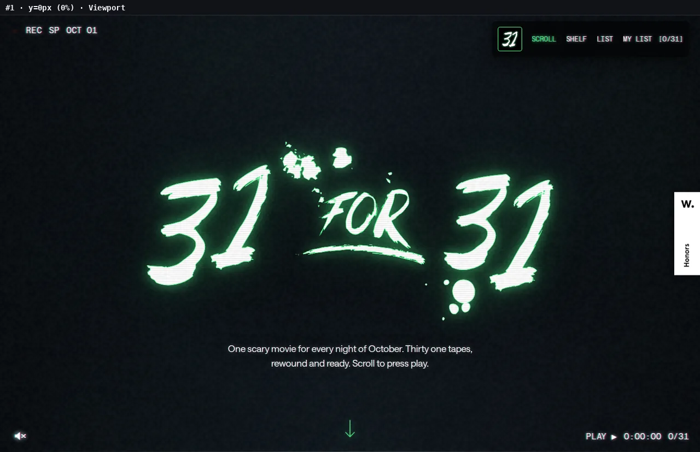
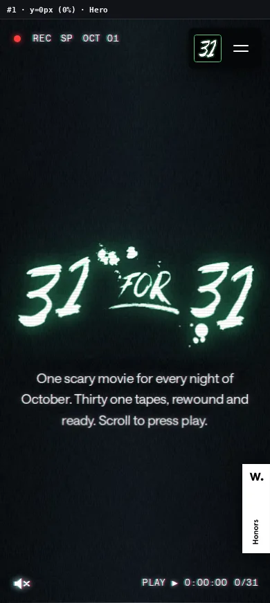

# UI Design System & Master Generation Blueprint: www-31-for-31-com

> **31 for 31 · One scary movie for every night of October** (https://www.31-for-31.com/) — Thirty one horror movies, one for each night of October. Rate them, find where to stream them, and scroll through the whole tape.





---

## 1. Executive Visual Persona & Design Archetype

- **Brand Essence & Persona**: **31 for 31 · One scary movie for every night of October** (`https://www.31-for-31.com/`). Thirty one horror movies, one for each night of October. Rate them, find where to stream them, and scroll through the whole tape.
- **Capture Provenance**: Live browser capture (`tier1_fast`, HTTP `200`, captured `2026-11-24`).
- **Visual Archetype**: **Dark-Substrate WebGL / Canvas Interactive Experience (`#07090c` / `#ff0000`)**.
- **Anti-AI-Slop Differentiators**:
  - **Live-Computed Chromatic Polarity**: Anchors the viewport in `#07090c` (live computed `html` `background-color` (`computed_styles.json`)) paired with `#ffffff` primary typography and `#ff0000` accents.
  - **Grounded Typographic Hierarchy**: Uses `Saans` across display (`Wes Craven's New Nightmare`) and body copy, paired with `Saans Mono` for monospace/code.
  - **Calibrated Spatial Grid & Motion**: Combines `1440px` container bounds (`gap: 14px`, padding `22px`) with `cubic-bezier(.2,.8,.2,1)` easing and Lenis Smooth Scroll (`data-lenis`), GSAP Timeline & ScrollTrigger.

---

## 2. Spatial Architecture & Modular Grid Mathematics

### Viewport Allocation & Container Geometry
- **Captured Journey Filmstrips**: Desktop `1280×828px` (`assets/desktop-journey.webp`, `1` keyframes up to `y=0px` / doc `900px`), Mobile `390×872px` (`assets/mobile-journey.webp`, `1` keyframes).
- **Master Container Bounds**: `1440px` (full-bleed `100%` desktop stage measured on `1440px` viewport).
- **Canvas Lateral Padding & Spacing**: `22px` lateral canvas padding with `14px` grid gap.
- **Border Radius Scale**: `4px`, `50%`, `8px`, `1px`.

### Responsive Breakpoint Architecture
- **Desktop Layout**: Multi-column CSS Grid / Flexbox layout at `1440px` (`max-width: 1440px`, `gap: 14px`).
- **Mobile Layout**: Single-column vertical stack at `390px` viewport width with `22px` horizontal padding.
- **Extracted CSS Media Queries**: `@media (max-width: 720px)`, `@media (max-height: 820px) and (min-width: 721px)`, `@media (hover: none), (pointer: coarse), (max-width: 720px)`, `@media (max-width: 860px)`.

---

## 3. Color System, Materiality & Atmospheric Lighting

### Semantic Palette & Source Grounding
| Semantic Role | Ground-Truth Value | Extracted Live / CSS Source |
|---|---|---|
| **Primary Canvas Substrate** | `#07090c` | live computed `html` `background-color` (`computed_styles.json`) |
| **Primary Typography Ink** | `#ffffff` | live computed `p` `color` (`computed_styles.json`) |
| **Elevated Surface / Card Substrate** | `#000000` | live computed `nav` `background-color` (`computed_styles.json`) |
| **Interactive Accent / Highlight** | `#ff0000` | `.rate button.dislike.is-mine { color: red }` (`#ff0000`) |
| **Secondary / Muted Copy** | `#8d8a80` | live computed `footer` `color` (`computed_styles.json`) |
| **Structural Hairline Border** | `#313335` | `.film-day { stroke: #313335 }` |
| **Variable Token (`--bg-2`)** | `#0d1218` | `var(--bg-2)` in `:root` |
| **Variable Token (`--ink`)** | `#e8e4d8` | `var(--ink)` in `:root` |
| **Variable Token (`--green`)** | `#4dff8c` | `var(--green)` in `:root` |
| **Variable Token (`--green-dim`)** | `#1f8f4e` | `var(--green-dim)` in `:root` |
| **Variable Token (`--orange`)** | `#ff6a1a` | `var(--orange)` in `:root` |
| **Variable Token (`--red`)** | `#ff2d55` | `var(--red)` in `:root` |
| **Variable Token (`--cyan`)** | `#2ee6ff` | `var(--cyan)` in `:root` |
| **Variable Token (`--block-a`)** | `#b8321f` | `var(--block-a)` in `:root` |
| **Variable Token (`--block-b`)** | `#1f3d2b` | `var(--block-b)` in `:root` |
| **Variable Token (`--block-c`)** | `#2a1f45` | `var(--block-c)` in `:root` |

### Sanitized Root CSS Variables (`ui-ux.md` Ground Truth)
| Variable Name | Extracted Value | Semantic Role |
|---|---|---|
| `--bg` | `#07090c` | Canvas / Surface Token |
| `--bg-2` | `#0d1218` | Canvas / Surface Token |
| `--ink` | `#e8e4d8` | Typography Ink Token |
| `--muted` | `#8d8a80` | Color / Atmospheric Token |
| `--green` | `#4dff8c` | Color / Atmospheric Token |
| `--green-dim` | `#1f8f4e` | Color / Atmospheric Token |
| `--orange` | `#ff6a1a` | Color / Atmospheric Token |
| `--red` | `#ff2d55` | Color / Atmospheric Token |
| `--cyan` | `#2ee6ff` | Color / Atmospheric Token |
| `--block-a` | `#b8321f` | Color / Atmospheric Token |
| `--block-b` | `#1f3d2b` | Color / Atmospheric Token |
| `--block-c` | `#2a1f45` | Color / Atmospheric Token |
| `--font-spooky` | `"Creepster", "Impact", cursive` | Typography / Scale Token |
| `--font-blimp` | `"OC Blimp", "Creepster", "Impact", cursive` | Typography / Scale Token |
| `--font-osd` | `"Saans Mono", ui-monospace, "SF Mono", Menlo, "Courier New", monospace` | Typography / Scale Token |
| `--font-body` | `"Saans", system-ui, -apple-system, "Helvetica Neue", sans-serif` | Typography / Scale Token |

---

## 4. Typographic Scale & Editorial Hierarchy

### Font Family Stacks
- **Display Typography**: `Saans`.
- **Primary Body Stack**: `Saans`.
- **Technical / Metadata Stack**: `Saans Mono`.

### Typographic Scale & Rules (Live Computed & Stylesheet Grounded)
- **Hero Display (`H1`)**: live computed `h1` (`font-size: 34px`, `line-height: 0px`, `font-weight: 700`); rule `.title` (`line-height: 0`).
- **Section Heading (`H2`)**: live computed `h2` (`font-size: 72px`, `line-height: 60px`, `font-weight: 400`); rule `h2` (`font-size: clamp(28px, 3.4vw, 52px)`, `line-height: 1`, `font-weight: 400`).
- **Body Copy**: live computed `body` (`font-size: 17px`, `line-height: 27.2px`, `font-weight: 400`); CSS variables `--font-body: "Saans", system-ui, -apple-system, "Helvetica Neue", sans-serif`; rule `body` (`font-size: 17px`, `line-height: 1.6`).
- **Metadata & Navigation Labels**: live computed `nav/a` (`font-size: 17px`, `line-height: 27.2px`, `font-weight: 400`); rule `small` (`font-size: 15px`, `letter-spacing: .3em`).

---

## 5. Choreographed Motion & Interaction Physics

### Primary Easing Curves
- **Extracted Timing Functions**: `cubic-bezier(.2,.8,.2,1)`, `cubic-bezier(.4,0,.2,1)`, `cubic-bezier(.2,.75,.25,1)`.

### Per-Element Transition & Choreography Rules
- **Selector `.osd-bl .snd-ico`**: `transition: transform .2s` extracted from `www-31-for-31-com` stylesheet.
- **Selector `.deck-links`**: `transition: grid-template-columns .45s cubic-bezier(.2,.8,.2,1)` extracted from `www-31-for-31-com` stylesheet.
- **Selector `.deck-links-in`**: `transition: padding-left .45s cubic-bezier(.2,.8,.2,1), opacity .25s` extracted from `www-31-for-31-com` stylesheet.
- **Extracted Easing Curve (`cubic-bezier(.2,.8,.2,1)`)**: Governs interactive state transitions across `<header.topbar>` and `<section.film>`.
- **Runtime Interaction Engine**: Integrates Lenis Smooth Scroll (`data-lenis`), GSAP Timeline & ScrollTrigger, Three.js / WebGL Canvas Pipeline, Lottie Vector Animation Player, Barba.js Page Transition Router with `prefers-reduced-motion: reduce` fallback guards.
### Measured Runtime Scroll & Interaction Telemetry (`behavioral_journey_v2`)
- **Scroll Driver Mode**: `wheel` (max document height `900px`, deepest scrollY reached `0px` across `1` desktop keyframes).
- **Detected Scroll / Motion Libraries**: `Lenis`, `GSAP/ScrollTrigger`, `WebGL/Canvas`.

---

## 6. Component Wireframe & Structural DOM Map

### Visual Layout Schematic — Desktop (`1440px`, Grounded in `dom.html` & Landmark Bounding Boxes)
```
┌────────────────────────────────────────────────────────────────────────┐
│ DESKTOP VIEWPORT (1440px) — 31 for 31 · One scary movie for every nigh │
│ ====================================================================== │
│ [ <header.topbar> (1440x98px)         | Overview · Index · Archive · ] │
│ ---------------------------------------------------------------------- │
│ | HERO STAGE: <section.hero> (w=1440px)                              | │
│ | H1: Wes Craven's New Nightmare                                     | │
│ | Substrate: #07090c | Ink: #ffffff | Accent: #ff0000                | │
│ ---------------------------------------------------------------------- │
│ | SHOWCASE GRID (<section.film>) max-w: 1440px                       | │
│ | +------------------------------+  +------------------------------+ | │
│ | | Friday the 13th              |  | Sleepy Hollow                | | │
│ | +------------------------------+  +------------------------------+ | │
│ ---------------------------------------------------------------------- │
│ | DETAIL MODULE (<section.film:nth(2)>) — The House of the Devi      | │
│ ---------------------------------------------------------------------- │
│ [ FOOTER (<footer.footer>     ) | https://www.31-for-31.com/           │
└────────────────────────────────────────────────────────────────────────┘
```

### Visual Layout Schematic — Mobile Reflow (`390px`)
```
┌────────────────────────────────────────────────────────────────────────┐
│ MOBILE VIEWPORT REFLOW (390px) — Single-Column Stack (gap: 14px)       │
│ ====================================================================== │
│ [ HEADER BAR (<header.topbar>         ) | Compact Menu (390px)         │
│ ---------------------------------------------------------------------- │
│ | HERO STAGE (<section.hero>) — 390px Vertical Lead                  | │
│ | H1: Wes Craven's New Nightmare                                     | │
│ ---------------------------------------------------------------------- │
│ | SHOWCASE STACK (<section.film>) — 1-Col Stack                      | │
│ | [ Item 1: Friday the 13th                                        ] | │
│ | [ Item 2: Sleepy Hollow                                          ] | │
│ ---------------------------------------------------------------------- │
│ | DETAIL STACK (<section.film:nth(2)>) — 1-Col (The House of the D)  | │
│ ---------------------------------------------------------------------- │
│ [ FOOTER (<footer.footer>     ) | Stacked 390px Colophon               │
└────────────────────────────────────────────────────────────────────────┘
```

### Granular DOM Region Breakdown
1. **Brand Header & Navigation Bar (<header.topbar> — `www-31-for-31-com`)**:
   - Landmark `<header class="topbar">` (`1440x98px`) hosting `31 for 31 · One scary movie for ever` navigation (`Overview · Index · Archive · About · Contact`), DOM attributes (`data-sound-toggle`, `data-view="scroll"`, `data-label="Scroll"`, `data-view="gallery"`), and stylesheet rule `focus { outline: none; }`.
2. **Hero Stage & Focal Lead (<section.hero> — `Wes Craven's New Nightmare`)**:
   - Landmark `<section class="hero">` presenting display lead `Wes Craven's New Nightmare` and copy excerpt *"One scary movie for every night of October. Thirty one tapes, rew"* over `#07090c` canvas and `#ffffff` ink.
3. **Primary Showcase & Content Grid (<section.film> — `Friday the 13th`)**:
   - Landmark `<section class="film">` rendering section `Friday the 13th` with copy *"1948 DIR. ALFRED HITCHCOCK"*, asset references (`apple-touch-icon.png`, `Saans-Regular.woff`, `SaansMono-Regular.woff`, `style.css`), and grid rule `focus-visible { outline: 2px solid var(--green); outline-offset: 3px; box-shadow: 0 0 0... }`.
4. **Interactive Detail & Feature Matrix (<section.film:nth(2)> — `Sleepy Hollow`)**:
   - Landmark `<section class="film">` framing `Sleepy Hollow` and `The House of the Devil` (*"DIR. ALFRED HITCHCOCK"*) with `#000000` surface cards, `#ff0000` accents, and `.stream a:focus-visible { outline-offset: 2px; }`.
5. **Colophon & Global Directory Footer (<footer.footer> — `https://www.31-for-31.com/`)**:
   - Landmark `<footer class="footer">` anchoring `31 for 31 · One scary movie for ` footer links (`Overview · Index · Archive · About · Contact`), copy *"Two college friends strangle a classmate, hide the body in a"*, and `#313335` structural dividers.
### Full Vertical Scroll Sequence (Desktop `1440×900` Keyframes)
- **Step 01** (`y=0px`, `0%`): Active landmark `Viewport` · sticky/fixed elements: `0`

---

## 7. Master Zero-Shot AI Generation Prompt

```markdown
# Master Zero-Shot Frontend Generation Prompt: www-31-for-31-com (31 for 31 · One scary movie for every night of October)

You are a principal frontend architect and design systems engineer. Build a complete, production-ready web application replicating the exact design system, DOM landmarks, typographic hierarchy, color tokens, and motion physics of `www-31-for-31-com` (**31 for 31 · One scary movie for every night of October** — `https://www.31-for-31.com/`).

### 1. Visual Archetype & Anti-AI-Slop Mandates
- **Archetype**: Dark-Substrate WebGL / Canvas Interactive Experience (`#07090c` / `#ff0000`).
- **Identity & Domain Context**: Thirty one horror movies, one for each night of October. Rate them, find where to stream them, and scroll through the whole tape.
- **Primary Substrate**: `#07090c` (live computed `html` `background-color` (`computed_styles.json`)), **Primary Ink**: `#ffffff`, **Accent / Highlight**: `#ff0000`.
- **Site-Specific Differentiators**:
  - **Live-Computed Chromatic Polarity**: Anchors the viewport in `#07090c` (live computed `html` `background-color` (`computed_styles.json`)) paired with `#ffffff` primary typography and `#ff0000` accents.
  - **Grounded Typographic Hierarchy**: Uses `Saans` across display (`Wes Craven's New Nightmare`) and body copy, paired with `Saans Mono` for monospace/code.
  - **Calibrated Spatial Grid & Motion**: Combines `1440px` container bounds (`gap: 14px`, padding `22px`) with `cubic-bezier(.2,.8,.2,1)` easing and Lenis Smooth Scroll (`data-lenis`), GSAP Timeline & ScrollTrigger.

### 2. Ground-Truth CSS Variables (`:root` Token Contract)
Declare and consume these exact custom properties extracted from `www-31-for-31-com` in your global stylesheet:

:root {
  /* 31 for 31 · One scary movie for every night of October (www-31-for-31-com) — Live-Grounded CSS Variables */
  --bg: #07090c; /* Canvas / Surface Token (www-31-for-31-com) */
  --bg-2: #0d1218; /* Canvas / Surface Token (www-31-for-31-com) */
  --ink: #e8e4d8; /* Typography Ink Token (www-31-for-31-com) */
  --muted: #8d8a80; /* Color / Atmospheric Token (www-31-for-31-com) */
  --green: #4dff8c; /* Color / Atmospheric Token (www-31-for-31-com) */
  --green-dim: #1f8f4e; /* Color / Atmospheric Token (www-31-for-31-com) */
  --orange: #ff6a1a; /* Color / Atmospheric Token (www-31-for-31-com) */
  --red: #ff2d55; /* Color / Atmospheric Token (www-31-for-31-com) */
  --cyan: #2ee6ff; /* Color / Atmospheric Token (www-31-for-31-com) */
  --block-a: #b8321f; /* Color / Atmospheric Token (www-31-for-31-com) */
  --block-b: #1f3d2b; /* Color / Atmospheric Token (www-31-for-31-com) */
  --block-c: #2a1f45; /* Color / Atmospheric Token (www-31-for-31-com) */
  --font-spooky: "Creepster", "Impact", cursive; /* Typography / Scale Token (www-31-for-31-com) */
  --font-blimp: "OC Blimp", "Creepster", "Impact", cursive; /* Typography / Scale Token (www-31-for-31-com) */
  --font-osd: "Saans Mono", ui-monospace, "SF Mono", Menlo, "Courier New", monospace; /* Typography / Scale Token (www-31-for-31-com) */
  --font-body: "Saans", system-ui, -apple-system, "Helvetica Neue", sans-serif; /* Typography / Scale Token (www-31-for-31-com) */
}

### 3. Semantic Color & Materiality Contract
Map every surface, ink, and border strictly to these source-grounded tokens:
- **Primary Canvas Substrate**: `#07090c` — grounded in live computed `html` `background-color` (`computed_styles.json`)
- **Primary Typography Ink**: `#ffffff` — grounded in live computed `p` `color` (`computed_styles.json`)
- **Elevated Surface / Card Substrate**: `#000000` — grounded in live computed `nav` `background-color` (`computed_styles.json`)
- **Interactive Accent / Highlight**: `#ff0000` — grounded in `.rate button.dislike.is-mine { color: red }` (`#ff0000`)
- **Secondary / Muted Copy**: `#8d8a80` — grounded in live computed `footer` `color` (`computed_styles.json`)
- **Structural Hairline Border**: `#313335` — grounded in `.film-day { stroke: #313335 }`
- **Variable Token (`--bg-2`)**: `#0d1218` — grounded in `var(--bg-2)` in `:root`
- **Variable Token (`--ink`)**: `#e8e4d8` — grounded in `var(--ink)` in `:root`
- **Variable Token (`--green`)**: `#4dff8c` — grounded in `var(--green)` in `:root`
- **Variable Token (`--green-dim`)**: `#1f8f4e` — grounded in `var(--green-dim)` in `:root`
- **Variable Token (`--orange`)**: `#ff6a1a` — grounded in `var(--orange)` in `:root`
- **Variable Token (`--red`)**: `#ff2d55` — grounded in `var(--red)` in `:root`
- **Variable Token (`--cyan`)**: `#2ee6ff` — grounded in `var(--cyan)` in `:root`
- **Variable Token (`--block-a`)**: `#b8321f` — grounded in `var(--block-a)` in `:root`
- **Variable Token (`--block-b`)**: `#1f3d2b` — grounded in `var(--block-b)` in `:root`
- **Variable Token (`--block-c`)**: `#2a1f45` — grounded in `var(--block-c)` in `:root`

### 4. Spatial Grid, Container Bounds & Responsive Breakpoints
- **Desktop Viewport Reference**: `1280×828px` (single-viewport 100vh live capture (900px), `1440px` standard desktop width).
- **Mobile Viewport Reference**: `390×872px` (full-page live capture (872px), `390px` standard mobile width).
- **Container Max-Width**: `1440px` (full-bleed `100%` desktop stage measured on `1440px` viewport)
- **Padding & Gutters**: `22px` lateral canvas padding with `14px` grid gap
- **Desktop Grid**: Multi-column CSS Grid / Flexbox layout at `1440px` (`max-width: 1440px`, `gap: 14px`)
- **Mobile Adaptation**: Single-column vertical stack at `390px` viewport width with `22px` horizontal padding
- **Media Queries**: `@media (max-width: 720px)`, `@media (max-height: 820px) and (min-width: 721px)`, `@media (hover: none), (pointer: coarse), (max-width: 720px)`, `@media (max-width: 860px)`
- **Corner Radii**: `4px`, `50%`, `8px`, `1px`

### 5. Typography & Editorial Scale Contract
- **Display Font Stack**: `Saans`
- **Body Font Stack**: `Saans`
- **Monospace / Technical Font Stack**: `Saans Mono`
- **H1 Display Rule**: live computed `h1` (`font-size: 34px`, `line-height: 0px`, `font-weight: 700`); rule `.title` (`line-height: 0`)
- **H2 Section Rule**: live computed `h2` (`font-size: 72px`, `line-height: 60px`, `font-weight: 400`); rule `h2` (`font-size: clamp(28px, 3.4vw, 52px)`, `line-height: 1`, `font-weight: 400`)
- **Body Copy Rule**: live computed `body` (`font-size: 17px`, `line-height: 27.2px`, `font-weight: 400`); CSS variables `--font-body: "Saans", system-ui, -apple-system, "Helvetica Neue", sans-serif`; rule `body` (`font-size: 17px`, `line-height: 1.6`)
- **Metadata & Index Rule**: live computed `nav/a` (`font-size: 17px`, `line-height: 27.2px`, `font-weight: 400`); rule `small` (`font-size: 15px`, `letter-spacing: .3em`)

### 6. Component Hierarchy, Verbatim Copy & Real DOM Landmarks
Scaffold `www-31-for-31-com` (`31 for 31 · One scary movie for every night of October`) with these exact structural regions, extracted copy, and CSS rules from `dom.html`:
1. **Brand Header & Navigation Bar (<header.topbar> — `www-31-for-31-com`)**:
   - DOM & Selectors: Landmark `<header class="topbar">` (`1440x98px`) hosting `31 for 31 · One scary movie for ever` navigation (`Overview · Index · Archive · About · Contact`), DOM attributes (`data-sound-toggle`, `data-view="scroll"`, `data-label="Scroll"`, `data-view="gallery"`), and stylesheet rule `focus { outline: none; }`.
   - Responsive Contract: Header `Brand Header & Navigation Bar (<header.topbar> — `www-31-for-31-com`)` (`www-31-for-31-com`) adapts across `@media (max-width: 720px)`, `@media (max-height: 820px) and (min-width: 721px)`, `@media (hover: none), (pointer: coarse), (max-width: 720px)`, `@media (max-width: 860px)` with `cubic-bezier(.2,.8,.2,1)`, `cubic-bezier(.4,0,.2,1)`, `cubic-bezier(.2,.75,.25,1)` transitions and links `Overview · Index · Archive · About · Contact`.
2. **Hero Stage & Focal Lead (<section.hero> — `Wes Craven's New Nightmare`)**:
   - DOM & Selectors: Landmark `<section class="hero">` presenting display lead `Wes Craven's New Nightmare` and copy excerpt *"One scary movie for every night of October. Thirty one tapes, rew"* over `#07090c` canvas and `#ffffff` ink.
   - Responsive Contract: Hero stage (`1280×828px` desktop / `390×872px` mobile) sets `#07090c` background with `#ffffff` headline `Wes Craven's New Nightmare`.
3. **Primary Showcase & Content Grid (<section.film> — `Friday the 13th`)**:
   - DOM & Selectors: Landmark `<section class="film">` rendering section `Friday the 13th` with copy *"1948 DIR. ALFRED HITCHCOCK"*, asset references (`apple-touch-icon.png`, `Saans-Regular.woff`, `SaansMono-Regular.woff`, `style.css`), and grid rule `focus-visible { outline: 2px solid var(--green); outline-offset: 3px; box-shadow: 0 0 0... }`.
   - Responsive Contract: Showcase grid `Primary Showcase & Content Grid (<section.film> — `Friday the 13th`)` applies Multi-column CSS Grid / Flexbox layout at `1440px` (`max-width: 1440px`, `gap: 14px`) on desktop and Single-column vertical stack at `390px` viewport width with `22px` horizontal padding on mobile.
4. **Interactive Detail & Feature Matrix (<section.film:nth(2)> — `Sleepy Hollow`)**:
   - DOM & Selectors: Landmark `<section class="film">` framing `Sleepy Hollow` and `The House of the Devil` (*"DIR. ALFRED HITCHCOCK"*) with `#000000` surface cards, `#ff0000` accents, and `.stream a:focus-visible { outline-offset: 2px; }`.
   - Responsive Contract: Detail module `Interactive Detail & Feature Matrix (<section.film:nth(2)> — `Sleepy Hollow`)` uses `4px`, `50%`, `8px`, `1px` radii, `#ff0000` highlights, and assets (apple-touch-icon.png, Saans-Regular.woff, SaansMono-Regular.woff).
5. **Colophon & Global Directory Footer (<footer.footer> — `https://www.31-for-31.com/`)**:
   - DOM & Selectors: Landmark `<footer class="footer">` anchoring `31 for 31 · One scary movie for ` footer links (`Overview · Index · Archive · About · Contact`), copy *"Two college friends strangle a classmate, hide the body in a"*, and `#313335` structural dividers.
   - Responsive Contract: Footer `Colophon & Global Directory Footer (<footer.footer> — `https://www.31-for-31.com/`)` aligns to `1440px` (full-bleed `100%` desktop stage measured on `1440px` viewport) with `22px` lateral canvas padding with `14px` grid gap and attributes (data-sound-toggle, data-view="scroll", data-label="Scroll").

#### Verbatim DOM Copy Excerpts (`dom.html`)
- Copy Excerpt 1: *"One scary movie for every night of October. Thirty one tapes, rewound and ready. S..."*
- Copy Excerpt 2: *"1948 DIR. ALFRED HITCHCOCK"*
- Copy Excerpt 3: *"DIR. ALFRED HITCHCOCK"*
- Copy Excerpt 4: *"Two college friends strangle a classmate, hide the body in a chest, then host a di..."*

### 7. Motion, Extracted Stylesheet Rules & Interaction Choreography
- **Primary Easing Functions**: `cubic-bezier(.2,.8,.2,1)`, `cubic-bezier(.4,0,.2,1)`, `cubic-bezier(.2,.75,.25,1)`
- **Extracted Stylesheet Rules (`www-31-for-31-com`)**:
- `focus { outline: none; }`
- `focus-visible { outline: 2px solid var(--green); outline-offset: 3px; box-shadow: 0 0 0... }`
- `.stream a:focus-visible { outline-offset: 2px; }`
- `html { background: var(--bg); color: var(--ink); scroll-behavior: auto; overflo... }`
- `html.lenis body { height: auto; }`
- **Per-Selector Transition Rules**:
- **Selector `.osd-bl .snd-ico`**: `transition: transform .2s` extracted from `www-31-for-31-com` stylesheet.
- **Selector `.deck-links`**: `transition: grid-template-columns .45s cubic-bezier(.2,.8,.2,1)` extracted from `www-31-for-31-com` stylesheet.
- **Selector `.deck-links-in`**: `transition: padding-left .45s cubic-bezier(.2,.8,.2,1), opacity .25s` extracted from `www-31-for-31-com` stylesheet.
- **Extracted Easing Curve (`cubic-bezier(.2,.8,.2,1)`)**: Governs interactive state transitions across `<header.topbar>` and `<section.film>`.
- **Runtime Interaction Engine**: Integrates Lenis Smooth Scroll (`data-lenis`), GSAP Timeline & ScrollTrigger, Three.js / WebGL Canvas Pipeline, Lottie Vector Animation Player, Barba.js Page Transition Router with `prefers-reduced-motion: reduce` fallback guards.
### 7b. Full-Page Scroll Choreography, Interactive States & Multi-Page Routes
- **Scroll Mechanics**: Implement `wheel` vertical progression up to `900px` across 1 distinct viewport chapters using Lenis, GSAP/ScrollTrigger, WebGL/Canvas.
- **Vertical Chapter Sequence**: Viewport (0%).

### 8. Technical Deliverables
- Implement in Next.js (App Router) with TypeScript and Tailwind CSS consuming the `:root` custom properties defined above for `www-31-for-31-com`.
- Reproduce both the `1440px` desktop architecture and `390px` mobile breakpoint transitions, preserving semantic HTML5 landmarks (`<header>`, `<nav>`, `<main>`, `<section>`, `<footer>`) and `prefers-reduced-motion` accessibility guards.
```
---

## 8. Full-Page Scroll Journey, Interactive States & Subpage Inventory

### Desktop Scroll Keyframes (`1440×900` WebP)
| Step | Scroll Y | Progress | Active Landmark / Section | Sticky/Fixed | Visual Asset |
| :---: | :---: | :---: | :--- | :---: | :--- |
| `#01` | `0px` | `0%` | Viewport | `0` | [desktop-step-01.webp](assets/desktop-step-01.webp) |

### Mobile Condensed Keyframes (`390×844` WebP)
| Step | Scroll Y | Progress | Active Landmark | Visual Asset |
| :---: | :---: | :---: | :--- | :--- |
| `#01` | `0px` | `0%` | Hero | [mobile-step-01.webp](assets/mobile-step-01.webp) |

