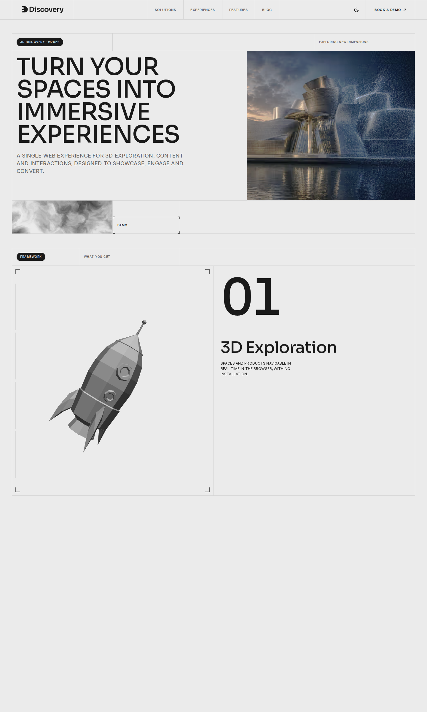
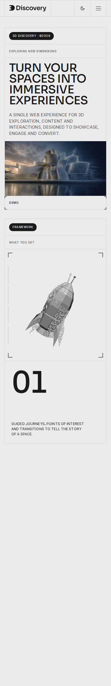

# UI Design System & Master Generation Blueprint: www-3d-discovery-fr

> **3D Discovery · Exploring New Dimensions** (https://www.3d-discovery.fr/) — Turn your spaces, projects and products into immersive web experiences: 3D exploration, content and interaction in one place to showcase,...



---

## 1. Executive Visual Persona & Design Archetype

- **Brand Essence & Persona**: **3D Discovery · Exploring New Dimensions** (`https://www.3d-discovery.fr/`). Turn your spaces, projects and products into immersive web experiences: 3D exploration, content and interaction in one place to showcase,...
- **Capture Provenance**: Live browser capture (`tier1_fast`, HTTP `200`, captured `2026-11-23`).
- **Visual Archetype**: **Light-Gallery WebGL / Canvas Interactive Experience (`#ebebeb` / `#f59e0b`)**.
- **Anti-AI-Slop Differentiators**:
  - **Live-Computed Chromatic Polarity**: Anchors the viewport in `#ebebeb` (live computed `body` `background-color` (`computed_styles.json`)) paired with `#1a1a1a` primary typography and `#f59e0b` accents.
  - **Grounded Typographic Hierarchy**: Pairs `Sora` for display copy (`TURN YOUR SPACES INTO IMMERSIVE EXPE`) with `Inter` and `JetBrains Mono`.
  - **Calibrated Spatial Grid & Motion**: Combines `1360px` container bounds (`gap: .5rem`, padding `1rem`) with `cubic-bezier(.8,0,1,1)` easing and Lenis Smooth Scroll (`data-lenis`), Three.js / WebGL Canvas Pipeline.

---

## 2. Spatial Architecture & Modular Grid Mathematics



### Viewport Allocation & Container Geometry
- **Captured Viewport Dimensions**: Desktop `1440×2400px` (`assets/desktop.png`, clamped at 2400px live multi-section capture), Mobile `390×2400px` (`assets/mobile.png`, clamped at 2400px live multi-section capture).
- **Master Container Bounds**: `1360px` (measured widest bounded `<section>` landmark width on `1440px` desktop).
- **Canvas Lateral Padding & Spacing**: `1rem` lateral canvas padding with `.5rem` grid gap.
- **Border Radius Scale**: `50%`, `999px`.

### Responsive Breakpoint Architecture
- **Desktop Layout**: Multi-column CSS Grid / Flexbox layout at `1440px` (`max-width: 1360px`, `gap: .5rem`).
- **Mobile Layout**: Single-column vertical stack at `390px` viewport width with `1rem` horizontal padding.
- **Extracted CSS Media Queries**: `@media (prefers-reduced-motion:reduce)`, `@media (min-width:768px)`, `@media (min-width:1024px)`, `@media (min-width:1280px)`.

---

## 3. Color System, Materiality & Atmospheric Lighting

### Semantic Palette & Source Grounding
| Semantic Role | Ground-Truth Value | Extracted Live / CSS Source |
|---|---|---|
| **Primary Canvas Substrate** | `#ebebeb` | live computed `body` `background-color` (`computed_styles.json`) |
| **Primary Typography Ink** | `#1a1a1a` | live computed `h1` `color` (`computed_styles.json`) |
| **Elevated Surface / Card Substrate** | `#e2e2e2` | `var(--bg-elevated)` in `:root` |
| **Interactive Accent / Highlight** | `#f59e0b` | `.badge--solid.badge--warning { background: #f59e0b }` |
| **Secondary / Muted Copy** | `#666666` | `var(--input-placeholder)` in `:root` |
| **Structural Hairline Border** | `#d4d4d4` | `var(--border-default)` in `:root` |
| **Variable Token (`--color-primary-light`)** | `#2e2e2e` | `var(--color-primary-light)` in `:root` |

### Sanitized Root CSS Variables (`ui-ux.md` Ground Truth)
| Variable Name | Extracted Value | Semantic Role |
|---|---|---|
| `--sg-grade` | `url(#sg-grade)` | Design System Custom Token |
| `--color-primary` | `#1a1a1a` | Brand / Palette Token |
| `--color-primary-light` | `#2e2e2e` | Canvas / Surface Token |
| `--color-primary-dark` | `#1a1a1a` | Canvas / Surface Token |
| `--color-secondary` | `#1a1a1a` | Brand / Palette Token |
| `--header-height` | `64px` | Layout / Spatial Grid Token |
| `--header-height-mobile` | `56px` | Layout / Spatial Grid Token |
| `--container-padding` | `1.5rem` | Layout / Spatial Grid Token |
| `--transition-fast` | `.15s ease` | Motion / Easing Token |
| `--transition-base` | `.2s ease` | Motion / Easing Token |
| `--transition-slow` | `.3s ease` | Motion / Easing Token |
| `--transition-theme` | `.2s ease` | Brand / Palette Token |
| `--z-header` | `30` | Layout / Spatial Grid Token |
| `--z-modal` | `50` | Elevation / Border Token |
| `--z-tooltip` | `70` | Elevation / Border Token |
| `--bg-body` | `#ebebeb` | Canvas / Surface Token |

---

## 4. Typographic Scale & Editorial Hierarchy

### Font Family Stacks
- **Display Typography**: `Sora`.
- **Primary Body Stack**: `Inter`.
- **Technical / Metadata Stack**: `JetBrains Mono`.

### Typographic Scale & Rules (Live Computed & Stylesheet Grounded)
- **Hero Display (`H1`)**: live computed `h1` (`font-size: 80px`, `line-height: 76px`, `font-weight: 500`, `letter-spacing: -1.6px`); rule `,.h1` (`font-size: 2.25rem`, `line-height: 1.1`, `letter-spacing: -.025em`, `font-weight: 700`).
- **Section Heading (`H2`)**: live computed `h2` (`font-size: 80px`, `line-height: 76px`, `font-weight: 500`, `letter-spacing: -1.6px`); rule `,.h2` (`font-size: 1.875rem`, `line-height: 1.1`, `letter-spacing: -.025em`, `font-weight: 700`).
- **Body Copy**: live computed `body` (`font-size: 16px`, `line-height: 24px`, `font-weight: 400`); CSS variables `--tra-body-h: 16rem`.
- **Metadata & Navigation Labels**: live computed `nav/a` (`font-size: 16px`, `line-height: 24px`, `font-weight: 400`).

---

## 5. Choreographed Motion & Interaction Physics

### Primary Easing Curves
- **Extracted Timing Functions**: `cubic-bezier(.8,0,1,1)`, `cubic-bezier(0,0,.2,1)`, `cubic-bezier(.65,0,.35,1)`.

### Per-Element Transition & Choreography Rules
- **Selector `:after`**: `transition: .01ms!important` extracted from `www-3d-discovery-fr` stylesheet.
- **Selector `body`**: `transition: background-color var(--transition-theme),color var(--transitio...` extracted from `www-3d-discovery-fr` stylesheet.
- **Selector `::-webkit-scrollbar-track`**: `transition: background var(--transition-theme)` extracted from `www-3d-discovery-fr` stylesheet.
- **Extracted Easing Curve (`cubic-bezier(.8,0,1,1)`)**: Governs interactive state transitions across `<header.header>` and `<section.sg-section--seq>`.
- **Runtime Interaction Engine**: Integrates Lenis Smooth Scroll (`data-lenis`), Three.js / WebGL Canvas Pipeline with `prefers-reduced-motion: reduce` fallback guards.

---

## 6. Component Wireframe & Structural DOM Map

### Visual Layout Schematic — Desktop (`1440px`, Grounded in `dom.html` & Landmark Bounding Boxes)
```
┌────────────────────────────────────────────────────────────────────────┐
│ DESKTOP VIEWPORT (1440px) — 3D Discovery · Exploring New Dimensions    │
│ ====================================================================== │
│ [ <header.header> (1440x66px)         | Solutions · Experiences · Fe ] │
│ ---------------------------------------------------------------------- │
│ | HERO STAGE: <section.sg-section> (w=1440px)                        | │
│ | H1: TURN YOUR SPACES INTO IMMERSIVE EXPERIENCES                    | │
│ | Substrate: #ebebeb | Ink: #1a1a1a | Accent: #f59e0b                | │
│ ---------------------------------------------------------------------- │
│ | SHOWCASE GRID (<section.sg-section--seq>) max-w: 1360px            | │
│ | +------------------------------+  +------------------------------+ | │
│ | | Turn your spaces into immers |  | Choose your field            | | │
│ | +------------------------------+  +------------------------------+ | │
│ ---------------------------------------------------------------------- │
│ | DETAIL MODULE (<section.sg-solutions>) — Seeing is understandi     | │
│ ---------------------------------------------------------------------- │
│ [ FOOTER (<footer.sg-footer>  ) | https://www.3d-discovery.fr/         │
└────────────────────────────────────────────────────────────────────────┘
```

### Visual Layout Schematic — Mobile Reflow (`390px`)
```
┌────────────────────────────────────────────────────────────────────────┐
│ MOBILE VIEWPORT REFLOW (390px) — Single-Column Stack (gap: .5rem)      │
│ ====================================================================== │
│ [ HEADER BAR (<header.header>         ) | Compact Menu (390px)         │
│ ---------------------------------------------------------------------- │
│ | HERO STAGE (<section.sg-section>) — 390px Vertical Lead            | │
│ | H1: TURN YOUR SPACES INTO IMMERSIVE EXPERIENCES                    | │
│ ---------------------------------------------------------------------- │
│ | SHOWCASE STACK (<section.sg-section--s) — 1-Col Stack              | │
│ | [ Item 1: Turn your spaces into immersive experiences            ] | │
│ | [ Item 2: Choose your field                                      ] | │
│ ---------------------------------------------------------------------- │
│ | DETAIL STACK (<section.sg-solutions>) — 1-Col (Seeing is understa) | │
│ ---------------------------------------------------------------------- │
│ [ FOOTER (<footer.sg-footer>  ) | Stacked 390px Colophon               │
└────────────────────────────────────────────────────────────────────────┘
```

### Granular DOM Region Breakdown
1. **Brand Header & Navigation Bar (<header.header> — `www-3d-discovery-fr`)**:
   - Landmark `<header class="header">` (`1440x66px`) hosting `3D Discovery · Exploring New Dimensi` navigation (`Solutions · Experiences · Features · Blog`), DOM attributes (`data-theme="light"`, `data-precedence="next"`, `data-precedence="next"`, `data-precedence="next"`), and stylesheet rule `nter_2fe1ab3d-module__-T-KAq__cla... { font-family:Inter,Inter Fallback;font-style:normal }`.
2. **Hero Stage & Focal Lead (<section.sg-section> — `TURN YOUR SPACES INTO IMMERSIVE EX`)**:
   - Landmark `<section class="sg-section">` presenting display lead `TURN YOUR SPACES INTO IMMERSIVE EXPERIENCES` and copy excerpt *"3D DISCOVERY · ©2026"* over `#ebebeb` canvas and `#1a1a1a` ink.
3. **Primary Showcase & Content Grid (<section.sg-section--seq> — `Turn your spaces into immersive ex`)**:
   - Landmark `<section class="sg-section sg-section--seq">` rendering section `Turn your spaces into immersive experiences` with copy *"3D Discovery · ©2026"*, asset references (`83afe278b6a6bb3c-s.p.0q-301v4kxxn...`, `c41ca59f1c34ba31-s.p.0xxb547n1hn7...`, `0ghcmdv7avfm..css`, `04vxxuqck~drg.css`), and grid rule `inter_2fe1ab3d-module__-T-KAq__va... { --font-inter:"Inter", "Inter Fallback" }`.
4. **Interactive Detail & Feature Matrix (<section.sg-solutions> — `Choose your field`)**:
   - Landmark `<section class="sg-section sg-solutions">` framing `Choose your field` and `Seeing is understanding` (*"Exploring new dimensions"*) with `#e2e2e2` surface cards, `#f59e0b` accents, and `sora_3fd80e00-module__HLND6q__cla... { font-family:Sora,Sora Fallback;font-style:normal }`.
5. **Colophon & Global Directory Footer (<footer.sg-footer> — `https://www.3d-discovery.fr/`)**:
   - Landmark `<footer class="sg-footer">` anchoring `3D Discovery · Exploring New Dim` footer links (`Solutions · Experiences · Features · Blog`), copy *"A single web experience for 3D exploration, content and inte"*, and `#d4d4d4` structural dividers.

---

## 7. Master Zero-Shot AI Generation Prompt

```markdown
# Master Zero-Shot Frontend Generation Prompt: www-3d-discovery-fr (3D Discovery · Exploring New Dimensions)

You are a principal frontend architect and design systems engineer. Build a complete, production-ready web application replicating the exact design system, DOM landmarks, typographic hierarchy, color tokens, and motion physics of `www-3d-discovery-fr` (**3D Discovery · Exploring New Dimensions** — `https://www.3d-discovery.fr/`).

### 1. Visual Archetype & Anti-AI-Slop Mandates
- **Archetype**: Light-Gallery WebGL / Canvas Interactive Experience (`#ebebeb` / `#f59e0b`).
- **Identity & Domain Context**: Turn your spaces, projects and products into immersive web experiences: 3D exploration, content and interaction in one place to showcase,...
- **Primary Substrate**: `#ebebeb` (live computed `body` `background-color` (`computed_styles.json`)), **Primary Ink**: `#1a1a1a`, **Accent / Highlight**: `#f59e0b`.
- **Site-Specific Differentiators**:
  - **Live-Computed Chromatic Polarity**: Anchors the viewport in `#ebebeb` (live computed `body` `background-color` (`computed_styles.json`)) paired with `#1a1a1a` primary typography and `#f59e0b` accents.
  - **Grounded Typographic Hierarchy**: Pairs `Sora` for display copy (`TURN YOUR SPACES INTO IMMERSIVE EXPE`) with `Inter` and `JetBrains Mono`.
  - **Calibrated Spatial Grid & Motion**: Combines `1360px` container bounds (`gap: .5rem`, padding `1rem`) with `cubic-bezier(.8,0,1,1)` easing and Lenis Smooth Scroll (`data-lenis`), Three.js / WebGL Canvas Pipeline.

### 2. Ground-Truth CSS Variables (`:root` Token Contract)
Declare and consume these exact custom properties extracted from `www-3d-discovery-fr` in your global stylesheet:

:root {
  /* 3D Discovery · Exploring New Dimensions (www-3d-discovery-fr) — Live-Grounded CSS Variables */
  --sg-grade: url(#sg-grade); /* Design System Custom Token (www-3d-discovery-fr) */
  --color-primary: #1a1a1a; /* Brand / Palette Token (www-3d-discovery-fr) */
  --color-primary-light: #2e2e2e; /* Canvas / Surface Token (www-3d-discovery-fr) */
  --color-primary-dark: #1a1a1a; /* Canvas / Surface Token (www-3d-discovery-fr) */
  --color-secondary: #1a1a1a; /* Brand / Palette Token (www-3d-discovery-fr) */
  --header-height: 64px; /* Layout / Spatial Grid Token (www-3d-discovery-fr) */
  --header-height-mobile: 56px; /* Layout / Spatial Grid Token (www-3d-discovery-fr) */
  --container-padding: 1.5rem; /* Layout / Spatial Grid Token (www-3d-discovery-fr) */
  --transition-fast: .15s ease; /* Motion / Easing Token (www-3d-discovery-fr) */
  --transition-base: .2s ease; /* Motion / Easing Token (www-3d-discovery-fr) */
  --transition-slow: .3s ease; /* Motion / Easing Token (www-3d-discovery-fr) */
  --transition-theme: .2s ease; /* Brand / Palette Token (www-3d-discovery-fr) */
  --z-header: 30; /* Layout / Spatial Grid Token (www-3d-discovery-fr) */
  --z-modal: 50; /* Elevation / Border Token (www-3d-discovery-fr) */
  --z-tooltip: 70; /* Elevation / Border Token (www-3d-discovery-fr) */
  --bg-body: #ebebeb; /* Canvas / Surface Token (www-3d-discovery-fr) */
}

### 3. Semantic Color & Materiality Contract
Map every surface, ink, and border strictly to these source-grounded tokens:
- **Primary Canvas Substrate**: `#ebebeb` — grounded in live computed `body` `background-color` (`computed_styles.json`)
- **Primary Typography Ink**: `#1a1a1a` — grounded in live computed `h1` `color` (`computed_styles.json`)
- **Elevated Surface / Card Substrate**: `#e2e2e2` — grounded in `var(--bg-elevated)` in `:root`
- **Interactive Accent / Highlight**: `#f59e0b` — grounded in `.badge--solid.badge--warning { background: #f59e0b }`
- **Secondary / Muted Copy**: `#666666` — grounded in `var(--input-placeholder)` in `:root`
- **Structural Hairline Border**: `#d4d4d4` — grounded in `var(--border-default)` in `:root`
- **Variable Token (`--color-primary-light`)**: `#2e2e2e` — grounded in `var(--color-primary-light)` in `:root`

### 4. Spatial Grid, Container Bounds & Responsive Breakpoints
- **Desktop Viewport Reference**: `1440×2400px` (clamped at 2400px live multi-section capture, `1440px` standard desktop width).
- **Mobile Viewport Reference**: `390×2400px` (clamped at 2400px live multi-section capture, `390px` standard mobile width).
- **Container Max-Width**: `1360px` (measured widest bounded `<section>` landmark width on `1440px` desktop)
- **Padding & Gutters**: `1rem` lateral canvas padding with `.5rem` grid gap
- **Desktop Grid**: Multi-column CSS Grid / Flexbox layout at `1440px` (`max-width: 1360px`, `gap: .5rem`)
- **Mobile Adaptation**: Single-column vertical stack at `390px` viewport width with `1rem` horizontal padding
- **Media Queries**: `@media (prefers-reduced-motion:reduce)`, `@media (min-width:768px)`, `@media (min-width:1024px)`, `@media (min-width:1280px)`
- **Corner Radii**: `50%`, `999px`

### 5. Typography & Editorial Scale Contract
- **Display Font Stack**: `Sora`
- **Body Font Stack**: `Inter`
- **Monospace / Technical Font Stack**: `JetBrains Mono`
- **H1 Display Rule**: live computed `h1` (`font-size: 80px`, `line-height: 76px`, `font-weight: 500`, `letter-spacing: -1.6px`); rule `,.h1` (`font-size: 2.25rem`, `line-height: 1.1`, `letter-spacing: -.025em`, `font-weight: 700`)
- **H2 Section Rule**: live computed `h2` (`font-size: 80px`, `line-height: 76px`, `font-weight: 500`, `letter-spacing: -1.6px`); rule `,.h2` (`font-size: 1.875rem`, `line-height: 1.1`, `letter-spacing: -.025em`, `font-weight: 700`)
- **Body Copy Rule**: live computed `body` (`font-size: 16px`, `line-height: 24px`, `font-weight: 400`); CSS variables `--tra-body-h: 16rem`
- **Metadata & Index Rule**: live computed `nav/a` (`font-size: 16px`, `line-height: 24px`, `font-weight: 400`)

### 6. Component Hierarchy, Verbatim Copy & Real DOM Landmarks
Scaffold `www-3d-discovery-fr` (`3D Discovery · Exploring New Dimensions`) with these exact structural regions, extracted copy, and CSS rules from `dom.html`:
1. **Brand Header & Navigation Bar (<header.header> — `www-3d-discovery-fr`)**:
   - DOM & Selectors: Landmark `<header class="header">` (`1440x66px`) hosting `3D Discovery · Exploring New Dimensi` navigation (`Solutions · Experiences · Features · Blog`), DOM attributes (`data-theme="light"`, `data-precedence="next"`, `data-precedence="next"`, `data-precedence="next"`), and stylesheet rule `nter_2fe1ab3d-module__-T-KAq__cla... { font-family:Inter,Inter Fallback;font-style:normal }`.
   - Responsive Contract: Header `Brand Header & Navigation Bar (<header.header> — `www-3d-discovery-fr`)` (`www-3d-discovery-fr`) adapts across `@media (prefers-reduced-motion:reduce)`, `@media (min-width:768px)`, `@media (min-width:1024px)`, `@media (min-width:1280px)` with `cubic-bezier(.8,0,1,1)`, `cubic-bezier(0,0,.2,1)`, `cubic-bezier(.65,0,.35,1)` transitions and links `Solutions · Experiences · Features · Blog`.
2. **Hero Stage & Focal Lead (<section.sg-section> — `TURN YOUR SPACES INTO IMMERSIVE EX`)**:
   - DOM & Selectors: Landmark `<section class="sg-section">` presenting display lead `TURN YOUR SPACES INTO IMMERSIVE EXPERIENCES` and copy excerpt *"3D DISCOVERY · ©2026"* over `#ebebeb` canvas and `#1a1a1a` ink.
   - Responsive Contract: Hero stage (`1440×2400px` desktop / `390×2400px` mobile) sets `#ebebeb` background with `#1a1a1a` headline `TURN YOUR SPACES INTO IMMERSIVE EXPERIENCES`.
3. **Primary Showcase & Content Grid (<section.sg-section--seq> — `Turn your spaces into immersive ex`)**:
   - DOM & Selectors: Landmark `<section class="sg-section sg-section--seq">` rendering section `Turn your spaces into immersive experiences` with copy *"3D Discovery · ©2026"*, asset references (`83afe278b6a6bb3c-s.p.0q-301v4kxxn...`, `c41ca59f1c34ba31-s.p.0xxb547n1hn7...`, `0ghcmdv7avfm..css`, `04vxxuqck~drg.css`), and grid rule `inter_2fe1ab3d-module__-T-KAq__va... { --font-inter:"Inter", "Inter Fallback" }`.
   - Responsive Contract: Showcase grid `Primary Showcase & Content Grid (<section.sg-section--seq> — `Turn your spaces into immersive ex`)` applies Multi-column CSS Grid / Flexbox layout at `1440px` (`max-width: 1360px`, `gap: .5rem`) on desktop and Single-column vertical stack at `390px` viewport width with `1rem` horizontal padding on mobile.
4. **Interactive Detail & Feature Matrix (<section.sg-solutions> — `Choose your field`)**:
   - DOM & Selectors: Landmark `<section class="sg-section sg-solutions">` framing `Choose your field` and `Seeing is understanding` (*"Exploring new dimensions"*) with `#e2e2e2` surface cards, `#f59e0b` accents, and `sora_3fd80e00-module__HLND6q__cla... { font-family:Sora,Sora Fallback;font-style:normal }`.
   - Responsive Contract: Detail module `Interactive Detail & Feature Matrix (<section.sg-solutions> — `Choose your field`)` uses `50%`, `999px` radii, `#f59e0b` highlights, and assets (83afe278b6a6bb3c-s.p.0q-301v4kxxn..., c41ca59f1c34ba31-s.p.0xxb547n1hn7..., 0ghcmdv7avfm..css).
5. **Colophon & Global Directory Footer (<footer.sg-footer> — `https://www.3d-discovery.fr/`)**:
   - DOM & Selectors: Landmark `<footer class="sg-footer">` anchoring `3D Discovery · Exploring New Dim` footer links (`Solutions · Experiences · Features · Blog`), copy *"A single web experience for 3D exploration, content and inte"*, and `#d4d4d4` structural dividers.
   - Responsive Contract: Footer `Colophon & Global Directory Footer (<footer.sg-footer> — `https://www.3d-discovery.fr/`)` aligns to `1360px` (measured widest bounded `<section>` landmark width on `1440px` desktop) with `1rem` lateral canvas padding with `.5rem` grid gap and attributes (data-theme="light", data-precedence="next", data-precedence="next").

#### Verbatim DOM Copy Excerpts (`dom.html`)
- Copy Excerpt 1: *"3D DISCOVERY · ©2026"*
- Copy Excerpt 2: *"3D Discovery · ©2026"*
- Copy Excerpt 3: *"Exploring new dimensions"*
- Copy Excerpt 4: *"A single web experience for 3D exploration, content and interactions, designed to..."*

### 7. Motion, Extracted Stylesheet Rules & Interaction Choreography
- **Primary Easing Functions**: `cubic-bezier(.8,0,1,1)`, `cubic-bezier(0,0,.2,1)`, `cubic-bezier(.65,0,.35,1)`
- **Extracted Stylesheet Rules (`www-3d-discovery-fr`)**:
- `nter_2fe1ab3d-module__-T-KAq__cla... { font-family:Inter,Inter Fallback;font-style:normal }`
- `inter_2fe1ab3d-module__-T-KAq__va... { --font-inter:"Inter", "Inter Fallback" }`
- `sora_3fd80e00-module__HLND6q__cla... { font-family:Sora,Sora Fallback;font-style:normal }`
- `.sora_3fd80e00-module__HLND6q__va... { --font-sora:"Sora", "Sora Fallback" }`
- `after { box-sizing:border-box }`
- **Per-Selector Transition Rules**:
- **Selector `:after`**: `transition: .01ms!important` extracted from `www-3d-discovery-fr` stylesheet.
- **Selector `body`**: `transition: background-color var(--transition-theme),color var(--transitio...` extracted from `www-3d-discovery-fr` stylesheet.
- **Selector `::-webkit-scrollbar-track`**: `transition: background var(--transition-theme)` extracted from `www-3d-discovery-fr` stylesheet.
- **Extracted Easing Curve (`cubic-bezier(.8,0,1,1)`)**: Governs interactive state transitions across `<header.header>` and `<section.sg-section--seq>`.
- **Runtime Interaction Engine**: Integrates Lenis Smooth Scroll (`data-lenis`), Three.js / WebGL Canvas Pipeline with `prefers-reduced-motion: reduce` fallback guards.

### 8. Technical Deliverables
- Implement in Next.js (App Router) with TypeScript and Tailwind CSS consuming the `:root` custom properties defined above for `www-3d-discovery-fr`.
- Reproduce both the `1440px` desktop architecture and `390px` mobile breakpoint transitions, preserving semantic HTML5 landmarks (`<header>`, `<nav>`, `<main>`, `<section>`, `<footer>`) and `prefers-reduced-motion` accessibility guards.
```
