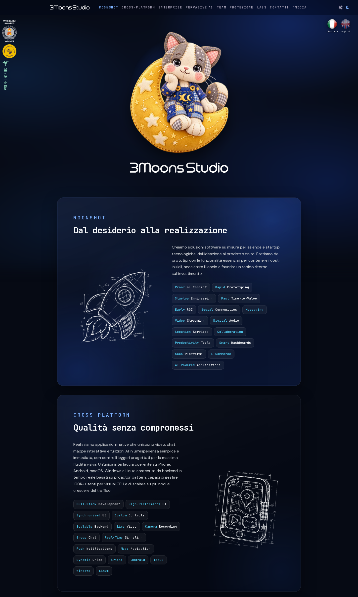
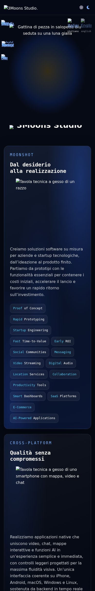

# UI Design System & Master Generation Blueprint: www-3moons-it

> **3Moons Studio · App mobile, software enterprise e AI su misura** (https://www.3moons.it) — Creiamo soluzioni software su misura per aziende e startup tecnologiche, dall’ideazione al prodotto finito: prototipi rapidi, costi conte...



---

## 1. Executive Visual Persona & Design Archetype

- **Brand Essence & Persona**: **3Moons Studio · App mobile, software enterprise e AI su misura** (`https://www.3moons.it`). Creiamo soluzioni software su misura per aziende e startup tecnologiche, dall’ideazione al prodotto finito: prototipi rapidi, costi conte...
- **Visual Archetype**: **High-Contrast Obsidian / Atmospheric Design System (`#060A14` canvas, `#F8FAFC` ink, `#A9A3B8` accent)**.
- **Anti-AI-Slop Differentiators**:
  - **Source-Grounded Chromatic Polarity**: Anchors the viewport in `#060A14` (`var(--bg)` in `:root`) paired with `#F8FAFC` primary typography and `#A9A3B8` accents.
  - **Extracted Typographic Hierarchy**: Pairs `DM Sans` for display copy (`Dal desiderio alla realizzazione`) with `JetBrains Mono` and `JetBrains Mono`.
  - **Calibrated Spatial Grid & Motion**: Combines `var(--max)` container bounds (`gap: 20px`, padding `var(--gutter)`) with `cubic-bezier(0.25,0.1,0.25,1)` easing.

---

## 2. Spatial Architecture & Modular Grid Mathematics



### Viewport Allocation & Container Geometry
- **Captured Viewport Dimensions**: Desktop `1440×7272px` (`assets/desktop.png`, full-page scroll capture), Mobile `390×2400px` (`assets/mobile.png`, capped at 2400px multi-section capture).
- **Master Container Bounds**: `var(--max)` extracted from `www-3moons-it` stylesheet.
- **Canvas Lateral Padding & Spacing**: `var(--gutter)` lateral canvas padding with `20px` grid gap.
- **Border Radius Scale**: `6px`, `999px`, `10px`, `8px`.

### Responsive Breakpoint Architecture
- **Desktop Layout**: Multi-column CSS Grid / Flexbox layout at `1440px` (`max-width: var(--max)`, `gap: 20px`).
- **Mobile Layout**: Single-column vertical stack at `390px` viewport width with `var(--gutter)` horizontal padding.
- **Extracted CSS Media Queries**: `@media (prefers-reduced-motion: reduce)`, `@media (min-width:761px)`, `@media (max-width:520px)`, `@media (max-width:560px)`.

---

## 3. Color System, Materiality & Atmospheric Lighting

### Semantic Palette & Source Grounding
| Semantic Role | Ground-Truth Value | Extracted CSS Source / Selector |
|---|---|---|
| **Primary Canvas Substrate** | `#060A14` | `var(--bg)` in `:root` |
| **Primary Typography Ink** | `#111112` | `var(--bg-alt)` in `:root` |
| **Elevated Surface / Card Substrate** | `#F8FAFC` | `var(--ink)` in `:root` |
| **Interactive Accent / Highlight** | `#A9A3B8` | `var(--muted)` in `:root` |
| **Secondary / Muted Copy** | `#7DB2FF` | `var(--cobalt)` in `:root` |
| **Structural Hairline Border** | `#2563EB` | `var(--primary)` in `:root` |
| **Variable Token (`--glow`)** | `#1E3A8A` | `var(--glow)` in `:root` |
| **Variable Token (`--sky`)** | `#4FCDF2` | `var(--sky)` in `:root` |
| **Variable Token (`--mustard`)** | `#FFCC00` | `var(--mustard)` in `:root` |

### Sanitized Root CSS Variables (`ui-ux.md` Ground Truth)
| Variable Name | Extracted Value | Semantic Role |
|---|---|---|
| `--bg` | `#060A14` | Canvas / Surface Token |
| `--bg-alt` | `#111112` | Canvas / Surface Token |
| `--surface` | `rgba(255,255,255,.05)` | Canvas / Surface Token |
| `--ink` | `#F8FAFC` | Typography Ink Token |
| `--muted` | `#A9A3B8` | Color / Atmospheric Token |
| `--cobalt` | `#7DB2FF` | Color / Atmospheric Token |
| `--primary` | `#2563EB` | Brand / Palette Token |
| `--glow` | `#1E3A8A` | Color / Atmospheric Token |
| `--sky` | `#4FCDF2` | Color / Atmospheric Token |
| `--mustard` | `#FFCC00` | Color / Atmospheric Token |
| `--chip` | `rgba(255,255,255,.05)` | Color / Atmospheric Token |
| `--line` | `rgba(255,255,255,.10)` | Color / Atmospheric Token |
| `--font-display` | `"JetBrains Mono",ui-monospace,"SFMono-Regular",Consolas,monospace` | Typography / Scale Token |
| `--font-body` | `"DM Sans","Segoe UI",system-ui,-apple-system,sans-serif` | Typography / Scale Token |
| `--font-mono` | `"JetBrains Mono",ui-monospace,"SFMono-Regular",Consolas,monospace` | Typography / Scale Token |
| `--gutter` | `clamp(16px,4vw,40px)` | Layout / Spatial Grid Token |

---

## 4. Typographic Scale & Editorial Hierarchy

### Font Family Stacks
- **Display Typography**: `DM Sans`.
- **Primary Body Stack**: `JetBrains Mono`.
- **Technical / Metadata Stack**: `JetBrains Mono`.

### Typographic Scale & Rules (Extracted from Stylesheet & Variables)
- **Hero Display (`H1`)**: CSS variables `--font-display: "JetBrains Mono",ui-monospace,"SFMono-Regular",Consolas,monospace`; rule `h1` (`line-height: 0`).
- **Section Heading (`H2`)**: rule `h2` (`font-size: clamp(24px,3.2vw,36px)`, `line-height: 1.2`, `letter-spacing: -.01em`, `font-weight: 700`).
- **Body Copy**: CSS variables `--font-body: "DM Sans","Segoe UI",system-ui,-apple-system,sans-serif`; rule `body` (`font-size: 16px`, `line-height: 1.65`).
- **Metadata & Navigation Labels**: CSS variables `--font-mono: "JetBrains Mono",ui-monospace,"SFMono-Regular",Consolas,monospace`; rule `small` (`font-size: 13px`, `letter-spacing: 0`, `font-weight: 500`).

---

## 5. Choreographed Motion & Interaction Physics

### Primary Easing Curves
- **Extracted Timing Functions**: `cubic-bezier(0.25,0.1,0.25,1)`.

### Per-Element Transition & Choreography Rules
- **Selector `body::before`**: `transition: none!important` extracted from `www-3moons-it` stylesheet.
- **Selector `.nav a`**: `transition: color .2s` extracted from `www-3moons-it` stylesheet.
- **Selector `.hero .tags a`**: `transition: border-color .2s,color .2s` extracted from `www-3moons-it` stylesheet.
- **Standard CSS Easing (`cubic-bezier(0.25,0.1,0.25,1)`)**: Default timing curve (no custom `cubic-bezier()` declared in static CSS).
- **State & Hover Choreography**: Opacity and transform transitions on `<section.hero>` and `<section.panel>` interactive targets.

---

## 6. Component Wireframe & Structural DOM Map

### Visual Layout Schematic (Grounded in `dom.html` — `1440px` Desktop & `390px` Mobile Reflow)
```
┌────────────────────────────────────────────────────────────────────────┐
│ DESKTOP VIEWPORT (1440px) — 3Moons Studio · App mobile, software enter │
│ ====================================================================== │
│ [ <header.topbar>          | Moonshot · Cross-platform · Enterprise ]  │
│ ---------------------------------------------------------------------- │
│ | HERO STAGE: <section.hero>                                       |   │
│ | H1: Dal desiderio alla realizzazione                             |   │
│ | Substrate: #060A14    | Ink: #F8FAFC    | Accent: #A9A3B8        |   │
│ ---------------------------------------------------------------------- │
│ | SHOWCASE GRID (<section.panel>           ) max-w: var(--max)     |   │
│ | +------------------------------+  +------------------------------+ | │
│ | | Qualità senza compromessi    |  | Tecnologia allo stato dell’a | | │
│ | +------------------------------+  +------------------------------+ | │
│ ---------------------------------------------------------------------- │
│ | MOBILE VIEWPORT REFLOW (390px) — Single-Column Stack (gap: 20px  ) | │
│ | [<header.topbar>] -> [<section.hero>] -> [<section.panel>] |         │
│ ---------------------------------------------------------------------- │
│ [ FOOTER (<footer.topbar>       ) | https://www.3moons.it              │
└────────────────────────────────────────────────────────────────────────┘
```

### Granular DOM Region Breakdown
1. **Brand Header & Navigation Bar (<header.topbar> — `www-3moons-it`)**:
   - Landmark `<header class="topbar">` hosting `3Moons Studio · App mobile, software` navigation (`Moonshot · Cross-platform · Enterprise · Pervasive AI · Team`), DOM attributes (`data-cert="guru"`, `data-cert="cssda"`, `data-cert="sotd"`, `data-endpoint="/app/ReceiveMessage"`), and stylesheet rule `html { scroll-behavior:smooth;scroll-padding-top:72px }`.
2. **Hero Stage & Focal Lead (<section.hero> — `Dal desiderio alla realizzazione`)**:
   - Landmark `<section class="hero">` presenting display lead `Dal desiderio alla realizzazione` and copy excerpt *"Creiamo soluzioni software su misura per aziende e startup tecnol"* over `#060A14` canvas and `#F8FAFC` ink.
3. **Primary Showcase & Content Grid (<section.panel> — `Qualità senza compromessi`)**:
   - Landmark `<section class="panel">` rendering section `Qualità senza compromessi` with copy *"Startup Engineering"*, asset references (`index_en.html`, `favicon.ico`, `favicon-32.png`, `apple-touch-icon.png`), and grid rule `body::before { animation:none!important;transition:none!important }`.
4. **Interactive Detail & Feature Matrix (<section.panel> — `Tecnologia allo stato dell’arte`)**:
   - Landmark `<section class="panel flip">` framing `Tecnologia allo stato dell’arte` and `La nuova frontiera dell’IT` (*"Fast Time-to-Value"*) with `#F8FAFC` surface cards, `#A9A3B8` accents, and `.mascot img { animation:float 6s ease-in-out infinite!important }`.
5. **Colophon & Global Directory Footer (<footer.topbar> — `https://www.3moons.it`)**:
   - Landmark `<footer class="topbar">` anchoring `3Moons Studio · App mobile, soft` footer links (`Moonshot · Cross-platform · Enterprise · Pervasive AI · Team`), copy *"Social Communities"*, and `#2563EB` structural dividers.

---

## 7. Master Zero-Shot AI Generation Prompt

```markdown
# Master Zero-Shot Frontend Generation Prompt: www-3moons-it (3Moons Studio · App mobile, software enterprise e AI su misura)

You are a principal frontend architect and design systems engineer. Build a complete, production-ready web application replicating the exact design system, DOM landmarks, typographic hierarchy, color tokens, and motion physics of `www-3moons-it` (**3Moons Studio · App mobile, software enterprise e AI su misura** — `https://www.3moons.it`).

### 1. Visual Archetype & Anti-AI-Slop Mandates
- **Archetype**: High-Contrast Obsidian / Atmospheric Design System (`#060A14` canvas, `#F8FAFC` ink, `#A9A3B8` accent).
- **Identity & Domain Context**: Creiamo soluzioni software su misura per aziende e startup tecnologiche, dall’ideazione al prodotto finito: prototipi rapidi, costi conte...
- **Primary Substrate**: `#060A14` (`var(--bg)` in `:root`), **Primary Ink**: `#F8FAFC`, **Accent / Highlight**: `#A9A3B8`.
- **Site-Specific Differentiators**:
  - **Source-Grounded Chromatic Polarity**: Anchors the viewport in `#060A14` (`var(--bg)` in `:root`) paired with `#F8FAFC` primary typography and `#A9A3B8` accents.
  - **Extracted Typographic Hierarchy**: Pairs `DM Sans` for display copy (`Dal desiderio alla realizzazione`) with `JetBrains Mono` and `JetBrains Mono`.
  - **Calibrated Spatial Grid & Motion**: Combines `var(--max)` container bounds (`gap: 20px`, padding `var(--gutter)`) with `cubic-bezier(0.25,0.1,0.25,1)` easing.

### 2. Ground-Truth CSS Variables (`:root` Token Contract)
Declare and consume these exact custom properties extracted from `www-3moons-it` in your global stylesheet:

:root {
  /* 3Moons Studio · App mobile, software enterprise e AI su misura (www-3moons-it) — Ground-Truth Extracted CSS Variables */
  --bg: #060A14; /* Canvas / Surface Token (www-3moons-it) */
  --bg-alt: #111112; /* Canvas / Surface Token (www-3moons-it) */
  --surface: rgba(255,255,255,.05); /* Canvas / Surface Token (www-3moons-it) */
  --ink: #F8FAFC; /* Typography Ink Token (www-3moons-it) */
  --muted: #A9A3B8; /* Color / Atmospheric Token (www-3moons-it) */
  --cobalt: #7DB2FF; /* Color / Atmospheric Token (www-3moons-it) */
  --primary: #2563EB; /* Brand / Palette Token (www-3moons-it) */
  --glow: #1E3A8A; /* Color / Atmospheric Token (www-3moons-it) */
  --sky: #4FCDF2; /* Color / Atmospheric Token (www-3moons-it) */
  --mustard: #FFCC00; /* Color / Atmospheric Token (www-3moons-it) */
  --chip: rgba(255,255,255,.05); /* Color / Atmospheric Token (www-3moons-it) */
  --line: rgba(255,255,255,.10); /* Color / Atmospheric Token (www-3moons-it) */
  --font-display: "JetBrains Mono",ui-monospace,"SFMono-Regular",Consolas,monospace; /* Typography / Scale Token (www-3moons-it) */
  --font-body: "DM Sans","Segoe UI",system-ui,-apple-system,sans-serif; /* Typography / Scale Token (www-3moons-it) */
  --font-mono: "JetBrains Mono",ui-monospace,"SFMono-Regular",Consolas,monospace; /* Typography / Scale Token (www-3moons-it) */
  --gutter: clamp(16px,4vw,40px); /* Layout / Spatial Grid Token (www-3moons-it) */
}

### 3. Semantic Color & Materiality Contract
Map every surface, ink, and border strictly to these source-grounded tokens:
- **Primary Canvas Substrate**: `#060A14` — grounded in `var(--bg)` in `:root`
- **Primary Typography Ink**: `#111112` — grounded in `var(--bg-alt)` in `:root`
- **Elevated Surface / Card Substrate**: `#F8FAFC` — grounded in `var(--ink)` in `:root`
- **Interactive Accent / Highlight**: `#A9A3B8` — grounded in `var(--muted)` in `:root`
- **Secondary / Muted Copy**: `#7DB2FF` — grounded in `var(--cobalt)` in `:root`
- **Structural Hairline Border**: `#2563EB` — grounded in `var(--primary)` in `:root`
- **Variable Token (`--glow`)**: `#1E3A8A` — grounded in `var(--glow)` in `:root`
- **Variable Token (`--sky`)**: `#4FCDF2` — grounded in `var(--sky)` in `:root`
- **Variable Token (`--mustard`)**: `#FFCC00` — grounded in `var(--mustard)` in `:root`

### 4. Spatial Grid, Container Bounds & Responsive Breakpoints
- **Desktop Viewport Reference**: `1440×7272px` (full-page scroll capture, `1440px` standard desktop width).
- **Mobile Viewport Reference**: `390×2400px` (capped at 2400px multi-section capture, `390px` standard mobile width).
- **Container Max-Width**: `var(--max)` extracted from `www-3moons-it` stylesheet
- **Padding & Gutters**: `var(--gutter)` lateral canvas padding with `20px` grid gap
- **Desktop Grid**: Multi-column CSS Grid / Flexbox layout at `1440px` (`max-width: var(--max)`, `gap: 20px`)
- **Mobile Adaptation**: Single-column vertical stack at `390px` viewport width with `var(--gutter)` horizontal padding
- **Media Queries**: `@media (prefers-reduced-motion: reduce)`, `@media (min-width:761px)`, `@media (max-width:520px)`, `@media (max-width:560px)`
- **Corner Radii**: `6px`, `999px`, `10px`, `8px`

### 5. Typography & Editorial Scale Contract
- **Display Font Stack**: `DM Sans`
- **Body Font Stack**: `JetBrains Mono`
- **Monospace / Technical Font Stack**: `JetBrains Mono`
- **H1 Display Rule**: CSS variables `--font-display: "JetBrains Mono",ui-monospace,"SFMono-Regular",Consolas,monospace`; rule `h1` (`line-height: 0`)
- **H2 Section Rule**: rule `h2` (`font-size: clamp(24px,3.2vw,36px)`, `line-height: 1.2`, `letter-spacing: -.01em`, `font-weight: 700`)
- **Body Copy Rule**: CSS variables `--font-body: "DM Sans","Segoe UI",system-ui,-apple-system,sans-serif`; rule `body` (`font-size: 16px`, `line-height: 1.65`)
- **Metadata & Index Rule**: CSS variables `--font-mono: "JetBrains Mono",ui-monospace,"SFMono-Regular",Consolas,monospace`; rule `small` (`font-size: 13px`, `letter-spacing: 0`, `font-weight: 500`)

### 6. Component Hierarchy, Verbatim Copy & Real DOM Landmarks
Scaffold `www-3moons-it` (`3Moons Studio · App mobile, software enterprise e AI su misura`) with these exact structural regions, extracted copy, and CSS rules from `dom.html`:
1. **Brand Header & Navigation Bar (<header.topbar> — `www-3moons-it`)**:
   - DOM & Selectors: Landmark `<header class="topbar">` hosting `3Moons Studio · App mobile, software` navigation (`Moonshot · Cross-platform · Enterprise · Pervasive AI · Team`), DOM attributes (`data-cert="guru"`, `data-cert="cssda"`, `data-cert="sotd"`, `data-endpoint="/app/ReceiveMessage"`), and stylesheet rule `html { scroll-behavior:smooth;scroll-padding-top:72px }`.
   - Responsive Contract: Header `Brand Header & Navigation Bar (<header.topbar> — `www-3moons-it`)` (`www-3moons-it`) adapts across `@media (prefers-reduced-motion: reduce)`, `@media (min-width:761px)`, `@media (max-width:520px)`, `@media (max-width:560px)` with `cubic-bezier(0.25,0.1,0.25,1)` transitions and links `Moonshot · Cross-platform · Enterprise · Pervasive AI · Team`.
2. **Hero Stage & Focal Lead (<section.hero> — `Dal desiderio alla realizzazione`)**:
   - DOM & Selectors: Landmark `<section class="hero">` presenting display lead `Dal desiderio alla realizzazione` and copy excerpt *"Creiamo soluzioni software su misura per aziende e startup tecnol"* over `#060A14` canvas and `#F8FAFC` ink.
   - Responsive Contract: Hero stage (`1440×7272px` desktop / `390×2400px` mobile) sets `#060A14` background with `#F8FAFC` headline `Dal desiderio alla realizzazione`.
3. **Primary Showcase & Content Grid (<section.panel> — `Qualità senza compromessi`)**:
   - DOM & Selectors: Landmark `<section class="panel">` rendering section `Qualità senza compromessi` with copy *"Startup Engineering"*, asset references (`index_en.html`, `favicon.ico`, `favicon-32.png`, `apple-touch-icon.png`), and grid rule `body::before { animation:none!important;transition:none!important }`.
   - Responsive Contract: Showcase grid `Primary Showcase & Content Grid (<section.panel> — `Qualità senza compromessi`)` applies Multi-column CSS Grid / Flexbox layout at `1440px` (`max-width: var(--max)`, `gap: 20px`) on desktop and Single-column vertical stack at `390px` viewport width with `var(--gutter)` horizontal padding on mobile.
4. **Interactive Detail & Feature Matrix (<section.panel> — `Tecnologia allo stato dell’arte`)**:
   - DOM & Selectors: Landmark `<section class="panel flip">` framing `Tecnologia allo stato dell’arte` and `La nuova frontiera dell’IT` (*"Fast Time-to-Value"*) with `#F8FAFC` surface cards, `#A9A3B8` accents, and `.mascot img { animation:float 6s ease-in-out infinite!important }`.
   - Responsive Contract: Detail module `Interactive Detail & Feature Matrix (<section.panel> — `Tecnologia allo stato dell’arte`)` uses `6px`, `999px`, `10px`, `8px` radii, `#A9A3B8` highlights, and assets (index_en.html, favicon.ico, favicon-32.png).
5. **Colophon & Global Directory Footer (<footer.topbar> — `https://www.3moons.it`)**:
   - DOM & Selectors: Landmark `<footer class="topbar">` anchoring `3Moons Studio · App mobile, soft` footer links (`Moonshot · Cross-platform · Enterprise · Pervasive AI · Team`), copy *"Social Communities"*, and `#2563EB` structural dividers.
   - Responsive Contract: Footer `Colophon & Global Directory Footer (<footer.topbar> — `https://www.3moons.it`)` aligns to `var(--max)` extracted from `www-3moons-it` stylesheet with `var(--gutter)` lateral canvas padding with `20px` grid gap and attributes (data-cert="guru", data-cert="cssda", data-cert="sotd").

#### Verbatim DOM Copy Excerpts (`dom.html`)
- Copy Excerpt 1: *"Creiamo soluzioni software su misura per aziende e startup tecnologiche, dall’idea..."*
- Copy Excerpt 2: *"Startup Engineering"*
- Copy Excerpt 3: *"Fast Time-to-Value"*
- Copy Excerpt 4: *"Social Communities"*

### 7. Motion, Extracted Stylesheet Rules & Interaction Choreography
- **Primary Easing Functions**: `cubic-bezier(0.25,0.1,0.25,1)`
- **Extracted Stylesheet Rules (`www-3moons-it`)**:
- `html { scroll-behavior:smooth;scroll-padding-top:72px }`
- `body::before { animation:none!important;transition:none!important }`
- `.mascot img { animation:float 6s ease-in-out infinite!important }`
- `focus-visible { outline:2px solid var(--cobalt);outline-offset:3px;border-radius:6px }`
- `.wrap { max-width:var(--max);margin-inline:auto;padding-inline:var(--gutter) }`
- **Per-Selector Transition Rules**:
- **Selector `body::before`**: `transition: none!important` extracted from `www-3moons-it` stylesheet.
- **Selector `.nav a`**: `transition: color .2s` extracted from `www-3moons-it` stylesheet.
- **Selector `.hero .tags a`**: `transition: border-color .2s,color .2s` extracted from `www-3moons-it` stylesheet.
- **Standard CSS Easing (`cubic-bezier(0.25,0.1,0.25,1)`)**: Default timing curve (no custom `cubic-bezier()` declared in static CSS).
- **State & Hover Choreography**: Opacity and transform transitions on `<section.hero>` and `<section.panel>` interactive targets.

### 8. Technical Deliverables
- Implement in Next.js (App Router) with TypeScript and Tailwind CSS consuming the `:root` custom properties defined above for `www-3moons-it`.
- Reproduce both the `1440px` desktop architecture and `390px` mobile breakpoint transitions, preserving semantic HTML5 landmarks (`<header>`, `<nav>`, `<main>`, `<section>`, `<footer>`) and `prefers-reduced-motion` accessibility guards.
```
