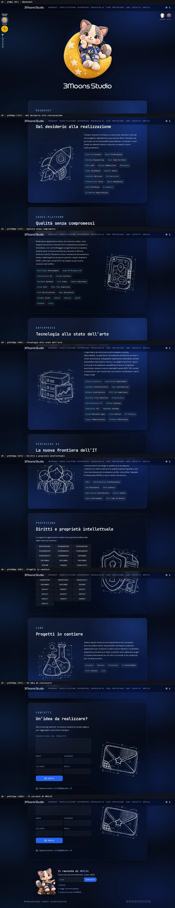
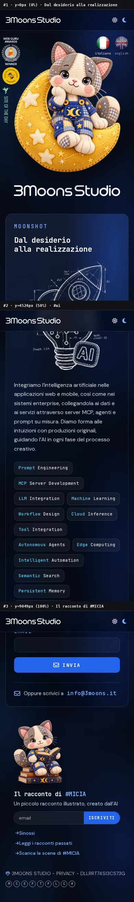

# UI Design System & Master Generation Blueprint: www-3moons-it

> **3Moons Studio · App mobile, software enterprise e AI su misura** (https://www.3moons.it) — Creiamo soluzioni software su misura per aziende e startup tecnologiche, dall’ideazione al prodotto finito: prototipi rapidi, costi conte...





---

## 1. Executive Visual Persona & Design Archetype

- **Brand Essence & Persona**: **3Moons Studio · App mobile, software enterprise e AI su misura** (`https://www.3moons.it`). Creiamo soluzioni software su misura per aziende e startup tecnologiche, dall’ideazione al prodotto finito: prototipi rapidi, costi conte...
- **Capture Provenance**: Live browser capture (`tier1_fast`, HTTP `200`, captured `2026-11-24`).
- **Visual Archetype**: **High-Contrast Obsidian / Atmospheric Design System (`#060a14` canvas, `#ffffff` ink, `#2563eb` accent)**.
- **Anti-AI-Slop Differentiators**:
  - **Live-Computed Chromatic Polarity**: Anchors the viewport in `#060a14` (live computed `body` `background-color` (`computed_styles.json`)) paired with `#ffffff` primary typography and `#2563eb` accents.
  - **Grounded Typographic Hierarchy**: Uses `DM Sans` across display (`Dal desiderio alla realizzazione`) and body copy, paired with `JetBrains Mono` for monospace/code.
  - **Calibrated Spatial Grid & Motion**: Combines `1440px` container bounds (`gap: 2px`, padding `var(--gutter)`) with `cubic-bezier(0.25,0.1,0.25,1)` easing.

---

## 2. Spatial Architecture & Modular Grid Mathematics

### Viewport Allocation & Container Geometry
- **Captured Journey Filmstrips**: Desktop `1280×6624px` (`assets/desktop-journey.webp`, `8` keyframes up to `y=6372px` / doc `7272px`), Mobile `390×2616px` (`assets/mobile-journey.webp`, `3` keyframes).
- **Master Container Bounds**: `1440px` (full-bleed `100%` desktop stage measured on `1440px` viewport).
- **Canvas Lateral Padding & Spacing**: `var(--gutter)` lateral canvas padding with `2px` grid gap.
- **Border Radius Scale**: `10px`, `6px`, `999px`, `8px`.

### Responsive Breakpoint Architecture
- **Desktop Layout**: Multi-column CSS Grid / Flexbox layout at `1440px` (`max-width: 1440px`, `gap: 2px`).
- **Mobile Layout**: Single-column vertical stack at `390px` viewport width with `var(--gutter)` horizontal padding.
- **Extracted CSS Media Queries**: `@media (prefers-reduced-motion: reduce)`, `@media (min-width:761px)`, `@media (max-width:520px)`, `@media (max-width:560px)`.

---

## 3. Color System, Materiality & Atmospheric Lighting

### Semantic Palette & Source Grounding
| Semantic Role | Ground-Truth Value | Extracted Live / CSS Source |
|---|---|---|
| **Primary Canvas Substrate** | `#060a14` | live computed `body` `background-color` (`computed_styles.json`) |
| **Primary Typography Ink** | `#ffffff` | live computed `button` `color` (`computed_styles.json`) |
| **Elevated Surface / Card Substrate** | `#2563eb` | live computed `button` `background-color` (`computed_styles.json`) |
| **Interactive Accent / Highlight** | `#2563eb` | live computed `button` `background-color` (`computed_styles.json`) |
| **Secondary / Muted Copy** | `#a9a3b8` | live computed `footer` `color` (`computed_styles.json`) |
| **Structural Hairline Border** | `#1f222c` | `var(--line)` in `:root` (`rgba(255,255,255,.10)`) |
| **Variable Token (`--bg-alt`)** | `#111112` | `var(--bg-alt)` in `:root` |
| **Variable Token (`--ink`)** | `#f8fafc` | `var(--ink)` in `:root` |
| **Variable Token (`--cobalt`)** | `#7db2ff` | `var(--cobalt)` in `:root` |
| **Variable Token (`--glow`)** | `#1e3a8a` | `var(--glow)` in `:root` |
| **Variable Token (`--sky`)** | `#4fcdf2` | `var(--sky)` in `:root` |
| **Variable Token (`--mustard`)** | `#ffcc00` | `var(--mustard)` in `:root` |

### Sanitized Root CSS Variables (`ui-ux.md` Ground Truth)
| Variable Name | Extracted Value | Semantic Role |
|---|---|---|
| `--bg` | `#060A14` | Canvas / Surface Token |
| `--bg-alt` | `#111112` | Canvas / Surface Token |
| `--surface` | `rgba(255,255,255,.05)` | Canvas / Surface Token |
| `--ink` | `#F8FAFC` | Typography Ink Token |
| `--muted` | `#A9A3B8` | Color / Atmospheric Token |
| `--cobalt` | `#7DB2FF` | Color / Atmospheric Token |
| `--primary` | `#2563EB` | Brand / Palette Token |
| `--glow` | `#1E3A8A` | Color / Atmospheric Token |
| `--sky` | `#4FCDF2` | Color / Atmospheric Token |
| `--mustard` | `#FFCC00` | Color / Atmospheric Token |
| `--chip` | `rgba(255,255,255,.05)` | Color / Atmospheric Token |
| `--line` | `rgba(255,255,255,.10)` | Color / Atmospheric Token |
| `--font-display` | `"JetBrains Mono",ui-monospace,"SFMono-Regular",Consolas,monospace` | Typography / Scale Token |
| `--font-body` | `"DM Sans","Segoe UI",system-ui,-apple-system,sans-serif` | Typography / Scale Token |
| `--font-mono` | `"JetBrains Mono",ui-monospace,"SFMono-Regular",Consolas,monospace` | Typography / Scale Token |
| `--gutter` | `clamp(16px,4vw,40px)` | Layout / Spatial Grid Token |

---

## 4. Typographic Scale & Editorial Hierarchy

### Font Family Stacks
- **Display Typography**: `DM Sans`.
- **Primary Body Stack**: `DM Sans`.
- **Technical / Metadata Stack**: `JetBrains Mono`.

### Typographic Scale & Rules (Live Computed & Stylesheet Grounded)
- **Hero Display (`H1`)**: live computed `h1` (`font-size: 32px`, `line-height: 0px`, `font-weight: 700`); CSS variables `--font-display: "JetBrains Mono",ui-monospace,"SFMono-Regular",Consolas,monospace`; rule `h1` (`line-height: 0`).
- **Section Heading (`H2`)**: live computed `h2` (`font-size: 34px`, `line-height: 39.1px`, `font-weight: 700`, `letter-spacing: -0.68px`); rule `h2` (`font-size: clamp(24px,3.2vw,36px)`, `line-height: 1.2`, `letter-spacing: -.01em`, `font-weight: 700`).
- **Body Copy**: live computed `body` (`font-size: 16px`, `line-height: 26.4px`, `font-weight: 400`); CSS variables `--font-body: "DM Sans","Segoe UI",system-ui,-apple-system,sans-serif`; rule `body` (`font-size: 16px`, `line-height: 1.65`).
- **Metadata & Navigation Labels**: live computed `nav/a` (`font-size: 16px`, `line-height: 26.4px`, `font-weight: 400`); CSS variables `--font-mono: "JetBrains Mono",ui-monospace,"SFMono-Regular",Consolas,monospace`; rule `small` (`font-size: 13px`, `letter-spacing: 0`, `font-weight: 500`).

---

## 5. Choreographed Motion & Interaction Physics

### Primary Easing Curves
- **Extracted Timing Functions**: `cubic-bezier(0.25,0.1,0.25,1)`.

### Per-Element Transition & Choreography Rules
- **Selector `body::before`**: `transition: none!important` extracted from `www-3moons-it` stylesheet.
- **Selector `.nav a`**: `transition: color .2s` extracted from `www-3moons-it` stylesheet.
- **Selector `.hero .tags a`**: `transition: border-color .2s,color .2s` extracted from `www-3moons-it` stylesheet.
- **Standard CSS Easing (`cubic-bezier(0.25,0.1,0.25,1)`)**: Default timing curve (no custom `cubic-bezier()` declared in captured CSS).
- **State & Hover Choreography**: Opacity and transform transitions on `<section.hero>` and `<section.panel>` interactive targets.
### Measured Runtime Scroll & Interaction Telemetry (`behavioral_journey_v2`)
- **Scroll Driver Mode**: `native` (max document height `7272px`, deepest scrollY reached `6372px` across `8` desktop keyframes).
- **Detected Scroll / Motion Libraries**: Native browser scroll / standard CSS transitions.
- **Hover Physics (`primary_cta` · `MOONSHOT`)**: Computed transition `0.2s` / `ease` (no static color/transform shift captured at rest).
- **Route Transition Architecture**: First internal navigation (`/app/micia_storia`) measured as `direct` in `516ms`.

---

## 6. Component Wireframe & Structural DOM Map

### Visual Layout Schematic — Desktop (`1440px`, Grounded in `dom.html` & Landmark Bounding Boxes)
```
┌────────────────────────────────────────────────────────────────────────┐
│ DESKTOP VIEWPORT (1440px) — 3Moons Studio · App mobile, software enter │
│ ====================================================================== │
│ [ <header.topbar> (1440x61px)         | Moonshot · Cross-platform ·  ] │
│ ---------------------------------------------------------------------- │
│ | HERO STAGE: <section.hero> (w=1440px)                              | │
│ | H1: Dal desiderio alla realizzazione                               | │
│ | Substrate: #060a14 | Ink: #ffffff | Accent: #2563eb                | │
│ ---------------------------------------------------------------------- │
│ | SHOWCASE GRID (<section.panel>) max-w: 1440px                      | │
│ | +------------------------------+  +------------------------------+ | │
│ | | Qualità senza compromessi    |  | Tecnologia allo stato dell’a | | │
│ | +------------------------------+  +------------------------------+ | │
│ ---------------------------------------------------------------------- │
│ | DETAIL MODULE (<section.flip>) — La nuova frontiera de             | │
│ ---------------------------------------------------------------------- │
│ [ FOOTER (<footer.topbar>     ) | https://www.3moons.it                │
└────────────────────────────────────────────────────────────────────────┘
```

### Visual Layout Schematic — Mobile Reflow (`390px`)
```
┌────────────────────────────────────────────────────────────────────────┐
│ MOBILE VIEWPORT REFLOW (390px) — Single-Column Stack (gap: 2px)        │
│ ====================================================================== │
│ [ HEADER BAR (<header.topbar>         ) | Compact Menu (390px)         │
│ ---------------------------------------------------------------------- │
│ | HERO STAGE (<section.hero>) — 390px Vertical Lead                  | │
│ | H1: Dal desiderio alla realizzazione                               | │
│ ---------------------------------------------------------------------- │
│ | SHOWCASE STACK (<section.panel>) — 1-Col Stack                     | │
│ | [ Item 1: Qualità senza compromessi                              ] | │
│ | [ Item 2: Tecnologia allo stato dell’arte                        ] | │
│ ---------------------------------------------------------------------- │
│ | DETAIL STACK (<section.flip>) — 1-Col (La nuova frontiera)         | │
│ ---------------------------------------------------------------------- │
│ [ FOOTER (<footer.topbar>     ) | Stacked 390px Colophon               │
└────────────────────────────────────────────────────────────────────────┘
```

### Granular DOM Region Breakdown
1. **Brand Header & Navigation Bar (<header.topbar> — `www-3moons-it`)**:
   - Landmark `<header class="topbar">` (`1440x61px`) hosting `3Moons Studio · App mobile, software` navigation (`Moonshot · Cross-platform · Enterprise · Pervasive AI · Team`), DOM attributes (`data-cert="guru"`, `data-cert="cssda"`, `data-cert="sotd"`, `data-endpoint="/app/ReceiveMessage"`), and stylesheet rule `html { scroll-behavior:smooth;scroll-padding-top:72px }`.
2. **Hero Stage & Focal Lead (<section.hero> — `Dal desiderio alla realizzazione`)**:
   - Landmark `<section class="hero">` presenting display lead `Dal desiderio alla realizzazione` and copy excerpt *"Creiamo soluzioni software su misura per aziende e startup tecnol"* over `#060a14` canvas and `#ffffff` ink.
3. **Primary Showcase & Content Grid (<section.panel> — `Qualità senza compromessi`)**:
   - Landmark `<section class="panel">` rendering section `Qualità senza compromessi` with copy *"Startup Engineering"*, asset references (`index_en.html`, `favicon.ico`, `favicon-32.png`, `apple-touch-icon.png`), and grid rule `body::before { animation:none!important;transition:none!important }`.
4. **Interactive Detail & Feature Matrix (<section.flip> — `Tecnologia allo stato dell’arte`)**:
   - Landmark `<section class="panel flip">` framing `Tecnologia allo stato dell’arte` and `La nuova frontiera dell’IT` (*"Fast Time-to-Value"*) with `#2563eb` surface cards, `#2563eb` accents, and `.mascot img { animation:float 6s ease-in-out infinite!important }`.
5. **Colophon & Global Directory Footer (<footer.topbar> — `https://www.3moons.it`)**:
   - Landmark `<footer class="topbar">` anchoring `3Moons Studio · App mobile, soft` footer links (`Moonshot · Cross-platform · Enterprise · Pervasive AI · Team`), copy *"Social Communities"*, and `#1f222c` structural dividers.
### Full Vertical Scroll Sequence (Desktop `1440×900` Keyframes)
- **Step 01** (`y=0px`, `0%`): Active landmark `#moonshot` · sticky/fixed elements: `1`
- **Step 02** (`y=850px`, `13%`): Active landmark `Dal desiderio alla realizzazione` · sticky/fixed elements: `1`
- **Step 03** (`y=1700px`, `27%`): Active landmark `Qualità senza compromessi` · sticky/fixed elements: `1`
- **Step 04** (`y=2550px`, `40%`): Active landmark `Tecnologia allo stato dell’arte` · sticky/fixed elements: `1`
- **Step 05** (`y=4250px`, `67%`): Active landmark `Diritti e proprietà intellettuale` · sticky/fixed elements: `1`
- **Step 06** (`y=5100px`, `80%`): Active landmark `Progetti in cantiere` · sticky/fixed elements: `1`
- **Step 07** (`y=5950px`, `93%`): Active landmark `Un’idea da realizzare?` · sticky/fixed elements: `1`
- **Step 08** (`y=6372px`, `100%`): Active landmark `Il racconto di #MICIA` · sticky/fixed elements: `1`

### Multi-Page Internal Route Map
- **Detail Route (`/app/micia_storia`)**: `https://www.3moons.it/app/micia_storia` — H1: `I racconti di #MICIA · 3Moons Studio`, scrollHeight `1946px`, transition `direct` (`516ms`)
- **Other Route (`/index_sun.html`)**: `https://www.3moons.it/index_sun.html` — H1: `3Moons Studio · App mobile, software enterprise e...`, scrollHeight `7272px`, transition `direct` (`371ms`)
- **Other Route (`/index.html`)**: `https://www.3moons.it/index.html` — H1: `3Moons Studio · App mobile, software enterprise e...`, scrollHeight `7272px`, transition `direct` (`346ms`)

---

## 7. Master Zero-Shot AI Generation Prompt

```markdown
# Master Zero-Shot Frontend Generation Prompt: www-3moons-it (3Moons Studio · App mobile, software enterprise e AI su misura)

You are a principal frontend architect and design systems engineer. Build a complete, production-ready web application replicating the exact design system, DOM landmarks, typographic hierarchy, color tokens, and motion physics of `www-3moons-it` (**3Moons Studio · App mobile, software enterprise e AI su misura** — `https://www.3moons.it`).

### 1. Visual Archetype & Anti-AI-Slop Mandates
- **Archetype**: High-Contrast Obsidian / Atmospheric Design System (`#060a14` canvas, `#ffffff` ink, `#2563eb` accent).
- **Identity & Domain Context**: Creiamo soluzioni software su misura per aziende e startup tecnologiche, dall’ideazione al prodotto finito: prototipi rapidi, costi conte...
- **Primary Substrate**: `#060a14` (live computed `body` `background-color` (`computed_styles.json`)), **Primary Ink**: `#ffffff`, **Accent / Highlight**: `#2563eb`.
- **Site-Specific Differentiators**:
  - **Live-Computed Chromatic Polarity**: Anchors the viewport in `#060a14` (live computed `body` `background-color` (`computed_styles.json`)) paired with `#ffffff` primary typography and `#2563eb` accents.
  - **Grounded Typographic Hierarchy**: Uses `DM Sans` across display (`Dal desiderio alla realizzazione`) and body copy, paired with `JetBrains Mono` for monospace/code.
  - **Calibrated Spatial Grid & Motion**: Combines `1440px` container bounds (`gap: 2px`, padding `var(--gutter)`) with `cubic-bezier(0.25,0.1,0.25,1)` easing.

### 2. Ground-Truth CSS Variables (`:root` Token Contract)
Declare and consume these exact custom properties extracted from `www-3moons-it` in your global stylesheet:

:root {
  /* 3Moons Studio · App mobile, software enterprise e AI su misura (www-3moons-it) — Live-Grounded CSS Variables */
  --bg: #060A14; /* Canvas / Surface Token (www-3moons-it) */
  --bg-alt: #111112; /* Canvas / Surface Token (www-3moons-it) */
  --surface: rgba(255,255,255,.05); /* Canvas / Surface Token (www-3moons-it) */
  --ink: #F8FAFC; /* Typography Ink Token (www-3moons-it) */
  --muted: #A9A3B8; /* Color / Atmospheric Token (www-3moons-it) */
  --cobalt: #7DB2FF; /* Color / Atmospheric Token (www-3moons-it) */
  --primary: #2563EB; /* Brand / Palette Token (www-3moons-it) */
  --glow: #1E3A8A; /* Color / Atmospheric Token (www-3moons-it) */
  --sky: #4FCDF2; /* Color / Atmospheric Token (www-3moons-it) */
  --mustard: #FFCC00; /* Color / Atmospheric Token (www-3moons-it) */
  --chip: rgba(255,255,255,.05); /* Color / Atmospheric Token (www-3moons-it) */
  --line: rgba(255,255,255,.10); /* Color / Atmospheric Token (www-3moons-it) */
  --font-display: "JetBrains Mono",ui-monospace,"SFMono-Regular",Consolas,monospace; /* Typography / Scale Token (www-3moons-it) */
  --font-body: "DM Sans","Segoe UI",system-ui,-apple-system,sans-serif; /* Typography / Scale Token (www-3moons-it) */
  --font-mono: "JetBrains Mono",ui-monospace,"SFMono-Regular",Consolas,monospace; /* Typography / Scale Token (www-3moons-it) */
  --gutter: clamp(16px,4vw,40px); /* Layout / Spatial Grid Token (www-3moons-it) */
}

### 3. Semantic Color & Materiality Contract
Map every surface, ink, and border strictly to these source-grounded tokens:
- **Primary Canvas Substrate**: `#060a14` — grounded in live computed `body` `background-color` (`computed_styles.json`)
- **Primary Typography Ink**: `#ffffff` — grounded in live computed `button` `color` (`computed_styles.json`)
- **Elevated Surface / Card Substrate**: `#2563eb` — grounded in live computed `button` `background-color` (`computed_styles.json`)
- **Interactive Accent / Highlight**: `#2563eb` — grounded in live computed `button` `background-color` (`computed_styles.json`)
- **Secondary / Muted Copy**: `#a9a3b8` — grounded in live computed `footer` `color` (`computed_styles.json`)
- **Structural Hairline Border**: `#1f222c` — grounded in `var(--line)` in `:root` (`rgba(255,255,255,.10)`)
- **Variable Token (`--bg-alt`)**: `#111112` — grounded in `var(--bg-alt)` in `:root`
- **Variable Token (`--ink`)**: `#f8fafc` — grounded in `var(--ink)` in `:root`
- **Variable Token (`--cobalt`)**: `#7db2ff` — grounded in `var(--cobalt)` in `:root`
- **Variable Token (`--glow`)**: `#1e3a8a` — grounded in `var(--glow)` in `:root`
- **Variable Token (`--sky`)**: `#4fcdf2` — grounded in `var(--sky)` in `:root`
- **Variable Token (`--mustard`)**: `#ffcc00` — grounded in `var(--mustard)` in `:root`

### 4. Spatial Grid, Container Bounds & Responsive Breakpoints
- **Desktop Viewport Reference**: `1280×6624px` (multi-frame vertical journey filmstrip (6624px), `1440px` standard desktop width).
- **Mobile Viewport Reference**: `390×2616px` (multi-frame vertical journey filmstrip (2616px), `390px` standard mobile width).
- **Container Max-Width**: `1440px` (full-bleed `100%` desktop stage measured on `1440px` viewport)
- **Padding & Gutters**: `var(--gutter)` lateral canvas padding with `2px` grid gap
- **Desktop Grid**: Multi-column CSS Grid / Flexbox layout at `1440px` (`max-width: 1440px`, `gap: 2px`)
- **Mobile Adaptation**: Single-column vertical stack at `390px` viewport width with `var(--gutter)` horizontal padding
- **Media Queries**: `@media (prefers-reduced-motion: reduce)`, `@media (min-width:761px)`, `@media (max-width:520px)`, `@media (max-width:560px)`
- **Corner Radii**: `10px`, `6px`, `999px`, `8px`

### 5. Typography & Editorial Scale Contract
- **Display Font Stack**: `DM Sans`
- **Body Font Stack**: `DM Sans`
- **Monospace / Technical Font Stack**: `JetBrains Mono`
- **H1 Display Rule**: live computed `h1` (`font-size: 32px`, `line-height: 0px`, `font-weight: 700`); CSS variables `--font-display: "JetBrains Mono",ui-monospace,"SFMono-Regular",Consolas,monospace`; rule `h1` (`line-height: 0`)
- **H2 Section Rule**: live computed `h2` (`font-size: 34px`, `line-height: 39.1px`, `font-weight: 700`, `letter-spacing: -0.68px`); rule `h2` (`font-size: clamp(24px,3.2vw,36px)`, `line-height: 1.2`, `letter-spacing: -.01em`, `font-weight: 700`)
- **Body Copy Rule**: live computed `body` (`font-size: 16px`, `line-height: 26.4px`, `font-weight: 400`); CSS variables `--font-body: "DM Sans","Segoe UI",system-ui,-apple-system,sans-serif`; rule `body` (`font-size: 16px`, `line-height: 1.65`)
- **Metadata & Index Rule**: live computed `nav/a` (`font-size: 16px`, `line-height: 26.4px`, `font-weight: 400`); CSS variables `--font-mono: "JetBrains Mono",ui-monospace,"SFMono-Regular",Consolas,monospace`; rule `small` (`font-size: 13px`, `letter-spacing: 0`, `font-weight: 500`)

### 6. Component Hierarchy, Verbatim Copy & Real DOM Landmarks
Scaffold `www-3moons-it` (`3Moons Studio · App mobile, software enterprise e AI su misura`) with these exact structural regions, extracted copy, and CSS rules from `dom.html`:
1. **Brand Header & Navigation Bar (<header.topbar> — `www-3moons-it`)**:
   - DOM & Selectors: Landmark `<header class="topbar">` (`1440x61px`) hosting `3Moons Studio · App mobile, software` navigation (`Moonshot · Cross-platform · Enterprise · Pervasive AI · Team`), DOM attributes (`data-cert="guru"`, `data-cert="cssda"`, `data-cert="sotd"`, `data-endpoint="/app/ReceiveMessage"`), and stylesheet rule `html { scroll-behavior:smooth;scroll-padding-top:72px }`.
   - Responsive Contract: Header `Brand Header & Navigation Bar (<header.topbar> — `www-3moons-it`)` (`www-3moons-it`) adapts across `@media (prefers-reduced-motion: reduce)`, `@media (min-width:761px)`, `@media (max-width:520px)`, `@media (max-width:560px)` with `cubic-bezier(0.25,0.1,0.25,1)` transitions and links `Moonshot · Cross-platform · Enterprise · Pervasive AI · Team`.
2. **Hero Stage & Focal Lead (<section.hero> — `Dal desiderio alla realizzazione`)**:
   - DOM & Selectors: Landmark `<section class="hero">` presenting display lead `Dal desiderio alla realizzazione` and copy excerpt *"Creiamo soluzioni software su misura per aziende e startup tecnol"* over `#060a14` canvas and `#ffffff` ink.
   - Responsive Contract: Hero stage (`1280×6624px` desktop / `390×2616px` mobile) sets `#060a14` background with `#ffffff` headline `Dal desiderio alla realizzazione`.
3. **Primary Showcase & Content Grid (<section.panel> — `Qualità senza compromessi`)**:
   - DOM & Selectors: Landmark `<section class="panel">` rendering section `Qualità senza compromessi` with copy *"Startup Engineering"*, asset references (`index_en.html`, `favicon.ico`, `favicon-32.png`, `apple-touch-icon.png`), and grid rule `body::before { animation:none!important;transition:none!important }`.
   - Responsive Contract: Showcase grid `Primary Showcase & Content Grid (<section.panel> — `Qualità senza compromessi`)` applies Multi-column CSS Grid / Flexbox layout at `1440px` (`max-width: 1440px`, `gap: 2px`) on desktop and Single-column vertical stack at `390px` viewport width with `var(--gutter)` horizontal padding on mobile.
4. **Interactive Detail & Feature Matrix (<section.flip> — `Tecnologia allo stato dell’arte`)**:
   - DOM & Selectors: Landmark `<section class="panel flip">` framing `Tecnologia allo stato dell’arte` and `La nuova frontiera dell’IT` (*"Fast Time-to-Value"*) with `#2563eb` surface cards, `#2563eb` accents, and `.mascot img { animation:float 6s ease-in-out infinite!important }`.
   - Responsive Contract: Detail module `Interactive Detail & Feature Matrix (<section.flip> — `Tecnologia allo stato dell’arte`)` uses `10px`, `6px`, `999px`, `8px` radii, `#2563eb` highlights, and assets (index_en.html, favicon.ico, favicon-32.png).
5. **Colophon & Global Directory Footer (<footer.topbar> — `https://www.3moons.it`)**:
   - DOM & Selectors: Landmark `<footer class="topbar">` anchoring `3Moons Studio · App mobile, soft` footer links (`Moonshot · Cross-platform · Enterprise · Pervasive AI · Team`), copy *"Social Communities"*, and `#1f222c` structural dividers.
   - Responsive Contract: Footer `Colophon & Global Directory Footer (<footer.topbar> — `https://www.3moons.it`)` aligns to `1440px` (full-bleed `100%` desktop stage measured on `1440px` viewport) with `var(--gutter)` lateral canvas padding with `2px` grid gap and attributes (data-cert="guru", data-cert="cssda", data-cert="sotd").

#### Verbatim DOM Copy Excerpts (`dom.html`)
- Copy Excerpt 1: *"Creiamo soluzioni software su misura per aziende e startup tecnologiche, dall’idea..."*
- Copy Excerpt 2: *"Startup Engineering"*
- Copy Excerpt 3: *"Fast Time-to-Value"*
- Copy Excerpt 4: *"Social Communities"*

### 7. Motion, Extracted Stylesheet Rules & Interaction Choreography
- **Primary Easing Functions**: `cubic-bezier(0.25,0.1,0.25,1)`
- **Extracted Stylesheet Rules (`www-3moons-it`)**:
- `html { scroll-behavior:smooth;scroll-padding-top:72px }`
- `body::before { animation:none!important;transition:none!important }`
- `.mascot img { animation:float 6s ease-in-out infinite!important }`
- `focus-visible { outline:2px solid var(--cobalt);outline-offset:3px;border-radius:6px }`
- `.wrap { max-width:var(--max);margin-inline:auto;padding-inline:var(--gutter) }`
- **Per-Selector Transition Rules**:
- **Selector `body::before`**: `transition: none!important` extracted from `www-3moons-it` stylesheet.
- **Selector `.nav a`**: `transition: color .2s` extracted from `www-3moons-it` stylesheet.
- **Selector `.hero .tags a`**: `transition: border-color .2s,color .2s` extracted from `www-3moons-it` stylesheet.
- **Standard CSS Easing (`cubic-bezier(0.25,0.1,0.25,1)`)**: Default timing curve (no custom `cubic-bezier()` declared in captured CSS).
- **State & Hover Choreography**: Opacity and transform transitions on `<section.hero>` and `<section.panel>` interactive targets.
### 7b. Full-Page Scroll Choreography, Interactive States & Multi-Page Routes
- **Scroll Mechanics**: Implement `native` vertical progression up to `7272px` across 8 distinct viewport chapters.
- **Vertical Chapter Sequence**: #moonshot (0%) -> Dal desiderio alla realizza... (13%) -> Qualità senza compromessi (27%) -> Tecnologia allo stato dell’... (40%) -> Diritti e proprietà intelle... (67%) -> Progetti in cantiere (80%) -> Un’idea da realizzare? (93%) -> Il racconto di #MICIA (100%).
- **Multi-Page Routes**: Scaffold internal routes `/app/micia_storia` (detail, direct), `/index_sun.html` (other, direct), `/index.html` (other, direct) sharing the global header/footer shell and design tokens.

### 8. Technical Deliverables
- Implement in Next.js (App Router) with TypeScript and Tailwind CSS consuming the `:root` custom properties defined above for `www-3moons-it`.
- Reproduce both the `1440px` desktop architecture and `390px` mobile breakpoint transitions, preserving semantic HTML5 landmarks (`<header>`, `<nav>`, `<main>`, `<section>`, `<footer>`) and `prefers-reduced-motion` accessibility guards.
```
---

## 8. Full-Page Scroll Journey, Interactive States & Subpage Inventory

### Desktop Scroll Keyframes (`1440×900` WebP)
| Step | Scroll Y | Progress | Active Landmark / Section | Sticky/Fixed | Visual Asset |
| :---: | :---: | :---: | :--- | :---: | :--- |
| `#01` | `0px` | `0%` | #moonshot | `1` | [desktop-step-01.webp](assets/desktop-step-01.webp) |
| `#02` | `850px` | `13%` | Dal desiderio alla realizzazione | `1` | [desktop-step-02.webp](assets/desktop-step-02.webp) |
| `#03` | `1700px` | `27%` | Qualità senza compromessi | `1` | [desktop-step-03.webp](assets/desktop-step-03.webp) |
| `#04` | `2550px` | `40%` | Tecnologia allo stato dell’arte | `1` | [desktop-step-04.webp](assets/desktop-step-04.webp) |
| `#05` | `4250px` | `67%` | Diritti e proprietà intellettuale | `1` | [desktop-step-05.webp](assets/desktop-step-05.webp) |
| `#06` | `5100px` | `80%` | Progetti in cantiere | `1` | [desktop-step-06.webp](assets/desktop-step-06.webp) |
| `#07` | `5950px` | `93%` | Un’idea da realizzare? | `1` | [desktop-step-07.webp](assets/desktop-step-07.webp) |
| `#08` | `6372px` | `100%` | Il racconto di #MICIA | `1` | [desktop-step-08.webp](assets/desktop-step-08.webp) |

### Mobile Condensed Keyframes (`390×844` WebP)
| Step | Scroll Y | Progress | Active Landmark | Visual Asset |
| :---: | :---: | :---: | :--- | :--- |
| `#01` | `0px` | `0%` | Dal desiderio alla realizzazione | [mobile-step-01.webp](assets/mobile-step-01.webp) |
| `#02` | `4524px` | `50%` | #ai | [mobile-step-02.webp](assets/mobile-step-02.webp) |
| `#03` | `9049px` | `100%` | Il racconto di #MICIA | [mobile-step-03.webp](assets/mobile-step-03.webp) |

### Internal Subpage Filmstrips (`1080px` Wide WebP)
| # | Template | Route URL | H1 / Title | Scroll Height | Transition | Filmstrip Asset |
| :-: | :---: | :--- | :--- | :---: | :---: | :--- |
| `1` | `detail` | `https://www.3moons.it/app/micia_storia` | I racconti di #MICIA · 3Moons Studio | `1946px` | `direct` (`516ms`) | [subpage-01-app-micia-storia.webp](assets/subpage-01-app-micia-storia.webp) |
| `2` | `other` | `https://www.3moons.it/index_sun.html` | 3Moons Studio · App mobile, software... | `7272px` | `direct` (`371ms`) | [subpage-02-index-sun-html.webp](assets/subpage-02-index-sun-html.webp) |
| `3` | `other` | `https://www.3moons.it/index.html` | 3Moons Studio · App mobile, software... | `7272px` | `direct` (`346ms`) | [subpage-03-index-html.webp](assets/subpage-03-index-html.webp) |

