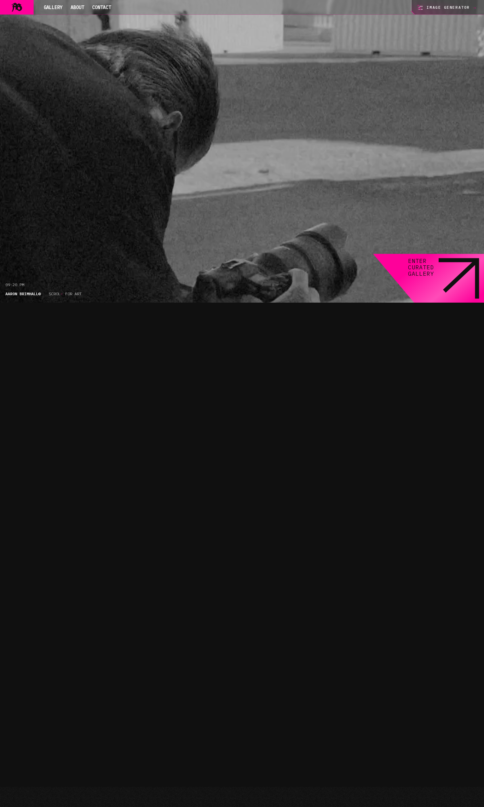

# UI Design System & Master Generation Blueprint: www-aaronbrimhall-com

> **Aaron Brimhall · Action & Automotive Photographer** (https://www.aaronbrimhall.com/) — Action and automotive photography by Aaron Brimhall: dynamic compositions, high-octane shoots and globe-trotting adventures. Fun fuels cr...



---

## 1. Executive Visual Persona & Design Archetype

- **Brand Essence & Persona**: **Aaron Brimhall · Action & Automotive Photographer** (`https://www.aaronbrimhall.com/`). Action and automotive photography by Aaron Brimhall: dynamic compositions, high-octane shoots and globe-trotting adventures. Fun fuels cr...
- **Visual Archetype**: **Dark-Substrate WebGL / Canvas Interactive Experience (`#101010` / `#000`)**.
- **Anti-AI-Slop Differentiators**:
  - **Source-Grounded Chromatic Polarity**: Anchors the viewport in `#101010` (`var(--black)` in `:root`) paired with `#ff0` primary typography and `#000` accents.
  - **Extracted Typographic Hierarchy**: Pairs `Inter Variablefont Opsz Wght` for display copy (`TELL ME ABOUT THE PROJECT`) with `IBM Plex Mono` and `IBM Plex Mono`.
  - **Calibrated Spatial Grid & Motion**: Combines `940px` container bounds (`gap: 16px`, padding `9px`) with `cubic-bezier(.625,.05,0,1)` easing and Lenis Smooth Scroll (`data-lenis`), GSAP Timeline & ScrollTrigger.

---

## 2. Spatial Architecture & Modular Grid Mathematics


### Viewport Allocation & Container Geometry
- **Captured Viewport Dimensions**: Desktop `1440×6239px` (`assets/desktop.png`, full-page scroll capture), Mobile `390×2400px` (`assets/mobile.png`, capped at 2400px multi-section capture).
- **Master Container Bounds**: `940px` extracted from `www-aaronbrimhall-com` stylesheet.
- **Canvas Lateral Padding & Spacing**: `9px` lateral canvas padding with `16px` grid gap.
- **Border Radius Scale**: `3px`, `100%`, `50%`, `0%`.

### Responsive Breakpoint Architecture
- **Desktop Layout**: Multi-column CSS Grid / Flexbox layout at `1440px` (`max-width: 940px`, `gap: 16px`).
- **Mobile Layout**: Single-column vertical stack at `390px` viewport width with `9px` horizontal padding.
- **Extracted CSS Media Queries**: `@media screen and (max-width:991px)`, `@media screen and (max-width:767px)`, `@media screen and (max-width:479px)`, `@media (min-width:768px)`.

---

## 3. Color System, Materiality & Atmospheric Lighting

### Semantic Palette & Source Grounding
| Semantic Role | Ground-Truth Value | Extracted CSS Source / Selector |
|---|---|---|
| **Primary Canvas Substrate** | `#101010` | `var(--black)` in `:root` |
| **Primary Typography Ink** | `#fe019a` | `var(--pink)` in `:root` |
| **Elevated Surface / Card Substrate** | `#0000` | `a { background-color: #0000 }` |
| **Interactive Accent / Highlight** | `#000` | `mark { color: #000 }` |
| **Secondary / Muted Copy** | `#ff0` | `mark { background: #ff0 }` |
| **Structural Hairline Border** | `#333` | `body { color: #333 }` |

### Sanitized Root CSS Variables (`ui-ux.md` Ground Truth)
| Variable Name | Extracted Value | Semantic Role |
|---|---|---|
| `--w-backdrop-animation` | `initial` | Motion / Easing Token |
| `--black` | `#101010` | Canvas / Surface Token |
| `--pink` | `#fe019a` | Typography Ink Token |
| `--font-family` | `"IBM Plex Mono",sans-serif` | Typography / Scale Token |
| `--ab-ldx-aw` | `max(96px,min(clamp(140px,44vw,210px),35.16dvh))` | Dimension / Scale Token |
| `--ab-pink` | `#fe019a` | Typography Ink Token |
| `--ab-black` | `#101010` | Canvas / Surface Token |
| `--ab-ease-osmo` | `cubic-bezier(0.625, 0.05, 0, 1)` | Motion / Easing Token |
| `--ab-ease-out` | `cubic-bezier(0.19, 1, 0.22, 1)` | Motion / Easing Token |
| `--tr-cover` | `#101010` | Color / Atmospheric Token |
| `--ab-edge` | `24px` | Dimension / Scale Token |
| `--ab-nav-ride` | `0.45s cubic-bezier(0.19, 1, 0.22, 1)` | Layout / Spatial Grid Token |
| `--hs-e` | `var(--ab-edge,24px)` | Dimension / Scale Token |
| `--hs-trim` | `4px` | Dimension / Scale Token |
| `--vf-i` | `clamp(24px,4vw,64px)` | Dimension / Scale Token |
| `--vf-t` | `max(var(--vf-i),60px)` | Dimension / Scale Token |

---

## 4. Typographic Scale & Editorial Hierarchy

### Font Family Stacks
- **Display Typography**: `Inter Variablefont Opsz Wght`.
- **Primary Body Stack**: `IBM Plex Mono`.
- **Technical / Metadata Stack**: `IBM Plex Mono`.

### Typographic Scale & Rules (Extracted from Stylesheet & Variables)
- **Hero Display (`H1`)**: not explicitly declared on tag in static CSS (stylesheet font-size ladder: `2em`, `80%`, `75%`, `1em`, `14px`).
- **Section Heading (`H2`)**: not explicitly declared on tag in static CSS (stylesheet font-size ladder: `2em`, `80%`, `75%`, `1em`, `14px`).
- **Body Copy**: rule `.paragraph` (`letter-spacing: .01em`).
- **Metadata & Navigation Labels**: not explicitly declared on tag in static CSS (stylesheet font-size ladder: `2em`, `80%`, `75%`, `1em`, `14px`).

---

## 5. Choreographed Motion & Interaction Physics

### Primary Easing Curves
- **Extracted Timing Functions**: `cubic-bezier(.625,.05,0,1)`, `cubic-bezier(0.625,0.05,0,1)`, `cubic-bezier(0.19,1,0.22,1)`.

### Per-Element Transition & Choreography Rules
- **Selector `.w-webflow-badge>img`**: `transition: unset` extracted from `www-aaronbrimhall-com` stylesheet.
- **Selector `.w-slider-dot`**: `transition: background-color .1s,color .1s` extracted from `www-aaronbrimhall-com` stylesheet.
- **Selector `.w-lightbox-control`**: `transition: all .3s` extracted from `www-aaronbrimhall-com` stylesheet.
- **Extracted Easing Curve (`cubic-bezier(.625,.05,0,1)`)**: Governs interactive state transitions across `<nav.ab-cs-socials>` and `<section.hero-section_wrapper>`.
- **Runtime Interaction Engine**: Integrates Lenis Smooth Scroll (`data-lenis`), GSAP Timeline & ScrollTrigger, Swiper Touch Carousel Engine, Barba.js Page Transition Router, HTML5 `<canvas>` Interactive Viewport Surface with `prefers-reduced-motion: reduce` fallback guards.

---

## 6. Component Wireframe & Structural DOM Map

### Visual Layout Schematic (Grounded in `dom.html` — `1440px` Desktop & `390px` Mobile Reflow)
```
┌────────────────────────────────────────────────────────────────────────┐
│ DESKTOP VIEWPORT (1440px) — Aaron Brimhall · Action & Automotive Photo │
│ ====================================================================== │
│ [ <nav.ab-cs-socials>      | INSTAGRAM ↗ · TIKTOK ↗ · BEHANCE ↗ · Y ]  │
│ ---------------------------------------------------------------------- │
│ | HERO STAGE: <section.hero_section>                               |   │
│ | H1: TELL ME ABOUT THE PROJECT                                    |   │
│ | Substrate: #101010    | Ink: #ff0       | Accent: #000           |   │
│ ---------------------------------------------------------------------- │
│ | SHOWCASE GRID (<section.hero-section_wrap) max-w: 940px          |   │
│ | +------------------------------+  +------------------------------+ | │
│ | | T H O S E W H O G E T I T    |  | AB Training                  | | │
│ | +------------------------------+  +------------------------------+ | │
│ ---------------------------------------------------------------------- │
│ | MOBILE VIEWPORT REFLOW (390px) — Single-Column Stack (gap: 16px  ) | │
│ | [<nav.ab-cs-socials] -> [<section.hero_sect] -> [<section.hero-sect] │
│ ---------------------------------------------------------------------- │
│ [ FOOTER (<footer.wf-ibmplexmono) | https://www.aaronbrimhall.com/     │
└────────────────────────────────────────────────────────────────────────┘
```

### Granular DOM Region Breakdown
1. **Brand Header & Navigation Bar (<nav.ab-cs-socials> — `www-aaronbrimhall-com`)**:
   - Landmark `<nav class="ab-cs-socials">` hosting `Aaron Brimhall · Action & Automotive` navigation (`INSTAGRAM ↗ · TIKTOK ↗ · BEHANCE ↗ · YOUTUBE ↗`), DOM attributes (`data-wf-domain="www.aaronbrimhall.com"`, `data-wf-page="6941d6f273b44a2836ceae0d"`, `data-wf-site="6941d6f273b44a2836ceae16"`, `data-page="home"`), and stylesheet rule `html { -webkit-text-size-adjust:100%;-ms-text-size-adjust:100%;font-family:sans... }`.
2. **Hero Stage & Focal Lead (<section.hero_section> — `TELL ME ABOUT THE PROJECT`)**:
   - Landmark `<section class="hero_section ab-hx-short">` presenting display lead `TELL ME ABOUT THE PROJECT` and copy excerpt *"TRANSMISSION RECEIVED"* over `#101010` canvas and `#ff0` ink.
3. **Primary Showcase & Content Grid (<section.hero-section_wrapper> — `T H O S E W H O G E T I T`)**:
   - Landmark `<section class="hero-section_wrapper">` rendering section `T H O S E W H O G E T I T` with copy *"SIGNAL LOST — TRY AGAIN"*, asset references (`cdn.prod.website-files.com`, `aaron-brimhall-site-09-25-f01e7c4...`, `fonts.googleapis.com`, `fonts.gstatic.com`), and grid rule `summary { display:block }`.
4. **Interactive Detail & Feature Matrix (<section.gallery_section> — `AB Training`)**:
   - Landmark `<section class="gallery_section">` framing `AB Training` and `Shop Prints` (*"I M A G E G E N E R A T O R →"*) with `#0000` surface cards, `#000` accents, and `video { vertical-align:baseline;display:inline-block }`.
5. **Colophon & Global Directory Footer (<footer.wf-ibmplexmono-n6-active> — `https://www.aaronbrimhall.com/`)**:
   - Landmark `<footer class="wf-ibmplexmono-n6-active">` anchoring `Aaron Brimhall · Action & Automo` footer links (`INSTAGRAM ↗ · TIKTOK ↗ · BEHANCE ↗ · YOUTUBE ↗`), copy *"I M A G E G E N E R A T O R"*, and `#333` structural dividers.

---

## 7. Master Zero-Shot AI Generation Prompt

```markdown
# Master Zero-Shot Frontend Generation Prompt: www-aaronbrimhall-com (Aaron Brimhall · Action & Automotive Photographer)

You are a principal frontend architect and design systems engineer. Build a complete, production-ready web application replicating the exact design system, DOM landmarks, typographic hierarchy, color tokens, and motion physics of `www-aaronbrimhall-com` (**Aaron Brimhall · Action & Automotive Photographer** — `https://www.aaronbrimhall.com/`).

### 1. Visual Archetype & Anti-AI-Slop Mandates
- **Archetype**: Dark-Substrate WebGL / Canvas Interactive Experience (`#101010` / `#000`).
- **Identity & Domain Context**: Action and automotive photography by Aaron Brimhall: dynamic compositions, high-octane shoots and globe-trotting adventures. Fun fuels cr...
- **Primary Substrate**: `#101010` (`var(--black)` in `:root`), **Primary Ink**: `#ff0`, **Accent / Highlight**: `#000`.
- **Site-Specific Differentiators**:
  - **Source-Grounded Chromatic Polarity**: Anchors the viewport in `#101010` (`var(--black)` in `:root`) paired with `#ff0` primary typography and `#000` accents.
  - **Extracted Typographic Hierarchy**: Pairs `Inter Variablefont Opsz Wght` for display copy (`TELL ME ABOUT THE PROJECT`) with `IBM Plex Mono` and `IBM Plex Mono`.
  - **Calibrated Spatial Grid & Motion**: Combines `940px` container bounds (`gap: 16px`, padding `9px`) with `cubic-bezier(.625,.05,0,1)` easing and Lenis Smooth Scroll (`data-lenis`), GSAP Timeline & ScrollTrigger.

### 2. Ground-Truth CSS Variables (`:root` Token Contract)
Declare and consume these exact custom properties extracted from `www-aaronbrimhall-com` in your global stylesheet:

:root {
  /* Aaron Brimhall · Action & Automotive Photographer (www-aaronbrimhall-com) — Ground-Truth Extracted CSS Variables */
  --w-backdrop-animation: initial; /* Motion / Easing Token (www-aaronbrimhall-com) */
  --black: #101010; /* Canvas / Surface Token (www-aaronbrimhall-com) */
  --pink: #fe019a; /* Typography Ink Token (www-aaronbrimhall-com) */
  --font-family: "IBM Plex Mono",sans-serif; /* Typography / Scale Token (www-aaronbrimhall-com) */
  --ab-ldx-aw: max(96px,min(clamp(140px,44vw,210px),35.16dvh)); /* Dimension / Scale Token (www-aaronbrimhall-com) */
  --ab-pink: #fe019a; /* Typography Ink Token (www-aaronbrimhall-com) */
  --ab-black: #101010; /* Canvas / Surface Token (www-aaronbrimhall-com) */
  --ab-ease-osmo: cubic-bezier(0.625, 0.05, 0, 1); /* Motion / Easing Token (www-aaronbrimhall-com) */
  --ab-ease-out: cubic-bezier(0.19, 1, 0.22, 1); /* Motion / Easing Token (www-aaronbrimhall-com) */
  --tr-cover: #101010; /* Color / Atmospheric Token (www-aaronbrimhall-com) */
  --ab-edge: 24px; /* Dimension / Scale Token (www-aaronbrimhall-com) */
  --ab-nav-ride: 0.45s cubic-bezier(0.19, 1, 0.22, 1); /* Layout / Spatial Grid Token (www-aaronbrimhall-com) */
  --hs-e: var(--ab-edge,24px); /* Dimension / Scale Token (www-aaronbrimhall-com) */
  --hs-trim: 4px; /* Dimension / Scale Token (www-aaronbrimhall-com) */
  --vf-i: clamp(24px,4vw,64px); /* Dimension / Scale Token (www-aaronbrimhall-com) */
  --vf-t: max(var(--vf-i),60px); /* Dimension / Scale Token (www-aaronbrimhall-com) */
}

### 3. Semantic Color & Materiality Contract
Map every surface, ink, and border strictly to these source-grounded tokens:
- **Primary Canvas Substrate**: `#101010` — grounded in `var(--black)` in `:root`
- **Primary Typography Ink**: `#fe019a` — grounded in `var(--pink)` in `:root`
- **Elevated Surface / Card Substrate**: `#0000` — grounded in `a { background-color: #0000 }`
- **Interactive Accent / Highlight**: `#000` — grounded in `mark { color: #000 }`
- **Secondary / Muted Copy**: `#ff0` — grounded in `mark { background: #ff0 }`
- **Structural Hairline Border**: `#333` — grounded in `body { color: #333 }`

### 4. Spatial Grid, Container Bounds & Responsive Breakpoints
- **Desktop Viewport Reference**: `1440×6239px` (full-page scroll capture, `1440px` standard desktop width).
- **Mobile Viewport Reference**: `390×2400px` (capped at 2400px multi-section capture, `390px` standard mobile width).
- **Container Max-Width**: `940px` extracted from `www-aaronbrimhall-com` stylesheet
- **Padding & Gutters**: `9px` lateral canvas padding with `16px` grid gap
- **Desktop Grid**: Multi-column CSS Grid / Flexbox layout at `1440px` (`max-width: 940px`, `gap: 16px`)
- **Mobile Adaptation**: Single-column vertical stack at `390px` viewport width with `9px` horizontal padding
- **Media Queries**: `@media screen and (max-width:991px)`, `@media screen and (max-width:767px)`, `@media screen and (max-width:479px)`, `@media (min-width:768px)`
- **Corner Radii**: `3px`, `100%`, `50%`, `0%`

### 5. Typography & Editorial Scale Contract
- **Display Font Stack**: `Inter Variablefont Opsz Wght`
- **Body Font Stack**: `IBM Plex Mono`
- **Monospace / Technical Font Stack**: `IBM Plex Mono`
- **H1 Display Rule**: not explicitly declared on tag in static CSS (stylesheet font-size ladder: `2em`, `80%`, `75%`, `1em`, `14px`)
- **H2 Section Rule**: not explicitly declared on tag in static CSS (stylesheet font-size ladder: `2em`, `80%`, `75%`, `1em`, `14px`)
- **Body Copy Rule**: rule `.paragraph` (`letter-spacing: .01em`)
- **Metadata & Index Rule**: not explicitly declared on tag in static CSS (stylesheet font-size ladder: `2em`, `80%`, `75%`, `1em`, `14px`)

### 6. Component Hierarchy, Verbatim Copy & Real DOM Landmarks
Scaffold `www-aaronbrimhall-com` (`Aaron Brimhall · Action & Automotive Photographer`) with these exact structural regions, extracted copy, and CSS rules from `dom.html`:
1. **Brand Header & Navigation Bar (<nav.ab-cs-socials> — `www-aaronbrimhall-com`)**:
   - DOM & Selectors: Landmark `<nav class="ab-cs-socials">` hosting `Aaron Brimhall · Action & Automotive` navigation (`INSTAGRAM ↗ · TIKTOK ↗ · BEHANCE ↗ · YOUTUBE ↗`), DOM attributes (`data-wf-domain="www.aaronbrimhall.com"`, `data-wf-page="6941d6f273b44a2836ceae0d"`, `data-wf-site="6941d6f273b44a2836ceae16"`, `data-page="home"`), and stylesheet rule `html { -webkit-text-size-adjust:100%;-ms-text-size-adjust:100%;font-family:sans... }`.
   - Responsive Contract: Header `Brand Header & Navigation Bar (<nav.ab-cs-socials> — `www-aaronbrimhall-com`)` (`www-aaronbrimhall-com`) adapts across `@media screen and (max-width:991px)`, `@media screen and (max-width:767px)`, `@media screen and (max-width:479px)`, `@media (min-width:768px)` with `cubic-bezier(.625,.05,0,1)`, `cubic-bezier(0.625,0.05,0,1)`, `cubic-bezier(0.19,1,0.22,1)` transitions and links `INSTAGRAM ↗ · TIKTOK ↗ · BEHANCE ↗ · YOUTUBE ↗`.
2. **Hero Stage & Focal Lead (<section.hero_section> — `TELL ME ABOUT THE PROJECT`)**:
   - DOM & Selectors: Landmark `<section class="hero_section ab-hx-short">` presenting display lead `TELL ME ABOUT THE PROJECT` and copy excerpt *"TRANSMISSION RECEIVED"* over `#101010` canvas and `#ff0` ink.
   - Responsive Contract: Hero stage (`1440×6239px` desktop / `390×2400px` mobile) sets `#101010` background with `#ff0` headline `TELL ME ABOUT THE PROJECT`.
3. **Primary Showcase & Content Grid (<section.hero-section_wrapper> — `T H O S E W H O G E T I T`)**:
   - DOM & Selectors: Landmark `<section class="hero-section_wrapper">` rendering section `T H O S E W H O G E T I T` with copy *"SIGNAL LOST — TRY AGAIN"*, asset references (`cdn.prod.website-files.com`, `aaron-brimhall-site-09-25-f01e7c4...`, `fonts.googleapis.com`, `fonts.gstatic.com`), and grid rule `summary { display:block }`.
   - Responsive Contract: Showcase grid `Primary Showcase & Content Grid (<section.hero-section_wrapper> — `T H O S E W H O G E T I T`)` applies Multi-column CSS Grid / Flexbox layout at `1440px` (`max-width: 940px`, `gap: 16px`) on desktop and Single-column vertical stack at `390px` viewport width with `9px` horizontal padding on mobile.
4. **Interactive Detail & Feature Matrix (<section.gallery_section> — `AB Training`)**:
   - DOM & Selectors: Landmark `<section class="gallery_section">` framing `AB Training` and `Shop Prints` (*"I M A G E G E N E R A T O R →"*) with `#0000` surface cards, `#000` accents, and `video { vertical-align:baseline;display:inline-block }`.
   - Responsive Contract: Detail module `Interactive Detail & Feature Matrix (<section.gallery_section> — `AB Training`)` uses `3px`, `100%`, `50%`, `0%` radii, `#000` highlights, and assets (cdn.prod.website-files.com, aaron-brimhall-site-09-25-f01e7c4..., fonts.googleapis.com).
5. **Colophon & Global Directory Footer (<footer.wf-ibmplexmono-n6-active> — `https://www.aaronbrimhall.com/`)**:
   - DOM & Selectors: Landmark `<footer class="wf-ibmplexmono-n6-active">` anchoring `Aaron Brimhall · Action & Automo` footer links (`INSTAGRAM ↗ · TIKTOK ↗ · BEHANCE ↗ · YOUTUBE ↗`), copy *"I M A G E G E N E R A T O R"*, and `#333` structural dividers.
   - Responsive Contract: Footer `Colophon & Global Directory Footer (<footer.wf-ibmplexmono-n6-active> — `https://www.aaronbrimhall.com/`)` aligns to `940px` extracted from `www-aaronbrimhall-com` stylesheet with `9px` lateral canvas padding with `16px` grid gap and attributes (data-wf-domain="www.aaronbrimhall.com", data-wf-page="6941d6f273b44a2836ceae0d", data-wf-site="6941d6f273b44a2836ceae16").

#### Verbatim DOM Copy Excerpts (`dom.html`)
- Copy Excerpt 1: *"TRANSMISSION RECEIVED"*
- Copy Excerpt 2: *"SIGNAL LOST — TRY AGAIN"*
- Copy Excerpt 3: *"I M A G E G E N E R A T O R →"*
- Copy Excerpt 4: *"I M A G E G E N E R A T O R"*

### 7. Motion, Extracted Stylesheet Rules & Interaction Choreography
- **Primary Easing Functions**: `cubic-bezier(.625,.05,0,1)`, `cubic-bezier(0.625,0.05,0,1)`, `cubic-bezier(0.19,1,0.22,1)`
- **Extracted Stylesheet Rules (`www-aaronbrimhall-com`)**:
- `html { -webkit-text-size-adjust:100%;-ms-text-size-adjust:100%;font-family:sans... }`
- `summary { display:block }`
- `video { vertical-align:baseline;display:inline-block }`
- `template { display:none }`
- `strong { font-weight:700 }`
- **Per-Selector Transition Rules**:
- **Selector `.w-webflow-badge>img`**: `transition: unset` extracted from `www-aaronbrimhall-com` stylesheet.
- **Selector `.w-slider-dot`**: `transition: background-color .1s,color .1s` extracted from `www-aaronbrimhall-com` stylesheet.
- **Selector `.w-lightbox-control`**: `transition: all .3s` extracted from `www-aaronbrimhall-com` stylesheet.
- **Extracted Easing Curve (`cubic-bezier(.625,.05,0,1)`)**: Governs interactive state transitions across `<nav.ab-cs-socials>` and `<section.hero-section_wrapper>`.
- **Runtime Interaction Engine**: Integrates Lenis Smooth Scroll (`data-lenis`), GSAP Timeline & ScrollTrigger, Swiper Touch Carousel Engine, Barba.js Page Transition Router, HTML5 `<canvas>` Interactive Viewport Surface with `prefers-reduced-motion: reduce` fallback guards.

### 8. Technical Deliverables
- Implement in Next.js (App Router) with TypeScript and Tailwind CSS consuming the `:root` custom properties defined above for `www-aaronbrimhall-com`.
- Reproduce both the `1440px` desktop architecture and `390px` mobile breakpoint transitions, preserving semantic HTML5 landmarks (`<header>`, `<nav>`, `<main>`, `<section>`, `<footer>`) and `prefers-reduced-motion` accessibility guards.
```
