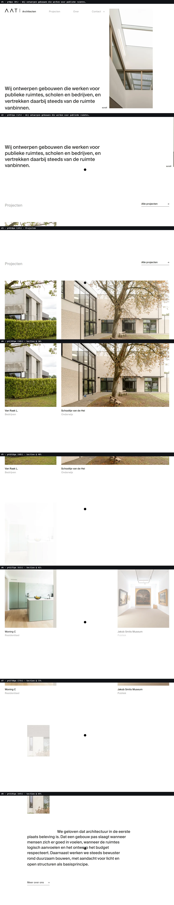
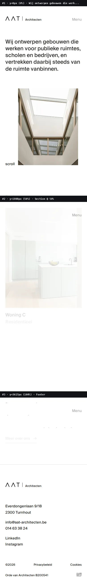

# UI Design System & Master Generation Blueprint: www-aat-architecten-be

> **AAT Architecten** (https://www.aat-architecten.be/) — Architectenbureau uit Turnhout (Antwerpen), actief in een ruimer gebied. Architectuurprojecten voor openbare besturen, scholen en bedrijv...





---

## 1. Executive Visual Persona & Design Archetype

- **Brand Essence & Persona**: **AAT Architecten** (`https://www.aat-architecten.be/`). Architectenbureau uit Turnhout (Antwerpen), actief in een ruimer gebied. Architectuurprojecten voor openbare besturen, scholen en bedrijv...
- **Capture Provenance**: Live browser capture (`tier1_fast`, HTTP `200`, captured `2026-11-24`).
- **Visual Archetype**: **Light-Substrate Editorial & Modular Grid System (`#ffffff` canvas, `#1d1d1b` ink, `#185abc` accent)**.
- **Anti-AI-Slop Differentiators**:
  - **Live-Computed Chromatic Polarity**: Anchors the viewport in `#ffffff` (live computed `body` `background-color` (`computed_styles.json`)) paired with `#1d1d1b` primary typography and `#185abc` accents.
  - **Grounded Typographic Hierarchy**: Uses `Suisse Intl` across display (`Wij ontwerpen gebouwen die werken vo`) and body copy, paired with `SFMono-Regular` for monospace/code.
  - **Calibrated Spatial Grid & Motion**: Combines `1920px` container bounds (`gap: var(--spacing-g-half)`, padding `1px`) with `cubic-bezier(.4,0,.2,1)` easing and Lenis Smooth Scroll (`data-lenis`), Three.js / WebGL Canvas Pipeline.

---

## 2. Spatial Architecture & Modular Grid Mathematics

### Viewport Allocation & Container Geometry
- **Captured Journey Filmstrips**: Desktop `1280×6624px` (`assets/desktop-journey.webp`, `8` keyframes up to `y=3185px` / doc `4660px`), Mobile `390×2616px` (`assets/mobile-journey.webp`, `3` keyframes).
- **Master Container Bounds**: `1920px` (non-`@media` desktop container stylesheet rule).
- **Canvas Lateral Padding & Spacing**: `1px` lateral canvas padding with `var(--spacing-g-half)` grid gap.
- **Border Radius Scale**: `.25rem`, `var(--radius-4)`, `6px`, `var(--radius-sm)`.

### Responsive Breakpoint Architecture
- **Desktop Layout**: Multi-column CSS Grid / Flexbox layout at `1440px` (`max-width: 1920px`, `gap: var(--spacing-g-half)`).
- **Mobile Layout**: Single-column vertical stack at `390px` viewport width with `1px` horizontal padding.
- **Extracted CSS Media Queries**: `@media (min-width:576px)`, `@media (min-width:820px)`, `@media (min-width:1024px)`, `@media (min-width:1280px)`.

---

## 3. Color System, Materiality & Atmospheric Lighting

### Semantic Palette & Source Grounding
| Semantic Role | Ground-Truth Value | Extracted Live / CSS Source |
|---|---|---|
| **Primary Canvas Substrate** | `#ffffff` | live computed `body` `background-color` (`computed_styles.json`) |
| **Primary Typography Ink** | `#1d1d1b` | live computed `h1` `color` (`computed_styles.json`) |
| **Elevated Surface / Card Substrate** | `#f9fafb` | `.aspect-ratio-box .no-image:before { background-color: #f9fafb }` |
| **Interactive Accent / Highlight** | `#185abc` | `.rc-2fa-submit-button-holder bu... { background-color: #185abc }` |
| **Secondary / Muted Copy** | `#ababab` | live computed `h2` `color` (`computed_styles.json`) |
| **Structural Hairline Border** | `#e9f3e3` | `20 { border-color: #e9f3e3 }` |

### Sanitized Root CSS Variables (`ui-ux.md` Ground Truth)
| Variable Name | Extracted Value | Semantic Role |
|---|---|---|
| `--reverse-aspect-ratio` | `1` | Design System Custom Token |
| `--form-spacing-x` | `calc(var(--spacing) * 8)` | Layout / Spatial Grid Token |
| `--form-spacing-y` | `calc(var(--spacing) * 10)` | Layout / Spatial Grid Token |
| `--form-submit-spacing` | `calc(var(--spacing) * 10)` | Layout / Spatial Grid Token |
| `--form-field-small-width` | `calc(25% - calc(var(--spacing) * 4))` | Layout / Spatial Grid Token |
| `--rte-margin` | `calc(var(--spacing) * 6)` | Layout / Spatial Grid Token |
| `--rte-link-color` | `var(--color-black-500)` | Typography Ink Token |
| `--g-spacing` | `calc(var(--spacing) * 24)` | Layout / Spatial Grid Token |
| `--none` | `linear(0, 1)` | Design System Custom Token |
| `--h1-size` | `clamp(32px, 3vw + 1.5rem, 72px)` | Typography / Scale Token |
| `--h2-size` | `clamp(28px, 2.2vw + 1.2rem, 48px)` | Typography / Scale Token |
| `--h3-size` | `clamp(24px, 1.8vw + 1rem, 40px)` | Typography / Scale Token |
| `--h4-size` | `clamp(20px, 1.3vw + .8rem, 32px)` | Layout / Spatial Grid Token |
| `--h5-size` | `clamp(18px, .5vw + 1rem, 20px)` | Layout / Spatial Grid Token |
| `--h6-size` | `clamp(16px, .4vw + .9rem, 18px)` | Layout / Spatial Grid Token |
| `--color-red-400` | `oklch(70.4% .191 22.216)` | Brand / Palette Token |

---

## 4. Typographic Scale & Editorial Hierarchy

### Font Family Stacks
- **Display Typography**: `Suisse Intl`.
- **Primary Body Stack**: `Suisse Intl`.
- **Technical / Metadata Stack**: `SFMono-Regular`.

### Typographic Scale & Rules (Live Computed & Stylesheet Grounded)
- **Hero Display (`H1`)**: live computed `h1` (`font-size: 40px`, `line-height: 50px`, `font-weight: 400`); CSS variables `--h1-size: clamp(32px, 3vw + 1.5rem, 72px)`.
- **Section Heading (`H2`)**: live computed `h2` (`font-size: 31.52px`, `line-height: 39.4px`, `font-weight: 400`); CSS variables `--h2-size: clamp(28px, 2.2vw + 1.2rem, 48px)`; rule `h2` (`font-size: var(--h4-size)`, `font-weight: var(--font-we...`).
- **Body Copy**: live computed `body` (`font-size: 16px`, `line-height: 24px`, `font-weight: 400`); rule `p` (`font-size: var(--text-13)`, `line-height: 1`).
- **Metadata & Navigation Labels**: live computed `nav/a` (`font-size: 16px`, `line-height: 24px`, `font-weight: 400`); CSS variables `--form-field-small-width: calc(25% - calc(var(--spacing) * 4))`, `--text-sm: .875rem`, `--text-sm--line-height: calc(1.25 / .875)`.

---

## 5. Choreographed Motion & Interaction Physics

### Primary Easing Curves
- **Extracted Timing Functions**: `cubic-bezier(.4,0,.2,1)`, `cubic-bezier(.625,.05,0,1)`, `cubic-bezier(.25,.46,.45,.94)`.

### Per-Element Transition & Choreography Rules
- **Selector `layer theme`**: `transition: .15s` extracted from `www-aat-architecten-be` stylesheet.
- **Selector `.underline-link-alt:before`**: `transition: var(--tw-ease,var(--default-transition-timing-function))` extracted from `www-aat-architecten-be` stylesheet.
- **Selector `.underline-link-alt:after`**: `transition: var(--tw-ease,var(--default-transition-timing-function))` extracted from `www-aat-architecten-be` stylesheet.
- **Extracted Easing Curve (`cubic-bezier(.4,0,.2,1)`)**: Governs interactive state transitions across `<header.site-wrapper__row>` and `<section.block-featured-projects>`.
- **Runtime Interaction Engine**: Integrates Lenis Smooth Scroll (`data-lenis`), Three.js / WebGL Canvas Pipeline with `prefers-reduced-motion: reduce` fallback guards.
### Measured Runtime Scroll & Interaction Telemetry (`behavioral_journey_v2`)
- **Scroll Driver Mode**: `wheel` (max document height `4660px`, deepest scrollY reached `3185px` across `8` desktop keyframes).
- **Detected Scroll / Motion Libraries**: `Lenis`, `GSAP/ScrollTrigger`.
- **Hover Physics (`primary_cta` · `Architecten`)**: Computed transition `0.6s` / `cubic-bezier(0.4, 0, 0.2, 1)` (no static color/transform shift captured at rest).
- **Route Transition Architecture**: First internal navigation (`/projecten/van-raak-l-ravels`) measured as `direct` in `438ms`.

---

## 6. Component Wireframe & Structural DOM Map

### Visual Layout Schematic — Desktop (`1440px`, Grounded in `dom.html` & Landmark Bounding Boxes)
```
┌────────────────────────────────────────────────────────────────────────┐
│ DESKTOP VIEWPORT (1440px) — AAT Architecten                            │
│ ====================================================================== │
│ [ <header.site-wrapper__ (1440x110px) | Projecten · Over · Contact   ] │
│ ---------------------------------------------------------------------- │
│ | HERO STAGE: <section.home-intro-block> (w=1440px)                  | │
│ | H1: Wij ontwerpen gebouwen die werken voor publieke r...           | │
│ | Substrate: #ffffff | Ink: #1d1d1b | Accent: #185abc                | │
│ ---------------------------------------------------------------------- │
│ | SHOWCASE GRID (<section.block-featured-pr) max-w: 1920px           | │
│ | +------------------------------+  +------------------------------+ | │
│ | | Projecten                    |  | publieke ruimtes, scholen en | | │
│ | +------------------------------+  +------------------------------+ | │
│ ---------------------------------------------------------------------- │
│ | DETAIL MODULE (<section.block-text-and-po) — vertrekken daarbij st | │
│ ---------------------------------------------------------------------- │
│ [ FOOTER (<footer.mobile-nav__) | https://www.aat-architecten.be/      │
└────────────────────────────────────────────────────────────────────────┘
```

### Visual Layout Schematic — Mobile Reflow (`390px`)
```
┌────────────────────────────────────────────────────────────────────────┐
│ MOBILE VIEWPORT REFLOW (390px) — Single-Column Stack (gap: var(--sp)   │
│ ====================================================================== │
│ [ HEADER BAR (<header.site-wrapper__ro) | Compact Menu (390px)         │
│ ---------------------------------------------------------------------- │
│ | HERO STAGE (<section.home-intro-bloc) — 390px Vertical Lead        | │
│ | H1: Wij ontwerpen gebouwen die werken voor publieke r...           | │
│ ---------------------------------------------------------------------- │
│ | SHOWCASE STACK (<section.block-feature) — 1-Col Stack              | │
│ | [ Item 1: Projecten                                              ] | │
│ | [ Item 2: publieke ruimtes, scholen en bedrijven, en             ] | │
│ ---------------------------------------------------------------------- │
│ | DETAIL STACK (<section.block-text-and-) — 1-Col (vertrekken daarbij) │
│ ---------------------------------------------------------------------- │
│ [ FOOTER (<footer.mobile-nav__) | Stacked 390px Colophon               │
└────────────────────────────────────────────────────────────────────────┘
```

### Granular DOM Region Breakdown
1. **Brand Header & Navigation Bar (<header.site-wrapper__row> — `www-aat-architecten-be`)**:
   - Landmark `<header class="site-wrapper__row site-wrapper__row--header">` (`1440x110px`) hosting `AAT Architecten` navigation (`Projecten · Over · Contact`), DOM attributes (`data-lenis-prevent`, `data-split="heading"`, `data-duration="1.6"`, `data-stagger="0.18"`), and stylesheet rule `html.lenis body { height:auto }`.
2. **Hero Stage & Focal Lead (<section.home-intro-block> — `Wij ontwerpen gebouwen die werken `)**:
   - Landmark `<section class="home-intro-block mb-g">` presenting display lead `Wij ontwerpen gebouwen die werken voor publieke r...` and copy excerpt *"Wij ontwerpen gebouwen die werken voor"* over `#ffffff` canvas and `#1d1d1b` ink.
3. **Primary Showcase & Content Grid (<section.block-featured-projects> — `Projecten`)**:
   - Landmark `<section class="block-featured-projects block-featured-projects--first">` rendering section `Projecten` with copy *"publieke ruimtes, scholen en bedrijven, en"*, asset references (`favicon-96x96.png`, `favicon.svg`, `favicon.ico`, `apple-touch-icon.png`), and grid rule `.lenis.lenis-stopped { overflow:clip }`.
4. **Interactive Detail & Feature Matrix (<section.block-text-and-portrait> — `publieke ruimtes, scholen en bedri`)**:
   - Landmark `<section class="block-text-and-portrait row">` framing `publieke ruimtes, scholen en bedrijven, en` and `vertrekken daarbij steeds van de ruimte` (*"vertrekken daarbij steeds van de ruimte"*) with `#f9fafb` surface cards, `#185abc` accents, and `.lenis.lenis-smooth iframe { pointer-events:none }`.
5. **Colophon & Global Directory Footer (<footer.mobile-nav__footer> — `https://www.aat-architecten.be/`)**:
   - Landmark `<footer class="mobile-nav__footer">` anchoring `AAT Architecten` footer links (`Projecten · Over · Contact`), copy *"Schooltje van de Hei"*, and `#e9f3e3` structural dividers.
### Full Vertical Scroll Sequence (Desktop `1440×900` Keyframes)
- **Step 01** (`y=0px`, `0%`): Active landmark `Wij ontwerpen gebouwen die werken voor publieke r...` · sticky/fixed elements: `1`
- **Step 02** (`y=455px`, `12%`): Active landmark `Wij ontwerpen gebouwen die werken voor publieke r...` · sticky/fixed elements: `0`
- **Step 03** (`y=910px`, `24%`): Active landmark `Projecten` · sticky/fixed elements: `0`
- **Step 04** (`y=1365px`, `36%`): Active landmark `Section @ 36%` · sticky/fixed elements: `0`
- **Step 05** (`y=1818px`, `48%`): Active landmark `Section @ 48%` · sticky/fixed elements: `0`
- **Step 06** (`y=2275px`, `61%`): Active landmark `Section @ 61%` · sticky/fixed elements: `0`
- **Step 07** (`y=2730px`, `73%`): Active landmark `Section @ 73%` · sticky/fixed elements: `0`
- **Step 08** (`y=3185px`, `85%`): Active landmark `Section @ 85%` · sticky/fixed elements: `0`

### Multi-Page Internal Route Map
- **Detail Route (`/projecten/van-raak-l-ravels`)**: `https://www.aat-architecten.be/projecten/van-raak-l-ravels` — H1: `Van Raak L.`, scrollHeight `19312px`, transition `direct` (`438ms`)
- **About Route (`/contact`)**: `https://www.aat-architecten.be/contact` — H1: `Contacteer ons voor een gesprek.`, scrollHeight `3249px`, transition `direct` (`689ms`)
- **Detail Route (`/projecten/schooltje-van-de-hei-mol`)**: `https://www.aat-architecten.be/projecten/schooltje-van-de-hei-mol` — H1: `Schooltje van de Hei`, scrollHeight `28519px`, transition `direct` (`1337ms`)

---

## 7. Master Zero-Shot AI Generation Prompt

```markdown
# Master Zero-Shot Frontend Generation Prompt: www-aat-architecten-be (AAT Architecten)

You are a principal frontend architect and design systems engineer. Build a complete, production-ready web application replicating the exact design system, DOM landmarks, typographic hierarchy, color tokens, and motion physics of `www-aat-architecten-be` (**AAT Architecten** — `https://www.aat-architecten.be/`).

### 1. Visual Archetype & Anti-AI-Slop Mandates
- **Archetype**: Light-Substrate Editorial & Modular Grid System (`#ffffff` canvas, `#1d1d1b` ink, `#185abc` accent).
- **Identity & Domain Context**: Architectenbureau uit Turnhout (Antwerpen), actief in een ruimer gebied. Architectuurprojecten voor openbare besturen, scholen en bedrijv...
- **Primary Substrate**: `#ffffff` (live computed `body` `background-color` (`computed_styles.json`)), **Primary Ink**: `#1d1d1b`, **Accent / Highlight**: `#185abc`.
- **Site-Specific Differentiators**:
  - **Live-Computed Chromatic Polarity**: Anchors the viewport in `#ffffff` (live computed `body` `background-color` (`computed_styles.json`)) paired with `#1d1d1b` primary typography and `#185abc` accents.
  - **Grounded Typographic Hierarchy**: Uses `Suisse Intl` across display (`Wij ontwerpen gebouwen die werken vo`) and body copy, paired with `SFMono-Regular` for monospace/code.
  - **Calibrated Spatial Grid & Motion**: Combines `1920px` container bounds (`gap: var(--spacing-g-half)`, padding `1px`) with `cubic-bezier(.4,0,.2,1)` easing and Lenis Smooth Scroll (`data-lenis`), Three.js / WebGL Canvas Pipeline.

### 2. Ground-Truth CSS Variables (`:root` Token Contract)
Declare and consume these exact custom properties extracted from `www-aat-architecten-be` in your global stylesheet:

:root {
  /* AAT Architecten (www-aat-architecten-be) — Live-Grounded CSS Variables */
  --reverse-aspect-ratio: 1; /* Design System Custom Token (www-aat-architecten-be) */
  --form-spacing-x: calc(var(--spacing) * 8); /* Layout / Spatial Grid Token (www-aat-architecten-be) */
  --form-spacing-y: calc(var(--spacing) * 10); /* Layout / Spatial Grid Token (www-aat-architecten-be) */
  --form-submit-spacing: calc(var(--spacing) * 10); /* Layout / Spatial Grid Token (www-aat-architecten-be) */
  --form-field-small-width: calc(25% - calc(var(--spacing) * 4)); /* Layout / Spatial Grid Token (www-aat-architecten-be) */
  --rte-margin: calc(var(--spacing) * 6); /* Layout / Spatial Grid Token (www-aat-architecten-be) */
  --rte-link-color: var(--color-black-500); /* Typography Ink Token (www-aat-architecten-be) */
  --g-spacing: calc(var(--spacing) * 24); /* Layout / Spatial Grid Token (www-aat-architecten-be) */
  --none: linear(0, 1); /* Design System Custom Token (www-aat-architecten-be) */
  --h1-size: clamp(32px, 3vw + 1.5rem, 72px); /* Typography / Scale Token (www-aat-architecten-be) */
  --h2-size: clamp(28px, 2.2vw + 1.2rem, 48px); /* Typography / Scale Token (www-aat-architecten-be) */
  --h3-size: clamp(24px, 1.8vw + 1rem, 40px); /* Typography / Scale Token (www-aat-architecten-be) */
  --h4-size: clamp(20px, 1.3vw + .8rem, 32px); /* Layout / Spatial Grid Token (www-aat-architecten-be) */
  --h5-size: clamp(18px, .5vw + 1rem, 20px); /* Layout / Spatial Grid Token (www-aat-architecten-be) */
  --h6-size: clamp(16px, .4vw + .9rem, 18px); /* Layout / Spatial Grid Token (www-aat-architecten-be) */
  --color-red-400: oklch(70.4% .191 22.216); /* Brand / Palette Token (www-aat-architecten-be) */
}

### 3. Semantic Color & Materiality Contract
Map every surface, ink, and border strictly to these source-grounded tokens:
- **Primary Canvas Substrate**: `#ffffff` — grounded in live computed `body` `background-color` (`computed_styles.json`)
- **Primary Typography Ink**: `#1d1d1b` — grounded in live computed `h1` `color` (`computed_styles.json`)
- **Elevated Surface / Card Substrate**: `#f9fafb` — grounded in `.aspect-ratio-box .no-image:before { background-color: #f9fafb }`
- **Interactive Accent / Highlight**: `#185abc` — grounded in `.rc-2fa-submit-button-holder bu... { background-color: #185abc }`
- **Secondary / Muted Copy**: `#ababab` — grounded in live computed `h2` `color` (`computed_styles.json`)
- **Structural Hairline Border**: `#e9f3e3` — grounded in `20 { border-color: #e9f3e3 }`

### 4. Spatial Grid, Container Bounds & Responsive Breakpoints
- **Desktop Viewport Reference**: `1280×6624px` (multi-frame vertical journey filmstrip (6624px), `1440px` standard desktop width).
- **Mobile Viewport Reference**: `390×2616px` (multi-frame vertical journey filmstrip (2616px), `390px` standard mobile width).
- **Container Max-Width**: `1920px` (non-`@media` desktop container stylesheet rule)
- **Padding & Gutters**: `1px` lateral canvas padding with `var(--spacing-g-half)` grid gap
- **Desktop Grid**: Multi-column CSS Grid / Flexbox layout at `1440px` (`max-width: 1920px`, `gap: var(--spacing-g-half)`)
- **Mobile Adaptation**: Single-column vertical stack at `390px` viewport width with `1px` horizontal padding
- **Media Queries**: `@media (min-width:576px)`, `@media (min-width:820px)`, `@media (min-width:1024px)`, `@media (min-width:1280px)`
- **Corner Radii**: `.25rem`, `var(--radius-4)`, `6px`, `var(--radius-sm)`

### 5. Typography & Editorial Scale Contract
- **Display Font Stack**: `Suisse Intl`
- **Body Font Stack**: `Suisse Intl`
- **Monospace / Technical Font Stack**: `SFMono-Regular`
- **H1 Display Rule**: live computed `h1` (`font-size: 40px`, `line-height: 50px`, `font-weight: 400`); CSS variables `--h1-size: clamp(32px, 3vw + 1.5rem, 72px)`
- **H2 Section Rule**: live computed `h2` (`font-size: 31.52px`, `line-height: 39.4px`, `font-weight: 400`); CSS variables `--h2-size: clamp(28px, 2.2vw + 1.2rem, 48px)`; rule `h2` (`font-size: var(--h4-size)`, `font-weight: var(--font-we...`)
- **Body Copy Rule**: live computed `body` (`font-size: 16px`, `line-height: 24px`, `font-weight: 400`); rule `p` (`font-size: var(--text-13)`, `line-height: 1`)
- **Metadata & Index Rule**: live computed `nav/a` (`font-size: 16px`, `line-height: 24px`, `font-weight: 400`); CSS variables `--form-field-small-width: calc(25% - calc(var(--spacing) * 4))`, `--text-sm: .875rem`, `--text-sm--line-height: calc(1.25 / .875)`

### 6. Component Hierarchy, Verbatim Copy & Real DOM Landmarks
Scaffold `www-aat-architecten-be` (`AAT Architecten`) with these exact structural regions, extracted copy, and CSS rules from `dom.html`:
1. **Brand Header & Navigation Bar (<header.site-wrapper__row> — `www-aat-architecten-be`)**:
   - DOM & Selectors: Landmark `<header class="site-wrapper__row site-wrapper__row--header">` (`1440x110px`) hosting `AAT Architecten` navigation (`Projecten · Over · Contact`), DOM attributes (`data-lenis-prevent`, `data-split="heading"`, `data-duration="1.6"`, `data-stagger="0.18"`), and stylesheet rule `html.lenis body { height:auto }`.
   - Responsive Contract: Header `Brand Header & Navigation Bar (<header.site-wrapper__row> — `www-aat-architecten-be`)` (`www-aat-architecten-be`) adapts across `@media (min-width:576px)`, `@media (min-width:820px)`, `@media (min-width:1024px)`, `@media (min-width:1280px)` with `cubic-bezier(.4,0,.2,1)`, `cubic-bezier(.625,.05,0,1)`, `cubic-bezier(.25,.46,.45,.94)` transitions and links `Projecten · Over · Contact`.
2. **Hero Stage & Focal Lead (<section.home-intro-block> — `Wij ontwerpen gebouwen die werken `)**:
   - DOM & Selectors: Landmark `<section class="home-intro-block mb-g">` presenting display lead `Wij ontwerpen gebouwen die werken voor publieke r...` and copy excerpt *"Wij ontwerpen gebouwen die werken voor"* over `#ffffff` canvas and `#1d1d1b` ink.
   - Responsive Contract: Hero stage (`1280×6624px` desktop / `390×2616px` mobile) sets `#ffffff` background with `#1d1d1b` headline `Wij ontwerpen gebouwen die werken voor publieke r...`.
3. **Primary Showcase & Content Grid (<section.block-featured-projects> — `Projecten`)**:
   - DOM & Selectors: Landmark `<section class="block-featured-projects block-featured-projects--first">` rendering section `Projecten` with copy *"publieke ruimtes, scholen en bedrijven, en"*, asset references (`favicon-96x96.png`, `favicon.svg`, `favicon.ico`, `apple-touch-icon.png`), and grid rule `.lenis.lenis-stopped { overflow:clip }`.
   - Responsive Contract: Showcase grid `Primary Showcase & Content Grid (<section.block-featured-projects> — `Projecten`)` applies Multi-column CSS Grid / Flexbox layout at `1440px` (`max-width: 1920px`, `gap: var(--spacing-g-half)`) on desktop and Single-column vertical stack at `390px` viewport width with `1px` horizontal padding on mobile.
4. **Interactive Detail & Feature Matrix (<section.block-text-and-portrait> — `publieke ruimtes, scholen en bedri`)**:
   - DOM & Selectors: Landmark `<section class="block-text-and-portrait row">` framing `publieke ruimtes, scholen en bedrijven, en` and `vertrekken daarbij steeds van de ruimte` (*"vertrekken daarbij steeds van de ruimte"*) with `#f9fafb` surface cards, `#185abc` accents, and `.lenis.lenis-smooth iframe { pointer-events:none }`.
   - Responsive Contract: Detail module `Interactive Detail & Feature Matrix (<section.block-text-and-portrait> — `publieke ruimtes, scholen en bedri`)` uses `.25rem`, `var(--radius-4)`, `6px`, `var(--radius-sm)` radii, `#185abc` highlights, and assets (favicon-96x96.png, favicon.svg, favicon.ico).
5. **Colophon & Global Directory Footer (<footer.mobile-nav__footer> — `https://www.aat-architecten.be/`)**:
   - DOM & Selectors: Landmark `<footer class="mobile-nav__footer">` anchoring `AAT Architecten` footer links (`Projecten · Over · Contact`), copy *"Schooltje van de Hei"*, and `#e9f3e3` structural dividers.
   - Responsive Contract: Footer `Colophon & Global Directory Footer (<footer.mobile-nav__footer> — `https://www.aat-architecten.be/`)` aligns to `1920px` (non-`@media` desktop container stylesheet rule) with `1px` lateral canvas padding with `var(--spacing-g-half)` grid gap and attributes (data-lenis-prevent, data-split="heading", data-duration="1.6").

#### Verbatim DOM Copy Excerpts (`dom.html`)
- Copy Excerpt 1: *"Wij ontwerpen gebouwen die werken voor"*
- Copy Excerpt 2: *"publieke ruimtes, scholen en bedrijven, en"*
- Copy Excerpt 3: *"vertrekken daarbij steeds van de ruimte"*
- Copy Excerpt 4: *"Schooltje van de Hei"*

### 7. Motion, Extracted Stylesheet Rules & Interaction Choreography
- **Primary Easing Functions**: `cubic-bezier(.4,0,.2,1)`, `cubic-bezier(.625,.05,0,1)`, `cubic-bezier(.25,.46,.45,.94)`
- **Extracted Stylesheet Rules (`www-aat-architecten-be`)**:
- `html.lenis body { height:auto }`
- `.lenis.lenis-stopped { overflow:clip }`
- `.lenis.lenis-smooth iframe { pointer-events:none }`
- `backdrop { box-sizing:border-box;border:0 solid;margin:0;padding:0 }`
- `file-selector-button { box-sizing:border-box;border:0 solid;margin:0;padding:0 }`
- **Per-Selector Transition Rules**:
- **Selector `layer theme`**: `transition: .15s` extracted from `www-aat-architecten-be` stylesheet.
- **Selector `.underline-link-alt:before`**: `transition: var(--tw-ease,var(--default-transition-timing-function))` extracted from `www-aat-architecten-be` stylesheet.
- **Selector `.underline-link-alt:after`**: `transition: var(--tw-ease,var(--default-transition-timing-function))` extracted from `www-aat-architecten-be` stylesheet.
- **Extracted Easing Curve (`cubic-bezier(.4,0,.2,1)`)**: Governs interactive state transitions across `<header.site-wrapper__row>` and `<section.block-featured-projects>`.
- **Runtime Interaction Engine**: Integrates Lenis Smooth Scroll (`data-lenis`), Three.js / WebGL Canvas Pipeline with `prefers-reduced-motion: reduce` fallback guards.
### 7b. Full-Page Scroll Choreography, Interactive States & Multi-Page Routes
- **Scroll Mechanics**: Implement `wheel` vertical progression up to `4660px` across 8 distinct viewport chapters using Lenis, GSAP/ScrollTrigger.
- **Vertical Chapter Sequence**: Wij ontwerpen gebouwen die... (0%) -> Wij ontwerpen gebouwen die... (12%) -> Projecten (24%) -> Section @ 36% (36%) -> Section @ 48% (48%) -> Section @ 61% (61%) -> Section @ 73% (73%) -> Section @ 85% (85%).
- **Multi-Page Routes**: Scaffold internal routes `/projecten/van-raak-l-ravels` (detail, direct), `/contact` (about, direct), `/projecten/schooltje-van-de-hei-mol` (detail, direct) sharing the global header/footer shell and design tokens.

### 8. Technical Deliverables
- Implement in Next.js (App Router) with TypeScript and Tailwind CSS consuming the `:root` custom properties defined above for `www-aat-architecten-be`.
- Reproduce both the `1440px` desktop architecture and `390px` mobile breakpoint transitions, preserving semantic HTML5 landmarks (`<header>`, `<nav>`, `<main>`, `<section>`, `<footer>`) and `prefers-reduced-motion` accessibility guards.
```
---

## 8. Full-Page Scroll Journey, Interactive States & Subpage Inventory

### Desktop Scroll Keyframes (`1440×900` WebP)
| Step | Scroll Y | Progress | Active Landmark / Section | Sticky/Fixed | Visual Asset |
| :---: | :---: | :---: | :--- | :---: | :--- |
| `#01` | `0px` | `0%` | Wij ontwerpen gebouwen die werken voor publie... | `1` | [desktop-step-01.webp](assets/desktop-step-01.webp) |
| `#02` | `455px` | `12%` | Wij ontwerpen gebouwen die werken voor publie... | `0` | [desktop-step-02.webp](assets/desktop-step-02.webp) |
| `#03` | `910px` | `24%` | Projecten | `0` | [desktop-step-03.webp](assets/desktop-step-03.webp) |
| `#04` | `1365px` | `36%` | Section @ 36% | `0` | [desktop-step-04.webp](assets/desktop-step-04.webp) |
| `#05` | `1818px` | `48%` | Section @ 48% | `0` | [desktop-step-05.webp](assets/desktop-step-05.webp) |
| `#06` | `2275px` | `61%` | Section @ 61% | `0` | [desktop-step-06.webp](assets/desktop-step-06.webp) |
| `#07` | `2730px` | `73%` | Section @ 73% | `0` | [desktop-step-07.webp](assets/desktop-step-07.webp) |
| `#08` | `3185px` | `85%` | Section @ 85% | `0` | [desktop-step-08.webp](assets/desktop-step-08.webp) |

### Mobile Condensed Keyframes (`390×844` WebP)
| Step | Scroll Y | Progress | Active Landmark | Visual Asset |
| :---: | :---: | :---: | :--- | :--- |
| `#01` | `0px` | `0%` | Wij ontwerpen gebouwen die werken voor pu... | [mobile-step-01.webp](assets/mobile-step-01.webp) |
| `#02` | `1808px` | `50%` | Section @ 50% | [mobile-step-02.webp](assets/mobile-step-02.webp) |
| `#03` | `3617px` | `100%` | Footer | [mobile-step-03.webp](assets/mobile-step-03.webp) |

### Internal Subpage Filmstrips (`1080px` Wide WebP)
| # | Template | Route URL | H1 / Title | Scroll Height | Transition | Filmstrip Asset |
| :-: | :---: | :--- | :--- | :---: | :---: | :--- |
| `1` | `detail` | `https://www.aat-architecten.be/projecten/van-raak-l-ravels` | Van Raak L. | `19312px` | `direct` (`438ms`) | [subpage-01-projecten-van-raak-l-ravels.webp](assets/subpage-01-projecten-van-raak-l-ravels.webp) |
| `2` | `about` | `https://www.aat-architecten.be/contact` | Contacteer ons voor een gesprek. | `3249px` | `direct` (`689ms`) | [subpage-02-contact.webp](assets/subpage-02-contact.webp) |
| `3` | `detail` | `https://www.aat-architecten.be/projecten/schooltje-van-de-hei-mol` | Schooltje van de Hei | `28519px` | `direct` (`1337ms`) | [subpage-03-projecten-schooltje-van-de-hei-mol.webp](assets/subpage-03-projecten-schooltje-van-de-hei-mol.webp) |

