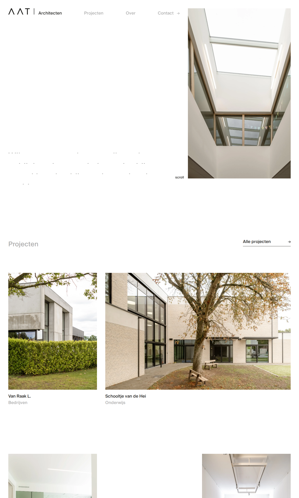
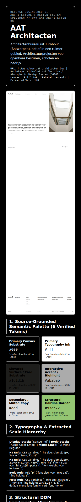

# UI Design System & Master Generation Blueprint: www-aat-architecten-be

> **AAT Architecten** (https://www.aat-architecten.be/) — Architectenbureau uit Turnhout (Antwerpen), actief in een ruimer gebied. Architectuurprojecten voor openbare besturen, scholen en bedrijv...



---

## 1. Executive Visual Persona & Design Archetype

- **Brand Essence & Persona**: **AAT Architecten** (`https://www.aat-architecten.be/`). Architectenbureau uit Turnhout (Antwerpen), actief in een ruimer gebied. Architectuurprojecten voor openbare besturen, scholen en bedrijv...
- **Visual Archetype**: **High-Contrast Obsidian / Atmospheric Design System (`#000` canvas, `#fff` ink, `#ababab` accent)**.
- **Anti-AI-Slop Differentiators**:
  - **Source-Grounded Chromatic Polarity**: Anchors the viewport in `#000` (`var(--color-black)` in `:root`) paired with `#fff` primary typography and `#ababab` accents.
  - **Extracted Typographic Hierarchy**: Pairs `Suisse Intl` for display copy (`Wij ontwerpen gebouwen die werken vo`) with `Apple Color Emoji` and `SFMono-Regular`.
  - **Calibrated Spatial Grid & Motion**: Combines `576px` container bounds (`gap: var(--spacing-g-half)`, padding `0px`) with `cubic-bezier(.4,0,.2,1)` easing and Lenis Smooth Scroll (`data-lenis`), Three.js / WebGL Canvas Pipeline.

---

## 2. Spatial Architecture & Modular Grid Mathematics



### Viewport Allocation & Container Geometry
- **Captured Viewport Dimensions**: Desktop `1440×4660px` (`assets/desktop.png`, full-page scroll capture), Mobile `390×2400px` (`assets/mobile.png`, capped at 2400px multi-section capture).
- **Master Container Bounds**: `576px` extracted from `www-aat-architecten-be` stylesheet.
- **Canvas Lateral Padding & Spacing**: `0px` lateral canvas padding with `var(--spacing-g-half)` grid gap.
- **Border Radius Scale**: `.25rem`, `var(--radius-4)`, `6px`, `var(--radius-sm)`.

### Responsive Breakpoint Architecture
- **Desktop Layout**: Multi-column CSS Grid / Flexbox layout at `1440px` (`max-width: 576px`, `gap: var(--spacing-g-half)`).
- **Mobile Layout**: Single-column vertical stack at `390px` viewport width with `0px` horizontal padding.
- **Extracted CSS Media Queries**: `@media (min-width:576px)`, `@media (min-width:820px)`, `@media (min-width:1024px)`, `@media (min-width:1280px)`.

---

## 3. Color System, Materiality & Atmospheric Lighting

### Semantic Palette & Source Grounding
| Semantic Role | Ground-Truth Value | Extracted CSS Source / Selector |
|---|---|---|
| **Primary Canvas Substrate** | `#000` | `var(--color-black)` in `:root` |
| **Primary Typography Ink** | `#fff` | `var(--color-white)` in `:root` |
| **Elevated Surface / Card Substrate** | `#1d1d1b` | `var(--color-black-500)` in `:root` |
| **Interactive Accent / Highlight** | `#ababab` | `var(--color-grey-500)` in `:root` |
| **Secondary / Muted Copy** | `#ddd` | `var(--color-grey-300)` in `:root` |
| **Structural Hairline Border** | `#93c572` | `var(--color-alert-green-400)` in `:root` |

### Sanitized Root CSS Variables (`ui-ux.md` Ground Truth)
| Variable Name | Extracted Value | Semantic Role |
|---|---|---|
| `--color-red-400` | `oklch(70.4% .191 22.216)` | Brand / Palette Token |
| `--color-red-500` | `oklch(63.7% .237 25.331)` | Brand / Palette Token |
| `--color-green-500` | `oklch(72.3% .219 149.579)` | Brand / Palette Token |
| `--color-blue-500` | `oklch(62.3% .214 259.815)` | Brand / Palette Token |
| `--color-blue-600` | `oklch(54.6% .245 262.881)` | Brand / Palette Token |
| `--color-gray-50` | `oklch(98.5% .002 247.839)` | Brand / Palette Token |
| `--color-gray-100` | `oklch(96.7% .003 264.542)` | Brand / Palette Token |
| `--color-gray-200` | `oklch(92.8% .006 264.531)` | Brand / Palette Token |
| `--color-gray-300` | `oklch(87.2% .01 258.338)` | Brand / Palette Token |
| `--color-gray-500` | `oklch(55.1% .027 264.364)` | Brand / Palette Token |
| `--color-gray-600` | `oklch(44.6% .03 256.802)` | Brand / Palette Token |
| `--color-gray-700` | `oklch(37.3% .034 259.733)` | Brand / Palette Token |
| `--color-black` | `#000` | Canvas / Surface Token |
| `--color-white` | `#fff` | Canvas / Surface Token |
| `--spacing` | `.25rem` | Layout / Spatial Grid Token |
| `--breakpoint-sm` | `576px` | Dimension / Scale Token |

---

## 4. Typographic Scale & Editorial Hierarchy

### Font Family Stacks
- **Display Typography**: `Suisse Intl`.
- **Primary Body Stack**: `Apple Color Emoji`.
- **Technical / Metadata Stack**: `SFMono-Regular`.

### Typographic Scale & Rules (Extracted from Stylesheet & Variables)
- **Hero Display (`H1`)**: CSS variables `--h1-size: clamp(32px, 3vw + 1.5rem, 72px)`.
- **Section Heading (`H2`)**: CSS variables `--h2-size: clamp(28px, 2.2vw + 1.2rem, 48px)`; rule `h2` (`font-size: var(--h4-size)!important`, `font-weight: var(--font-we...`).
- **Body Copy**: rule `p` (`font-size: var(--text-13)`, `line-height: 1`).
- **Metadata & Navigation Labels**: CSS variables `--text-sm: .875rem`, `--text-sm--line-height: calc(1.25 / .875)`, `--default-mono-font-family: var(--font-mono)`.

---

## 5. Choreographed Motion & Interaction Physics

### Primary Easing Curves
- **Extracted Timing Functions**: `cubic-bezier(.4,0,.2,1)`, `cubic-bezier(.625,.05,0,1)`, `cubic-bezier(.25,.46,.45,.94)`.

### Per-Element Transition & Choreography Rules
- **Selector `layer theme`**: `transition: .15s` extracted from `www-aat-architecten-be` stylesheet.
- **Selector `.underline-link-alt:before`**: `transition: var(--tw-ease,var(--default-transition-timing-function))` extracted from `www-aat-architecten-be` stylesheet.
- **Selector `.underline-link-alt:after`**: `transition: var(--tw-ease,var(--default-transition-timing-function))` extracted from `www-aat-architecten-be` stylesheet.
- **Extracted Easing Curve (`cubic-bezier(.4,0,.2,1)`)**: Governs interactive state transitions across `<header.site-wrapper__row>` and `<section.home-intro-block>`.
- **Runtime Interaction Engine**: Integrates Lenis Smooth Scroll (`data-lenis`), Three.js / WebGL Canvas Pipeline with `prefers-reduced-motion: reduce` fallback guards.

---

## 6. Component Wireframe & Structural DOM Map

### Visual Layout Schematic (Grounded in `dom.html` — `1440px` Desktop & `390px` Mobile Reflow)
```
┌────────────────────────────────────────────────────────────────────────┐
│ DESKTOP VIEWPORT (1440px) — AAT Architecten                            │
│ ====================================================================== │
│ [ <header.site-wrapper__ro | Projecten · Over · Contact             ]  │
│ ---------------------------------------------------------------------- │
│ | HERO STAGE: <section.header>                                     |   │
│ | H1: Wij ontwerpen gebouwen die werken voor publieke r...         |   │
│ | Substrate: #000       | Ink: #fff       | Accent: #ababab        |   │
│ ---------------------------------------------------------------------- │
│ | SHOWCASE GRID (<section.home-intro-block>) max-w: 576px          |   │
│ | +------------------------------+  +------------------------------+ | │
│ | | Projecten                    |  | Wij ontwerpen gebouwen die w | | │
│ | +------------------------------+  +------------------------------+ | │
│ ---------------------------------------------------------------------- │
│ | MOBILE VIEWPORT REFLOW (390px) — Single-Column Stack (gap: var(--) | │
│ | [<header.site-wrapp] -> [<section.header>] -> [<section.home-intr] | │
│ ---------------------------------------------------------------------- │
│ [ FOOTER (<footer.mobile-nav__fo) | https://www.aat-architecten.be/    │
└────────────────────────────────────────────────────────────────────────┘
```

### Granular DOM Region Breakdown
1. **Brand Header & Navigation Bar (<header.site-wrapper__row> — `www-aat-architecten-be`)**:
   - Landmark `<header class="site-wrapper__row site-wrapper__row--header">` hosting `AAT Architecten` navigation (`Projecten · Over · Contact`), DOM attributes (`data-lenis-prevent`, `data-split="heading"`, `data-duration="1.6"`, `data-stagger="0.18"`), and stylesheet rule `html.lenis body { height:auto }`.
2. **Hero Stage & Focal Lead (<section.header> — `Wij ontwerpen gebouwen die werken `)**:
   - Landmark `<section class="header js-header">` presenting display lead `Wij ontwerpen gebouwen die werken voor publieke r...` and copy excerpt *"info@aat-architecten.be"* over `#000` canvas and `#fff` ink.
3. **Primary Showcase & Content Grid (<section.home-intro-block> — `Projecten`)**:
   - Landmark `<section class="home-intro-block mb-g">` rendering section `Projecten` with copy *"Wij ontwerpen gebouwen die werken voor"*, asset references (`favicon-96x96.png`, `favicon.svg`, `favicon.ico`, `apple-touch-icon.png`), and grid rule `.lenis.lenis-stopped { overflow:clip }`.
4. **Interactive Detail & Feature Matrix (<section.block-featured-projects> — `Wij ontwerpen gebouwen die werken `)**:
   - Landmark `<section class="block-featured-projects block-featured-projects--first">` framing `Wij ontwerpen gebouwen die werken voor` and `publieke ruimtes, scholen en bedrijven, en` (*"publieke ruimtes, scholen en bedrijven, en"*) with `#1d1d1b` surface cards, `#ababab` accents, and `.lenis.lenis-smooth iframe { pointer-events:none }`.
5. **Colophon & Global Directory Footer (<footer.mobile-nav__footer> — `https://www.aat-architecten.be/`)**:
   - Landmark `<footer class="mobile-nav__footer">` anchoring `AAT Architecten` footer links (`Projecten · Over · Contact`), copy *"vertrekken daarbij steeds van de ruimte"*, and `#93c572` structural dividers.

---

## 7. Master Zero-Shot AI Generation Prompt

```markdown
# Master Zero-Shot Frontend Generation Prompt: www-aat-architecten-be (AAT Architecten)

You are a principal frontend architect and design systems engineer. Build a complete, production-ready web application replicating the exact design system, DOM landmarks, typographic hierarchy, color tokens, and motion physics of `www-aat-architecten-be` (**AAT Architecten** — `https://www.aat-architecten.be/`).

### 1. Visual Archetype & Anti-AI-Slop Mandates
- **Archetype**: High-Contrast Obsidian / Atmospheric Design System (`#000` canvas, `#fff` ink, `#ababab` accent).
- **Identity & Domain Context**: Architectenbureau uit Turnhout (Antwerpen), actief in een ruimer gebied. Architectuurprojecten voor openbare besturen, scholen en bedrijv...
- **Primary Substrate**: `#000` (`var(--color-black)` in `:root`), **Primary Ink**: `#fff`, **Accent / Highlight**: `#ababab`.
- **Site-Specific Differentiators**:
  - **Source-Grounded Chromatic Polarity**: Anchors the viewport in `#000` (`var(--color-black)` in `:root`) paired with `#fff` primary typography and `#ababab` accents.
  - **Extracted Typographic Hierarchy**: Pairs `Suisse Intl` for display copy (`Wij ontwerpen gebouwen die werken vo`) with `Apple Color Emoji` and `SFMono-Regular`.
  - **Calibrated Spatial Grid & Motion**: Combines `576px` container bounds (`gap: var(--spacing-g-half)`, padding `0px`) with `cubic-bezier(.4,0,.2,1)` easing and Lenis Smooth Scroll (`data-lenis`), Three.js / WebGL Canvas Pipeline.

### 2. Ground-Truth CSS Variables (`:root` Token Contract)
Declare and consume these exact custom properties extracted from `www-aat-architecten-be` in your global stylesheet:

:root {
  /* AAT Architecten (www-aat-architecten-be) — Ground-Truth Extracted CSS Variables */
  --color-red-400: oklch(70.4% .191 22.216); /* Brand / Palette Token (www-aat-architecten-be) */
  --color-red-500: oklch(63.7% .237 25.331); /* Brand / Palette Token (www-aat-architecten-be) */
  --color-green-500: oklch(72.3% .219 149.579); /* Brand / Palette Token (www-aat-architecten-be) */
  --color-blue-500: oklch(62.3% .214 259.815); /* Brand / Palette Token (www-aat-architecten-be) */
  --color-blue-600: oklch(54.6% .245 262.881); /* Brand / Palette Token (www-aat-architecten-be) */
  --color-gray-50: oklch(98.5% .002 247.839); /* Brand / Palette Token (www-aat-architecten-be) */
  --color-gray-100: oklch(96.7% .003 264.542); /* Brand / Palette Token (www-aat-architecten-be) */
  --color-gray-200: oklch(92.8% .006 264.531); /* Brand / Palette Token (www-aat-architecten-be) */
  --color-gray-300: oklch(87.2% .01 258.338); /* Brand / Palette Token (www-aat-architecten-be) */
  --color-gray-500: oklch(55.1% .027 264.364); /* Brand / Palette Token (www-aat-architecten-be) */
  --color-gray-600: oklch(44.6% .03 256.802); /* Brand / Palette Token (www-aat-architecten-be) */
  --color-gray-700: oklch(37.3% .034 259.733); /* Brand / Palette Token (www-aat-architecten-be) */
  --color-black: #000; /* Canvas / Surface Token (www-aat-architecten-be) */
  --color-white: #fff; /* Canvas / Surface Token (www-aat-architecten-be) */
  --spacing: .25rem; /* Layout / Spatial Grid Token (www-aat-architecten-be) */
  --breakpoint-sm: 576px; /* Dimension / Scale Token (www-aat-architecten-be) */
}

### 3. Semantic Color & Materiality Contract
Map every surface, ink, and border strictly to these source-grounded tokens:
- **Primary Canvas Substrate**: `#000` — grounded in `var(--color-black)` in `:root`
- **Primary Typography Ink**: `#fff` — grounded in `var(--color-white)` in `:root`
- **Elevated Surface / Card Substrate**: `#1d1d1b` — grounded in `var(--color-black-500)` in `:root`
- **Interactive Accent / Highlight**: `#ababab` — grounded in `var(--color-grey-500)` in `:root`
- **Secondary / Muted Copy**: `#ddd` — grounded in `var(--color-grey-300)` in `:root`
- **Structural Hairline Border**: `#93c572` — grounded in `var(--color-alert-green-400)` in `:root`

### 4. Spatial Grid, Container Bounds & Responsive Breakpoints
- **Desktop Viewport Reference**: `1440×4660px` (full-page scroll capture, `1440px` standard desktop width).
- **Mobile Viewport Reference**: `390×2400px` (capped at 2400px multi-section capture, `390px` standard mobile width).
- **Container Max-Width**: `576px` extracted from `www-aat-architecten-be` stylesheet
- **Padding & Gutters**: `0px` lateral canvas padding with `var(--spacing-g-half)` grid gap
- **Desktop Grid**: Multi-column CSS Grid / Flexbox layout at `1440px` (`max-width: 576px`, `gap: var(--spacing-g-half)`)
- **Mobile Adaptation**: Single-column vertical stack at `390px` viewport width with `0px` horizontal padding
- **Media Queries**: `@media (min-width:576px)`, `@media (min-width:820px)`, `@media (min-width:1024px)`, `@media (min-width:1280px)`
- **Corner Radii**: `.25rem`, `var(--radius-4)`, `6px`, `var(--radius-sm)`

### 5. Typography & Editorial Scale Contract
- **Display Font Stack**: `Suisse Intl`
- **Body Font Stack**: `Apple Color Emoji`
- **Monospace / Technical Font Stack**: `SFMono-Regular`
- **H1 Display Rule**: CSS variables `--h1-size: clamp(32px, 3vw + 1.5rem, 72px)`
- **H2 Section Rule**: CSS variables `--h2-size: clamp(28px, 2.2vw + 1.2rem, 48px)`; rule `h2` (`font-size: var(--h4-size)!important`, `font-weight: var(--font-we...`)
- **Body Copy Rule**: rule `p` (`font-size: var(--text-13)`, `line-height: 1`)
- **Metadata & Index Rule**: CSS variables `--text-sm: .875rem`, `--text-sm--line-height: calc(1.25 / .875)`, `--default-mono-font-family: var(--font-mono)`

### 6. Component Hierarchy, Verbatim Copy & Real DOM Landmarks
Scaffold `www-aat-architecten-be` (`AAT Architecten`) with these exact structural regions, extracted copy, and CSS rules from `dom.html`:
1. **Brand Header & Navigation Bar (<header.site-wrapper__row> — `www-aat-architecten-be`)**:
   - DOM & Selectors: Landmark `<header class="site-wrapper__row site-wrapper__row--header">` hosting `AAT Architecten` navigation (`Projecten · Over · Contact`), DOM attributes (`data-lenis-prevent`, `data-split="heading"`, `data-duration="1.6"`, `data-stagger="0.18"`), and stylesheet rule `html.lenis body { height:auto }`.
   - Responsive Contract: Header `Brand Header & Navigation Bar (<header.site-wrapper__row> — `www-aat-architecten-be`)` (`www-aat-architecten-be`) adapts across `@media (min-width:576px)`, `@media (min-width:820px)`, `@media (min-width:1024px)`, `@media (min-width:1280px)` with `cubic-bezier(.4,0,.2,1)`, `cubic-bezier(.625,.05,0,1)`, `cubic-bezier(.25,.46,.45,.94)` transitions and links `Projecten · Over · Contact`.
2. **Hero Stage & Focal Lead (<section.header> — `Wij ontwerpen gebouwen die werken `)**:
   - DOM & Selectors: Landmark `<section class="header js-header">` presenting display lead `Wij ontwerpen gebouwen die werken voor publieke r...` and copy excerpt *"info@aat-architecten.be"* over `#000` canvas and `#fff` ink.
   - Responsive Contract: Hero stage (`1440×4660px` desktop / `390×2400px` mobile) sets `#000` background with `#fff` headline `Wij ontwerpen gebouwen die werken voor publieke r...`.
3. **Primary Showcase & Content Grid (<section.home-intro-block> — `Projecten`)**:
   - DOM & Selectors: Landmark `<section class="home-intro-block mb-g">` rendering section `Projecten` with copy *"Wij ontwerpen gebouwen die werken voor"*, asset references (`favicon-96x96.png`, `favicon.svg`, `favicon.ico`, `apple-touch-icon.png`), and grid rule `.lenis.lenis-stopped { overflow:clip }`.
   - Responsive Contract: Showcase grid `Primary Showcase & Content Grid (<section.home-intro-block> — `Projecten`)` applies Multi-column CSS Grid / Flexbox layout at `1440px` (`max-width: 576px`, `gap: var(--spacing-g-half)`) on desktop and Single-column vertical stack at `390px` viewport width with `0px` horizontal padding on mobile.
4. **Interactive Detail & Feature Matrix (<section.block-featured-projects> — `Wij ontwerpen gebouwen die werken `)**:
   - DOM & Selectors: Landmark `<section class="block-featured-projects block-featured-projects--first">` framing `Wij ontwerpen gebouwen die werken voor` and `publieke ruimtes, scholen en bedrijven, en` (*"publieke ruimtes, scholen en bedrijven, en"*) with `#1d1d1b` surface cards, `#ababab` accents, and `.lenis.lenis-smooth iframe { pointer-events:none }`.
   - Responsive Contract: Detail module `Interactive Detail & Feature Matrix (<section.block-featured-projects> — `Wij ontwerpen gebouwen die werken `)` uses `.25rem`, `var(--radius-4)`, `6px`, `var(--radius-sm)` radii, `#ababab` highlights, and assets (favicon-96x96.png, favicon.svg, favicon.ico).
5. **Colophon & Global Directory Footer (<footer.mobile-nav__footer> — `https://www.aat-architecten.be/`)**:
   - DOM & Selectors: Landmark `<footer class="mobile-nav__footer">` anchoring `AAT Architecten` footer links (`Projecten · Over · Contact`), copy *"vertrekken daarbij steeds van de ruimte"*, and `#93c572` structural dividers.
   - Responsive Contract: Footer `Colophon & Global Directory Footer (<footer.mobile-nav__footer> — `https://www.aat-architecten.be/`)` aligns to `576px` extracted from `www-aat-architecten-be` stylesheet with `0px` lateral canvas padding with `var(--spacing-g-half)` grid gap and attributes (data-lenis-prevent, data-split="heading", data-duration="1.6").

#### Verbatim DOM Copy Excerpts (`dom.html`)
- Copy Excerpt 1: *"info@aat-architecten.be"*
- Copy Excerpt 2: *"Wij ontwerpen gebouwen die werken voor"*
- Copy Excerpt 3: *"publieke ruimtes, scholen en bedrijven, en"*
- Copy Excerpt 4: *"vertrekken daarbij steeds van de ruimte"*

### 7. Motion, Extracted Stylesheet Rules & Interaction Choreography
- **Primary Easing Functions**: `cubic-bezier(.4,0,.2,1)`, `cubic-bezier(.625,.05,0,1)`, `cubic-bezier(.25,.46,.45,.94)`
- **Extracted Stylesheet Rules (`www-aat-architecten-be`)**:
- `html.lenis body { height:auto }`
- `.lenis.lenis-stopped { overflow:clip }`
- `.lenis.lenis-smooth iframe { pointer-events:none }`
- `backdrop { box-sizing:border-box;border:0 solid;margin:0;padding:0 }`
- `file-selector-button { box-sizing:border-box;border:0 solid;margin:0;padding:0 }`
- **Per-Selector Transition Rules**:
- **Selector `layer theme`**: `transition: .15s` extracted from `www-aat-architecten-be` stylesheet.
- **Selector `.underline-link-alt:before`**: `transition: var(--tw-ease,var(--default-transition-timing-function))` extracted from `www-aat-architecten-be` stylesheet.
- **Selector `.underline-link-alt:after`**: `transition: var(--tw-ease,var(--default-transition-timing-function))` extracted from `www-aat-architecten-be` stylesheet.
- **Extracted Easing Curve (`cubic-bezier(.4,0,.2,1)`)**: Governs interactive state transitions across `<header.site-wrapper__row>` and `<section.home-intro-block>`.
- **Runtime Interaction Engine**: Integrates Lenis Smooth Scroll (`data-lenis`), Three.js / WebGL Canvas Pipeline with `prefers-reduced-motion: reduce` fallback guards.

### 8. Technical Deliverables
- Implement in Next.js (App Router) with TypeScript and Tailwind CSS consuming the `:root` custom properties defined above for `www-aat-architecten-be`.
- Reproduce both the `1440px` desktop architecture and `390px` mobile breakpoint transitions, preserving semantic HTML5 landmarks (`<header>`, `<nav>`, `<main>`, `<section>`, `<footer>`) and `prefers-reduced-motion` accessibility guards.
```
