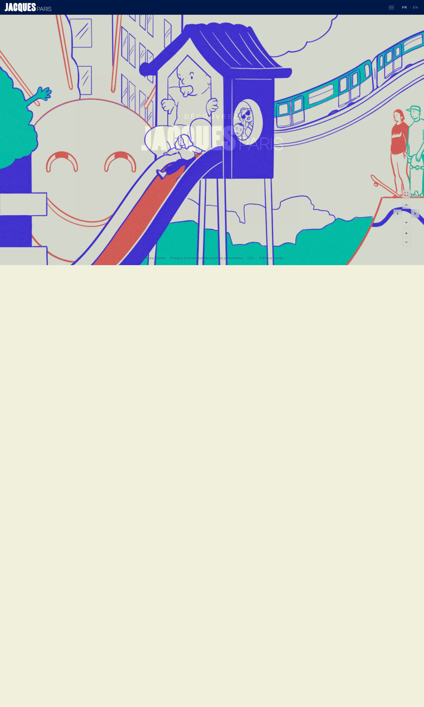

# UI Design System & Master Generation Blueprint: www-agencejacquesparis-fr

> **Jacques Paris - Agence à impact positif** (https://www.agencejacquesparis.fr/) — La créativité au service des marques qui veulent changer les choses et prendre soin de ce qui compte.



---

## 1. Executive Visual Persona & Design Archetype

- **Brand Essence & Persona**: **Jacques Paris - Agence à impact positif** (`https://www.agencejacquesparis.fr/`). La créativité au service des marques qui veulent changer les choses et prendre soin de ce qui compte.
- **Capture Provenance**: Live browser capture (`tier1_fast`, HTTP `200`, captured `2026-11-23`).
- **Visual Archetype**: **Light-Substrate Editorial & Modular Grid System (`#f0f0dc` canvas, `#001847` ink, `#ffffff` accent)**.
- **Anti-AI-Slop Differentiators**:
  - **Live-Computed Chromatic Polarity**: Anchors the viewport in `#f0f0dc` (live computed `body` `background-color` (`computed_styles.json`)) paired with `#001847` primary typography and `#ffffff` accents.
  - **Grounded Typographic Hierarchy**: Pairs `ClashGrotesk` for display copy (`Jacques Paris - Agence à impact posi`) with `ClashGrotesk` and not declared in live computed styles (uses primary stack / `ui-monospace`).
  - **Calibrated Spatial Grid & Motion**: Combines `1440px` container bounds (`gap: var(--space-lg)`, padding `var(--space-xl)`) with `cubic-bezier(0.25,0.1,0.25,1)` easing.

---

## 2. Spatial Architecture & Modular Grid Mathematics


### Viewport Allocation & Container Geometry
- **Captured Viewport Dimensions**: Desktop `1440×2400px` (`assets/desktop.png`, clamped at 2400px live multi-section capture), Mobile `390×2400px` (`assets/mobile.png`, clamped at 2400px live multi-section capture).
- **Master Container Bounds**: `1440px` (full-bleed `100%` desktop stage measured on `1440px` viewport).
- **Canvas Lateral Padding & Spacing**: `var(--space-xl)` lateral canvas padding with `var(--space-lg)` grid gap.
- **Border Radius Scale**: `2px`, `0px 0px 4px 4px`, `50%`, `3px`.

### Responsive Breakpoint Architecture
- **Desktop Layout**: Multi-column CSS Grid / Flexbox layout at `1440px` (`max-width: 1440px`, `gap: var(--space-lg)`).
- **Mobile Layout**: Single-column vertical stack at `390px` viewport width with `var(--space-xl)` horizontal padding.
- **Extracted CSS Media Queries**: `@media (min-width:1024px)`, `@media (prefers-reduced-motion:reduce)`.

---

## 3. Color System, Materiality & Atmospheric Lighting

### Semantic Palette & Source Grounding
| Semantic Role | Ground-Truth Value | Extracted Live / CSS Source |
|---|---|---|
| **Primary Canvas Substrate** | `#f0f0dc` | live computed `body` `background-color` (`computed_styles.json`) |
| **Primary Typography Ink** | `#001847` | live computed `main` `color` (`computed_styles.json`) |
| **Elevated Surface / Card Substrate** | `#ffffff` | `.ZoneCard_caseBtn__MWFpY { background: #ffffff }` |
| **Interactive Accent / Highlight** | `#ffffff` | `.ZoneCard_caseBtn__MWFpY { background: #ffffff }` |
| **Secondary / Muted Copy** | `#ffffff` | live computed `p` `color` (`computed_styles.json`) |
| **Structural Hairline Border** | `#c0c5be` | `.InvitationForm_textarea__Xo0Zw { border-bottom: #c0c5be }` |
| **Variable Token (`--color-cream-light`)** | `#f7f7ed` | `var(--color-cream-light)` in `:root` |
| **Variable Token (`--color-cobalt-light`)** | `#1a3a6b` | `var(--color-cobalt-light)` in `:root` |
| **Variable Token (`--color-teal`)** | `#0e9aa7` | `var(--color-teal)` in `:root` |
| **Variable Token (`--color-coral`)** | `#e8442a` | `var(--color-coral)` in `:root` |

### Sanitized Root CSS Variables (`ui-ux.md` Ground Truth)
| Variable Name | Extracted Value | Semantic Role |
|---|---|---|
| `--color-cream` | `#F0F0DC` | Brand / Palette Token |
| `--color-cream-light` | `#F7F7ED` | Canvas / Surface Token |
| `--color-cobalt` | `#001847` | Brand / Palette Token |
| `--color-cobalt-light` | `#1a3a6b` | Canvas / Surface Token |
| `--color-teal` | `#0E9AA7` | Brand / Palette Token |
| `--color-coral` | `#E8442A` | Brand / Palette Token |
| `--space-zero` | `0` | Layout / Spatial Grid Token |
| `--space-xs` | `4px` | Layout / Spatial Grid Token |
| `--space-sm` | `8px` | Layout / Spatial Grid Token |
| `--space-md` | `16px` | Layout / Spatial Grid Token |
| `--space-lg` | `24px` | Layout / Spatial Grid Token |
| `--space-xl` | `40px` | Layout / Spatial Grid Token |
| `--space-2xl` | `64px` | Layout / Spatial Grid Token |
| `--space-3xl` | `96px` | Layout / Spatial Grid Token |
| `--text-xs` | `11px` | Typography Ink Token |
| `--text-sm` | `14px` | Typography Ink Token |

---

## 4. Typographic Scale & Editorial Hierarchy

### Font Family Stacks
- **Display Typography**: `ClashGrotesk`.
- **Primary Body Stack**: `ClashGrotesk`.
- **Technical / Metadata Stack**: not declared in live computed styles (uses primary stack / `ui-monospace`).

### Typographic Scale & Rules (Live Computed & Stylesheet Grounded)
- **Hero Display (`H1`)**: observed font-size ladder: `16px`, `22.4px`, `14px`, `13.3333px`, `var(--text-xs)`.
- **Section Heading (`H2`)**: observed font-size ladder: `16px`, `22.4px`, `14px`, `13.3333px`, `var(--text-xs)`.
- **Body Copy**: live computed `body` (`font-size: 16px`, `line-height: normal`, `font-weight: 400`); CSS variables `--text-base: 15px`.
- **Metadata & Navigation Labels**: live computed `nav/a` (`font-size: 16px`, `line-height: normal`, `font-weight: 400`); CSS variables `--text-xs: 11px`, `--text-sm: 14px`.

---

## 5. Choreographed Motion & Interaction Physics

### Primary Easing Curves
- **Extracted Timing Functions**: `cubic-bezier(0.25,0.1,0.25,1)`.

### Per-Element Transition & Choreography Rules
- **Selector `.InvitationForm_textarea__Xo0Zw`**: `transition: border-color .2s ease` extracted from `www-agencejacquesparis-fr` stylesheet.
- **Selector `.InvitationForm_submit__OiJHX`**: `transition: background .2s ease` extracted from `www-agencejacquesparis-fr` stylesheet.
- **Selector `.ZoneCard_overviewCard__A2vTr`**: `transition: opacity .15s,transform .15s` extracted from `www-agencejacquesparis-fr` stylesheet.
- **Standard CSS Easing (`cubic-bezier(0.25,0.1,0.25,1)`)**: Default timing curve (no custom `cubic-bezier()` declared in captured CSS).
- **State & Hover Choreography**: Opacity and transform transitions on `<main.ScrollEngine_scrollSpace__HfjIP>` and `<main.ScrollEngine_viewport__JJVIB>` interactive targets.

---

## 6. Component Wireframe & Structural DOM Map

### Visual Layout Schematic — Desktop (`1440px`, Grounded in `dom.html` & Landmark Bounding Boxes)
```
┌────────────────────────────────────────────────────────────────────────┐
│ DESKTOP VIEWPORT (1440px) — Jacques Paris - Agence à impact positif    │
│ ====================================================================== │
│ [ <nav.Navbar_navbar__UM (1440x50px)  | Overview · Index · Archive · ] │
│ ---------------------------------------------------------------------- │
│ | HERO STAGE: <main.ScrollEngine_scrollSpace__HfjI (w=1440px)        | │
│ | H1: Jacques Paris - Agence à impact positif                        | │
│ | Substrate: #f0f0dc | Ink: #001847 | Accent: #ffffff                | │
│ ---------------------------------------------------------------------- │
│ | SHOWCASE GRID (<main.ScrollEngine_viewpor) max-w: 1440px           | │
│ | +------------------------------+  +------------------------------+ | │
│ | | Featured Work & Interactive  |  | Technical Architecture & Nar | | │
│ | +------------------------------+  +------------------------------+ | │
│ ---------------------------------------------------------------------- │
│ | DETAIL MODULE (<main.PosterCanvas_canvas_) — Global Directory & Co | │
│ ---------------------------------------------------------------------- │
│ [ FOOTER (<footer.PosterCanvas) | https://www.agencejacquesparis.fr/   │
└────────────────────────────────────────────────────────────────────────┘
```

### Visual Layout Schematic — Mobile Reflow (`390px`)
```
┌────────────────────────────────────────────────────────────────────────┐
│ MOBILE VIEWPORT REFLOW (390px) — Single-Column Stack (gap: var(--sp)   │
│ ====================================================================== │
│ [ HEADER BAR (<nav.Navbar_navbar__UMdI) | Compact Menu (390px)         │
│ ---------------------------------------------------------------------- │
│ | HERO STAGE (<main.ScrollEngine_scrol) — 390px Vertical Lead        | │
│ | H1: Jacques Paris - Agence à impact positif                        | │
│ ---------------------------------------------------------------------- │
│ | SHOWCASE STACK (<main.ScrollEngine_vie) — 1-Col Stack              | │
│ | [ Item 1: Featured Work & Interactive Showcase                   ] | │
│ | [ Item 2: Technical Architecture & Narrative                     ] | │
│ ---------------------------------------------------------------------- │
│ | DETAIL STACK (<main.PosterCanvas_canva) — 1-Col (Global Directory &) │
│ ---------------------------------------------------------------------- │
│ [ FOOTER (<footer.PosterCanvas) | Stacked 390px Colophon               │
└────────────────────────────────────────────────────────────────────────┘
```

### Granular DOM Region Breakdown
1. **Brand Header & Navigation Bar (<nav.Navbar_navbar__UMdIx> — `www-agencejacquesparis-fr`)**:
   - Landmark `<nav class="Navbar_navbar__UMdIx">` (`1440x50px`) hosting `Jacques Paris - Agence à impact posi` navigation (`Overview · Index · Archive · About · Contact`), DOM attributes (`data-precedence="next"`, `data-precedence="next"`, `data-nscript="afterInteractive"`), and stylesheet rule `.PosterCanvas_canvas__BduZz { position:absolute;inset:0;overflow:hidden;background-color:var(--color-c... }`.
2. **Hero Stage & Focal Lead (<main.ScrollEngine_scrollSpace__HfjIP> — `Jacques Paris - Agence à impact po`)**:
   - Landmark `<main class="ScrollEngine_scrollSpace__HfjIP">` presenting display lead `Jacques Paris - Agence à impact positif` and copy excerpt *"Assistant Art Director"* over `#f0f0dc` canvas and `#001847` ink.
3. **Primary Showcase & Content Grid (<main.ScrollEngine_viewport__JJVIB> — `Featured Work & Interactive Showca`)**:
   - Landmark `<main class="ScrollEngine_viewport__JJVIB">` rendering section `Featured Work & Interactive Showcase` with copy *"Junior Business Partner"*, asset references (`jacques-logo.png`, `ad44a6578bd60804.css`, `074517235421c822.css`, `webpack-8fefb68f87553cee.js`), and grid rule `.ZoneLabel_primary__tb_mD { font-size:var(--text-xs);opacity:.35;letter-spacing:.05em }`.
4. **Interactive Detail & Feature Matrix (<main.PosterCanvas_canvas__BduZz> — `Technical Architecture & Narrative`)**:
   - Landmark `<main class="PosterCanvas_canvas__BduZz">` framing `Technical Architecture & Narrative` and `Global Directory & Contact` (*"Creative Copywriter"*) with `#ffffff` surface cards, `#ffffff` accents, and `.ZoneLabel_secondary__sFo9Q { font-weight:300;color:var(--color-cobalt);line-height:1.4 }`.
5. **Colophon & Global Directory Footer (<footer.PosterCanvas_poster__O791U> — `https://www.agencejacquesparis.fr/`)**:
   - Landmark `<footer class="PosterCanvas_poster__O791U">` anchoring `Jacques Paris - Agence à impact ` footer links (`Overview · Index · Archive · About · Contact`), copy *"Senior Art Director"*, and `#c0c5be` structural dividers.

---

## 7. Master Zero-Shot AI Generation Prompt

```markdown
# Master Zero-Shot Frontend Generation Prompt: www-agencejacquesparis-fr (Jacques Paris - Agence à impact positif)

You are a principal frontend architect and design systems engineer. Build a complete, production-ready web application replicating the exact design system, DOM landmarks, typographic hierarchy, color tokens, and motion physics of `www-agencejacquesparis-fr` (**Jacques Paris - Agence à impact positif** — `https://www.agencejacquesparis.fr/`).

### 1. Visual Archetype & Anti-AI-Slop Mandates
- **Archetype**: Light-Substrate Editorial & Modular Grid System (`#f0f0dc` canvas, `#001847` ink, `#ffffff` accent).
- **Identity & Domain Context**: La créativité au service des marques qui veulent changer les choses et prendre soin de ce qui compte.
- **Primary Substrate**: `#f0f0dc` (live computed `body` `background-color` (`computed_styles.json`)), **Primary Ink**: `#001847`, **Accent / Highlight**: `#ffffff`.
- **Site-Specific Differentiators**:
  - **Live-Computed Chromatic Polarity**: Anchors the viewport in `#f0f0dc` (live computed `body` `background-color` (`computed_styles.json`)) paired with `#001847` primary typography and `#ffffff` accents.
  - **Grounded Typographic Hierarchy**: Pairs `ClashGrotesk` for display copy (`Jacques Paris - Agence à impact posi`) with `ClashGrotesk` and not declared in live computed styles (uses primary stack / `ui-monospace`).
  - **Calibrated Spatial Grid & Motion**: Combines `1440px` container bounds (`gap: var(--space-lg)`, padding `var(--space-xl)`) with `cubic-bezier(0.25,0.1,0.25,1)` easing.

### 2. Ground-Truth CSS Variables (`:root` Token Contract)
Declare and consume these exact custom properties extracted from `www-agencejacquesparis-fr` in your global stylesheet:

:root {
  /* Jacques Paris - Agence à impact positif (www-agencejacquesparis-fr) — Live-Grounded CSS Variables */
  --color-cream: #F0F0DC; /* Brand / Palette Token (www-agencejacquesparis-fr) */
  --color-cream-light: #F7F7ED; /* Canvas / Surface Token (www-agencejacquesparis-fr) */
  --color-cobalt: #001847; /* Brand / Palette Token (www-agencejacquesparis-fr) */
  --color-cobalt-light: #1a3a6b; /* Canvas / Surface Token (www-agencejacquesparis-fr) */
  --color-teal: #0E9AA7; /* Brand / Palette Token (www-agencejacquesparis-fr) */
  --color-coral: #E8442A; /* Brand / Palette Token (www-agencejacquesparis-fr) */
  --space-zero: 0; /* Layout / Spatial Grid Token (www-agencejacquesparis-fr) */
  --space-xs: 4px; /* Layout / Spatial Grid Token (www-agencejacquesparis-fr) */
  --space-sm: 8px; /* Layout / Spatial Grid Token (www-agencejacquesparis-fr) */
  --space-md: 16px; /* Layout / Spatial Grid Token (www-agencejacquesparis-fr) */
  --space-lg: 24px; /* Layout / Spatial Grid Token (www-agencejacquesparis-fr) */
  --space-xl: 40px; /* Layout / Spatial Grid Token (www-agencejacquesparis-fr) */
  --space-2xl: 64px; /* Layout / Spatial Grid Token (www-agencejacquesparis-fr) */
  --space-3xl: 96px; /* Layout / Spatial Grid Token (www-agencejacquesparis-fr) */
  --text-xs: 11px; /* Typography Ink Token (www-agencejacquesparis-fr) */
  --text-sm: 14px; /* Typography Ink Token (www-agencejacquesparis-fr) */
}

### 3. Semantic Color & Materiality Contract
Map every surface, ink, and border strictly to these source-grounded tokens:
- **Primary Canvas Substrate**: `#f0f0dc` — grounded in live computed `body` `background-color` (`computed_styles.json`)
- **Primary Typography Ink**: `#001847` — grounded in live computed `main` `color` (`computed_styles.json`)
- **Elevated Surface / Card Substrate**: `#ffffff` — grounded in `.ZoneCard_caseBtn__MWFpY { background: #ffffff }`
- **Interactive Accent / Highlight**: `#ffffff` — grounded in `.ZoneCard_caseBtn__MWFpY { background: #ffffff }`
- **Secondary / Muted Copy**: `#ffffff` — grounded in live computed `p` `color` (`computed_styles.json`)
- **Structural Hairline Border**: `#c0c5be` — grounded in `.InvitationForm_textarea__Xo0Zw { border-bottom: #c0c5be }`
- **Variable Token (`--color-cream-light`)**: `#f7f7ed` — grounded in `var(--color-cream-light)` in `:root`
- **Variable Token (`--color-cobalt-light`)**: `#1a3a6b` — grounded in `var(--color-cobalt-light)` in `:root`
- **Variable Token (`--color-teal`)**: `#0e9aa7` — grounded in `var(--color-teal)` in `:root`
- **Variable Token (`--color-coral`)**: `#e8442a` — grounded in `var(--color-coral)` in `:root`

### 4. Spatial Grid, Container Bounds & Responsive Breakpoints
- **Desktop Viewport Reference**: `1440×2400px` (clamped at 2400px live multi-section capture, `1440px` standard desktop width).
- **Mobile Viewport Reference**: `390×2400px` (clamped at 2400px live multi-section capture, `390px` standard mobile width).
- **Container Max-Width**: `1440px` (full-bleed `100%` desktop stage measured on `1440px` viewport)
- **Padding & Gutters**: `var(--space-xl)` lateral canvas padding with `var(--space-lg)` grid gap
- **Desktop Grid**: Multi-column CSS Grid / Flexbox layout at `1440px` (`max-width: 1440px`, `gap: var(--space-lg)`)
- **Mobile Adaptation**: Single-column vertical stack at `390px` viewport width with `var(--space-xl)` horizontal padding
- **Media Queries**: `@media (min-width:1024px)`, `@media (prefers-reduced-motion:reduce)`
- **Corner Radii**: `2px`, `0px 0px 4px 4px`, `50%`, `3px`

### 5. Typography & Editorial Scale Contract
- **Display Font Stack**: `ClashGrotesk`
- **Body Font Stack**: `ClashGrotesk`
- **Monospace / Technical Font Stack**: not declared in live computed styles (uses primary stack / `ui-monospace`)
- **H1 Display Rule**: observed font-size ladder: `16px`, `22.4px`, `14px`, `13.3333px`, `var(--text-xs)`
- **H2 Section Rule**: observed font-size ladder: `16px`, `22.4px`, `14px`, `13.3333px`, `var(--text-xs)`
- **Body Copy Rule**: live computed `body` (`font-size: 16px`, `line-height: normal`, `font-weight: 400`); CSS variables `--text-base: 15px`
- **Metadata & Index Rule**: live computed `nav/a` (`font-size: 16px`, `line-height: normal`, `font-weight: 400`); CSS variables `--text-xs: 11px`, `--text-sm: 14px`

### 6. Component Hierarchy, Verbatim Copy & Real DOM Landmarks
Scaffold `www-agencejacquesparis-fr` (`Jacques Paris - Agence à impact positif`) with these exact structural regions, extracted copy, and CSS rules from `dom.html`:
1. **Brand Header & Navigation Bar (<nav.Navbar_navbar__UMdIx> — `www-agencejacquesparis-fr`)**:
   - DOM & Selectors: Landmark `<nav class="Navbar_navbar__UMdIx">` (`1440x50px`) hosting `Jacques Paris - Agence à impact posi` navigation (`Overview · Index · Archive · About · Contact`), DOM attributes (`data-precedence="next"`, `data-precedence="next"`, `data-nscript="afterInteractive"`), and stylesheet rule `.PosterCanvas_canvas__BduZz { position:absolute;inset:0;overflow:hidden;background-color:var(--color-c... }`.
   - Responsive Contract: Header `Brand Header & Navigation Bar (<nav.Navbar_navbar__UMdIx> — `www-agencejacquesparis-fr`)` (`www-agencejacquesparis-fr`) adapts across `@media (min-width:1024px)`, `@media (prefers-reduced-motion:reduce)` with `cubic-bezier(0.25,0.1,0.25,1)` transitions and links `Overview · Index · Archive · About · Contact`.
2. **Hero Stage & Focal Lead (<main.ScrollEngine_scrollSpace__HfjIP> — `Jacques Paris - Agence à impact po`)**:
   - DOM & Selectors: Landmark `<main class="ScrollEngine_scrollSpace__HfjIP">` presenting display lead `Jacques Paris - Agence à impact positif` and copy excerpt *"Assistant Art Director"* over `#f0f0dc` canvas and `#001847` ink.
   - Responsive Contract: Hero stage (`1440×2400px` desktop / `390×2400px` mobile) sets `#f0f0dc` background with `#001847` headline `Jacques Paris - Agence à impact positif`.
3. **Primary Showcase & Content Grid (<main.ScrollEngine_viewport__JJVIB> — `Featured Work & Interactive Showca`)**:
   - DOM & Selectors: Landmark `<main class="ScrollEngine_viewport__JJVIB">` rendering section `Featured Work & Interactive Showcase` with copy *"Junior Business Partner"*, asset references (`jacques-logo.png`, `ad44a6578bd60804.css`, `074517235421c822.css`, `webpack-8fefb68f87553cee.js`), and grid rule `.ZoneLabel_primary__tb_mD { font-size:var(--text-xs);opacity:.35;letter-spacing:.05em }`.
   - Responsive Contract: Showcase grid `Primary Showcase & Content Grid (<main.ScrollEngine_viewport__JJVIB> — `Featured Work & Interactive Showca`)` applies Multi-column CSS Grid / Flexbox layout at `1440px` (`max-width: 1440px`, `gap: var(--space-lg)`) on desktop and Single-column vertical stack at `390px` viewport width with `var(--space-xl)` horizontal padding on mobile.
4. **Interactive Detail & Feature Matrix (<main.PosterCanvas_canvas__BduZz> — `Technical Architecture & Narrative`)**:
   - DOM & Selectors: Landmark `<main class="PosterCanvas_canvas__BduZz">` framing `Technical Architecture & Narrative` and `Global Directory & Contact` (*"Creative Copywriter"*) with `#ffffff` surface cards, `#ffffff` accents, and `.ZoneLabel_secondary__sFo9Q { font-weight:300;color:var(--color-cobalt);line-height:1.4 }`.
   - Responsive Contract: Detail module `Interactive Detail & Feature Matrix (<main.PosterCanvas_canvas__BduZz> — `Technical Architecture & Narrative`)` uses `2px`, `0px 0px 4px 4px`, `50%`, `3px` radii, `#ffffff` highlights, and assets (jacques-logo.png, ad44a6578bd60804.css, 074517235421c822.css).
5. **Colophon & Global Directory Footer (<footer.PosterCanvas_poster__O791U> — `https://www.agencejacquesparis.fr/`)**:
   - DOM & Selectors: Landmark `<footer class="PosterCanvas_poster__O791U">` anchoring `Jacques Paris - Agence à impact ` footer links (`Overview · Index · Archive · About · Contact`), copy *"Senior Art Director"*, and `#c0c5be` structural dividers.
   - Responsive Contract: Footer `Colophon & Global Directory Footer (<footer.PosterCanvas_poster__O791U> — `https://www.agencejacquesparis.fr/`)` aligns to `1440px` (full-bleed `100%` desktop stage measured on `1440px` viewport) with `var(--space-xl)` lateral canvas padding with `var(--space-lg)` grid gap and attributes (data-precedence="next", data-precedence="next", data-nscript="afterInteractive").

#### Verbatim DOM Copy Excerpts (`dom.html`)
- Copy Excerpt 1: *"Assistant Art Director"*
- Copy Excerpt 2: *"Junior Business Partner"*
- Copy Excerpt 3: *"Creative Copywriter"*
- Copy Excerpt 4: *"Senior Art Director"*

### 7. Motion, Extracted Stylesheet Rules & Interaction Choreography
- **Primary Easing Functions**: `cubic-bezier(0.25,0.1,0.25,1)`
- **Extracted Stylesheet Rules (`www-agencejacquesparis-fr`)**:
- `.PosterCanvas_canvas__BduZz { position:absolute;inset:0;overflow:hidden;background-color:var(--color-c... }`
- `.ZoneLabel_primary__tb_mD { font-size:var(--text-xs);opacity:.35;letter-spacing:.05em }`
- `.ZoneLabel_secondary__sFo9Q { font-weight:300;color:var(--color-cobalt);line-height:1.4 }`
- `.InvitationForm_overlay__HwWr1 { position:absolute;inset:0;display:flex;align-items:center;justify-conten... }`
- `.InvitationForm_fields__y7A6P { display:flex;flex-direction:column;gap:var(--space-lg) }`
- **Per-Selector Transition Rules**:
- **Selector `.InvitationForm_textarea__Xo0Zw`**: `transition: border-color .2s ease` extracted from `www-agencejacquesparis-fr` stylesheet.
- **Selector `.InvitationForm_submit__OiJHX`**: `transition: background .2s ease` extracted from `www-agencejacquesparis-fr` stylesheet.
- **Selector `.ZoneCard_overviewCard__A2vTr`**: `transition: opacity .15s,transform .15s` extracted from `www-agencejacquesparis-fr` stylesheet.
- **Standard CSS Easing (`cubic-bezier(0.25,0.1,0.25,1)`)**: Default timing curve (no custom `cubic-bezier()` declared in captured CSS).
- **State & Hover Choreography**: Opacity and transform transitions on `<main.ScrollEngine_scrollSpace__HfjIP>` and `<main.ScrollEngine_viewport__JJVIB>` interactive targets.

### 8. Technical Deliverables
- Implement in Next.js (App Router) with TypeScript and Tailwind CSS consuming the `:root` custom properties defined above for `www-agencejacquesparis-fr`.
- Reproduce both the `1440px` desktop architecture and `390px` mobile breakpoint transitions, preserving semantic HTML5 landmarks (`<header>`, `<nav>`, `<main>`, `<section>`, `<footer>`) and `prefers-reduced-motion` accessibility guards.
```
