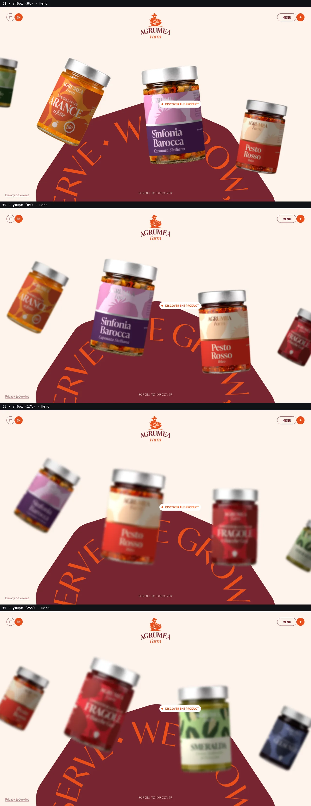
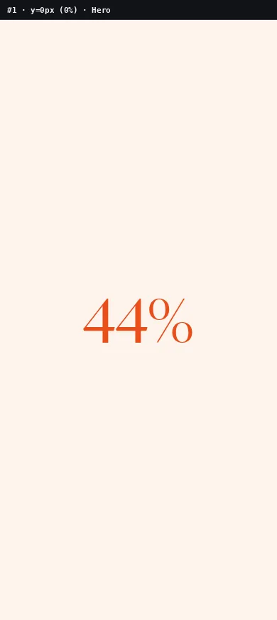

# UI Design System & Master Generation Blueprint: www-agrumeafarm-it_en

> **Agrumea Farm · Jams, pestos and flavours of Sicily** (https://www.agrumeafarm.it/en) — Agrumea Farm transforms Sicilian citrus fruits, other fruits and produce into artisanal jams, pestos and preserves with an authentic flavour





---

## 1. Executive Visual Persona & Design Archetype

- **Brand Essence & Persona**: **Agrumea Farm · Jams, pestos and flavours of Sicily** (`https://www.agrumeafarm.it/en`). Agrumea Farm transforms Sicilian citrus fruits, other fruits and produce into artisanal jams, pestos and preserves with an authentic flavour
- **Capture Provenance**: Live browser capture (`tier1_fast`, HTTP `200`, captured `2026-11-24`).
- **Visual Archetype**: **Light-Gallery WebGL / Canvas Interactive Experience (`#fdf3eb` / `#e94e1b`)**.
- **Anti-AI-Slop Differentiators**:
  - **Live-Computed Chromatic Polarity**: Anchors the viewport in `#fdf3eb` (live computed `body` `background-color` (`computed_styles.json`)) paired with `#762530` primary typography and `#e94e1b` accents.
  - **Grounded Typographic Hierarchy**: Uses `ivystyle-sans` across display (`Agrumea Farm: Sicilian artisan marma`) and body copy.
  - **Calibrated Spatial Grid & Motion**: Combines `1440px` container bounds (`gap: 0.5px`, padding `30px`) with `cubic-bezier(.645,.045,.355,1)` easing and Lenis Smooth Scroll (`data-lenis`), HTML5 `<canvas>` Interactive Viewport Surface.

---

## 2. Spatial Architecture & Modular Grid Mathematics

### Viewport Allocation & Container Geometry
- **Captured Journey Filmstrips**: Desktop `1280×3312px` (`assets/desktop-journey.webp`, `4` keyframes up to `y=0px` / doc `900px`), Mobile `390×872px` (`assets/mobile-journey.webp`, `1` keyframes).
- **Master Container Bounds**: `1440px` (full-bleed `100%` desktop stage measured on `1440px` viewport).
- **Canvas Lateral Padding & Spacing**: `30px` lateral canvas padding with `0.5px` grid gap.
- **Border Radius Scale**: `0px 0px 15px`, `999px`, `14px`, `2px`.

### Responsive Breakpoint Architecture
- **Desktop Layout**: Multi-column CSS Grid / Flexbox layout at `1440px` (`max-width: 1440px`, `gap: 0.5px`).
- **Mobile Layout**: Single-column vertical stack at `390px` viewport width with `30px` horizontal padding.
- **Extracted CSS Media Queries**: `@media (max-width:1024px)`, `@media (max-width:480px)`, `@media (prefers-reduced-motion:reduce)`.

---

## 3. Color System, Materiality & Atmospheric Lighting

### Semantic Palette & Source Grounding
| Semantic Role | Ground-Truth Value | Extracted Live / CSS Source |
|---|---|---|
| **Primary Canvas Substrate** | `#fdf3eb` | live computed `body` `background-color` (`computed_styles.json`) |
| **Primary Typography Ink** | `#762530` | live computed `h1` `color` (`computed_styles.json`) |
| **Elevated Surface / Card Substrate** | `#ffffff` | `body { background: white }` (`#ffffff`) |
| **Interactive Accent / Highlight** | `#e94e1b` | live computed `a` `background-color` (`computed_styles.json`) |
| **Secondary / Muted Copy** | `#ffa500` | `:hover { color: orange }` (`#ffa500`) |
| **Structural Hairline Border** | `#762530` | `var(--color-border)` in `:root` |
| **Variable Token (`--color-yellow`)** | `#f39200` | `var(--color-yellow)` in `:root` |

### Sanitized Root CSS Variables (`ui-ux.md` Ground Truth)
| Variable Name | Extracted Value | Semantic Role |
|---|---|---|
| `--color-orange` | `#e94e1b` | Brand / Palette Token |
| `--color-border` | `#762530` | Brand / Palette Token |
| `--color-white` | `#fdf3eb` | Canvas / Surface Token |
| `--color-yellow` | `#f39200` | Brand / Palette Token |
| `--border-round` | `15px` | Elevation / Border Token |
| `--container-padding` | `clamp(30px,2vw,40px)` | Layout / Spatial Grid Token |
| `--grid-columns` | `12` | Layout / Spatial Grid Token |
| `--grid-gap-x` | `clamp(12px,1.45vw,30px)` | Layout / Spatial Grid Token |
| `--grid-gap-y` | `0` | Layout / Spatial Grid Token |
| `--header-offset` | `clamp(20px,2vw,30px)` | Layout / Spatial Grid Token |
| `--header-logo-width` | `clamp(126px,10vw,152px)` | Layout / Spatial Grid Token |
| `--header-pad-y` | `30px` | Layout / Spatial Grid Token |
| `--header-brand-width` | `135px` | Brand / Palette Token |
| `--header-safe-top` | `calc(var(--header-pad-y) + var(--header-brand-width)*130/151)` | Layout / Spatial Grid Token |
| `--font-sans` | `"ivystyle-sans","Avenir Next","Helvetica Neue",Helvetica,Arial,sans-serif` | Typography / Scale Token |
| `--text-small` | `.875rem` | Typography Ink Token |

---

## 4. Typographic Scale & Editorial Hierarchy

### Font Family Stacks
- **Display Typography**: `ivystyle-sans`.
- **Primary Body Stack**: `ivystyle-sans`.
- **Technical / Metadata Stack**: not declared in live computed styles (uses primary stack / `ui-monospace`).

### Typographic Scale & Rules (Live Computed & Stylesheet Grounded)
- **Hero Display (`H1`)**: live computed `h1` (`font-size: 32px`, `line-height: 41.6px`, `font-weight: 400`); CSS variables `--text-display: clamp(4rem, calc(2.9rem + 11vw) ,999999px)`.
- **Section Heading (`H2`)**: observed font-size ladder: `32px`, `16px`, `13px`, `14px`, `var(--text-base)`.
- **Body Copy**: live computed `body` (`font-size: 16px`, `line-height: 20.8px`, `font-weight: 400`); CSS variables `--text-base: 1rem`.
- **Metadata & Navigation Labels**: live computed `nav/a` (`font-size: 16px`, `line-height: 20.8px`, `font-weight: 400`); CSS variables `--text-small: .875rem`.

---

## 5. Choreographed Motion & Interaction Physics

### Primary Easing Curves
- **Extracted Timing Functions**: `cubic-bezier(.645,.045,.355,1)`, `cubic-bezier(.22,1,.36,1)`, `cubic-bezier(.16,1,.3,1)`.

### Per-Element Transition & Choreography Rules
- **Selector `jar-slider.is-flying-out[data-v-a...`**: `transition: opacity .42s var(--ease-soft),scale .42s var(--ease-soft)` extracted from `www-agrumeafarm-it_en` stylesheet.
- **Selector `.jar-slider__prompt[data-v-a006feed]`**: `transition: opacity .9s var(--ease-premium) .18s,transform .9s var(--ease-...` extracted from `www-agrumeafarm-it_en` stylesheet.
- **Selector `.site-footer__link[data-v-68ac8fad]`**: `transition: color .3s var(--ease-out-expo)` extracted from `www-agrumeafarm-it_en` stylesheet.
- **Extracted Easing Curve (`cubic-bezier(.645,.045,.355,1)`)**: Governs interactive state transitions across `<header.site-header>` and `<section.jar-slider:nth(2)>`.
- **Runtime Interaction Engine**: Integrates Lenis Smooth Scroll (`data-lenis`), HTML5 `<canvas>` Interactive Viewport Surface with `prefers-reduced-motion: reduce` fallback guards.
### Measured Runtime Scroll & Interaction Telemetry (`behavioral_journey_v2`)
- **Scroll Driver Mode**: `wheel` (max document height `900px`, deepest scrollY reached `0px` across `4` desktop keyframes).
- **Detected Scroll / Motion Libraries**: `Lenis`, `WebGL/Canvas`.
- **Nav / Drawer Probe (`menu`)**: Triggered visual change (pixel diff `100.125`, captured in `assets/state-nav.webp`); revealed links: Smeraldo - Pistachio..., H O M E H O M E, P A N T R Y P A N T R Y, P R O D U C T I O N P..., E X P E R I E N C E E..., A b o u t A b o u t.

---

## 6. Component Wireframe & Structural DOM Map

### Visual Layout Schematic — Desktop (`1440px`, Grounded in `dom.html` & Landmark Bounding Boxes)
```
┌────────────────────────────────────────────────────────────────────────┐
│ DESKTOP VIEWPORT (1440px) — Agrumea Farm · Jams, pestos and flavours o │
│ ====================================================================== │
│ [ <header.site-header> (1440x97px)    | IT · EN                      ] │
│ ---------------------------------------------------------------------- │
│ | HERO STAGE: <section.jar-slider> (w=1440px)                        | │
│ | H1: Agrumea Farm: Sicilian artisan marmalades, spread...           | │
│ | Substrate: #fdf3eb | Ink: #762530 | Accent: #e94e1b                | │
│ ---------------------------------------------------------------------- │
│ | SHOWCASE GRID (<section.jar-slider:nth(2)) max-w: 1440px           | │
│ | +------------------------------+  +------------------------------+ | │
│ | | SCROLL TO DISCOVER           |  | Scroll to discover           | | │
│ | +------------------------------+  +------------------------------+ | │
│ ---------------------------------------------------------------------- │
│ | DETAIL MODULE (<section.jar-slider:nth(3)) — Agrumea Farm · Jams,  | │
│ ---------------------------------------------------------------------- │
│ [ FOOTER (<footer.site-shell__) | https://www.agrumeafarm.it/en        │
└────────────────────────────────────────────────────────────────────────┘
```

### Visual Layout Schematic — Mobile Reflow (`390px`)
```
┌────────────────────────────────────────────────────────────────────────┐
│ MOBILE VIEWPORT REFLOW (390px) — Single-Column Stack (gap: 0.5px)      │
│ ====================================================================== │
│ [ HEADER BAR (<header.site-header>    ) | Compact Menu (390px)         │
│ ---------------------------------------------------------------------- │
│ | HERO STAGE (<section.jar-slider>) — 390px Vertical Lead            | │
│ | H1: Agrumea Farm: Sicilian artisan marmalades, spread...           | │
│ ---------------------------------------------------------------------- │
│ | SHOWCASE STACK (<section.jar-slider:nt) — 1-Col Stack              | │
│ | [ Item 1: SCROLL TO DISCOVER                                     ] | │
│ | [ Item 2: Scroll to discover                                     ] | │
│ ---------------------------------------------------------------------- │
│ | DETAIL STACK (<section.jar-slider:nth() — 1-Col (Agrumea Farm · Jam) │
│ ---------------------------------------------------------------------- │
│ [ FOOTER (<footer.site-shell__) | Stacked 390px Colophon               │
└────────────────────────────────────────────────────────────────────────┘
```

### Granular DOM Region Breakdown
1. **Brand Header & Navigation Bar (<header.site-header> — `www-agrumeafarm-it_en`)**:
   - Landmark `<header class="site-header">` (`1440x97px`) hosting `Agrumea Farm · Jams, pestos and flav` navigation (`IT · EN`), DOM attributes (`data-v-aa931410`, `data-v-3a145d88`, `data-header-theme="dark"`, `data-header-logo="full"`), and stylesheet rule `active { cursor:grabbing }`.
2. **Hero Stage & Focal Lead (<section.jar-slider> — `Agrumea Farm: Sicilian artisan mar`)**:
   - Landmark `<section class="jar-slider">` presenting display lead `Agrumea Farm: Sicilian artisan marmalades, spread...` and copy excerpt *"SCROLL TO DISCOVER"* over `#fdf3eb` canvas and `#762530` ink.
3. **Primary Showcase & Content Grid (<section.jar-slider:nth(2)> — `SCROLL TO DISCOVER`)**:
   - Landmark `<section class="jar-slider">` rendering section `SCROLL TO DISCOVER` with copy *"Scroll to discover"*, asset references (`use.typekit.net`, `p.typekit.net`, `yey3ruw.css`, `CmsHomePage.CpbPGEL3.css`), and grid rule `.tk-ivystyle-sans { font-family: "ivystyle-sans",sans-serif; }`.
4. **Interactive Detail & Feature Matrix (<section.jar-slider:nth(3)> — `Scroll to discover`)**:
   - Landmark `<section class="jar-slider">` framing `Scroll to discover` and `Agrumea Farm · Jams, pestos and flavours of Sici` (*"Agrumea Farm · Jams, pestos and flavours of Sicily"*) with `#ffffff` surface cards, `#e94e1b` accents, and `.tk-ivymode { font-family: "ivymode",sans-serif; }`.
5. **Colophon & Global Directory Footer (<footer.site-shell__legal> — `https://www.agrumeafarm.it/en`)**:
   - Landmark `<footer class="site-shell__legal">` anchoring `Agrumea Farm · Jams, pestos and ` footer links (`IT · EN`), copy *"m m e e n n u u c c l l o o s s e e"*, and `#762530` structural dividers.
### Full Vertical Scroll Sequence (Desktop `1440×900` Keyframes)
- **Step 01** (`y=0px`, `0%`): Active landmark `Hero` · sticky/fixed elements: `6`
- **Step 02** (`y=0px`, `8%`): Active landmark `Hero` · sticky/fixed elements: `6`
- **Step 03** (`y=0px`, `17%`): Active landmark `Hero` · sticky/fixed elements: `6`
- **Step 04** (`y=0px`, `25%`): Active landmark `Hero` · sticky/fixed elements: `6`

---

## 7. Master Zero-Shot AI Generation Prompt

```markdown
# Master Zero-Shot Frontend Generation Prompt: www-agrumeafarm-it_en (Agrumea Farm · Jams, pestos and flavours of Sicily)

You are a principal frontend architect and design systems engineer. Build a complete, production-ready web application replicating the exact design system, DOM landmarks, typographic hierarchy, color tokens, and motion physics of `www-agrumeafarm-it_en` (**Agrumea Farm · Jams, pestos and flavours of Sicily** — `https://www.agrumeafarm.it/en`).

### 1. Visual Archetype & Anti-AI-Slop Mandates
- **Archetype**: Light-Gallery WebGL / Canvas Interactive Experience (`#fdf3eb` / `#e94e1b`).
- **Identity & Domain Context**: Agrumea Farm transforms Sicilian citrus fruits, other fruits and produce into artisanal jams, pestos and preserves with an authentic flavour
- **Primary Substrate**: `#fdf3eb` (live computed `body` `background-color` (`computed_styles.json`)), **Primary Ink**: `#762530`, **Accent / Highlight**: `#e94e1b`.
- **Site-Specific Differentiators**:
  - **Live-Computed Chromatic Polarity**: Anchors the viewport in `#fdf3eb` (live computed `body` `background-color` (`computed_styles.json`)) paired with `#762530` primary typography and `#e94e1b` accents.
  - **Grounded Typographic Hierarchy**: Uses `ivystyle-sans` across display (`Agrumea Farm: Sicilian artisan marma`) and body copy.
  - **Calibrated Spatial Grid & Motion**: Combines `1440px` container bounds (`gap: 0.5px`, padding `30px`) with `cubic-bezier(.645,.045,.355,1)` easing and Lenis Smooth Scroll (`data-lenis`), HTML5 `<canvas>` Interactive Viewport Surface.

### 2. Ground-Truth CSS Variables (`:root` Token Contract)
Declare and consume these exact custom properties extracted from `www-agrumeafarm-it_en` in your global stylesheet:

:root {
  /* Agrumea Farm · Jams, pestos and flavours of Sicily (www-agrumeafarm-it_en) — Live-Grounded CSS Variables */
  --color-orange: #e94e1b; /* Brand / Palette Token (www-agrumeafarm-it_en) */
  --color-border: #762530; /* Brand / Palette Token (www-agrumeafarm-it_en) */
  --color-white: #fdf3eb; /* Canvas / Surface Token (www-agrumeafarm-it_en) */
  --color-yellow: #f39200; /* Brand / Palette Token (www-agrumeafarm-it_en) */
  --border-round: 15px; /* Elevation / Border Token (www-agrumeafarm-it_en) */
  --container-padding: clamp(30px,2vw,40px); /* Layout / Spatial Grid Token (www-agrumeafarm-it_en) */
  --grid-columns: 12; /* Layout / Spatial Grid Token (www-agrumeafarm-it_en) */
  --grid-gap-x: clamp(12px,1.45vw,30px); /* Layout / Spatial Grid Token (www-agrumeafarm-it_en) */
  --grid-gap-y: 0; /* Layout / Spatial Grid Token (www-agrumeafarm-it_en) */
  --header-offset: clamp(20px,2vw,30px); /* Layout / Spatial Grid Token (www-agrumeafarm-it_en) */
  --header-logo-width: clamp(126px,10vw,152px); /* Layout / Spatial Grid Token (www-agrumeafarm-it_en) */
  --header-pad-y: 30px; /* Layout / Spatial Grid Token (www-agrumeafarm-it_en) */
  --header-brand-width: 135px; /* Brand / Palette Token (www-agrumeafarm-it_en) */
  --header-safe-top: calc(var(--header-pad-y) + var(--header-brand-width)*130/151); /* Layout / Spatial Grid Token (www-agrumeafarm-it_en) */
  --font-sans: "ivystyle-sans","Avenir Next","Helvetica Neue",Helvetica,Arial,sans-serif; /* Typography / Scale Token (www-agrumeafarm-it_en) */
  --text-small: .875rem; /* Typography Ink Token (www-agrumeafarm-it_en) */
}

### 3. Semantic Color & Materiality Contract
Map every surface, ink, and border strictly to these source-grounded tokens:
- **Primary Canvas Substrate**: `#fdf3eb` — grounded in live computed `body` `background-color` (`computed_styles.json`)
- **Primary Typography Ink**: `#762530` — grounded in live computed `h1` `color` (`computed_styles.json`)
- **Elevated Surface / Card Substrate**: `#ffffff` — grounded in `body { background: white }` (`#ffffff`)
- **Interactive Accent / Highlight**: `#e94e1b` — grounded in live computed `a` `background-color` (`computed_styles.json`)
- **Secondary / Muted Copy**: `#ffa500` — grounded in `:hover { color: orange }` (`#ffa500`)
- **Structural Hairline Border**: `#762530` — grounded in `var(--color-border)` in `:root`
- **Variable Token (`--color-yellow`)**: `#f39200` — grounded in `var(--color-yellow)` in `:root`

### 4. Spatial Grid, Container Bounds & Responsive Breakpoints
- **Desktop Viewport Reference**: `1280×3312px` (multi-frame vertical journey filmstrip (3312px), `1440px` standard desktop width).
- **Mobile Viewport Reference**: `390×872px` (full-page live capture (872px), `390px` standard mobile width).
- **Container Max-Width**: `1440px` (full-bleed `100%` desktop stage measured on `1440px` viewport)
- **Padding & Gutters**: `30px` lateral canvas padding with `0.5px` grid gap
- **Desktop Grid**: Multi-column CSS Grid / Flexbox layout at `1440px` (`max-width: 1440px`, `gap: 0.5px`)
- **Mobile Adaptation**: Single-column vertical stack at `390px` viewport width with `30px` horizontal padding
- **Media Queries**: `@media (max-width:1024px)`, `@media (max-width:480px)`, `@media (prefers-reduced-motion:reduce)`
- **Corner Radii**: `0px 0px 15px`, `999px`, `14px`, `2px`

### 5. Typography & Editorial Scale Contract
- **Display Font Stack**: `ivystyle-sans`
- **Body Font Stack**: `ivystyle-sans`
- **Monospace / Technical Font Stack**: not declared in live computed styles (uses primary stack / `ui-monospace`)
- **H1 Display Rule**: live computed `h1` (`font-size: 32px`, `line-height: 41.6px`, `font-weight: 400`); CSS variables `--text-display: clamp(4rem, calc(2.9rem + 11vw) ,999999px)`
- **H2 Section Rule**: observed font-size ladder: `32px`, `16px`, `13px`, `14px`, `var(--text-base)`
- **Body Copy Rule**: live computed `body` (`font-size: 16px`, `line-height: 20.8px`, `font-weight: 400`); CSS variables `--text-base: 1rem`
- **Metadata & Index Rule**: live computed `nav/a` (`font-size: 16px`, `line-height: 20.8px`, `font-weight: 400`); CSS variables `--text-small: .875rem`

### 6. Component Hierarchy, Verbatim Copy & Real DOM Landmarks
Scaffold `www-agrumeafarm-it_en` (`Agrumea Farm · Jams, pestos and flavours of Sicily`) with these exact structural regions, extracted copy, and CSS rules from `dom.html`:
1. **Brand Header & Navigation Bar (<header.site-header> — `www-agrumeafarm-it_en`)**:
   - DOM & Selectors: Landmark `<header class="site-header">` (`1440x97px`) hosting `Agrumea Farm · Jams, pestos and flav` navigation (`IT · EN`), DOM attributes (`data-v-aa931410`, `data-v-3a145d88`, `data-header-theme="dark"`, `data-header-logo="full"`), and stylesheet rule `active { cursor:grabbing }`.
   - Responsive Contract: Header `Brand Header & Navigation Bar (<header.site-header> — `www-agrumeafarm-it_en`)` (`www-agrumeafarm-it_en`) adapts across `@media (max-width:1024px)`, `@media (max-width:480px)`, `@media (prefers-reduced-motion:reduce)` with `cubic-bezier(.645,.045,.355,1)`, `cubic-bezier(.22,1,.36,1)`, `cubic-bezier(.16,1,.3,1)` transitions and links `IT · EN`.
2. **Hero Stage & Focal Lead (<section.jar-slider> — `Agrumea Farm: Sicilian artisan mar`)**:
   - DOM & Selectors: Landmark `<section class="jar-slider">` presenting display lead `Agrumea Farm: Sicilian artisan marmalades, spread...` and copy excerpt *"SCROLL TO DISCOVER"* over `#fdf3eb` canvas and `#762530` ink.
   - Responsive Contract: Hero stage (`1280×3312px` desktop / `390×872px` mobile) sets `#fdf3eb` background with `#762530` headline `Agrumea Farm: Sicilian artisan marmalades, spread...`.
3. **Primary Showcase & Content Grid (<section.jar-slider:nth(2)> — `SCROLL TO DISCOVER`)**:
   - DOM & Selectors: Landmark `<section class="jar-slider">` rendering section `SCROLL TO DISCOVER` with copy *"Scroll to discover"*, asset references (`use.typekit.net`, `p.typekit.net`, `yey3ruw.css`, `CmsHomePage.CpbPGEL3.css`), and grid rule `.tk-ivystyle-sans { font-family: "ivystyle-sans",sans-serif; }`.
   - Responsive Contract: Showcase grid `Primary Showcase & Content Grid (<section.jar-slider:nth(2)> — `SCROLL TO DISCOVER`)` applies Multi-column CSS Grid / Flexbox layout at `1440px` (`max-width: 1440px`, `gap: 0.5px`) on desktop and Single-column vertical stack at `390px` viewport width with `30px` horizontal padding on mobile.
4. **Interactive Detail & Feature Matrix (<section.jar-slider:nth(3)> — `Scroll to discover`)**:
   - DOM & Selectors: Landmark `<section class="jar-slider">` framing `Scroll to discover` and `Agrumea Farm · Jams, pestos and flavours of Sici` (*"Agrumea Farm · Jams, pestos and flavours of Sicily"*) with `#ffffff` surface cards, `#e94e1b` accents, and `.tk-ivymode { font-family: "ivymode",sans-serif; }`.
   - Responsive Contract: Detail module `Interactive Detail & Feature Matrix (<section.jar-slider:nth(3)> — `Scroll to discover`)` uses `0px 0px 15px`, `999px`, `14px`, `2px` radii, `#e94e1b` highlights, and assets (use.typekit.net, p.typekit.net, yey3ruw.css).
5. **Colophon & Global Directory Footer (<footer.site-shell__legal> — `https://www.agrumeafarm.it/en`)**:
   - DOM & Selectors: Landmark `<footer class="site-shell__legal">` anchoring `Agrumea Farm · Jams, pestos and ` footer links (`IT · EN`), copy *"m m e e n n u u c c l l o o s s e e"*, and `#762530` structural dividers.
   - Responsive Contract: Footer `Colophon & Global Directory Footer (<footer.site-shell__legal> — `https://www.agrumeafarm.it/en`)` aligns to `1440px` (full-bleed `100%` desktop stage measured on `1440px` viewport) with `30px` lateral canvas padding with `0.5px` grid gap and attributes (data-v-aa931410, data-v-3a145d88, data-header-theme="dark").

#### Verbatim DOM Copy Excerpts (`dom.html`)
- Copy Excerpt 1: *"SCROLL TO DISCOVER"*
- Copy Excerpt 2: *"Scroll to discover"*
- Copy Excerpt 3: *"Agrumea Farm · Jams, pestos and flavours of Sicily"*
- Copy Excerpt 4: *"m m e e n n u u c c l l o o s s e e"*

### 7. Motion, Extracted Stylesheet Rules & Interaction Choreography
- **Primary Easing Functions**: `cubic-bezier(.645,.045,.355,1)`, `cubic-bezier(.22,1,.36,1)`, `cubic-bezier(.16,1,.3,1)`
- **Extracted Stylesheet Rules (`www-agrumeafarm-it_en`)**:
- `active { cursor:grabbing }`
- `.tk-ivystyle-sans { font-family: "ivystyle-sans",sans-serif; }`
- `.tk-ivymode { font-family: "ivymode",sans-serif; }`
- `hover { color:var(--color-orange) }`
- `.site-legal { align-items:flex-start;flex-direction:column;gap:.35rem }`
- **Per-Selector Transition Rules**:
- **Selector `jar-slider.is-flying-out[data-v-a...`**: `transition: opacity .42s var(--ease-soft),scale .42s var(--ease-soft)` extracted from `www-agrumeafarm-it_en` stylesheet.
- **Selector `.jar-slider__prompt[data-v-a006feed]`**: `transition: opacity .9s var(--ease-premium) .18s,transform .9s var(--ease-...` extracted from `www-agrumeafarm-it_en` stylesheet.
- **Selector `.site-footer__link[data-v-68ac8fad]`**: `transition: color .3s var(--ease-out-expo)` extracted from `www-agrumeafarm-it_en` stylesheet.
- **Extracted Easing Curve (`cubic-bezier(.645,.045,.355,1)`)**: Governs interactive state transitions across `<header.site-header>` and `<section.jar-slider:nth(2)>`.
- **Runtime Interaction Engine**: Integrates Lenis Smooth Scroll (`data-lenis`), HTML5 `<canvas>` Interactive Viewport Surface with `prefers-reduced-motion: reduce` fallback guards.
### 7b. Full-Page Scroll Choreography, Interactive States & Multi-Page Routes
- **Scroll Mechanics**: Implement `wheel` vertical progression up to `900px` across 4 distinct viewport chapters using Lenis, WebGL/Canvas.
- **Vertical Chapter Sequence**: Hero (0%) -> Hero (8%) -> Hero (17%) -> Hero (25%).
- **Navigation Drawer / Menu State**: Replicate interactive menu toggle (`menu`) with Escape-to-close keyboard handling.

### 8. Technical Deliverables
- Implement in Next.js (App Router) with TypeScript and Tailwind CSS consuming the `:root` custom properties defined above for `www-agrumeafarm-it_en`.
- Reproduce both the `1440px` desktop architecture and `390px` mobile breakpoint transitions, preserving semantic HTML5 landmarks (`<header>`, `<nav>`, `<main>`, `<section>`, `<footer>`) and `prefers-reduced-motion` accessibility guards.
```
---

## 8. Full-Page Scroll Journey, Interactive States & Subpage Inventory

### Desktop Scroll Keyframes (`1440×900` WebP)
| Step | Scroll Y | Progress | Active Landmark / Section | Sticky/Fixed | Visual Asset |
| :---: | :---: | :---: | :--- | :---: | :--- |
| `#01` | `0px` | `0%` | Hero | `6` | [desktop-step-01.webp](assets/desktop-step-01.webp) |
| `#02` | `0px` | `8%` | Hero | `6` | [desktop-step-02.webp](assets/desktop-step-02.webp) |
| `#03` | `0px` | `17%` | Hero | `6` | [desktop-step-03.webp](assets/desktop-step-03.webp) |
| `#04` | `0px` | `25%` | Hero | `6` | [desktop-step-04.webp](assets/desktop-step-04.webp) |

### Mobile Condensed Keyframes (`390×844` WebP)
| Step | Scroll Y | Progress | Active Landmark | Visual Asset |
| :---: | :---: | :---: | :--- | :--- |
| `#01` | `0px` | `0%` | Hero | [mobile-step-01.webp](assets/mobile-step-01.webp) |

### Interactive UI State Captures (`1440×900` WebP)
| State Type | Trigger / Observation | Visual Asset |
| :--- | :--- | :--- |
| `nav_menu` | Nav/Menu opened (`menu`, diff `100.125`) | [state-nav.webp](assets/state-nav.webp) |

