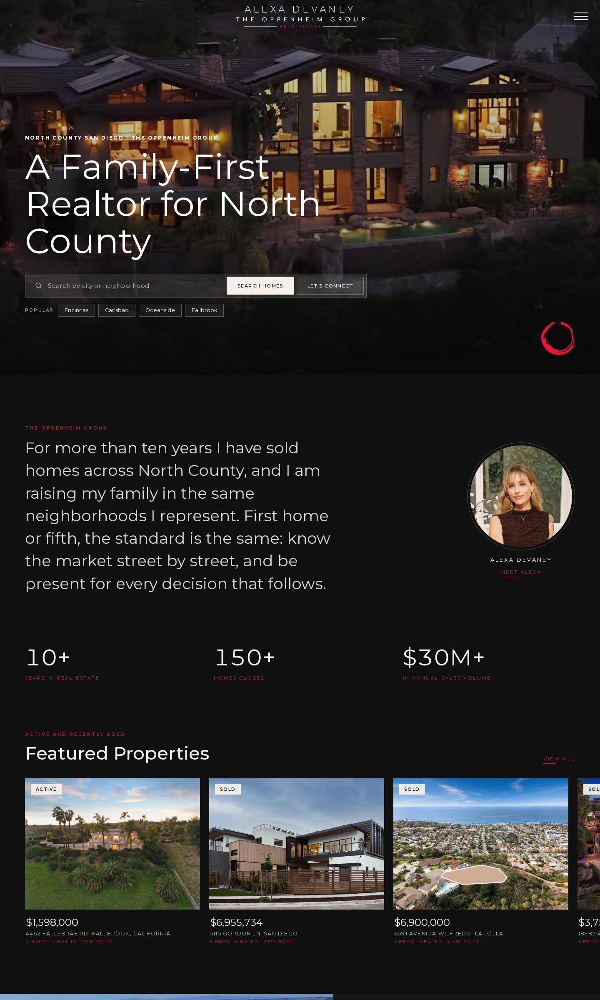
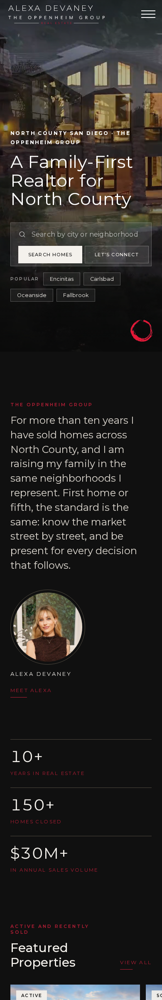

# UI Design System & Master Generation Blueprint: www-alexadevaney-com

> **North County San Diego Luxury Homes – Alexa Devaney** (https://www.alexadevaney.com/) — Alexa Devaney, Senior Realtor Associate with The Oppenheim Group, helps families buy and sell luxury homes from Encinitas and Carlsbad to...



---

## 1. Executive Visual Persona & Design Archetype

- **Brand Essence & Persona**: **North County San Diego Luxury Homes – Alexa Devaney** (`https://www.alexadevaney.com/`). Alexa Devaney, Senior Realtor Associate with The Oppenheim Group, helps families buy and sell luxury homes from Encinitas and Carlsbad to...
- **Capture Provenance**: Live browser capture (`tier1_fast`, HTTP `200`, captured `2026-11-23`).
- **Visual Archetype**: **Light-Substrate Editorial & Modular Grid System (`#f7f6f4` canvas, `#333333` ink, `#000080` accent)**.
- **Anti-AI-Slop Differentiators**:
  - **Live-Computed Chromatic Polarity**: Anchors the viewport in `#f7f6f4` (live computed `body` `background-color` (`computed_styles.json`)) paired with `#333333` primary typography and `#000080` accents.
  - **Grounded Typographic Hierarchy**: Pairs `Montserrat` for display copy (`A Family-First Realtor for North Cou`) with `Montserrat` and not declared in live computed styles (uses primary stack / `ui-monospace`).
  - **Calibrated Spatial Grid & Motion**: Combines `1320px` container bounds (`gap: 18px`, padding `18px`) with `cubic-bezier(.4,0,.2,1)` easing.

---

## 2. Spatial Architecture & Modular Grid Mathematics



### Viewport Allocation & Container Geometry
- **Captured Viewport Dimensions**: Desktop `1440×2400px` (`assets/desktop.png`, clamped at 2400px live multi-section capture), Mobile `390×2400px` (`assets/mobile.png`, clamped at 2400px live multi-section capture).
- **Master Container Bounds**: `1320px` (measured widest bounded `<section>` landmark width on `1440px` desktop).
- **Canvas Lateral Padding & Spacing**: `18px` lateral canvas padding with `18px` grid gap.
- **Border Radius Scale**: `50%`, `999px`, `2px`, `4px`.

### Responsive Breakpoint Architecture
- **Desktop Layout**: Multi-column CSS Grid / Flexbox layout at `1440px` (`max-width: 1320px`, `gap: 18px`).
- **Mobile Layout**: Single-column vertical stack at `390px` viewport width with `18px` horizontal padding.
- **Extracted CSS Media Queries**: `@media (max-width:600px)`, `@media (prefers-reduced-motion:reduce)`, `@media (max-width:1240px)`, `@media (max-width:992px)`.

---

## 3. Color System, Materiality & Atmospheric Lighting

### Semantic Palette & Source Grounding
| Semantic Role | Ground-Truth Value | Extracted Live / CSS Source |
|---|---|---|
| **Primary Canvas Substrate** | `#f7f6f4` | live computed `body` `background-color` (`computed_styles.json`) |
| **Primary Typography Ink** | `#333333` | live computed `body` `color` (`computed_styles.json`) |
| **Elevated Surface / Card Substrate** | `#ffffff` | `.navbar.scrolled { background-color: white }` (`#ffffff`) |
| **Interactive Accent / Highlight** | `#000080` | `.lp-btn--outline { color: navy }` (`#000080`) |
| **Secondary / Muted Copy** | `#b6b0a6` | live computed `p` `color` (`computed_styles.json`) |
| **Structural Hairline Border** | `#f8f7f5` | `.sidemenu__nav li { border-bottom: #f8f7f5 }` |
| **Variable Token (`--navy`)** | `#004f71` | `var(--navy)` in `:root` |
| **Variable Token (`--taupe`)** | `#88786a` | `var(--taupe)` in `:root` |
| **Variable Token (`--cream`)** | `#fbf9f7` | `var(--cream)` in `:root` |
| **Variable Token (`--cat`)** | `#7fb0c4` | `var(--cat)` in `:root` |

### Sanitized Root CSS Variables (`ui-ux.md` Ground Truth)
| Variable Name | Extracted Value | Semantic Role |
|---|---|---|
| `--navy` | `#004F71` | Layout / Spatial Grid Token |
| `--navy-90` | `rgba(0,79,113,0.9)` | Layout / Spatial Grid Token |
| `--taupe` | `#88786A` | Color / Atmospheric Token |
| `--taupe-overlay` | `rgba(136,120,106,0.4)` | Color / Atmospheric Token |
| `--cream` | `#FBF9F7` | Color / Atmospheric Token |
| `--white` | `#FFFFFF` | Canvas / Surface Token |
| `--heading-font` | `"Montserrat",sans-serif` | Typography Ink Token |
| `--display-font` | `"Montserrat",sans-serif` | Typography / Scale Token |
| `--body-font` | `"Montserrat",sans-serif` | Typography / Scale Token |
| `--rail-gutter` | `max(25px,calc((100% - 1370px) / 2 + 25px))` | Layout / Spatial Grid Token |
| `--cat` | `#7fb0c4` | Color / Atmospheric Token |
| `--ag-top` | `96px` | Dimension / Scale Token |
| `--ag-h` | `min(calc(100vh - var(--ag-top) - 24px),780px)` | Dimension / Scale Token |
| `--decal` | `url(/brand/og-ring-decal.webp)` | Design System Custom Token |
| `--mix` | `0` | Design System Custom Token |
| `--hs-menu-max` | `340px` | Dimension / Scale Token |

---

## 4. Typographic Scale & Editorial Hierarchy

### Font Family Stacks
- **Display Typography**: `Montserrat`.
- **Primary Body Stack**: `Montserrat`.
- **Technical / Metadata Stack**: not declared in live computed styles (uses primary stack / `ui-monospace`).

### Typographic Scale & Rules (Live Computed & Stylesheet Grounded)
- **Hero Display (`H1`)**: live computed `h1` (`font-size: 84px`, `line-height: 89.04px`, `font-weight: 400`, `letter-spacing: 0.5px`); CSS variables `--display-font: "Montserrat",sans-serif`; rule `h1` (`font-size: clamp(38px,5.4vw,72px)`, `line-height: 1.02`, `letter-spacing: -1.4px`, `font-weight: 300`).
- **Section Heading (`H2`)**: live computed `h2` (`font-size: 37.44px`, `line-height: 54.288px`, `font-weight: 400`); rule `h2` (`font-size: 30px`, `letter-spacing: 1px`, `font-weight: 400`).
- **Body Copy**: live computed `body` (`font-size: 16px`, `line-height: normal`, `font-weight: 400`); CSS variables `--body-font: "Montserrat",sans-serif`; rule `p` (`font-size: 16px`, `line-height: 1.7`, `letter-spacing: 1px`).
- **Metadata & Navigation Labels**: live computed `nav/a` (`font-size: 16px`, `line-height: normal`, `font-weight: 400`).

---

## 5. Choreographed Motion & Interaction Physics

### Primary Easing Curves
- **Extracted Timing Functions**: `cubic-bezier(.4,0,.2,1)`, `cubic-bezier(.16,1,.3,1)`, `cubic-bezier(.77,0,.175,1)`.

### Per-Element Transition & Choreography Rules
- **Selector `html[data-intro=play] .intro`**: `transition: opacity .6s cubic-bezier(.4,0,.2,1)` extracted from `www-alexadevaney-com` stylesheet.
- **Selector `html[data-intro=leaving] .intro__orb`**: `transition: scale .6s ease-in` extracted from `www-alexadevaney-com` stylesheet.
- **Selector `html[data-intro=leaving] .intro__...`**: `transition: translate .6s ease-in` extracted from `www-alexadevaney-com` stylesheet.
- **Extracted Easing Curve (`cubic-bezier(.4,0,.2,1)`)**: Governs interactive state transitions across `<nav.navbar>` and `<section.hn-statement>`.
- **State & Hover Choreography**: Opacity and transform transitions on `<section.video-section>` and `<section.hn-statement>` interactive targets.

---

## 6. Component Wireframe & Structural DOM Map

### Visual Layout Schematic — Desktop (`1440px`, Grounded in `dom.html` & Landmark Bounding Boxes)
```
┌────────────────────────────────────────────────────────────────────────┐
│ DESKTOP VIEWPORT (1440px) — North County San Diego Luxury Homes – Alex │
│ ====================================================================== │
│ [ <nav.navbar> (1440x79px)            | Buy · Sell · Old Encinitas · ] │
│ ---------------------------------------------------------------------- │
│ | HERO STAGE: <section.video-section> (w=1440px)                     | │
│ | H1: A Family-First Realtor for North County                        | │
│ | Substrate: #f7f6f4 | Ink: #333333 | Accent: #000080                | │
│ ---------------------------------------------------------------------- │
│ | SHOWCASE GRID (<section.hn-statement>) max-w: 1320px               | │
│ | +------------------------------+  +------------------------------+ | │
│ | | Surf breaks, bluff-top stree |  | Communities North County San | | │
│ | +------------------------------+  +------------------------------+ | │
│ ---------------------------------------------------------------------- │
│ | DETAIL MODULE (<section.hn-stats>) — North County San Dieg         | │
│ ---------------------------------------------------------------------- │
│ [ FOOTER (<footer.intro__emble) | https://www.alexadevaney.com/        │
└────────────────────────────────────────────────────────────────────────┘
```

### Visual Layout Schematic — Mobile Reflow (`390px`)
```
┌────────────────────────────────────────────────────────────────────────┐
│ MOBILE VIEWPORT REFLOW (390px) — Single-Column Stack (gap: 18px)       │
│ ====================================================================== │
│ [ HEADER BAR (<nav.navbar>            ) | Compact Menu (390px)         │
│ ---------------------------------------------------------------------- │
│ | HERO STAGE (<section.video-section>) — 390px Vertical Lead         | │
│ | H1: A Family-First Realtor for North County                        | │
│ ---------------------------------------------------------------------- │
│ | SHOWCASE STACK (<section.hn-statement>) — 1-Col Stack              | │
│ | [ Item 1: Surf breaks, bluff-top streets, and a laid-back        ] | │
│ | [ Item 2: Communities North County San Diego View all comm       ] | │
│ ---------------------------------------------------------------------- │
│ | DETAIL STACK (<section.hn-stats>) — 1-Col (North County San D)     | │
│ ---------------------------------------------------------------------- │
│ [ FOOTER (<footer.intro__emble) | Stacked 390px Colophon               │
└────────────────────────────────────────────────────────────────────────┘
```

### Granular DOM Region Breakdown
1. **Brand Header & Navigation Bar (<nav.navbar> — `www-alexadevaney-com`)**:
   - Landmark `<nav class="navbar">` (`1440x79px`) hosting `North County San Diego Luxury Homes ` navigation (`Buy · Sell · Old Encinitas · Leucadia · Cardiff-by-the-Sea`), DOM attributes (`data-intro="done"`, `data-precedence="next"`, `data-precedence="next"`, `data-nimg="fill"`), and stylesheet rule `.intro { display:none }`.
2. **Hero Stage & Focal Lead (<section.video-section> — `A Family-First Realtor for North C`)**:
   - Landmark `<section class="video-section hn-hero">` presenting display lead `A Family-First Realtor for North County` and copy excerpt *"Surf breaks, bluff-top streets, and a laid-back coastal village f"* over `#f7f6f4` canvas and `#333333` ink.
3. **Primary Showcase & Content Grid (<section.hn-statement> — `Surf breaks, bluff-top streets, an`)**:
   - Landmark `<section class="hn-statement">` rendering section `Surf breaks, bluff-top streets, and a laid-back ` with copy *"Communities North County San Diego View all communities → Encinit"*, asset references (`og-emblem.webp`, `og-wordmark-light.webp`, `og-wordmark-dark.webp`, `og-ring-decal.webp`), and grid rule `.intro__orb { scale:1.12;transition:scale .6s ease-in }`.
4. **Interactive Detail & Feature Matrix (<section.hn-stats> — `Communities North County San Diego`)**:
   - Landmark `<section class="hn-stats">` framing `Communities North County San Diego View all comm` and `North County San Diego` (*"North County San Diego"*) with `#ffffff` surface cards, `#000080` accents, and `.intro__content { position:relative;display:flex;flex-direction:column;align-items:center;... }`.
5. **Colophon & Global Directory Footer (<footer.intro__emblem> — `https://www.alexadevaney.com/`)**:
   - Landmark `<footer class="intro__emblem">` anchoring `North County San Diego Luxury Ho` footer links (`Buy · Sell · Old Encinitas · Leucadia · Cardiff-by-the-Sea`), copy *"Encinitas → Surf breaks, bluff-top streets, and a laid-back "*, and `#f8f7f5` structural dividers.

---

## 7. Master Zero-Shot AI Generation Prompt

```markdown
# Master Zero-Shot Frontend Generation Prompt: www-alexadevaney-com (North County San Diego Luxury Homes – Alexa Devaney)

You are a principal frontend architect and design systems engineer. Build a complete, production-ready web application replicating the exact design system, DOM landmarks, typographic hierarchy, color tokens, and motion physics of `www-alexadevaney-com` (**North County San Diego Luxury Homes – Alexa Devaney** — `https://www.alexadevaney.com/`).

### 1. Visual Archetype & Anti-AI-Slop Mandates
- **Archetype**: Light-Substrate Editorial & Modular Grid System (`#f7f6f4` canvas, `#333333` ink, `#000080` accent).
- **Identity & Domain Context**: Alexa Devaney, Senior Realtor Associate with The Oppenheim Group, helps families buy and sell luxury homes from Encinitas and Carlsbad to...
- **Primary Substrate**: `#f7f6f4` (live computed `body` `background-color` (`computed_styles.json`)), **Primary Ink**: `#333333`, **Accent / Highlight**: `#000080`.
- **Site-Specific Differentiators**:
  - **Live-Computed Chromatic Polarity**: Anchors the viewport in `#f7f6f4` (live computed `body` `background-color` (`computed_styles.json`)) paired with `#333333` primary typography and `#000080` accents.
  - **Grounded Typographic Hierarchy**: Pairs `Montserrat` for display copy (`A Family-First Realtor for North Cou`) with `Montserrat` and not declared in live computed styles (uses primary stack / `ui-monospace`).
  - **Calibrated Spatial Grid & Motion**: Combines `1320px` container bounds (`gap: 18px`, padding `18px`) with `cubic-bezier(.4,0,.2,1)` easing.

### 2. Ground-Truth CSS Variables (`:root` Token Contract)
Declare and consume these exact custom properties extracted from `www-alexadevaney-com` in your global stylesheet:

:root {
  /* North County San Diego Luxury Homes – Alexa Devaney (www-alexadevaney-com) — Live-Grounded CSS Variables */
  --navy: #004F71; /* Layout / Spatial Grid Token (www-alexadevaney-com) */
  --navy-90: rgba(0,79,113,0.9); /* Layout / Spatial Grid Token (www-alexadevaney-com) */
  --taupe: #88786A; /* Color / Atmospheric Token (www-alexadevaney-com) */
  --taupe-overlay: rgba(136,120,106,0.4); /* Color / Atmospheric Token (www-alexadevaney-com) */
  --cream: #FBF9F7; /* Color / Atmospheric Token (www-alexadevaney-com) */
  --white: #FFFFFF; /* Canvas / Surface Token (www-alexadevaney-com) */
  --heading-font: "Montserrat",sans-serif; /* Typography Ink Token (www-alexadevaney-com) */
  --display-font: "Montserrat",sans-serif; /* Typography / Scale Token (www-alexadevaney-com) */
  --body-font: "Montserrat",sans-serif; /* Typography / Scale Token (www-alexadevaney-com) */
  --rail-gutter: max(25px,calc((100% - 1370px) / 2 + 25px)); /* Layout / Spatial Grid Token (www-alexadevaney-com) */
  --cat: #7fb0c4; /* Color / Atmospheric Token (www-alexadevaney-com) */
  --ag-top: 96px; /* Dimension / Scale Token (www-alexadevaney-com) */
  --ag-h: min(calc(100vh - var(--ag-top) - 24px),780px); /* Dimension / Scale Token (www-alexadevaney-com) */
  --decal: url(/brand/og-ring-decal.webp); /* Design System Custom Token (www-alexadevaney-com) */
  --mix: 0; /* Design System Custom Token (www-alexadevaney-com) */
  --hs-menu-max: 340px; /* Dimension / Scale Token (www-alexadevaney-com) */
}

### 3. Semantic Color & Materiality Contract
Map every surface, ink, and border strictly to these source-grounded tokens:
- **Primary Canvas Substrate**: `#f7f6f4` — grounded in live computed `body` `background-color` (`computed_styles.json`)
- **Primary Typography Ink**: `#333333` — grounded in live computed `body` `color` (`computed_styles.json`)
- **Elevated Surface / Card Substrate**: `#ffffff` — grounded in `.navbar.scrolled { background-color: white }` (`#ffffff`)
- **Interactive Accent / Highlight**: `#000080` — grounded in `.lp-btn--outline { color: navy }` (`#000080`)
- **Secondary / Muted Copy**: `#b6b0a6` — grounded in live computed `p` `color` (`computed_styles.json`)
- **Structural Hairline Border**: `#f8f7f5` — grounded in `.sidemenu__nav li { border-bottom: #f8f7f5 }`
- **Variable Token (`--navy`)**: `#004f71` — grounded in `var(--navy)` in `:root`
- **Variable Token (`--taupe`)**: `#88786a` — grounded in `var(--taupe)` in `:root`
- **Variable Token (`--cream`)**: `#fbf9f7` — grounded in `var(--cream)` in `:root`
- **Variable Token (`--cat`)**: `#7fb0c4` — grounded in `var(--cat)` in `:root`

### 4. Spatial Grid, Container Bounds & Responsive Breakpoints
- **Desktop Viewport Reference**: `1440×2400px` (clamped at 2400px live multi-section capture, `1440px` standard desktop width).
- **Mobile Viewport Reference**: `390×2400px` (clamped at 2400px live multi-section capture, `390px` standard mobile width).
- **Container Max-Width**: `1320px` (measured widest bounded `<section>` landmark width on `1440px` desktop)
- **Padding & Gutters**: `18px` lateral canvas padding with `18px` grid gap
- **Desktop Grid**: Multi-column CSS Grid / Flexbox layout at `1440px` (`max-width: 1320px`, `gap: 18px`)
- **Mobile Adaptation**: Single-column vertical stack at `390px` viewport width with `18px` horizontal padding
- **Media Queries**: `@media (max-width:600px)`, `@media (prefers-reduced-motion:reduce)`, `@media (max-width:1240px)`, `@media (max-width:992px)`
- **Corner Radii**: `50%`, `999px`, `2px`, `4px`

### 5. Typography & Editorial Scale Contract
- **Display Font Stack**: `Montserrat`
- **Body Font Stack**: `Montserrat`
- **Monospace / Technical Font Stack**: not declared in live computed styles (uses primary stack / `ui-monospace`)
- **H1 Display Rule**: live computed `h1` (`font-size: 84px`, `line-height: 89.04px`, `font-weight: 400`, `letter-spacing: 0.5px`); CSS variables `--display-font: "Montserrat",sans-serif`; rule `h1` (`font-size: clamp(38px,5.4vw,72px)`, `line-height: 1.02`, `letter-spacing: -1.4px`, `font-weight: 300`)
- **H2 Section Rule**: live computed `h2` (`font-size: 37.44px`, `line-height: 54.288px`, `font-weight: 400`); rule `h2` (`font-size: 30px`, `letter-spacing: 1px`, `font-weight: 400`)
- **Body Copy Rule**: live computed `body` (`font-size: 16px`, `line-height: normal`, `font-weight: 400`); CSS variables `--body-font: "Montserrat",sans-serif`; rule `p` (`font-size: 16px`, `line-height: 1.7`, `letter-spacing: 1px`)
- **Metadata & Index Rule**: live computed `nav/a` (`font-size: 16px`, `line-height: normal`, `font-weight: 400`)

### 6. Component Hierarchy, Verbatim Copy & Real DOM Landmarks
Scaffold `www-alexadevaney-com` (`North County San Diego Luxury Homes – Alexa Devaney`) with these exact structural regions, extracted copy, and CSS rules from `dom.html`:
1. **Brand Header & Navigation Bar (<nav.navbar> — `www-alexadevaney-com`)**:
   - DOM & Selectors: Landmark `<nav class="navbar">` (`1440x79px`) hosting `North County San Diego Luxury Homes ` navigation (`Buy · Sell · Old Encinitas · Leucadia · Cardiff-by-the-Sea`), DOM attributes (`data-intro="done"`, `data-precedence="next"`, `data-precedence="next"`, `data-nimg="fill"`), and stylesheet rule `.intro { display:none }`.
   - Responsive Contract: Header `Brand Header & Navigation Bar (<nav.navbar> — `www-alexadevaney-com`)` (`www-alexadevaney-com`) adapts across `@media (max-width:600px)`, `@media (prefers-reduced-motion:reduce)`, `@media (max-width:1240px)`, `@media (max-width:992px)` with `cubic-bezier(.4,0,.2,1)`, `cubic-bezier(.16,1,.3,1)`, `cubic-bezier(.77,0,.175,1)` transitions and links `Buy · Sell · Old Encinitas · Leucadia · Cardiff-by-the-Sea`.
2. **Hero Stage & Focal Lead (<section.video-section> — `A Family-First Realtor for North C`)**:
   - DOM & Selectors: Landmark `<section class="video-section hn-hero">` presenting display lead `A Family-First Realtor for North County` and copy excerpt *"Surf breaks, bluff-top streets, and a laid-back coastal village f"* over `#f7f6f4` canvas and `#333333` ink.
   - Responsive Contract: Hero stage (`1440×2400px` desktop / `390×2400px` mobile) sets `#f7f6f4` background with `#333333` headline `A Family-First Realtor for North County`.
3. **Primary Showcase & Content Grid (<section.hn-statement> — `Surf breaks, bluff-top streets, an`)**:
   - DOM & Selectors: Landmark `<section class="hn-statement">` rendering section `Surf breaks, bluff-top streets, and a laid-back ` with copy *"Communities North County San Diego View all communities → Encinit"*, asset references (`og-emblem.webp`, `og-wordmark-light.webp`, `og-wordmark-dark.webp`, `og-ring-decal.webp`), and grid rule `.intro__orb { scale:1.12;transition:scale .6s ease-in }`.
   - Responsive Contract: Showcase grid `Primary Showcase & Content Grid (<section.hn-statement> — `Surf breaks, bluff-top streets, an`)` applies Multi-column CSS Grid / Flexbox layout at `1440px` (`max-width: 1320px`, `gap: 18px`) on desktop and Single-column vertical stack at `390px` viewport width with `18px` horizontal padding on mobile.
4. **Interactive Detail & Feature Matrix (<section.hn-stats> — `Communities North County San Diego`)**:
   - DOM & Selectors: Landmark `<section class="hn-stats">` framing `Communities North County San Diego View all comm` and `North County San Diego` (*"North County San Diego"*) with `#ffffff` surface cards, `#000080` accents, and `.intro__content { position:relative;display:flex;flex-direction:column;align-items:center;... }`.
   - Responsive Contract: Detail module `Interactive Detail & Feature Matrix (<section.hn-stats> — `Communities North County San Diego`)` uses `50%`, `999px`, `2px`, `4px` radii, `#000080` highlights, and assets (og-emblem.webp, og-wordmark-light.webp, og-wordmark-dark.webp).
5. **Colophon & Global Directory Footer (<footer.intro__emblem> — `https://www.alexadevaney.com/`)**:
   - DOM & Selectors: Landmark `<footer class="intro__emblem">` anchoring `North County San Diego Luxury Ho` footer links (`Buy · Sell · Old Encinitas · Leucadia · Cardiff-by-the-Sea`), copy *"Encinitas → Surf breaks, bluff-top streets, and a laid-back "*, and `#f8f7f5` structural dividers.
   - Responsive Contract: Footer `Colophon & Global Directory Footer (<footer.intro__emblem> — `https://www.alexadevaney.com/`)` aligns to `1320px` (measured widest bounded `<section>` landmark width on `1440px` desktop) with `18px` lateral canvas padding with `18px` grid gap and attributes (data-intro="done", data-precedence="next", data-precedence="next").

#### Verbatim DOM Copy Excerpts (`dom.html`)
- Copy Excerpt 1: *"Surf breaks, bluff-top streets, and a laid-back coastal village from Leucadia to C..."*
- Copy Excerpt 2: *"Communities North County San Diego View all communities → Encinitas → Surf breaks,..."*
- Copy Excerpt 3: *"North County San Diego"*
- Copy Excerpt 4: *"Encinitas → Surf breaks, bluff-top streets, and a laid-back coastal village from L..."*

### 7. Motion, Extracted Stylesheet Rules & Interaction Choreography
- **Primary Easing Functions**: `cubic-bezier(.4,0,.2,1)`, `cubic-bezier(.16,1,.3,1)`, `cubic-bezier(.77,0,.175,1)`
- **Extracted Stylesheet Rules (`www-alexadevaney-com`)**:
- `.intro { display:none }`
- `.intro__orb { scale:1.12;transition:scale .6s ease-in }`
- `.intro__content { position:relative;display:flex;flex-direction:column;align-items:center;... }`
- `.intro__wordmark { filter:brightness(0) invert(1) drop-shadow(0 1px 12px rgba(42,4,9,.35)) }`
- `.intro__emblem { width:72px;height:auto;animation:introRise 1s cubic-bezier(.4,0,.2,1) .... }`
- **Per-Selector Transition Rules**:
- **Selector `html[data-intro=play] .intro`**: `transition: opacity .6s cubic-bezier(.4,0,.2,1)` extracted from `www-alexadevaney-com` stylesheet.
- **Selector `html[data-intro=leaving] .intro__orb`**: `transition: scale .6s ease-in` extracted from `www-alexadevaney-com` stylesheet.
- **Selector `html[data-intro=leaving] .intro__...`**: `transition: translate .6s ease-in` extracted from `www-alexadevaney-com` stylesheet.
- **Extracted Easing Curve (`cubic-bezier(.4,0,.2,1)`)**: Governs interactive state transitions across `<nav.navbar>` and `<section.hn-statement>`.
- **State & Hover Choreography**: Opacity and transform transitions on `<section.video-section>` and `<section.hn-statement>` interactive targets.

### 8. Technical Deliverables
- Implement in Next.js (App Router) with TypeScript and Tailwind CSS consuming the `:root` custom properties defined above for `www-alexadevaney-com`.
- Reproduce both the `1440px` desktop architecture and `390px` mobile breakpoint transitions, preserving semantic HTML5 landmarks (`<header>`, `<nav>`, `<main>`, `<section>`, `<footer>`) and `prefers-reduced-motion` accessibility guards.
```
