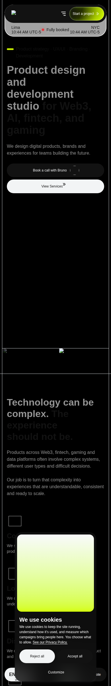

# UI Design System & Master Generation Blueprint: www-allerstudio-com

> **ALLER Studio — Product design and development studio** (https://www.allerstudio.com/) — Product design and development studio for Web3, AI, fintech, and gaming.


---

## 1. Executive Visual Persona & Design Archetype

- **Brand Essence & Persona**: **ALLER Studio — Product design and development studio** (`https://www.allerstudio.com/`). Product design and development studio for Web3, AI, fintech, and gaming.
- **Visual Archetype**: **Dark-Substrate WebGL / Canvas Interactive Experience (`#000` / `#646aed`)**.
- **Anti-AI-Slop Differentiators**:
  - **Source-Grounded Chromatic Polarity**: Anchors the viewport in `#000` (`var(--color-black)` in `:root`) paired with `#fff` primary typography and `#646aed` accents.
  - **Extracted Typographic Hierarchy**: Pairs `Inter` for display copy (`Product design and development studi`) with `Inter Fallback` and `SFMono-Regular`.
  - **Calibrated Spatial Grid & Motion**: Combines `121px` container bounds (`gap: 4px`, padding `var(--btn-px)`) with `cubic-bezier(.16,1,.3,1)` easing and Framer Motion Layout Physics, HTML5 `<canvas>` Interactive Viewport Surface.

---

## 2. Spatial Architecture & Modular Grid Mathematics



### Viewport Allocation & Container Geometry
- **Captured Viewport Dimensions**: Desktop `1440×2400px` (`assets/desktop.png`, capped at 2400px multi-section capture), Mobile `390×2400px` (`assets/mobile.png`, capped at 2400px multi-section capture).
- **Master Container Bounds**: `121px` extracted from `www-allerstudio-com` stylesheet.
- **Canvas Lateral Padding & Spacing**: `var(--btn-px)` lateral canvas padding with `4px` grid gap.
- **Border Radius Scale**: `50%`, `16px`, `44px`, `999px`.

### Responsive Breakpoint Architecture
- **Desktop Layout**: Multi-column CSS Grid / Flexbox layout at `1440px` (`max-width: 121px`, `gap: 4px`).
- **Mobile Layout**: Single-column vertical stack at `390px` viewport width with `var(--btn-px)` horizontal padding.
- **Extracted CSS Media Queries**: `@media (prefers-reduced-motion:reduce)`, `@media (min-width:40rem)`, `@media (min-width:48rem)`, `@media (min-width:64rem)`.

---

## 3. Color System, Materiality & Atmospheric Lighting

### Semantic Palette & Source Grounding
| Semantic Role | Ground-Truth Value | Extracted CSS Source / Selector |
|---|---|---|
| **Primary Canvas Substrate** | `#000` | `var(--color-black)` in `:root` |
| **Primary Typography Ink** | `#fff` | `var(--color-white)` in `:root` |
| **Elevated Surface / Card Substrate** | `#d5fe00` | `var(--color-lime)` in `:root` |
| **Interactive Accent / Highlight** | `#646aed` | `var(--color-violet)` in `:root` |
| **Secondary / Muted Copy** | `#fc4b08` | `var(--color-orange)` in `:root` |
| **Structural Hairline Border** | `#121212` | `var(--color-dark-950)` in `:root` |

### Sanitized Root CSS Variables (`ui-ux.md` Ground Truth)
| Variable Name | Extracted Value | Semantic Role |
|---|---|---|
| `--ease-out` | `cubic-bezier(.16, 1, .3, 1)` | Motion / Easing Token |
| `--ease-in-out` | `cubic-bezier(.37, 0, .63, 1)` | Motion / Easing Token |
| `--active` | `0` | Design System Custom Token |
| `--font-inter` | `"Inter", "Inter Fallback"` | Typography / Scale Token |
| `--font-rajdhani` | `"Rajdhani", "Rajdhani Fallback"` | Typography / Scale Token |
| `--font-sans` | `var(--font-inter), "Helvetica Neue", Arial, sans-serif` | Typography / Scale Token |
| `--color-black` | `#000` | Canvas / Surface Token |
| `--color-white` | `#fff` | Canvas / Surface Token |
| `--spacing` | `.25rem` | Layout / Spatial Grid Token |
| `--text-xs` | `.75rem` | Typography Ink Token |
| `--text-xs--line-height` | `calc(1 / .75)` | Typography Ink Token |
| `--text-sm` | `.875rem` | Typography Ink Token |
| `--text-sm--line-height` | `calc(1.25 / .875)` | Typography Ink Token |
| `--text-base` | `1rem` | Typography Ink Token |
| `--text-base--line-height` | `calc(1.5 / 1)` | Typography Ink Token |
| `--text-lg` | `1.125rem` | Typography Ink Token |

---

## 4. Typographic Scale & Editorial Hierarchy

### Font Family Stacks
- **Display Typography**: `Inter`.
- **Primary Body Stack**: `Inter Fallback`.
- **Technical / Metadata Stack**: `SFMono-Regular`.

### Typographic Scale & Rules (Extracted from Stylesheet & Variables)
- **Hero Display (`H1`)**: CSS variables `--text-5xl: 3rem`, `--text-5xl--line-height: 1`, `--font-display: var(--font-rajdhani), "Arial Narrow", sans-serif`.
- **Section Heading (`H2`)**: CSS variables `--text-2xl: 1.5rem`, `--text-2xl--line-height: calc(2 / 1.5)`, `--color-text-subtitle: #4e5964`.
- **Body Copy**: CSS variables `--text-base: 1rem`, `--text-base--line-height: calc(1.5 / 1)`.
- **Metadata & Navigation Labels**: CSS variables `--text-xs: .75rem`, `--text-xs--line-height: calc(1 / .75)`, `--text-sm: .875rem`.

---

## 5. Choreographed Motion & Interaction Physics

### Primary Easing Curves
- **Extracted Timing Functions**: `cubic-bezier(.16,1,.3,1)`, `cubic-bezier(.37,0,.63,1)`, `cubic-bezier(0,0,.2,1)`.

### Per-Element Transition & Choreography Rules
- **Selector `._3N0scq_progress`**: `transition: stroke-dashoffset var(--travel) var(--ease-in-out)` extracted from `www-allerstudio-com` stylesheet.
- **Selector `scq_board[data-resetting] ._3N0sc...`**: `transition: opacity .5s var(--ease-in-out)` extracted from `www-allerstudio-com` stylesheet.
- **Selector `._3N0scq_nodeOn`**: `transition: opacity .35s var(--ease-out), transform .5s var(--ease-out)` extracted from `www-allerstudio-com` stylesheet.
- **Extracted Easing Curve (`cubic-bezier(.16,1,.3,1)`)**: Governs interactive state transitions across `<header.header-in>` and `<section.relative>`.
- **Runtime Interaction Engine**: Integrates Framer Motion Layout Physics, HTML5 `<canvas>` Interactive Viewport Surface with `prefers-reduced-motion: reduce` fallback guards.

---

## 6. Component Wireframe & Structural DOM Map

### Visual Layout Schematic (Grounded in `dom.html` — `1440px` Desktop & `390px` Mobile Reflow)
```
┌────────────────────────────────────────────────────────────────────────┐
│ DESKTOP VIEWPORT (1440px) — ALLER Studio — Product design and developm │
│ ====================================================================== │
│ [ <header.header-in>       | Services · Case Studies · Studio · Ins ]  │
│ ---------------------------------------------------------------------- │
│ | HERO STAGE: <section.relative>                                   |   │
│ | H1: Product design and development studio for Web3, A...         |   │
│ | Substrate: #000       | Ink: #fff       | Accent: #646aed        |   │
│ ---------------------------------------------------------------------- │
│ | SHOWCASE GRID (<section.relative>        ) max-w: 121px          |   │
│ | +------------------------------+  +------------------------------+ | │
│ | | Technology can be complex. T |  | Complex flows                | | │
│ | +------------------------------+  +------------------------------+ | │
│ ---------------------------------------------------------------------- │
│ | MOBILE VIEWPORT REFLOW (390px) — Single-Column Stack (gap: 4px   ) | │
│ | [<header.header-in>] -> [<section.relative>] -> [<section.relative>] │
│ ---------------------------------------------------------------------- │
│ [ FOOTER (<footer.relative>     ) | https://www.allerstudio.com/       │
└────────────────────────────────────────────────────────────────────────┘
```

### Granular DOM Region Breakdown
1. **Brand Header & Navigation Bar (<header.header-in> — `www-allerstudio-com`)**:
   - Landmark `<header class="header-in fixed">` hosting `ALLER Studio — Product design and de` navigation (`Services · Case Studies · Studio · Insights · Contact`), DOM attributes (`data-precedence="next"`, `data-precedence="next"`, `data-precedence="next"`, `data-sdkn="@vercel/analytics/next"`), and stylesheet rule `._3N0scq_board { width:954px;height:594px;transform:scale(var(--s,1));transform-origin:0... }`.
2. **Hero Stage & Focal Lead (<section.relative> — `Product design and development stu`)**:
   - Landmark `<section class="relative pt-40">` presenting display lead `Product design and development studio for Web3, A...` and copy excerpt *"Lima · 10:44 AM UTC-5"* over `#000` canvas and `#fff` ink.
3. **Primary Showcase & Content Grid (<section.relative> — `Technology can be complex. The exp`)**:
   - Landmark `<section class="relative px-4">` rendering section `Technology can be complex. The experience should...` with copy *"Fully booked · Next slot Q1 2027"*, asset references (`3206eb66b875a5b3-s.p.3gjg6tthudz5...`, `83afe278b6a6bb3c-s.p.45535valc9rz...`, `a079e02bba5bf7ab-s.p.2yv0x3fl1lx-...`, `a10c617c9026098c-s.p.1a-q6cj6za4e...`), and grid rule `._3N0scq_svg { pointer-events:none;position:absolute;inset:0;overflow:visible }`.
4. **Interactive Detail & Feature Matrix (<section.relative> — `Complex flows`)**:
   - Landmark `<section class="relative px-4">` framing `Complex flows` and `Low user trust` (*"· Next slot Q1 2027"*) with `#d5fe00` surface cards, `#646aed` accents, and `._3N0scq_progress { stroke-dasharray:1 1;stroke-dashoffset:1px;opacity:1;transition:stroke-d... }`.
5. **Colophon & Global Directory Footer (<footer.relative> — `https://www.allerstudio.com/`)**:
   - Landmark `<footer class="relative z-42">` anchoring `ALLER Studio — Product design an` footer links (`Services · Case Studies · Studio · Insights · Contact`), copy *"NYC · 10:44 AM UTC-5"*, and `#121212` structural dividers.

---

## 7. Master Zero-Shot AI Generation Prompt

```markdown
# Master Zero-Shot Frontend Generation Prompt: www-allerstudio-com (ALLER Studio — Product design and development studio)

You are a principal frontend architect and design systems engineer. Build a complete, production-ready web application replicating the exact design system, DOM landmarks, typographic hierarchy, color tokens, and motion physics of `www-allerstudio-com` (**ALLER Studio — Product design and development studio** — `https://www.allerstudio.com/`).

### 1. Visual Archetype & Anti-AI-Slop Mandates
- **Archetype**: Dark-Substrate WebGL / Canvas Interactive Experience (`#000` / `#646aed`).
- **Identity & Domain Context**: Product design and development studio for Web3, AI, fintech, and gaming.
- **Primary Substrate**: `#000` (`var(--color-black)` in `:root`), **Primary Ink**: `#fff`, **Accent / Highlight**: `#646aed`.
- **Site-Specific Differentiators**:
  - **Source-Grounded Chromatic Polarity**: Anchors the viewport in `#000` (`var(--color-black)` in `:root`) paired with `#fff` primary typography and `#646aed` accents.
  - **Extracted Typographic Hierarchy**: Pairs `Inter` for display copy (`Product design and development studi`) with `Inter Fallback` and `SFMono-Regular`.
  - **Calibrated Spatial Grid & Motion**: Combines `121px` container bounds (`gap: 4px`, padding `var(--btn-px)`) with `cubic-bezier(.16,1,.3,1)` easing and Framer Motion Layout Physics, HTML5 `<canvas>` Interactive Viewport Surface.

### 2. Ground-Truth CSS Variables (`:root` Token Contract)
Declare and consume these exact custom properties extracted from `www-allerstudio-com` in your global stylesheet:

:root {
  /* ALLER Studio — Product design and development studio (www-allerstudio-com) — Ground-Truth Extracted CSS Variables */
  --ease-out: cubic-bezier(.16, 1, .3, 1); /* Motion / Easing Token (www-allerstudio-com) */
  --ease-in-out: cubic-bezier(.37, 0, .63, 1); /* Motion / Easing Token (www-allerstudio-com) */
  --active: 0; /* Design System Custom Token (www-allerstudio-com) */
  --font-inter: "Inter", "Inter Fallback"; /* Typography / Scale Token (www-allerstudio-com) */
  --font-rajdhani: "Rajdhani", "Rajdhani Fallback"; /* Typography / Scale Token (www-allerstudio-com) */
  --font-sans: var(--font-inter), "Helvetica Neue", Arial, sans-serif; /* Typography / Scale Token (www-allerstudio-com) */
  --color-black: #000; /* Canvas / Surface Token (www-allerstudio-com) */
  --color-white: #fff; /* Canvas / Surface Token (www-allerstudio-com) */
  --spacing: .25rem; /* Layout / Spatial Grid Token (www-allerstudio-com) */
  --text-xs: .75rem; /* Typography Ink Token (www-allerstudio-com) */
  --text-xs--line-height: calc(1 / .75); /* Typography Ink Token (www-allerstudio-com) */
  --text-sm: .875rem; /* Typography Ink Token (www-allerstudio-com) */
  --text-sm--line-height: calc(1.25 / .875); /* Typography Ink Token (www-allerstudio-com) */
  --text-base: 1rem; /* Typography Ink Token (www-allerstudio-com) */
  --text-base--line-height: calc(1.5 / 1); /* Typography Ink Token (www-allerstudio-com) */
  --text-lg: 1.125rem; /* Typography Ink Token (www-allerstudio-com) */
}

### 3. Semantic Color & Materiality Contract
Map every surface, ink, and border strictly to these source-grounded tokens:
- **Primary Canvas Substrate**: `#000` — grounded in `var(--color-black)` in `:root`
- **Primary Typography Ink**: `#fff` — grounded in `var(--color-white)` in `:root`
- **Elevated Surface / Card Substrate**: `#d5fe00` — grounded in `var(--color-lime)` in `:root`
- **Interactive Accent / Highlight**: `#646aed` — grounded in `var(--color-violet)` in `:root`
- **Secondary / Muted Copy**: `#fc4b08` — grounded in `var(--color-orange)` in `:root`
- **Structural Hairline Border**: `#121212` — grounded in `var(--color-dark-950)` in `:root`

### 4. Spatial Grid, Container Bounds & Responsive Breakpoints
- **Desktop Viewport Reference**: `1440×2400px` (capped at 2400px multi-section capture, `1440px` standard desktop width).
- **Mobile Viewport Reference**: `390×2400px` (capped at 2400px multi-section capture, `390px` standard mobile width).
- **Container Max-Width**: `121px` extracted from `www-allerstudio-com` stylesheet
- **Padding & Gutters**: `var(--btn-px)` lateral canvas padding with `4px` grid gap
- **Desktop Grid**: Multi-column CSS Grid / Flexbox layout at `1440px` (`max-width: 121px`, `gap: 4px`)
- **Mobile Adaptation**: Single-column vertical stack at `390px` viewport width with `var(--btn-px)` horizontal padding
- **Media Queries**: `@media (prefers-reduced-motion:reduce)`, `@media (min-width:40rem)`, `@media (min-width:48rem)`, `@media (min-width:64rem)`
- **Corner Radii**: `50%`, `16px`, `44px`, `999px`

### 5. Typography & Editorial Scale Contract
- **Display Font Stack**: `Inter`
- **Body Font Stack**: `Inter Fallback`
- **Monospace / Technical Font Stack**: `SFMono-Regular`
- **H1 Display Rule**: CSS variables `--text-5xl: 3rem`, `--text-5xl--line-height: 1`, `--font-display: var(--font-rajdhani), "Arial Narrow", sans-serif`
- **H2 Section Rule**: CSS variables `--text-2xl: 1.5rem`, `--text-2xl--line-height: calc(2 / 1.5)`, `--color-text-subtitle: #000`
- **Body Copy Rule**: CSS variables `--text-base: 1rem`, `--text-base--line-height: calc(1.5 / 1)`
- **Metadata & Index Rule**: CSS variables `--text-xs: .75rem`, `--text-xs--line-height: calc(1 / .75)`, `--text-sm: .875rem`

### 6. Component Hierarchy, Verbatim Copy & Real DOM Landmarks
Scaffold `www-allerstudio-com` (`ALLER Studio — Product design and development studio`) with these exact structural regions, extracted copy, and CSS rules from `dom.html`:
1. **Brand Header & Navigation Bar (<header.header-in> — `www-allerstudio-com`)**:
   - DOM & Selectors: Landmark `<header class="header-in fixed">` hosting `ALLER Studio — Product design and de` navigation (`Services · Case Studies · Studio · Insights · Contact`), DOM attributes (`data-precedence="next"`, `data-precedence="next"`, `data-precedence="next"`, `data-sdkn="@vercel/analytics/next"`), and stylesheet rule `._3N0scq_board { width:954px;height:594px;transform:scale(var(--s,1));transform-origin:0... }`.
   - Responsive Contract: Header `Brand Header & Navigation Bar (<header.header-in> — `www-allerstudio-com`)` (`www-allerstudio-com`) adapts across `@media (prefers-reduced-motion:reduce)`, `@media (min-width:40rem)`, `@media (min-width:48rem)`, `@media (min-width:64rem)` with `cubic-bezier(.16,1,.3,1)`, `cubic-bezier(.37,0,.63,1)`, `cubic-bezier(0,0,.2,1)` transitions and links `Services · Case Studies · Studio · Insights · Contact`.
2. **Hero Stage & Focal Lead (<section.relative> — `Product design and development stu`)**:
   - DOM & Selectors: Landmark `<section class="relative pt-40">` presenting display lead `Product design and development studio for Web3, A...` and copy excerpt *"Lima · 10:44 AM UTC-5"* over `#000` canvas and `#fff` ink.
   - Responsive Contract: Hero stage (`1440×2400px` desktop / `390×2400px` mobile) sets `#000` background with `#fff` headline `Product design and development studio for Web3, A...`.
3. **Primary Showcase & Content Grid (<section.relative> — `Technology can be complex. The exp`)**:
   - DOM & Selectors: Landmark `<section class="relative px-4">` rendering section `Technology can be complex. The experience should...` with copy *"Fully booked · Next slot Q1 2027"*, asset references (`3206eb66b875a5b3-s.p.3gjg6tthudz5...`, `83afe278b6a6bb3c-s.p.45535valc9rz...`, `a079e02bba5bf7ab-s.p.2yv0x3fl1lx-...`, `a10c617c9026098c-s.p.1a-q6cj6za4e...`), and grid rule `._3N0scq_svg { pointer-events:none;position:absolute;inset:0;overflow:visible }`.
   - Responsive Contract: Showcase grid `Primary Showcase & Content Grid (<section.relative> — `Technology can be complex. The exp`)` applies Multi-column CSS Grid / Flexbox layout at `1440px` (`max-width: 121px`, `gap: 4px`) on desktop and Single-column vertical stack at `390px` viewport width with `var(--btn-px)` horizontal padding on mobile.
4. **Interactive Detail & Feature Matrix (<section.relative> — `Complex flows`)**:
   - DOM & Selectors: Landmark `<section class="relative px-4">` framing `Complex flows` and `Low user trust` (*"· Next slot Q1 2027"*) with `#d5fe00` surface cards, `#646aed` accents, and `._3N0scq_progress { stroke-dasharray:1 1;stroke-dashoffset:1px;opacity:1;transition:stroke-d... }`.
   - Responsive Contract: Detail module `Interactive Detail & Feature Matrix (<section.relative> — `Complex flows`)` uses `50%`, `16px`, `44px`, `999px` radii, `#646aed` highlights, and assets (3206eb66b875a5b3-s.p.3gjg6tthudz5..., 83afe278b6a6bb3c-s.p.45535valc9rz..., a079e02bba5bf7ab-s.p.2yv0x3fl1lx-...).
5. **Colophon & Global Directory Footer (<footer.relative> — `https://www.allerstudio.com/`)**:
   - DOM & Selectors: Landmark `<footer class="relative z-42">` anchoring `ALLER Studio — Product design an` footer links (`Services · Case Studies · Studio · Insights · Contact`), copy *"NYC · 10:44 AM UTC-5"*, and `#121212` structural dividers.
   - Responsive Contract: Footer `Colophon & Global Directory Footer (<footer.relative> — `https://www.allerstudio.com/`)` aligns to `121px` extracted from `www-allerstudio-com` stylesheet with `var(--btn-px)` lateral canvas padding with `4px` grid gap and attributes (data-precedence="next", data-precedence="next", data-precedence="next").

#### Verbatim DOM Copy Excerpts (`dom.html`)
- Copy Excerpt 1: *"Lima · 10:44 AM UTC-5"*
- Copy Excerpt 2: *"Fully booked · Next slot Q1 2027"*
- Copy Excerpt 3: *"· Next slot Q1 2027"*
- Copy Excerpt 4: *"NYC · 10:44 AM UTC-5"*

### 7. Motion, Extracted Stylesheet Rules & Interaction Choreography
- **Primary Easing Functions**: `cubic-bezier(.16,1,.3,1)`, `cubic-bezier(.37,0,.63,1)`, `cubic-bezier(0,0,.2,1)`
- **Extracted Stylesheet Rules (`www-allerstudio-com`)**:
- `._3N0scq_board { width:954px;height:594px;transform:scale(var(--s,1));transform-origin:0... }`
- `._3N0scq_svg { pointer-events:none;position:absolute;inset:0;overflow:visible }`
- `._3N0scq_progress { stroke-dasharray:1 1;stroke-dashoffset:1px;opacity:1;transition:stroke-d... }`
- `._3N0scq_node { z-index:2;width:24px;height:24px;position:absolute }`
- `._3N0scq_node img { width:100%;height:100%;position:absolute;inset:0 }`
- **Per-Selector Transition Rules**:
- **Selector `._3N0scq_progress`**: `transition: stroke-dashoffset var(--travel) var(--ease-in-out)` extracted from `www-allerstudio-com` stylesheet.
- **Selector `scq_board[data-resetting] ._3N0sc...`**: `transition: opacity .5s var(--ease-in-out)` extracted from `www-allerstudio-com` stylesheet.
- **Selector `._3N0scq_nodeOn`**: `transition: opacity .35s var(--ease-out), transform .5s var(--ease-out)` extracted from `www-allerstudio-com` stylesheet.
- **Extracted Easing Curve (`cubic-bezier(.16,1,.3,1)`)**: Governs interactive state transitions across `<header.header-in>` and `<section.relative>`.
- **Runtime Interaction Engine**: Integrates Framer Motion Layout Physics, HTML5 `<canvas>` Interactive Viewport Surface with `prefers-reduced-motion: reduce` fallback guards.

### 8. Technical Deliverables
- Implement in Next.js (App Router) with TypeScript and Tailwind CSS consuming the `:root` custom properties defined above for `www-allerstudio-com`.
- Reproduce both the `1440px` desktop architecture and `390px` mobile breakpoint transitions, preserving semantic HTML5 landmarks (`<header>`, `<nav>`, `<main>`, `<section>`, `<footer>`) and `prefers-reduced-motion` accessibility guards.
```
