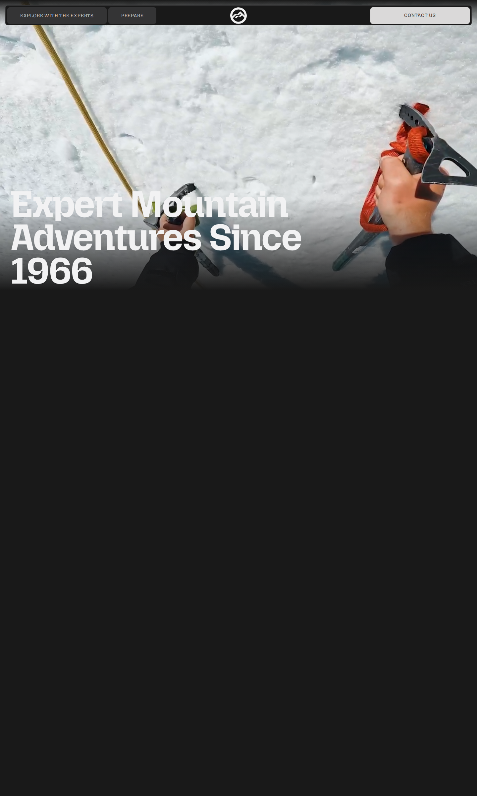
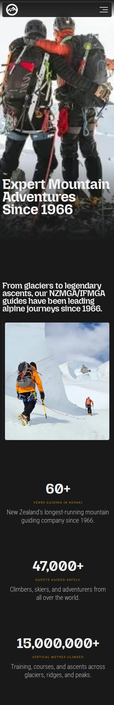

# UI Design System & Master Generation Blueprint: www-alpineguides-co-nz

> **Alpine Guides Aoraki · NZ Mountain Guiding Since 1966** (https://www.alpineguides.co.nz/) — Explore guided ascents, mountaineering courses, ski touring, Tasman Glacier heli-hike and alpine adventures in Aoraki/Mount Cook with pro...



---

## 1. Executive Visual Persona & Design Archetype

- **Brand Essence & Persona**: **Alpine Guides Aoraki · NZ Mountain Guiding Since 1966** (`https://www.alpineguides.co.nz/`). Explore guided ascents, mountaineering courses, ski touring, Tasman Glacier heli-hike and alpine adventures in Aoraki/Mount Cook with pro...
- **Capture Provenance**: Live browser capture (`tier1_fast`, HTTP `200`, captured `2026-11-23`).
- **Visual Archetype**: **High-Contrast Obsidian / Atmospheric Design System (`#191919` canvas, `#f2f2f3` ink, `#ffcc00` accent)**.
- **Anti-AI-Slop Differentiators**:
  - **Live-Computed Chromatic Polarity**: Anchors the viewport in `#191919` (live computed `body` `background-color` (`computed_styles.json`)) paired with `#f2f2f3` primary typography and `#ffcc00` accents.
  - **Grounded Typographic Hierarchy**: Pairs `Mozillaheadline Variablefont Wdth Wght` for display copy (`Expert Mountain Adventures Since 196`) with `Helvetica Neue` and not declared in live computed styles (uses primary stack / `ui-monospace`).
  - **Calibrated Spatial Grid & Motion**: Combines `1392px` container bounds (`gap: 16px`, padding `9px`) with `cubic-bezier(.49,.78,.46,1.34)` easing and GSAP Timeline & ScrollTrigger, Three.js / WebGL Canvas Pipeline.

---

## 2. Spatial Architecture & Modular Grid Mathematics



### Viewport Allocation & Container Geometry
- **Captured Viewport Dimensions**: Desktop `1440×2400px` (`assets/desktop.png`, clamped at 2400px live multi-section capture), Mobile `390×2400px` (`assets/mobile.png`, clamped at 2400px live multi-section capture).
- **Master Container Bounds**: `1392px` (measured widest bounded `<section>` landmark width on `1440px` desktop).
- **Canvas Lateral Padding & Spacing**: `9px` lateral canvas padding with `16px` grid gap.
- **Border Radius Scale**: `8px`, `7px`, `3px`, `100%`.

### Responsive Breakpoint Architecture
- **Desktop Layout**: Multi-column CSS Grid / Flexbox layout at `1440px` (`max-width: 1392px`, `gap: 16px`).
- **Mobile Layout**: Single-column vertical stack at `390px` viewport width with `9px` horizontal padding.
- **Extracted CSS Media Queries**: `@media screen and (max-width: 991px)`, `@media screen and (max-width: 767px)`, `@media screen and (max-width: 479px)`, `@media (min-width: 768px)`.

---

## 3. Color System, Materiality & Atmospheric Lighting

### Semantic Palette & Source Grounding
| Semantic Role | Ground-Truth Value | Extracted Live / CSS Source |
|---|---|---|
| **Primary Canvas Substrate** | `#191919` | live computed `body` `background-color` (`computed_styles.json`) |
| **Primary Typography Ink** | `#f2f2f3` | live computed `h1` `color` (`computed_styles.json`) |
| **Elevated Surface / Card Substrate** | `#343435` | live computed `a` `background-color` (`computed_styles.json`) |
| **Interactive Accent / Highlight** | `#ffcc00` | `crubber-button.ytp-swatch-backg... { background-color: #ffcc00 }` |
| **Secondary / Muted Copy** | `#333333` | live computed `footer` `color` (`computed_styles.json`) |
| **Structural Hairline Border** | `#3898ec` | `.w-select:focus { border-color: #3898ec }` |
| **Variable Token (`--_theme---agl-gold`)** | `#fcb124` | `var(--_theme---agl-gold)` in `:root` |
| **Variable Token (`--_theme---carbon`)** | `#1e1e1e` | `var(--_theme---carbon)` in `:root` |

### Sanitized Root CSS Variables (`ui-ux.md` Ground Truth)
| Variable Name | Extracted Value | Semantic Role |
|---|---|---|
| `--_text-syle---font-family` | `Robotocondensed, Arial, sans-serif` | Typography Ink Token |
| `--_theme---color--heading` | `var(--_theme---white)` | Typography Ink Token |
| `--_responsive---h1` | `7rem` | Typography / Scale Token |
| `--_text-syle---line-height` | `1.25` | Typography Ink Token |
| `--_text-syle---font-weight` | `200` | Typography Ink Token |
| `--_text-syle---letter-spacing` | `0rem` | Typography Ink Token |
| `--_responsive---h2` | `3rem` | Typography / Scale Token |
| `--_theme---color--eyebrow` | `var(--_theme---agl-gold)` | Brand / Palette Token |
| `--_text-syle---text-size` | `var(--_responsive---paragraph)` | Typography Ink Token |
| `--_theme---color--text` | `var(--_theme---white)` | Typography Ink Token |
| `--_responsive---paragraph` | `1.4rem` | Typography / Scale Token |
| `--_theme---agl-gold` | `#fcb124` | Brand / Palette Token |
| `--_theme---color--border` | `var(--_theme---ash)` | Brand / Palette Token |
| `--_theme---color--background` | `var(--_theme---black)` | Canvas / Surface Token |
| `--_theme---white` | `#f2f2f3` | Canvas / Surface Token |
| `--_theme---carbon` | `#1e1e1e` | Brand / Palette Token |

---

## 4. Typographic Scale & Editorial Hierarchy

### Font Family Stacks
- **Display Typography**: `Mozillaheadline Variablefont Wdth Wght`.
- **Primary Body Stack**: `Helvetica Neue`.
- **Technical / Metadata Stack**: not declared in live computed styles (uses primary stack / `ui-monospace`).

### Typographic Scale & Rules (Live Computed & Stylesheet Grounded)
- **Hero Display (`H1`)**: live computed `h1` (`font-size: 112px`, `line-height: 100.8px`, `font-weight: 800`, `letter-spacing: -3.2px`); CSS variables `--_responsive---h1: 7rem`, `--_responsive---h1-line-height: .5rem`; rule `h1` (`font-size: 2em`).
- **Section Heading (`H2`)**: live computed `h2` (`font-size: 48px`, `line-height: 43.2px`, `font-weight: 600`, `letter-spacing: -0.96px`); CSS variables `--_responsive---h2: 3rem`; rule `h2` (`font-size: 32px`, `line-height: 36px`).
- **Body Copy**: live computed `body` (`font-size: 14px`, `line-height: 20px`, `font-weight: 400`); CSS variables `--_responsive---paragraph: 1.4rem`, `--_responsive---paragraph_small: 1rem`; rule `body` (`font-size: 14px`, `line-height: 20px`).
- **Metadata & Navigation Labels**: live computed `nav/a` (`font-size: 14.4px`, `line-height: 15px`, `font-weight: 200`, `letter-spacing: 0.8px`); CSS variables `--_text-syle---letter-spacing: 0rem`, `--_responsive---spacer-small: .7rem`, `--_responsive---paragraph_small: 1rem`; rule `small` (`font-size: 80%`).

---

## 5. Choreographed Motion & Interaction Physics

### Primary Easing Curves
- **Extracted Timing Functions**: `cubic-bezier(.49,.78,.46,1.34)`, `cubic-bezier(0,0,.2,1)`, `cubic-bezier(.4,0,1,1)`.

### Per-Element Transition & Choreography Rules
- **Selector `.w-webflow-badge > img`**: `transition: unset` extracted from `www-alpineguides-co-nz` stylesheet.
- **Selector `.w-slider-dot`**: `transition: background-color .1s, color .1s` extracted from `www-alpineguides-co-nz` stylesheet.
- **Selector `.w-lightbox-control`**: `transition: all .3s` extracted from `www-alpineguides-co-nz` stylesheet.
- **Extracted Easing Curve (`cubic-bezier(.49,.78,.46,1.34)`)**: Governs interactive state transitions across `<header.w-mod-js>` and `<section.prepare-mega>`.
- **Runtime Interaction Engine**: Integrates GSAP Timeline & ScrollTrigger, Three.js / WebGL Canvas Pipeline, Swiper Touch Carousel Engine, Lottie Vector Animation Player with `prefers-reduced-motion: reduce` fallback guards.

---

## 6. Component Wireframe & Structural DOM Map

### Visual Layout Schematic — Desktop (`1440px`, Grounded in `dom.html` & Landmark Bounding Boxes)
```
┌────────────────────────────────────────────────────────────────────────┐
│ DESKTOP VIEWPORT (1440px) — Alpine Guides Aoraki · NZ Mountain Guiding │
│ ====================================================================== │
│ [ <header.w-mod-js> (1440px)          | prepare · contact us · alpin ] │
│ ---------------------------------------------------------------------- │
│ | HERO STAGE: <section.explore-mega> (w=1440px)                      | │
│ | H1: Expert Mountain Adventures Since 1966                          | │
│ | Substrate: #191919 | Ink: #f2f2f3 | Accent: #ffcc00                | │
│ ---------------------------------------------------------------------- │
│ | SHOWCASE GRID (<section.prepare-mega>) max-w: 1392px               | │
│ | +------------------------------+  +------------------------------+ | │
│ | | Alpine Guides offers unmatch |  | A spectacular heli-hike expe | | │
│ | +------------------------------+  +------------------------------+ | │
│ ---------------------------------------------------------------------- │
│ | DETAIL MODULE (<section.c-hero>) — A 7-day intermediate-           | │
│ ---------------------------------------------------------------------- │
│ [ FOOTER (<footer.footer>     ) | https://www.alpineguides.co.nz/      │
└────────────────────────────────────────────────────────────────────────┘
```

### Visual Layout Schematic — Mobile Reflow (`390px`)
```
┌────────────────────────────────────────────────────────────────────────┐
│ MOBILE VIEWPORT REFLOW (390px) — Single-Column Stack (gap: 16px)       │
│ ====================================================================== │
│ [ HEADER BAR (<header.w-mod-js>       ) | Compact Menu (390px)         │
│ ---------------------------------------------------------------------- │
│ | HERO STAGE (<section.explore-mega>) — 390px Vertical Lead          | │
│ | H1: Expert Mountain Adventures Since 1966                          | │
│ ---------------------------------------------------------------------- │
│ | SHOWCASE STACK (<section.prepare-mega>) — 1-Col Stack              | │
│ | [ Item 1: Alpine Guides offers unmatched access to the vas       ] | │
│ | [ Item 2: A spectacular heli-hike experience exploring the       ] | │
│ ---------------------------------------------------------------------- │
│ | DETAIL STACK (<section.c-hero>) — 1-Col (A 7-day intermedia)       | │
│ ---------------------------------------------------------------------- │
│ [ FOOTER (<footer.footer>     ) | Stacked 390px Colophon               │
└────────────────────────────────────────────────────────────────────────┘
```

### Granular DOM Region Breakdown
1. **Brand Header & Navigation Bar (<header.w-mod-js> — `www-alpineguides-co-nz`)**:
   - Landmark `<header class="w-mod-js">` (`1440px`) hosting `Alpine Guides Aoraki · NZ Mountain G` navigation (`prepare · contact us · alpine hiking · learn the ropes · guided ascents`), DOM attributes (`data-wf-domain="www.alpineguides.co.nz"`, `data-wf-page="6948a91537f8a4167b84e785"`, `data-wf-site="6948a91537f8a4167b84e770"`, `data-styled="active"`), and stylesheet rule `html { -webkit-text-size-adjust: 100%; -ms-text-size-adjust: 100%; font-family:... }`.
2. **Hero Stage & Focal Lead (<section.explore-mega> — `Expert Mountain Adventures Since 1`)**:
   - Landmark `<section class="explore-mega">` presenting display lead `Expert Mountain Adventures Since 1966` and copy excerpt *"Alpine Guides offers unmatched access to the vast mountain playgr"* over `#191919` canvas and `#f2f2f3` ink.
3. **Primary Showcase & Content Grid (<section.prepare-mega> — `Alpine Guides offers unmatched acc`)**:
   - Landmark `<section class="prepare-mega">` rendering section `Alpine Guides offers unmatched access to the vas` with copy *"A spectacular heli-hike experience exploring the white ice of New"*, asset references (`cdn.prod.website-files.com`, `alpine-guides.webflow.shared.ac09...`, `www-widgetapi.js`, `recaptcha__en.js`), and grid rule `body { margin: 0; }`.
4. **Interactive Detail & Feature Matrix (<section.c-hero> — `A spectacular heli-hike experience`)**:
   - Landmark `<section class="c-hero">` framing `A spectacular heli-hike experience exploring the` and `A 7-day intermediate-level course teaching an in` (*"A 7-day intermediate-level course teaching an introduction to mod"*) with `#343435` surface cards, `#ffcc00` accents, and `summary { display: block; }`.
5. **Colophon & Global Directory Footer (<footer.footer> — `https://www.alpineguides.co.nz/`)**:
   - Landmark `<footer class="footer">` anchoring `Alpine Guides Aoraki · NZ Mounta` footer links (`prepare · contact us · alpine hiking · learn the ropes · guided ascents`), copy *"A tailor-made package for bespoke mountaineering and ski tou"*, and `#3898ec` structural dividers.

---

## 7. Master Zero-Shot AI Generation Prompt

```markdown
# Master Zero-Shot Frontend Generation Prompt: www-alpineguides-co-nz (Alpine Guides Aoraki · NZ Mountain Guiding Since 1966)

You are a principal frontend architect and design systems engineer. Build a complete, production-ready web application replicating the exact design system, DOM landmarks, typographic hierarchy, color tokens, and motion physics of `www-alpineguides-co-nz` (**Alpine Guides Aoraki · NZ Mountain Guiding Since 1966** — `https://www.alpineguides.co.nz/`).

### 1. Visual Archetype & Anti-AI-Slop Mandates
- **Archetype**: High-Contrast Obsidian / Atmospheric Design System (`#191919` canvas, `#f2f2f3` ink, `#ffcc00` accent).
- **Identity & Domain Context**: Explore guided ascents, mountaineering courses, ski touring, Tasman Glacier heli-hike and alpine adventures in Aoraki/Mount Cook with pro...
- **Primary Substrate**: `#191919` (live computed `body` `background-color` (`computed_styles.json`)), **Primary Ink**: `#f2f2f3`, **Accent / Highlight**: `#ffcc00`.
- **Site-Specific Differentiators**:
  - **Live-Computed Chromatic Polarity**: Anchors the viewport in `#191919` (live computed `body` `background-color` (`computed_styles.json`)) paired with `#f2f2f3` primary typography and `#ffcc00` accents.
  - **Grounded Typographic Hierarchy**: Pairs `Mozillaheadline Variablefont Wdth Wght` for display copy (`Expert Mountain Adventures Since 196`) with `Helvetica Neue` and not declared in live computed styles (uses primary stack / `ui-monospace`).
  - **Calibrated Spatial Grid & Motion**: Combines `1392px` container bounds (`gap: 16px`, padding `9px`) with `cubic-bezier(.49,.78,.46,1.34)` easing and GSAP Timeline & ScrollTrigger, Three.js / WebGL Canvas Pipeline.

### 2. Ground-Truth CSS Variables (`:root` Token Contract)
Declare and consume these exact custom properties extracted from `www-alpineguides-co-nz` in your global stylesheet:

:root {
  /* Alpine Guides Aoraki · NZ Mountain Guiding Since 1966 (www-alpineguides-co-nz) — Live-Grounded CSS Variables */
  --_text-syle---font-family: Robotocondensed, Arial, sans-serif; /* Typography Ink Token (www-alpineguides-co-nz) */
  --_theme---color--heading: var(--_theme---white); /* Typography Ink Token (www-alpineguides-co-nz) */
  --_responsive---h1: 7rem; /* Typography / Scale Token (www-alpineguides-co-nz) */
  --_text-syle---line-height: 1.25; /* Typography Ink Token (www-alpineguides-co-nz) */
  --_text-syle---font-weight: 200; /* Typography Ink Token (www-alpineguides-co-nz) */
  --_text-syle---letter-spacing: 0rem; /* Typography Ink Token (www-alpineguides-co-nz) */
  --_responsive---h2: 3rem; /* Typography / Scale Token (www-alpineguides-co-nz) */
  --_theme---color--eyebrow: var(--_theme---agl-gold); /* Brand / Palette Token (www-alpineguides-co-nz) */
  --_text-syle---text-size: var(--_responsive---paragraph); /* Typography Ink Token (www-alpineguides-co-nz) */
  --_theme---color--text: var(--_theme---white); /* Typography Ink Token (www-alpineguides-co-nz) */
  --_responsive---paragraph: 1.4rem; /* Typography / Scale Token (www-alpineguides-co-nz) */
  --_theme---agl-gold: #fcb124; /* Brand / Palette Token (www-alpineguides-co-nz) */
  --_theme---color--border: var(--_theme---ash); /* Brand / Palette Token (www-alpineguides-co-nz) */
  --_theme---color--background: var(--_theme---black); /* Canvas / Surface Token (www-alpineguides-co-nz) */
  --_theme---white: #f2f2f3; /* Canvas / Surface Token (www-alpineguides-co-nz) */
  --_theme---carbon: #1e1e1e; /* Brand / Palette Token (www-alpineguides-co-nz) */
}

### 3. Semantic Color & Materiality Contract
Map every surface, ink, and border strictly to these source-grounded tokens:
- **Primary Canvas Substrate**: `#191919` — grounded in live computed `body` `background-color` (`computed_styles.json`)
- **Primary Typography Ink**: `#f2f2f3` — grounded in live computed `h1` `color` (`computed_styles.json`)
- **Elevated Surface / Card Substrate**: `#343435` — grounded in live computed `a` `background-color` (`computed_styles.json`)
- **Interactive Accent / Highlight**: `#ffcc00` — grounded in `crubber-button.ytp-swatch-backg... { background-color: #ffcc00 }`
- **Secondary / Muted Copy**: `#333333` — grounded in live computed `footer` `color` (`computed_styles.json`)
- **Structural Hairline Border**: `#3898ec` — grounded in `.w-select:focus { border-color: #3898ec }`
- **Variable Token (`--_theme---agl-gold`)**: `#fcb124` — grounded in `var(--_theme---agl-gold)` in `:root`
- **Variable Token (`--_theme---carbon`)**: `#1e1e1e` — grounded in `var(--_theme---carbon)` in `:root`

### 4. Spatial Grid, Container Bounds & Responsive Breakpoints
- **Desktop Viewport Reference**: `1440×2400px` (clamped at 2400px live multi-section capture, `1440px` standard desktop width).
- **Mobile Viewport Reference**: `390×2400px` (clamped at 2400px live multi-section capture, `390px` standard mobile width).
- **Container Max-Width**: `1392px` (measured widest bounded `<section>` landmark width on `1440px` desktop)
- **Padding & Gutters**: `9px` lateral canvas padding with `16px` grid gap
- **Desktop Grid**: Multi-column CSS Grid / Flexbox layout at `1440px` (`max-width: 1392px`, `gap: 16px`)
- **Mobile Adaptation**: Single-column vertical stack at `390px` viewport width with `9px` horizontal padding
- **Media Queries**: `@media screen and (max-width: 991px)`, `@media screen and (max-width: 767px)`, `@media screen and (max-width: 479px)`, `@media (min-width: 768px)`
- **Corner Radii**: `8px`, `7px`, `3px`, `100%`

### 5. Typography & Editorial Scale Contract
- **Display Font Stack**: `Mozillaheadline Variablefont Wdth Wght`
- **Body Font Stack**: `Helvetica Neue`
- **Monospace / Technical Font Stack**: not declared in live computed styles (uses primary stack / `ui-monospace`)
- **H1 Display Rule**: live computed `h1` (`font-size: 112px`, `line-height: 100.8px`, `font-weight: 800`, `letter-spacing: -3.2px`); CSS variables `--_responsive---h1: 7rem`, `--_responsive---h1-line-height: .5rem`; rule `h1` (`font-size: 2em`)
- **H2 Section Rule**: live computed `h2` (`font-size: 48px`, `line-height: 43.2px`, `font-weight: 600`, `letter-spacing: -0.96px`); CSS variables `--_responsive---h2: 3rem`; rule `h2` (`font-size: 32px`, `line-height: 36px`)
- **Body Copy Rule**: live computed `body` (`font-size: 14px`, `line-height: 20px`, `font-weight: 400`); CSS variables `--_responsive---paragraph: 1.4rem`, `--_responsive---paragraph_small: 1rem`; rule `body` (`font-size: 14px`, `line-height: 20px`)
- **Metadata & Index Rule**: live computed `nav/a` (`font-size: 14.4px`, `line-height: 15px`, `font-weight: 200`, `letter-spacing: 0.8px`); CSS variables `--_text-syle---letter-spacing: 0rem`, `--_responsive---spacer-small: .7rem`, `--_responsive---paragraph_small: 1rem`; rule `small` (`font-size: 80%`)

### 6. Component Hierarchy, Verbatim Copy & Real DOM Landmarks
Scaffold `www-alpineguides-co-nz` (`Alpine Guides Aoraki · NZ Mountain Guiding Since 1966`) with these exact structural regions, extracted copy, and CSS rules from `dom.html`:
1. **Brand Header & Navigation Bar (<header.w-mod-js> — `www-alpineguides-co-nz`)**:
   - DOM & Selectors: Landmark `<header class="w-mod-js">` (`1440px`) hosting `Alpine Guides Aoraki · NZ Mountain G` navigation (`prepare · contact us · alpine hiking · learn the ropes · guided ascents`), DOM attributes (`data-wf-domain="www.alpineguides.co.nz"`, `data-wf-page="6948a91537f8a4167b84e785"`, `data-wf-site="6948a91537f8a4167b84e770"`, `data-styled="active"`), and stylesheet rule `html { -webkit-text-size-adjust: 100%; -ms-text-size-adjust: 100%; font-family:... }`.
   - Responsive Contract: Header `Brand Header & Navigation Bar (<header.w-mod-js> — `www-alpineguides-co-nz`)` (`www-alpineguides-co-nz`) adapts across `@media screen and (max-width: 991px)`, `@media screen and (max-width: 767px)`, `@media screen and (max-width: 479px)`, `@media (min-width: 768px)` with `cubic-bezier(.49,.78,.46,1.34)`, `cubic-bezier(0,0,.2,1)`, `cubic-bezier(.4,0,1,1)` transitions and links `prepare · contact us · alpine hiking · learn the ropes · guided ascents`.
2. **Hero Stage & Focal Lead (<section.explore-mega> — `Expert Mountain Adventures Since 1`)**:
   - DOM & Selectors: Landmark `<section class="explore-mega">` presenting display lead `Expert Mountain Adventures Since 1966` and copy excerpt *"Alpine Guides offers unmatched access to the vast mountain playgr"* over `#191919` canvas and `#f2f2f3` ink.
   - Responsive Contract: Hero stage (`1440×2400px` desktop / `390×2400px` mobile) sets `#191919` background with `#f2f2f3` headline `Expert Mountain Adventures Since 1966`.
3. **Primary Showcase & Content Grid (<section.prepare-mega> — `Alpine Guides offers unmatched acc`)**:
   - DOM & Selectors: Landmark `<section class="prepare-mega">` rendering section `Alpine Guides offers unmatched access to the vas` with copy *"A spectacular heli-hike experience exploring the white ice of New"*, asset references (`cdn.prod.website-files.com`, `alpine-guides.webflow.shared.ac09...`, `www-widgetapi.js`, `recaptcha__en.js`), and grid rule `body { margin: 0; }`.
   - Responsive Contract: Showcase grid `Primary Showcase & Content Grid (<section.prepare-mega> — `Alpine Guides offers unmatched acc`)` applies Multi-column CSS Grid / Flexbox layout at `1440px` (`max-width: 1392px`, `gap: 16px`) on desktop and Single-column vertical stack at `390px` viewport width with `9px` horizontal padding on mobile.
4. **Interactive Detail & Feature Matrix (<section.c-hero> — `A spectacular heli-hike experience`)**:
   - DOM & Selectors: Landmark `<section class="c-hero">` framing `A spectacular heli-hike experience exploring the` and `A 7-day intermediate-level course teaching an in` (*"A 7-day intermediate-level course teaching an introduction to mod"*) with `#343435` surface cards, `#ffcc00` accents, and `summary { display: block; }`.
   - Responsive Contract: Detail module `Interactive Detail & Feature Matrix (<section.c-hero> — `A spectacular heli-hike experience`)` uses `8px`, `7px`, `3px`, `100%` radii, `#ffcc00` highlights, and assets (cdn.prod.website-files.com, alpine-guides.webflow.shared.ac09..., www-widgetapi.js).
5. **Colophon & Global Directory Footer (<footer.footer> — `https://www.alpineguides.co.nz/`)**:
   - DOM & Selectors: Landmark `<footer class="footer">` anchoring `Alpine Guides Aoraki · NZ Mounta` footer links (`prepare · contact us · alpine hiking · learn the ropes · guided ascents`), copy *"A tailor-made package for bespoke mountaineering and ski tou"*, and `#3898ec` structural dividers.
   - Responsive Contract: Footer `Colophon & Global Directory Footer (<footer.footer> — `https://www.alpineguides.co.nz/`)` aligns to `1392px` (measured widest bounded `<section>` landmark width on `1440px` desktop) with `9px` lateral canvas padding with `16px` grid gap and attributes (data-wf-domain="www.alpineguides.co.nz", data-wf-page="6948a91537f8a4167b84e785", data-wf-site="6948a91537f8a4167b84e770").

#### Verbatim DOM Copy Excerpts (`dom.html`)
- Copy Excerpt 1: *"Alpine Guides offers unmatched access to the vast mountain playground of the South..."*
- Copy Excerpt 2: *"A spectacular heli-hike experience exploring the white ice of New Zealand’s longes..."*
- Copy Excerpt 3: *"A 7-day intermediate-level course teaching an introduction to modern snow, ice, an..."*
- Copy Excerpt 4: *"A tailor-made package for bespoke mountaineering and ski touring in the Southern A..."*

### 7. Motion, Extracted Stylesheet Rules & Interaction Choreography
- **Primary Easing Functions**: `cubic-bezier(.49,.78,.46,1.34)`, `cubic-bezier(0,0,.2,1)`, `cubic-bezier(.4,0,1,1)`
- **Extracted Stylesheet Rules (`www-alpineguides-co-nz`)**:
- `html { -webkit-text-size-adjust: 100%; -ms-text-size-adjust: 100%; font-family:... }`
- `body { margin: 0; }`
- `summary { display: block; }`
- `video { vertical-align: baseline; display: inline-block; }`
- `template { display: none; }`
- **Per-Selector Transition Rules**:
- **Selector `.w-webflow-badge > img`**: `transition: unset` extracted from `www-alpineguides-co-nz` stylesheet.
- **Selector `.w-slider-dot`**: `transition: background-color .1s, color .1s` extracted from `www-alpineguides-co-nz` stylesheet.
- **Selector `.w-lightbox-control`**: `transition: all .3s` extracted from `www-alpineguides-co-nz` stylesheet.
- **Extracted Easing Curve (`cubic-bezier(.49,.78,.46,1.34)`)**: Governs interactive state transitions across `<header.w-mod-js>` and `<section.prepare-mega>`.
- **Runtime Interaction Engine**: Integrates GSAP Timeline & ScrollTrigger, Three.js / WebGL Canvas Pipeline, Swiper Touch Carousel Engine, Lottie Vector Animation Player with `prefers-reduced-motion: reduce` fallback guards.

### 8. Technical Deliverables
- Implement in Next.js (App Router) with TypeScript and Tailwind CSS consuming the `:root` custom properties defined above for `www-alpineguides-co-nz`.
- Reproduce both the `1440px` desktop architecture and `390px` mobile breakpoint transitions, preserving semantic HTML5 landmarks (`<header>`, `<nav>`, `<main>`, `<section>`, `<footer>`) and `prefers-reduced-motion` accessibility guards.
```
