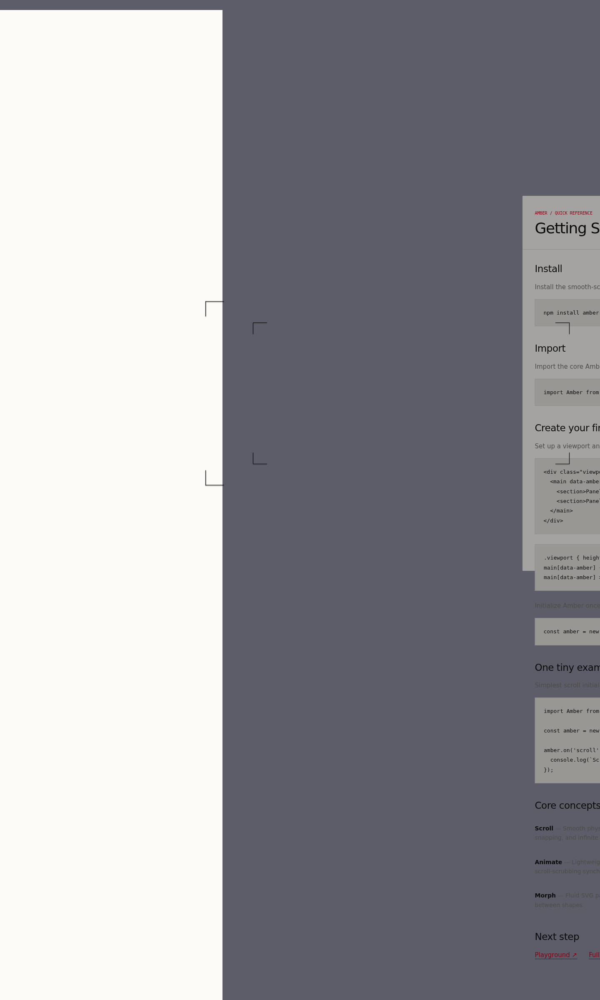
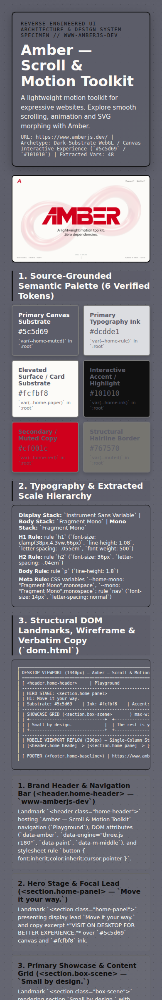

# UI Design System & Master Generation Blueprint: www-amberjs-dev

> **Amber — Scroll & Motion Toolkit** (https://www.amberjs.dev/) — A lightweight motion toolkit for expressive websites. Explore smooth scrolling, animation and SVG morphing with Amber.



---

## 1. Executive Visual Persona & Design Archetype

- **Brand Essence & Persona**: **Amber — Scroll & Motion Toolkit** (`https://www.amberjs.dev/`). A lightweight motion toolkit for expressive websites. Explore smooth scrolling, animation and SVG morphing with Amber.
- **Visual Archetype**: **Dark-Substrate WebGL / Canvas Interactive Experience (`#5c5d69` / `#101010`)**.
- **Anti-AI-Slop Differentiators**:
  - **Source-Grounded Chromatic Polarity**: Anchors the viewport in `#5c5d69` (`var(--home-muted)` in `:root`) paired with `#fcfbf8` primary typography and `#101010` accents.
  - **Extracted Typographic Hierarchy**: Pairs `Instrument Sans Variable` for display copy (`Move it your way.`) with `Fragment Mono` and `Fragment Mono`.
  - **Calibrated Spatial Grid & Motion**: Combines `1000px` container bounds (`gap: 28px`, padding `30px`) with `cubic-bezier(.22,1,.36,1)` easing and Three.js / WebGL Canvas Pipeline.

---

## 2. Spatial Architecture & Modular Grid Mathematics



### Viewport Allocation & Container Geometry
- **Captured Viewport Dimensions**: Desktop `1440×2400px` (`assets/desktop.png`, capped at 2400px multi-section capture), Mobile `390×2400px` (`assets/mobile.png`, capped at 2400px multi-section capture).
- **Master Container Bounds**: `1000px` extracted from `www-amberjs-dev` stylesheet.
- **Canvas Lateral Padding & Spacing**: `30px` lateral canvas padding with `28px` grid gap.
- **Border Radius Scale**: `999px`, `1px`, `50%`, `4px`.

### Responsive Breakpoint Architecture
- **Desktop Layout**: Multi-column CSS Grid / Flexbox layout at `1440px` (`max-width: 1000px`, `gap: 28px`).
- **Mobile Layout**: Single-column vertical stack at `390px` viewport width with `30px` horizontal padding.
- **Extracted CSS Media Queries**: `@media (min-width:1800px)`, `@media (max-width:1000px)`, `@media (max-width:700px)`, `@media (max-width:600px)`.

---

## 3. Color System, Materiality & Atmospheric Lighting

### Semantic Palette & Source Grounding
| Semantic Role | Ground-Truth Value | Extracted CSS Source / Selector |
|---|---|---|
| **Primary Canvas Substrate** | `#5c5d69` | `var(--home-muted)` in `:root` |
| **Primary Typography Ink** | `#dcdde1` | `var(--home-rule)` in `:root` |
| **Elevated Surface / Card Substrate** | `#fcfbf8` | `var(--home-paper)` in `:root` |
| **Interactive Accent / Highlight** | `#101010` | `var(--home-ink)` in `:root` |
| **Secondary / Muted Copy** | `#cf001c` | `var(--home-red)` in `:root` |
| **Structural Hairline Border** | `#767570` | `var(--muted)` in `:root` |

### Sanitized Root CSS Variables (`ui-ux.md` Ground Truth)
| Variable Name | Extracted Value | Semantic Role |
|---|---|---|
| `--home-sans` | `"Instrument Sans Variable",sans-serif` | Typography / Scale Token |
| `--home-serif` | `"Instrument Serif",serif` | Typography / Scale Token |
| `--home-mono` | `"Fragment Mono",monospace` | Typography / Scale Token |
| `--home-muted` | `#5c5d69` | Color / Atmospheric Token |
| `--home-rule` | `#dcdde1` | Color / Atmospheric Token |
| `--home-paper` | `#fcfbf8` | Canvas / Surface Token |
| `--home-ink` | `#101010` | Typography Ink Token |
| `--home-red` | `#cf001c` | Color / Atmospheric Token |
| `--link-arrow-color` | `var(--home-ink)` | Typography Ink Token |
| `--camera-exit` | `0` | Design System Custom Token |
| `--camera-entry` | `1` | Design System Custom Token |
| `--camera-focus-scale` | `1.3` | Design System Custom Token |
| `--camera-focus-opacity` | `0` | Design System Custom Token |
| `--camera-inset-x` | `3.2vw` | Dimension / Scale Token |
| `--camera-inset-top` | `max(28px, env(safe-area-inset-top))` | Dimension / Scale Token |
| `--camera-inset-bottom` | `max(28px, env(safe-area-inset-bottom))` | Dimension / Scale Token |

---

## 4. Typographic Scale & Editorial Hierarchy

### Font Family Stacks
- **Display Typography**: `Instrument Sans Variable`.
- **Primary Body Stack**: `Fragment Mono`.
- **Technical / Metadata Stack**: `Fragment Mono`.

### Typographic Scale & Rules (Extracted from Stylesheet & Variables)
- **Hero Display (`H1`)**: rule `h1` (`font-size: clamp(38px,4.3vw,66px)`, `line-height: 1.08`, `letter-spacing: -.055em`, `font-weight: 500`).
- **Section Heading (`H2`)**: rule `h2` (`font-size: 36px`, `letter-spacing: -.04em`).
- **Body Copy**: rule `p` (`line-height: 1.8`).
- **Metadata & Navigation Labels**: CSS variables `--home-mono: "Fragment Mono",monospace`, `--mono: "Fragment Mono",monospace`; rule `nav` (`font-size: 14px`, `letter-spacing: normal`).

---

## 5. Choreographed Motion & Interaction Physics

### Primary Easing Curves
- **Extracted Timing Functions**: `cubic-bezier(.22,1,.36,1)`.

### Per-Element Transition & Choreography Rules
- **Selector `.footprint-package-link`**: `transition: background-color .18s ease,box-shadow .18s ease` extracted from `www-amberjs-dev` stylesheet.
- **Selector `.footprint-options label`**: `transition: opacity .22s ease-out` extracted from `www-amberjs-dev` stylesheet.
- **Selector `.footprint-options input`**: `transition: background-color .18s ease-out,border-color .18s ease-out,box-...` extracted from `www-amberjs-dev` stylesheet.
- **Extracted Easing Curve (`cubic-bezier(.22,1,.36,1)`)**: Governs interactive state transitions across `<header.home-header>` and `<section.box-scene>`.
- **Runtime Interaction Engine**: Integrates Three.js / WebGL Canvas Pipeline with `prefers-reduced-motion: reduce` fallback guards.

---

## 6. Component Wireframe & Structural DOM Map

### Visual Layout Schematic (Grounded in `dom.html` — `1440px` Desktop & `390px` Mobile Reflow)
```
┌────────────────────────────────────────────────────────────────────────┐
│ DESKTOP VIEWPORT (1440px) — Amber — Scroll & Motion Toolkit            │
│ ====================================================================== │
│ [ <header.home-header>     | Playground                             ]  │
│ ---------------------------------------------------------------------- │
│ | HERO STAGE: <section.home-panel>                                 |   │
│ | H1: Move it your way.                                            |   │
│ | Substrate: #5c5d69    | Ink: #fcfbf8    | Accent: #101010        |   │
│ ---------------------------------------------------------------------- │
│ | SHOWCASE GRID (<section.box-scene>       ) max-w: 1000px         |   │
│ | +------------------------------+  +------------------------------+ | │
│ | | Small by design.             |  | The rest is yours.           | | │
│ | +------------------------------+  +------------------------------+ | │
│ ---------------------------------------------------------------------- │
│ | MOBILE VIEWPORT REFLOW (390px) — Single-Column Stack (gap: 28px  ) | │
│ | [<header.home-heade] -> [<section.home-pane] -> [<section.box-scene] │
│ ---------------------------------------------------------------------- │
│ [ FOOTER (<footer.home-baseline>) | https://www.amberjs.dev/           │
└────────────────────────────────────────────────────────────────────────┘
```

### Granular DOM Region Breakdown
1. **Brand Header & Navigation Bar (<header.home-header> — `www-amberjs-dev`)**:
   - Landmark `<header class="home-header">` hosting `Amber — Scroll & Motion Toolkit` navigation (`Playground`), DOM attributes (`data-amber`, `data-engine="three.js r180"`, `data-paint`, `data-m-middle`), and stylesheet rule `button { font:inherit;color:inherit;cursor:pointer }`.
2. **Hero Stage & Focal Lead (<section.home-panel> — `Move it your way.`)**:
   - Landmark `<section class="home-panel">` presenting display lead `Move it your way.` and copy excerpt *"VISIT ON DESKTOP FOR BETTER EXPERIENCE."* over `#5c5d69` canvas and `#fcfbf8` ink.
3. **Primary Showcase & Content Grid (<section.box-scene> — `Small by design.`)**:
   - Landmark `<section class="box-scene">` rendering section `Small by design.` with copy *"A lightweight motion toolkit. Zero dependencies."*, asset references (`hardikgandhi.me`, `favicon.ico`, `favicon.svg`, `apple-touch-icon.png`), and grid rule `button:focus-visible { outline:2px solid var(--home-red);outline-offset:7px }`.
4. **Interactive Detail & Feature Matrix (<article.book-accessible-copy> — `The rest is yours.`)**:
   - Landmark `<article class="book-accessible-copy">` framing `The rest is yours.` and `Getting Started` (*"SMOOTH SCROLL · ANIMATE · MORPH"*) with `#fcfbf8` surface cards, `#101010` accents, and `selection { background:var(--home-red);color:fff }`.
5. **Colophon & Global Directory Footer (<footer.home-baseline> — `https://www.amberjs.dev/`)**:
   - Landmark `<footer class="home-baseline">` anchoring `Amber — Scroll & Motion Toolkit` footer links (`Playground`), copy *"RUNNING ON AMBER · <20 KB"*, and `#767570` structural dividers.

---

## 7. Master Zero-Shot AI Generation Prompt

```markdown
# Master Zero-Shot Frontend Generation Prompt: www-amberjs-dev (Amber — Scroll & Motion Toolkit)

You are a principal frontend architect and design systems engineer. Build a complete, production-ready web application replicating the exact design system, DOM landmarks, typographic hierarchy, color tokens, and motion physics of `www-amberjs-dev` (**Amber — Scroll & Motion Toolkit** — `https://www.amberjs.dev/`).

### 1. Visual Archetype & Anti-AI-Slop Mandates
- **Archetype**: Dark-Substrate WebGL / Canvas Interactive Experience (`#5c5d69` / `#101010`).
- **Identity & Domain Context**: A lightweight motion toolkit for expressive websites. Explore smooth scrolling, animation and SVG morphing with Amber.
- **Primary Substrate**: `#5c5d69` (`var(--home-muted)` in `:root`), **Primary Ink**: `#fcfbf8`, **Accent / Highlight**: `#101010`.
- **Site-Specific Differentiators**:
  - **Source-Grounded Chromatic Polarity**: Anchors the viewport in `#5c5d69` (`var(--home-muted)` in `:root`) paired with `#fcfbf8` primary typography and `#101010` accents.
  - **Extracted Typographic Hierarchy**: Pairs `Instrument Sans Variable` for display copy (`Move it your way.`) with `Fragment Mono` and `Fragment Mono`.
  - **Calibrated Spatial Grid & Motion**: Combines `1000px` container bounds (`gap: 28px`, padding `30px`) with `cubic-bezier(.22,1,.36,1)` easing and Three.js / WebGL Canvas Pipeline.

### 2. Ground-Truth CSS Variables (`:root` Token Contract)
Declare and consume these exact custom properties extracted from `www-amberjs-dev` in your global stylesheet:

:root {
  /* Amber — Scroll & Motion Toolkit (www-amberjs-dev) — Ground-Truth Extracted CSS Variables */
  --home-sans: "Instrument Sans Variable",sans-serif; /* Typography / Scale Token (www-amberjs-dev) */
  --home-serif: "Instrument Serif",serif; /* Typography / Scale Token (www-amberjs-dev) */
  --home-mono: "Fragment Mono",monospace; /* Typography / Scale Token (www-amberjs-dev) */
  --home-muted: #5c5d69; /* Color / Atmospheric Token (www-amberjs-dev) */
  --home-rule: #dcdde1; /* Color / Atmospheric Token (www-amberjs-dev) */
  --home-paper: #fcfbf8; /* Canvas / Surface Token (www-amberjs-dev) */
  --home-ink: #101010; /* Typography Ink Token (www-amberjs-dev) */
  --home-red: #cf001c; /* Color / Atmospheric Token (www-amberjs-dev) */
  --link-arrow-color: var(--home-ink); /* Typography Ink Token (www-amberjs-dev) */
  --camera-exit: 0; /* Design System Custom Token (www-amberjs-dev) */
  --camera-entry: 1; /* Design System Custom Token (www-amberjs-dev) */
  --camera-focus-scale: 1.3; /* Design System Custom Token (www-amberjs-dev) */
  --camera-focus-opacity: 0; /* Design System Custom Token (www-amberjs-dev) */
  --camera-inset-x: 3.2vw; /* Dimension / Scale Token (www-amberjs-dev) */
  --camera-inset-top: max(28px, env(safe-area-inset-top)); /* Dimension / Scale Token (www-amberjs-dev) */
  --camera-inset-bottom: max(28px, env(safe-area-inset-bottom)); /* Dimension / Scale Token (www-amberjs-dev) */
}

### 3. Semantic Color & Materiality Contract
Map every surface, ink, and border strictly to these source-grounded tokens:
- **Primary Canvas Substrate**: `#5c5d69` — grounded in `var(--home-muted)` in `:root`
- **Primary Typography Ink**: `#dcdde1` — grounded in `var(--home-rule)` in `:root`
- **Elevated Surface / Card Substrate**: `#fcfbf8` — grounded in `var(--home-paper)` in `:root`
- **Interactive Accent / Highlight**: `#101010` — grounded in `var(--home-ink)` in `:root`
- **Secondary / Muted Copy**: `#cf001c` — grounded in `var(--home-red)` in `:root`
- **Structural Hairline Border**: `#767570` — grounded in `var(--muted)` in `:root`

### 4. Spatial Grid, Container Bounds & Responsive Breakpoints
- **Desktop Viewport Reference**: `1440×2400px` (capped at 2400px multi-section capture, `1440px` standard desktop width).
- **Mobile Viewport Reference**: `390×2400px` (capped at 2400px multi-section capture, `390px` standard mobile width).
- **Container Max-Width**: `1000px` extracted from `www-amberjs-dev` stylesheet
- **Padding & Gutters**: `30px` lateral canvas padding with `28px` grid gap
- **Desktop Grid**: Multi-column CSS Grid / Flexbox layout at `1440px` (`max-width: 1000px`, `gap: 28px`)
- **Mobile Adaptation**: Single-column vertical stack at `390px` viewport width with `30px` horizontal padding
- **Media Queries**: `@media (min-width:1800px)`, `@media (max-width:1000px)`, `@media (max-width:700px)`, `@media (max-width:600px)`
- **Corner Radii**: `999px`, `1px`, `50%`, `4px`

### 5. Typography & Editorial Scale Contract
- **Display Font Stack**: `Instrument Sans Variable`
- **Body Font Stack**: `Fragment Mono`
- **Monospace / Technical Font Stack**: `Fragment Mono`
- **H1 Display Rule**: rule `h1` (`font-size: clamp(38px,4.3vw,66px)`, `line-height: 1.08`, `letter-spacing: -.055em`, `font-weight: 500`)
- **H2 Section Rule**: rule `h2` (`font-size: 36px`, `letter-spacing: -.04em`)
- **Body Copy Rule**: rule `p` (`line-height: 1.8`)
- **Metadata & Index Rule**: CSS variables `--home-mono: "Fragment Mono",monospace`, `--mono: "Fragment Mono",monospace`; rule `nav` (`font-size: 14px`, `letter-spacing: normal`)

### 6. Component Hierarchy, Verbatim Copy & Real DOM Landmarks
Scaffold `www-amberjs-dev` (`Amber — Scroll & Motion Toolkit`) with these exact structural regions, extracted copy, and CSS rules from `dom.html`:
1. **Brand Header & Navigation Bar (<header.home-header> — `www-amberjs-dev`)**:
   - DOM & Selectors: Landmark `<header class="home-header">` hosting `Amber — Scroll & Motion Toolkit` navigation (`Playground`), DOM attributes (`data-amber`, `data-engine="three.js r180"`, `data-paint`, `data-m-middle`), and stylesheet rule `button { font:inherit;color:inherit;cursor:pointer }`.
   - Responsive Contract: Header `Brand Header & Navigation Bar (<header.home-header> — `www-amberjs-dev`)` (`www-amberjs-dev`) adapts across `@media (min-width:1800px)`, `@media (max-width:1000px)`, `@media (max-width:700px)`, `@media (max-width:600px)` with `cubic-bezier(.22,1,.36,1)` transitions and links `Playground`.
2. **Hero Stage & Focal Lead (<section.home-panel> — `Move it your way.`)**:
   - DOM & Selectors: Landmark `<section class="home-panel">` presenting display lead `Move it your way.` and copy excerpt *"VISIT ON DESKTOP FOR BETTER EXPERIENCE."* over `#5c5d69` canvas and `#fcfbf8` ink.
   - Responsive Contract: Hero stage (`1440×2400px` desktop / `390×2400px` mobile) sets `#5c5d69` background with `#fcfbf8` headline `Move it your way.`.
3. **Primary Showcase & Content Grid (<section.box-scene> — `Small by design.`)**:
   - DOM & Selectors: Landmark `<section class="box-scene">` rendering section `Small by design.` with copy *"A lightweight motion toolkit. Zero dependencies."*, asset references (`hardikgandhi.me`, `favicon.ico`, `favicon.svg`, `apple-touch-icon.png`), and grid rule `button:focus-visible { outline:2px solid var(--home-red);outline-offset:7px }`.
   - Responsive Contract: Showcase grid `Primary Showcase & Content Grid (<section.box-scene> — `Small by design.`)` applies Multi-column CSS Grid / Flexbox layout at `1440px` (`max-width: 1000px`, `gap: 28px`) on desktop and Single-column vertical stack at `390px` viewport width with `30px` horizontal padding on mobile.
4. **Interactive Detail & Feature Matrix (<article.book-accessible-copy> — `The rest is yours.`)**:
   - DOM & Selectors: Landmark `<article class="book-accessible-copy">` framing `The rest is yours.` and `Getting Started` (*"SMOOTH SCROLL · ANIMATE · MORPH"*) with `#fcfbf8` surface cards, `#101010` accents, and `selection { background:var(--home-red);color:fff }`.
   - Responsive Contract: Detail module `Interactive Detail & Feature Matrix (<article.book-accessible-copy> — `The rest is yours.`)` uses `999px`, `1px`, `50%`, `4px` radii, `#101010` highlights, and assets (hardikgandhi.me, favicon.ico, favicon.svg).
5. **Colophon & Global Directory Footer (<footer.home-baseline> — `https://www.amberjs.dev/`)**:
   - DOM & Selectors: Landmark `<footer class="home-baseline">` anchoring `Amber — Scroll & Motion Toolkit` footer links (`Playground`), copy *"RUNNING ON AMBER · <20 KB"*, and `#767570` structural dividers.
   - Responsive Contract: Footer `Colophon & Global Directory Footer (<footer.home-baseline> — `https://www.amberjs.dev/`)` aligns to `1000px` extracted from `www-amberjs-dev` stylesheet with `30px` lateral canvas padding with `28px` grid gap and attributes (data-amber, data-engine="three.js r180", data-paint).

#### Verbatim DOM Copy Excerpts (`dom.html`)
- Copy Excerpt 1: *"VISIT ON DESKTOP FOR BETTER EXPERIENCE."*
- Copy Excerpt 2: *"A lightweight motion toolkit. Zero dependencies."*
- Copy Excerpt 3: *"SMOOTH SCROLL · ANIMATE · MORPH"*
- Copy Excerpt 4: *"RUNNING ON AMBER · <20 KB"*

### 7. Motion, Extracted Stylesheet Rules & Interaction Choreography
- **Primary Easing Functions**: `cubic-bezier(.22,1,.36,1)`
- **Extracted Stylesheet Rules (`www-amberjs-dev`)**:
- `button { font:inherit;color:inherit;cursor:pointer }`
- `button:focus-visible { outline:2px solid var(--home-red);outline-offset:7px }`
- `selection { background:var(--home-red);color:fff }`
- `.home { position:relative;min-height:680px;height:100svh;isolation:isolate;overf... }`
- `.home-header { position:absolute;top:32px;left:3.2%;right:3.2%;display:flex;align-items... }`
- **Per-Selector Transition Rules**:
- **Selector `.footprint-package-link`**: `transition: background-color .18s ease,box-shadow .18s ease` extracted from `www-amberjs-dev` stylesheet.
- **Selector `.footprint-options label`**: `transition: opacity .22s ease-out` extracted from `www-amberjs-dev` stylesheet.
- **Selector `.footprint-options input`**: `transition: background-color .18s ease-out,border-color .18s ease-out,box-...` extracted from `www-amberjs-dev` stylesheet.
- **Extracted Easing Curve (`cubic-bezier(.22,1,.36,1)`)**: Governs interactive state transitions across `<header.home-header>` and `<section.box-scene>`.
- **Runtime Interaction Engine**: Integrates Three.js / WebGL Canvas Pipeline with `prefers-reduced-motion: reduce` fallback guards.

### 8. Technical Deliverables
- Implement in Next.js (App Router) with TypeScript and Tailwind CSS consuming the `:root` custom properties defined above for `www-amberjs-dev`.
- Reproduce both the `1440px` desktop architecture and `390px` mobile breakpoint transitions, preserving semantic HTML5 landmarks (`<header>`, `<nav>`, `<main>`, `<section>`, `<footer>`) and `prefers-reduced-motion` accessibility guards.
```
