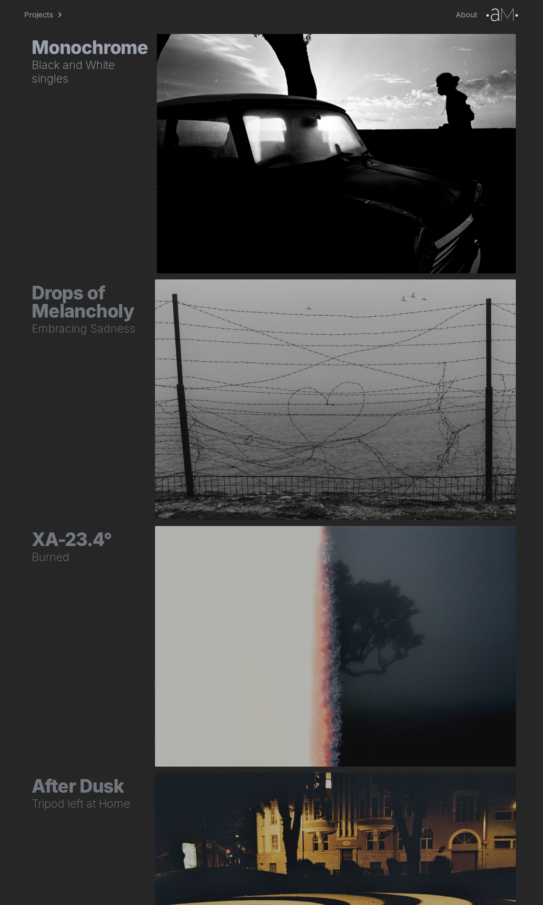
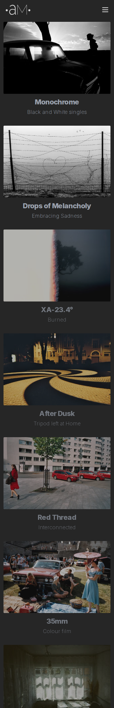

# UI Design System & Master Generation Blueprint: www-andriimur-com

> **Andrii Mur** (https://www.andriimur.com/) — Andrii Mur – Ukrainian street & documentary photographer in Tallinn, Estonia. From the information mess to how it feels to be Alive in an...



---

## 1. Executive Visual Persona & Design Archetype

- **Brand Essence & Persona**: **Andrii Mur** (`https://www.andriimur.com/`). Andrii Mur – Ukrainian street & documentary photographer in Tallinn, Estonia. From the information mess to how it feels to be Alive in an...
- **Capture Provenance**: Live browser capture (`tier1_fast`, HTTP `200`, captured `2026-11-23`).
- **Visual Archetype**: **High-Contrast Obsidian / Atmospheric Design System (`#262626` canvas, `#ffffff` ink, `#829f62` accent)**.
- **Anti-AI-Slop Differentiators**:
  - **Live-Computed Chromatic Polarity**: Anchors the viewport in `#262626` (live computed `html` `background-color` (`computed_styles.json`)) paired with `#ffffff` primary typography and `#829f62` accents.
  - **Grounded Typographic Hierarchy**: Pairs `Inter` for display copy (`Andrii Mur`) with `Inter` and `IBM Plex Mono`.
  - **Calibrated Spatial Grid & Motion**: Combines `96rem` container bounds (`gap: normal 20px`, padding `64px`) with `cubic-bezier(0,0,.2,1)` easing.

---

## 2. Spatial Architecture & Modular Grid Mathematics



### Viewport Allocation & Container Geometry
- **Captured Viewport Dimensions**: Desktop `1440×2400px` (`assets/desktop.png`, clamped at 2400px live multi-section capture), Mobile `390×2400px` (`assets/mobile.png`, clamped at 2400px live multi-section capture).
- **Master Container Bounds**: `96rem` (non-`@media` desktop container stylesheet rule).
- **Canvas Lateral Padding & Spacing**: `64px` lateral canvas padding with `normal 20px` grid gap.
- **Border Radius Scale**: `.25rem`, `3px`, `var(--radius-lg)`, `var(--radius-md)`.

### Responsive Breakpoint Architecture
- **Desktop Layout**: 2-column persistent left sidebar (`364px`, <nav.inset-0>) + `1076px` main content stage at `1440px` (`max-width: 96rem`, `gap: normal 20px`).
- **Mobile Layout**: Single-column vertical stack at `390px` viewport width with collapsed `<nav.inset-0>` drawer navigation and `64px` horizontal padding.
- **Extracted CSS Media Queries**: `@media (min-width:40rem)`, `@media (min-width:48rem)`, `@media (min-width:64rem)`, `@media (min-width:80rem)`.

---

## 3. Color System, Materiality & Atmospheric Lighting

### Semantic Palette & Source Grounding
| Semantic Role | Ground-Truth Value | Extracted Live / CSS Source |
|---|---|---|
| **Primary Canvas Substrate** | `#262626` | live computed `html` `background-color` (`computed_styles.json`) |
| **Primary Typography Ink** | `#ffffff` | live computed `header` `color` (`computed_styles.json`) |
| **Elevated Surface / Card Substrate** | `#000000` | `var(--pswp-bg)` in `:root` |
| **Interactive Accent / Highlight** | `#829f62` | `var(--color-accent)` in `:root` |
| **Secondary / Muted Copy** | `#9ca3af` | live computed `p` `color` (`computed_styles.json`) |
| **Structural Hairline Border** | `#4f4f4f` | `var(--pswp-icon-stroke-color)` in `:root` |
| **Variable Token (`--color-yellow-100`)** | `#fef9c2` | `var(--color-yellow-100)` in `:root` |
| **Variable Token (`--color-yellow-700`)** | `#a36100` | `var(--color-yellow-700)` in `:root` |
| **Variable Token (`--color-blue-500`)** | `#3080ff` | `var(--color-blue-500)` in `:root` |
| **Variable Token (`--color-blue-800`)** | `#193cb8` | `var(--color-blue-800)` in `:root` |
| **Variable Token (`--color-slate-200`)** | `#e2e8f0` | `var(--color-slate-200)` in `:root` |
| **Variable Token (`--color-gray-50`)** | `#f9fafb` | `var(--color-gray-50)` in `:root` |
| **Variable Token (`--color-gray-100`)** | `#f3f4f6` | `var(--color-gray-100)` in `:root` |
| **Variable Token (`--color-gray-200`)** | `#e5e7eb` | `var(--color-gray-200)` in `:root` |
| **Variable Token (`--color-gray-300`)** | `#d1d5dc` | `var(--color-gray-300)` in `:root` |

### Sanitized Root CSS Variables (`ui-ux.md` Ground Truth)
| Variable Name | Extracted Value | Semantic Role |
|---|---|---|
| `--z-page-background` | `-1` | Canvas / Surface Token |
| `--z-chrome` | `10` | Elevation / Border Token |
| `--z-overlay` | `15` | Elevation / Border Token |
| `--vf-dial-gutter` | `2.75rem` | Layout / Spatial Grid Token |
| `--vf-frame-max-w` | `min(calc(100cqh * 1.5), calc(100cqw - var(--vf-dial-gutter) * 2))` | Layout / Spatial Grid Token |
| `--vf-dial-inset` | `max(1rem, calc(50vw - 75svh - var(--vf-dial-gutter)))` | Dimension / Scale Token |
| `--font-serif` | `ui-serif, Georgia, Cambria, "Times New Roman", Times, serif` | Typography / Scale Token |
| `--color-yellow-100` | `#fef9c2` | Brand / Palette Token |
| `--color-yellow-700` | `#a36100` | Brand / Palette Token |
| `--color-blue-500` | `#3080ff` | Brand / Palette Token |
| `--color-blue-800` | `#193cb8` | Brand / Palette Token |
| `--color-slate-200` | `#e2e8f0` | Brand / Palette Token |
| `--color-gray-50` | `#f9fafb` | Brand / Palette Token |
| `--color-gray-100` | `#f3f4f6` | Brand / Palette Token |
| `--color-gray-200` | `#e5e7eb` | Brand / Palette Token |
| `--color-gray-300` | `#d1d5dc` | Brand / Palette Token |

---

## 4. Typographic Scale & Editorial Hierarchy

### Font Family Stacks
- **Display Typography**: `Inter`.
- **Primary Body Stack**: `Inter`.
- **Technical / Metadata Stack**: `IBM Plex Mono`.

### Typographic Scale & Rules (Live Computed & Stylesheet Grounded)
- **Hero Display (`H1`)**: CSS variables `--text-4xl: 2.25rem`, `--text-4xl--line-height: calc(2.5 / 2.25)`, `--text-5xl: 3rem`.
- **Section Heading (`H2`)**: live computed `h2` (`font-size: 48px`, `line-height: 48px`, `font-weight: 800`, `letter-spacing: -1.2px`); CSS variables `--text-2xl: 1.5rem`, `--text-2xl--line-height: calc(2 / 1.5)`, `--text-3xl: 1.875rem`.
- **Body Copy**: live computed `body` (`font-size: 16px`, `line-height: 24px`, `font-weight: 400`); CSS variables `--text-base: 1rem`, `--text-base--line-height: calc(1.5 / 1)`.
- **Metadata & Navigation Labels**: live computed `nav/a` (`font-size: 16px`, `line-height: 24px`, `font-weight: 400`); CSS variables `--text-xs: .75rem`, `--text-xs--line-height: calc(1 / .75)`, `--text-sm: .875rem`.

---

## 5. Choreographed Motion & Interaction Physics

### Primary Easing Curves
- **Extracted Timing Functions**: `cubic-bezier(0,0,.2,1)`, `cubic-bezier(.4,0,.2,1)`, `cubic-bezier(.4,0,.22,1)`.

### Per-Element Transition & Choreography Rules
- **Selector `layer theme`**: `transition: .15s` extracted from `www-andriimur-com` stylesheet.
- **Selector `.transition`**: `transition: var(--tw-ease,var(--default-transition-timing-function))` extracted from `www-andriimur-com` stylesheet.
- **Selector `background-color\]`**: `transition: var(--tw-ease,var(--default-transition-timing-function))` extracted from `www-andriimur-com` stylesheet.
- **Extracted Easing Curve (`cubic-bezier(0,0,.2,1)`)**: Governs interactive state transitions across `<header.top-0>` and `<section.snap-showcase>`.
- **State & Hover Choreography**: Opacity and transform transitions on `<section.dark>` and `<section.snap-showcase>` interactive targets.

---

## 6. Component Wireframe & Structural DOM Map

### Visual Layout Schematic — Desktop (`1440px`, Grounded in `dom.html` & Landmark Bounding Boxes)
```
┌────────────────────────────────────────────────────────────────────────┐
│ DESKTOP VIEWPORT (1440px) — Sidebar (364px) + Main (1076px)            │
│ ====================================================================== │
│ +--[ SIDEBAR (364px) ]--+--[ MAIN CONTENT STAGE (1076px) ]-----------+ │
│ | <nav.inset-0>         | [ <header.top-0> | About · Monochrome ]    | │
│ | - About               | ------------------------------------------ | │
│ | - Monochrome          | HERO STAGE: <section.dark>                 | │
│ | - Drops of Melancholy | H1: Andrii Mur                             | │
│ | - XA-23.4°            | Bg:#262626 Ink:#ffffff Acc:#829f62         | │
│ | x=-388 h=772px rail   | ------------------------------------------ | │
│ |                       | SHOWCASE: <section.snap-showca max:96rem   | │
│ |                       | [Featured Work & In] [Technical Architec]  | │
│ |                       | DETAIL: <section.flex>                     | │
│ +-----------------------+--------------------------------------------+ │
│ [ FOOTER (<footer.bottom-0>   ) | https://www.andriimur.com/           │
└────────────────────────────────────────────────────────────────────────┘
```

### Visual Layout Schematic — Mobile Reflow (`390px`)
```
┌────────────────────────────────────────────────────────────────────────┐
│ MOBILE VIEWPORT REFLOW (390px) — Collapsed Sidebar + 1-Col Stack       │
│ ====================================================================== │
│ [ DRAWER (<nav.inset-0>         ) | <header.top-0>                     │
│ ---------------------------------------------------------------------- │
│ | HERO STAGE (<section.dark>) — 390px Full-Width                     | │
│ | H1: Andrii Mur                                                     | │
│ ---------------------------------------------------------------------- │
│ | SHOWCASE STACK (<section.snap-showcase) — 1-Col (gap: normal 20p)  | │
│ | [ Card 1: Featured Work & Interactive Showcase                   ] | │
│ | [ Card 2: Technical Architecture & Narrative                     ] | │
│ ---------------------------------------------------------------------- │
│ | DETAIL STACK (<section.flex>) — 1-Col (Global Directory &)         | │
│ ---------------------------------------------------------------------- │
│ [ FOOTER (<footer.bottom-0>     ) | Stacked 390px Colophon             │
└────────────────────────────────────────────────────────────────────────┘
```

### Granular DOM Region Breakdown
1. **Persistent Left Sidebar Navigation (<nav.inset-0> — `364×772px` at `x=-388`)**:
   - Fixed/sticky left rail `<nav class="inset-0 items-end">` (`364px` wide) paired with top bar `<header class="top-0 gap-x-5">` hosting `Andrii Mur` navigation (`About · Monochrome · Drops of Melancholy · XA-23.4° · After Dusk`), DOM attributes (`data-theme="dark"`, `data-precedence="next"`, `data-precedence="next"`, `data-precedence="next"`), and rule `backdrop { box-sizing:border-box;border:0 solid;margin:0;padding:0 }`.
2. **Hero Stage & Focal Lead (<section.dark> — `Andrii Mur`)**:
   - Landmark `<section class="dark">` inside `1076px` main stage presenting display lead `Andrii Mur` and copy excerpt *"Black and White singles"* over `#262626` canvas and `#ffffff` ink.
3. **Primary Showcase & Content Grid (<section.snap-showcase> — `Featured Work & Interactive Showca`)**:
   - Landmark `<section class="snap-showcase">` rendering section `Featured Work & Interactive Showcase` with copy *"Tripod left at Home"*, asset references (`m2ak1cq3.api.sanity.io`, `6ab71d031fe7ae3b-s.p.141jscyq52bj...`, `80bb744e92754df7-s.p.2eihtoujcocl...`, `83afe278b6a6bb3c-s.p.2bn3s6zvc0dy...`), and grid rule `file-selector-button { box-sizing:border-box;border:0 solid;margin:0;padding:0 }`.
4. **Interactive Detail & Feature Matrix (<section.flex> — `Technical Architecture & Narrative`)**:
   - Landmark `<section class="flex">` framing `Technical Architecture & Narrative` and `Global Directory & Contact` (*"Between duality of Space and Time"*) with `#000000` surface cards, `#829f62` accents, and `strong { font-weight:bolder }`.
5. **Colophon & Global Directory Footer (<footer.bottom-0> — `https://www.andriimur.com/`)**:
   - Landmark `<footer class="bottom-0 bg-neutral-900">` anchoring `Andrii Mur` footer links (`About · Monochrome · Drops of Melancholy · XA-23.4° · After Dusk`), copy *"a Quiet gaze from Within"*, and `#4f4f4f` structural dividers.

---

## 7. Master Zero-Shot AI Generation Prompt

```markdown
# Master Zero-Shot Frontend Generation Prompt: www-andriimur-com (Andrii Mur)

You are a principal frontend architect and design systems engineer. Build a complete, production-ready web application replicating the exact design system, DOM landmarks, typographic hierarchy, color tokens, and motion physics of `www-andriimur-com` (**Andrii Mur** — `https://www.andriimur.com/`).

### 1. Visual Archetype & Anti-AI-Slop Mandates
- **Archetype**: High-Contrast Obsidian / Atmospheric Design System (`#262626` canvas, `#ffffff` ink, `#829f62` accent).
- **Identity & Domain Context**: Andrii Mur – Ukrainian street & documentary photographer in Tallinn, Estonia. From the information mess to how it feels to be Alive in an...
- **Primary Substrate**: `#262626` (live computed `html` `background-color` (`computed_styles.json`)), **Primary Ink**: `#ffffff`, **Accent / Highlight**: `#829f62`.
- **Site-Specific Differentiators**:
  - **Live-Computed Chromatic Polarity**: Anchors the viewport in `#262626` (live computed `html` `background-color` (`computed_styles.json`)) paired with `#ffffff` primary typography and `#829f62` accents.
  - **Grounded Typographic Hierarchy**: Pairs `Inter` for display copy (`Andrii Mur`) with `Inter` and `IBM Plex Mono`.
  - **Calibrated Spatial Grid & Motion**: Combines `96rem` container bounds (`gap: normal 20px`, padding `64px`) with `cubic-bezier(0,0,.2,1)` easing.

### 2. Ground-Truth CSS Variables (`:root` Token Contract)
Declare and consume these exact custom properties extracted from `www-andriimur-com` in your global stylesheet:

:root {
  /* Andrii Mur (www-andriimur-com) — Live-Grounded CSS Variables */
  --z-page-background: -1; /* Canvas / Surface Token (www-andriimur-com) */
  --z-chrome: 10; /* Elevation / Border Token (www-andriimur-com) */
  --z-overlay: 15; /* Elevation / Border Token (www-andriimur-com) */
  --vf-dial-gutter: 2.75rem; /* Layout / Spatial Grid Token (www-andriimur-com) */
  --vf-frame-max-w: min(calc(100cqh * 1.5), calc(100cqw - var(--vf-dial-gutter) * 2)); /* Layout / Spatial Grid Token (www-andriimur-com) */
  --vf-dial-inset: max(1rem, calc(50vw - 75svh - var(--vf-dial-gutter))); /* Dimension / Scale Token (www-andriimur-com) */
  --font-serif: ui-serif, Georgia, Cambria, "Times New Roman", Times, serif; /* Typography / Scale Token (www-andriimur-com) */
  --color-yellow-100: #fef9c2; /* Brand / Palette Token (www-andriimur-com) */
  --color-yellow-700: #a36100; /* Brand / Palette Token (www-andriimur-com) */
  --color-blue-500: #3080ff; /* Brand / Palette Token (www-andriimur-com) */
  --color-blue-800: #193cb8; /* Brand / Palette Token (www-andriimur-com) */
  --color-slate-200: #e2e8f0; /* Brand / Palette Token (www-andriimur-com) */
  --color-gray-50: #f9fafb; /* Brand / Palette Token (www-andriimur-com) */
  --color-gray-100: #f3f4f6; /* Brand / Palette Token (www-andriimur-com) */
  --color-gray-200: #e5e7eb; /* Brand / Palette Token (www-andriimur-com) */
  --color-gray-300: #d1d5dc; /* Brand / Palette Token (www-andriimur-com) */
}

### 3. Semantic Color & Materiality Contract
Map every surface, ink, and border strictly to these source-grounded tokens:
- **Primary Canvas Substrate**: `#262626` — grounded in live computed `html` `background-color` (`computed_styles.json`)
- **Primary Typography Ink**: `#ffffff` — grounded in live computed `header` `color` (`computed_styles.json`)
- **Elevated Surface / Card Substrate**: `#000000` — grounded in `var(--pswp-bg)` in `:root`
- **Interactive Accent / Highlight**: `#829f62` — grounded in `var(--color-accent)` in `:root`
- **Secondary / Muted Copy**: `#9ca3af` — grounded in live computed `p` `color` (`computed_styles.json`)
- **Structural Hairline Border**: `#4f4f4f` — grounded in `var(--pswp-icon-stroke-color)` in `:root`
- **Variable Token (`--color-yellow-100`)**: `#fef9c2` — grounded in `var(--color-yellow-100)` in `:root`
- **Variable Token (`--color-yellow-700`)**: `#a36100` — grounded in `var(--color-yellow-700)` in `:root`
- **Variable Token (`--color-blue-500`)**: `#3080ff` — grounded in `var(--color-blue-500)` in `:root`
- **Variable Token (`--color-blue-800`)**: `#193cb8` — grounded in `var(--color-blue-800)` in `:root`
- **Variable Token (`--color-slate-200`)**: `#e2e8f0` — grounded in `var(--color-slate-200)` in `:root`
- **Variable Token (`--color-gray-50`)**: `#f9fafb` — grounded in `var(--color-gray-50)` in `:root`
- **Variable Token (`--color-gray-100`)**: `#f3f4f6` — grounded in `var(--color-gray-100)` in `:root`
- **Variable Token (`--color-gray-200`)**: `#e5e7eb` — grounded in `var(--color-gray-200)` in `:root`
- **Variable Token (`--color-gray-300`)**: `#d1d5dc` — grounded in `var(--color-gray-300)` in `:root`

### 4. Spatial Grid, Container Bounds & Responsive Breakpoints
- **Desktop Viewport Reference**: `1440×2400px` (clamped at 2400px live multi-section capture, `1440px` standard desktop width).
- **Mobile Viewport Reference**: `390×2400px` (clamped at 2400px live multi-section capture, `390px` standard mobile width).
- **Container Max-Width**: `96rem` (non-`@media` desktop container stylesheet rule)
- **Padding & Gutters**: `64px` lateral canvas padding with `normal 20px` grid gap
- **Desktop Grid**: 2-column persistent left sidebar (`364px`, <nav.inset-0>) + `1076px` main content stage at `1440px` (`max-width: 96rem`, `gap: normal 20px`)
- **Mobile Adaptation**: Single-column vertical stack at `390px` viewport width with collapsed `<nav.inset-0>` drawer navigation and `64px` horizontal padding
- **Media Queries**: `@media (min-width:40rem)`, `@media (min-width:48rem)`, `@media (min-width:64rem)`, `@media (min-width:80rem)`
- **Corner Radii**: `.25rem`, `3px`, `var(--radius-lg)`, `var(--radius-md)`

### 5. Typography & Editorial Scale Contract
- **Display Font Stack**: `Inter`
- **Body Font Stack**: `Inter`
- **Monospace / Technical Font Stack**: `IBM Plex Mono`
- **H1 Display Rule**: CSS variables `--text-4xl: 2.25rem`, `--text-4xl--line-height: calc(2.5 / 2.25)`, `--text-5xl: 3rem`
- **H2 Section Rule**: live computed `h2` (`font-size: 48px`, `line-height: 48px`, `font-weight: 800`, `letter-spacing: -1.2px`); CSS variables `--text-2xl: 1.5rem`, `--text-2xl--line-height: calc(2 / 1.5)`, `--text-3xl: 1.875rem`
- **Body Copy Rule**: live computed `body` (`font-size: 16px`, `line-height: 24px`, `font-weight: 400`); CSS variables `--text-base: 1rem`, `--text-base--line-height: calc(1.5 / 1)`
- **Metadata & Index Rule**: live computed `nav/a` (`font-size: 16px`, `line-height: 24px`, `font-weight: 400`); CSS variables `--text-xs: .75rem`, `--text-xs--line-height: calc(1 / .75)`, `--text-sm: .875rem`

### 6. Component Hierarchy, Verbatim Copy & Real DOM Landmarks
Scaffold `www-andriimur-com` (`Andrii Mur`) with these exact structural regions, extracted copy, and CSS rules from `dom.html`:
1. **Persistent Left Sidebar Navigation (<nav.inset-0> — `364×772px` at `x=-388`)**:
   - DOM & Selectors: Fixed/sticky left rail `<nav class="inset-0 items-end">` (`364px` wide) paired with top bar `<header class="top-0 gap-x-5">` hosting `Andrii Mur` navigation (`About · Monochrome · Drops of Melancholy · XA-23.4° · After Dusk`), DOM attributes (`data-theme="dark"`, `data-precedence="next"`, `data-precedence="next"`, `data-precedence="next"`), and rule `backdrop { box-sizing:border-box;border:0 solid;margin:0;padding:0 }`.
   - Responsive Contract: Header `Persistent Left Sidebar Navigation (<nav.inset-0> — `364×772px` at `x=-388`)` (`www-andriimur-com`) adapts across `@media (min-width:40rem)`, `@media (min-width:48rem)`, `@media (min-width:64rem)`, `@media (min-width:80rem)` with `cubic-bezier(0,0,.2,1)`, `cubic-bezier(.4,0,.2,1)`, `cubic-bezier(.4,0,.22,1)` transitions and links `About · Monochrome · Drops of Melancholy · XA-23.4° · After Dusk`.
2. **Hero Stage & Focal Lead (<section.dark> — `Andrii Mur`)**:
   - DOM & Selectors: Landmark `<section class="dark">` inside `1076px` main stage presenting display lead `Andrii Mur` and copy excerpt *"Black and White singles"* over `#262626` canvas and `#ffffff` ink.
   - Responsive Contract: Hero stage (`1440×2400px` desktop / `390×2400px` mobile) sets `#262626` background with `#ffffff` headline `Andrii Mur`.
3. **Primary Showcase & Content Grid (<section.snap-showcase> — `Featured Work & Interactive Showca`)**:
   - DOM & Selectors: Landmark `<section class="snap-showcase">` rendering section `Featured Work & Interactive Showcase` with copy *"Tripod left at Home"*, asset references (`m2ak1cq3.api.sanity.io`, `6ab71d031fe7ae3b-s.p.141jscyq52bj...`, `80bb744e92754df7-s.p.2eihtoujcocl...`, `83afe278b6a6bb3c-s.p.2bn3s6zvc0dy...`), and grid rule `file-selector-button { box-sizing:border-box;border:0 solid;margin:0;padding:0 }`.
   - Responsive Contract: Showcase grid `Primary Showcase & Content Grid (<section.snap-showcase> — `Featured Work & Interactive Showca`)` applies 2-column persistent left sidebar (`364px`, <nav.inset-0>) + `1076px` main content stage at `1440px` (`max-width: 96rem`, `gap: normal 20px`) on desktop and Single-column vertical stack at `390px` viewport width with collapsed `<nav.inset-0>` drawer navigation and `64px` horizontal padding on mobile.
4. **Interactive Detail & Feature Matrix (<section.flex> — `Technical Architecture & Narrative`)**:
   - DOM & Selectors: Landmark `<section class="flex">` framing `Technical Architecture & Narrative` and `Global Directory & Contact` (*"Between duality of Space and Time"*) with `#000000` surface cards, `#829f62` accents, and `strong { font-weight:bolder }`.
   - Responsive Contract: Detail module `Interactive Detail & Feature Matrix (<section.flex> — `Technical Architecture & Narrative`)` uses `.25rem`, `3px`, `var(--radius-lg)`, `var(--radius-md)` radii, `#829f62` highlights, and assets (m2ak1cq3.api.sanity.io, 6ab71d031fe7ae3b-s.p.141jscyq52bj..., 80bb744e92754df7-s.p.2eihtoujcocl...).
5. **Colophon & Global Directory Footer (<footer.bottom-0> — `https://www.andriimur.com/`)**:
   - DOM & Selectors: Landmark `<footer class="bottom-0 bg-neutral-900">` anchoring `Andrii Mur` footer links (`About · Monochrome · Drops of Melancholy · XA-23.4° · After Dusk`), copy *"a Quiet gaze from Within"*, and `#4f4f4f` structural dividers.
   - Responsive Contract: Footer `Colophon & Global Directory Footer (<footer.bottom-0> — `https://www.andriimur.com/`)` aligns to `96rem` (non-`@media` desktop container stylesheet rule) with `64px` lateral canvas padding with `normal 20px` grid gap and attributes (data-theme="dark", data-precedence="next", data-precedence="next").

#### Verbatim DOM Copy Excerpts (`dom.html`)
- Copy Excerpt 1: *"Black and White singles"*
- Copy Excerpt 2: *"Tripod left at Home"*
- Copy Excerpt 3: *"Between duality of Space and Time"*
- Copy Excerpt 4: *"a Quiet gaze from Within"*

### 7. Motion, Extracted Stylesheet Rules & Interaction Choreography
- **Primary Easing Functions**: `cubic-bezier(0,0,.2,1)`, `cubic-bezier(.4,0,.2,1)`, `cubic-bezier(.4,0,.22,1)`
- **Extracted Stylesheet Rules (`www-andriimur-com`)**:
- `backdrop { box-sizing:border-box;border:0 solid;margin:0;padding:0 }`
- `file-selector-button { box-sizing:border-box;border:0 solid;margin:0;padding:0 }`
- `strong { font-weight:bolder }`
- `small { font-size:80% }`
- `sup { vertical-align:baseline;font-size:75%;line-height:0;position:relative }`
- **Per-Selector Transition Rules**:
- **Selector `layer theme`**: `transition: .15s` extracted from `www-andriimur-com` stylesheet.
- **Selector `.transition`**: `transition: var(--tw-ease,var(--default-transition-timing-function))` extracted from `www-andriimur-com` stylesheet.
- **Selector `background-color\]`**: `transition: var(--tw-ease,var(--default-transition-timing-function))` extracted from `www-andriimur-com` stylesheet.
- **Extracted Easing Curve (`cubic-bezier(0,0,.2,1)`)**: Governs interactive state transitions across `<header.top-0>` and `<section.snap-showcase>`.
- **State & Hover Choreography**: Opacity and transform transitions on `<section.dark>` and `<section.snap-showcase>` interactive targets.

### 8. Technical Deliverables
- Implement in Next.js (App Router) with TypeScript and Tailwind CSS consuming the `:root` custom properties defined above for `www-andriimur-com`.
- Reproduce both the `1440px` desktop architecture and `390px` mobile breakpoint transitions, preserving semantic HTML5 landmarks (`<header>`, `<nav>`, `<main>`, `<section>`, `<footer>`) and `prefers-reduced-motion` accessibility guards.
```
