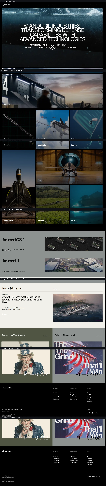
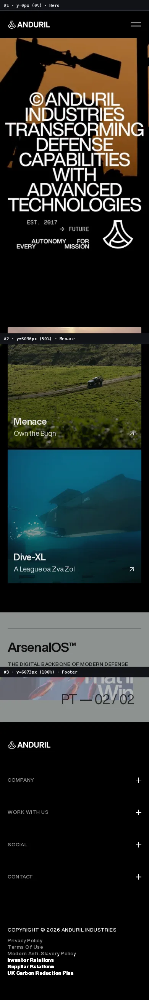

# UI Design System & Master Generation Blueprint: www-anduril-com

> **Transforming U.S. Defense Capabilities with Advanced Technology · Anduril** (https://www.anduril.com/) — Anduril Industries builds advanced autonomous systems and defense technology to protect US and allied forces. Creating the future of nati...





---

## 1. Executive Visual Persona & Design Archetype

- **Brand Essence & Persona**: **Transforming U.S. Defense Capabilities with Advanced Technology · Anduril** (`https://www.anduril.com/`). Anduril Industries builds advanced autonomous systems and defense technology to protect US and allied forces. Creating the future of nati...
- **Capture Provenance**: Live browser capture (`tier1_fast`, HTTP `200`, captured `2026-11-24`).
- **Visual Archetype**: **Dark-Substrate WebGL / Canvas Interactive Experience (`#000000` / `#ff3535`)**.
- **Anti-AI-Slop Differentiators**:
  - **Live-Computed Chromatic Polarity**: Anchors the viewport in `#000000` (live computed `body` `background-color` (`computed_styles.json`)) paired with `#ffffff` primary typography and `#ff3535` accents.
  - **Grounded Typographic Hierarchy**: Pairs `HelveticaNowDisplay` for display copy (`@[shortTitle]`) with `Elios`.
  - **Calibrated Spatial Grid & Motion**: Combines `1440px` container bounds (`gap: 1rem`, padding `8px`) with `cubic-bezier(.215,.62,.34,1)` easing and Lenis Smooth Scroll (`data-lenis`), Three.js / WebGL Canvas Pipeline.

---

## 2. Spatial Architecture & Modular Grid Mathematics

### Viewport Allocation & Container Geometry
- **Captured Journey Filmstrips**: Desktop `1280×5796px` (`assets/desktop-journey.webp`, `7` keyframes up to `y=4330px` / doc `5230px`), Mobile `390×2616px` (`assets/mobile-journey.webp`, `3` keyframes).
- **Master Container Bounds**: `1440px` (full-bleed `100%` desktop stage measured on `1440px` viewport).
- **Canvas Lateral Padding & Spacing**: `8px` lateral canvas padding with `1rem` grid gap.
- **Border Radius Scale**: `2px`, `100px`, `50%`, `5px`.

### Responsive Breakpoint Architecture
- **Desktop Layout**: Multi-column CSS Grid / Flexbox layout at `1440px` (`max-width: 1440px`, `gap: 1rem`).
- **Mobile Layout**: Single-column vertical stack at `390px` viewport width with `8px` horizontal padding.
- **Extracted CSS Media Queries**: `@media (max-width:768px)`, `@media (min-width:400px)`, `@media (min-width:768px)`, `@media (min-width:1280px)`.

---

## 3. Color System, Materiality & Atmospheric Lighting

### Semantic Palette & Source Grounding
| Semantic Role | Ground-Truth Value | Extracted Live / CSS Source |
|---|---|---|
| **Primary Canvas Substrate** | `#000000` | live computed `body` `background-color` (`computed_styles.json`) |
| **Primary Typography Ink** | `#ffffff` | live computed `h1` `color` (`computed_styles.json`) |
| **Elevated Surface / Card Substrate** | `#010101` | `var(--theme-color-background)` in `:root` |
| **Interactive Accent / Highlight** | `#ff3535` | `FormInput.FormInput .errorMessa... { color: #ff3535 }` |
| **Secondary / Muted Copy** | `#010101` | live computed `p` `color` (`computed_styles.json`) |
| **Structural Hairline Border** | `#010101` | `.AlgoliaPagination .next { border: #010101 }` |

### Sanitized Root CSS Variables (`ui-ux.md` Ground Truth)
| Variable Name | Extracted Value | Semantic Role |
|---|---|---|
| `--is-mob` | `0` | Design System Custom Token |
| `--theme-color-background` | `#010101` | Canvas / Surface Token |
| `--theme-color-text` | `#fff` | Typography Ink Token |
| `--base-color` | `black` | Brand / Palette Token |
| `--contrast-color` | `white` | Brand / Palette Token |
| `--linkbutton-color` | `#fff` | Typography Ink Token |
| `--linkbutton-hover-color` | `#010101` | Typography Ink Token |
| `--roller-scale` | `1` | Motion / Easing Token |
| `--roller-font-size` | `calc(3rem*var(--roller-scale))` | Typography / Scale Token |
| `--roller-column-height` | `calc(2.5rem*var(--roller-scale))` | Layout / Spatial Grid Token |
| `--roller-digit-width` | `calc(1.8rem*var(--roller-scale))` | Layout / Spatial Grid Token |
| `--links-height` | `0px` | Typography Ink Token |
| `--frosted` | `0` | Design System Custom Token |
| `--backgroundOpacity` | `0` | Canvas / Surface Token |
| `--in-production-h` | `max(505px,100vw*505/403)` | Dimension / Scale Token |
| `--focus-ring-color` | `currentColor` | Brand / Palette Token |

---

## 4. Typographic Scale & Editorial Hierarchy

### Font Family Stacks
- **Display Typography**: `HelveticaNowDisplay`.
- **Primary Body Stack**: `Elios`.
- **Technical / Metadata Stack**: not declared in live computed styles (uses primary stack / `ui-monospace`).

### Typographic Scale & Rules (Live Computed & Stylesheet Grounded)
- **Hero Display (`H1`)**: live computed `h1` (`font-size: 12px`, `line-height: 12.6px`, `font-weight: 500`, `letter-spacing: 0.48px`); rule `.title` (`font-size: 3rem`).
- **Section Heading (`H2`)**: live computed `h2` (`font-size: 24px`, `line-height: 27.6px`, `font-weight: 700`, `letter-spacing: -0.24px`); rule `h2` (`font-size: 8.75rem`, `line-height: 95%`, `letter-spacing: -.0875rem`, `font-weight: 500`).
- **Body Copy**: live computed `body` (`font-size: 16px`, `line-height: normal`, `font-weight: 400`); rule `p` (`font-size: 1.5rem`, `line-height: 115%`, `letter-spacing: -.015rem`, `font-weight: 400`).
- **Metadata & Navigation Labels**: live computed `nav/a` (`font-size: 16px`, `line-height: normal`, `font-weight: 400`); rule `.label` (`font-size: .75rem`, `line-height: 105%`, `letter-spacing: .03rem`, `font-weight: 500`).

---

## 5. Choreographed Motion & Interaction Physics

### Primary Easing Curves
- **Extracted Timing Functions**: `cubic-bezier(.215,.62,.34,1)`, `cubic-bezier(0.215,0.61,0.355,1)`, `cubic-bezier(0.19,1,0.22,1)`.

### Per-Element Transition & Choreography Rules
- **Selector `.AlgoliaPagination .next`**: `transition: background-color .5s,border-color .5s` extracted from `www-anduril-com` stylesheet.
- **Selector `.AlgoliaPagination .next svg`**: `transition: color .5s` extracted from `www-anduril-com` stylesheet.
- **Selector `.AlgoliaPagination .pageButton`**: `transition: opacity .5s` extracted from `www-anduril-com` stylesheet.
- **Extracted Easing Curve (`cubic-bezier(.215,.62,.34,1)`)**: Governs interactive state transitions across `<header.header>` and `<main.Header>`.
- **Runtime Interaction Engine**: Integrates Lenis Smooth Scroll (`data-lenis`), Three.js / WebGL Canvas Pipeline with `prefers-reduced-motion: reduce` fallback guards.
### Measured Runtime Scroll & Interaction Telemetry (`behavioral_journey_v2`)
- **Scroll Driver Mode**: `native` (max document height `5230px`, deepest scrollY reached `4330px` across `7` desktop keyframes).
- **Detected Scroll / Motion Libraries**: `Lenis`, `WebGL/Canvas`.
- **Route Transition Architecture**: First internal navigation (`/news`) measured as `direct` in `276ms`.

---

## 6. Component Wireframe & Structural DOM Map

### Visual Layout Schematic — Desktop (`1440px`, Grounded in `dom.html` & Landmark Bounding Boxes)
```
┌────────────────────────────────────────────────────────────────────────┐
│ DESKTOP VIEWPORT (1440px) — Transforming U.S. Defense Capabilities wit │
│ ====================================================================== │
│ [ <header.header> (1440px)            | Anduril Logo · Subterranean  ] │
│ ---------------------------------------------------------------------- │
│ | HERO STAGE: <main.GLA11y> (w=1425px)                               | │
│ | H1: @[shortTitle]                                                  | │
│ | Substrate: #000000 | Ink: #ffffff | Accent: #ff3535                | │
│ ---------------------------------------------------------------------- │
│ | SHOWCASE GRID (<main.Header>) max-w: 1440px                        | │
│ | +------------------------------+  +------------------------------+ | │
│ | | @[title]                     |  | Steelfin                     | | │
│ | +------------------------------+  +------------------------------+ | │
│ ---------------------------------------------------------------------- │
│ | DETAIL MODULE (<main.HeaderDesktop>) — Barracuda                   | │
│ ---------------------------------------------------------------------- │
│ [ FOOTER (<footer.Footer>     ) | https://www.anduril.com/             │
└────────────────────────────────────────────────────────────────────────┘
```

### Visual Layout Schematic — Mobile Reflow (`390px`)
```
┌────────────────────────────────────────────────────────────────────────┐
│ MOBILE VIEWPORT REFLOW (390px) — Single-Column Stack (gap: 1rem)       │
│ ====================================================================== │
│ [ HEADER BAR (<header.header>         ) | Compact Menu (390px)         │
│ ---------------------------------------------------------------------- │
│ | HERO STAGE (<main.GLA11y>) — 390px Vertical Lead                   | │
│ | H1: @[shortTitle]                                                  | │
│ ---------------------------------------------------------------------- │
│ | SHOWCASE STACK (<main.Header>) — 1-Col Stack                       | │
│ | [ Item 1: @[title]                                               ] | │
│ | [ Item 2: Steelfin                                               ] | │
│ ---------------------------------------------------------------------- │
│ | DETAIL STACK (<main.HeaderDesktop>) — 1-Col (Barracuda)            | │
│ ---------------------------------------------------------------------- │
│ [ FOOTER (<footer.Footer>     ) | Stacked 390px Colophon               │
└────────────────────────────────────────────────────────────────────────┘
```

### Granular DOM Region Breakdown
1. **Brand Header & Navigation Bar (<header.header> — `www-anduril-com`)**:
   - Landmark `<header class="header">` (`1440px`) hosting `Transforming U.S. Defense Capabiliti` navigation (`Anduril Logo · Subterranean · Space · Arsenal · Seapower`), DOM attributes (`data-path="/"`, `data-path="subterranean/future-s..."`, `data-label="Subterranean"`, `data-domain="Sea"`), and stylesheet rule `root { --is-mob:0 }`.
2. **Hero Stage & Focal Lead (<main.GLA11y> — `@[shortTitle]`)**:
   - Landmark `<main class="GLA11y">` presenting display lead `@[shortTitle]` and copy excerpt *"THE DIGITAL BACKBONE OF MODERN DEFENSE MANUFACTURING"* over `#000000` canvas and `#ffffff` ink.
3. **Primary Showcase & Content Grid (<main.Header> — `@[title]`)**:
   - Landmark `<main class="Header">` rendering section `@[title]` with copy *"The Digital Backbone of Modern Defense Manufacturing"*, asset references (`feed.xml`, `favicon.xxWKiVhdqu.ico`, `favicon.xxQR7xb3fo.svg`, `apple-touch-icon.xxx1TpF2gg.png`), and grid rule `Stage { width:100%;height:100%;margin:0;padding:0;overflow-x:clip }`.
4. **Interactive Detail & Feature Matrix (<main.HeaderDesktop> — `Steelfin`)**:
   - Landmark `<main class="HeaderDesktop">` framing `Steelfin` and `Barracuda` (*"A New Standard in Defense Manufacturing"*) with `#010101` surface cards, `#ff3535` accents, and `html { scrollbar-gutter:stable }`.
5. **Colophon & Global Directory Footer (<footer.Footer> — `https://www.anduril.com/`)**:
   - Landmark `<footer class="Footer">` anchoring `Transforming U.S. Defense Capabi` footer links (`Anduril Logo · Subterranean · Space · Arsenal · Seapower`), copy *"Anduril, U.S. Navy Invest $6.6 Billion to Expand America's S"*, and `#010101` structural dividers.
### Full Vertical Scroll Sequence (Desktop `1440×900` Keyframes)
- **Step 01** (`y=0px`, `0%`): Active landmark `Hero` · sticky/fixed elements: `1`
- **Step 02** (`y=850px`, `20%`): Active landmark `Arsenal-2` · sticky/fixed elements: `1`
- **Step 03** (`y=1700px`, `39%`): Active landmark `Steelfin` · sticky/fixed elements: `1`
- **Step 04** (`y=2550px`, `59%`): Active landmark `Roadrunner` · sticky/fixed elements: `1`
- **Step 05** (`y=3400px`, `79%`): Active landmark `Section @ 79%` · sticky/fixed elements: `1`
- **Step 06** (`y=4250px`, `98%`): Active landmark `Footer` · sticky/fixed elements: `1`
- **Step 07** (`y=4330px`, `100%`): Active landmark `Footer` · sticky/fixed elements: `1`

### Multi-Page Internal Route Map
- **Listing Route (`/news`)**: `https://www.anduril.com/news` — H1: `Newsroom · Anduril`, scrollHeight `3859px`, transition `direct` (`276ms`)
- **Detail Route (`/space/space`)**: `https://www.anduril.com/space/space` — H1: `Space`, scrollHeight `4532px`, transition `direct` (`154ms`)
- **About Route (`/careers`)**: `https://www.anduril.com/careers` — H1: `1`, scrollHeight `4779px`, transition `direct` (`161ms`)

---

## 7. Master Zero-Shot AI Generation Prompt

```markdown
# Master Zero-Shot Frontend Generation Prompt: www-anduril-com (Transforming U.S. Defense Capabilities with Advanced Technology · Anduril)

You are a principal frontend architect and design systems engineer. Build a complete, production-ready web application replicating the exact design system, DOM landmarks, typographic hierarchy, color tokens, and motion physics of `www-anduril-com` (**Transforming U.S. Defense Capabilities with Advanced Technology · Anduril** — `https://www.anduril.com/`).

### 1. Visual Archetype & Anti-AI-Slop Mandates
- **Archetype**: Dark-Substrate WebGL / Canvas Interactive Experience (`#000000` / `#ff3535`).
- **Identity & Domain Context**: Anduril Industries builds advanced autonomous systems and defense technology to protect US and allied forces. Creating the future of nati...
- **Primary Substrate**: `#000000` (live computed `body` `background-color` (`computed_styles.json`)), **Primary Ink**: `#ffffff`, **Accent / Highlight**: `#ff3535`.
- **Site-Specific Differentiators**:
  - **Live-Computed Chromatic Polarity**: Anchors the viewport in `#000000` (live computed `body` `background-color` (`computed_styles.json`)) paired with `#ffffff` primary typography and `#ff3535` accents.
  - **Grounded Typographic Hierarchy**: Pairs `HelveticaNowDisplay` for display copy (`@[shortTitle]`) with `Elios`.
  - **Calibrated Spatial Grid & Motion**: Combines `1440px` container bounds (`gap: 1rem`, padding `8px`) with `cubic-bezier(.215,.62,.34,1)` easing and Lenis Smooth Scroll (`data-lenis`), Three.js / WebGL Canvas Pipeline.

### 2. Ground-Truth CSS Variables (`:root` Token Contract)
Declare and consume these exact custom properties extracted from `www-anduril-com` in your global stylesheet:

:root {
  /* Transforming U.S. Defense Capabilities with Advanced Technology · Anduril (www-anduril-com) — Live-Grounded CSS Variables */
  --is-mob: 0; /* Design System Custom Token (www-anduril-com) */
  --theme-color-background: #010101; /* Canvas / Surface Token (www-anduril-com) */
  --theme-color-text: #fff; /* Typography Ink Token (www-anduril-com) */
  --base-color: black; /* Brand / Palette Token (www-anduril-com) */
  --contrast-color: white; /* Brand / Palette Token (www-anduril-com) */
  --linkbutton-color: #fff; /* Typography Ink Token (www-anduril-com) */
  --linkbutton-hover-color: #010101; /* Typography Ink Token (www-anduril-com) */
  --roller-scale: 1; /* Motion / Easing Token (www-anduril-com) */
  --roller-font-size: calc(3rem*var(--roller-scale)); /* Typography / Scale Token (www-anduril-com) */
  --roller-column-height: calc(2.5rem*var(--roller-scale)); /* Layout / Spatial Grid Token (www-anduril-com) */
  --roller-digit-width: calc(1.8rem*var(--roller-scale)); /* Layout / Spatial Grid Token (www-anduril-com) */
  --links-height: 0px; /* Typography Ink Token (www-anduril-com) */
  --frosted: 0; /* Design System Custom Token (www-anduril-com) */
  --backgroundOpacity: 0; /* Canvas / Surface Token (www-anduril-com) */
  --in-production-h: max(505px,100vw*505/403); /* Dimension / Scale Token (www-anduril-com) */
  --focus-ring-color: currentColor; /* Brand / Palette Token (www-anduril-com) */
}

### 3. Semantic Color & Materiality Contract
Map every surface, ink, and border strictly to these source-grounded tokens:
- **Primary Canvas Substrate**: `#000000` — grounded in live computed `body` `background-color` (`computed_styles.json`)
- **Primary Typography Ink**: `#ffffff` — grounded in live computed `h1` `color` (`computed_styles.json`)
- **Elevated Surface / Card Substrate**: `#010101` — grounded in `var(--theme-color-background)` in `:root`
- **Interactive Accent / Highlight**: `#ff3535` — grounded in `FormInput.FormInput .errorMessa... { color: #ff3535 }`
- **Secondary / Muted Copy**: `#010101` — grounded in live computed `p` `color` (`computed_styles.json`)
- **Structural Hairline Border**: `#010101` — grounded in `.AlgoliaPagination .next { border: #010101 }`

### 4. Spatial Grid, Container Bounds & Responsive Breakpoints
- **Desktop Viewport Reference**: `1280×5796px` (multi-frame vertical journey filmstrip (5796px), `1440px` standard desktop width).
- **Mobile Viewport Reference**: `390×2616px` (multi-frame vertical journey filmstrip (2616px), `390px` standard mobile width).
- **Container Max-Width**: `1440px` (full-bleed `100%` desktop stage measured on `1440px` viewport)
- **Padding & Gutters**: `8px` lateral canvas padding with `1rem` grid gap
- **Desktop Grid**: Multi-column CSS Grid / Flexbox layout at `1440px` (`max-width: 1440px`, `gap: 1rem`)
- **Mobile Adaptation**: Single-column vertical stack at `390px` viewport width with `8px` horizontal padding
- **Media Queries**: `@media (max-width:768px)`, `@media (min-width:400px)`, `@media (min-width:768px)`, `@media (min-width:1280px)`
- **Corner Radii**: `2px`, `100px`, `50%`, `5px`

### 5. Typography & Editorial Scale Contract
- **Display Font Stack**: `HelveticaNowDisplay`
- **Body Font Stack**: `Elios`
- **Monospace / Technical Font Stack**: not declared in live computed styles (uses primary stack / `ui-monospace`)
- **H1 Display Rule**: live computed `h1` (`font-size: 12px`, `line-height: 12.6px`, `font-weight: 500`, `letter-spacing: 0.48px`); rule `.title` (`font-size: 3rem`)
- **H2 Section Rule**: live computed `h2` (`font-size: 24px`, `line-height: 27.6px`, `font-weight: 700`, `letter-spacing: -0.24px`); rule `h2` (`font-size: 8.75rem`, `line-height: 95%`, `letter-spacing: -.0875rem`, `font-weight: 500`)
- **Body Copy Rule**: live computed `body` (`font-size: 16px`, `line-height: normal`, `font-weight: 400`); rule `p` (`font-size: 1.5rem`, `line-height: 115%`, `letter-spacing: -.015rem`, `font-weight: 400`)
- **Metadata & Index Rule**: live computed `nav/a` (`font-size: 16px`, `line-height: normal`, `font-weight: 400`); rule `.label` (`font-size: .75rem`, `line-height: 105%`, `letter-spacing: .03rem`, `font-weight: 500`)

### 6. Component Hierarchy, Verbatim Copy & Real DOM Landmarks
Scaffold `www-anduril-com` (`Transforming U.S. Defense Capabilities with Advanced Technology · Anduril`) with these exact structural regions, extracted copy, and CSS rules from `dom.html`:
1. **Brand Header & Navigation Bar (<header.header> — `www-anduril-com`)**:
   - DOM & Selectors: Landmark `<header class="header">` (`1440px`) hosting `Transforming U.S. Defense Capabiliti` navigation (`Anduril Logo · Subterranean · Space · Arsenal · Seapower`), DOM attributes (`data-path="/"`, `data-path="subterranean/future-s..."`, `data-label="Subterranean"`, `data-domain="Sea"`), and stylesheet rule `root { --is-mob:0 }`.
   - Responsive Contract: Header `Brand Header & Navigation Bar (<header.header> — `www-anduril-com`)` (`www-anduril-com`) adapts across `@media (max-width:768px)`, `@media (min-width:400px)`, `@media (min-width:768px)`, `@media (min-width:1280px)` with `cubic-bezier(.215,.62,.34,1)`, `cubic-bezier(0.215,0.61,0.355,1)`, `cubic-bezier(0.19,1,0.22,1)` transitions and links `Anduril Logo · Subterranean · Space · Arsenal · Seapower`.
2. **Hero Stage & Focal Lead (<main.GLA11y> — `@[shortTitle]`)**:
   - DOM & Selectors: Landmark `<main class="GLA11y">` presenting display lead `@[shortTitle]` and copy excerpt *"THE DIGITAL BACKBONE OF MODERN DEFENSE MANUFACTURING"* over `#000000` canvas and `#ffffff` ink.
   - Responsive Contract: Hero stage (`1280×5796px` desktop / `390×2616px` mobile) sets `#000000` background with `#ffffff` headline `@[shortTitle]`.
3. **Primary Showcase & Content Grid (<main.Header> — `@[title]`)**:
   - DOM & Selectors: Landmark `<main class="Header">` rendering section `@[title]` with copy *"The Digital Backbone of Modern Defense Manufacturing"*, asset references (`feed.xml`, `favicon.xxWKiVhdqu.ico`, `favicon.xxQR7xb3fo.svg`, `apple-touch-icon.xxx1TpF2gg.png`), and grid rule `Stage { width:100%;height:100%;margin:0;padding:0;overflow-x:clip }`.
   - Responsive Contract: Showcase grid `Primary Showcase & Content Grid (<main.Header> — `@[title]`)` applies Multi-column CSS Grid / Flexbox layout at `1440px` (`max-width: 1440px`, `gap: 1rem`) on desktop and Single-column vertical stack at `390px` viewport width with `8px` horizontal padding on mobile.
4. **Interactive Detail & Feature Matrix (<main.HeaderDesktop> — `Steelfin`)**:
   - DOM & Selectors: Landmark `<main class="HeaderDesktop">` framing `Steelfin` and `Barracuda` (*"A New Standard in Defense Manufacturing"*) with `#010101` surface cards, `#ff3535` accents, and `html { scrollbar-gutter:stable }`.
   - Responsive Contract: Detail module `Interactive Detail & Feature Matrix (<main.HeaderDesktop> — `Steelfin`)` uses `2px`, `100px`, `50%`, `5px` radii, `#ff3535` highlights, and assets (feed.xml, favicon.xxWKiVhdqu.ico, favicon.xxQR7xb3fo.svg).
5. **Colophon & Global Directory Footer (<footer.Footer> — `https://www.anduril.com/`)**:
   - DOM & Selectors: Landmark `<footer class="Footer">` anchoring `Transforming U.S. Defense Capabi` footer links (`Anduril Logo · Subterranean · Space · Arsenal · Seapower`), copy *"Anduril, U.S. Navy Invest $6.6 Billion to Expand America's S"*, and `#010101` structural dividers.
   - Responsive Contract: Footer `Colophon & Global Directory Footer (<footer.Footer> — `https://www.anduril.com/`)` aligns to `1440px` (full-bleed `100%` desktop stage measured on `1440px` viewport) with `8px` lateral canvas padding with `1rem` grid gap and attributes (data-path="/", data-path="subterranean/future-s...", data-label="Subterranean").

#### Verbatim DOM Copy Excerpts (`dom.html`)
- Copy Excerpt 1: *"THE DIGITAL BACKBONE OF MODERN DEFENSE MANUFACTURING"*
- Copy Excerpt 2: *"The Digital Backbone of Modern Defense Manufacturing"*
- Copy Excerpt 3: *"A New Standard in Defense Manufacturing"*
- Copy Excerpt 4: *"Anduril, U.S. Navy Invest $6.6 Billion to Expand America's Submarine Industrial Base"*

### 7. Motion, Extracted Stylesheet Rules & Interaction Choreography
- **Primary Easing Functions**: `cubic-bezier(.215,.62,.34,1)`, `cubic-bezier(0.215,0.61,0.355,1)`, `cubic-bezier(0.19,1,0.22,1)`
- **Extracted Stylesheet Rules (`www-anduril-com`)**:
- `root { --is-mob:0 }`
- `Stage { width:100%;height:100%;margin:0;padding:0;overflow-x:clip }`
- `html { scrollbar-gutter:stable }`
- `.mob { height:100vh;position:relative }`
- `.GLA11y { clip:rect(0 0 0 0);width:0;height:100%;position:absolute;overflow:hidden }`
- **Per-Selector Transition Rules**:
- **Selector `.AlgoliaPagination .next`**: `transition: background-color .5s,border-color .5s` extracted from `www-anduril-com` stylesheet.
- **Selector `.AlgoliaPagination .next svg`**: `transition: color .5s` extracted from `www-anduril-com` stylesheet.
- **Selector `.AlgoliaPagination .pageButton`**: `transition: opacity .5s` extracted from `www-anduril-com` stylesheet.
- **Extracted Easing Curve (`cubic-bezier(.215,.62,.34,1)`)**: Governs interactive state transitions across `<header.header>` and `<main.Header>`.
- **Runtime Interaction Engine**: Integrates Lenis Smooth Scroll (`data-lenis`), Three.js / WebGL Canvas Pipeline with `prefers-reduced-motion: reduce` fallback guards.
### 7b. Full-Page Scroll Choreography, Interactive States & Multi-Page Routes
- **Scroll Mechanics**: Implement `native` vertical progression up to `5230px` across 7 distinct viewport chapters using Lenis, WebGL/Canvas.
- **Vertical Chapter Sequence**: Hero (0%) -> Arsenal-2 (20%) -> Steelfin (39%) -> Roadrunner (59%) -> Section @ 79% (79%) -> Footer (98%) -> Footer (100%).
- **Multi-Page Routes**: Scaffold internal routes `/news` (listing, direct), `/space/space` (detail, direct), `/careers` (about, direct) sharing the global header/footer shell and design tokens.

### 8. Technical Deliverables
- Implement in Next.js (App Router) with TypeScript and Tailwind CSS consuming the `:root` custom properties defined above for `www-anduril-com`.
- Reproduce both the `1440px` desktop architecture and `390px` mobile breakpoint transitions, preserving semantic HTML5 landmarks (`<header>`, `<nav>`, `<main>`, `<section>`, `<footer>`) and `prefers-reduced-motion` accessibility guards.
```
---

## 8. Full-Page Scroll Journey, Interactive States & Subpage Inventory

### Desktop Scroll Keyframes (`1440×900` WebP)
| Step | Scroll Y | Progress | Active Landmark / Section | Sticky/Fixed | Visual Asset |
| :---: | :---: | :---: | :--- | :---: | :--- |
| `#01` | `0px` | `0%` | Hero | `1` | [desktop-step-01.webp](assets/desktop-step-01.webp) |
| `#02` | `850px` | `20%` | Arsenal-2 | `1` | [desktop-step-02.webp](assets/desktop-step-02.webp) |
| `#03` | `1700px` | `39%` | Steelfin | `1` | [desktop-step-03.webp](assets/desktop-step-03.webp) |
| `#04` | `2550px` | `59%` | Roadrunner | `1` | [desktop-step-04.webp](assets/desktop-step-04.webp) |
| `#05` | `3400px` | `79%` | Section @ 79% | `1` | [desktop-step-05.webp](assets/desktop-step-05.webp) |
| `#06` | `4250px` | `98%` | Footer | `1` | [desktop-step-06.webp](assets/desktop-step-06.webp) |
| `#07` | `4330px` | `100%` | Footer | `1` | [desktop-step-07.webp](assets/desktop-step-07.webp) |

### Mobile Condensed Keyframes (`390×844` WebP)
| Step | Scroll Y | Progress | Active Landmark | Visual Asset |
| :---: | :---: | :---: | :--- | :--- |
| `#01` | `0px` | `0%` | Hero | [mobile-step-01.webp](assets/mobile-step-01.webp) |
| `#02` | `3036px` | `50%` | Menace | [mobile-step-02.webp](assets/mobile-step-02.webp) |
| `#03` | `6073px` | `100%` | Footer | [mobile-step-03.webp](assets/mobile-step-03.webp) |

### Internal Subpage Filmstrips (`1080px` Wide WebP)
| # | Template | Route URL | H1 / Title | Scroll Height | Transition | Filmstrip Asset |
| :-: | :---: | :--- | :--- | :---: | :---: | :--- |
| `1` | `listing` | `https://www.anduril.com/news` | Newsroom · Anduril | `3859px` | `direct` (`276ms`) | [subpage-01-news.webp](assets/subpage-01-news.webp) |
| `2` | `detail` | `https://www.anduril.com/space/space` | Space | `4532px` | `direct` (`154ms`) | [subpage-02-space-space.webp](assets/subpage-02-space-space.webp) |
| `3` | `about` | `https://www.anduril.com/careers` | 1 | `4779px` | `direct` (`161ms`) | [subpage-03-careers.webp](assets/subpage-03-careers.webp) |

