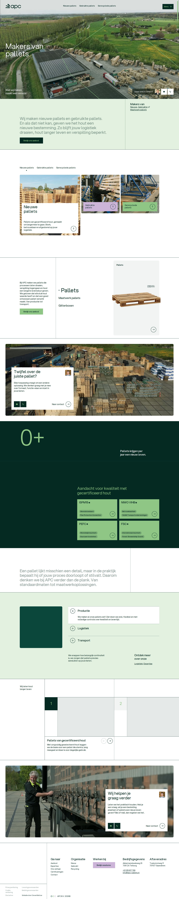
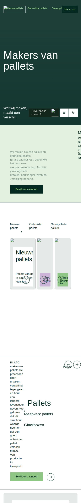

# UI Design System & Master Generation Blueprint: www-apc-pallets-nl

> **Algemeen Pallet Centrum · APC** (https://www.apc-pallets.nl/) — Pallets kopen? Nieuwe, gebruikte & gerecyclede pallets gemaakt van gecertificeerd hout. Sterk, betrouwbaar & op maat voor jouw logistiek....



---

## 1. Executive Visual Persona & Design Archetype

- **Brand Essence & Persona**: **Algemeen Pallet Centrum · APC** (`https://www.apc-pallets.nl/`). Pallets kopen? Nieuwe, gebruikte & gerecyclede pallets gemaakt van gecertificeerd hout. Sterk, betrouwbaar & op maat voor jouw logistiek....
- **Visual Archetype**: **Dark-Substrate WebGL / Canvas Interactive Experience (`#0c473b` / `#e3f1e0`)**.
- **Anti-AI-Slop Differentiators**:
  - **Source-Grounded Chromatic Polarity**: Anchors the viewport in `#0c473b` (`var(--swatch--mid-green)` in `:root`) paired with `#e3f1e0` primary typography and `#e3f1e0` accents.
  - **Extracted Typographic Hierarchy**: Pairs `Aspekta` for display copy (`Makers van pallets`) with `.875rem` and not declared in static CSS (uses primary stack / `ui-monospace`).
  - **Calibrated Spatial Grid & Motion**: Combines `940px` container bounds (`gap: 16px`, padding `9px`) with `cubic-bezier(.421,.014,.041,.985)` easing and Lenis Smooth Scroll (`data-lenis`), GSAP Timeline & ScrollTrigger.

---

## 2. Spatial Architecture & Modular Grid Mathematics



### Viewport Allocation & Container Geometry
- **Captured Viewport Dimensions**: Desktop `1440×7217px` (`assets/desktop.png`, full-page scroll capture), Mobile `390×2400px` (`assets/mobile.png`, capped at 2400px multi-section capture).
- **Master Container Bounds**: `940px` extracted from `www-apc-pallets-nl` stylesheet.
- **Canvas Lateral Padding & Spacing**: `9px` lateral canvas padding with `16px` grid gap.
- **Border Radius Scale**: `3px`, `100%`, `50%`, `var(--radius--main)`.

### Responsive Breakpoint Architecture
- **Desktop Layout**: Multi-column CSS Grid / Flexbox layout at `1440px` (`max-width: 940px`, `gap: 16px`).
- **Mobile Layout**: Single-column vertical stack at `390px` viewport width with `9px` horizontal padding.
- **Extracted CSS Media Queries**: `@media screen and (max-width: 991px)`, `@media screen and (max-width: 767px)`, `@media screen and (max-width: 479px)`, `@media (min-width: 768px)`.

---

## 3. Color System, Materiality & Atmospheric Lighting

### Semantic Palette & Source Grounding
| Semantic Role | Ground-Truth Value | Extracted CSS Source / Selector |
|---|---|---|
| **Primary Canvas Substrate** | `#0c473b` | `var(--swatch--mid-green)` in `:root` |
| **Primary Typography Ink** | `#90c685` | `var(--swatch--light-green)` in `:root` |
| **Elevated Surface / Card Substrate** | `#042a22` | `var(--swatch--dark-green)` in `:root` |
| **Interactive Accent / Highlight** | `#e3f1e0` | `var(--swatch--pale-green)` in `:root` |
| **Secondary / Muted Copy** | `#ccb4d8` | `var(--swatch--purple)` in `:root` |
| **Structural Hairline Border** | `#0000` | `a { background-color: #0000 }` |

### Sanitized Root CSS Variables (`ui-ux.md` Ground Truth)
| Variable Name | Extracted Value | Semantic Role |
|---|---|---|
| `--w-backdrop-animation` | `initial` | Motion / Easing Token |
| `--_theme---background` | `var(--swatch--white)` | Canvas / Surface Token |
| `--_text-style---font-family` | `var(--_typography---font--primary-family)` | Typography Ink Token |
| `--_theme---text` | `var(--swatch--brand-text)` | Typography Ink Token |
| `--_text-style---font-size` | `var(--_typography---font-size--text-main)` | Typography Ink Token |
| `--_text-style---line-height` | `var(--_typography---line-height--1-35)` | Typography Ink Token |
| `--_text-style---font-weight` | `var(--_typography---font--primary-400)` | Typography Ink Token |
| `--_text-style---letter-spacing` | `var(--_typography---letter-spacing--normal)` | Typography Ink Token |
| `--site--gutter` | `2rem` | Layout / Spatial Grid Token |
| `--_spacing---space--10rem` | `10rem` | Layout / Spatial Grid Token |
| `--radius--main` | `.5rem` | Elevation / Border Token |
| `--_theme---background-2` | `var(--swatch--pale-green)` | Canvas / Surface Token |
| `--site--column-count` | `12` | Layout / Spatial Grid Token |
| `--_responsive---large` | `1` | Design System Custom Token |
| `--_responsive---medium` | `0` | Design System Custom Token |
| `--_responsive---small` | `0` | Design System Custom Token |

---

## 4. Typographic Scale & Editorial Hierarchy

### Font Family Stacks
- **Display Typography**: `Aspekta`.
- **Primary Body Stack**: `.875rem`.
- **Technical / Metadata Stack**: not declared in static CSS (uses primary stack / `ui-monospace`).

### Typographic Scale & Rules (Extracted from Stylesheet & Variables)
- **Hero Display (`H1`)**: CSS variables `--_typography---font-size--h1: 3.75rem`, `--_typography---font-size--display: 6rem`; rule `h1` (`font-size: 2em`).
- **Section Heading (`H2`)**: CSS variables `--_typography---font-size--h2: 3rem`; rule `h2` (`font-size: 32px`, `line-height: 36px`).
- **Body Copy**: rule `body` (`font-size: 14px`, `line-height: 20px`).
- **Metadata & Navigation Labels**: CSS variables `--_text-style---letter-spacing: var(--_typography---letter-spacing--normal)`, `--_responsive---small: 0`, `--_responsive---xsmall: 0`; rule `small` (`font-size: 80%`).

---

## 5. Choreographed Motion & Interaction Physics

### Primary Easing Curves
- **Extracted Timing Functions**: `cubic-bezier(.421,.014,.041,.985)`, `cubic-bezier(.48,.002,.035,.996)`, `cubic-bezier(.25,.46,.45,.94)`.

### Per-Element Transition & Choreography Rules
- **Selector `.w-webflow-badge > img`**: `transition: unset` extracted from `www-apc-pallets-nl` stylesheet.
- **Selector `.w-slider-dot`**: `transition: background-color .1s, color .1s` extracted from `www-apc-pallets-nl` stylesheet.
- **Selector `.w-lightbox-control`**: `transition: all .3s` extracted from `www-apc-pallets-nl` stylesheet.
- **Extracted Easing Curve (`cubic-bezier(.421,.014,.041,.985)`)**: Governs interactive state transitions across `<nav.nav_component>` and `<section.u-section>`.
- **Runtime Interaction Engine**: Integrates Lenis Smooth Scroll (`data-lenis`), GSAP Timeline & ScrollTrigger, Three.js / WebGL Canvas Pipeline, Swiper Touch Carousel Engine with `prefers-reduced-motion: reduce` fallback guards.

---

## 6. Component Wireframe & Structural DOM Map

### Visual Layout Schematic (Grounded in `dom.html` — `1440px` Desktop & `390px` Mobile Reflow)
```
┌────────────────────────────────────────────────────────────────────────┐
│ DESKTOP VIEWPORT (1440px) — Algemeen Pallet Centrum · APC              │
│ ====================================================================== │
│ [ <nav.nav_component>      | Contact · Vacatures · Nieuwe pallets · ]  │
│ ---------------------------------------------------------------------- │
│ | HERO STAGE: <section.u-section>                                  |   │
│ | H1: Makers van pallets                                           |   │
│ | Substrate: #0c473b    | Ink: #e3f1e0    | Accent: #e3f1e0        |   │
│ ---------------------------------------------------------------------- │
│ | SHOWCASE GRID (<section.u-section>       ) max-w: 940px          |   │
│ | +------------------------------+  +------------------------------+ | │
│ | | Twijfel over de juiste palle |  | Aandacht voor kwaliteit met  | | │
│ | +------------------------------+  +------------------------------+ | │
│ ---------------------------------------------------------------------- │
│ | MOBILE VIEWPORT REFLOW (390px) — Single-Column Stack (gap: 16px  ) | │
│ | [<nav.nav_component] -> [<section.u-section] -> [<section.u-section] │
│ ---------------------------------------------------------------------- │
│ [ FOOTER (<footer.footer_compone) | https://www.apc-pallets.nl/        │
└────────────────────────────────────────────────────────────────────────┘
```

### Granular DOM Region Breakdown
1. **Brand Header & Navigation Bar (<nav.nav_component> — `www-apc-pallets-nl`)**:
   - Landmark `<nav class="nav_component">` hosting `Algemeen Pallet Centrum · APC` navigation (`Contact · Vacatures · Nieuwe pallets · Gebruikte pallets · Gerecyclede pallets`), DOM attributes (`data-wf-domain="www.apc-pallets.nl"`, `data-wf-page="693a8a0b940fefc38834a6ec"`, `data-wf-site="693a8a0a940fefc38834a67f"`, `data-padding-bottom="none"`), and stylesheet rule `html { -webkit-text-size-adjust: 100%; -ms-text-size-adjust: 100%; font-family:... }`.
2. **Hero Stage & Focal Lead (<section.u-section> — `Makers van pallets`)**:
   - Landmark `<section class="u-section section_header">` presenting display lead `Makers van pallets` and copy excerpt *"Gerecyclede pallets"* over `#0c473b` canvas and `#e3f1e0` ink.
3. **Primary Showcase & Content Grid (<section.u-section> — `Twijfel over de juiste pallet?`)**:
   - Landmark `<section class="u-section section_home_subheader">` rendering section `Twijfel over de juiste pallet?` with copy *"Makers van verschil"*, asset references (`cdn.prod.website-files.com`, `apcdev.webflow.shared.2991ca99e.css`, `clarity.js`, `array.js`), and grid rule `body { margin: 0; }`.
4. **Interactive Detail & Feature Matrix (<section.u-section> — `Aandacht voor kwaliteit met gecert`)**:
   - Landmark `<section class="u-section">` framing `Aandacht voor kwaliteit met gecertificeerd hout` and `ISPM15` (*"Wat wij maken, maakt een verschil"*) with `#042a22` surface cards, `#e3f1e0` accents, and `summary { display: block; }`.
5. **Colophon & Global Directory Footer (<footer.footer_component> — `https://www.apc-pallets.nl/`)**:
   - Landmark `<footer class="footer_component">` anchoring `Algemeen Pallet Centrum · APC` footer links (`Contact · Vacatures · Nieuwe pallets · Gebruikte pallets · Gerecyclede pallets`), copy *"W i j m a k e n n i e u w e p a l l e t s e n g e b r u i k "*, and `#0000` structural dividers.

---

## 7. Master Zero-Shot AI Generation Prompt

```markdown
# Master Zero-Shot Frontend Generation Prompt: www-apc-pallets-nl (Algemeen Pallet Centrum · APC)

You are a principal frontend architect and design systems engineer. Build a complete, production-ready web application replicating the exact design system, DOM landmarks, typographic hierarchy, color tokens, and motion physics of `www-apc-pallets-nl` (**Algemeen Pallet Centrum · APC** — `https://www.apc-pallets.nl/`).

### 1. Visual Archetype & Anti-AI-Slop Mandates
- **Archetype**: Dark-Substrate WebGL / Canvas Interactive Experience (`#0c473b` / `#e3f1e0`).
- **Identity & Domain Context**: Pallets kopen? Nieuwe, gebruikte & gerecyclede pallets gemaakt van gecertificeerd hout. Sterk, betrouwbaar & op maat voor jouw logistiek....
- **Primary Substrate**: `#0c473b` (`var(--swatch--mid-green)` in `:root`), **Primary Ink**: `#e3f1e0`, **Accent / Highlight**: `#e3f1e0`.
- **Site-Specific Differentiators**:
  - **Source-Grounded Chromatic Polarity**: Anchors the viewport in `#0c473b` (`var(--swatch--mid-green)` in `:root`) paired with `#e3f1e0` primary typography and `#e3f1e0` accents.
  - **Extracted Typographic Hierarchy**: Pairs `Aspekta` for display copy (`Makers van pallets`) with `.875rem` and not declared in static CSS (uses primary stack / `ui-monospace`).
  - **Calibrated Spatial Grid & Motion**: Combines `940px` container bounds (`gap: 16px`, padding `9px`) with `cubic-bezier(.421,.014,.041,.985)` easing and Lenis Smooth Scroll (`data-lenis`), GSAP Timeline & ScrollTrigger.

### 2. Ground-Truth CSS Variables (`:root` Token Contract)
Declare and consume these exact custom properties extracted from `www-apc-pallets-nl` in your global stylesheet:

:root {
  /* Algemeen Pallet Centrum · APC (www-apc-pallets-nl) — Ground-Truth Extracted CSS Variables */
  --w-backdrop-animation: initial; /* Motion / Easing Token (www-apc-pallets-nl) */
  --_theme---background: var(--swatch--white); /* Canvas / Surface Token (www-apc-pallets-nl) */
  --_text-style---font-family: var(--_typography---font--primary-family); /* Typography Ink Token (www-apc-pallets-nl) */
  --_theme---text: var(--swatch--brand-text); /* Typography Ink Token (www-apc-pallets-nl) */
  --_text-style---font-size: var(--_typography---font-size--text-main); /* Typography Ink Token (www-apc-pallets-nl) */
  --_text-style---line-height: var(--_typography---line-height--1-35); /* Typography Ink Token (www-apc-pallets-nl) */
  --_text-style---font-weight: var(--_typography---font--primary-400); /* Typography Ink Token (www-apc-pallets-nl) */
  --_text-style---letter-spacing: var(--_typography---letter-spacing--normal); /* Typography Ink Token (www-apc-pallets-nl) */
  --site--gutter: 2rem; /* Layout / Spatial Grid Token (www-apc-pallets-nl) */
  --_spacing---space--10rem: 10rem; /* Layout / Spatial Grid Token (www-apc-pallets-nl) */
  --radius--main: .5rem; /* Elevation / Border Token (www-apc-pallets-nl) */
  --_theme---background-2: var(--swatch--pale-green); /* Canvas / Surface Token (www-apc-pallets-nl) */
  --site--column-count: 12; /* Layout / Spatial Grid Token (www-apc-pallets-nl) */
  --_responsive---large: 1; /* Design System Custom Token (www-apc-pallets-nl) */
  --_responsive---medium: 0; /* Design System Custom Token (www-apc-pallets-nl) */
  --_responsive---small: 0; /* Design System Custom Token (www-apc-pallets-nl) */
}

### 3. Semantic Color & Materiality Contract
Map every surface, ink, and border strictly to these source-grounded tokens:
- **Primary Canvas Substrate**: `#0c473b` — grounded in `var(--swatch--mid-green)` in `:root`
- **Primary Typography Ink**: `#90c685` — grounded in `var(--swatch--light-green)` in `:root`
- **Elevated Surface / Card Substrate**: `#042a22` — grounded in `var(--swatch--dark-green)` in `:root`
- **Interactive Accent / Highlight**: `#e3f1e0` — grounded in `var(--swatch--pale-green)` in `:root`
- **Secondary / Muted Copy**: `#ccb4d8` — grounded in `var(--swatch--purple)` in `:root`
- **Structural Hairline Border**: `#0000` — grounded in `a { background-color: #0000 }`

### 4. Spatial Grid, Container Bounds & Responsive Breakpoints
- **Desktop Viewport Reference**: `1440×7217px` (full-page scroll capture, `1440px` standard desktop width).
- **Mobile Viewport Reference**: `390×2400px` (capped at 2400px multi-section capture, `390px` standard mobile width).
- **Container Max-Width**: `940px` extracted from `www-apc-pallets-nl` stylesheet
- **Padding & Gutters**: `9px` lateral canvas padding with `16px` grid gap
- **Desktop Grid**: Multi-column CSS Grid / Flexbox layout at `1440px` (`max-width: 940px`, `gap: 16px`)
- **Mobile Adaptation**: Single-column vertical stack at `390px` viewport width with `9px` horizontal padding
- **Media Queries**: `@media screen and (max-width: 991px)`, `@media screen and (max-width: 767px)`, `@media screen and (max-width: 479px)`, `@media (min-width: 768px)`
- **Corner Radii**: `3px`, `100%`, `50%`, `var(--radius--main)`

### 5. Typography & Editorial Scale Contract
- **Display Font Stack**: `Aspekta`
- **Body Font Stack**: `.875rem`
- **Monospace / Technical Font Stack**: not declared in static CSS (uses primary stack / `ui-monospace`)
- **H1 Display Rule**: CSS variables `--_typography---font-size--h1: 3.75rem`, `--_typography---font-size--display: 6rem`; rule `h1` (`font-size: 2em`)
- **H2 Section Rule**: CSS variables `--_typography---font-size--h2: 3rem`; rule `h2` (`font-size: 32px`, `line-height: 36px`)
- **Body Copy Rule**: rule `body` (`font-size: 14px`, `line-height: 20px`)
- **Metadata & Index Rule**: CSS variables `--_text-style---letter-spacing: var(--_typography---letter-spacing--normal)`, `--_responsive---small: 0`, `--_responsive---xsmall: 0`; rule `small` (`font-size: 80%`)

### 6. Component Hierarchy, Verbatim Copy & Real DOM Landmarks
Scaffold `www-apc-pallets-nl` (`Algemeen Pallet Centrum · APC`) with these exact structural regions, extracted copy, and CSS rules from `dom.html`:
1. **Brand Header & Navigation Bar (<nav.nav_component> — `www-apc-pallets-nl`)**:
   - DOM & Selectors: Landmark `<nav class="nav_component">` hosting `Algemeen Pallet Centrum · APC` navigation (`Contact · Vacatures · Nieuwe pallets · Gebruikte pallets · Gerecyclede pallets`), DOM attributes (`data-wf-domain="www.apc-pallets.nl"`, `data-wf-page="693a8a0b940fefc38834a6ec"`, `data-wf-site="693a8a0a940fefc38834a67f"`, `data-padding-bottom="none"`), and stylesheet rule `html { -webkit-text-size-adjust: 100%; -ms-text-size-adjust: 100%; font-family:... }`.
   - Responsive Contract: Header `Brand Header & Navigation Bar (<nav.nav_component> — `www-apc-pallets-nl`)` (`www-apc-pallets-nl`) adapts across `@media screen and (max-width: 991px)`, `@media screen and (max-width: 767px)`, `@media screen and (max-width: 479px)`, `@media (min-width: 768px)` with `cubic-bezier(.421,.014,.041,.985)`, `cubic-bezier(.48,.002,.035,.996)`, `cubic-bezier(.25,.46,.45,.94)` transitions and links `Contact · Vacatures · Nieuwe pallets · Gebruikte pallets · Gerecyclede pallets`.
2. **Hero Stage & Focal Lead (<section.u-section> — `Makers van pallets`)**:
   - DOM & Selectors: Landmark `<section class="u-section section_header">` presenting display lead `Makers van pallets` and copy excerpt *"Gerecyclede pallets"* over `#0c473b` canvas and `#e3f1e0` ink.
   - Responsive Contract: Hero stage (`1440×7217px` desktop / `390×2400px` mobile) sets `#0c473b` background with `#e3f1e0` headline `Makers van pallets`.
3. **Primary Showcase & Content Grid (<section.u-section> — `Twijfel over de juiste pallet?`)**:
   - DOM & Selectors: Landmark `<section class="u-section section_home_subheader">` rendering section `Twijfel over de juiste pallet?` with copy *"Makers van verschil"*, asset references (`cdn.prod.website-files.com`, `apcdev.webflow.shared.2991ca99e.css`, `clarity.js`, `array.js`), and grid rule `body { margin: 0; }`.
   - Responsive Contract: Showcase grid `Primary Showcase & Content Grid (<section.u-section> — `Twijfel over de juiste pallet?`)` applies Multi-column CSS Grid / Flexbox layout at `1440px` (`max-width: 940px`, `gap: 16px`) on desktop and Single-column vertical stack at `390px` viewport width with `9px` horizontal padding on mobile.
4. **Interactive Detail & Feature Matrix (<section.u-section> — `Aandacht voor kwaliteit met gecert`)**:
   - DOM & Selectors: Landmark `<section class="u-section">` framing `Aandacht voor kwaliteit met gecertificeerd hout` and `ISPM15` (*"Wat wij maken, maakt een verschil"*) with `#042a22` surface cards, `#e3f1e0` accents, and `summary { display: block; }`.
   - Responsive Contract: Detail module `Interactive Detail & Feature Matrix (<section.u-section> — `Aandacht voor kwaliteit met gecert`)` uses `3px`, `100%`, `50%`, `var(--radius--main)` radii, `#e3f1e0` highlights, and assets (cdn.prod.website-files.com, apcdev.webflow.shared.2991ca99e.css, clarity.js).
5. **Colophon & Global Directory Footer (<footer.footer_component> — `https://www.apc-pallets.nl/`)**:
   - DOM & Selectors: Landmark `<footer class="footer_component">` anchoring `Algemeen Pallet Centrum · APC` footer links (`Contact · Vacatures · Nieuwe pallets · Gebruikte pallets · Gerecyclede pallets`), copy *"W i j m a k e n n i e u w e p a l l e t s e n g e b r u i k "*, and `#0000` structural dividers.
   - Responsive Contract: Footer `Colophon & Global Directory Footer (<footer.footer_component> — `https://www.apc-pallets.nl/`)` aligns to `940px` extracted from `www-apc-pallets-nl` stylesheet with `9px` lateral canvas padding with `16px` grid gap and attributes (data-wf-domain="www.apc-pallets.nl", data-wf-page="693a8a0b940fefc38834a6ec", data-wf-site="693a8a0a940fefc38834a67f").

#### Verbatim DOM Copy Excerpts (`dom.html`)
- Copy Excerpt 1: *"Gerecyclede pallets"*
- Copy Excerpt 2: *"Makers van verschil"*
- Copy Excerpt 3: *"Wat wij maken, maakt een verschil"*
- Copy Excerpt 4: *"W i j m a k e n n i e u w e p a l l e t s e n g e b r u i k t e p a l l e t s . E..."*

### 7. Motion, Extracted Stylesheet Rules & Interaction Choreography
- **Primary Easing Functions**: `cubic-bezier(.421,.014,.041,.985)`, `cubic-bezier(.48,.002,.035,.996)`, `cubic-bezier(.25,.46,.45,.94)`
- **Extracted Stylesheet Rules (`www-apc-pallets-nl`)**:
- `html { -webkit-text-size-adjust: 100%; -ms-text-size-adjust: 100%; font-family:... }`
- `body { margin: 0; }`
- `summary { display: block; }`
- `video { vertical-align: baseline; display: inline-block; }`
- `template { display: none; }`
- **Per-Selector Transition Rules**:
- **Selector `.w-webflow-badge > img`**: `transition: unset` extracted from `www-apc-pallets-nl` stylesheet.
- **Selector `.w-slider-dot`**: `transition: background-color .1s, color .1s` extracted from `www-apc-pallets-nl` stylesheet.
- **Selector `.w-lightbox-control`**: `transition: all .3s` extracted from `www-apc-pallets-nl` stylesheet.
- **Extracted Easing Curve (`cubic-bezier(.421,.014,.041,.985)`)**: Governs interactive state transitions across `<nav.nav_component>` and `<section.u-section>`.
- **Runtime Interaction Engine**: Integrates Lenis Smooth Scroll (`data-lenis`), GSAP Timeline & ScrollTrigger, Three.js / WebGL Canvas Pipeline, Swiper Touch Carousel Engine with `prefers-reduced-motion: reduce` fallback guards.

### 8. Technical Deliverables
- Implement in Next.js (App Router) with TypeScript and Tailwind CSS consuming the `:root` custom properties defined above for `www-apc-pallets-nl`.
- Reproduce both the `1440px` desktop architecture and `390px` mobile breakpoint transitions, preserving semantic HTML5 landmarks (`<header>`, `<nav>`, `<main>`, `<section>`, `<footer>`) and `prefers-reduced-motion` accessibility guards.
```
