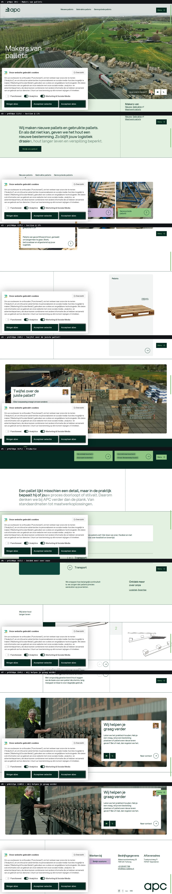
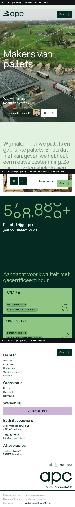

# UI Design System & Master Generation Blueprint: www-apc-pallets-nl

> **Algemeen Pallet Centrum · APC** (https://www.apc-pallets.nl/) — Pallets kopen? Nieuwe, gebruikte & gerecyclede pallets gemaakt van gecertificeerd hout. Sterk, betrouwbaar & op maat voor jouw logistiek....





---

## 1. Executive Visual Persona & Design Archetype

- **Brand Essence & Persona**: **Algemeen Pallet Centrum · APC** (`https://www.apc-pallets.nl/`). Pallets kopen? Nieuwe, gebruikte & gerecyclede pallets gemaakt van gecertificeerd hout. Sterk, betrouwbaar & op maat voor jouw logistiek....
- **Capture Provenance**: Live browser capture (`tier1_fast`, HTTP `200`, captured `2026-11-24`).
- **Visual Archetype**: **Light-Gallery WebGL / Canvas Interactive Experience (`#ffffff` / `#0082f3`)**.
- **Anti-AI-Slop Differentiators**:
  - **Live-Computed Chromatic Polarity**: Anchors the viewport in `#ffffff` (live computed `body` `background-color` (`computed_styles.json`)) paired with `#042a22` primary typography and `#0082f3` accents.
  - **Grounded Typographic Hierarchy**: Uses `Aspekta` across display (`Makers van pallets`) and body copy.
  - **Calibrated Spatial Grid & Motion**: Combines `75rem` container bounds (`gap: 16px`, padding `9px`) with `cubic-bezier(.421,.014,.041,.985)` easing and Lenis Smooth Scroll (`data-lenis`), GSAP Timeline & ScrollTrigger.

---

## 2. Spatial Architecture & Modular Grid Mathematics

### Viewport Allocation & Container Geometry
- **Captured Journey Filmstrips**: Desktop `1280×6624px` (`assets/desktop-journey.webp`, `8` keyframes up to `y=6317px` / doc `7217px`), Mobile `390×2616px` (`assets/mobile-journey.webp`, `3` keyframes).
- **Master Container Bounds**: `75rem` (non-`@media` desktop container stylesheet rule).
- **Canvas Lateral Padding & Spacing**: `9px` lateral canvas padding with `16px` grid gap.
- **Border Radius Scale**: `3px`, `100%`, `50%`, `var(--radius--main)`.

### Responsive Breakpoint Architecture
- **Desktop Layout**: Multi-column CSS Grid / Flexbox layout at `1440px` (`max-width: 75rem`, `gap: 16px`).
- **Mobile Layout**: Single-column vertical stack at `390px` viewport width with `9px` horizontal padding.
- **Extracted CSS Media Queries**: `@media screen and (max-width: 991px)`, `@media screen and (max-width: 767px)`, `@media screen and (max-width: 479px)`, `@media (min-width: 768px)`.

---

## 3. Color System, Materiality & Atmospheric Lighting

### Semantic Palette & Source Grounding
| Semantic Role | Ground-Truth Value | Extracted Live / CSS Source |
|---|---|---|
| **Primary Canvas Substrate** | `#ffffff` | live computed `body` `background-color` (`computed_styles.json`) |
| **Primary Typography Ink** | `#042a22` | live computed `main` `color` (`computed_styles.json`) |
| **Elevated Surface / Card Substrate** | `#f5f5f5` | `var(--consent-studio-default-header-action-bg-color)` in `:root` |
| **Interactive Accent / Highlight** | `#0082f3` | `.w-dropdown-link.w--current { color: #0082f3 }` |
| **Secondary / Muted Copy** | `#333333` | `var(--consent-studio-default-heading-text-color)` in `:root` |
| **Structural Hairline Border** | `#e2e2e2` | `blockquote { border-left: #e2e2e2 }` |

### Sanitized Root CSS Variables (`ui-ux.md` Ground Truth)
| Variable Name | Extracted Value | Semantic Role |
|---|---|---|
| `--_theme---background` | `var(--swatch--white)` | Canvas / Surface Token |
| `--_text-style---font-family` | `var(--_typography---font--primary-family)` | Typography Ink Token |
| `--_theme---text` | `var(--swatch--brand-text)` | Typography Ink Token |
| `--_text-style---font-size` | `var(--_typography---font-size--text-main)` | Typography Ink Token |
| `--_text-style---line-height` | `var(--_typography---line-height--1-35)` | Typography Ink Token |
| `--_text-style---font-weight` | `var(--_typography---font--primary-400)` | Typography Ink Token |
| `--_text-style---letter-spacing` | `var(--_typography---letter-spacing--normal)` | Typography Ink Token |
| `--site--gutter` | `2rem` | Layout / Spatial Grid Token |
| `--_spacing---space--10rem` | `10rem` | Layout / Spatial Grid Token |
| `--radius--main` | `.5rem` | Elevation / Border Token |
| `--_theme---background-2` | `var(--swatch--pale-green)` | Canvas / Surface Token |
| `--site--column-count` | `12` | Layout / Spatial Grid Token |
| `--_responsive---large` | `1` | Design System Custom Token |
| `--_responsive---medium` | `0` | Design System Custom Token |
| `--_responsive---small` | `0` | Design System Custom Token |
| `--_responsive---xsmall` | `0` | Design System Custom Token |

---

## 4. Typographic Scale & Editorial Hierarchy

### Font Family Stacks
- **Display Typography**: `Aspekta`.
- **Primary Body Stack**: `Aspekta`.
- **Technical / Metadata Stack**: not declared in live computed styles (uses primary stack / `ui-monospace`).

### Typographic Scale & Rules (Live Computed & Stylesheet Grounded)
- **Hero Display (`H1`)**: CSS variables `--_typography---font-size--h1: 3.75rem`, `--_typography---font-size--display: 6rem`; rule `h1` (`font-size: 2em`).
- **Section Heading (`H2`)**: live computed `h2` (`font-size: 60px`, `line-height: 60px`, `font-weight: 350`); CSS variables `--_typography---font-size--h2: 3rem`; rule `h2` (`font-size: 32px`, `line-height: 36px`).
- **Body Copy**: live computed `body` (`font-size: 16px`, `line-height: 21.6px`, `font-weight: 400`); CSS variables `--consent-studio-mixed-body-font-weight: inherit`, `--consent-studio-typo-body-min-font-size: 14px`; rule `body` (`font-size: 14px`, `line-height: 20px`).
- **Metadata & Navigation Labels**: live computed `nav/a` (`font-size: 16px`, `line-height: 21.6px`, `font-weight: 400`); CSS variables `--_text-style---letter-spacing: var(--_typography---letter-spacing--normal)`, `--_responsive---small: 0`, `--_responsive---xsmall: 0`; rule `small` (`font-size: 80%`).

---

## 5. Choreographed Motion & Interaction Physics

### Primary Easing Curves
- **Extracted Timing Functions**: `cubic-bezier(.421,.014,.041,.985)`, `cubic-bezier(.48,.002,.035,.996)`, `cubic-bezier(.25,.46,.45,.94)`.

### Per-Element Transition & Choreography Rules
- **Selector `.w-webflow-badge > img`**: `transition: unset` extracted from `www-apc-pallets-nl` stylesheet.
- **Selector `.w-slider-dot`**: `transition: background-color .1s, color .1s` extracted from `www-apc-pallets-nl` stylesheet.
- **Selector `.w-lightbox-control`**: `transition: all .3s` extracted from `www-apc-pallets-nl` stylesheet.
- **Extracted Easing Curve (`cubic-bezier(.421,.014,.041,.985)`)**: Governs interactive state transitions across `<nav.nav_component>` and `<section.section_home_subheader>`.
- **Runtime Interaction Engine**: Integrates Lenis Smooth Scroll (`data-lenis`), GSAP Timeline & ScrollTrigger, Three.js / WebGL Canvas Pipeline, Swiper Touch Carousel Engine with `prefers-reduced-motion: reduce` fallback guards.
### Measured Runtime Scroll & Interaction Telemetry (`behavioral_journey_v2`)
- **Scroll Driver Mode**: `native` (max document height `7217px`, deepest scrollY reached `6317px` across `8` desktop keyframes).
- **Detected Scroll / Motion Libraries**: `Lenis`, `GSAP/ScrollTrigger`, `WebGL/Canvas`.
- **Hover Physics (`primary_cta` · `Nieuwe`)**: Computed transition `0.15s` / `ease` (no static color/transform shift captured at rest).
- **Route Transition Architecture**: First internal navigation (`/aanbod/pallets`) measured as `direct` in `3980ms`.

---

## 6. Component Wireframe & Structural DOM Map

### Visual Layout Schematic — Desktop (`1440px`, Grounded in `dom.html` & Landmark Bounding Boxes)
```
┌────────────────────────────────────────────────────────────────────────┐
│ DESKTOP VIEWPORT (1440px) — Algemeen Pallet Centrum · APC              │
│ ====================================================================== │
│ [ <nav.nav_component> (1440x80px)     | Contact · Vacatures · Nieuwe ] │
│ ---------------------------------------------------------------------- │
│ | HERO STAGE: <section.u-section> (w=1440px)                         | │
│ | H1: Makers van pallets                                             | │
│ | Substrate: #ffffff | Ink: #042a22 | Accent: #0082f3                | │
│ ---------------------------------------------------------------------- │
│ | SHOWCASE GRID (<section.section_home_subh) max-w: 75rem            | │
│ | +------------------------------+  +------------------------------+ | │
│ | | Twijfel over de juiste palle |  | Aandacht voor kwaliteit met  | | │
│ | +------------------------------+  +------------------------------+ | │
│ ---------------------------------------------------------------------- │
│ | DETAIL MODULE (<section.u-section:nth(2)>) — Ontdek meer over onze | │
│ ---------------------------------------------------------------------- │
│ [ FOOTER (<footer.footer_compo) | https://www.apc-pallets.nl/          │
└────────────────────────────────────────────────────────────────────────┘
```

### Visual Layout Schematic — Mobile Reflow (`390px`)
```
┌────────────────────────────────────────────────────────────────────────┐
│ MOBILE VIEWPORT REFLOW (390px) — Single-Column Stack (gap: 16px)       │
│ ====================================================================== │
│ [ HEADER BAR (<nav.nav_component>     ) | Compact Menu (390px)         │
│ ---------------------------------------------------------------------- │
│ | HERO STAGE (<section.u-section>) — 390px Vertical Lead             | │
│ | H1: Makers van pallets                                             | │
│ ---------------------------------------------------------------------- │
│ | SHOWCASE STACK (<section.section_home_) — 1-Col Stack              | │
│ | [ Item 1: Twijfel over de juiste pallet?                         ] | │
│ | [ Item 2: Aandacht voor kwaliteit met gecertificeerd hout        ] | │
│ ---------------------------------------------------------------------- │
│ | DETAIL STACK (<section.u-section:nth(2) — 1-Col (Ontdek meer over o) │
│ ---------------------------------------------------------------------- │
│ [ FOOTER (<footer.footer_compo) | Stacked 390px Colophon               │
└────────────────────────────────────────────────────────────────────────┘
```

### Granular DOM Region Breakdown
1. **Brand Header & Navigation Bar (<nav.nav_component> — `www-apc-pallets-nl`)**:
   - Landmark `<nav class="nav_component">` (`1440x80px`) hosting `Algemeen Pallet Centrum · APC` navigation (`Contact · Vacatures · Nieuwe pallets · Gebruikte pallets · Gerecyclede pallets`), DOM attributes (`data-wf-domain="www.apc-pallets.nl"`, `data-wf-page="693a8a0b940fefc38834a6ec"`, `data-wf-site="693a8a0a940fefc38834a67f"`, `data-padding-bottom="none"`), and stylesheet rule `html { -webkit-text-size-adjust: 100%; -ms-text-size-adjust: 100%; font-family:... }`.
2. **Hero Stage & Focal Lead (<section.u-section> — `Makers van pallets`)**:
   - Landmark `<section class="u-section section_header">` presenting display lead `Makers van pallets` and copy excerpt *"Wat wij maken, maakt een verschil"* over `#ffffff` canvas and `#042a22` ink.
3. **Primary Showcase & Content Grid (<section.section_home_subheader> — `Twijfel over de juiste pallet?`)**:
   - Landmark `<section class="u-section section_home_subheader">` rendering section `Twijfel over de juiste pallet?` with copy *"W i j m a k e n n i e u w e p a l l e t s e n g e b r u i k t e p"*, asset references (`cdn.prod.website-files.com`, `apcdev.webflow.shared.2991ca99e.css`, `clarity.js`, `array.js`), and grid rule `body { margin: 0; }`.
4. **Interactive Detail & Feature Matrix (<section.u-section:nth(2)> — `Aandacht voor kwaliteit met gecert`)**:
   - Landmark `<section class="u-section">` framing `Aandacht voor kwaliteit met gecertificeerd hout` and `Ontdek meer over onze` (*"Nieuwe , Gebruikte of Maatwerk pallets"*) with `#f5f5f5` surface cards, `#0082f3` accents, and `summary { display: block; }`.
5. **Colophon & Global Directory Footer (<footer.footer_component> — `https://www.apc-pallets.nl/`)**:
   - Landmark `<footer class="footer_component">` anchoring `Algemeen Pallet Centrum · APC` footer links (`Contact · Vacatures · Nieuwe pallets · Gebruikte pallets · Gerecyclede pallets`), copy *"Elke toepassing vraagt om een andere oplossing. We denken gr"*, and `#e2e2e2` structural dividers.
### Full Vertical Scroll Sequence (Desktop `1440×900` Keyframes)
- **Step 01** (`y=0px`, `0%`): Active landmark `Makers van pallets` · sticky/fixed elements: `1`
- **Step 02** (`y=850px`, `13%`): Active landmark `Section @ 13%` · sticky/fixed elements: `1`
- **Step 03** (`y=1700px`, `27%`): Active landmark `Section @ 27%` · sticky/fixed elements: `1`
- **Step 04** (`y=2550px`, `40%`): Active landmark `Twijfel over de juiste pallet?` · sticky/fixed elements: `1`
- **Step 05** (`y=4250px`, `67%`): Active landmark `Productie` · sticky/fixed elements: `1`
- **Step 06** (`y=5100px`, `81%`): Active landmark `Ontdek meer over onze` · sticky/fixed elements: `1`
- **Step 07** (`y=5950px`, `94%`): Active landmark `Wij helpen je graag verder` · sticky/fixed elements: `1`
- **Step 08** (`y=6317px`, `100%`): Active landmark `Wij helpen je graag verder` · sticky/fixed elements: `1`

### Multi-Page Internal Route Map
- **Detail Route (`/aanbod/pallets`)**: `https://www.apc-pallets.nl/aanbod/pallets` — H1: `Pallets`, scrollHeight `3893px`, transition `direct` (`3980ms`)
- **About Route (`/contact`)**: `https://www.apc-pallets.nl/contact` — H1: `Kom in contact`, scrollHeight `2916px`, transition `direct` (`2325ms`)
- **Detail Route (`/aanbod/maatwerk-pallets`)**: `https://www.apc-pallets.nl/aanbod/maatwerk-pallets` — H1: `Maatwerk pallets`, scrollHeight `4205px`, transition `direct` (`1750ms`)

---

## 7. Master Zero-Shot AI Generation Prompt

```markdown
# Master Zero-Shot Frontend Generation Prompt: www-apc-pallets-nl (Algemeen Pallet Centrum · APC)

You are a principal frontend architect and design systems engineer. Build a complete, production-ready web application replicating the exact design system, DOM landmarks, typographic hierarchy, color tokens, and motion physics of `www-apc-pallets-nl` (**Algemeen Pallet Centrum · APC** — `https://www.apc-pallets.nl/`).

### 1. Visual Archetype & Anti-AI-Slop Mandates
- **Archetype**: Light-Gallery WebGL / Canvas Interactive Experience (`#ffffff` / `#0082f3`).
- **Identity & Domain Context**: Pallets kopen? Nieuwe, gebruikte & gerecyclede pallets gemaakt van gecertificeerd hout. Sterk, betrouwbaar & op maat voor jouw logistiek....
- **Primary Substrate**: `#ffffff` (live computed `body` `background-color` (`computed_styles.json`)), **Primary Ink**: `#042a22`, **Accent / Highlight**: `#0082f3`.
- **Site-Specific Differentiators**:
  - **Live-Computed Chromatic Polarity**: Anchors the viewport in `#ffffff` (live computed `body` `background-color` (`computed_styles.json`)) paired with `#042a22` primary typography and `#0082f3` accents.
  - **Grounded Typographic Hierarchy**: Uses `Aspekta` across display (`Makers van pallets`) and body copy.
  - **Calibrated Spatial Grid & Motion**: Combines `75rem` container bounds (`gap: 16px`, padding `9px`) with `cubic-bezier(.421,.014,.041,.985)` easing and Lenis Smooth Scroll (`data-lenis`), GSAP Timeline & ScrollTrigger.

### 2. Ground-Truth CSS Variables (`:root` Token Contract)
Declare and consume these exact custom properties extracted from `www-apc-pallets-nl` in your global stylesheet:

:root {
  /* Algemeen Pallet Centrum · APC (www-apc-pallets-nl) — Live-Grounded CSS Variables */
  --_theme---background: var(--swatch--white); /* Canvas / Surface Token (www-apc-pallets-nl) */
  --_text-style---font-family: var(--_typography---font--primary-family); /* Typography Ink Token (www-apc-pallets-nl) */
  --_theme---text: var(--swatch--brand-text); /* Typography Ink Token (www-apc-pallets-nl) */
  --_text-style---font-size: var(--_typography---font-size--text-main); /* Typography Ink Token (www-apc-pallets-nl) */
  --_text-style---line-height: var(--_typography---line-height--1-35); /* Typography Ink Token (www-apc-pallets-nl) */
  --_text-style---font-weight: var(--_typography---font--primary-400); /* Typography Ink Token (www-apc-pallets-nl) */
  --_text-style---letter-spacing: var(--_typography---letter-spacing--normal); /* Typography Ink Token (www-apc-pallets-nl) */
  --site--gutter: 2rem; /* Layout / Spatial Grid Token (www-apc-pallets-nl) */
  --_spacing---space--10rem: 10rem; /* Layout / Spatial Grid Token (www-apc-pallets-nl) */
  --radius--main: .5rem; /* Elevation / Border Token (www-apc-pallets-nl) */
  --_theme---background-2: var(--swatch--pale-green); /* Canvas / Surface Token (www-apc-pallets-nl) */
  --site--column-count: 12; /* Layout / Spatial Grid Token (www-apc-pallets-nl) */
  --_responsive---large: 1; /* Design System Custom Token (www-apc-pallets-nl) */
  --_responsive---medium: 0; /* Design System Custom Token (www-apc-pallets-nl) */
  --_responsive---small: 0; /* Design System Custom Token (www-apc-pallets-nl) */
  --_responsive---xsmall: 0; /* Design System Custom Token (www-apc-pallets-nl) */
}

### 3. Semantic Color & Materiality Contract
Map every surface, ink, and border strictly to these source-grounded tokens:
- **Primary Canvas Substrate**: `#ffffff` — grounded in live computed `body` `background-color` (`computed_styles.json`)
- **Primary Typography Ink**: `#042a22` — grounded in live computed `main` `color` (`computed_styles.json`)
- **Elevated Surface / Card Substrate**: `#f5f5f5` — grounded in `var(--consent-studio-default-header-action-bg-color)` in `:root`
- **Interactive Accent / Highlight**: `#0082f3` — grounded in `.w-dropdown-link.w--current { color: #0082f3 }`
- **Secondary / Muted Copy**: `#333333` — grounded in `var(--consent-studio-default-heading-text-color)` in `:root`
- **Structural Hairline Border**: `#e2e2e2` — grounded in `blockquote { border-left: #e2e2e2 }`

### 4. Spatial Grid, Container Bounds & Responsive Breakpoints
- **Desktop Viewport Reference**: `1280×6624px` (multi-frame vertical journey filmstrip (6624px), `1440px` standard desktop width).
- **Mobile Viewport Reference**: `390×2616px` (multi-frame vertical journey filmstrip (2616px), `390px` standard mobile width).
- **Container Max-Width**: `75rem` (non-`@media` desktop container stylesheet rule)
- **Padding & Gutters**: `9px` lateral canvas padding with `16px` grid gap
- **Desktop Grid**: Multi-column CSS Grid / Flexbox layout at `1440px` (`max-width: 75rem`, `gap: 16px`)
- **Mobile Adaptation**: Single-column vertical stack at `390px` viewport width with `9px` horizontal padding
- **Media Queries**: `@media screen and (max-width: 991px)`, `@media screen and (max-width: 767px)`, `@media screen and (max-width: 479px)`, `@media (min-width: 768px)`
- **Corner Radii**: `3px`, `100%`, `50%`, `var(--radius--main)`

### 5. Typography & Editorial Scale Contract
- **Display Font Stack**: `Aspekta`
- **Body Font Stack**: `Aspekta`
- **Monospace / Technical Font Stack**: not declared in live computed styles (uses primary stack / `ui-monospace`)
- **H1 Display Rule**: CSS variables `--_typography---font-size--h1: 3.75rem`, `--_typography---font-size--display: 6rem`; rule `h1` (`font-size: 2em`)
- **H2 Section Rule**: live computed `h2` (`font-size: 60px`, `line-height: 60px`, `font-weight: 350`); CSS variables `--_typography---font-size--h2: 3rem`; rule `h2` (`font-size: 32px`, `line-height: 36px`)
- **Body Copy Rule**: live computed `body` (`font-size: 16px`, `line-height: 21.6px`, `font-weight: 400`); CSS variables `--consent-studio-mixed-body-font-weight: inherit`, `--consent-studio-typo-body-min-font-size: 14px`; rule `body` (`font-size: 14px`, `line-height: 20px`)
- **Metadata & Index Rule**: live computed `nav/a` (`font-size: 16px`, `line-height: 21.6px`, `font-weight: 400`); CSS variables `--_text-style---letter-spacing: var(--_typography---letter-spacing--normal)`, `--_responsive---small: 0`, `--_responsive---xsmall: 0`; rule `small` (`font-size: 80%`)

### 6. Component Hierarchy, Verbatim Copy & Real DOM Landmarks
Scaffold `www-apc-pallets-nl` (`Algemeen Pallet Centrum · APC`) with these exact structural regions, extracted copy, and CSS rules from `dom.html`:
1. **Brand Header & Navigation Bar (<nav.nav_component> — `www-apc-pallets-nl`)**:
   - DOM & Selectors: Landmark `<nav class="nav_component">` (`1440x80px`) hosting `Algemeen Pallet Centrum · APC` navigation (`Contact · Vacatures · Nieuwe pallets · Gebruikte pallets · Gerecyclede pallets`), DOM attributes (`data-wf-domain="www.apc-pallets.nl"`, `data-wf-page="693a8a0b940fefc38834a6ec"`, `data-wf-site="693a8a0a940fefc38834a67f"`, `data-padding-bottom="none"`), and stylesheet rule `html { -webkit-text-size-adjust: 100%; -ms-text-size-adjust: 100%; font-family:... }`.
   - Responsive Contract: Header `Brand Header & Navigation Bar (<nav.nav_component> — `www-apc-pallets-nl`)` (`www-apc-pallets-nl`) adapts across `@media screen and (max-width: 991px)`, `@media screen and (max-width: 767px)`, `@media screen and (max-width: 479px)`, `@media (min-width: 768px)` with `cubic-bezier(.421,.014,.041,.985)`, `cubic-bezier(.48,.002,.035,.996)`, `cubic-bezier(.25,.46,.45,.94)` transitions and links `Contact · Vacatures · Nieuwe pallets · Gebruikte pallets · Gerecyclede pallets`.
2. **Hero Stage & Focal Lead (<section.u-section> — `Makers van pallets`)**:
   - DOM & Selectors: Landmark `<section class="u-section section_header">` presenting display lead `Makers van pallets` and copy excerpt *"Wat wij maken, maakt een verschil"* over `#ffffff` canvas and `#042a22` ink.
   - Responsive Contract: Hero stage (`1280×6624px` desktop / `390×2616px` mobile) sets `#ffffff` background with `#042a22` headline `Makers van pallets`.
3. **Primary Showcase & Content Grid (<section.section_home_subheader> — `Twijfel over de juiste pallet?`)**:
   - DOM & Selectors: Landmark `<section class="u-section section_home_subheader">` rendering section `Twijfel over de juiste pallet?` with copy *"W i j m a k e n n i e u w e p a l l e t s e n g e b r u i k t e p"*, asset references (`cdn.prod.website-files.com`, `apcdev.webflow.shared.2991ca99e.css`, `clarity.js`, `array.js`), and grid rule `body { margin: 0; }`.
   - Responsive Contract: Showcase grid `Primary Showcase & Content Grid (<section.section_home_subheader> — `Twijfel over de juiste pallet?`)` applies Multi-column CSS Grid / Flexbox layout at `1440px` (`max-width: 75rem`, `gap: 16px`) on desktop and Single-column vertical stack at `390px` viewport width with `9px` horizontal padding on mobile.
4. **Interactive Detail & Feature Matrix (<section.u-section:nth(2)> — `Aandacht voor kwaliteit met gecert`)**:
   - DOM & Selectors: Landmark `<section class="u-section">` framing `Aandacht voor kwaliteit met gecertificeerd hout` and `Ontdek meer over onze` (*"Nieuwe , Gebruikte of Maatwerk pallets"*) with `#f5f5f5` surface cards, `#0082f3` accents, and `summary { display: block; }`.
   - Responsive Contract: Detail module `Interactive Detail & Feature Matrix (<section.u-section:nth(2)> — `Aandacht voor kwaliteit met gecert`)` uses `3px`, `100%`, `50%`, `var(--radius--main)` radii, `#0082f3` highlights, and assets (cdn.prod.website-files.com, apcdev.webflow.shared.2991ca99e.css, clarity.js).
5. **Colophon & Global Directory Footer (<footer.footer_component> — `https://www.apc-pallets.nl/`)**:
   - DOM & Selectors: Landmark `<footer class="footer_component">` anchoring `Algemeen Pallet Centrum · APC` footer links (`Contact · Vacatures · Nieuwe pallets · Gebruikte pallets · Gerecyclede pallets`), copy *"Elke toepassing vraagt om een andere oplossing. We denken gr"*, and `#e2e2e2` structural dividers.
   - Responsive Contract: Footer `Colophon & Global Directory Footer (<footer.footer_component> — `https://www.apc-pallets.nl/`)` aligns to `75rem` (non-`@media` desktop container stylesheet rule) with `9px` lateral canvas padding with `16px` grid gap and attributes (data-wf-domain="www.apc-pallets.nl", data-wf-page="693a8a0b940fefc38834a6ec", data-wf-site="693a8a0a940fefc38834a67f").

#### Verbatim DOM Copy Excerpts (`dom.html`)
- Copy Excerpt 1: *"Wat wij maken, maakt een verschil"*
- Copy Excerpt 2: *"W i j m a k e n n i e u w e p a l l e t s e n g e b r u i k t e p a l l e t s . E..."*
- Copy Excerpt 3: *"Nieuwe , Gebruikte of Maatwerk pallets"*
- Copy Excerpt 4: *"Elke toepassing vraagt om een andere oplossing. We denken graag met je mee over fo..."*

### 7. Motion, Extracted Stylesheet Rules & Interaction Choreography
- **Primary Easing Functions**: `cubic-bezier(.421,.014,.041,.985)`, `cubic-bezier(.48,.002,.035,.996)`, `cubic-bezier(.25,.46,.45,.94)`
- **Extracted Stylesheet Rules (`www-apc-pallets-nl`)**:
- `html { -webkit-text-size-adjust: 100%; -ms-text-size-adjust: 100%; font-family:... }`
- `body { margin: 0; }`
- `summary { display: block; }`
- `video { vertical-align: baseline; display: inline-block; }`
- `template { display: none; }`
- **Per-Selector Transition Rules**:
- **Selector `.w-webflow-badge > img`**: `transition: unset` extracted from `www-apc-pallets-nl` stylesheet.
- **Selector `.w-slider-dot`**: `transition: background-color .1s, color .1s` extracted from `www-apc-pallets-nl` stylesheet.
- **Selector `.w-lightbox-control`**: `transition: all .3s` extracted from `www-apc-pallets-nl` stylesheet.
- **Extracted Easing Curve (`cubic-bezier(.421,.014,.041,.985)`)**: Governs interactive state transitions across `<nav.nav_component>` and `<section.section_home_subheader>`.
- **Runtime Interaction Engine**: Integrates Lenis Smooth Scroll (`data-lenis`), GSAP Timeline & ScrollTrigger, Three.js / WebGL Canvas Pipeline, Swiper Touch Carousel Engine with `prefers-reduced-motion: reduce` fallback guards.
### 7b. Full-Page Scroll Choreography, Interactive States & Multi-Page Routes
- **Scroll Mechanics**: Implement `native` vertical progression up to `7217px` across 8 distinct viewport chapters using Lenis, GSAP/ScrollTrigger, WebGL/Canvas.
- **Vertical Chapter Sequence**: Makers van pallets (0%) -> Section @ 13% (13%) -> Section @ 27% (27%) -> Twijfel over de juiste pallet? (40%) -> Productie (67%) -> Ontdek meer over onze (81%) -> Wij helpen je graag verder (94%) -> Wij helpen je graag verder (100%).
- **Multi-Page Routes**: Scaffold internal routes `/aanbod/pallets` (detail, direct), `/contact` (about, direct), `/aanbod/maatwerk-pallets` (detail, direct) sharing the global header/footer shell and design tokens.

### 8. Technical Deliverables
- Implement in Next.js (App Router) with TypeScript and Tailwind CSS consuming the `:root` custom properties defined above for `www-apc-pallets-nl`.
- Reproduce both the `1440px` desktop architecture and `390px` mobile breakpoint transitions, preserving semantic HTML5 landmarks (`<header>`, `<nav>`, `<main>`, `<section>`, `<footer>`) and `prefers-reduced-motion` accessibility guards.
```
---

## 8. Full-Page Scroll Journey, Interactive States & Subpage Inventory

### Desktop Scroll Keyframes (`1440×900` WebP)
| Step | Scroll Y | Progress | Active Landmark / Section | Sticky/Fixed | Visual Asset |
| :---: | :---: | :---: | :--- | :---: | :--- |
| `#01` | `0px` | `0%` | Makers van pallets | `1` | [desktop-step-01.webp](assets/desktop-step-01.webp) |
| `#02` | `850px` | `13%` | Section @ 13% | `1` | [desktop-step-02.webp](assets/desktop-step-02.webp) |
| `#03` | `1700px` | `27%` | Section @ 27% | `1` | [desktop-step-03.webp](assets/desktop-step-03.webp) |
| `#04` | `2550px` | `40%` | Twijfel over de juiste pallet? | `1` | [desktop-step-04.webp](assets/desktop-step-04.webp) |
| `#05` | `4250px` | `67%` | Productie | `1` | [desktop-step-05.webp](assets/desktop-step-05.webp) |
| `#06` | `5100px` | `81%` | Ontdek meer over onze | `1` | [desktop-step-06.webp](assets/desktop-step-06.webp) |
| `#07` | `5950px` | `94%` | Wij helpen je graag verder | `1` | [desktop-step-07.webp](assets/desktop-step-07.webp) |
| `#08` | `6317px` | `100%` | Wij helpen je graag verder | `1` | [desktop-step-08.webp](assets/desktop-step-08.webp) |

### Mobile Condensed Keyframes (`390×844` WebP)
| Step | Scroll Y | Progress | Active Landmark | Visual Asset |
| :---: | :---: | :---: | :--- | :--- |
| `#01` | `0px` | `0%` | Makers van pallets | [mobile-step-01.webp](assets/mobile-step-01.webp) |
| `#02` | `3608px` | `50%` | Aandacht voor kwaliteit met gecertificeer... | [mobile-step-02.webp](assets/mobile-step-02.webp) |
| `#03` | `7216px` | `100%` | Organisatie | [mobile-step-03.webp](assets/mobile-step-03.webp) |

### Internal Subpage Filmstrips (`1080px` Wide WebP)
| # | Template | Route URL | H1 / Title | Scroll Height | Transition | Filmstrip Asset |
| :-: | :---: | :--- | :--- | :---: | :---: | :--- |
| `1` | `detail` | `https://www.apc-pallets.nl/aanbod/pallets` | Pallets | `3893px` | `direct` (`3980ms`) | [subpage-01-aanbod-pallets.webp](assets/subpage-01-aanbod-pallets.webp) |
| `2` | `about` | `https://www.apc-pallets.nl/contact` | Kom in contact | `2916px` | `direct` (`2325ms`) | [subpage-02-contact.webp](assets/subpage-02-contact.webp) |
| `3` | `detail` | `https://www.apc-pallets.nl/aanbod/maatwerk-pallets` | Maatwerk pallets | `4205px` | `direct` (`1750ms`) | [subpage-03-aanbod-maatwerk-pallets.webp](assets/subpage-03-aanbod-maatwerk-pallets.webp) |

