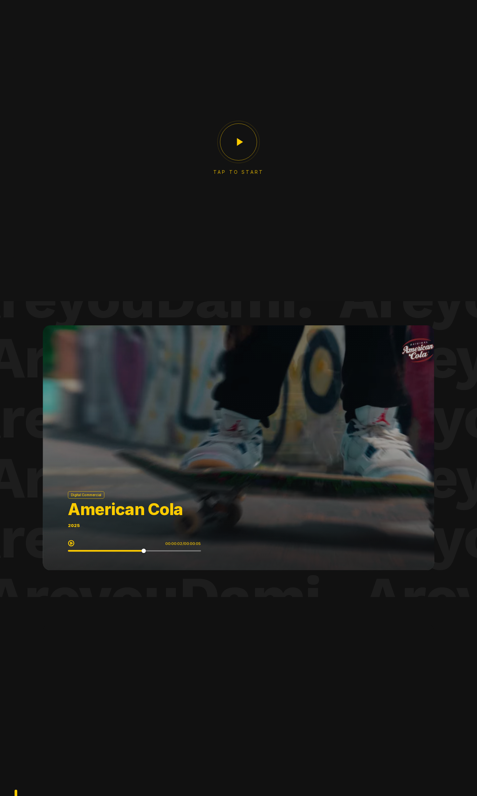

# UI Design System & Master Generation Blueprint: www-areyoudami-com

> **AreyouDami. — Damilare Olawoyin, Creative Director** (https://www.areyoudami.com) — Damilare Olawoyin (AreyouDami.) — creative director & editor based in Lagos. Bringing stories that push emotions. Edit. Color. VFX.



---

## 1. Executive Visual Persona & Design Archetype

- **Brand Essence & Persona**: **AreyouDami. — Damilare Olawoyin, Creative Director** (`https://www.areyoudami.com`). Damilare Olawoyin (AreyouDami.) — creative director & editor based in Lagos. Bringing stories that push emotions. Edit. Color. VFX.
- **Capture Provenance**: Live browser capture (`tier1_fast`, HTTP `200`, captured `2026-11-23`).
- **Visual Archetype**: **Dark-Substrate WebGL / Canvas Interactive Experience (`#111111` / `#ffcc00`)**.
- **Anti-AI-Slop Differentiators**:
  - **Live-Computed Chromatic Polarity**: Anchors the viewport in `#111111` (live computed `body` `background-color` (`computed_styles.json`)) paired with `#ffffff` primary typography and `#ffcc00` accents.
  - **Grounded Typographic Hierarchy**: Pairs `Inter` for display copy (`AreyouDami.`) with `Inter` and `SFMono-Regular`.
  - **Calibrated Spatial Grid & Motion**: Combines `1440px` container bounds (`gap: 6px`, padding `40px`) with `cubic-bezier(0,0,.2,1)` easing and Lenis Smooth Scroll (`data-lenis`), HTML5 `<canvas>` Interactive Viewport Surface.

---

## 2. Spatial Architecture & Modular Grid Mathematics


### Viewport Allocation & Container Geometry
- **Captured Viewport Dimensions**: Desktop `1440×2400px` (`assets/desktop.png`, clamped at 2400px live multi-section capture), Mobile `390×2400px` (`assets/mobile.png`, clamped at 2400px live multi-section capture).
- **Master Container Bounds**: `1440px` (full-bleed `100%` desktop stage measured on `1440px` viewport).
- **Canvas Lateral Padding & Spacing**: `40px` lateral canvas padding with `6px` grid gap.
- **Border Radius Scale**: `2px`, `3px`, `4px`, `5px`.

### Responsive Breakpoint Architecture
- **Desktop Layout**: Multi-column CSS Grid / Flexbox layout at `1440px` (`max-width: 1440px`, `gap: 6px`).
- **Mobile Layout**: Single-column vertical stack at `390px` viewport width with `40px` horizontal padding.
- **Extracted CSS Media Queries**: `@media (min-width:40rem)`, `@media (min-width:48rem)`, `@media (min-width:64rem)`, `@media (min-width:768px)`.

---

## 3. Color System, Materiality & Atmospheric Lighting

### Semantic Palette & Source Grounding
| Semantic Role | Ground-Truth Value | Extracted Live / CSS Source |
|---|---|---|
| **Primary Canvas Substrate** | `#111111` | live computed `body` `background-color` (`computed_styles.json`) |
| **Primary Typography Ink** | `#ffffff` | live computed `h1` `color` (`computed_styles.json`) |
| **Elevated Surface / Card Substrate** | `#000000` | `.bg-black { background-color: black }` (`#000000`) |
| **Interactive Accent / Highlight** | `#ffcc00` | live computed `button` `color` (`computed_styles.json`) |
| **Secondary / Muted Copy** | `#8e8e93` | `var(--color-subtext)` in `:root` |
| **Structural Hairline Border** | `#705c0a` | `40 { border-color: #705c0a }` |

### Sanitized Root CSS Variables (`ui-ux.md` Ground Truth)
| Variable Name | Extracted Value | Semantic Role |
|---|---|---|
| `--lightningcss-dark` | `initial` | Canvas / Surface Token |
| `--grain-density` | `1` | Design System Custom Token |
| `--grain-size` | `.5` | Layout / Spatial Grid Token |
| `--font-inter` | `"Inter", "Inter Fallback"` | Typography / Scale Token |
| `--font-work-sans` | `"Work Sans", "Work Sans Fallback"` | Typography / Scale Token |
| `--iris` | `0%` | Dimension / Scale Token |
| `--font-sans` | `var(--font-inter), ui-sans-serif, system-ui, sans-serif` | Typography / Scale Token |
| `--color-black` | `#000` | Canvas / Surface Token |
| `--color-white` | `#fff` | Canvas / Surface Token |
| `--spacing` | `.25rem` | Layout / Spatial Grid Token |
| `--container-md` | `28rem` | Layout / Spatial Grid Token |
| `--container-xl` | `36rem` | Layout / Spatial Grid Token |
| `--container-2xl` | `42rem` | Layout / Spatial Grid Token |
| `--text-xs` | `clamp(.6875rem, .66rem + .11vw, .75rem)` | Typography Ink Token |
| `--text-xs--line-height` | `1.45` | Typography Ink Token |
| `--text-sm` | `clamp(.75rem, .7rem + .22vw, .875rem)` | Typography Ink Token |

---

## 4. Typographic Scale & Editorial Hierarchy

### Font Family Stacks
- **Display Typography**: `Inter`.
- **Primary Body Stack**: `Inter`.
- **Technical / Metadata Stack**: `SFMono-Regular`.

### Typographic Scale & Rules (Live Computed & Stylesheet Grounded)
- **Hero Display (`H1`)**: live computed `h1` (`font-size: 16px`, `line-height: 24px`, `font-weight: 400`); CSS variables `--text-6xl: clamp(2.25rem, 1.63rem + 2.65vw, 3.75rem)`, `--text-6xl--line-height: 1.05`, `--font-display: var(--font-work-sans), "Arial", system-ui, sans-serif`.
- **Section Heading (`H2`)**: live computed `h2` (`font-size: 60px`, `line-height: 62.4px`, `font-weight: 800`, `letter-spacing: -1px`); CSS variables `--text-2xl: clamp(1.1875rem, 1.06rem + .55vw, 1.5rem)`, `--text-2xl--line-height: 1.25`.
- **Body Copy**: live computed `body` (`font-size: 16px`, `line-height: 24px`, `font-weight: 400`); CSS variables `--text-base: clamp(.875rem, .82rem + .22vw, 1rem)`, `--text-base--line-height: 1.55`.
- **Metadata & Navigation Labels**: live computed `nav/a` (`font-size: 16px`, `line-height: 24px`, `font-weight: 400`); CSS variables `--text-xs: clamp(.6875rem, .66rem + .11vw, .75rem)`, `--text-xs--line-height: 1.45`, `--text-sm: clamp(.75rem, .7rem + .22vw, .875rem)`.

---

## 5. Choreographed Motion & Interaction Physics

### Primary Easing Curves
- **Extracted Timing Functions**: `cubic-bezier(0,0,.2,1)`, `cubic-bezier(.4,0,.2,1)`, `cubic-bezier(.16,1,.3,1)`.

### Per-Element Transition & Choreography Rules
- **Selector `layer theme`**: `transition: .15s` extracted from `www-areyoudami-com` stylesheet.
- **Selector `.transition`**: `transition: var(--tw-ease,var(--default-transition-timing-function))` extracted from `www-areyoudami-com` stylesheet.
- **Selector `transform\]`**: `transition: var(--tw-ease,var(--default-transition-timing-function))` extracted from `www-areyoudami-com` stylesheet.
- **Extracted Easing Curve (`cubic-bezier(0,0,.2,1)`)**: Governs interactive state transitions across `<header.top-5>` and `<section.text-paper>`.
- **Runtime Interaction Engine**: Integrates Lenis Smooth Scroll (`data-lenis`), HTML5 `<canvas>` Interactive Viewport Surface with `prefers-reduced-motion: reduce` fallback guards.

---

## 6. Component Wireframe & Structural DOM Map

### Visual Layout Schematic — Desktop (`1440px`, Grounded in `dom.html` & Landmark Bounding Boxes)
```
┌────────────────────────────────────────────────────────────────────────┐
│ DESKTOP VIEWPORT (1440px) — AreyouDami. — Damilare Olawoyin, Creative  │
│ ====================================================================== │
│ [ <header.top-5> (290x56px)           | Overview · Index · Archive · ] │
│ ---------------------------------------------------------------------- │
│ | HERO STAGE: <section.bg-ink> (w=1440px)                            | │
│ | H1: AreyouDami.                                                    | │
│ | Substrate: #111111 | Ink: #ffffff | Accent: #ffcc00                | │
│ ---------------------------------------------------------------------- │
│ | SHOWCASE GRID (<section.text-paper>) max-w: 1440px                 | │
│ | +------------------------------+  +------------------------------+ | │
│ | | American Cola                |  | Trace Sessions With FOLA     | | │
│ | +------------------------------+  +------------------------------+ | │
│ ---------------------------------------------------------------------- │
│ | DETAIL MODULE (<article.relative>) — Victoria Orenze - Fat         | │
│ ---------------------------------------------------------------------- │
│ [ FOOTER (<footer.bg-ink>     ) | https://www.areyoudami.com           │
└────────────────────────────────────────────────────────────────────────┘
```

### Visual Layout Schematic — Mobile Reflow (`390px`)
```
┌────────────────────────────────────────────────────────────────────────┐
│ MOBILE VIEWPORT REFLOW (390px) — Single-Column Stack (gap: 6px)        │
│ ====================================================================== │
│ [ HEADER BAR (<header.top-5>          ) | Compact Menu (390px)         │
│ ---------------------------------------------------------------------- │
│ | HERO STAGE (<section.bg-ink>) — 390px Vertical Lead                | │
│ | H1: AreyouDami.                                                    | │
│ ---------------------------------------------------------------------- │
│ | SHOWCASE STACK (<section.text-paper>) — 1-Col Stack                | │
│ | [ Item 1: American Cola                                          ] | │
│ | [ Item 2: Trace Sessions With FOLA                               ] | │
│ ---------------------------------------------------------------------- │
│ | DETAIL STACK (<article.relative>) — 1-Col (Victoria Orenze - )     | │
│ ---------------------------------------------------------------------- │
│ [ FOOTER (<footer.bg-ink>     ) | Stacked 390px Colophon               │
└────────────────────────────────────────────────────────────────────────┘
```

### Granular DOM Region Breakdown
1. **Brand Header & Navigation Bar (<header.top-5> — `www-areyoudami-com`)**:
   - Landmark `<header class="top-5 fixed">` (`290x56px`) hosting `AreyouDami. — Damilare Olawoyin, Cre` navigation (`Overview · Index · Archive · About · Contact`), DOM attributes (`data-precedence="next"`, `data-snap="true"`, `data-snap="true"`, `data-tag="true"`), and stylesheet rule `nter_7b064e0d-module__MOT0tq__cla... { font-family:Inter,Inter Fallback;font-style:normal }`.
2. **Hero Stage & Focal Lead (<section.bg-ink> — `AreyouDami.`)**:
   - Landmark `<section class="bg-ink relative">` presenting display lead `AreyouDami.` and copy excerpt *"AreyouDami. AreyouDami. AreyouDami. AreyouDami. AreyouDami. Areyo"* over `#111111` canvas and `#ffffff` ink.
3. **Primary Showcase & Content Grid (<section.text-paper> — `American Cola`)**:
   - Landmark `<section class="bg-ink text-paper">` rendering section `American Cola` with copy *"Digital Commercial"*, asset references (`7ddd198311ba7843-s.p.3kq6k02b2ysv...`, `83afe278b6a6bb3c-s.p.2bn3s6zvc0dy...`, `hero-poster.jpg`, `cssda-special-kudos-white.svg`), and grid rule `inter_7b064e0d-module__MOT0tq__va... { --font-inter:"Inter", "Inter Fallback" }`.
4. **Interactive Detail & Feature Matrix (<article.relative> — `Trace Sessions With FOLA`)**:
   - Landmark `<article class="relative w-full">` framing `Trace Sessions With FOLA` and `Victoria Orenze - Father We Are Grateful` (*"00:00:01 / 00:00:05"*) with `#000000` surface cards, `#ffcc00` accents, and `sans_2c8a97c2-module__lkoJJW__cla... { font-family:Work Sans,Work Sans Fallback;font-style:normal }`.
5. **Colophon & Global Directory Footer (<footer.bg-ink> — `https://www.areyoudami.com`)**:
   - Landmark `<footer class="bg-ink relative">` anchoring `AreyouDami. — Damilare Olawoyin,` footer links (`Overview · Index · Archive · About · Contact`), copy *"Trace Sessions With FOLA"*, and `#705c0a` structural dividers.

---

## 7. Master Zero-Shot AI Generation Prompt

```markdown
# Master Zero-Shot Frontend Generation Prompt: www-areyoudami-com (AreyouDami. — Damilare Olawoyin, Creative Director)

You are a principal frontend architect and design systems engineer. Build a complete, production-ready web application replicating the exact design system, DOM landmarks, typographic hierarchy, color tokens, and motion physics of `www-areyoudami-com` (**AreyouDami. — Damilare Olawoyin, Creative Director** — `https://www.areyoudami.com`).

### 1. Visual Archetype & Anti-AI-Slop Mandates
- **Archetype**: Dark-Substrate WebGL / Canvas Interactive Experience (`#111111` / `#ffcc00`).
- **Identity & Domain Context**: Damilare Olawoyin (AreyouDami.) — creative director & editor based in Lagos. Bringing stories that push emotions. Edit. Color. VFX.
- **Primary Substrate**: `#111111` (live computed `body` `background-color` (`computed_styles.json`)), **Primary Ink**: `#ffffff`, **Accent / Highlight**: `#ffcc00`.
- **Site-Specific Differentiators**:
  - **Live-Computed Chromatic Polarity**: Anchors the viewport in `#111111` (live computed `body` `background-color` (`computed_styles.json`)) paired with `#ffffff` primary typography and `#ffcc00` accents.
  - **Grounded Typographic Hierarchy**: Pairs `Inter` for display copy (`AreyouDami.`) with `Inter` and `SFMono-Regular`.
  - **Calibrated Spatial Grid & Motion**: Combines `1440px` container bounds (`gap: 6px`, padding `40px`) with `cubic-bezier(0,0,.2,1)` easing and Lenis Smooth Scroll (`data-lenis`), HTML5 `<canvas>` Interactive Viewport Surface.

### 2. Ground-Truth CSS Variables (`:root` Token Contract)
Declare and consume these exact custom properties extracted from `www-areyoudami-com` in your global stylesheet:

:root {
  /* AreyouDami. — Damilare Olawoyin, Creative Director (www-areyoudami-com) — Live-Grounded CSS Variables */
  --lightningcss-dark: initial; /* Canvas / Surface Token (www-areyoudami-com) */
  --grain-density: 1; /* Design System Custom Token (www-areyoudami-com) */
  --grain-size: .5; /* Layout / Spatial Grid Token (www-areyoudami-com) */
  --font-inter: "Inter", "Inter Fallback"; /* Typography / Scale Token (www-areyoudami-com) */
  --font-work-sans: "Work Sans", "Work Sans Fallback"; /* Typography / Scale Token (www-areyoudami-com) */
  --iris: 0%; /* Dimension / Scale Token (www-areyoudami-com) */
  --font-sans: var(--font-inter), ui-sans-serif, system-ui, sans-serif; /* Typography / Scale Token (www-areyoudami-com) */
  --color-black: #000; /* Canvas / Surface Token (www-areyoudami-com) */
  --color-white: #fff; /* Canvas / Surface Token (www-areyoudami-com) */
  --spacing: .25rem; /* Layout / Spatial Grid Token (www-areyoudami-com) */
  --container-md: 28rem; /* Layout / Spatial Grid Token (www-areyoudami-com) */
  --container-xl: 36rem; /* Layout / Spatial Grid Token (www-areyoudami-com) */
  --container-2xl: 42rem; /* Layout / Spatial Grid Token (www-areyoudami-com) */
  --text-xs: clamp(.6875rem, .66rem + .11vw, .75rem); /* Typography Ink Token (www-areyoudami-com) */
  --text-xs--line-height: 1.45; /* Typography Ink Token (www-areyoudami-com) */
  --text-sm: clamp(.75rem, .7rem + .22vw, .875rem); /* Typography Ink Token (www-areyoudami-com) */
}

### 3. Semantic Color & Materiality Contract
Map every surface, ink, and border strictly to these source-grounded tokens:
- **Primary Canvas Substrate**: `#111111` — grounded in live computed `body` `background-color` (`computed_styles.json`)
- **Primary Typography Ink**: `#ffffff` — grounded in live computed `h1` `color` (`computed_styles.json`)
- **Elevated Surface / Card Substrate**: `#000000` — grounded in `.bg-black { background-color: black }` (`#000000`)
- **Interactive Accent / Highlight**: `#ffcc00` — grounded in live computed `button` `color` (`computed_styles.json`)
- **Secondary / Muted Copy**: `#8e8e93` — grounded in `var(--color-subtext)` in `:root`
- **Structural Hairline Border**: `#705c0a` — grounded in `40 { border-color: #705c0a }`

### 4. Spatial Grid, Container Bounds & Responsive Breakpoints
- **Desktop Viewport Reference**: `1440×2400px` (clamped at 2400px live multi-section capture, `1440px` standard desktop width).
- **Mobile Viewport Reference**: `390×2400px` (clamped at 2400px live multi-section capture, `390px` standard mobile width).
- **Container Max-Width**: `1440px` (full-bleed `100%` desktop stage measured on `1440px` viewport)
- **Padding & Gutters**: `40px` lateral canvas padding with `6px` grid gap
- **Desktop Grid**: Multi-column CSS Grid / Flexbox layout at `1440px` (`max-width: 1440px`, `gap: 6px`)
- **Mobile Adaptation**: Single-column vertical stack at `390px` viewport width with `40px` horizontal padding
- **Media Queries**: `@media (min-width:40rem)`, `@media (min-width:48rem)`, `@media (min-width:64rem)`, `@media (min-width:768px)`
- **Corner Radii**: `2px`, `3px`, `4px`, `5px`

### 5. Typography & Editorial Scale Contract
- **Display Font Stack**: `Inter`
- **Body Font Stack**: `Inter`
- **Monospace / Technical Font Stack**: `SFMono-Regular`
- **H1 Display Rule**: live computed `h1` (`font-size: 16px`, `line-height: 24px`, `font-weight: 400`); CSS variables `--text-6xl: clamp(2.25rem, 1.63rem + 2.65vw, 3.75rem)`, `--text-6xl--line-height: 1.05`, `--font-display: var(--font-work-sans), "Arial", system-ui, sans-serif`
- **H2 Section Rule**: live computed `h2` (`font-size: 60px`, `line-height: 62.4px`, `font-weight: 800`, `letter-spacing: -1px`); CSS variables `--text-2xl: clamp(1.1875rem, 1.06rem + .55vw, 1.5rem)`, `--text-2xl--line-height: 1.25`
- **Body Copy Rule**: live computed `body` (`font-size: 16px`, `line-height: 24px`, `font-weight: 400`); CSS variables `--text-base: clamp(.875rem, .82rem + .22vw, 1rem)`, `--text-base--line-height: 1.55`
- **Metadata & Index Rule**: live computed `nav/a` (`font-size: 16px`, `line-height: 24px`, `font-weight: 400`); CSS variables `--text-xs: clamp(.6875rem, .66rem + .11vw, .75rem)`, `--text-xs--line-height: 1.45`, `--text-sm: clamp(.75rem, .7rem + .22vw, .875rem)`

### 6. Component Hierarchy, Verbatim Copy & Real DOM Landmarks
Scaffold `www-areyoudami-com` (`AreyouDami. — Damilare Olawoyin, Creative Director`) with these exact structural regions, extracted copy, and CSS rules from `dom.html`:
1. **Brand Header & Navigation Bar (<header.top-5> — `www-areyoudami-com`)**:
   - DOM & Selectors: Landmark `<header class="top-5 fixed">` (`290x56px`) hosting `AreyouDami. — Damilare Olawoyin, Cre` navigation (`Overview · Index · Archive · About · Contact`), DOM attributes (`data-precedence="next"`, `data-snap="true"`, `data-snap="true"`, `data-tag="true"`), and stylesheet rule `nter_7b064e0d-module__MOT0tq__cla... { font-family:Inter,Inter Fallback;font-style:normal }`.
   - Responsive Contract: Header `Brand Header & Navigation Bar (<header.top-5> — `www-areyoudami-com`)` (`www-areyoudami-com`) adapts across `@media (min-width:40rem)`, `@media (min-width:48rem)`, `@media (min-width:64rem)`, `@media (min-width:768px)` with `cubic-bezier(0,0,.2,1)`, `cubic-bezier(.4,0,.2,1)`, `cubic-bezier(.16,1,.3,1)` transitions and links `Overview · Index · Archive · About · Contact`.
2. **Hero Stage & Focal Lead (<section.bg-ink> — `AreyouDami.`)**:
   - DOM & Selectors: Landmark `<section class="bg-ink relative">` presenting display lead `AreyouDami.` and copy excerpt *"AreyouDami. AreyouDami. AreyouDami. AreyouDami. AreyouDami. Areyo"* over `#111111` canvas and `#ffffff` ink.
   - Responsive Contract: Hero stage (`1440×2400px` desktop / `390×2400px` mobile) sets `#111111` background with `#ffffff` headline `AreyouDami.`.
3. **Primary Showcase & Content Grid (<section.text-paper> — `American Cola`)**:
   - DOM & Selectors: Landmark `<section class="bg-ink text-paper">` rendering section `American Cola` with copy *"Digital Commercial"*, asset references (`7ddd198311ba7843-s.p.3kq6k02b2ysv...`, `83afe278b6a6bb3c-s.p.2bn3s6zvc0dy...`, `hero-poster.jpg`, `cssda-special-kudos-white.svg`), and grid rule `inter_7b064e0d-module__MOT0tq__va... { --font-inter:"Inter", "Inter Fallback" }`.
   - Responsive Contract: Showcase grid `Primary Showcase & Content Grid (<section.text-paper> — `American Cola`)` applies Multi-column CSS Grid / Flexbox layout at `1440px` (`max-width: 1440px`, `gap: 6px`) on desktop and Single-column vertical stack at `390px` viewport width with `40px` horizontal padding on mobile.
4. **Interactive Detail & Feature Matrix (<article.relative> — `Trace Sessions With FOLA`)**:
   - DOM & Selectors: Landmark `<article class="relative w-full">` framing `Trace Sessions With FOLA` and `Victoria Orenze - Father We Are Grateful` (*"00:00:01 / 00:00:05"*) with `#000000` surface cards, `#ffcc00` accents, and `sans_2c8a97c2-module__lkoJJW__cla... { font-family:Work Sans,Work Sans Fallback;font-style:normal }`.
   - Responsive Contract: Detail module `Interactive Detail & Feature Matrix (<article.relative> — `Trace Sessions With FOLA`)` uses `2px`, `3px`, `4px`, `5px` radii, `#ffcc00` highlights, and assets (7ddd198311ba7843-s.p.3kq6k02b2ysv..., 83afe278b6a6bb3c-s.p.2bn3s6zvc0dy..., hero-poster.jpg).
5. **Colophon & Global Directory Footer (<footer.bg-ink> — `https://www.areyoudami.com`)**:
   - DOM & Selectors: Landmark `<footer class="bg-ink relative">` anchoring `AreyouDami. — Damilare Olawoyin,` footer links (`Overview · Index · Archive · About · Contact`), copy *"Trace Sessions With FOLA"*, and `#705c0a` structural dividers.
   - Responsive Contract: Footer `Colophon & Global Directory Footer (<footer.bg-ink> — `https://www.areyoudami.com`)` aligns to `1440px` (full-bleed `100%` desktop stage measured on `1440px` viewport) with `40px` lateral canvas padding with `6px` grid gap and attributes (data-precedence="next", data-snap="true", data-snap="true").

#### Verbatim DOM Copy Excerpts (`dom.html`)
- Copy Excerpt 1: *"AreyouDami. AreyouDami. AreyouDami. AreyouDami. AreyouDami. AreyouDami. AreyouDami..."*
- Copy Excerpt 2: *"Digital Commercial"*
- Copy Excerpt 3: *"00:00:01 / 00:00:05"*
- Copy Excerpt 4: *"Trace Sessions With FOLA"*

### 7. Motion, Extracted Stylesheet Rules & Interaction Choreography
- **Primary Easing Functions**: `cubic-bezier(0,0,.2,1)`, `cubic-bezier(.4,0,.2,1)`, `cubic-bezier(.16,1,.3,1)`
- **Extracted Stylesheet Rules (`www-areyoudami-com`)**:
- `nter_7b064e0d-module__MOT0tq__cla... { font-family:Inter,Inter Fallback;font-style:normal }`
- `inter_7b064e0d-module__MOT0tq__va... { --font-inter:"Inter", "Inter Fallback" }`
- `sans_2c8a97c2-module__lkoJJW__cla... { font-family:Work Sans,Work Sans Fallback;font-style:normal }`
- `sans_2c8a97c2-module__lkoJJW__var... { --font-work-sans:"Work Sans", "Work Sans Fallback" }`
- `backdrop { box-sizing:border-box;border:0 solid;margin:0;padding:0 }`
- **Per-Selector Transition Rules**:
- **Selector `layer theme`**: `transition: .15s` extracted from `www-areyoudami-com` stylesheet.
- **Selector `.transition`**: `transition: var(--tw-ease,var(--default-transition-timing-function))` extracted from `www-areyoudami-com` stylesheet.
- **Selector `transform\]`**: `transition: var(--tw-ease,var(--default-transition-timing-function))` extracted from `www-areyoudami-com` stylesheet.
- **Extracted Easing Curve (`cubic-bezier(0,0,.2,1)`)**: Governs interactive state transitions across `<header.top-5>` and `<section.text-paper>`.
- **Runtime Interaction Engine**: Integrates Lenis Smooth Scroll (`data-lenis`), HTML5 `<canvas>` Interactive Viewport Surface with `prefers-reduced-motion: reduce` fallback guards.

### 8. Technical Deliverables
- Implement in Next.js (App Router) with TypeScript and Tailwind CSS consuming the `:root` custom properties defined above for `www-areyoudami-com`.
- Reproduce both the `1440px` desktop architecture and `390px` mobile breakpoint transitions, preserving semantic HTML5 landmarks (`<header>`, `<nav>`, `<main>`, `<section>`, `<footer>`) and `prefers-reduced-motion` accessibility guards.
```
