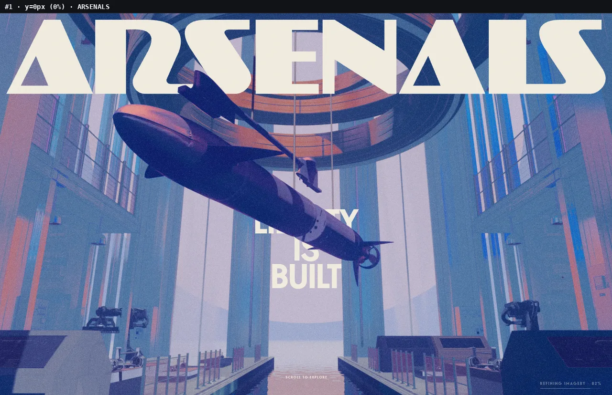
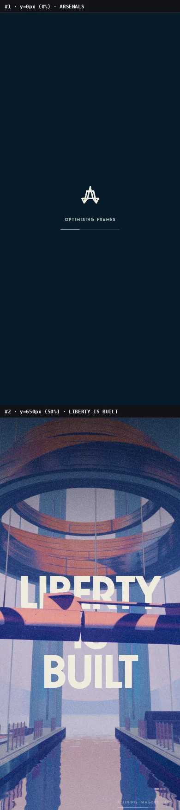

# UI Design System & Master Generation Blueprint: www-arsenals-com

> **Arsenals · Liberty is built** (http://www.arsenals.com) — Liberty is built. Arsenals builds a new maritime arsenal: autonomous, attritable, massed. The Harpoon is our first asset.





---

## 1. Executive Visual Persona & Design Archetype

- **Brand Essence & Persona**: **Arsenals · Liberty is built** (`http://www.arsenals.com`). Liberty is built. Arsenals builds a new maritime arsenal: autonomous, attritable, massed. The Harpoon is our first asset.
- **Final Redirected URL**: [https://arsenals.com/](https://arsenals.com/)
- **Capture Provenance**: Live browser capture (`tier2_webgl`, HTTP `200`, captured `2026-11-24`).
- **Visual Archetype**: **Dark-Substrate WebGL / Canvas Interactive Experience (`#061a2b` / `#f0ebde`)**.
- **Anti-AI-Slop Differentiators**:
  - **Live-Computed Chromatic Polarity**: Anchors the viewport in `#061a2b` (live computed `body` `background-color` (`computed_styles.json`)) paired with `#ffffff` primary typography and `#f0ebde` accents.
  - **Grounded Typographic Hierarchy**: Pairs `Battling` for display copy (`Arsenals`) with `Battling Loader`.
  - **Calibrated Spatial Grid & Motion**: Combines `1440px` container bounds (`gap: 0px (flush layout)`, padding `8px`) with `cubic-bezier(.65,0,.35,1)` easing and HTML5 `<canvas>` Interactive Viewport Surface.

---

## 2. Spatial Architecture & Modular Grid Mathematics

### Viewport Allocation & Container Geometry
- **Captured Journey Filmstrips**: Desktop `1280×828px` (`assets/desktop-journey.webp`, `1` keyframes up to `y=0px` / doc `9225px`), Mobile `390×1744px` (`assets/mobile-journey.webp`, `2` keyframes).
- **Master Container Bounds**: `1440px` (full-bleed `100%` desktop stage measured on `1440px` viewport).
- **Canvas Lateral Padding & Spacing**: `8px` lateral canvas padding with `0px (flush layout)` grid gap.
- **Border Radius Scale**: `4px`.

### Responsive Breakpoint Architecture
- **Desktop Layout**: Multi-column CSS Grid / Flexbox layout at `1440px` (`max-width: 1440px`, `gap: 0px (flush layout)`).
- **Mobile Layout**: Single-column vertical stack at `390px` viewport width with `8px` horizontal padding.
- **Extracted CSS Media Queries**: `@media (prefers-reduced-motion:reduce)`.

---

## 3. Color System, Materiality & Atmospheric Lighting

### Semantic Palette & Source Grounding
| Semantic Role | Ground-Truth Value | Extracted Live / CSS Source |
|---|---|---|
| **Primary Canvas Substrate** | `#061a2b` | live computed `body` `background-color` (`computed_styles.json`) |
| **Primary Typography Ink** | `#ffffff` | live computed `body` `color` (`computed_styles.json`) |
| **Elevated Surface / Card Substrate** | `#222222` | `#hud canvas { background: #222222 }` |
| **Interactive Accent / Highlight** | `#f0ebde` | live computed `a` `color` (`computed_styles.json`) |
| **Secondary / Muted Copy** | `#f0ebde` | live computed `p` `color` (`computed_styles.json`) |
| **Structural Hairline Border** | `#273844` | `#footer-cta .cta-box { border: #273844 }` |

### Sanitized Root CSS Variables (`ui-ux.md` Ground Truth)
| Variable Name | Extracted Value | Semantic Role |
|---|---|---|
| `--lightningcss-dark` | `initial` | Canvas / Surface Token |
| `--bg` | `#061a2b` | Canvas / Surface Token |
| `--cream` | `#f0ebde` | Color / Atmospheric Token |
| `--hv-ease` | `cubic-bezier(.65, 0, .35, 1)` | Motion / Easing Token |
| `--hv-time` | `.5s` | Motion / Timing Token |
| `--in` | `80px` | Dimension / Scale Token |
| `--lead` | `108px` | Dimension / Scale Token |
| `--edge` | `9px` | Dimension / Scale Token |
| `--edge-x` | `0px` | Dimension / Scale Token |
| `--edge-top` | `0px` | Dimension / Scale Token |
| `--sw` | `1` | Design System Custom Token |
| `--period` | `1.8s` | Motion / Timing Token |
| `--lo` | `0.2` | Design System Custom Token |
| `--hi` | `0.95` | Design System Custom Token |
| `--www-arsenals-com-bg` | `#061a2b` | Canvas Substrate (from live computed `body` `background-color` (`computed_styles.json`)) |
| `--www-arsenals-com-ink` | `#ffffff` | Primary Typography Ink (computed-derived) |

---

## 4. Typographic Scale & Editorial Hierarchy

### Font Family Stacks
- **Display Typography**: `Battling`.
- **Primary Body Stack**: `Battling Loader`.
- **Technical / Metadata Stack**: not declared in live computed styles (uses primary stack / `ui-monospace`).

### Typographic Scale & Rules (Live Computed & Stylesheet Grounded)
- **Hero Display (`H1`)**: live computed `h1` (`font-size: 32px`, `line-height: normal`, `font-weight: 700`).
- **Section Heading (`H2`)**: live computed `h2` (`font-size: 24px`, `line-height: normal`, `font-weight: 700`).
- **Body Copy**: live computed `body` (`font-size: 16px`, `line-height: normal`, `font-weight: 400`); rule `p` (`font-size: 44px`, `line-height: 54px`, `letter-spacing: 0`, `font-weight: 400`).
- **Metadata & Navigation Labels**: live computed `nav/a` (`font-size: 16px`, `line-height: normal`, `font-weight: 500`).

---

## 5. Choreographed Motion & Interaction Physics

### Primary Easing Curves
- **Extracted Timing Functions**: `cubic-bezier(.65,0,.35,1)`.

### Per-Element Transition & Choreography Rules
- **Selector `.hv`**: `transition: transform var(--hv-time) var(--hv-ease)` extracted from `www-arsenals-com` stylesheet.
- **Selector `.hv-g`**: `transition: transform var(--hv-time) var(--hv-ease)` extracted from `www-arsenals-com` stylesheet.
- **Selector `.hv-line`**: `transition: transform .45s var(--hv-ease)` extracted from `www-arsenals-com` stylesheet.
- **Extracted Easing Curve (`cubic-bezier(.65,0,.35,1)`)**: Governs interactive state transitions across `<nav.el>` and `<section.copy>`.
- **Runtime Interaction Engine**: Integrates HTML5 `<canvas>` Interactive Viewport Surface with `prefers-reduced-motion: reduce` fallback guards.
### Measured Runtime Scroll & Interaction Telemetry (`behavioral_journey_v2`)
- **Scroll Driver Mode**: `native` (max document height `9225px`, deepest scrollY reached `0px` across `1` desktop keyframes).
- **Detected Scroll / Motion Libraries**: `WebGL/Canvas`.

---

## 6. Component Wireframe & Structural DOM Map

### Visual Layout Schematic — Desktop (`1440px`, Grounded in `dom.html` & Landmark Bounding Boxes)
```
┌────────────────────────────────────────────────────────────────────────┐
│ DESKTOP VIEWPORT (1440px) — Arsenals · Liberty is built                │
│ ====================================================================== │
│ [ <nav.el> (1920x1080px)              | Careers Careers · LinkedIn L ] │
│ ---------------------------------------------------------------------- │
│ | HERO STAGE: <section.el> (w=1920px)                                | │
│ | H1: Arsenals                                                       | │
│ | Substrate: #061a2b | Ink: #ffffff | Accent: #f0ebde                | │
│ ---------------------------------------------------------------------- │
│ | SHOWCASE GRID (<section.copy>) max-w: 1440px                       | │
│ | +------------------------------+  +------------------------------+ | │
│ | | Liberty is built             |  | A modular fleet that adapts  | | │
│ | +------------------------------+  +------------------------------+ | │
│ ---------------------------------------------------------------------- │
│ | DETAIL MODULE (<section.el:nth(2)>) — Liberty is not grante        | │
│ ---------------------------------------------------------------------- │
│ [ FOOTER (<footer.el>         ) | http://www.arsenals.com              │
└────────────────────────────────────────────────────────────────────────┘
```

### Visual Layout Schematic — Mobile Reflow (`390px`)
```
┌────────────────────────────────────────────────────────────────────────┐
│ MOBILE VIEWPORT REFLOW (390px) — Single-Column Stack (gap: 0px (flu)   │
│ ====================================================================== │
│ [ HEADER BAR (<nav.el>                ) | Compact Menu (390px)         │
│ ---------------------------------------------------------------------- │
│ | HERO STAGE (<section.el>) — 390px Vertical Lead                    | │
│ | H1: Arsenals                                                       | │
│ ---------------------------------------------------------------------- │
│ | SHOWCASE STACK (<section.copy>) — 1-Col Stack                      | │
│ | [ Item 1: Liberty is built                                       ] | │
│ | [ Item 2: A modular fleet that adapts to the mission             ] | │
│ ---------------------------------------------------------------------- │
│ | DETAIL STACK (<section.el:nth(2)>) — 1-Col (Liberty is not gra)    | │
│ ---------------------------------------------------------------------- │
│ [ FOOTER (<footer.el>         ) | Stacked 390px Colophon               │
└────────────────────────────────────────────────────────────────────────┘
```

### Granular DOM Region Breakdown
1. **Brand Header & Navigation Bar (<nav.el> — `www-arsenals-com`)**:
   - Landmark `<nav class="el">` (`1920x1080px`) hosting `Arsenals · Liberty is built` navigation (`Careers Careers · LinkedIn LinkedIn`), DOM attributes (`data-layout="width"`, `data-hover-style="none"`, `data-btn="frame"`, `data-el="bg-dim"`), and stylesheet rule `body { overflow-x:hidden }`.
2. **Hero Stage & Focal Lead (<section.el> — `Arsenals`)**:
   - Landmark `<section class="el copy">` presenting display lead `Arsenals` and copy excerpt *"Liberty is not granted. Not given. It must be built. And today it"* over `#061a2b` canvas and `#ffffff` ink.
3. **Primary Showcase & Content Grid (<section.copy> — `Liberty is built`)**:
   - Landmark `<section class="el copy">` rendering section `Liberty is built` with copy *"The Harpoon, an autonomous maritime vessel, descends from its han"*, asset references (`favicon.ico`, `favicon.svg`, `favicon-32.png`, `apple-touch-icon.png`), and grid rule `stage { pointer-events:none;isolation:isolate;position:fixed;inset:0;overflow:hi... }`.
4. **Interactive Detail & Feature Matrix (<section.el:nth(2)> — `A modular fleet that adapts to the`)**:
   - Landmark `<section class="el copy">` framing `A modular fleet that adapts to the mission` and `Liberty is not granted. Not given. It must` (*"Liberty is not granted. Not given. It must"*) with `#222222` surface cards, `#f0ebde` accents, and `.frame { transform-origin:0 0;width:1920px;height:1080px;display:block;position:a... }`.
5. **Colophon & Global Directory Footer (<footer.el> — `http://www.arsenals.com`)**:
   - Landmark `<footer class="el">` anchoring `Arsenals · Liberty is built` footer links (`Careers Careers · LinkedIn LinkedIn`), copy *"be built. And today it must be rebuilt,"*, and `#273844` structural dividers.
### Full Vertical Scroll Sequence (Desktop `1440×900` Keyframes)
- **Step 01** (`y=0px`, `0%`): Active landmark `ARSENALS` · sticky/fixed elements: `1`

---

## 7. Master Zero-Shot AI Generation Prompt

```markdown
# Master Zero-Shot Frontend Generation Prompt: www-arsenals-com (Arsenals · Liberty is built)

You are a principal frontend architect and design systems engineer. Build a complete, production-ready web application replicating the exact design system, DOM landmarks, typographic hierarchy, color tokens, and motion physics of `www-arsenals-com` (**Arsenals · Liberty is built** — `http://www.arsenals.com`).

### 1. Visual Archetype & Anti-AI-Slop Mandates
- **Archetype**: Dark-Substrate WebGL / Canvas Interactive Experience (`#061a2b` / `#f0ebde`).
- **Identity & Domain Context**: Liberty is built. Arsenals builds a new maritime arsenal: autonomous, attritable, massed. The Harpoon is our first asset.
- **Primary Substrate**: `#061a2b` (live computed `body` `background-color` (`computed_styles.json`)), **Primary Ink**: `#ffffff`, **Accent / Highlight**: `#f0ebde`.
- **Site-Specific Differentiators**:
  - **Live-Computed Chromatic Polarity**: Anchors the viewport in `#061a2b` (live computed `body` `background-color` (`computed_styles.json`)) paired with `#ffffff` primary typography and `#f0ebde` accents.
  - **Grounded Typographic Hierarchy**: Pairs `Battling` for display copy (`Arsenals`) with `Battling Loader`.
  - **Calibrated Spatial Grid & Motion**: Combines `1440px` container bounds (`gap: 0px (flush layout)`, padding `8px`) with `cubic-bezier(.65,0,.35,1)` easing and HTML5 `<canvas>` Interactive Viewport Surface.

### 2. Ground-Truth CSS Variables (`:root` Token Contract)
Declare and consume these exact custom properties extracted from `www-arsenals-com` in your global stylesheet:

:root {
  /* Arsenals · Liberty is built (www-arsenals-com) — Live-Grounded CSS Variables */
  --lightningcss-dark: initial; /* Canvas / Surface Token (www-arsenals-com) */
  --bg: #061a2b; /* Canvas / Surface Token (www-arsenals-com) */
  --cream: #f0ebde; /* Color / Atmospheric Token (www-arsenals-com) */
  --hv-ease: cubic-bezier(.65, 0, .35, 1); /* Motion / Easing Token (www-arsenals-com) */
  --hv-time: .5s; /* Motion / Timing Token (www-arsenals-com) */
  --in: 80px; /* Dimension / Scale Token (www-arsenals-com) */
  --lead: 108px; /* Dimension / Scale Token (www-arsenals-com) */
  --edge: 9px; /* Dimension / Scale Token (www-arsenals-com) */
  --edge-x: 0px; /* Dimension / Scale Token (www-arsenals-com) */
  --edge-top: 0px; /* Dimension / Scale Token (www-arsenals-com) */
  --sw: 1; /* Design System Custom Token (www-arsenals-com) */
  --period: 1.8s; /* Motion / Timing Token (www-arsenals-com) */
  --lo: 0.2; /* Design System Custom Token (www-arsenals-com) */
  --hi: 0.95; /* Design System Custom Token (www-arsenals-com) */
  --www-arsenals-com-bg: #061a2b; /* Canvas Substrate (from live computed `body` `background-color` (`computed_styles.json`)) (www-arsenals-com) */
  --www-arsenals-com-ink: #ffffff; /* Primary Typography Ink (computed-derived) (www-arsenals-com) */
}

### 3. Semantic Color & Materiality Contract
Map every surface, ink, and border strictly to these source-grounded tokens:
- **Primary Canvas Substrate**: `#061a2b` — grounded in live computed `body` `background-color` (`computed_styles.json`)
- **Primary Typography Ink**: `#ffffff` — grounded in live computed `body` `color` (`computed_styles.json`)
- **Elevated Surface / Card Substrate**: `#222222` — grounded in `#hud canvas { background: #222222 }`
- **Interactive Accent / Highlight**: `#f0ebde` — grounded in live computed `a` `color` (`computed_styles.json`)
- **Secondary / Muted Copy**: `#f0ebde` — grounded in live computed `p` `color` (`computed_styles.json`)
- **Structural Hairline Border**: `#273844` — grounded in `#footer-cta .cta-box { border: #273844 }`

### 4. Spatial Grid, Container Bounds & Responsive Breakpoints
- **Desktop Viewport Reference**: `1280×828px` (single-viewport 100vh live capture (900px), `1440px` standard desktop width).
- **Mobile Viewport Reference**: `390×1744px` (full-page live capture (1744px), `390px` standard mobile width).
- **Container Max-Width**: `1440px` (full-bleed `100%` desktop stage measured on `1440px` viewport)
- **Padding & Gutters**: `8px` lateral canvas padding with `0px (flush layout)` grid gap
- **Desktop Grid**: Multi-column CSS Grid / Flexbox layout at `1440px` (`max-width: 1440px`, `gap: 0px (flush layout)`)
- **Mobile Adaptation**: Single-column vertical stack at `390px` viewport width with `8px` horizontal padding
- **Media Queries**: `@media (prefers-reduced-motion:reduce)`
- **Corner Radii**: `4px`

### 5. Typography & Editorial Scale Contract
- **Display Font Stack**: `Battling`
- **Body Font Stack**: `Battling Loader`
- **Monospace / Technical Font Stack**: not declared in live computed styles (uses primary stack / `ui-monospace`)
- **H1 Display Rule**: live computed `h1` (`font-size: 32px`, `line-height: normal`, `font-weight: 700`)
- **H2 Section Rule**: live computed `h2` (`font-size: 24px`, `line-height: normal`, `font-weight: 700`)
- **Body Copy Rule**: live computed `body` (`font-size: 16px`, `line-height: normal`, `font-weight: 400`); rule `p` (`font-size: 44px`, `line-height: 54px`, `letter-spacing: 0`, `font-weight: 400`)
- **Metadata & Index Rule**: live computed `nav/a` (`font-size: 16px`, `line-height: normal`, `font-weight: 500`)

### 6. Component Hierarchy, Verbatim Copy & Real DOM Landmarks
Scaffold `www-arsenals-com` (`Arsenals · Liberty is built`) with these exact structural regions, extracted copy, and CSS rules from `dom.html`:
1. **Brand Header & Navigation Bar (<nav.el> — `www-arsenals-com`)**:
   - DOM & Selectors: Landmark `<nav class="el">` (`1920x1080px`) hosting `Arsenals · Liberty is built` navigation (`Careers Careers · LinkedIn LinkedIn`), DOM attributes (`data-layout="width"`, `data-hover-style="none"`, `data-btn="frame"`, `data-el="bg-dim"`), and stylesheet rule `body { overflow-x:hidden }`.
   - Responsive Contract: Header `Brand Header & Navigation Bar (<nav.el> — `www-arsenals-com`)` (`www-arsenals-com`) adapts across `@media (prefers-reduced-motion:reduce)` with `cubic-bezier(.65,0,.35,1)` transitions and links `Careers Careers · LinkedIn LinkedIn`.
2. **Hero Stage & Focal Lead (<section.el> — `Arsenals`)**:
   - DOM & Selectors: Landmark `<section class="el copy">` presenting display lead `Arsenals` and copy excerpt *"Liberty is not granted. Not given. It must be built. And today it"* over `#061a2b` canvas and `#ffffff` ink.
   - Responsive Contract: Hero stage (`1280×828px` desktop / `390×1744px` mobile) sets `#061a2b` background with `#ffffff` headline `Arsenals`.
3. **Primary Showcase & Content Grid (<section.copy> — `Liberty is built`)**:
   - DOM & Selectors: Landmark `<section class="el copy">` rendering section `Liberty is built` with copy *"The Harpoon, an autonomous maritime vessel, descends from its han"*, asset references (`favicon.ico`, `favicon.svg`, `favicon-32.png`, `apple-touch-icon.png`), and grid rule `stage { pointer-events:none;isolation:isolate;position:fixed;inset:0;overflow:hi... }`.
   - Responsive Contract: Showcase grid `Primary Showcase & Content Grid (<section.copy> — `Liberty is built`)` applies Multi-column CSS Grid / Flexbox layout at `1440px` (`max-width: 1440px`, `gap: 0px (flush layout)`) on desktop and Single-column vertical stack at `390px` viewport width with `8px` horizontal padding on mobile.
4. **Interactive Detail & Feature Matrix (<section.el:nth(2)> — `A modular fleet that adapts to the`)**:
   - DOM & Selectors: Landmark `<section class="el copy">` framing `A modular fleet that adapts to the mission` and `Liberty is not granted. Not given. It must` (*"Liberty is not granted. Not given. It must"*) with `#222222` surface cards, `#f0ebde` accents, and `.frame { transform-origin:0 0;width:1920px;height:1080px;display:block;position:a... }`.
   - Responsive Contract: Detail module `Interactive Detail & Feature Matrix (<section.el:nth(2)> — `A modular fleet that adapts to the`)` uses `4px` radii, `#f0ebde` highlights, and assets (favicon.ico, favicon.svg, favicon-32.png).
5. **Colophon & Global Directory Footer (<footer.el> — `http://www.arsenals.com`)**:
   - DOM & Selectors: Landmark `<footer class="el">` anchoring `Arsenals · Liberty is built` footer links (`Careers Careers · LinkedIn LinkedIn`), copy *"be built. And today it must be rebuilt,"*, and `#273844` structural dividers.
   - Responsive Contract: Footer `Colophon & Global Directory Footer (<footer.el> — `http://www.arsenals.com`)` aligns to `1440px` (full-bleed `100%` desktop stage measured on `1440px` viewport) with `8px` lateral canvas padding with `0px (flush layout)` grid gap and attributes (data-layout="width", data-hover-style="none", data-btn="frame").

#### Verbatim DOM Copy Excerpts (`dom.html`)
- Copy Excerpt 1: *"Liberty is not granted. Not given. It must be built. And today it must be rebuilt,..."*
- Copy Excerpt 2: *"The Harpoon, an autonomous maritime vessel, descends from its hangar into the wate..."*
- Copy Excerpt 3: *"Liberty is not granted. Not given. It must"*
- Copy Excerpt 4: *"be built. And today it must be rebuilt,"*

### 7. Motion, Extracted Stylesheet Rules & Interaction Choreography
- **Primary Easing Functions**: `cubic-bezier(.65,0,.35,1)`
- **Extracted Stylesheet Rules (`www-arsenals-com`)**:
- `body { overflow-x:hidden }`
- `stage { pointer-events:none;isolation:isolate;position:fixed;inset:0;overflow:hi... }`
- `.frame { transform-origin:0 0;width:1920px;height:1080px;display:block;position:a... }`
- `stage .grain { pointer-events:none;width:100%;height:100%;display:block;position:absolu... }`
- `dim { background:0003;position:absolute;inset:0 }`
- **Per-Selector Transition Rules**:
- **Selector `.hv`**: `transition: transform var(--hv-time) var(--hv-ease)` extracted from `www-arsenals-com` stylesheet.
- **Selector `.hv-g`**: `transition: transform var(--hv-time) var(--hv-ease)` extracted from `www-arsenals-com` stylesheet.
- **Selector `.hv-line`**: `transition: transform .45s var(--hv-ease)` extracted from `www-arsenals-com` stylesheet.
- **Extracted Easing Curve (`cubic-bezier(.65,0,.35,1)`)**: Governs interactive state transitions across `<nav.el>` and `<section.copy>`.
- **Runtime Interaction Engine**: Integrates HTML5 `<canvas>` Interactive Viewport Surface with `prefers-reduced-motion: reduce` fallback guards.
### 7b. Full-Page Scroll Choreography, Interactive States & Multi-Page Routes
- **Scroll Mechanics**: Implement `native` vertical progression up to `9225px` across 1 distinct viewport chapters using WebGL/Canvas.
- **Vertical Chapter Sequence**: ARSENALS (0%).

### 8. Technical Deliverables
- Implement in Next.js (App Router) with TypeScript and Tailwind CSS consuming the `:root` custom properties defined above for `www-arsenals-com`.
- Reproduce both the `1440px` desktop architecture and `390px` mobile breakpoint transitions, preserving semantic HTML5 landmarks (`<header>`, `<nav>`, `<main>`, `<section>`, `<footer>`) and `prefers-reduced-motion` accessibility guards.
```
---

## 8. Full-Page Scroll Journey, Interactive States & Subpage Inventory

### Desktop Scroll Keyframes (`1440×900` WebP)
| Step | Scroll Y | Progress | Active Landmark / Section | Sticky/Fixed | Visual Asset |
| :---: | :---: | :---: | :--- | :---: | :--- |
| `#01` | `0px` | `0%` | ARSENALS | `1` | [desktop-step-01.webp](assets/desktop-step-01.webp) |

### Mobile Condensed Keyframes (`390×844` WebP)
| Step | Scroll Y | Progress | Active Landmark | Visual Asset |
| :---: | :---: | :---: | :--- | :--- |
| `#01` | `0px` | `0%` | ARSENALS | [mobile-step-01.webp](assets/mobile-step-01.webp) |
| `#02` | `650px` | `50%` | LIBERTY IS BUILT | [mobile-step-02.webp](assets/mobile-step-02.webp) |

