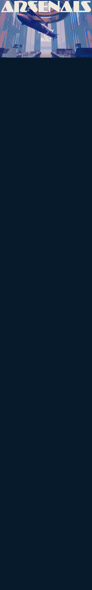
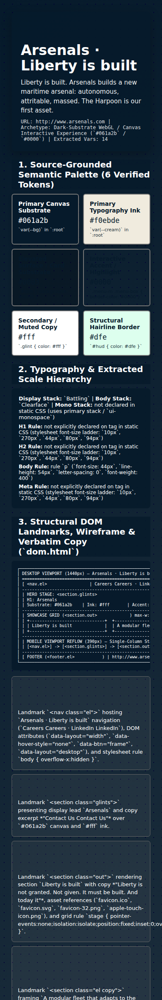

# UI Design System & Master Generation Blueprint: www-arsenals-com

> **Arsenals · Liberty is built** (http://www.arsenals.com) — Liberty is built. Arsenals builds a new maritime arsenal: autonomous, attritable, massed. The Harpoon is our first asset.



---

## 1. Executive Visual Persona & Design Archetype

- **Brand Essence & Persona**: **Arsenals · Liberty is built** (`http://www.arsenals.com`). Liberty is built. Arsenals builds a new maritime arsenal: autonomous, attritable, massed. The Harpoon is our first asset.
- **Visual Archetype**: **Dark-Substrate WebGL / Canvas Interactive Experience (`#061a2b` / `#0000`)**.
- **Anti-AI-Slop Differentiators**:
  - **Source-Grounded Chromatic Polarity**: Anchors the viewport in `#061a2b` (`var(--bg)` in `:root`) paired with `#fff` primary typography and `#0000` accents.
  - **Extracted Typographic Hierarchy**: Pairs `Battling` for display copy (`Arsenals`) with `Clearface` and not declared in static CSS (uses primary stack / `ui-monospace`).
  - **Calibrated Spatial Grid & Motion**: Combines `620px` container bounds (`gap: 0px (flush layout)`, padding `8px`) with `cubic-bezier(.65,0,.35,1)` easing and Lottie Vector Animation Player, HTML5 `<canvas>` Interactive Viewport Surface.

---

## 2. Spatial Architecture & Modular Grid Mathematics



### Viewport Allocation & Container Geometry
- **Captured Viewport Dimensions**: Desktop `1440×9225px` (`assets/desktop.png`, full-page scroll capture), Mobile `390×2400px` (`assets/mobile.png`, capped at 2400px multi-section capture).
- **Master Container Bounds**: `620px` extracted from `www-arsenals-com` stylesheet.
- **Canvas Lateral Padding & Spacing**: `8px` lateral canvas padding with `0px (flush layout)` grid gap.
- **Border Radius Scale**: `4px`.

### Responsive Breakpoint Architecture
- **Desktop Layout**: Multi-column CSS Grid / Flexbox layout at `1440px` (`max-width: 620px`, `gap: 0px (flush layout)`).
- **Mobile Layout**: Single-column vertical stack at `390px` viewport width with `8px` horizontal padding.
- **Extracted CSS Media Queries**: `@media (prefers-reduced-motion:reduce)`.

---

## 3. Color System, Materiality & Atmospheric Lighting

### Semantic Palette & Source Grounding
| Semantic Role | Ground-Truth Value | Extracted CSS Source / Selector |
|---|---|---|
| **Primary Canvas Substrate** | `#061a2b` | `var(--bg)` in `:root` |
| **Primary Typography Ink** | `#f0ebde` | `var(--cream)` in `:root` |
| **Elevated Surface / Card Substrate** | `#0003` | `#dim { background: #0003 }` |
| **Interactive Accent / Highlight** | `#0000` | `.menu-m .menu-box { border-color: #0000 }` |
| **Secondary / Muted Copy** | `#fff` | `.glint { color: #fff }` |
| **Structural Hairline Border** | `#dfe` | `#hud { color: #dfe }` |

### Sanitized Root CSS Variables (`ui-ux.md` Ground Truth)
| Variable Name | Extracted Value | Semantic Role |
|---|---|---|
| `--in` | `80px` | Dimension / Scale Token |
| `--lead` | `108px` | Dimension / Scale Token |
| `--edge` | `9px` | Dimension / Scale Token |
| `--hv-ease` | `cubic-bezier(.65, 0, .35, 1)` | Motion / Easing Token |
| `--hv-time` | `.5s` | Motion / Timing Token |
| `--lightningcss-dark` | `initial` | Canvas / Surface Token |
| `--bg` | `#061a2b` | Canvas / Surface Token |
| `--cream` | `#f0ebde` | Color / Atmospheric Token |
| `--edge-x` | `0px` | Dimension / Scale Token |
| `--edge-top` | `0px` | Dimension / Scale Token |
| `--sw` | `1` | Design System Custom Token |
| `--period` | `1.8s` | Motion / Timing Token |
| `--lo` | `0.2` | Design System Custom Token |
| `--hi` | `0.95` | Design System Custom Token |
| `--www-arsenals-com-bg` | `#061a2b` | Canvas Substrate (from `var(--bg)` in `:root`) |
| `--www-arsenals-com-ink` | `#fff` | Primary Typography Ink (stylesheet-derived) |

---

## 4. Typographic Scale & Editorial Hierarchy

### Font Family Stacks
- **Display Typography**: `Battling`.
- **Primary Body Stack**: `Clearface`.
- **Technical / Metadata Stack**: not declared in static CSS (uses primary stack / `ui-monospace`).

### Typographic Scale & Rules (Extracted from Stylesheet & Variables)
- **Hero Display (`H1`)**: not explicitly declared on tag in static CSS (stylesheet font-size ladder: `10px`, `270px`, `44px`, `80px`, `94px`).
- **Section Heading (`H2`)**: not explicitly declared on tag in static CSS (stylesheet font-size ladder: `10px`, `270px`, `44px`, `80px`, `94px`).
- **Body Copy**: rule `p` (`font-size: 44px`, `line-height: 54px`, `letter-spacing: 0`, `font-weight: 400`).
- **Metadata & Navigation Labels**: not explicitly declared on tag in static CSS (stylesheet font-size ladder: `10px`, `270px`, `44px`, `80px`, `94px`).

---

## 5. Choreographed Motion & Interaction Physics

### Primary Easing Curves
- **Extracted Timing Functions**: `cubic-bezier(.65,0,.35,1)`.

### Per-Element Transition & Choreography Rules
- **Selector `.hv`**: `transition: transform var(--hv-time) var(--hv-ease)` extracted from `www-arsenals-com` stylesheet.
- **Selector `.hv-g`**: `transition: transform var(--hv-time) var(--hv-ease)` extracted from `www-arsenals-com` stylesheet.
- **Selector `.hv-line`**: `transition: transform .45s var(--hv-ease)` extracted from `www-arsenals-com` stylesheet.
- **Extracted Easing Curve (`cubic-bezier(.65,0,.35,1)`)**: Governs interactive state transitions across `<nav.el>` and `<section.out>`.
- **Runtime Interaction Engine**: Integrates Lottie Vector Animation Player, HTML5 `<canvas>` Interactive Viewport Surface with `prefers-reduced-motion: reduce` fallback guards.

---

## 6. Component Wireframe & Structural DOM Map

### Visual Layout Schematic (Grounded in `dom.html` — `1440px` Desktop & `390px` Mobile Reflow)
```
┌────────────────────────────────────────────────────────────────────────┐
│ DESKTOP VIEWPORT (1440px) — Arsenals · Liberty is built                │
│ ====================================================================== │
│ [ <nav.el>                 | Careers Careers · LinkedIn LinkedIn    ]  │
│ ---------------------------------------------------------------------- │
│ | HERO STAGE: <section.glints>                                     |   │
│ | H1: Arsenals                                                     |   │
│ | Substrate: #061a2b    | Ink: #fff       | Accent: #0000          |   │
│ ---------------------------------------------------------------------- │
│ | SHOWCASE GRID (<section.out>             ) max-w: 620px          |   │
│ | +------------------------------+  +------------------------------+ | │
│ | | Liberty is built             |  | A modular fleet that adapts  | | │
│ | +------------------------------+  +------------------------------+ | │
│ ---------------------------------------------------------------------- │
│ | MOBILE VIEWPORT REFLOW (390px) — Single-Column Stack (gap: 0px (f) | │
│ | [<nav.el>] -> [<section.glints>] -> [<section.out>] |                │
│ ---------------------------------------------------------------------- │
│ [ FOOTER (<footer.el>           ) | http://www.arsenals.com            │
└────────────────────────────────────────────────────────────────────────┘
```

### Granular DOM Region Breakdown
1. **Brand Header & Navigation Bar (<nav.el> — `www-arsenals-com`)**:
   - Landmark `<nav class="el">` hosting `Arsenals · Liberty is built` navigation (`Careers Careers · LinkedIn LinkedIn`), DOM attributes (`data-layout="width"`, `data-hover-style="none"`, `data-btn="frame"`, `data-layout="desktop"`), and stylesheet rule `body { overflow-x:hidden }`.
2. **Hero Stage & Focal Lead (<section.glints> — `Arsenals`)**:
   - Landmark `<section class="glints">` presenting display lead `Arsenals` and copy excerpt *"Contact Us Contact Us"* over `#061a2b` canvas and `#fff` ink.
3. **Primary Showcase & Content Grid (<section.out> — `Liberty is built`)**:
   - Landmark `<section class="out">` rendering section `Liberty is built` with copy *"Liberty is not granted. Not given. It must be built. And today it"*, asset references (`favicon.ico`, `favicon.svg`, `favicon-32.png`, `apple-touch-icon.png`), and grid rule `stage { pointer-events:none;isolation:isolate;position:fixed;inset:0;overflow:hi... }`.
4. **Interactive Detail & Feature Matrix (<section.el> — `A modular fleet that adapts to the`)**:
   - Landmark `<section class="el copy">` framing `A modular fleet that adapts to the mission` and `The Harpoon. Our first asset. Completely autonom` (*"The Harpoon. Our first asset. Completely autonomous. Deployable b"*) with `#0003` surface cards, `#0000` accents, and `.frame { transform-origin:0 0;width:1920px;height:1080px;display:block;position:a... }`.
5. **Colophon & Global Directory Footer (<footer.el> — `http://www.arsenals.com`)**:
   - Landmark `<footer class="el">` anchoring `Arsenals · Liberty is built` footer links (`Careers Careers · LinkedIn LinkedIn`), copy *"Copyright © 2026 Arsenals. All rights reserved."*, and `#dfe` structural dividers.

---

## 7. Master Zero-Shot AI Generation Prompt

```markdown
# Master Zero-Shot Frontend Generation Prompt: www-arsenals-com (Arsenals · Liberty is built)

You are a principal frontend architect and design systems engineer. Build a complete, production-ready web application replicating the exact design system, DOM landmarks, typographic hierarchy, color tokens, and motion physics of `www-arsenals-com` (**Arsenals · Liberty is built** — `http://www.arsenals.com`).

### 1. Visual Archetype & Anti-AI-Slop Mandates
- **Archetype**: Dark-Substrate WebGL / Canvas Interactive Experience (`#061a2b` / `#0000`).
- **Identity & Domain Context**: Liberty is built. Arsenals builds a new maritime arsenal: autonomous, attritable, massed. The Harpoon is our first asset.
- **Primary Substrate**: `#061a2b` (`var(--bg)` in `:root`), **Primary Ink**: `#fff`, **Accent / Highlight**: `#0000`.
- **Site-Specific Differentiators**:
  - **Source-Grounded Chromatic Polarity**: Anchors the viewport in `#061a2b` (`var(--bg)` in `:root`) paired with `#fff` primary typography and `#0000` accents.
  - **Extracted Typographic Hierarchy**: Pairs `Battling` for display copy (`Arsenals`) with `Clearface` and not declared in static CSS (uses primary stack / `ui-monospace`).
  - **Calibrated Spatial Grid & Motion**: Combines `620px` container bounds (`gap: 0px (flush layout)`, padding `8px`) with `cubic-bezier(.65,0,.35,1)` easing and Lottie Vector Animation Player, HTML5 `<canvas>` Interactive Viewport Surface.

### 2. Ground-Truth CSS Variables (`:root` Token Contract)
Declare and consume these exact custom properties extracted from `www-arsenals-com` in your global stylesheet:

:root {
  /* Arsenals · Liberty is built (www-arsenals-com) — Ground-Truth Extracted CSS Variables */
  --in: 80px; /* Dimension / Scale Token (www-arsenals-com) */
  --lead: 108px; /* Dimension / Scale Token (www-arsenals-com) */
  --edge: 9px; /* Dimension / Scale Token (www-arsenals-com) */
  --hv-ease: cubic-bezier(.65, 0, .35, 1); /* Motion / Easing Token (www-arsenals-com) */
  --hv-time: .5s; /* Motion / Timing Token (www-arsenals-com) */
  --lightningcss-dark: initial; /* Canvas / Surface Token (www-arsenals-com) */
  --bg: #061a2b; /* Canvas / Surface Token (www-arsenals-com) */
  --cream: #f0ebde; /* Color / Atmospheric Token (www-arsenals-com) */
  --edge-x: 0px; /* Dimension / Scale Token (www-arsenals-com) */
  --edge-top: 0px; /* Dimension / Scale Token (www-arsenals-com) */
  --sw: 1; /* Design System Custom Token (www-arsenals-com) */
  --period: 1.8s; /* Motion / Timing Token (www-arsenals-com) */
  --lo: 0.2; /* Design System Custom Token (www-arsenals-com) */
  --hi: 0.95; /* Design System Custom Token (www-arsenals-com) */
  --www-arsenals-com-bg: #061a2b; /* Canvas Substrate (from `var(--bg)` in `:root`) (www-arsenals-com) */
  --www-arsenals-com-ink: #fff; /* Primary Typography Ink (stylesheet-derived) (www-arsenals-com) */
}

### 3. Semantic Color & Materiality Contract
Map every surface, ink, and border strictly to these source-grounded tokens:
- **Primary Canvas Substrate**: `#061a2b` — grounded in `var(--bg)` in `:root`
- **Primary Typography Ink**: `#f0ebde` — grounded in `var(--cream)` in `:root`
- **Elevated Surface / Card Substrate**: `#0003` — grounded in `#dim { background: #0003 }`
- **Interactive Accent / Highlight**: `#0000` — grounded in `.menu-m .menu-box { border-color: #0000 }`
- **Secondary / Muted Copy**: `#fff` — grounded in `.glint { color: #fff }`
- **Structural Hairline Border**: `#dfe` — grounded in `#hud { color: #dfe }`

### 4. Spatial Grid, Container Bounds & Responsive Breakpoints
- **Desktop Viewport Reference**: `1440×9225px` (full-page scroll capture, `1440px` standard desktop width).
- **Mobile Viewport Reference**: `390×2400px` (capped at 2400px multi-section capture, `390px` standard mobile width).
- **Container Max-Width**: `620px` extracted from `www-arsenals-com` stylesheet
- **Padding & Gutters**: `8px` lateral canvas padding with `0px (flush layout)` grid gap
- **Desktop Grid**: Multi-column CSS Grid / Flexbox layout at `1440px` (`max-width: 620px`, `gap: 0px (flush layout)`)
- **Mobile Adaptation**: Single-column vertical stack at `390px` viewport width with `8px` horizontal padding
- **Media Queries**: `@media (prefers-reduced-motion:reduce)`
- **Corner Radii**: `4px`

### 5. Typography & Editorial Scale Contract
- **Display Font Stack**: `Battling`
- **Body Font Stack**: `Clearface`
- **Monospace / Technical Font Stack**: not declared in static CSS (uses primary stack / `ui-monospace`)
- **H1 Display Rule**: not explicitly declared on tag in static CSS (stylesheet font-size ladder: `10px`, `270px`, `44px`, `80px`, `94px`)
- **H2 Section Rule**: not explicitly declared on tag in static CSS (stylesheet font-size ladder: `10px`, `270px`, `44px`, `80px`, `94px`)
- **Body Copy Rule**: rule `p` (`font-size: 44px`, `line-height: 54px`, `letter-spacing: 0`, `font-weight: 400`)
- **Metadata & Index Rule**: not explicitly declared on tag in static CSS (stylesheet font-size ladder: `10px`, `270px`, `44px`, `80px`, `94px`)

### 6. Component Hierarchy, Verbatim Copy & Real DOM Landmarks
Scaffold `www-arsenals-com` (`Arsenals · Liberty is built`) with these exact structural regions, extracted copy, and CSS rules from `dom.html`:
1. **Brand Header & Navigation Bar (<nav.el> — `www-arsenals-com`)**:
   - DOM & Selectors: Landmark `<nav class="el">` hosting `Arsenals · Liberty is built` navigation (`Careers Careers · LinkedIn LinkedIn`), DOM attributes (`data-layout="width"`, `data-hover-style="none"`, `data-btn="frame"`, `data-layout="desktop"`), and stylesheet rule `body { overflow-x:hidden }`.
   - Responsive Contract: Header `Brand Header & Navigation Bar (<nav.el> — `www-arsenals-com`)` (`www-arsenals-com`) adapts across `@media (prefers-reduced-motion:reduce)` with `cubic-bezier(.65,0,.35,1)` transitions and links `Careers Careers · LinkedIn LinkedIn`.
2. **Hero Stage & Focal Lead (<section.glints> — `Arsenals`)**:
   - DOM & Selectors: Landmark `<section class="glints">` presenting display lead `Arsenals` and copy excerpt *"Contact Us Contact Us"* over `#061a2b` canvas and `#fff` ink.
   - Responsive Contract: Hero stage (`1440×9225px` desktop / `390×2400px` mobile) sets `#061a2b` background with `#fff` headline `Arsenals`.
3. **Primary Showcase & Content Grid (<section.out> — `Liberty is built`)**:
   - DOM & Selectors: Landmark `<section class="out">` rendering section `Liberty is built` with copy *"Liberty is not granted. Not given. It must be built. And today it"*, asset references (`favicon.ico`, `favicon.svg`, `favicon-32.png`, `apple-touch-icon.png`), and grid rule `stage { pointer-events:none;isolation:isolate;position:fixed;inset:0;overflow:hi... }`.
   - Responsive Contract: Showcase grid `Primary Showcase & Content Grid (<section.out> — `Liberty is built`)` applies Multi-column CSS Grid / Flexbox layout at `1440px` (`max-width: 620px`, `gap: 0px (flush layout)`) on desktop and Single-column vertical stack at `390px` viewport width with `8px` horizontal padding on mobile.
4. **Interactive Detail & Feature Matrix (<section.el> — `A modular fleet that adapts to the`)**:
   - DOM & Selectors: Landmark `<section class="el copy">` framing `A modular fleet that adapts to the mission` and `The Harpoon. Our first asset. Completely autonom` (*"The Harpoon. Our first asset. Completely autonomous. Deployable b"*) with `#0003` surface cards, `#0000` accents, and `.frame { transform-origin:0 0;width:1920px;height:1080px;display:block;position:a... }`.
   - Responsive Contract: Detail module `Interactive Detail & Feature Matrix (<section.el> — `A modular fleet that adapts to the`)` uses `4px` radii, `#0000` highlights, and assets (favicon.ico, favicon.svg, favicon-32.png).
5. **Colophon & Global Directory Footer (<footer.el> — `http://www.arsenals.com`)**:
   - DOM & Selectors: Landmark `<footer class="el">` anchoring `Arsenals · Liberty is built` footer links (`Careers Careers · LinkedIn LinkedIn`), copy *"Copyright © 2026 Arsenals. All rights reserved."*, and `#dfe` structural dividers.
   - Responsive Contract: Footer `Colophon & Global Directory Footer (<footer.el> — `http://www.arsenals.com`)` aligns to `620px` extracted from `www-arsenals-com` stylesheet with `8px` lateral canvas padding with `0px (flush layout)` grid gap and attributes (data-layout="width", data-hover-style="none", data-btn="frame").

#### Verbatim DOM Copy Excerpts (`dom.html`)
- Copy Excerpt 1: *"Contact Us Contact Us"*
- Copy Excerpt 2: *"Liberty is not granted. Not given. It must be built. And today it must be rebuilt,..."*
- Copy Excerpt 3: *"The Harpoon. Our first asset. Completely autonomous. Deployable by hand, by sea, o..."*
- Copy Excerpt 4: *"Copyright © 2026 Arsenals. All rights reserved."*

### 7. Motion, Extracted Stylesheet Rules & Interaction Choreography
- **Primary Easing Functions**: `cubic-bezier(.65,0,.35,1)`
- **Extracted Stylesheet Rules (`www-arsenals-com`)**:
- `body { overflow-x:hidden }`
- `stage { pointer-events:none;isolation:isolate;position:fixed;inset:0;overflow:hi... }`
- `.frame { transform-origin:0 0;width:1920px;height:1080px;display:block;position:a... }`
- `stage .grain { pointer-events:none;width:100%;height:100%;display:block;position:absolu... }`
- `dim { background:0003;position:absolute;inset:0 }`
- **Per-Selector Transition Rules**:
- **Selector `.hv`**: `transition: transform var(--hv-time) var(--hv-ease)` extracted from `www-arsenals-com` stylesheet.
- **Selector `.hv-g`**: `transition: transform var(--hv-time) var(--hv-ease)` extracted from `www-arsenals-com` stylesheet.
- **Selector `.hv-line`**: `transition: transform .45s var(--hv-ease)` extracted from `www-arsenals-com` stylesheet.
- **Extracted Easing Curve (`cubic-bezier(.65,0,.35,1)`)**: Governs interactive state transitions across `<nav.el>` and `<section.out>`.
- **Runtime Interaction Engine**: Integrates Lottie Vector Animation Player, HTML5 `<canvas>` Interactive Viewport Surface with `prefers-reduced-motion: reduce` fallback guards.

### 8. Technical Deliverables
- Implement in Next.js (App Router) with TypeScript and Tailwind CSS consuming the `:root` custom properties defined above for `www-arsenals-com`.
- Reproduce both the `1440px` desktop architecture and `390px` mobile breakpoint transitions, preserving semantic HTML5 landmarks (`<header>`, `<nav>`, `<main>`, `<section>`, `<footer>`) and `prefers-reduced-motion` accessibility guards.
```
