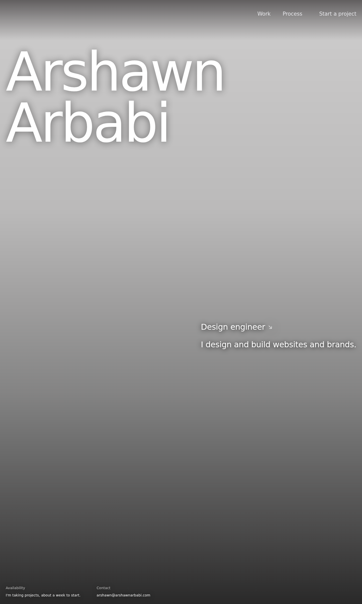
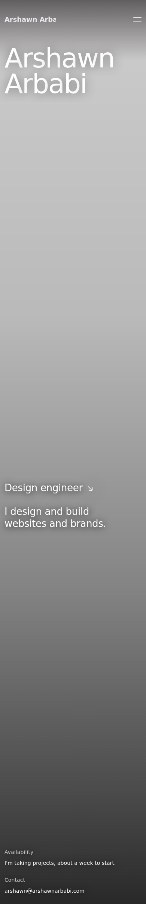

# UI Design System & Master Generation Blueprint: www-arshawnarbabi-com

> **Arshawn Arbabi, design engineer** (https://www.arshawnarbabi.com) — I design and build custom websites, and the brand behind them if you don't have one yet.



---

## 1. Executive Visual Persona & Design Archetype

- **Brand Essence & Persona**: **Arshawn Arbabi, design engineer** (`https://www.arshawnarbabi.com`). I design and build custom websites, and the brand behind them if you don't have one yet.
- **Visual Archetype**: **Light-Gallery WebGL / Canvas Interactive Experience (`#fff` / `#ffe9e6`)**.
- **Anti-AI-Slop Differentiators**:
  - **Source-Grounded Chromatic Polarity**: Anchors the viewport in `#fff` (`var(--ink-on)` in `:root`) paired with `#ffc8c3` primary typography and `#ffe9e6` accents.
  - **Extracted Typographic Hierarchy**: Pairs `Manrope` for display copy (`Arshawn A r s h a w n Arbabi A r b a`) with `clamp(4.5rem` and `SFMono-Regular`.
  - **Calibrated Spatial Grid & Motion**: Combines `1023px` container bounds (`gap: 8px`, padding `6px`) with `cubic-bezier(.76,0,.24,1)` easing and Lenis Smooth Scroll (`data-lenis`), HTML5 `<canvas>` Interactive Viewport Surface.

---

## 2. Spatial Architecture & Modular Grid Mathematics



### Viewport Allocation & Container Geometry
- **Captured Viewport Dimensions**: Desktop `1440×2400px` (`assets/desktop.png`, capped at 2400px multi-section capture), Mobile `390×2400px` (`assets/mobile.png`, capped at 2400px multi-section capture).
- **Master Container Bounds**: `1023px` extracted from `www-arshawnarbabi-com` stylesheet.
- **Canvas Lateral Padding & Spacing**: `6px` lateral canvas padding with `8px` grid gap.
- **Border Radius Scale**: `10px`, `6px`, `var(--radius-xs)`, `var(--radius-sm2)`.

### Responsive Breakpoint Architecture
- **Desktop Layout**: Multi-column CSS Grid / Flexbox layout at `1440px` (`max-width: 1023px`, `gap: 8px`).
- **Mobile Layout**: Single-column vertical stack at `390px` viewport width with `6px` horizontal padding.
- **Extracted CSS Media Queries**: `@media (prefers-reduced-motion:reduce)`, `@media (min-width:768px)`, `@media (min-width:1024px)`, `@media (max-width:1023px)`.

---

## 3. Color System, Materiality & Atmospheric Lighting

### Semantic Palette & Source Grounding
| Semantic Role | Ground-Truth Value | Extracted CSS Source / Selector |
|---|---|---|
| **Primary Canvas Substrate** | `#fff` | `var(--ink-on)` in `:root` |
| **Primary Typography Ink** | `#fffbfa` | `var(--primary-1)` in `:root` |
| **Elevated Surface / Card Substrate** | `#fff2f0` | `var(--primary-2)` in `:root` |
| **Interactive Accent / Highlight** | `#ffe9e6` | `var(--primary-3)` in `:root` |
| **Secondary / Muted Copy** | `#ffdbd7` | `var(--primary-4)` in `:root` |
| **Structural Hairline Border** | `#ffc8c3` | `var(--primary-5)` in `:root` |

### Sanitized Root CSS Variables (`ui-ux.md` Ground Truth)
| Variable Name | Extracted Value | Semantic Role |
|---|---|---|
| `--photo-travel` | `0px` | Dimension / Scale Token |
| `--ptr-travel` | `var(--parallax-travel-pointer)` | Design System Custom Token |
| `--intro-travel` | `calc(var(--parallax-travel) * 1.5)` | Design System Custom Token |
| `--reveal-r` | `var(--radius-xs)` | Design System Custom Token |
| `--cap-pull` | `var(--space-12)` | Design System Custom Token |
| `--terms-travel` | `0px` | Dimension / Scale Token |
| `--faq-travel` | `0px` | Dimension / Scale Token |
| `--faq-rule` | `var(--neutral-12)` | Design System Custom Token |
| `--faq-row-pad-end` | `var(--space-8)` | Layout / Spatial Grid Token |
| `--faq-sign-size` | `max(32px, var(--text-heading-lg))` | Layout / Spatial Grid Token |
| `--faq-sign-nudge` | `-1px` | Dimension / Scale Token |
| `--closer-rule` | `var(--border-strong)` | Design System Custom Token |
| `--social-icon-size` | `max(24px, calc(var(--text-heading-lg) * .75))` | Layout / Spatial Grid Token |
| `--social-icon-nudge` | `calc(-1 * max(1px, calc(var(--text-heading-lg) * .03125)))` | Dimension / Scale Token |
| `--mark-w` | `96px` | Dimension / Scale Token |
| `--closer-rise` | `.6em` | Dimension / Scale Token |

---

## 4. Typographic Scale & Editorial Hierarchy

### Font Family Stacks
- **Display Typography**: `Manrope`.
- **Primary Body Stack**: `clamp(4.5rem`.
- **Technical / Metadata Stack**: `SFMono-Regular`.

### Typographic Scale & Rules (Extracted from Stylesheet & Variables)
- **Hero Display (`H1`)**: not explicitly declared on tag in static CSS (stylesheet font-size ladder: `12px`, `13px`, `10px`, `var(--text-heading-2xl)`, `var(--text-heading-lg)`).
- **Section Heading (`H2`)**: CSS variables `--text-heading-2xl: clamp(2.5rem, 2rem + 2.222vw, 4rem)`, `--leading-heading-2xl: 1.08`, `--tracking-heading-2xl: -.022em`.
- **Body Copy**: CSS variables `--text-body-xl: 1.3125rem`, `--leading-body-xl: 1.5`, `--tracking-body-xl: -.008em`.
- **Metadata & Navigation Labels**: CSS variables `--label-to-input: var(--space-2)`.

---

## 5. Choreographed Motion & Interaction Physics

### Primary Easing Curves
- **Extracted Timing Functions**: `cubic-bezier(.76,0,.24,1)`, `cubic-bezier(.45,0,.55,1)`, `cubic-bezier(.2,0,0,1)`.

### Per-Element Transition & Choreography Rules
- **Selector `sing] .RouteTransition-module__Xv...`**: `transition: transform .38s cubic-bezier(.76,0,.24,1)` extracted from `www-arshawnarbabi-com` stylesheet.
- **Selector `ning] .RouteTransition-module__Xv...`**: `transition: transform .62s cubic-bezier(.76,0,.24,1)` extracted from `www-arshawnarbabi-com` stylesheet.
- **Selector `media (prefers-reduced-motion:red...`**: `transition: none` extracted from `www-arshawnarbabi-com` stylesheet.
- **Extracted Easing Curve (`cubic-bezier(.76,0,.24,1)`)**: Governs interactive state transitions across `<nav.SiteNav-module__xVSxrG__nav>` and `<section.Intro-module__XC4VmG__section>`.
- **Runtime Interaction Engine**: Integrates Lenis Smooth Scroll (`data-lenis`), HTML5 `<canvas>` Interactive Viewport Surface with `prefers-reduced-motion: reduce` fallback guards.

---

## 6. Component Wireframe & Structural DOM Map

### Visual Layout Schematic (Grounded in `dom.html` — `1440px` Desktop & `390px` Mobile Reflow)
```
┌────────────────────────────────────────────────────────────────────────┐
│ DESKTOP VIEWPORT (1440px) — Arshawn Arbabi, design engineer            │
│ ====================================================================== │
│ [ <nav.SiteNav-module__xVS | Work Work · Process Process            ]  │
│ ---------------------------------------------------------------------- │
│ | HERO STAGE: <section.Hero-module__Z8hQ_W__hero>                  |   │
│ | H1: Arshawn A r s h a w n Arbabi A r b a b i                     |   │
│ | Substrate: #fff       | Ink: #ffc8c3    | Accent: #ffe9e6        |   │
│ ---------------------------------------------------------------------- │
│ | SHOWCASE GRID (<section.Intro-module__XC4) max-w: 1023px         |   │
│ | +------------------------------+  +------------------------------+ | │
│ | | What a project includes      |  | Selected Work                | | │
│ | +------------------------------+  +------------------------------+ | │
│ ---------------------------------------------------------------------- │
│ | MOBILE VIEWPORT REFLOW (390px) — Single-Column Stack (gap: 8px   ) | │
│ | [<nav.SiteNav-modul] -> [<section.Hero-modu] -> [<section.Intro-mod] │
│ ---------------------------------------------------------------------- │
│ [ FOOTER (<footer.SiteNav-module) | https://www.arshawnarbabi.com      │
└────────────────────────────────────────────────────────────────────────┘
```

### Granular DOM Region Breakdown
1. **Brand Header & Navigation Bar (<nav.SiteNav-module__xVSxrG__nav> — `www-arshawnarbabi-com`)**:
   - Landmark `<nav class="SiteNav-module__xVSxrG__nav">` hosting `Arshawn Arbabi, design engineer` navigation (`Work Work · Process Process`), DOM attributes (`data-theme="dark"`, `data-enter`, `data-instant-reveal`, `data-hero-title`), and stylesheet rule `RouteTransition-module__XvASuW__o... { z-index:9998;pointer-events:none;position:fixed;inset:0 }`.
2. **Hero Stage & Focal Lead (<section.Hero-module__Z8hQ_W__hero> — `Arshawn A r s h a w n Arbabi A r b`)**:
   - Landmark `<section class="Hero-module__Z8hQ_W__hero">` presenting display lead `Arshawn A r s h a w n Arbabi A r b a b i` and copy excerpt *"Arshawn Arbabi Arshawn Arbabi"* over `#fff` canvas and `#ffc8c3` ink.
3. **Primary Showcase & Content Grid (<section.Intro-module__XC4VmG__section> — `What a project includes`)**:
   - Landmark `<section class="Intro-module__XC4VmG__section">` rendering section `What a project includes` with copy *"Start a project Start a project Start a project Start a project"*, asset references (`Manrope-Variable.woff2`, `aura-expanded-vblur.webp`, `3rprz2jei5o6w.css`, `39phslleu3etf.css`), and grid rule `.RouteTransition-module__XvASuW__... { background:var(--neutral-1);will-change:transform;position:absolute;inse... }`.
4. **Interactive Detail & Feature Matrix (<section.RouteTransition-module__XvASuW__top> — `Selected Work`)**:
   - Landmark `<section class="RouteTransition-module__XvASuW__top">` framing `Selected Work` and `Temperance` (*"Start a project Start a project"*) with `#fff2f0` surface cards, `#ffe9e6` accents, and `.RouteTransition-module__XvASuW__top { height:calc(50% + 1px);inset-block-start:0 }`.
5. **Colophon & Global Directory Footer (<footer.SiteNav-module__xVSxrG__nav> — `https://www.arshawnarbabi.com`)**:
   - Landmark `<footer class="SiteNav-module__xVSxrG__nav">` anchoring `Arshawn Arbabi, design engineer` footer links (`Work Work · Process Process`), copy *"Arshawn A r s h a w n"*, and `#ffc8c3` structural dividers.

---

## 7. Master Zero-Shot AI Generation Prompt

```markdown
# Master Zero-Shot Frontend Generation Prompt: www-arshawnarbabi-com (Arshawn Arbabi, design engineer)

You are a principal frontend architect and design systems engineer. Build a complete, production-ready web application replicating the exact design system, DOM landmarks, typographic hierarchy, color tokens, and motion physics of `www-arshawnarbabi-com` (**Arshawn Arbabi, design engineer** — `https://www.arshawnarbabi.com`).

### 1. Visual Archetype & Anti-AI-Slop Mandates
- **Archetype**: Light-Gallery WebGL / Canvas Interactive Experience (`#fff` / `#ffe9e6`).
- **Identity & Domain Context**: I design and build custom websites, and the brand behind them if you don't have one yet.
- **Primary Substrate**: `#fff` (`var(--ink-on)` in `:root`), **Primary Ink**: `#ffc8c3`, **Accent / Highlight**: `#ffe9e6`.
- **Site-Specific Differentiators**:
  - **Source-Grounded Chromatic Polarity**: Anchors the viewport in `#fff` (`var(--ink-on)` in `:root`) paired with `#ffc8c3` primary typography and `#ffe9e6` accents.
  - **Extracted Typographic Hierarchy**: Pairs `Manrope` for display copy (`Arshawn A r s h a w n Arbabi A r b a`) with `clamp(4.5rem` and `SFMono-Regular`.
  - **Calibrated Spatial Grid & Motion**: Combines `1023px` container bounds (`gap: 8px`, padding `6px`) with `cubic-bezier(.76,0,.24,1)` easing and Lenis Smooth Scroll (`data-lenis`), HTML5 `<canvas>` Interactive Viewport Surface.

### 2. Ground-Truth CSS Variables (`:root` Token Contract)
Declare and consume these exact custom properties extracted from `www-arshawnarbabi-com` in your global stylesheet:

:root {
  /* Arshawn Arbabi, design engineer (www-arshawnarbabi-com) — Ground-Truth Extracted CSS Variables */
  --photo-travel: 0px; /* Dimension / Scale Token (www-arshawnarbabi-com) */
  --ptr-travel: var(--parallax-travel-pointer); /* Design System Custom Token (www-arshawnarbabi-com) */
  --intro-travel: calc(var(--parallax-travel) * 1.5); /* Design System Custom Token (www-arshawnarbabi-com) */
  --reveal-r: var(--radius-xs); /* Design System Custom Token (www-arshawnarbabi-com) */
  --cap-pull: var(--space-12); /* Design System Custom Token (www-arshawnarbabi-com) */
  --terms-travel: 0px; /* Dimension / Scale Token (www-arshawnarbabi-com) */
  --faq-travel: 0px; /* Dimension / Scale Token (www-arshawnarbabi-com) */
  --faq-rule: var(--neutral-12); /* Design System Custom Token (www-arshawnarbabi-com) */
  --faq-row-pad-end: var(--space-8); /* Layout / Spatial Grid Token (www-arshawnarbabi-com) */
  --faq-sign-size: max(32px, var(--text-heading-lg)); /* Layout / Spatial Grid Token (www-arshawnarbabi-com) */
  --faq-sign-nudge: -1px; /* Dimension / Scale Token (www-arshawnarbabi-com) */
  --closer-rule: var(--border-strong); /* Design System Custom Token (www-arshawnarbabi-com) */
  --social-icon-size: max(24px, calc(var(--text-heading-lg) * .75)); /* Layout / Spatial Grid Token (www-arshawnarbabi-com) */
  --social-icon-nudge: calc(-1 * max(1px, calc(var(--text-heading-lg) * .03125))); /* Dimension / Scale Token (www-arshawnarbabi-com) */
  --mark-w: 96px; /* Dimension / Scale Token (www-arshawnarbabi-com) */
  --closer-rise: .6em; /* Dimension / Scale Token (www-arshawnarbabi-com) */
}

### 3. Semantic Color & Materiality Contract
Map every surface, ink, and border strictly to these source-grounded tokens:
- **Primary Canvas Substrate**: `#fff` — grounded in `var(--ink-on)` in `:root`
- **Primary Typography Ink**: `#fffbfa` — grounded in `var(--primary-1)` in `:root`
- **Elevated Surface / Card Substrate**: `#fff2f0` — grounded in `var(--primary-2)` in `:root`
- **Interactive Accent / Highlight**: `#ffe9e6` — grounded in `var(--primary-3)` in `:root`
- **Secondary / Muted Copy**: `#ffdbd7` — grounded in `var(--primary-4)` in `:root`
- **Structural Hairline Border**: `#ffc8c3` — grounded in `var(--primary-5)` in `:root`

### 4. Spatial Grid, Container Bounds & Responsive Breakpoints
- **Desktop Viewport Reference**: `1440×2400px` (capped at 2400px multi-section capture, `1440px` standard desktop width).
- **Mobile Viewport Reference**: `390×2400px` (capped at 2400px multi-section capture, `390px` standard mobile width).
- **Container Max-Width**: `1023px` extracted from `www-arshawnarbabi-com` stylesheet
- **Padding & Gutters**: `6px` lateral canvas padding with `8px` grid gap
- **Desktop Grid**: Multi-column CSS Grid / Flexbox layout at `1440px` (`max-width: 1023px`, `gap: 8px`)
- **Mobile Adaptation**: Single-column vertical stack at `390px` viewport width with `6px` horizontal padding
- **Media Queries**: `@media (prefers-reduced-motion:reduce)`, `@media (min-width:768px)`, `@media (min-width:1024px)`, `@media (max-width:1023px)`
- **Corner Radii**: `10px`, `6px`, `var(--radius-xs)`, `var(--radius-sm2)`

### 5. Typography & Editorial Scale Contract
- **Display Font Stack**: `Manrope`
- **Body Font Stack**: `clamp(4.5rem`
- **Monospace / Technical Font Stack**: `SFMono-Regular`
- **H1 Display Rule**: not explicitly declared on tag in static CSS (stylesheet font-size ladder: `12px`, `13px`, `10px`, `var(--text-heading-2xl)`, `var(--text-heading-lg)`)
- **H2 Section Rule**: CSS variables `--text-heading-2xl: clamp(2.5rem, 2rem + 2.222vw, 4rem)`, `--leading-heading-2xl: 1.08`, `--tracking-heading-2xl: -.022em`
- **Body Copy Rule**: CSS variables `--text-body-xl: 1.3125rem`, `--leading-body-xl: 1.5`, `--tracking-body-xl: -.008em`
- **Metadata & Index Rule**: CSS variables `--label-to-input: var(--space-2)`

### 6. Component Hierarchy, Verbatim Copy & Real DOM Landmarks
Scaffold `www-arshawnarbabi-com` (`Arshawn Arbabi, design engineer`) with these exact structural regions, extracted copy, and CSS rules from `dom.html`:
1. **Brand Header & Navigation Bar (<nav.SiteNav-module__xVSxrG__nav> — `www-arshawnarbabi-com`)**:
   - DOM & Selectors: Landmark `<nav class="SiteNav-module__xVSxrG__nav">` hosting `Arshawn Arbabi, design engineer` navigation (`Work Work · Process Process`), DOM attributes (`data-theme="dark"`, `data-enter`, `data-instant-reveal`, `data-hero-title`), and stylesheet rule `RouteTransition-module__XvASuW__o... { z-index:9998;pointer-events:none;position:fixed;inset:0 }`.
   - Responsive Contract: Header `Brand Header & Navigation Bar (<nav.SiteNav-module__xVSxrG__nav> — `www-arshawnarbabi-com`)` (`www-arshawnarbabi-com`) adapts across `@media (prefers-reduced-motion:reduce)`, `@media (min-width:768px)`, `@media (min-width:1024px)`, `@media (max-width:1023px)` with `cubic-bezier(.76,0,.24,1)`, `cubic-bezier(.45,0,.55,1)`, `cubic-bezier(.2,0,0,1)` transitions and links `Work Work · Process Process`.
2. **Hero Stage & Focal Lead (<section.Hero-module__Z8hQ_W__hero> — `Arshawn A r s h a w n Arbabi A r b`)**:
   - DOM & Selectors: Landmark `<section class="Hero-module__Z8hQ_W__hero">` presenting display lead `Arshawn A r s h a w n Arbabi A r b a b i` and copy excerpt *"Arshawn Arbabi Arshawn Arbabi"* over `#fff` canvas and `#ffc8c3` ink.
   - Responsive Contract: Hero stage (`1440×2400px` desktop / `390×2400px` mobile) sets `#fff` background with `#ffc8c3` headline `Arshawn A r s h a w n Arbabi A r b a b i`.
3. **Primary Showcase & Content Grid (<section.Intro-module__XC4VmG__section> — `What a project includes`)**:
   - DOM & Selectors: Landmark `<section class="Intro-module__XC4VmG__section">` rendering section `What a project includes` with copy *"Start a project Start a project Start a project Start a project"*, asset references (`Manrope-Variable.woff2`, `aura-expanded-vblur.webp`, `3rprz2jei5o6w.css`, `39phslleu3etf.css`), and grid rule `.RouteTransition-module__XvASuW__... { background:var(--neutral-1);will-change:transform;position:absolute;inse... }`.
   - Responsive Contract: Showcase grid `Primary Showcase & Content Grid (<section.Intro-module__XC4VmG__section> — `What a project includes`)` applies Multi-column CSS Grid / Flexbox layout at `1440px` (`max-width: 1023px`, `gap: 8px`) on desktop and Single-column vertical stack at `390px` viewport width with `6px` horizontal padding on mobile.
4. **Interactive Detail & Feature Matrix (<section.RouteTransition-module__XvASuW__top> — `Selected Work`)**:
   - DOM & Selectors: Landmark `<section class="RouteTransition-module__XvASuW__top">` framing `Selected Work` and `Temperance` (*"Start a project Start a project"*) with `#fff2f0` surface cards, `#ffe9e6` accents, and `.RouteTransition-module__XvASuW__top { height:calc(50% + 1px);inset-block-start:0 }`.
   - Responsive Contract: Detail module `Interactive Detail & Feature Matrix (<section.RouteTransition-module__XvASuW__top> — `Selected Work`)` uses `10px`, `6px`, `var(--radius-xs)`, `var(--radius-sm2)` radii, `#ffe9e6` highlights, and assets (Manrope-Variable.woff2, aura-expanded-vblur.webp, 3rprz2jei5o6w.css).
5. **Colophon & Global Directory Footer (<footer.SiteNav-module__xVSxrG__nav> — `https://www.arshawnarbabi.com`)**:
   - DOM & Selectors: Landmark `<footer class="SiteNav-module__xVSxrG__nav">` anchoring `Arshawn Arbabi, design engineer` footer links (`Work Work · Process Process`), copy *"Arshawn A r s h a w n"*, and `#ffc8c3` structural dividers.
   - Responsive Contract: Footer `Colophon & Global Directory Footer (<footer.SiteNav-module__xVSxrG__nav> — `https://www.arshawnarbabi.com`)` aligns to `1023px` extracted from `www-arshawnarbabi-com` stylesheet with `6px` lateral canvas padding with `8px` grid gap and attributes (data-theme="dark", data-enter, data-instant-reveal).

#### Verbatim DOM Copy Excerpts (`dom.html`)
- Copy Excerpt 1: *"Arshawn Arbabi Arshawn Arbabi"*
- Copy Excerpt 2: *"Start a project Start a project Start a project Start a project"*
- Copy Excerpt 3: *"Start a project Start a project"*
- Copy Excerpt 4: *"Arshawn A r s h a w n"*

### 7. Motion, Extracted Stylesheet Rules & Interaction Choreography
- **Primary Easing Functions**: `cubic-bezier(.76,0,.24,1)`, `cubic-bezier(.45,0,.55,1)`, `cubic-bezier(.2,0,0,1)`
- **Extracted Stylesheet Rules (`www-arshawnarbabi-com`)**:
- `RouteTransition-module__XvASuW__o... { z-index:9998;pointer-events:none;position:fixed;inset:0 }`
- `.RouteTransition-module__XvASuW__... { background:var(--neutral-1);will-change:transform;position:absolute;inse... }`
- `.RouteTransition-module__XvASuW__top { height:calc(50% + 1px);inset-block-start:0 }`
- `.GlassScaleSwitch-module__H4GNJq_... { font-size:13px;font-weight:600 }`
- `.Intro-module__XC4VmG__section { padding-block:var(--section-pad-mobile);z-index:1;background:0 0;positio... }`
- **Per-Selector Transition Rules**:
- **Selector `sing] .RouteTransition-module__Xv...`**: `transition: transform .38s cubic-bezier(.76,0,.24,1)` extracted from `www-arshawnarbabi-com` stylesheet.
- **Selector `ning] .RouteTransition-module__Xv...`**: `transition: transform .62s cubic-bezier(.76,0,.24,1)` extracted from `www-arshawnarbabi-com` stylesheet.
- **Selector `media (prefers-reduced-motion:red...`**: `transition: none` extracted from `www-arshawnarbabi-com` stylesheet.
- **Extracted Easing Curve (`cubic-bezier(.76,0,.24,1)`)**: Governs interactive state transitions across `<nav.SiteNav-module__xVSxrG__nav>` and `<section.Intro-module__XC4VmG__section>`.
- **Runtime Interaction Engine**: Integrates Lenis Smooth Scroll (`data-lenis`), HTML5 `<canvas>` Interactive Viewport Surface with `prefers-reduced-motion: reduce` fallback guards.

### 8. Technical Deliverables
- Implement in Next.js (App Router) with TypeScript and Tailwind CSS consuming the `:root` custom properties defined above for `www-arshawnarbabi-com`.
- Reproduce both the `1440px` desktop architecture and `390px` mobile breakpoint transitions, preserving semantic HTML5 landmarks (`<header>`, `<nav>`, `<main>`, `<section>`, `<footer>`) and `prefers-reduced-motion` accessibility guards.
```
