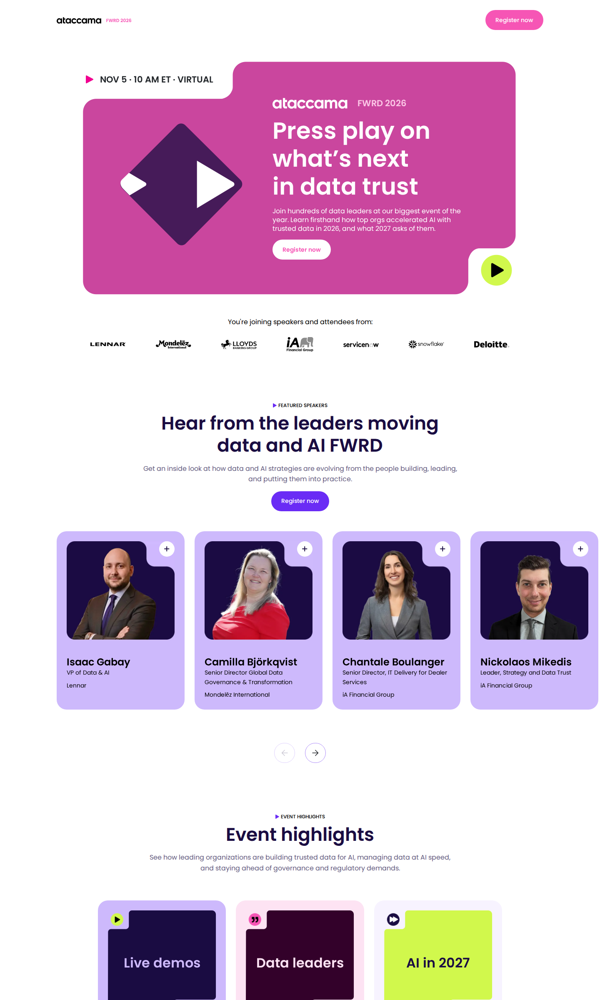

# UI Design System & Master Generation Blueprint: www-ataccama-com_fwrd2026

> **Ataccama FWRD 2026: Press play on what's next in data trust · Ataccama** (https://www.ataccama.com/fwrd2026) — Rewind through the shifts in data quality, agentic data management, and governed context that shaped trusted AI in 2026, then fast-forwar...



---

## 1. Executive Visual Persona & Design Archetype

- **Brand Essence & Persona**: **Ataccama FWRD 2026: Press play on what's next in data trust · Ataccama** (`https://www.ataccama.com/fwrd2026`). Rewind through the shifts in data quality, agentic data management, and governed context that shaped trusted AI in 2026, then fast-forwar...
- **Visual Archetype**: **Dark-Substrate WebGL / Canvas Interactive Experience (`#0d6efd` / `#fd7e14`)**.
- **Anti-AI-Slop Differentiators**:
  - **Source-Grounded Chromatic Polarity**: Anchors the viewport in `#0d6efd` (`var(--bs-blue)` in `:root`) paired with `#ffc107` primary typography and `#fd7e14` accents.
  - **Extracted Typographic Hierarchy**: Pairs `Poppins` for display copy (`Press play on what’s next in data tr`) with `212529` and not declared in static CSS (uses primary stack / `ui-monospace`).
  - **Calibrated Spatial Grid & Motion**: Combines `1168px` container bounds (`gap: .375rem`, padding `24px`) with `cubic-bezier(.455,.03,.515,.955)` easing and GSAP Timeline & ScrollTrigger, Swiper Touch Carousel Engine.

---

## 2. Spatial Architecture & Modular Grid Mathematics


### Viewport Allocation & Container Geometry
- **Captured Viewport Dimensions**: Desktop `1440×5116px` (`assets/desktop.png`, full-page scroll capture), Mobile `390×2400px` (`assets/mobile.png`, capped at 2400px multi-section capture).
- **Master Container Bounds**: `1168px` extracted from `www-ataccama-com_fwrd2026` stylesheet.
- **Canvas Lateral Padding & Spacing**: `24px` lateral canvas padding with `.375rem` grid gap.
- **Border Radius Scale**: `.375rem`, `var(--vbox-title-radius)`, `var(--vbox-share-radius)`, `6px`.

### Responsive Breakpoint Architecture
- **Desktop Layout**: Multi-column CSS Grid / Flexbox layout at `1440px` (`max-width: 1168px`, `gap: .375rem`).
- **Mobile Layout**: Single-column vertical stack at `390px` viewport width with `24px` horizontal padding.
- **Extracted CSS Media Queries**: `@media (min-width: 1280px)`, `@media (min-width: 780px)`, `@media screen and (min-width: 1920px)`, `@media (max-width: 779.98px)`.

---

## 3. Color System, Materiality & Atmospheric Lighting

### Semantic Palette & Source Grounding
| Semantic Role | Ground-Truth Value | Extracted CSS Source / Selector |
|---|---|---|
| **Primary Canvas Substrate** | `#0d6efd` | `var(--bs-blue)` in `:root` |
| **Primary Typography Ink** | `#6610f2` | `var(--bs-indigo)` in `:root` |
| **Elevated Surface / Card Substrate** | `#dc3545` | `var(--bs-red)` in `:root` |
| **Interactive Accent / Highlight** | `#fd7e14` | `var(--bs-orange)` in `:root` |
| **Secondary / Muted Copy** | `#ffc107` | `var(--bs-yellow)` in `:root` |
| **Structural Hairline Border** | `#198754` | `var(--bs-green)` in `:root` |
| **Variable Token (`--bs-teal`)** | `#20c997` | `var(--bs-teal)` in `:root` |
| **Variable Token (`--bs-cyan`)** | `#0dcaf0` | `var(--bs-cyan)` in `:root` |
| **Variable Token (`--bs-gray`)** | `#6c757d` | `var(--bs-gray)` in `:root` |
| **Variable Token (`--bs-gray-dark`)** | `#343a40` | `var(--bs-gray-dark)` in `:root` |
| **Variable Token (`--bs-gray-100`)** | `#f8f9fa` | `var(--bs-gray-100)` in `:root` |
| **Variable Token (`--bs-gray-200`)** | `#e9ecef` | `var(--bs-gray-200)` in `:root` |
| **Variable Token (`--bs-gray-300`)** | `#dee2e6` | `var(--bs-gray-300)` in `:root` |
| **Variable Token (`--bs-gray-400`)** | `#ced4da` | `var(--bs-gray-400)` in `:root` |
| **Variable Token (`--bs-gray-500`)** | `#adb5bd` | `var(--bs-gray-500)` in `:root` |

### Sanitized Root CSS Variables (`ui-ux.md` Ground Truth)
| Variable Name | Extracted Value | Semantic Role |
|---|---|---|
| `--bs-blue` | `#0d6efd` | Color / Atmospheric Token |
| `--bs-indigo` | `#6610f2` | Color / Atmospheric Token |
| `--bs-red` | `#dc3545` | Color / Atmospheric Token |
| `--bs-orange` | `#fd7e14` | Color / Atmospheric Token |
| `--bs-yellow` | `#ffc107` | Color / Atmospheric Token |
| `--bs-green` | `#198754` | Color / Atmospheric Token |
| `--bs-teal` | `#20c997` | Color / Atmospheric Token |
| `--bs-cyan` | `#0dcaf0` | Color / Atmospheric Token |
| `--bs-gray` | `#6c757d` | Color / Atmospheric Token |
| `--bs-gray-dark` | `#343a40` | Canvas / Surface Token |
| `--bs-gray-100` | `#f8f9fa` | Color / Atmospheric Token |
| `--bs-gray-200` | `#e9ecef` | Color / Atmospheric Token |
| `--bs-gray-300` | `#dee2e6` | Color / Atmospheric Token |
| `--bs-gray-400` | `#ced4da` | Color / Atmospheric Token |
| `--bs-gray-500` | `#adb5bd` | Color / Atmospheric Token |
| `--bs-gray-600` | `#6c757d` | Color / Atmospheric Token |

---

## 4. Typographic Scale & Editorial Hierarchy

### Font Family Stacks
- **Display Typography**: `Poppins`.
- **Primary Body Stack**: `212529`.
- **Technical / Metadata Stack**: not declared in static CSS (uses primary stack / `ui-monospace`).

### Typographic Scale & Rules (Extracted from Stylesheet & Variables)
- **Hero Display (`H1`)**: rule `,.h1` (`font-size: clamp(2.75rem,2.4vw + 1.58rem...`, `line-height: 1.2`, `font-weight: 400!important`).
- **Section Heading (`H2`)**: rule `,.h2` (`font-size: clamp(1.75rem,1.6vw + .97rem,...`, `line-height: 1.2`, `font-weight: 400!important`).
- **Body Copy**: CSS variables `--bs-body-font-size: 1rem`, `--bs-body-font-weight: 400`, `--bs-body-line-height: 1.5`; rule `p` (`font-size: 18px`, `line-height: 1.5`).
- **Metadata & Navigation Labels**: rule `small` (`font-weight: normal`).

---

## 5. Choreographed Motion & Interaction Physics

### Primary Easing Curves
- **Extracted Timing Functions**: `cubic-bezier(.455,.03,.515,.955)`, `cubic-bezier(.68,-.55,.27,1.4)`.

### Per-Element Transition & Choreography Rules
- **Selector `button.vbox-close`**: `transition: opacity .2s` extracted from `www-ataccama-com_fwrd2026` stylesheet.
- **Selector `.vbox-prev`**: `transition: opacity .2s` extracted from `www-ataccama-com_fwrd2026` stylesheet.
- **Selector `.vbox-preloader .vbox-preloader-i...`**: `transition: opacity .2s` extracted from `www-ataccama-com_fwrd2026` stylesheet.
- **Extracted Easing Curve (`cubic-bezier(.455,.03,.515,.955)`)**: Governs interactive state transitions across `<header.position-relative>` and `<section.pb-56>`.
- **Runtime Interaction Engine**: Integrates GSAP Timeline & ScrollTrigger, Swiper Touch Carousel Engine, Lottie Vector Animation Player, HTML5 `<canvas>` Interactive Viewport Surface with `prefers-reduced-motion: reduce` fallback guards.

---

## 6. Component Wireframe & Structural DOM Map

### Visual Layout Schematic (Grounded in `dom.html` — `1440px` Desktop & `390px` Mobile Reflow)
```
┌────────────────────────────────────────────────────────────────────────┐
│ DESKTOP VIEWPORT (1440px) — Ataccama FWRD 2026: Press play on what's n │
│ ====================================================================== │
│ [ <header.position-relativ | Register now                           ]  │
│ ---------------------------------------------------------------------- │
│ | HERO STAGE: <section.bg-white>                                   |   │
│ | H1: Press play on what’s next in data trust                      |   │
│ | Substrate: #0d6efd    | Ink: #ffc107    | Accent: #fd7e14        |   │
│ ---------------------------------------------------------------------- │
│ | SHOWCASE GRID (<section.pb-56>           ) max-w: 1168px         |   │
│ | +------------------------------+  +------------------------------+ | │
│ | | Hear from the leaders moving |  | Isaac Gabay                  | | │
│ | +------------------------------+  +------------------------------+ | │
│ ---------------------------------------------------------------------- │
│ | MOBILE VIEWPORT REFLOW (390px) — Single-Column Stack (gap: .375re) | │
│ | [<header.position-r] -> [<section.bg-white>] -> [<section.pb-56>] |  │
│ ---------------------------------------------------------------------- │
│ [ FOOTER (<footer.page-id-13449>) | https://www.ataccama.com/fwrd2026  │
└────────────────────────────────────────────────────────────────────────┘
```

### Granular DOM Region Breakdown
1. **Brand Header & Navigation Bar (<header.position-relative> — `www-ataccama-com_fwrd2026`)**:
   - Landmark `<header class="position-relative overflow-hidden">` hosting `Ataccama FWRD 2026: Press play on wh` navigation (`Register now`), DOM attributes (`data-hubspot-styled-components`, `data-wp-strategy="defer"`, `data-lottie-intro-src="/dist/images/other/an..."`, `data-lottie-loop-src="/dist/images/other/an..."`), and stylesheet rule `.container { max-width:1168px }`.
2. **Hero Stage & Focal Lead (<section.bg-white> — `Press play on what’s next in data `)**:
   - Landmark `<section class="bg-white overflow-hidden">` presenting display lead `Press play on what’s next in data trust` and copy excerpt *"NOV 5 · 10 AM ET · VIRTUAL"* over `#0d6efd` canvas and `#ffc107` ink.
3. **Primary Showcase & Content Grid (<section.pb-56> — `Hear from the leaders moving data `)**:
   - Landmark `<section class="pb-56 pb-sm-120">` rendering section `Hear from the leaders moving data and AI FWRD` with copy *"Join hundreds of data leaders at our biggest event of the year. L"*, asset references (`main-DPilGSmv.css`, `cdnjs.cloudflare.com`, `feed`, `embed`), and grid rule `root { --bs-breakpoint-xs: 0;--bs-breakpoint-sm: 780px;--bs-breakpoint-md: 1280px }`.
4. **Interactive Detail & Feature Matrix (<section.bg-navy> — `Isaac Gabay`)**:
   - Landmark `<section class="bg-navy overflow-hidden">` framing `Isaac Gabay` and `Camilla Björkqvist` (*"You're joining speakers and attendees from:"*) with `#dc3545` surface cards, `#fd7e14` accents, and `.col { flex:1 0 0 }`.
5. **Colophon & Global Directory Footer (<footer.page-id-13449> — `https://www.ataccama.com/fwrd2026`)**:
   - Landmark `<footer class="page-id-13449">` anchoring `Ataccama FWRD 2026: Press play o` footer links (`Register now`), copy *"Get an inside look at how data and AI strategies are evolvin"*, and `#198754` structural dividers.

---

## 7. Master Zero-Shot AI Generation Prompt

```markdown
# Master Zero-Shot Frontend Generation Prompt: www-ataccama-com_fwrd2026 (Ataccama FWRD 2026: Press play on what's next in data trust · Ataccama)

You are a principal frontend architect and design systems engineer. Build a complete, production-ready web application replicating the exact design system, DOM landmarks, typographic hierarchy, color tokens, and motion physics of `www-ataccama-com_fwrd2026` (**Ataccama FWRD 2026: Press play on what's next in data trust · Ataccama** — `https://www.ataccama.com/fwrd2026`).

### 1. Visual Archetype & Anti-AI-Slop Mandates
- **Archetype**: Dark-Substrate WebGL / Canvas Interactive Experience (`#0d6efd` / `#fd7e14`).
- **Identity & Domain Context**: Rewind through the shifts in data quality, agentic data management, and governed context that shaped trusted AI in 2026, then fast-forwar...
- **Primary Substrate**: `#0d6efd` (`var(--bs-blue)` in `:root`), **Primary Ink**: `#ffc107`, **Accent / Highlight**: `#fd7e14`.
- **Site-Specific Differentiators**:
  - **Source-Grounded Chromatic Polarity**: Anchors the viewport in `#0d6efd` (`var(--bs-blue)` in `:root`) paired with `#ffc107` primary typography and `#fd7e14` accents.
  - **Extracted Typographic Hierarchy**: Pairs `Poppins` for display copy (`Press play on what’s next in data tr`) with `212529` and not declared in static CSS (uses primary stack / `ui-monospace`).
  - **Calibrated Spatial Grid & Motion**: Combines `1168px` container bounds (`gap: .375rem`, padding `24px`) with `cubic-bezier(.455,.03,.515,.955)` easing and GSAP Timeline & ScrollTrigger, Swiper Touch Carousel Engine.

### 2. Ground-Truth CSS Variables (`:root` Token Contract)
Declare and consume these exact custom properties extracted from `www-ataccama-com_fwrd2026` in your global stylesheet:

:root {
  /* Ataccama FWRD 2026: Press play on what's next in data trust · Ataccama (www-ataccama-com_fwrd2026) — Ground-Truth Extracted CSS Variables */
  --bs-blue: #0d6efd; /* Color / Atmospheric Token (www-ataccama-com_fwrd2026) */
  --bs-indigo: #6610f2; /* Color / Atmospheric Token (www-ataccama-com_fwrd2026) */
  --bs-red: #dc3545; /* Color / Atmospheric Token (www-ataccama-com_fwrd2026) */
  --bs-orange: #fd7e14; /* Color / Atmospheric Token (www-ataccama-com_fwrd2026) */
  --bs-yellow: #ffc107; /* Color / Atmospheric Token (www-ataccama-com_fwrd2026) */
  --bs-green: #198754; /* Color / Atmospheric Token (www-ataccama-com_fwrd2026) */
  --bs-teal: #20c997; /* Color / Atmospheric Token (www-ataccama-com_fwrd2026) */
  --bs-cyan: #0dcaf0; /* Color / Atmospheric Token (www-ataccama-com_fwrd2026) */
  --bs-gray: #6c757d; /* Color / Atmospheric Token (www-ataccama-com_fwrd2026) */
  --bs-gray-dark: #343a40; /* Canvas / Surface Token (www-ataccama-com_fwrd2026) */
  --bs-gray-100: #f8f9fa; /* Color / Atmospheric Token (www-ataccama-com_fwrd2026) */
  --bs-gray-200: #e9ecef; /* Color / Atmospheric Token (www-ataccama-com_fwrd2026) */
  --bs-gray-300: #dee2e6; /* Color / Atmospheric Token (www-ataccama-com_fwrd2026) */
  --bs-gray-400: #ced4da; /* Color / Atmospheric Token (www-ataccama-com_fwrd2026) */
  --bs-gray-500: #adb5bd; /* Color / Atmospheric Token (www-ataccama-com_fwrd2026) */
  --bs-gray-600: #6c757d; /* Color / Atmospheric Token (www-ataccama-com_fwrd2026) */
}

### 3. Semantic Color & Materiality Contract
Map every surface, ink, and border strictly to these source-grounded tokens:
- **Primary Canvas Substrate**: `#0d6efd` — grounded in `var(--bs-blue)` in `:root`
- **Primary Typography Ink**: `#6610f2` — grounded in `var(--bs-indigo)` in `:root`
- **Elevated Surface / Card Substrate**: `#dc3545` — grounded in `var(--bs-red)` in `:root`
- **Interactive Accent / Highlight**: `#fd7e14` — grounded in `var(--bs-orange)` in `:root`
- **Secondary / Muted Copy**: `#ffc107` — grounded in `var(--bs-yellow)` in `:root`
- **Structural Hairline Border**: `#198754` — grounded in `var(--bs-green)` in `:root`
- **Variable Token (`--bs-teal`)**: `#20c997` — grounded in `var(--bs-teal)` in `:root`
- **Variable Token (`--bs-cyan`)**: `#0dcaf0` — grounded in `var(--bs-cyan)` in `:root`
- **Variable Token (`--bs-gray`)**: `#6c757d` — grounded in `var(--bs-gray)` in `:root`
- **Variable Token (`--bs-gray-dark`)**: `#343a40` — grounded in `var(--bs-gray-dark)` in `:root`
- **Variable Token (`--bs-gray-100`)**: `#f8f9fa` — grounded in `var(--bs-gray-100)` in `:root`
- **Variable Token (`--bs-gray-200`)**: `#e9ecef` — grounded in `var(--bs-gray-200)` in `:root`
- **Variable Token (`--bs-gray-300`)**: `#dee2e6` — grounded in `var(--bs-gray-300)` in `:root`
- **Variable Token (`--bs-gray-400`)**: `#ced4da` — grounded in `var(--bs-gray-400)` in `:root`
- **Variable Token (`--bs-gray-500`)**: `#adb5bd` — grounded in `var(--bs-gray-500)` in `:root`

### 4. Spatial Grid, Container Bounds & Responsive Breakpoints
- **Desktop Viewport Reference**: `1440×5116px` (full-page scroll capture, `1440px` standard desktop width).
- **Mobile Viewport Reference**: `390×2400px` (capped at 2400px multi-section capture, `390px` standard mobile width).
- **Container Max-Width**: `1168px` extracted from `www-ataccama-com_fwrd2026` stylesheet
- **Padding & Gutters**: `24px` lateral canvas padding with `.375rem` grid gap
- **Desktop Grid**: Multi-column CSS Grid / Flexbox layout at `1440px` (`max-width: 1168px`, `gap: .375rem`)
- **Mobile Adaptation**: Single-column vertical stack at `390px` viewport width with `24px` horizontal padding
- **Media Queries**: `@media (min-width: 1280px)`, `@media (min-width: 780px)`, `@media screen and (min-width: 1920px)`, `@media (max-width: 779.98px)`
- **Corner Radii**: `.375rem`, `var(--vbox-title-radius)`, `var(--vbox-share-radius)`, `6px`

### 5. Typography & Editorial Scale Contract
- **Display Font Stack**: `Poppins`
- **Body Font Stack**: `212529`
- **Monospace / Technical Font Stack**: not declared in static CSS (uses primary stack / `ui-monospace`)
- **H1 Display Rule**: rule `,.h1` (`font-size: clamp(2.75rem,2.4vw + 1.58rem...`, `line-height: 1.2`, `font-weight: 400!important`)
- **H2 Section Rule**: rule `,.h2` (`font-size: clamp(1.75rem,1.6vw + .97rem,...`, `line-height: 1.2`, `font-weight: 400!important`)
- **Body Copy Rule**: CSS variables `--bs-body-font-size: 1rem`, `--bs-body-font-weight: 400`, `--bs-body-line-height: 1.5`; rule `p` (`font-size: 18px`, `line-height: 1.5`)
- **Metadata & Index Rule**: rule `small` (`font-weight: normal`)

### 6. Component Hierarchy, Verbatim Copy & Real DOM Landmarks
Scaffold `www-ataccama-com_fwrd2026` (`Ataccama FWRD 2026: Press play on what's next in data trust · Ataccama`) with these exact structural regions, extracted copy, and CSS rules from `dom.html`:
1. **Brand Header & Navigation Bar (<header.position-relative> — `www-ataccama-com_fwrd2026`)**:
   - DOM & Selectors: Landmark `<header class="position-relative overflow-hidden">` hosting `Ataccama FWRD 2026: Press play on wh` navigation (`Register now`), DOM attributes (`data-hubspot-styled-components`, `data-wp-strategy="defer"`, `data-lottie-intro-src="/dist/images/other/an..."`, `data-lottie-loop-src="/dist/images/other/an..."`), and stylesheet rule `.container { max-width:1168px }`.
   - Responsive Contract: Header `Brand Header & Navigation Bar (<header.position-relative> — `www-ataccama-com_fwrd2026`)` (`www-ataccama-com_fwrd2026`) adapts across `@media (min-width: 1280px)`, `@media (min-width: 780px)`, `@media screen and (min-width: 1920px)`, `@media (max-width: 779.98px)` with `cubic-bezier(.455,.03,.515,.955)`, `cubic-bezier(.68,-.55,.27,1.4)` transitions and links `Register now`.
2. **Hero Stage & Focal Lead (<section.bg-white> — `Press play on what’s next in data `)**:
   - DOM & Selectors: Landmark `<section class="bg-white overflow-hidden">` presenting display lead `Press play on what’s next in data trust` and copy excerpt *"NOV 5 · 10 AM ET · VIRTUAL"* over `#0d6efd` canvas and `#ffc107` ink.
   - Responsive Contract: Hero stage (`1440×5116px` desktop / `390×2400px` mobile) sets `#0d6efd` background with `#ffc107` headline `Press play on what’s next in data trust`.
3. **Primary Showcase & Content Grid (<section.pb-56> — `Hear from the leaders moving data `)**:
   - DOM & Selectors: Landmark `<section class="pb-56 pb-sm-120">` rendering section `Hear from the leaders moving data and AI FWRD` with copy *"Join hundreds of data leaders at our biggest event of the year. L"*, asset references (`main-DPilGSmv.css`, `cdnjs.cloudflare.com`, `feed`, `embed`), and grid rule `root { --bs-breakpoint-xs: 0;--bs-breakpoint-sm: 780px;--bs-breakpoint-md: 1280px }`.
   - Responsive Contract: Showcase grid `Primary Showcase & Content Grid (<section.pb-56> — `Hear from the leaders moving data `)` applies Multi-column CSS Grid / Flexbox layout at `1440px` (`max-width: 1168px`, `gap: .375rem`) on desktop and Single-column vertical stack at `390px` viewport width with `24px` horizontal padding on mobile.
4. **Interactive Detail & Feature Matrix (<section.bg-navy> — `Isaac Gabay`)**:
   - DOM & Selectors: Landmark `<section class="bg-navy overflow-hidden">` framing `Isaac Gabay` and `Camilla Björkqvist` (*"You're joining speakers and attendees from:"*) with `#dc3545` surface cards, `#fd7e14` accents, and `.col { flex:1 0 0 }`.
   - Responsive Contract: Detail module `Interactive Detail & Feature Matrix (<section.bg-navy> — `Isaac Gabay`)` uses `.375rem`, `var(--vbox-title-radius)`, `var(--vbox-share-radius)`, `6px` radii, `#fd7e14` highlights, and assets (main-DPilGSmv.css, cdnjs.cloudflare.com, feed).
5. **Colophon & Global Directory Footer (<footer.page-id-13449> — `https://www.ataccama.com/fwrd2026`)**:
   - DOM & Selectors: Landmark `<footer class="page-id-13449">` anchoring `Ataccama FWRD 2026: Press play o` footer links (`Register now`), copy *"Get an inside look at how data and AI strategies are evolvin"*, and `#198754` structural dividers.
   - Responsive Contract: Footer `Colophon & Global Directory Footer (<footer.page-id-13449> — `https://www.ataccama.com/fwrd2026`)` aligns to `1168px` extracted from `www-ataccama-com_fwrd2026` stylesheet with `24px` lateral canvas padding with `.375rem` grid gap and attributes (data-hubspot-styled-components, data-wp-strategy="defer", data-lottie-intro-src="/dist/images/other/an...").

#### Verbatim DOM Copy Excerpts (`dom.html`)
- Copy Excerpt 1: *"NOV 5 · 10 AM ET · VIRTUAL"*
- Copy Excerpt 2: *"Join hundreds of data leaders at our biggest event of the year. Learn firsthand ho..."*
- Copy Excerpt 3: *"You're joining speakers and attendees from:"*
- Copy Excerpt 4: *"Get an inside look at how data and AI strategies are evolving from the people buil..."*

### 7. Motion, Extracted Stylesheet Rules & Interaction Choreography
- **Primary Easing Functions**: `cubic-bezier(.455,.03,.515,.955)`, `cubic-bezier(.68,-.55,.27,1.4)`
- **Extracted Stylesheet Rules (`www-ataccama-com_fwrd2026`)**:
- `.container { max-width:1168px }`
- `root { --bs-breakpoint-xs: 0;--bs-breakpoint-sm: 780px;--bs-breakpoint-md: 1280px }`
- `.col { flex:1 0 0 }`
- `.col-auto { flex:0 0 auto;width:auto }`
- `.col-1 { flex:0 0 auto;width:8.33333333% }`
- **Per-Selector Transition Rules**:
- **Selector `button.vbox-close`**: `transition: opacity .2s` extracted from `www-ataccama-com_fwrd2026` stylesheet.
- **Selector `.vbox-prev`**: `transition: opacity .2s` extracted from `www-ataccama-com_fwrd2026` stylesheet.
- **Selector `.vbox-preloader .vbox-preloader-i...`**: `transition: opacity .2s` extracted from `www-ataccama-com_fwrd2026` stylesheet.
- **Extracted Easing Curve (`cubic-bezier(.455,.03,.515,.955)`)**: Governs interactive state transitions across `<header.position-relative>` and `<section.pb-56>`.
- **Runtime Interaction Engine**: Integrates GSAP Timeline & ScrollTrigger, Swiper Touch Carousel Engine, Lottie Vector Animation Player, HTML5 `<canvas>` Interactive Viewport Surface with `prefers-reduced-motion: reduce` fallback guards.

### 8. Technical Deliverables
- Implement in Next.js (App Router) with TypeScript and Tailwind CSS consuming the `:root` custom properties defined above for `www-ataccama-com_fwrd2026`.
- Reproduce both the `1440px` desktop architecture and `390px` mobile breakpoint transitions, preserving semantic HTML5 landmarks (`<header>`, `<nav>`, `<main>`, `<section>`, `<footer>`) and `prefers-reduced-motion` accessibility guards.
```
