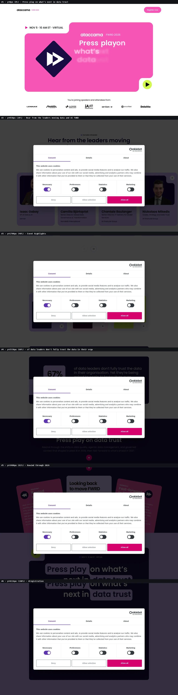
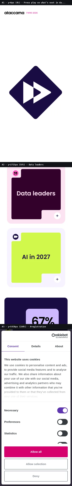

# UI Design System & Master Generation Blueprint: www-ataccama-com_fwrd2026

> **Ataccama FWRD 2026: Press play on what's next in data trust · Ataccama** (https://www.ataccama.com/fwrd2026) — Rewind through the shifts in data quality, agentic data management, and governed context that shaped trusted AI in 2026, then fast-forwar...





---

## 1. Executive Visual Persona & Design Archetype

- **Brand Essence & Persona**: **Ataccama FWRD 2026: Press play on what's next in data trust · Ataccama** (`https://www.ataccama.com/fwrd2026`). Rewind through the shifts in data quality, agentic data management, and governed context that shaped trusted AI in 2026, then fast-forwar...
- **Capture Provenance**: Live browser capture (`tier1_fast`, HTTP `200`, captured `2026-11-24`).
- **Visual Archetype**: **Light-Gallery WebGL / Canvas Interactive Experience (`#ffffff` / `#f10090`)**.
- **Anti-AI-Slop Differentiators**:
  - **Live-Computed Chromatic Polarity**: Anchors the viewport in `#ffffff` (live computed `body` `background-color` (`computed_styles.json`)) paired with `#1a0c42` primary typography and `#f10090` accents.
  - **Grounded Typographic Hierarchy**: Uses `Poppins` across display (`Press play on what’s next in data tr`) and body copy.
  - **Calibrated Spatial Grid & Motion**: Combines `1808px` container bounds (`gap: .375rem`, padding `12px`) with `cubic-bezier(.455,.03,.515,.955)` easing and GSAP Timeline & ScrollTrigger, Swiper Touch Carousel Engine.

---

## 2. Spatial Architecture & Modular Grid Mathematics

### Viewport Allocation & Container Geometry
- **Captured Journey Filmstrips**: Desktop `1280×4968px` (`assets/desktop-journey.webp`, `6` keyframes up to `y=4216px` / doc `5116px`), Mobile `390×2616px` (`assets/mobile-journey.webp`, `3` keyframes).
- **Master Container Bounds**: `1808px` (non-`@media` desktop container stylesheet rule).
- **Canvas Lateral Padding & Spacing**: `12px` lateral canvas padding with `.375rem` grid gap.
- **Border Radius Scale**: `64px`, `var(--vbox-title-radius)`, `var(--vbox-share-radius)`, `6px`.

### Responsive Breakpoint Architecture
- **Desktop Layout**: Multi-column CSS Grid / Flexbox layout at `1440px` (`max-width: 1808px`, `gap: .375rem`).
- **Mobile Layout**: Single-column vertical stack at `390px` viewport width with `12px` horizontal padding.
- **Extracted CSS Media Queries**: `@media (max-width: 779.98px)`, `@media (max-width: 1279.98px)`, `@media (min-width: 780px)`, `@media (min-width: 1280px)`.

---

## 3. Color System, Materiality & Atmospheric Lighting

### Semantic Palette & Source Grounding
| Semantic Role | Ground-Truth Value | Extracted Live / CSS Source |
|---|---|---|
| **Primary Canvas Substrate** | `#ffffff` | live computed `body` `background-color` (`computed_styles.json`) |
| **Primary Typography Ink** | `#1a0c42` | live computed `h2` `color` (`computed_styles.json`) |
| **Elevated Surface / Card Substrate** | `#dddddd` | `var(--wp-editor-canvas-background)` in `:root` |
| **Interactive Accent / Highlight** | `#f10090` | `var(--bs-link-color)` in `:root` |
| **Secondary / Muted Copy** | `#f771c1` | `var(--bs-pink-60)` in `:root` |
| **Structural Hairline Border** | `#e9ecef` | `var(--bs-light-border-subtle)` in `:root` |
| **Variable Token (`--wp-block-synced-color`)** | `#7a00df` | `var(--wp-block-synced-color)` in `:root` |
| **Variable Token (`--wp-admin-theme-color`)** | `#007cba` | `var(--wp-admin-theme-color)` in `:root` |
| **Variable Token (`--wp-admin-theme-color-darker-10`)** | `#006ba1` | `var(--wp-admin-theme-color-darker-10)` in `:root` |
| **Variable Token (`--wp-admin-theme-color-darker-20`)** | `#005a87` | `var(--wp-admin-theme-color-darker-20)` in `:root` |
| **Variable Token (`--bs-blue`)** | `#0d6efd` | `var(--bs-blue)` in `:root` |
| **Variable Token (`--bs-indigo`)** | `#6610f2` | `var(--bs-indigo)` in `:root` |
| **Variable Token (`--bs-red`)** | `#dc3545` | `var(--bs-red)` in `:root` |
| **Variable Token (`--bs-orange`)** | `#fd7e14` | `var(--bs-orange)` in `:root` |

### Sanitized Root CSS Variables (`ui-ux.md` Ground Truth)
| Variable Name | Extracted Value | Semantic Role |
|---|---|---|
| `--wp-block-synced-color` | `#7a00df` | Brand / Palette Token |
| `--wp-block-synced-color--rgb` | `122,0,223` | Brand / Palette Token |
| `--wp-bound-block-color` | `var(--wp-block-synced-color)` | Brand / Palette Token |
| `--wp-editor-canvas-background` | `#ddd` | Canvas / Surface Token |
| `--wp-admin-theme-color` | `#007cba` | Brand / Palette Token |
| `--wp-admin-theme-color--rgb` | `0,124,186` | Brand / Palette Token |
| `--wp-admin-theme-color-darker-10` | `#006ba1` | Canvas / Surface Token |
| `--wp-admin-theme-color-darker-10--rgb` | `0,107,160.5` | Canvas / Surface Token |
| `--wp-admin-theme-color-darker-20` | `#005a87` | Canvas / Surface Token |
| `--wp-admin-theme-color-darker-20--rgb` | `0,90,135` | Canvas / Surface Token |
| `--wp-admin-border-width-focus` | `2px` | Layout / Spatial Grid Token |
| `--wp-admin--admin-bar--position-offset` | `var(--wp-admin--admin-bar--height,0px)` | Dimension / Scale Token |
| `--bs-blue` | `#0d6efd` | Color / Atmospheric Token |
| `--bs-indigo` | `#6610f2` | Color / Atmospheric Token |
| `--bs-red` | `#dc3545` | Color / Atmospheric Token |
| `--bs-orange` | `#fd7e14` | Color / Atmospheric Token |

---

## 4. Typographic Scale & Editorial Hierarchy

### Font Family Stacks
- **Display Typography**: `Poppins`.
- **Primary Body Stack**: `Poppins`.
- **Technical / Metadata Stack**: not declared in live computed styles (uses primary stack / `ui-monospace`).

### Typographic Scale & Rules (Live Computed & Stylesheet Grounded)
- **Hero Display (`H1`)**: live computed `h1` (`font-size: 56px`, `line-height: 67.2px`, `font-weight: 600`); rule `,.h1` (`font-size: clamp(2.75rem,2.4vw + 1.58rem...`, `line-height: 1.2`, `font-weight: 400`).
- **Section Heading (`H2`)**: live computed `h2` (`font-size: 44px`, `line-height: 52.8px`, `font-weight: 600`); rule `,.h2` (`font-size: clamp(1.75rem,1.6vw + .97rem,...`, `line-height: 1.2`, `font-weight: 400`).
- **Body Copy**: live computed `body` (`font-size: 16px`, `line-height: 24px`, `font-weight: 400`); CSS variables `--bs-body-font-size: 1rem`, `--bs-body-font-weight: 400`, `--bs-body-line-height: 1.5`; rule `p` (`font-size: 18px`, `line-height: 1.5`).
- **Metadata & Navigation Labels**: live computed `nav/a` (`font-size: 16px`, `line-height: 24px`, `font-weight: 400`); rule `small` (`font-weight: normal`).

---

## 5. Choreographed Motion & Interaction Physics

### Primary Easing Curves
- **Extracted Timing Functions**: `cubic-bezier(.455,.03,.515,.955)`, `cubic-bezier(.68,-.55,.27,1.4)`.

### Per-Element Transition & Choreography Rules
- **Selector `button.vbox-close`**: `transition: opacity .2s` extracted from `www-ataccama-com_fwrd2026` stylesheet.
- **Selector `.vbox-prev`**: `transition: opacity .2s` extracted from `www-ataccama-com_fwrd2026` stylesheet.
- **Selector `.vbox-preloader .vbox-preloader-i...`**: `transition: opacity .2s` extracted from `www-ataccama-com_fwrd2026` stylesheet.
- **Extracted Easing Curve (`cubic-bezier(.455,.03,.515,.955)`)**: Governs interactive state transitions across `<header.position-relative>` and `<section.pb-56>`.
- **Runtime Interaction Engine**: Integrates GSAP Timeline & ScrollTrigger, Swiper Touch Carousel Engine, Lottie Vector Animation Player, HTML5 `<canvas>` Interactive Viewport Surface with `prefers-reduced-motion: reduce` fallback guards.
### Measured Runtime Scroll & Interaction Telemetry (`behavioral_journey_v2`)
- **Scroll Driver Mode**: `native` (max document height `5116px`, deepest scrollY reached `4216px` across `6` desktop keyframes).
- **Detected Scroll / Motion Libraries**: `WebGL/Canvas`.
- **Hover Physics (`primary_cta` · `Register now`)**: Computed transition `0.4s` / `ease` (no static color/transform shift captured at rest).

---

## 6. Component Wireframe & Structural DOM Map

### Visual Layout Schematic — Desktop (`1440px`, Grounded in `dom.html` & Landmark Bounding Boxes)
```
┌────────────────────────────────────────────────────────────────────────┐
│ DESKTOP VIEWPORT (1440px) — Ataccama FWRD 2026: Press play on what's n │
│ ====================================================================== │
│ [ <header.position-relat (1440x96px)  | Register now                 ] │
│ ---------------------------------------------------------------------- │
│ | HERO STAGE: <section.py-56> (w=1440px)                             | │
│ | H1: Press play on what’s next in data trust                        | │
│ | Substrate: #ffffff | Ink: #1a0c42 | Accent: #f10090                | │
│ ---------------------------------------------------------------------- │
│ | SHOWCASE GRID (<section.pb-56>) max-w: 1808px                      | │
│ | +------------------------------+  +------------------------------+ | │
│ | | Hear from the leaders moving |  | Camilla Björkqvist           | | │
│ | +------------------------------+  +------------------------------+ | │
│ ---------------------------------------------------------------------- │
│ | DETAIL MODULE (<section.bg-navy>) — Chantale Boulanger             | │
│ ---------------------------------------------------------------------- │
│ [ FOOTER (<footer.page-id-1344) | https://www.ataccama.com/fwrd2026    │
└────────────────────────────────────────────────────────────────────────┘
```

### Visual Layout Schematic — Mobile Reflow (`390px`)
```
┌────────────────────────────────────────────────────────────────────────┐
│ MOBILE VIEWPORT REFLOW (390px) — Single-Column Stack (gap: .375rem)    │
│ ====================================================================== │
│ [ HEADER BAR (<header.position-relativ) | Compact Menu (390px)         │
│ ---------------------------------------------------------------------- │
│ | HERO STAGE (<section.py-56>) — 390px Vertical Lead                 | │
│ | H1: Press play on what’s next in data trust                        | │
│ ---------------------------------------------------------------------- │
│ | SHOWCASE STACK (<section.pb-56>) — 1-Col Stack                     | │
│ | [ Item 1: Hear from the leaders moving data and AI FWRD          ] | │
│ | [ Item 2: Camilla Björkqvist                                     ] | │
│ ---------------------------------------------------------------------- │
│ | DETAIL STACK (<section.bg-navy>) — 1-Col (Chantale Boulanger)      | │
│ ---------------------------------------------------------------------- │
│ [ FOOTER (<footer.page-id-1344) | Stacked 390px Colophon               │
└────────────────────────────────────────────────────────────────────────┘
```

### Granular DOM Region Breakdown
1. **Brand Header & Navigation Bar (<header.position-relative> — `www-ataccama-com_fwrd2026`)**:
   - Landmark `<header class="position-relative pt-md-96">` (`1440x96px`) hosting `Ataccama FWRD 2026: Press play on wh` navigation (`Register now`), DOM attributes (`data-hubspot-styled-components`, `data-wp-strategy="defer"`, `data-lottie-intro-src="/dist/images/other/an..."`, `data-lottie-loop-src="/dist/images/other/an..."`), and stylesheet rule `.a0-footer { display: none; }`.
2. **Hero Stage & Focal Lead (<section.py-56> — `Press play on what’s next in data `)**:
   - Landmark `<section class="py-56 py-sm-120">` presenting display lead `Press play on what’s next in data trust` and copy excerpt *"Get an inside look at how data and AI strategies are evolving fro"* over `#ffffff` canvas and `#1a0c42` ink.
3. **Primary Showcase & Content Grid (<section.pb-56> — `Hear from the leaders moving data `)**:
   - Landmark `<section class="pb-56 pb-sm-120">` rendering section `Hear from the leaders moving data and AI FWRD` with copy *"NOV 5 · 10 AM ET · VIRTUAL"*, asset references (`main-qGdQcxOC.css`, `cdnjs.cloudflare.com`, `feed`, `embed`), and grid rule `a0-widget .a0-zocial.a0-wp-login { background-color: 490050; }`.
4. **Interactive Detail & Feature Matrix (<section.bg-navy> — `Camilla Björkqvist`)**:
   - Landmark `<section class="bg-navy py-56">` framing `Camilla Björkqvist` and `Chantale Boulanger` (*"Join hundreds of data leaders at our biggest event of the year. L"*) with `#dddddd` surface cards, `#f10090` accents, and `wp-login-form-wrapper { display: none; }`.
5. **Colophon & Global Directory Footer (<footer.page-id-13449> — `https://www.ataccama.com/fwrd2026`)**:
   - Landmark `<footer class="page-id-13449">` anchoring `Ataccama FWRD 2026: Press play o` footer links (`Register now`), copy *"You're joining speakers and attendees from:"*, and `#e9ecef` structural dividers.
### Full Vertical Scroll Sequence (Desktop `1440×900` Keyframes)
- **Step 01** (`y=0px`, `0%`): Active landmark `Press play on what’s next in data trust` · sticky/fixed elements: `0`
- **Step 02** (`y=850px`, `20%`): Active landmark `Hear from the leaders moving data and AI FWRD` · sticky/fixed elements: `1`
- **Step 03** (`y=1700px`, `40%`): Active landmark `Event highlights` · sticky/fixed elements: `1`
- **Step 04** (`y=2550px`, `60%`): Active landmark `of data leaders don't fully trust the data in the...` · sticky/fixed elements: `1`
- **Step 05** (`y=3400px`, `81%`): Active landmark `Rewind through 2026` · sticky/fixed elements: `1`
- **Step 06** (`y=4216px`, `100%`): Active landmark `#registration` · sticky/fixed elements: `1`

---

## 7. Master Zero-Shot AI Generation Prompt

```markdown
# Master Zero-Shot Frontend Generation Prompt: www-ataccama-com_fwrd2026 (Ataccama FWRD 2026: Press play on what's next in data trust · Ataccama)

You are a principal frontend architect and design systems engineer. Build a complete, production-ready web application replicating the exact design system, DOM landmarks, typographic hierarchy, color tokens, and motion physics of `www-ataccama-com_fwrd2026` (**Ataccama FWRD 2026: Press play on what's next in data trust · Ataccama** — `https://www.ataccama.com/fwrd2026`).

### 1. Visual Archetype & Anti-AI-Slop Mandates
- **Archetype**: Light-Gallery WebGL / Canvas Interactive Experience (`#ffffff` / `#f10090`).
- **Identity & Domain Context**: Rewind through the shifts in data quality, agentic data management, and governed context that shaped trusted AI in 2026, then fast-forwar...
- **Primary Substrate**: `#ffffff` (live computed `body` `background-color` (`computed_styles.json`)), **Primary Ink**: `#1a0c42`, **Accent / Highlight**: `#f10090`.
- **Site-Specific Differentiators**:
  - **Live-Computed Chromatic Polarity**: Anchors the viewport in `#ffffff` (live computed `body` `background-color` (`computed_styles.json`)) paired with `#1a0c42` primary typography and `#f10090` accents.
  - **Grounded Typographic Hierarchy**: Uses `Poppins` across display (`Press play on what’s next in data tr`) and body copy.
  - **Calibrated Spatial Grid & Motion**: Combines `1808px` container bounds (`gap: .375rem`, padding `12px`) with `cubic-bezier(.455,.03,.515,.955)` easing and GSAP Timeline & ScrollTrigger, Swiper Touch Carousel Engine.

### 2. Ground-Truth CSS Variables (`:root` Token Contract)
Declare and consume these exact custom properties extracted from `www-ataccama-com_fwrd2026` in your global stylesheet:

:root {
  /* Ataccama FWRD 2026: Press play on what's next in data trust · Ataccama (www-ataccama-com_fwrd2026) — Live-Grounded CSS Variables */
  --wp-block-synced-color: #7a00df; /* Brand / Palette Token (www-ataccama-com_fwrd2026) */
  --wp-block-synced-color--rgb: 122,0,223; /* Brand / Palette Token (www-ataccama-com_fwrd2026) */
  --wp-bound-block-color: var(--wp-block-synced-color); /* Brand / Palette Token (www-ataccama-com_fwrd2026) */
  --wp-editor-canvas-background: #ddd; /* Canvas / Surface Token (www-ataccama-com_fwrd2026) */
  --wp-admin-theme-color: #007cba; /* Brand / Palette Token (www-ataccama-com_fwrd2026) */
  --wp-admin-theme-color--rgb: 0,124,186; /* Brand / Palette Token (www-ataccama-com_fwrd2026) */
  --wp-admin-theme-color-darker-10: #006ba1; /* Canvas / Surface Token (www-ataccama-com_fwrd2026) */
  --wp-admin-theme-color-darker-10--rgb: 0,107,160.5; /* Canvas / Surface Token (www-ataccama-com_fwrd2026) */
  --wp-admin-theme-color-darker-20: #005a87; /* Canvas / Surface Token (www-ataccama-com_fwrd2026) */
  --wp-admin-theme-color-darker-20--rgb: 0,90,135; /* Canvas / Surface Token (www-ataccama-com_fwrd2026) */
  --wp-admin-border-width-focus: 2px; /* Layout / Spatial Grid Token (www-ataccama-com_fwrd2026) */
  --wp-admin--admin-bar--position-offset: var(--wp-admin--admin-bar--height,0px); /* Dimension / Scale Token (www-ataccama-com_fwrd2026) */
  --bs-blue: #0d6efd; /* Color / Atmospheric Token (www-ataccama-com_fwrd2026) */
  --bs-indigo: #6610f2; /* Color / Atmospheric Token (www-ataccama-com_fwrd2026) */
  --bs-red: #dc3545; /* Color / Atmospheric Token (www-ataccama-com_fwrd2026) */
  --bs-orange: #fd7e14; /* Color / Atmospheric Token (www-ataccama-com_fwrd2026) */
}

### 3. Semantic Color & Materiality Contract
Map every surface, ink, and border strictly to these source-grounded tokens:
- **Primary Canvas Substrate**: `#ffffff` — grounded in live computed `body` `background-color` (`computed_styles.json`)
- **Primary Typography Ink**: `#1a0c42` — grounded in live computed `h2` `color` (`computed_styles.json`)
- **Elevated Surface / Card Substrate**: `#dddddd` — grounded in `var(--wp-editor-canvas-background)` in `:root`
- **Interactive Accent / Highlight**: `#f10090` — grounded in `var(--bs-link-color)` in `:root`
- **Secondary / Muted Copy**: `#f771c1` — grounded in `var(--bs-pink-60)` in `:root`
- **Structural Hairline Border**: `#e9ecef` — grounded in `var(--bs-light-border-subtle)` in `:root`
- **Variable Token (`--wp-block-synced-color`)**: `#7a00df` — grounded in `var(--wp-block-synced-color)` in `:root`
- **Variable Token (`--wp-admin-theme-color`)**: `#007cba` — grounded in `var(--wp-admin-theme-color)` in `:root`
- **Variable Token (`--wp-admin-theme-color-darker-10`)**: `#006ba1` — grounded in `var(--wp-admin-theme-color-darker-10)` in `:root`
- **Variable Token (`--wp-admin-theme-color-darker-20`)**: `#005a87` — grounded in `var(--wp-admin-theme-color-darker-20)` in `:root`
- **Variable Token (`--bs-blue`)**: `#0d6efd` — grounded in `var(--bs-blue)` in `:root`
- **Variable Token (`--bs-indigo`)**: `#6610f2` — grounded in `var(--bs-indigo)` in `:root`
- **Variable Token (`--bs-red`)**: `#dc3545` — grounded in `var(--bs-red)` in `:root`
- **Variable Token (`--bs-orange`)**: `#fd7e14` — grounded in `var(--bs-orange)` in `:root`

### 4. Spatial Grid, Container Bounds & Responsive Breakpoints
- **Desktop Viewport Reference**: `1280×4968px` (multi-frame vertical journey filmstrip (4968px), `1440px` standard desktop width).
- **Mobile Viewport Reference**: `390×2616px` (multi-frame vertical journey filmstrip (2616px), `390px` standard mobile width).
- **Container Max-Width**: `1808px` (non-`@media` desktop container stylesheet rule)
- **Padding & Gutters**: `12px` lateral canvas padding with `.375rem` grid gap
- **Desktop Grid**: Multi-column CSS Grid / Flexbox layout at `1440px` (`max-width: 1808px`, `gap: .375rem`)
- **Mobile Adaptation**: Single-column vertical stack at `390px` viewport width with `12px` horizontal padding
- **Media Queries**: `@media (max-width: 779.98px)`, `@media (max-width: 1279.98px)`, `@media (min-width: 780px)`, `@media (min-width: 1280px)`
- **Corner Radii**: `64px`, `var(--vbox-title-radius)`, `var(--vbox-share-radius)`, `6px`

### 5. Typography & Editorial Scale Contract
- **Display Font Stack**: `Poppins`
- **Body Font Stack**: `Poppins`
- **Monospace / Technical Font Stack**: not declared in live computed styles (uses primary stack / `ui-monospace`)
- **H1 Display Rule**: live computed `h1` (`font-size: 56px`, `line-height: 67.2px`, `font-weight: 600`); rule `,.h1` (`font-size: clamp(2.75rem,2.4vw + 1.58rem...`, `line-height: 1.2`, `font-weight: 400`)
- **H2 Section Rule**: live computed `h2` (`font-size: 44px`, `line-height: 52.8px`, `font-weight: 600`); rule `,.h2` (`font-size: clamp(1.75rem,1.6vw + .97rem,...`, `line-height: 1.2`, `font-weight: 400`)
- **Body Copy Rule**: live computed `body` (`font-size: 16px`, `line-height: 24px`, `font-weight: 400`); CSS variables `--bs-body-font-size: 1rem`, `--bs-body-font-weight: 400`, `--bs-body-line-height: 1.5`; rule `p` (`font-size: 18px`, `line-height: 1.5`)
- **Metadata & Index Rule**: live computed `nav/a` (`font-size: 16px`, `line-height: 24px`, `font-weight: 400`); rule `small` (`font-weight: normal`)

### 6. Component Hierarchy, Verbatim Copy & Real DOM Landmarks
Scaffold `www-ataccama-com_fwrd2026` (`Ataccama FWRD 2026: Press play on what's next in data trust · Ataccama`) with these exact structural regions, extracted copy, and CSS rules from `dom.html`:
1. **Brand Header & Navigation Bar (<header.position-relative> — `www-ataccama-com_fwrd2026`)**:
   - DOM & Selectors: Landmark `<header class="position-relative pt-md-96">` (`1440x96px`) hosting `Ataccama FWRD 2026: Press play on wh` navigation (`Register now`), DOM attributes (`data-hubspot-styled-components`, `data-wp-strategy="defer"`, `data-lottie-intro-src="/dist/images/other/an..."`, `data-lottie-loop-src="/dist/images/other/an..."`), and stylesheet rule `.a0-footer { display: none; }`.
   - Responsive Contract: Header `Brand Header & Navigation Bar (<header.position-relative> — `www-ataccama-com_fwrd2026`)` (`www-ataccama-com_fwrd2026`) adapts across `@media (max-width: 779.98px)`, `@media (max-width: 1279.98px)`, `@media (min-width: 780px)`, `@media (min-width: 1280px)` with `cubic-bezier(.455,.03,.515,.955)`, `cubic-bezier(.68,-.55,.27,1.4)` transitions and links `Register now`.
2. **Hero Stage & Focal Lead (<section.py-56> — `Press play on what’s next in data `)**:
   - DOM & Selectors: Landmark `<section class="py-56 py-sm-120">` presenting display lead `Press play on what’s next in data trust` and copy excerpt *"Get an inside look at how data and AI strategies are evolving fro"* over `#ffffff` canvas and `#1a0c42` ink.
   - Responsive Contract: Hero stage (`1280×4968px` desktop / `390×2616px` mobile) sets `#ffffff` background with `#1a0c42` headline `Press play on what’s next in data trust`.
3. **Primary Showcase & Content Grid (<section.pb-56> — `Hear from the leaders moving data `)**:
   - DOM & Selectors: Landmark `<section class="pb-56 pb-sm-120">` rendering section `Hear from the leaders moving data and AI FWRD` with copy *"NOV 5 · 10 AM ET · VIRTUAL"*, asset references (`main-qGdQcxOC.css`, `cdnjs.cloudflare.com`, `feed`, `embed`), and grid rule `a0-widget .a0-zocial.a0-wp-login { background-color: 490050; }`.
   - Responsive Contract: Showcase grid `Primary Showcase & Content Grid (<section.pb-56> — `Hear from the leaders moving data `)` applies Multi-column CSS Grid / Flexbox layout at `1440px` (`max-width: 1808px`, `gap: .375rem`) on desktop and Single-column vertical stack at `390px` viewport width with `12px` horizontal padding on mobile.
4. **Interactive Detail & Feature Matrix (<section.bg-navy> — `Camilla Björkqvist`)**:
   - DOM & Selectors: Landmark `<section class="bg-navy py-56">` framing `Camilla Björkqvist` and `Chantale Boulanger` (*"Join hundreds of data leaders at our biggest event of the year. L"*) with `#dddddd` surface cards, `#f10090` accents, and `wp-login-form-wrapper { display: none; }`.
   - Responsive Contract: Detail module `Interactive Detail & Feature Matrix (<section.bg-navy> — `Camilla Björkqvist`)` uses `64px`, `var(--vbox-title-radius)`, `var(--vbox-share-radius)`, `6px` radii, `#f10090` highlights, and assets (main-qGdQcxOC.css, cdnjs.cloudflare.com, feed).
5. **Colophon & Global Directory Footer (<footer.page-id-13449> — `https://www.ataccama.com/fwrd2026`)**:
   - DOM & Selectors: Landmark `<footer class="page-id-13449">` anchoring `Ataccama FWRD 2026: Press play o` footer links (`Register now`), copy *"You're joining speakers and attendees from:"*, and `#e9ecef` structural dividers.
   - Responsive Contract: Footer `Colophon & Global Directory Footer (<footer.page-id-13449> — `https://www.ataccama.com/fwrd2026`)` aligns to `1808px` (non-`@media` desktop container stylesheet rule) with `12px` lateral canvas padding with `.375rem` grid gap and attributes (data-hubspot-styled-components, data-wp-strategy="defer", data-lottie-intro-src="/dist/images/other/an...").

#### Verbatim DOM Copy Excerpts (`dom.html`)
- Copy Excerpt 1: *"Get an inside look at how data and AI strategies are evolving from the people buil..."*
- Copy Excerpt 2: *"NOV 5 · 10 AM ET · VIRTUAL"*
- Copy Excerpt 3: *"Join hundreds of data leaders at our biggest event of the year. Learn firsthand ho..."*
- Copy Excerpt 4: *"You're joining speakers and attendees from:"*

### 7. Motion, Extracted Stylesheet Rules & Interaction Choreography
- **Primary Easing Functions**: `cubic-bezier(.455,.03,.515,.955)`, `cubic-bezier(.68,-.55,.27,1.4)`
- **Extracted Stylesheet Rules (`www-ataccama-com_fwrd2026`)**:
- `.a0-footer { display: none; }`
- `a0-widget .a0-zocial.a0-wp-login { background-color: 490050; }`
- `wp-login-form-wrapper { display: none; }`
- `.auth0-login .form-signin-heading { margin-bottom: 10px; }`
- `.a0-message small { font-weight: normal; cursor: pointer; }`
- **Per-Selector Transition Rules**:
- **Selector `button.vbox-close`**: `transition: opacity .2s` extracted from `www-ataccama-com_fwrd2026` stylesheet.
- **Selector `.vbox-prev`**: `transition: opacity .2s` extracted from `www-ataccama-com_fwrd2026` stylesheet.
- **Selector `.vbox-preloader .vbox-preloader-i...`**: `transition: opacity .2s` extracted from `www-ataccama-com_fwrd2026` stylesheet.
- **Extracted Easing Curve (`cubic-bezier(.455,.03,.515,.955)`)**: Governs interactive state transitions across `<header.position-relative>` and `<section.pb-56>`.
- **Runtime Interaction Engine**: Integrates GSAP Timeline & ScrollTrigger, Swiper Touch Carousel Engine, Lottie Vector Animation Player, HTML5 `<canvas>` Interactive Viewport Surface with `prefers-reduced-motion: reduce` fallback guards.
### 7b. Full-Page Scroll Choreography, Interactive States & Multi-Page Routes
- **Scroll Mechanics**: Implement `native` vertical progression up to `5116px` across 6 distinct viewport chapters using WebGL/Canvas.
- **Vertical Chapter Sequence**: Press play on what’s next i... (0%) -> Hear from the leaders movin... (20%) -> Event highlights (40%) -> of data leaders don't fully... (60%) -> Rewind through 2026 (81%) -> #registration (100%).

### 8. Technical Deliverables
- Implement in Next.js (App Router) with TypeScript and Tailwind CSS consuming the `:root` custom properties defined above for `www-ataccama-com_fwrd2026`.
- Reproduce both the `1440px` desktop architecture and `390px` mobile breakpoint transitions, preserving semantic HTML5 landmarks (`<header>`, `<nav>`, `<main>`, `<section>`, `<footer>`) and `prefers-reduced-motion` accessibility guards.
```
---

## 8. Full-Page Scroll Journey, Interactive States & Subpage Inventory

### Desktop Scroll Keyframes (`1440×900` WebP)
| Step | Scroll Y | Progress | Active Landmark / Section | Sticky/Fixed | Visual Asset |
| :---: | :---: | :---: | :--- | :---: | :--- |
| `#01` | `0px` | `0%` | Press play on what’s next in data trust | `0` | [desktop-step-01.webp](assets/desktop-step-01.webp) |
| `#02` | `850px` | `20%` | Hear from the leaders moving data and AI FWRD | `1` | [desktop-step-02.webp](assets/desktop-step-02.webp) |
| `#03` | `1700px` | `40%` | Event highlights | `1` | [desktop-step-03.webp](assets/desktop-step-03.webp) |
| `#04` | `2550px` | `60%` | of data leaders don't fully trust the data in... | `1` | [desktop-step-04.webp](assets/desktop-step-04.webp) |
| `#05` | `3400px` | `81%` | Rewind through 2026 | `1` | [desktop-step-05.webp](assets/desktop-step-05.webp) |
| `#06` | `4216px` | `100%` | #registration | `1` | [desktop-step-06.webp](assets/desktop-step-06.webp) |

### Mobile Condensed Keyframes (`390×844` WebP)
| Step | Scroll Y | Progress | Active Landmark | Visual Asset |
| :---: | :---: | :---: | :--- | :--- |
| `#01` | `0px` | `0%` | Press play on what’s next in data trust | [mobile-step-01.webp](assets/mobile-step-01.webp) |
| `#02` | `2715px` | `50%` | Data leaders | [mobile-step-02.webp](assets/mobile-step-02.webp) |
| `#03` | `5430px` | `100%` | #registration | [mobile-step-03.webp](assets/mobile-step-03.webp) |

