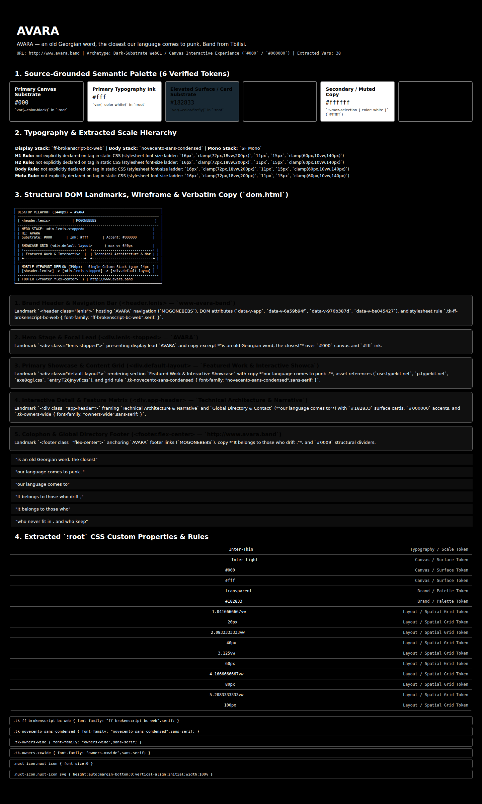
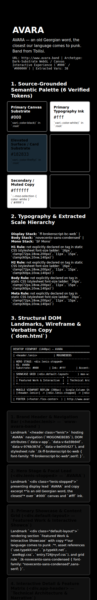

# UI Design System & Master Generation Blueprint: www-avara-band

> **AVARA** (http://www.avara.band) — AVARA — an old Georgian word, the closest our language comes to punk. Band from Tbilisi.



---

## 1. Executive Visual Persona & Design Archetype

- **Brand Essence & Persona**: **AVARA** (`http://www.avara.band`). AVARA — an old Georgian word, the closest our language comes to punk. Band from Tbilisi.
- **Visual Archetype**: **Dark-Substrate WebGL / Canvas Interactive Experience (`#000` / `#000000`)**.
- **Anti-AI-Slop Differentiators**:
  - **Source-Grounded Chromatic Polarity**: Anchors the viewport in `#000` (`var(--color-black)` in `:root`) paired with `#fff` primary typography and `#000000` accents.
  - **Extracted Typographic Hierarchy**: Pairs `ff-brokenscript-bc-web` for display copy (`AVARA`) with `novecento-sans-condensed` and `SF Mono`.
  - **Calibrated Spatial Grid & Motion**: Combines `640px` container bounds (`gap: 14px`, padding `30px`) with `cubic-bezier(.16,1,.3,1)` easing and Lenis Smooth Scroll (`data-lenis`), Three.js / WebGL Canvas Pipeline.

---

## 2. Spatial Architecture & Modular Grid Mathematics



### Viewport Allocation & Container Geometry
- **Captured Viewport Dimensions**: Desktop `1440×2400px` (`assets/desktop.png`, capped at 2400px multi-section capture), Mobile `390×2400px` (`assets/mobile.png`, capped at 2400px multi-section capture).
- **Master Container Bounds**: `640px` extracted from `www-avara-band` stylesheet.
- **Canvas Lateral Padding & Spacing**: `30px` lateral canvas padding with `14px` grid gap.
- **Border Radius Scale**: `50%`, `3px`, `4px`, `2px`.

### Responsive Breakpoint Architecture
- **Desktop Layout**: Multi-column CSS Grid / Flexbox layout at `1440px` (`max-width: 640px`, `gap: 14px`).
- **Mobile Layout**: Single-column vertical stack at `390px` viewport width with `30px` horizontal padding.
- **Extracted CSS Media Queries**: `@media (max-width:640px)`.

---

## 3. Color System, Materiality & Atmospheric Lighting

### Semantic Palette & Source Grounding
| Semantic Role | Ground-Truth Value | Extracted CSS Source / Selector |
|---|---|---|
| **Primary Canvas Substrate** | `#000` | `var(--color-black)` in `:root` |
| **Primary Typography Ink** | `#fff` | `var(--color-white)` in `:root` |
| **Elevated Surface / Card Substrate** | `#182833` | `var(--color-firefly)` in `:root` |
| **Interactive Accent / Highlight** | `#000000` | `html { background-color: black }` (`#000000`) |
| **Secondary / Muted Copy** | `#ffffff` | `::-moz-selection { color: white }` (`#ffffff`) |
| **Structural Hairline Border** | `#0009` | `:hover { background: #0009 }` |

### Sanitized Root CSS Variables (`ui-ux.md` Ground Truth)
| Variable Name | Extracted Value | Semantic Role |
|---|---|---|
| `--font-family-inter-thin` | `Inter-Thin` | Typography / Scale Token |
| `--font-family-inter-light` | `Inter-Light` | Canvas / Surface Token |
| `--color-black` | `#000` | Canvas / Surface Token |
| `--color-white` | `#fff` | Canvas / Surface Token |
| `--color-transparent` | `transparent` | Brand / Palette Token |
| `--color-firefly` | `#182833` | Brand / Palette Token |
| `--layout-grid-xxs` | `1.0416666667vw` | Layout / Spatial Grid Token |
| `--layout-grid-xxs-px` | `20px` | Layout / Spatial Grid Token |
| `--layout-grid-xs` | `2.0833333333vw` | Layout / Spatial Grid Token |
| `--layout-grid-xs-px` | `40px` | Layout / Spatial Grid Token |
| `--layout-grid-s` | `3.125vw` | Layout / Spatial Grid Token |
| `--layout-grid-s-px` | `60px` | Layout / Spatial Grid Token |
| `--layout-grid-m` | `4.1666666667vw` | Layout / Spatial Grid Token |
| `--layout-grid-m-px` | `80px` | Layout / Spatial Grid Token |
| `--layout-grid-l` | `5.2083333333vw` | Layout / Spatial Grid Token |
| `--layout-grid-l-px` | `100px` | Layout / Spatial Grid Token |

---

## 4. Typographic Scale & Editorial Hierarchy

### Font Family Stacks
- **Display Typography**: `ff-brokenscript-bc-web`.
- **Primary Body Stack**: `novecento-sans-condensed`.
- **Technical / Metadata Stack**: `SF Mono`.

### Typographic Scale & Rules (Extracted from Stylesheet & Variables)
- **Hero Display (`H1`)**: not explicitly declared on tag in static CSS (stylesheet font-size ladder: `16px`, `clamp(72px,18vw,200px)`, `11px`, `15px`, `clamp(60px,10vw,140px)`).
- **Section Heading (`H2`)**: not explicitly declared on tag in static CSS (stylesheet font-size ladder: `16px`, `clamp(72px,18vw,200px)`, `11px`, `15px`, `clamp(60px,10vw,140px)`).
- **Body Copy**: not explicitly declared on tag in static CSS (stylesheet font-size ladder: `16px`, `clamp(72px,18vw,200px)`, `11px`, `15px`, `clamp(60px,10vw,140px)`).
- **Metadata & Navigation Labels**: not explicitly declared on tag in static CSS (stylesheet font-size ladder: `16px`, `clamp(72px,18vw,200px)`, `11px`, `15px`, `clamp(60px,10vw,140px)`).

---

## 5. Choreographed Motion & Interaction Physics

### Primary Easing Curves
- **Extracted Timing Functions**: `cubic-bezier(.16,1,.3,1)`, `cubic-bezier(.25,1,.5,1)`, `cubic-bezier(.34,1.56,.64,1)`.

### Per-Element Transition & Choreography Rules
- **Selector `.error-404__back[data-v-25f3fcd5]`**: `transition: color .2s,border-color .2s,background .2s` extracted from `www-avara-band` stylesheet.
- **Selector `.error-404__arrow[data-v-25f3fcd5]`**: `transition: transform .2s ease` extracted from `www-avara-band` stylesheet.
- **Selector `ader .logo-container .logo[data-v...`**: `transition: transform .45s cubic-bezier(.16,1,.3,1)` extracted from `www-avara-band` stylesheet.
- **Extracted Easing Curve (`cubic-bezier(.16,1,.3,1)`)**: Governs interactive state transitions across `<header.lenis>` and `<div.default-layout>`.
- **Runtime Interaction Engine**: Integrates Lenis Smooth Scroll (`data-lenis`), Three.js / WebGL Canvas Pipeline with `prefers-reduced-motion: reduce` fallback guards.

---

## 6. Component Wireframe & Structural DOM Map

### Visual Layout Schematic (Grounded in `dom.html` — `1440px` Desktop & `390px` Mobile Reflow)
```
┌────────────────────────────────────────────────────────────────────────┐
│ DESKTOP VIEWPORT (1440px) — AVARA                                      │
│ ====================================================================== │
│ [ <header.lenis>           | MOGONEBEBS                             ]  │
│ ---------------------------------------------------------------------- │
│ | HERO STAGE: <div.lenis-stopped>                                  |   │
│ | H1: AVARA                                                        |   │
│ | Substrate: #000       | Ink: #fff       | Accent: #000000        |   │
│ ---------------------------------------------------------------------- │
│ | SHOWCASE GRID (<div.default-layout>      ) max-w: 640px          |   │
│ | +------------------------------+  +------------------------------+ | │
│ | | Featured Work & Interactive  |  | Technical Architecture & Nar | | │
│ | +------------------------------+  +------------------------------+ | │
│ ---------------------------------------------------------------------- │
│ | MOBILE VIEWPORT REFLOW (390px) — Single-Column Stack (gap: 14px  ) | │
│ | [<header.lenis>] -> [<div.lenis-stopped] -> [<div.default-layou] |   │
│ ---------------------------------------------------------------------- │
│ [ FOOTER (<footer.flex-center>  ) | http://www.avara.band              │
└────────────────────────────────────────────────────────────────────────┘
```

### Granular DOM Region Breakdown
1. **Brand Header & Navigation Bar (<header.lenis> — `www-avara-band`)**:
   - Landmark `<header class="lenis">` hosting `AVARA` navigation (`MOGONEBEBS`), DOM attributes (`data-v-app`, `data-v-6a59b94f`, `data-v-976b387d`, `data-v-be045427`), and stylesheet rule `.tk-ff-brokenscript-bc-web { font-family: "ff-brokenscript-bc-web",serif; }`.
2. **Hero Stage & Focal Lead (<div.lenis-stopped> — `AVARA`)**:
   - Landmark `<div class="lenis-stopped">` presenting display lead `AVARA` and copy excerpt *"is an old Georgian word, the closest"* over `#000` canvas and `#fff` ink.
3. **Primary Showcase & Content Grid (<div.default-layout> — `Featured Work & Interactive Showca`)**:
   - Landmark `<div class="default-layout">` rendering section `Featured Work & Interactive Showcase` with copy *"our language comes to punk ."*, asset references (`use.typekit.net`, `p.typekit.net`, `axe8qgi.css`, `entry.T26Jnyvf.css`), and grid rule `.tk-novecento-sans-condensed { font-family: "novecento-sans-condensed",sans-serif; }`.
4. **Interactive Detail & Feature Matrix (<div.app-header> — `Technical Architecture & Narrative`)**:
   - Landmark `<div class="app-header">` framing `Technical Architecture & Narrative` and `Global Directory & Contact` (*"our language comes to"*) with `#182833` surface cards, `#000000` accents, and `.tk-owners-wide { font-family: "owners-wide",sans-serif; }`.
5. **Colophon & Global Directory Footer (<footer.flex-center> — `http://www.avara.band`)**:
   - Landmark `<footer class="flex-center">` anchoring `AVARA` footer links (`MOGONEBEBS`), copy *"It belongs to those who drift ,"*, and `#0009` structural dividers.

---

## 7. Master Zero-Shot AI Generation Prompt

```markdown
# Master Zero-Shot Frontend Generation Prompt: www-avara-band (AVARA)

You are a principal frontend architect and design systems engineer. Build a complete, production-ready web application replicating the exact design system, DOM landmarks, typographic hierarchy, color tokens, and motion physics of `www-avara-band` (**AVARA** — `http://www.avara.band`).

### 1. Visual Archetype & Anti-AI-Slop Mandates
- **Archetype**: Dark-Substrate WebGL / Canvas Interactive Experience (`#000` / `#000000`).
- **Identity & Domain Context**: AVARA — an old Georgian word, the closest our language comes to punk. Band from Tbilisi.
- **Primary Substrate**: `#000` (`var(--color-black)` in `:root`), **Primary Ink**: `#fff`, **Accent / Highlight**: `#000000`.
- **Site-Specific Differentiators**:
  - **Source-Grounded Chromatic Polarity**: Anchors the viewport in `#000` (`var(--color-black)` in `:root`) paired with `#fff` primary typography and `#000000` accents.
  - **Extracted Typographic Hierarchy**: Pairs `ff-brokenscript-bc-web` for display copy (`AVARA`) with `novecento-sans-condensed` and `SF Mono`.
  - **Calibrated Spatial Grid & Motion**: Combines `640px` container bounds (`gap: 14px`, padding `30px`) with `cubic-bezier(.16,1,.3,1)` easing and Lenis Smooth Scroll (`data-lenis`), Three.js / WebGL Canvas Pipeline.

### 2. Ground-Truth CSS Variables (`:root` Token Contract)
Declare and consume these exact custom properties extracted from `www-avara-band` in your global stylesheet:

:root {
  /* AVARA (www-avara-band) — Ground-Truth Extracted CSS Variables */
  --font-family-inter-thin: Inter-Thin; /* Typography / Scale Token (www-avara-band) */
  --font-family-inter-light: Inter-Light; /* Canvas / Surface Token (www-avara-band) */
  --color-black: #000; /* Canvas / Surface Token (www-avara-band) */
  --color-white: #fff; /* Canvas / Surface Token (www-avara-band) */
  --color-transparent: transparent; /* Brand / Palette Token (www-avara-band) */
  --color-firefly: #182833; /* Brand / Palette Token (www-avara-band) */
  --layout-grid-xxs: 1.0416666667vw; /* Layout / Spatial Grid Token (www-avara-band) */
  --layout-grid-xxs-px: 20px; /* Layout / Spatial Grid Token (www-avara-band) */
  --layout-grid-xs: 2.0833333333vw; /* Layout / Spatial Grid Token (www-avara-band) */
  --layout-grid-xs-px: 40px; /* Layout / Spatial Grid Token (www-avara-band) */
  --layout-grid-s: 3.125vw; /* Layout / Spatial Grid Token (www-avara-band) */
  --layout-grid-s-px: 60px; /* Layout / Spatial Grid Token (www-avara-band) */
  --layout-grid-m: 4.1666666667vw; /* Layout / Spatial Grid Token (www-avara-band) */
  --layout-grid-m-px: 80px; /* Layout / Spatial Grid Token (www-avara-band) */
  --layout-grid-l: 5.2083333333vw; /* Layout / Spatial Grid Token (www-avara-band) */
  --layout-grid-l-px: 100px; /* Layout / Spatial Grid Token (www-avara-band) */
}

### 3. Semantic Color & Materiality Contract
Map every surface, ink, and border strictly to these source-grounded tokens:
- **Primary Canvas Substrate**: `#000` — grounded in `var(--color-black)` in `:root`
- **Primary Typography Ink**: `#fff` — grounded in `var(--color-white)` in `:root`
- **Elevated Surface / Card Substrate**: `#182833` — grounded in `var(--color-firefly)` in `:root`
- **Interactive Accent / Highlight**: `#000000` — grounded in `html { background-color: black }` (`#000000`)
- **Secondary / Muted Copy**: `#ffffff` — grounded in `::-moz-selection { color: white }` (`#ffffff`)
- **Structural Hairline Border**: `#0009` — grounded in `:hover { background: #0009 }`

### 4. Spatial Grid, Container Bounds & Responsive Breakpoints
- **Desktop Viewport Reference**: `1440×2400px` (capped at 2400px multi-section capture, `1440px` standard desktop width).
- **Mobile Viewport Reference**: `390×2400px` (capped at 2400px multi-section capture, `390px` standard mobile width).
- **Container Max-Width**: `640px` extracted from `www-avara-band` stylesheet
- **Padding & Gutters**: `30px` lateral canvas padding with `14px` grid gap
- **Desktop Grid**: Multi-column CSS Grid / Flexbox layout at `1440px` (`max-width: 640px`, `gap: 14px`)
- **Mobile Adaptation**: Single-column vertical stack at `390px` viewport width with `30px` horizontal padding
- **Media Queries**: `@media (max-width:640px)`
- **Corner Radii**: `50%`, `3px`, `4px`, `2px`

### 5. Typography & Editorial Scale Contract
- **Display Font Stack**: `ff-brokenscript-bc-web`
- **Body Font Stack**: `novecento-sans-condensed`
- **Monospace / Technical Font Stack**: `SF Mono`
- **H1 Display Rule**: not explicitly declared on tag in static CSS (stylesheet font-size ladder: `16px`, `clamp(72px,18vw,200px)`, `11px`, `15px`, `clamp(60px,10vw,140px)`)
- **H2 Section Rule**: not explicitly declared on tag in static CSS (stylesheet font-size ladder: `16px`, `clamp(72px,18vw,200px)`, `11px`, `15px`, `clamp(60px,10vw,140px)`)
- **Body Copy Rule**: not explicitly declared on tag in static CSS (stylesheet font-size ladder: `16px`, `clamp(72px,18vw,200px)`, `11px`, `15px`, `clamp(60px,10vw,140px)`)
- **Metadata & Index Rule**: not explicitly declared on tag in static CSS (stylesheet font-size ladder: `16px`, `clamp(72px,18vw,200px)`, `11px`, `15px`, `clamp(60px,10vw,140px)`)

### 6. Component Hierarchy, Verbatim Copy & Real DOM Landmarks
Scaffold `www-avara-band` (`AVARA`) with these exact structural regions, extracted copy, and CSS rules from `dom.html`:
1. **Brand Header & Navigation Bar (<header.lenis> — `www-avara-band`)**:
   - DOM & Selectors: Landmark `<header class="lenis">` hosting `AVARA` navigation (`MOGONEBEBS`), DOM attributes (`data-v-app`, `data-v-6a59b94f`, `data-v-976b387d`, `data-v-be045427`), and stylesheet rule `.tk-ff-brokenscript-bc-web { font-family: "ff-brokenscript-bc-web",serif; }`.
   - Responsive Contract: Header `Brand Header & Navigation Bar (<header.lenis> — `www-avara-band`)` (`www-avara-band`) adapts across `@media (max-width:640px)` with `cubic-bezier(.16,1,.3,1)`, `cubic-bezier(.25,1,.5,1)`, `cubic-bezier(.34,1.56,.64,1)` transitions and links `MOGONEBEBS`.
2. **Hero Stage & Focal Lead (<div.lenis-stopped> — `AVARA`)**:
   - DOM & Selectors: Landmark `<div class="lenis-stopped">` presenting display lead `AVARA` and copy excerpt *"is an old Georgian word, the closest"* over `#000` canvas and `#fff` ink.
   - Responsive Contract: Hero stage (`1440×2400px` desktop / `390×2400px` mobile) sets `#000` background with `#fff` headline `AVARA`.
3. **Primary Showcase & Content Grid (<div.default-layout> — `Featured Work & Interactive Showca`)**:
   - DOM & Selectors: Landmark `<div class="default-layout">` rendering section `Featured Work & Interactive Showcase` with copy *"our language comes to punk ."*, asset references (`use.typekit.net`, `p.typekit.net`, `axe8qgi.css`, `entry.T26Jnyvf.css`), and grid rule `.tk-novecento-sans-condensed { font-family: "novecento-sans-condensed",sans-serif; }`.
   - Responsive Contract: Showcase grid `Primary Showcase & Content Grid (<div.default-layout> — `Featured Work & Interactive Showca`)` applies Multi-column CSS Grid / Flexbox layout at `1440px` (`max-width: 640px`, `gap: 14px`) on desktop and Single-column vertical stack at `390px` viewport width with `30px` horizontal padding on mobile.
4. **Interactive Detail & Feature Matrix (<div.app-header> — `Technical Architecture & Narrative`)**:
   - DOM & Selectors: Landmark `<div class="app-header">` framing `Technical Architecture & Narrative` and `Global Directory & Contact` (*"our language comes to"*) with `#182833` surface cards, `#000000` accents, and `.tk-owners-wide { font-family: "owners-wide",sans-serif; }`.
   - Responsive Contract: Detail module `Interactive Detail & Feature Matrix (<div.app-header> — `Technical Architecture & Narrative`)` uses `50%`, `3px`, `4px`, `2px` radii, `#000000` highlights, and assets (use.typekit.net, p.typekit.net, axe8qgi.css).
5. **Colophon & Global Directory Footer (<footer.flex-center> — `http://www.avara.band`)**:
   - DOM & Selectors: Landmark `<footer class="flex-center">` anchoring `AVARA` footer links (`MOGONEBEBS`), copy *"It belongs to those who drift ,"*, and `#0009` structural dividers.
   - Responsive Contract: Footer `Colophon & Global Directory Footer (<footer.flex-center> — `http://www.avara.band`)` aligns to `640px` extracted from `www-avara-band` stylesheet with `30px` lateral canvas padding with `14px` grid gap and attributes (data-v-app, data-v-6a59b94f, data-v-976b387d).

#### Verbatim DOM Copy Excerpts (`dom.html`)
- Copy Excerpt 1: *"is an old Georgian word, the closest"*
- Copy Excerpt 2: *"our language comes to punk ."*
- Copy Excerpt 3: *"our language comes to"*
- Copy Excerpt 4: *"It belongs to those who drift ,"*

### 7. Motion, Extracted Stylesheet Rules & Interaction Choreography
- **Primary Easing Functions**: `cubic-bezier(.16,1,.3,1)`, `cubic-bezier(.25,1,.5,1)`, `cubic-bezier(.34,1.56,.64,1)`
- **Extracted Stylesheet Rules (`www-avara-band`)**:
- `.tk-ff-brokenscript-bc-web { font-family: "ff-brokenscript-bc-web",serif; }`
- `.tk-novecento-sans-condensed { font-family: "novecento-sans-condensed",sans-serif; }`
- `.tk-owners-wide { font-family: "owners-wide",sans-serif; }`
- `.tk-owners-xxwide { font-family: "owners-xxwide",sans-serif; }`
- `.nuxt-icon.nuxt-icon { font-size:0 }`
- **Per-Selector Transition Rules**:
- **Selector `.error-404__back[data-v-25f3fcd5]`**: `transition: color .2s,border-color .2s,background .2s` extracted from `www-avara-band` stylesheet.
- **Selector `.error-404__arrow[data-v-25f3fcd5]`**: `transition: transform .2s ease` extracted from `www-avara-band` stylesheet.
- **Selector `ader .logo-container .logo[data-v...`**: `transition: transform .45s cubic-bezier(.16,1,.3,1)` extracted from `www-avara-band` stylesheet.
- **Extracted Easing Curve (`cubic-bezier(.16,1,.3,1)`)**: Governs interactive state transitions across `<header.lenis>` and `<div.default-layout>`.
- **Runtime Interaction Engine**: Integrates Lenis Smooth Scroll (`data-lenis`), Three.js / WebGL Canvas Pipeline with `prefers-reduced-motion: reduce` fallback guards.

### 8. Technical Deliverables
- Implement in Next.js (App Router) with TypeScript and Tailwind CSS consuming the `:root` custom properties defined above for `www-avara-band`.
- Reproduce both the `1440px` desktop architecture and `390px` mobile breakpoint transitions, preserving semantic HTML5 landmarks (`<header>`, `<nav>`, `<main>`, `<section>`, `<footer>`) and `prefers-reduced-motion` accessibility guards.
```
