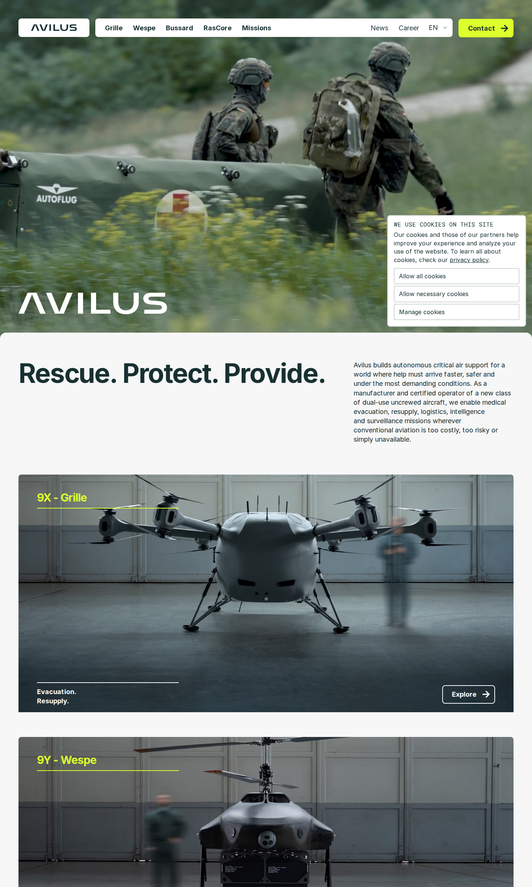

# UI Design System & Master Generation Blueprint: www-avilus-com

> **Avilus · Dual-Use Uncrewed Aircraft for Evacuation, Logistics and Survei...** (https://www.avilus.com/) — Manufacturer and certified operator of dual-use uncrewed aircraft for medical evacuation, logistics, surveillance, and reconnaissance.



---

## 1. Executive Visual Persona & Design Archetype

- **Brand Essence & Persona**: **Avilus · Dual-Use Uncrewed Aircraft for Evacuation, Logistics and Survei...** (`https://www.avilus.com/`). Manufacturer and certified operator of dual-use uncrewed aircraft for medical evacuation, logistics, surveillance, and reconnaissance.
- **Capture Provenance**: Live browser capture (`tier1_fast`, HTTP `200`, captured `2026-11-23`).
- **Visual Archetype**: **Light-Substrate Editorial & Modular Grid System (`#f7f7f7` canvas, `#183032` ink, `#0082f3` accent)**.
- **Anti-AI-Slop Differentiators**:
  - **Live-Computed Chromatic Polarity**: Anchors the viewport in `#f7f7f7` (live computed `body` `background-color` (`computed_styles.json`)) paired with `#183032` primary typography and `#0082f3` accents.
  - **Grounded Typographic Hierarchy**: Pairs `Inter` for display copy (`Rescue. Protect. Provide.`) with `Inter` and `Robotomono`.
  - **Calibrated Spatial Grid & Motion**: Combines `1440px` container bounds (`gap: normal 16px`, padding `9px`) with `cubic-bezier(.4,0,.2,1)` easing and Lenis Smooth Scroll (`data-lenis`), GSAP Timeline & ScrollTrigger.

---

## 2. Spatial Architecture & Modular Grid Mathematics


### Viewport Allocation & Container Geometry
- **Captured Viewport Dimensions**: Desktop `1440×2400px` (`assets/desktop.png`, clamped at 2400px live multi-section capture), Mobile `390×2400px` (`assets/mobile.png`, clamped at 2400px live multi-section capture).
- **Master Container Bounds**: `1440px` (full-bleed `100%` desktop stage measured on `1440px` viewport).
- **Canvas Lateral Padding & Spacing**: `9px` lateral canvas padding with `normal 16px` grid gap.
- **Border Radius Scale**: `8px`, `4px`, `3px`, `100%`.

### Responsive Breakpoint Architecture
- **Desktop Layout**: Multi-column CSS Grid / Flexbox layout at `1440px` (`max-width: 1440px`, `gap: normal 16px`).
- **Mobile Layout**: Single-column vertical stack at `390px` viewport width with `9px` horizontal padding.
- **Extracted CSS Media Queries**: `@media screen and (max-width:991px)`, `@media screen and (max-width:767px)`, `@media screen and (max-width:479px)`, `@media (min-width:768px)`.

---

## 3. Color System, Materiality & Atmospheric Lighting

### Semantic Palette & Source Grounding
| Semantic Role | Ground-Truth Value | Extracted Live / CSS Source |
|---|---|---|
| **Primary Canvas Substrate** | `#f7f7f7` | live computed `body` `background-color` (`computed_styles.json`) |
| **Primary Typography Ink** | `#183032` | live computed `h1` `color` (`computed_styles.json`) |
| **Elevated Surface / Card Substrate** | `#ffff00` | `mark { background: #ffff00 }` |
| **Interactive Accent / Highlight** | `#0082f3` | `.w-dropdown-link.w--current { color: #0082f3 }` |
| **Secondary / Muted Copy** | `#ddff2c` | live computed `h2` `color` (`computed_styles.json`) |
| **Structural Hairline Border** | `#e2e2e2` | `blockquote { border-left: #e2e2e2 }` |

### Sanitized Root CSS Variables (`ui-ux.md` Ground Truth)
| Variable Name | Extracted Value | Semantic Role |
|---|---|---|
| `--_theme---background` | `var(--swatch--light-200)` | Canvas / Surface Token |
| `--_text-style---font-family` | `var(--_typography---font--primary-family)` | Typography Ink Token |
| `--_theme---text` | `var(--swatch--dark-900)` | Typography Ink Token |
| `--_text-style---font-size` | `var(--_typography---font-size--text-main)` | Typography Ink Token |
| `--_text-style---line-height` | `var(--_typography---line-height--huge)` | Typography Ink Token |
| `--_text-style---font-weight` | `var(--_typography---font--primary-regular)` | Typography Ink Token |
| `--_text-style---letter-spacing` | `var(--_typography---letter-spacing--normal)` | Typography Ink Token |
| `--_text-style---text-wrap` | `pretty` | Typography Ink Token |
| `--radius--main` | `.5rem` | Elevation / Border Token |
| `--_theme---background-2` | `var(--swatch--light-100)` | Canvas / Surface Token |
| `--site--column-count` | `12` | Layout / Spatial Grid Token |
| `--_responsive---large` | `1` | Design System Custom Token |
| `--_responsive---medium` | `0` | Design System Custom Token |
| `--_responsive---small` | `0` | Design System Custom Token |
| `--_responsive---xsmall` | `0` | Design System Custom Token |
| `--max-width--small` | `50rem` | Layout / Spatial Grid Token |

---

## 4. Typographic Scale & Editorial Hierarchy

### Font Family Stacks
- **Display Typography**: `Inter`.
- **Primary Body Stack**: `Inter`.
- **Technical / Metadata Stack**: `Robotomono`.

### Typographic Scale & Rules (Live Computed & Stylesheet Grounded)
- **Hero Display (`H1`)**: live computed `h1` (`font-size: 72px`, `line-height: 72px`, `font-weight: 700`, `letter-spacing: -2.16px`).
- **Section Heading (`H2`)**: live computed `h2` (`font-size: 30px`, `line-height: 33px`, `font-weight: 700`, `letter-spacing: -0.9px`).
- **Body Copy**: live computed `body` (`font-size: 18px`, `line-height: 25.2px`, `font-weight: 400`).
- **Metadata & Navigation Labels**: live computed `nav/a` (`font-size: 18px`, `line-height: 25.2px`, `font-weight: 400`); CSS variables `--_text-style---letter-spacing: var(--_typography---letter-spacing--normal)`, `--_responsive---small: 0`, `--_responsive---xsmall: 0`.

---

## 5. Choreographed Motion & Interaction Physics

### Primary Easing Curves
- **Extracted Timing Functions**: `cubic-bezier(.4,0,.2,1)`, `cubic-bezier(.25,.46,.45,.94)`.

### Per-Element Transition & Choreography Rules
- **Selector `.w-webflow-badge>img`**: `transition: unset` extracted from `www-avilus-com` stylesheet.
- **Selector `.w-slider-dot`**: `transition: background-color .1s,color .1s` extracted from `www-avilus-com` stylesheet.
- **Selector `.w-lightbox-control`**: `transition: all .3s` extracted from `www-avilus-com` stylesheet.
- **Extracted Easing Curve (`cubic-bezier(.4,0,.2,1)`)**: Governs interactive state transitions across `<header.nav_desktop_wrap>` and `<section.u-padding-top-small>`.
- **Runtime Interaction Engine**: Integrates Lenis Smooth Scroll (`data-lenis`), GSAP Timeline & ScrollTrigger, Three.js / WebGL Canvas Pipeline, Swiper Touch Carousel Engine with `prefers-reduced-motion: reduce` fallback guards.

---

## 6. Component Wireframe & Structural DOM Map

### Visual Layout Schematic — Desktop (`1440px`, Grounded in `dom.html` & Landmark Bounding Boxes)
```
┌────────────────────────────────────────────────────────────────────────┐
│ DESKTOP VIEWPORT (1440px) — Avilus · Dual-Use Uncrewed Aircraft for Ev │
│ ====================================================================== │
│ [ <header.nav_desktop_wr (1440x50px)  | 01 Grille · 02 Wespe · 03 Bu ] │
│ ---------------------------------------------------------------------- │
│ | HERO STAGE: <section.u-section> (w=1440px)                         | │
│ | H1: Rescue. Protect. Provide.                                      | │
│ | Substrate: #f7f7f7 | Ink: #183032 | Accent: #0082f3                | │
│ ---------------------------------------------------------------------- │
│ | SHOWCASE GRID (<section.u-padding-top-sma) max-w: 1440px           | │
│ | +------------------------------+  +------------------------------+ | │
│ | | 9Z - Bussard                 |  | Aircraft as a Service        | | │
│ | +------------------------------+  +------------------------------+ | │
│ ---------------------------------------------------------------------- │
│ | DETAIL MODULE (<section.u-padding-bottom-) — Elevate your career a | │
│ ---------------------------------------------------------------------- │
│ [ FOOTER (<footer.footer_inner) | https://www.avilus.com/              │
└────────────────────────────────────────────────────────────────────────┘
```

### Visual Layout Schematic — Mobile Reflow (`390px`)
```
┌────────────────────────────────────────────────────────────────────────┐
│ MOBILE VIEWPORT REFLOW (390px) — Single-Column Stack (gap: normal 1)   │
│ ====================================================================== │
│ [ HEADER BAR (<header.nav_desktop_wrap) | Compact Menu (390px)         │
│ ---------------------------------------------------------------------- │
│ | HERO STAGE (<section.u-section>) — 390px Vertical Lead             | │
│ | H1: Rescue. Protect. Provide.                                      | │
│ ---------------------------------------------------------------------- │
│ | SHOWCASE STACK (<section.u-padding-top) — 1-Col Stack              | │
│ | [ Item 1: 9Z - Bussard                                           ] | │
│ | [ Item 2: Aircraft as a Service                                  ] | │
│ ---------------------------------------------------------------------- │
│ | DETAIL STACK (<section.u-padding-botto) — 1-Col (Elevate your caree) │
│ ---------------------------------------------------------------------- │
│ [ FOOTER (<footer.footer_inner) | Stacked 390px Colophon               │
└────────────────────────────────────────────────────────────────────────┘
```

### Granular DOM Region Breakdown
1. **Brand Header & Navigation Bar (<header.nav_desktop_wrap> — `www-avilus-com`)**:
   - Landmark `<header class="nav_desktop_wrap">` (`1440x50px`) hosting `Avilus · Dual-Use Uncrewed Aircraft ` navigation (`01 Grille · 02 Wespe · 03 Bussard · 04 RasCore · 05 Missions`), DOM attributes (`data-wf-domain="www.avilus.com"`, `data-wf-page="6a3f87ff2dc47a02eacbeb15"`, `data-wf-site="6a3f87fb2dc47a02eacbead0"`, `data-padding-bottom="none"`), and stylesheet rule `html { -webkit-text-size-adjust:100%;-ms-text-size-adjust:100%;font-family:sans... }`.
2. **Hero Stage & Focal Lead (<section.u-section> — `Rescue. Protect. Provide.`)**:
   - Landmark `<section class="u-section u-min-height-screen">` presenting display lead `Rescue. Protect. Provide.` and copy excerpt *"Avilus builds autonomous critical air support for a world where h"* over `#f7f7f7` canvas and `#183032` ink.
3. **Primary Showcase & Content Grid (<section.u-padding-top-small> — `9Z - Bussard`)**:
   - Landmark `<section class="u-section u-padding-top-small">` rendering section `9Z - Bussard` with copy *"Evacuation. Resupply."*, asset references (`cdn.prod.website-files.com`, `avilus-staging.webflow.shared.f03...`, `gtm.js`, `6a521a02912e539c1f3a6bbb_avilus_w...`), and grid rule `summary { display:block }`.
4. **Interactive Detail & Feature Matrix (<section.u-padding-bottom-small> — `Aircraft as a Service`)**:
   - Landmark `<section class="u-section u-padding-top-small">` framing `Aircraft as a Service` and `Elevate your career at Avilus` (*"Multi-Role. Cargo."*) with `#ffff00` surface cards, `#0082f3` accents, and `video { vertical-align:baseline;display:inline-block }`.
5. **Colophon & Global Directory Footer (<footer.footer_inner> — `https://www.avilus.com/`)**:
   - Landmark `<footer class="footer_inner">` anchoring `Avilus · Dual-Use Uncrewed Aircr` footer links (`01 Grille · 02 Wespe · 03 Bussard · 04 RasCore · 05 Missions`), copy *"Intelligence. Surveillance."*, and `#e2e2e2` structural dividers.

---

## 7. Master Zero-Shot AI Generation Prompt

```markdown
# Master Zero-Shot Frontend Generation Prompt: www-avilus-com (Avilus · Dual-Use Uncrewed Aircraft for Evacuation, Logistics and Survei...)

You are a principal frontend architect and design systems engineer. Build a complete, production-ready web application replicating the exact design system, DOM landmarks, typographic hierarchy, color tokens, and motion physics of `www-avilus-com` (**Avilus · Dual-Use Uncrewed Aircraft for Evacuation, Logistics and Survei...** — `https://www.avilus.com/`).

### 1. Visual Archetype & Anti-AI-Slop Mandates
- **Archetype**: Light-Substrate Editorial & Modular Grid System (`#f7f7f7` canvas, `#183032` ink, `#0082f3` accent).
- **Identity & Domain Context**: Manufacturer and certified operator of dual-use uncrewed aircraft for medical evacuation, logistics, surveillance, and reconnaissance.
- **Primary Substrate**: `#f7f7f7` (live computed `body` `background-color` (`computed_styles.json`)), **Primary Ink**: `#183032`, **Accent / Highlight**: `#0082f3`.
- **Site-Specific Differentiators**:
  - **Live-Computed Chromatic Polarity**: Anchors the viewport in `#f7f7f7` (live computed `body` `background-color` (`computed_styles.json`)) paired with `#183032` primary typography and `#0082f3` accents.
  - **Grounded Typographic Hierarchy**: Pairs `Inter` for display copy (`Rescue. Protect. Provide.`) with `Inter` and `Robotomono`.
  - **Calibrated Spatial Grid & Motion**: Combines `1440px` container bounds (`gap: normal 16px`, padding `9px`) with `cubic-bezier(.4,0,.2,1)` easing and Lenis Smooth Scroll (`data-lenis`), GSAP Timeline & ScrollTrigger.

### 2. Ground-Truth CSS Variables (`:root` Token Contract)
Declare and consume these exact custom properties extracted from `www-avilus-com` in your global stylesheet:

:root {
  /* Avilus · Dual-Use Uncrewed Aircraft for Evacuation, Logistics and Survei... (www-avilus-com) — Live-Grounded CSS Variables */
  --_theme---background: var(--swatch--light-200); /* Canvas / Surface Token (www-avilus-com) */
  --_text-style---font-family: var(--_typography---font--primary-family); /* Typography Ink Token (www-avilus-com) */
  --_theme---text: var(--swatch--dark-900); /* Typography Ink Token (www-avilus-com) */
  --_text-style---font-size: var(--_typography---font-size--text-main); /* Typography Ink Token (www-avilus-com) */
  --_text-style---line-height: var(--_typography---line-height--huge); /* Typography Ink Token (www-avilus-com) */
  --_text-style---font-weight: var(--_typography---font--primary-regular); /* Typography Ink Token (www-avilus-com) */
  --_text-style---letter-spacing: var(--_typography---letter-spacing--normal); /* Typography Ink Token (www-avilus-com) */
  --_text-style---text-wrap: pretty; /* Typography Ink Token (www-avilus-com) */
  --radius--main: .5rem; /* Elevation / Border Token (www-avilus-com) */
  --_theme---background-2: var(--swatch--light-100); /* Canvas / Surface Token (www-avilus-com) */
  --site--column-count: 12; /* Layout / Spatial Grid Token (www-avilus-com) */
  --_responsive---large: 1; /* Design System Custom Token (www-avilus-com) */
  --_responsive---medium: 0; /* Design System Custom Token (www-avilus-com) */
  --_responsive---small: 0; /* Design System Custom Token (www-avilus-com) */
  --_responsive---xsmall: 0; /* Design System Custom Token (www-avilus-com) */
  --max-width--small: 50rem; /* Layout / Spatial Grid Token (www-avilus-com) */
}

### 3. Semantic Color & Materiality Contract
Map every surface, ink, and border strictly to these source-grounded tokens:
- **Primary Canvas Substrate**: `#f7f7f7` — grounded in live computed `body` `background-color` (`computed_styles.json`)
- **Primary Typography Ink**: `#183032` — grounded in live computed `h1` `color` (`computed_styles.json`)
- **Elevated Surface / Card Substrate**: `#ffff00` — grounded in `mark { background: #ffff00 }`
- **Interactive Accent / Highlight**: `#0082f3` — grounded in `.w-dropdown-link.w--current { color: #0082f3 }`
- **Secondary / Muted Copy**: `#ddff2c` — grounded in live computed `h2` `color` (`computed_styles.json`)
- **Structural Hairline Border**: `#e2e2e2` — grounded in `blockquote { border-left: #e2e2e2 }`

### 4. Spatial Grid, Container Bounds & Responsive Breakpoints
- **Desktop Viewport Reference**: `1440×2400px` (clamped at 2400px live multi-section capture, `1440px` standard desktop width).
- **Mobile Viewport Reference**: `390×2400px` (clamped at 2400px live multi-section capture, `390px` standard mobile width).
- **Container Max-Width**: `1440px` (full-bleed `100%` desktop stage measured on `1440px` viewport)
- **Padding & Gutters**: `9px` lateral canvas padding with `normal 16px` grid gap
- **Desktop Grid**: Multi-column CSS Grid / Flexbox layout at `1440px` (`max-width: 1440px`, `gap: normal 16px`)
- **Mobile Adaptation**: Single-column vertical stack at `390px` viewport width with `9px` horizontal padding
- **Media Queries**: `@media screen and (max-width:991px)`, `@media screen and (max-width:767px)`, `@media screen and (max-width:479px)`, `@media (min-width:768px)`
- **Corner Radii**: `8px`, `4px`, `3px`, `100%`

### 5. Typography & Editorial Scale Contract
- **Display Font Stack**: `Inter`
- **Body Font Stack**: `Inter`
- **Monospace / Technical Font Stack**: `Robotomono`
- **H1 Display Rule**: live computed `h1` (`font-size: 72px`, `line-height: 72px`, `font-weight: 700`, `letter-spacing: -2.16px`)
- **H2 Section Rule**: live computed `h2` (`font-size: 30px`, `line-height: 33px`, `font-weight: 700`, `letter-spacing: -0.9px`)
- **Body Copy Rule**: live computed `body` (`font-size: 18px`, `line-height: 25.2px`, `font-weight: 400`)
- **Metadata & Index Rule**: live computed `nav/a` (`font-size: 18px`, `line-height: 25.2px`, `font-weight: 400`); CSS variables `--_text-style---letter-spacing: var(--_typography---letter-spacing--normal)`, `--_responsive---small: 0`, `--_responsive---xsmall: 0`

### 6. Component Hierarchy, Verbatim Copy & Real DOM Landmarks
Scaffold `www-avilus-com` (`Avilus · Dual-Use Uncrewed Aircraft for Evacuation, Logistics and Survei...`) with these exact structural regions, extracted copy, and CSS rules from `dom.html`:
1. **Brand Header & Navigation Bar (<header.nav_desktop_wrap> — `www-avilus-com`)**:
   - DOM & Selectors: Landmark `<header class="nav_desktop_wrap">` (`1440x50px`) hosting `Avilus · Dual-Use Uncrewed Aircraft ` navigation (`01 Grille · 02 Wespe · 03 Bussard · 04 RasCore · 05 Missions`), DOM attributes (`data-wf-domain="www.avilus.com"`, `data-wf-page="6a3f87ff2dc47a02eacbeb15"`, `data-wf-site="6a3f87fb2dc47a02eacbead0"`, `data-padding-bottom="none"`), and stylesheet rule `html { -webkit-text-size-adjust:100%;-ms-text-size-adjust:100%;font-family:sans... }`.
   - Responsive Contract: Header `Brand Header & Navigation Bar (<header.nav_desktop_wrap> — `www-avilus-com`)` (`www-avilus-com`) adapts across `@media screen and (max-width:991px)`, `@media screen and (max-width:767px)`, `@media screen and (max-width:479px)`, `@media (min-width:768px)` with `cubic-bezier(.4,0,.2,1)`, `cubic-bezier(.25,.46,.45,.94)` transitions and links `01 Grille · 02 Wespe · 03 Bussard · 04 RasCore · 05 Missions`.
2. **Hero Stage & Focal Lead (<section.u-section> — `Rescue. Protect. Provide.`)**:
   - DOM & Selectors: Landmark `<section class="u-section u-min-height-screen">` presenting display lead `Rescue. Protect. Provide.` and copy excerpt *"Avilus builds autonomous critical air support for a world where h"* over `#f7f7f7` canvas and `#183032` ink.
   - Responsive Contract: Hero stage (`1440×2400px` desktop / `390×2400px` mobile) sets `#f7f7f7` background with `#183032` headline `Rescue. Protect. Provide.`.
3. **Primary Showcase & Content Grid (<section.u-padding-top-small> — `9Z - Bussard`)**:
   - DOM & Selectors: Landmark `<section class="u-section u-padding-top-small">` rendering section `9Z - Bussard` with copy *"Evacuation. Resupply."*, asset references (`cdn.prod.website-files.com`, `avilus-staging.webflow.shared.f03...`, `gtm.js`, `6a521a02912e539c1f3a6bbb_avilus_w...`), and grid rule `summary { display:block }`.
   - Responsive Contract: Showcase grid `Primary Showcase & Content Grid (<section.u-padding-top-small> — `9Z - Bussard`)` applies Multi-column CSS Grid / Flexbox layout at `1440px` (`max-width: 1440px`, `gap: normal 16px`) on desktop and Single-column vertical stack at `390px` viewport width with `9px` horizontal padding on mobile.
4. **Interactive Detail & Feature Matrix (<section.u-padding-bottom-small> — `Aircraft as a Service`)**:
   - DOM & Selectors: Landmark `<section class="u-section u-padding-top-small">` framing `Aircraft as a Service` and `Elevate your career at Avilus` (*"Multi-Role. Cargo."*) with `#ffff00` surface cards, `#0082f3` accents, and `video { vertical-align:baseline;display:inline-block }`.
   - Responsive Contract: Detail module `Interactive Detail & Feature Matrix (<section.u-padding-bottom-small> — `Aircraft as a Service`)` uses `8px`, `4px`, `3px`, `100%` radii, `#0082f3` highlights, and assets (cdn.prod.website-files.com, avilus-staging.webflow.shared.f03..., gtm.js).
5. **Colophon & Global Directory Footer (<footer.footer_inner> — `https://www.avilus.com/`)**:
   - DOM & Selectors: Landmark `<footer class="footer_inner">` anchoring `Avilus · Dual-Use Uncrewed Aircr` footer links (`01 Grille · 02 Wespe · 03 Bussard · 04 RasCore · 05 Missions`), copy *"Intelligence. Surveillance."*, and `#e2e2e2` structural dividers.
   - Responsive Contract: Footer `Colophon & Global Directory Footer (<footer.footer_inner> — `https://www.avilus.com/`)` aligns to `1440px` (full-bleed `100%` desktop stage measured on `1440px` viewport) with `9px` lateral canvas padding with `normal 16px` grid gap and attributes (data-wf-domain="www.avilus.com", data-wf-page="6a3f87ff2dc47a02eacbeb15", data-wf-site="6a3f87fb2dc47a02eacbead0").

#### Verbatim DOM Copy Excerpts (`dom.html`)
- Copy Excerpt 1: *"Avilus builds autonomous critical air support for a world where help must arrive f..."*
- Copy Excerpt 2: *"Evacuation. Resupply."*
- Copy Excerpt 3: *"Multi-Role. Cargo."*
- Copy Excerpt 4: *"Intelligence. Surveillance."*

### 7. Motion, Extracted Stylesheet Rules & Interaction Choreography
- **Primary Easing Functions**: `cubic-bezier(.4,0,.2,1)`, `cubic-bezier(.25,.46,.45,.94)`
- **Extracted Stylesheet Rules (`www-avilus-com`)**:
- `html { -webkit-text-size-adjust:100%;-ms-text-size-adjust:100%;font-family:sans... }`
- `summary { display:block }`
- `video { vertical-align:baseline;display:inline-block }`
- `template { display:none }`
- `strong { font-weight:700 }`
- **Per-Selector Transition Rules**:
- **Selector `.w-webflow-badge>img`**: `transition: unset` extracted from `www-avilus-com` stylesheet.
- **Selector `.w-slider-dot`**: `transition: background-color .1s,color .1s` extracted from `www-avilus-com` stylesheet.
- **Selector `.w-lightbox-control`**: `transition: all .3s` extracted from `www-avilus-com` stylesheet.
- **Extracted Easing Curve (`cubic-bezier(.4,0,.2,1)`)**: Governs interactive state transitions across `<header.nav_desktop_wrap>` and `<section.u-padding-top-small>`.
- **Runtime Interaction Engine**: Integrates Lenis Smooth Scroll (`data-lenis`), GSAP Timeline & ScrollTrigger, Three.js / WebGL Canvas Pipeline, Swiper Touch Carousel Engine with `prefers-reduced-motion: reduce` fallback guards.

### 8. Technical Deliverables
- Implement in Next.js (App Router) with TypeScript and Tailwind CSS consuming the `:root` custom properties defined above for `www-avilus-com`.
- Reproduce both the `1440px` desktop architecture and `390px` mobile breakpoint transitions, preserving semantic HTML5 landmarks (`<header>`, `<nav>`, `<main>`, `<section>`, `<footer>`) and `prefers-reduced-motion` accessibility guards.
```
