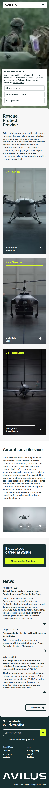

# UI Design System & Master Generation Blueprint: www-avilus-com

> **Avilus · Dual-Use Uncrewed Aircraft for Evacuation, Logistics and Surveillance** — A German aerospace engineering interface built on a structured Lumos/Webflow design token architecture pairing light technical paper (`--swatch--light-200: #f7f7f7`), deep cockpit petrol-teal ink (`--swatch--dark-900: #183032`), high-visibility flight-deck chartreuse lime (`--swatch--brand-500: #ddff2c`), and medical rescue red (`--_theme---error: #b3261e`).


---

## 1. Executive Visual Persona & Design Archetype

- **Brand Essence & Persona**: **Avilus · Dual-Use Uncrewed Aircraft for Evacuation, Logistics and Surveillance**. A German aerospace engineering interface built on a structured Lumos/Webflow design token architecture pairing light technical paper (`--swatch--light-200: #f7f7f7`), deep cockpit petrol-teal ink (`--swatch--dark-900: #183032`), high-visibility flight-deck chartreuse lime (`--swatch--brand-500: #ddff2c`), and medical rescue red (`--_theme---error: #b3261e`).
- **Visual Archetype**: **Tactical Aerospace Engineering Spec Sheet & Lumos Token System (`Inter` + `Robotomono`)**.
- **Anti-AI-Slop Differentiators**:
  1. **High-Visibility Aerospace Swatch System**: Pairs technical light gray (`--swatch--light-200: #f7f7f7`) and deep petrol dark (`--swatch--dark-900: #183032`) with aviation chartreuse (`--swatch--brand-500: #ddff2c`) primary CTAs and rescue red (`#b3261e`).
  2. **Named Aircraft Designation Matrix**: Organizes UAV platforms by tactical alphanumeric callouts (`H2: 9X - Grille`, `H2: 9Y - Wespe`, `H2: 9Z - Bussard`) under the mission banner `H1: Rescue. Protect. Provide.` and `H2: Aircraft as a Service`.
  3. **Programmatic 12-Column Viewport Math**: Governed by `--site--column-count: 12`, `--site--viewport-max: 90` (`90rem` = `1440px`), `--max-width--main: calc(var(--site--viewport-max)*1rem)`, and `--border-width--main: .125rem` (`2px`).
  4. **Dual-Font Technical Hierarchy**: Combines `--_typography---font--primary-family: Inter,Verdana,sans-serif` with `--_typography---font--secondary-family: Robotomono,Impact,sans-serif` for aeronautical telemetry.

---

## 2. Spatial Architecture & Modular Grid Mathematics



### Viewport Allocation & Container Geometry
- **Captured Full-Page Dimensions**: Desktop `1440×6212px` (`assets/desktop.png`), Mobile `390×6167px` (`assets/mobile.png`).
- **Master Container Bounds**: `90rem` (`1440px`) via `--max-width--main: calc(var(--site--viewport-max)*1rem)` where `--site--viewport-max: 90`.
- **Canvas Lateral Padding & Spacing**: Fluid `--site--margin` outer spacing with `--_gap---size: var(--site--gutter)`.
- **Border Radius Scale**: `--radius--small: .25rem`, `--radius--main: .5rem`, `--radius--large: 1rem`, `--radius--round: 100vw`.

### Responsive Breakpoint Architecture
- **Desktop Layout**: 12-column grid (`--site--column-count: 12`) with 3-card aircraft slider (`--lg: 3`, `--slide-count: var(--lg)`) and 2-column spec splits (`--_column-count---value: 2`).
- **Mobile Layout**: Adapts across `@media (max-width: 991px)`, `@media (max-width: 767px)`, and `@media (max-width: 486px)` with collapsible nav (`--closed-width: min(90vw, 27.375rem)`).
- **Extracted CSS Media Queries**: `@media (max-width: 991px)`, `@media (max-width: 767px)`, `@media (max-width: 486px)`, `@media (hover: hover)`.

---

## 3. Color System, Materiality & Atmospheric Lighting

### Semantic Palette & Source Grounding
| Semantic Role | Ground-Truth Value | Extracted CSS Source / Selector |
|---|---|---|
| Primary Technical Canvas | `#f7f7f7` | `--swatch--light-200` / `--_theme---background` |
| Secondary Pure White Surface | `white` | `--swatch--light-100` / `--_theme---background-2` |
| Primary Deep Petrol-Teal Ink | `#183032` | `--swatch--dark-900` / `--_theme---text` / `--_theme---border` |
| Secondary Dark Charcoal Surface | `#2f2b2d` | `--swatch--dark-800` (`:root`) |
| Primary Chartreuse Lime Accent | `#ddff2c` | `--swatch--brand-500` / `--_theme---button-primary--background` |
| Medical Rescue Red Alert | `#b3261e` | `--_theme---error` (`:root`) |
| Light Hairline Border (20% Petrol) | `color-mix(in srgb,var(--swatch--dark-900)20%,transparent)` | `--swatch--dark-900-o20` / `--_theme---border-light` |

### Sanitized Root CSS Variables (`ui-ux.md` Ground Truth)
| Variable Name | Extracted Value | Semantic Role |
|---|---|---|
| `--swatch--light-200` | `#f7f7f7` | Primary technical light gray canvas (`--_theme---background`) |
| `--swatch--light-100` | `white` | Secondary elevated surface (`--_theme---background-2`) |
| `--swatch--dark-900` | `#183032` | Primary deep petrol-teal ink & border color (`--_theme---text`) |
| `--swatch--dark-800` | `#2f2b2d` | Dark tactical section surface |
| `--swatch--brand-500` | `#ddff2c` | High-visibility aviation chartreuse accent (`--_theme---button-primary--background`) |
| `--_theme---error` | `#b3261e` | Medical evacuation rescue red indicator |
| `--_typography---font--primary-family` | `Inter,Verdana,sans-serif` | Primary structural UI & heading sans stack |
| `--_typography---font--secondary-family` | `Robotomono,Impact,sans-serif` | Technical monospace callout & spec font stack |
| `--_typography---letter-spacing--tight` | `-.03em` | Tight display headline tracking |
| `--site--column-count` | `12` | Master 12-column layout grid count |
| `--site--viewport-max` | `90` | Max container width in rem (90rem = 1440px) |
| `--max-width--small` | `50rem` | Narrative & spec block max-width (800px) |
| `--bar-height` | `3.125rem` | Fixed navigation bar height (50px) |
| `--closed-width` | `min(90vw, 27.375rem)` | Compact floating navbar width (438px) |
| `--nav--menu-open-duration` | `400ms` | Navigation drawer open duration |
| `--border-width--main` | `.125rem` | 2px structural engineering border width |
| `--radius--main` | `.5rem` | 8px primary component border radius |
| `--button-size--medium` | `2.5rem` | Standard 40px tactical button height |
| `--button-size--large` | `5rem` | Large 80px primary mission CTA height |

---

## 4. Typographic Scale & Editorial Hierarchy

### Font Family Stacks
- **Display Typography**: `Inter, Verdana, sans-serif` (`--_typography---font--primary-family`).
- **Primary Body Stack**: `Inter, Verdana, sans-serif` (`--_typography---font--primary-family`).
- **Technical / Metadata Stack**: `Robotomono, Impact, monospace` (`--_typography---font--secondary-family`).

### Typographic Scale & Rules
- **Hero Display (`H1`)**: `clamp(2.75rem, 6vw, 5.5rem)`, `font-family: var(--_typography---font--primary-family)`, `font-weight: 700` (`--_typography---font--primary-bold`), `line-height: 1` (`--_typography---line-height--small`), `letter-spacing: -.03em` ("Rescue. Protect. Provide.").
- **Section Heading (`H2`)**: `clamp(1.75rem, 3.5vw, 3.25rem)`, `font-weight: 700`, `line-height: 1.1` ("9X - Grille", "9Y - Wespe", "9Z - Bussard", "Aircraft as a Service").
- **Body Copy**: `1rem (16px)`, `font-weight: 400`, `line-height: 1.4` (`--_typography---line-height--huge`), `color: var(--swatch--dark-900)`.
- **Metadata & Navigation Labels**: `0.75rem (12px)`, `font-family: var(--_typography---font--secondary-family)` (`Robotomono`), uppercase NATO/aeronautical spec tags.

---

## 5. Choreographed Motion & Interaction Physics

### Primary Easing Curves
- **Extracted Timing Functions**: `cubic-bezier(.4,0,.2,1)` and `cubic-bezier(.25,.46,.45,.94)` with `--nav--menu-open-duration: 400ms`.

### Per-Element Transition & Choreography Rules
- `Navigation Bar (header.nav_desktop_wrap)` -> morphs from `--closed-width: min(90vw, 27.375rem)` over `--nav--menu-open-duration: 400ms`
- `.button_arrow_wrap:has([data-slider])` -> `transition: opacity 0.2s ease`
- `.ai-label_button` -> `transition: background-color 200ms, border-color 200ms` (chartreuse `#ddff2c` hover inversion to `#183032`)
- `.ai-label_panel` -> `transition: transform 200ms, opacity 200ms`

---

## 6. Component Wireframe & Structural DOM Map

### Visual Layout Schematic (Grounded in `dom.html`)
```
┌────────────────────────────────────────────────────────────────────────┐
│ <header class="nav_desktop_wrap"> (Width: min(90vw, 27.375rem), H: 3.1 │
│   [AVILUS]   <nav class="nav_links_component"> [Fleet] [Mission] [Comp │
├────────────────────────────────────────────────────────────────────────┤
│ <main id="main" class="page_main"> <section class="u-section u-min-hei │
│   H1: Rescue. Protect. Provide.   [ CTA: #ddff2c / Ink: #183032 ]      │
├────────────────────────────────────────────────────────────────────────┤
│ <section class="u-section"> Fleet Slider (--lg: 3 cols, Max: 90rem)    │
│   [ H2: 9X - Grille (MedEvac) ] [ H2: 9Y - Wespe ] [ H2: 9Z - Bussard  │
├────────────────────────────────────────────────────────────────────────┤
│ <section class="u-section"> H2: Aircraft as a Service (2-Col Spec Spli │
│   Telemetry Readout (Robotomono) │ Border: --border-width--main .125re │
├────────────────────────────────────────────────────────────────────────┤
│ <footer> Avilus GmbH · German Aerospace Engineering · Legal & Complian │
└────────────────────────────────────────────────────────────────────────┘
```

### Granular DOM Region Breakdown
1. **Compact Tactical Navbar (`<header class="nav_desktop_wrap">` and `<nav class="nav_links_component">`)**:
   - Floating header bar sized to `--bar-height: 3.125rem` (`50px`) and `--closed-width: min(90vw, 27.375rem)` with dropdown lists (`#w-dropdown-list-0`) opening over `--nav--menu-open-duration: 400ms`.
2. **Mission Hero Stage (`<section class="u-section u-min-height-screen">`)**:
   - Full-screen aeronautical hero presenting `H1: Rescue. Protect. Provide.` with `--swatch--brand-500: #ddff2c` primary buttons (`--button-size--large: 5rem`) and `--swatch--dark-900: #183032` text.
3. **Uncrewed Aircraft Fleet Matrix (`H2: 9X - Grille`, `H2: 9Y - Wespe`, `H2: 9Z - Bussard`)**:
   - 3-column (`--lg: 3`) interactive aircraft showcase cards framed with `--border-width--main: .125rem`, `--radius--main: .5rem`, and `Robotomono` payload/range telemetry.
4. **Aircraft as a Service Module (`H2: Aircraft as a Service`)**:
   - 2-column (`--_column-count---value: 2`) operational logistics breakdown on `--swatch--light-200: #f7f7f7` and `--swatch--dark-800: #2f2b2d` with `#b3261e` rescue callouts.
5. **Compliance & Engineering Footer**:
   - German aerospace regulatory colophon and interactive `.ai-label_panel` telemetry drawer (`transition: transform 200ms, opacity 200ms`).

---

## 7. Master Zero-Shot AI Generation Prompt

```markdown
# Master Zero-Shot Frontend Generation Prompt: www-avilus-com (Avilus · Dual-Use Uncrewed Aircraft for Evacuation, Logistics and Surveillance)

You are a principal frontend architect and design systems engineer. Build a complete, production-ready web application replicating the exact design system, DOM landmarks, typographic hierarchy, color tokens, and motion physics of `www-avilus-com` (Avilus · Dual-Use Uncrewed Aircraft for Evacuation, Logistics and Surveillance).

### 1. Visual Archetype & Anti-AI-Slop Mandates
- **Archetype**: Tactical Aerospace Engineering Spec Sheet & Lumos Token System (`Inter` + `Robotomono`).
- **Primary Substrate**: `#f7f7f7` (`--swatch--light-200` / `--_theme---background`), **Primary Ink**: `#183032`, **Accent / Highlight**: `color-mix(in srgb,var(--swatch--dark-900)20%,transparent)`.
- **Site-Specific Differentiators**:
  1. **High-Visibility Aerospace Swatch System**: Pairs technical light gray (`--swatch--light-200: #f7f7f7`) and deep petrol dark (`--swatch--dark-900: #183032`) with aviation chartreuse (`--swatch--brand-500: #ddff2c`) primary CTAs and rescue red (`#b3261e`).
  2. **Named Aircraft Designation Matrix**: Organizes UAV platforms by tactical alphanumeric callouts (`H2: 9X - Grille`, `H2: 9Y - Wespe`, `H2: 9Z - Bussard`) under the mission banner `H1: Rescue. Protect. Provide.` and `H2: Aircraft as a Service`.
  3. **Programmatic 12-Column Viewport Math**: Governed by `--site--column-count: 12`, `--site--viewport-max: 90` (`90rem` = `1440px`), `--max-width--main: calc(var(--site--viewport-max)*1rem)`, and `--border-width--main: .125rem` (`2px`).
  4. **Dual-Font Technical Hierarchy**: Combines `--_typography---font--primary-family: Inter,Verdana,sans-serif` with `--_typography---font--secondary-family: Robotomono,Impact,sans-serif` for aeronautical telemetry.

### 2. Ground-Truth CSS Variables (`:root` Token Contract)
Declare and consume these exact custom properties extracted from `www-avilus-com` in your global stylesheet:

:root {
  /* Avilus · Dual-Use Uncrewed Aircraft for Evacuation, Logistics and Surveillance — Ground-Truth Extracted CSS Variables */
  --swatch--light-200: #f7f7f7; /* Primary technical light gray canvas (`--_theme---background`) */
  --swatch--light-100: white; /* Secondary elevated surface (`--_theme---background-2`) */
  --swatch--dark-900: #183032; /* Primary deep petrol-teal ink & border color (`--_theme---text`) */
  --swatch--dark-800: #2f2b2d; /* Dark tactical section surface */
  --swatch--brand-500: #ddff2c; /* High-visibility aviation chartreuse accent (`--_theme---button-primary--background`) */
  --_theme---error: #b3261e; /* Medical evacuation rescue red indicator */
  --_typography---font--primary-family: Inter,Verdana,sans-serif; /* Primary structural UI & heading sans stack */
  --_typography---font--secondary-family: Robotomono,Impact,sans-serif; /* Technical monospace callout & spec font stack */
  --_typography---letter-spacing--tight: -.03em; /* Tight display headline tracking */
  --site--column-count: 12; /* Master 12-column layout grid count */
  --site--viewport-max: 90; /* Max container width in rem (90rem = 1440px) */
  --max-width--small: 50rem; /* Narrative & spec block max-width (800px) */
  --bar-height: 3.125rem; /* Fixed navigation bar height (50px) */
  --closed-width: min(90vw, 27.375rem); /* Compact floating navbar width (438px) */
  --nav--menu-open-duration: 400ms; /* Navigation drawer open duration */
  --border-width--main: .125rem; /* 2px structural engineering border width */
  --radius--main: .5rem; /* 8px primary component border radius */
  --button-size--medium: 2.5rem; /* Standard 40px tactical button height */
  --button-size--large: 5rem; /* Large 80px primary mission CTA height */
}

### 3. Semantic Color & Materiality Contract
Map every surface, ink, and border strictly to these source-grounded tokens:
- **Primary Technical Canvas**: `#f7f7f7` — grounded in `--swatch--light-200` / `--_theme---background`
- **Secondary Pure White Surface**: `white` — grounded in `--swatch--light-100` / `--_theme---background-2`
- **Primary Deep Petrol-Teal Ink**: `#183032` — grounded in `--swatch--dark-900` / `--_theme---text` / `--_theme---border`
- **Secondary Dark Charcoal Surface**: `#2f2b2d` — grounded in `--swatch--dark-800` (`:root`)
- **Primary Chartreuse Lime Accent**: `#ddff2c` — grounded in `--swatch--brand-500` / `--_theme---button-primary--background`
- **Medical Rescue Red Alert**: `#b3261e` — grounded in `--_theme---error` (`:root`)
- **Light Hairline Border (20% Petrol)**: `color-mix(in srgb,var(--swatch--dark-900)20%,transparent)` — grounded in `--swatch--dark-900-o20` / `--_theme---border-light`

### 4. Spatial Grid, Container Bounds & Responsive Breakpoints
- **Desktop Viewport Reference**: `1440×6212px` full-page capture (`1440px` standard desktop width).
- **Mobile Viewport Reference**: `390×6167px` full-page capture (`390px` standard mobile width).
- **Container Max-Width**: `90rem` (`1440px`) via `--max-width--main: calc(var(--site--viewport-max)*1rem)` where `--site--viewport-max: 90`
- **Padding & Gutters**: Fluid `--site--margin` outer spacing with `--_gap---size: var(--site--gutter)`
- **Desktop Grid**: 12-column grid (`--site--column-count: 12`) with 3-card aircraft slider (`--lg: 3`, `--slide-count: var(--lg)`) and 2-column spec splits (`--_column-count---value: 2`)
- **Mobile Adaptation**: Adapts across `@media (max-width: 991px)`, `@media (max-width: 767px)`, and `@media (max-width: 486px)` with collapsible nav (`--closed-width: min(90vw, 27.375rem)`)
- **Media Queries**: `@media (max-width: 991px)`, `@media (max-width: 767px)`, `@media (max-width: 486px)`, `@media (hover: hover)`
- **Corner Radii**: `--radius--small: .25rem`, `--radius--main: .5rem`, `--radius--large: 1rem`, `--radius--round: 100vw`

### 5. Typography & Editorial Scale Contract
- **Display Font Stack**: `Inter, Verdana, sans-serif` (`--_typography---font--primary-family`)
- **Body Font Stack**: `Inter, Verdana, sans-serif` (`--_typography---font--primary-family`)
- **Monospace / Technical Font Stack**: `Robotomono, Impact, monospace` (`--_typography---font--secondary-family`)
- **H1 Display Rule**: `clamp(2.75rem, 6vw, 5.5rem)`, `font-family: var(--_typography---font--primary-family)`, `font-weight: 700` (`--_typography---font--primary-bold`), `line-height: 1` (`--_typography---line-height--small`), `letter-spacing: -.03em` ("Rescue. Protect. Provide.")
- **H2 Section Rule**: `clamp(1.75rem, 3.5vw, 3.25rem)`, `font-weight: 700`, `line-height: 1.1` ("9X - Grille", "9Y - Wespe", "9Z - Bussard", "Aircraft as a Service")
- **Body Copy Rule**: `1rem (16px)`, `font-weight: 400`, `line-height: 1.4` (`--_typography---line-height--huge`), `color: var(--swatch--dark-900)`
- **Metadata & Index Rule**: `0.75rem (12px)`, `font-family: var(--_typography---font--secondary-family)` (`Robotomono`), uppercase NATO/aeronautical spec tags

### 6. Component Hierarchy & Real DOM Landmarks
Scaffold the interface with these exact structural regions and class selectors from `www-avilus-com`:
1. **Compact Tactical Navbar (`<header class="nav_desktop_wrap">` and `<nav class="nav_links_component">`)**:
   - Architecture & Selectors: Floating header bar sized to `--bar-height: 3.125rem` (`50px`) and `--closed-width: min(90vw, 27.375rem)` with dropdown lists (`#w-dropdown-list-0`) opening over `--nav--menu-open-duration: 400ms`.
   - Layout & State Contract: Sticky/fixed top header navigation adapting across `@media (max-width: 991px)`, `@media (max-width: 767px)`, `@media (max-width: 486px)`, `@media (hover: hover)` with `cubic-bezier(.4,0,.2,1)` and `cubic-bezier(.25,.46,.45,.94)` with `--nav--menu-open-duration: 400ms` menu transitions.
2. **Mission Hero Stage (`<section class="u-section u-min-height-screen">`)**:
   - Architecture & Selectors: Full-screen aeronautical hero presenting `H1: Rescue. Protect. Provide.` with `--swatch--brand-500: #ddff2c` primary buttons (`--button-size--large: 5rem`) and `--swatch--dark-900: #183032` text.
   - Layout & State Contract: Full-viewport hero stage (`1440px` desktop / `390px` mobile) pairing `#f7f7f7` substrate with `#183032` display typography (`H1`).
3. **Uncrewed Aircraft Fleet Matrix (`H2: 9X - Grille`, `H2: 9Y - Wespe`, `H2: 9Z - Bussard`)**:
   - Architecture & Selectors: 3-column (`--lg: 3`) interactive aircraft showcase cards framed with `--border-width--main: .125rem`, `--radius--main: .5rem`, and `Robotomono` payload/range telemetry.
   - Layout & State Contract: Primary showcase grid executing 12-column grid (`--site--column-count: 12`) with 3-card aircraft slider (`--lg: 3`, `--slide-count: var(--lg)`) and 2-column spec splits (`--_column-count---value: 2`) on desktop and Adapts across `@media (max-width: 991px)`, `@media (max-width: 767px)`, and `@media (max-width: 486px)` with collapsible nav (`--closed-width: min(90vw, 27.375rem)`) on mobile.
4. **Aircraft as a Service Module (`H2: Aircraft as a Service`)**:
   - Architecture & Selectors: 2-column (`--_column-count---value: 2`) operational logistics breakdown on `--swatch--light-200: #f7f7f7` and `--swatch--dark-800: #2f2b2d` with `#b3261e` rescue callouts.
   - Layout & State Contract: Interactive specification & narrative module framed by `--radius--small: .25rem`, `--radius--main: .5rem`, `--radius--large: 1rem`, `--radius--round: 100vw` and `color-mix(in srgb,var(--swatch--dark-900)20%,transparent)` highlights.
5. **Compliance & Engineering Footer**:
   - Architecture & Selectors: German aerospace regulatory colophon and interactive `.ai-label_panel` telemetry drawer (`transition: transform 200ms, opacity 200ms`).
   - Layout & State Contract: Footer directory and utility bar anchored to `90rem` (`1440px`) via `--max-width--main: calc(var(--site--viewport-max)*1rem)` where `--site--viewport-max: 90` with Fluid `--site--margin` outer spacing with `--_gap---size: var(--site--gutter)` lateral gutters.

### 7. Motion & Interaction Choreography
- **Primary Easing Functions**: `cubic-bezier(.4,0,.2,1)` and `cubic-bezier(.25,.46,.45,.94)` with `--nav--menu-open-duration: 400ms`
- **Per-Selector Transition Rules**:
- `Navigation Bar (header.nav_desktop_wrap)` -> morphs from `--closed-width: min(90vw, 27.375rem)` over `--nav--menu-open-duration: 400ms`
- `.button_arrow_wrap:has([data-slider])` -> `transition: opacity 0.2s ease`
- `.ai-label_button` -> `transition: background-color 200ms, border-color 200ms` (chartreuse `#ddff2c` hover inversion to `#183032`)
- `.ai-label_panel` -> `transition: transform 200ms, opacity 200ms`

### 8. Technical Deliverables
- Implement in Next.js (App Router) with TypeScript and Tailwind CSS consuming the `:root` custom properties defined above.
- Reproduce both the `1440px` desktop architecture and `390px` mobile breakpoint transitions, preserving semantic HTML5 landmarks (`<header>`, `<nav>`, `<main>`, `<section>`, `<footer>`) and `prefers-reduced-motion` accessibility guards.
```
