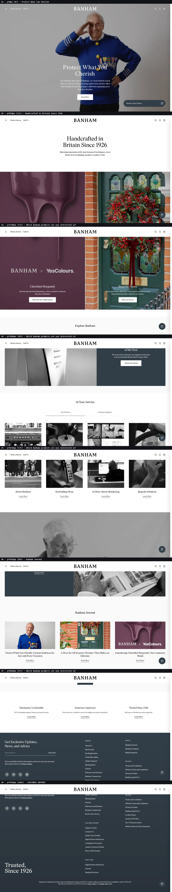
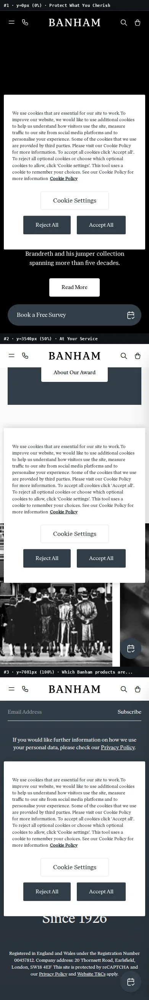

# UI Design System & Master Generation Blueprint: www-banham-co-uk

> **Banham · Experts in Security Services Since 1926** (https://www.banham.co.uk/) — Welcome to Banham, market-leaders in the security industry since 1926, and the perfect people to help secure your property





---

## 1. Executive Visual Persona & Design Archetype

- **Brand Essence & Persona**: **Banham · Experts in Security Services Since 1926** (`https://www.banham.co.uk/`). Welcome to Banham, market-leaders in the security industry since 1926, and the perfect people to help secure your property
- **Capture Provenance**: Live browser capture (`tier1_fast`, HTTP `200`, captured `2026-11-24`).
- **Visual Archetype**: **Light-Substrate Editorial & Modular Grid System (`#ffffff` canvas, `#000000` ink, `#ff0000` accent)**.
- **Anti-AI-Slop Differentiators**:
  - **Live-Computed Chromatic Polarity**: Anchors the viewport in `#ffffff` (live computed `browser-default` `background-color` (`computed_styles.json`)) paired with `#000000` primary typography and `#ff0000` accents.
  - **Grounded Typographic Hierarchy**: Pairs `IvarHeadline` for display copy (`Protect What You Cherish`) with `IvarText`.
  - **Calibrated Spatial Grid & Motion**: Combines `1440px` container bounds (`gap: .375rem`, padding `15px`) with `cubic-bezier(.4,0,.2,1)` easing and Three.js / WebGL Canvas Pipeline, Barba.js Page Transition Router.

---

## 2. Spatial Architecture & Modular Grid Mathematics

### Viewport Allocation & Container Geometry
- **Captured Journey Filmstrips**: Desktop `1280×6624px` (`assets/desktop-journey.webp`, `8` keyframes up to `y=7449px` / doc `8349px`), Mobile `390×2616px` (`assets/mobile-journey.webp`, `3` keyframes).
- **Master Container Bounds**: `1440px` (non-`@media` desktop container stylesheet rule).
- **Canvas Lateral Padding & Spacing**: `15px` lateral canvas padding with `.375rem` grid gap.
- **Border Radius Scale**: `4px`, `5px`, `3px`, `100%`.

### Responsive Breakpoint Architecture
- **Desktop Layout**: Multi-column CSS Grid / Flexbox layout at `1440px` (`max-width: 1440px`, `gap: .375rem`).
- **Mobile Layout**: Single-column vertical stack at `390px` viewport width with `15px` horizontal padding.
- **Extracted CSS Media Queries**: `@media only screen and (-webkit-min-device-pixel-ratio:1.5),only...`, `@media (min-width:640px)`, `@media (min-width:768px)`, `@media (min-width:1024px)`.

---

## 3. Color System, Materiality & Atmospheric Lighting

### Semantic Palette & Source Grounding
| Semantic Role | Ground-Truth Value | Extracted Live / CSS Source |
|---|---|---|
| **Primary Canvas Substrate** | `#ffffff` | live computed `browser-default` `background-color` (`computed_styles.json`) |
| **Primary Typography Ink** | `#000000` | live computed `main` `color` (`computed_styles.json`) |
| **Elevated Surface / Card Substrate** | `#eeeeee` | live computed `p` `background-color` (`computed_styles.json`) |
| **Interactive Accent / Highlight** | `#ff0000` | `.dfd-btn-error { background-color: red }` (`#ff0000`) |
| **Secondary / Muted Copy** | `#737678` | `var(--df-accent-secondary)` in `:root` |
| **Structural Hairline Border** | `#cbcccd` | `var(--df-neutral-outline)` in `:root` |
| **Variable Token (`--btn-stroke`)** | `#0000` | `var(--btn-stroke)` in `:root` |
| **Variable Token (`--btn-bg`)** | `#333e48` | `var(--btn-bg)` in `:root` |
| **Variable Token (`--btn-hover-bg`)** | `#2b3239` | `var(--btn-hover-bg)` in `:root` |
| **Variable Token (`--color-cornflower-100`)** | `#8392a7` | `var(--color-cornflower-100)` in `:root` |
| **Variable Token (`--color-amsb_graystarts`)** | `#cbd5e0` | `var(--color-amsb_graystarts)` in `:root` |

### Sanitized Root CSS Variables (`ui-ux.md` Ground Truth)
| Variable Name | Extracted Value | Semantic Role |
|---|---|---|
| `--btn-stroke` | `#0000` | Elevation / Border Token |
| `--btn-bg` | `#333e48` | Canvas / Surface Token |
| `--btn-color` | `#fff` | Brand / Palette Token |
| `--btn-hover-bg` | `#2b3239` | Canvas / Surface Token |
| `--btn-active-bg` | `#2b3239` | Canvas / Surface Token |
| `--line-after` | `#000` | Color / Atmospheric Token |
| `--line-before` | `#0000` | Color / Atmospheric Token |
| `--width-am-latter` | `32px` | Layout / Spatial Grid Token |
| `--width-am-brand` | `120px` | Brand / Palette Token |
| `--width-am-popup-content` | `600px` | Layout / Spatial Grid Token |
| `--height-am-latter` | `32px` | Layout / Spatial Grid Token |
| `--height-am-popup-content` | `415px` | Layout / Spatial Grid Token |
| `--background-size-size20` | `20px` | Canvas / Surface Token |
| `--color-cornflower-100` | `#8392a7` | Brand / Palette Token |
| `--padding-full` | `100%` | Layout / Spatial Grid Token |
| `--color-amsb_graystarts` | `#cbd5e0` | Brand / Palette Token |

---

## 4. Typographic Scale & Editorial Hierarchy

### Font Family Stacks
- **Display Typography**: `IvarHeadline`.
- **Primary Body Stack**: `IvarText`.
- **Technical / Metadata Stack**: not declared in live computed styles (uses primary stack / `ui-monospace`).

### Typographic Scale & Rules (Live Computed & Stylesheet Grounded)
- **Hero Display (`H1`)**: live computed `h1` (`font-size: 48px`, `line-height: 52.8px`, `font-weight: 400`, `letter-spacing: 1.2px`); CSS variables `--dfd-btn-display: inline-flex`, `--dfd-btn-group-display: flex`; rule `,h1` (`font-size: 2.25rem`, `line-height: 2.5rem`, `letter-spacing: .36px`).
- **Section Heading (`H2`)**: live computed `h2` (`font-size: 24px`, `line-height: 30px`, `font-weight: 400`, `letter-spacing: 0.24px`); rule `,h2` (`font-size: 28px`, `line-height: 1.25`, `letter-spacing: .28px`).
- **Body Copy**: live computed `body` (`font-size: 16px`, `line-height: 24px`, `font-weight: 400`); rule `p` (`font-size: .875rem`, `line-height: 1.25rem`).
- **Metadata & Navigation Labels**: live computed `nav/a` (`font-size: 16px`, `line-height: 16px`, `font-weight: 400`); rule `.label` (`font-size: 1rem`, `line-height: 1.5rem`, `font-weight: 600`).

---

## 5. Choreographed Motion & Interaction Physics

### Primary Easing Curves
- **Extracted Timing Functions**: `cubic-bezier(.4,0,.2,1)`, `cubic-bezier(0,0,.2,1)`, `cubic-bezier(.8,0,1,1)`.

### Per-Element Transition & Choreography Rules
- **Selector `.catalog-product-view .product-ta...`**: `transition: cubic-bezier(.4,0,.2,1)` extracted from `www-banham-co-uk` stylesheet.
- **Selector `.catalog-product-view .what-new a`**: `transition: .3s` extracted from `www-banham-co-uk` stylesheet.
- **Selector `builder-banner-wrapper .pagebuild...`**: `transition: .5s` extracted from `www-banham-co-uk` stylesheet.
- **Extracted Easing Curve (`cubic-bezier(.4,0,.2,1)`)**: Governs interactive state transitions across `<header.page-header>` and `<section.storyblok-home>`.
- **Runtime Interaction Engine**: Integrates Three.js / WebGL Canvas Pipeline, Barba.js Page Transition Router, Framer Motion Layout Physics with `prefers-reduced-motion: reduce` fallback guards.
### Measured Runtime Scroll & Interaction Telemetry (`behavioral_journey_v2`)
- **Scroll Driver Mode**: `native` (max document height `8349px`, deepest scrollY reached `7449px` across `8` desktop keyframes).
- **Detected Scroll / Motion Libraries**: Native browser scroll / standard CSS transitions.
- **Nav / Drawer Probe (`Open menu`)**: Triggered visual change (pixel diff `74.485`, captured in `assets/state-nav.webp`); revealed links: Sign In, Make a Payment, Help and Support, Contact Us, Trade Site, About Us.
- **Hover Physics (`primary_cta` · `Read More`)**: `backgroundColor`: `rgb(255, 255, 255)` -> `rgb(245, 245, 245)` (`transition-duration: 0s`, `timing: ease`).
- **Route Transition Architecture**: First internal navigation (`/journal`) measured as `direct` in `2400ms`.

---

## 6. Component Wireframe & Structural DOM Map

### Visual Layout Schematic — Desktop (`1440px`, Grounded in `dom.html` & Landmark Bounding Boxes)
```
┌────────────────────────────────────────────────────────────────────────┐
│ DESKTOP VIEWPORT (1440px) — Banham · Experts in Security Services Sinc │
│ ====================================================================== │
│ [ <header.page-header> (1425x0px)     | Book a Survey · Locks · All  ] │
│ ---------------------------------------------------------------------- │
│ | HERO STAGE: <section.message> (w=1425px)                           | │
│ | H1: Protect What You Cherish                                       | │
│ | Substrate: #ffffff | Ink: #000000 | Accent: #ff0000                | │
│ ---------------------------------------------------------------------- │
│ | SHOWCASE GRID (<section.storyblok-home>) max-w: 1440px             | │
│ | +------------------------------+  +------------------------------+ | │
│ | | Handcrafted in Britain Since |  | Cherished Burgundy           | | │
│ | +------------------------------+  +------------------------------+ | │
│ ---------------------------------------------------------------------- │
│ | DETAIL MODULE (<section.fixed>) — Bespoke Doors                    | │
│ ---------------------------------------------------------------------- │
│ [ FOOTER (<footer.footer-conta) | https://www.banham.co.uk/            │
└────────────────────────────────────────────────────────────────────────┘
```

### Visual Layout Schematic — Mobile Reflow (`390px`)
```
┌────────────────────────────────────────────────────────────────────────┐
│ MOBILE VIEWPORT REFLOW (390px) — Single-Column Stack (gap: .375rem)    │
│ ====================================================================== │
│ [ HEADER BAR (<header.page-header>    ) | Compact Menu (390px)         │
│ ---------------------------------------------------------------------- │
│ | HERO STAGE (<section.message>) — 390px Vertical Lead               | │
│ | H1: Protect What You Cherish                                       | │
│ ---------------------------------------------------------------------- │
│ | SHOWCASE STACK (<section.storyblok-hom) — 1-Col Stack              | │
│ | [ Item 1: Handcrafted in Britain Since 1926                      ] | │
│ | [ Item 2: Cherished Burgundy                                     ] | │
│ ---------------------------------------------------------------------- │
│ | DETAIL STACK (<section.fixed>) — 1-Col (Bespoke Doors)             | │
│ ---------------------------------------------------------------------- │
│ [ FOOTER (<footer.footer-conta) | Stacked 390px Colophon               │
└────────────────────────────────────────────────────────────────────────┘
```

### Granular DOM Region Breakdown
1. **Brand Header & Navigation Bar (<header.page-header> — `www-banham-co-uk`)**:
   - Landmark `<header class="page-header">` (`1425x0px`) hosting `Banham · Experts in Security Service` navigation (`Book a Survey · Locks · All Locks · Door Locks · Emergency Locksmiths`), DOM attributes (`data-mm-order="40"`, `data-mm-order="50"`, `data-ueto="ueto_0d180c2ea0"`, `data-hj-csq-tag`), and stylesheet rule `.warning-icon { width:20%;max-width:30px;font-size:21px;display:inline-block;vertical-al... }`.
2. **Hero Stage & Focal Lead (<section.message> — `Protect What You Cherish`)**:
   - Landmark `<section class="message global">` presenting display lead `Protect What You Cherish` and copy excerpt *"Prefer to call? Reach us on 020 7819 3730"* over `#ffffff` canvas and `#000000` ink.
3. **Primary Showcase & Content Grid (<section.storyblok-home> — `Handcrafted in Britain Since 1926`)**:
   - Landmark `<section class="storyblok-home">` rendering section `Handcrafted in Britain Since 1926` with copy *"To celebrate 100 years of Banham, we went behind closed doors to "*, asset references (`styles.min.css`, `chosen.min.css`, `trustpilot.min.css`, `Banham_Logo_FA-04.png`), and grid rule `.trustbox-message-text { width:80%;display:inline-block;vertical-align:middle }`.
4. **Interactive Detail & Feature Matrix (<section.fixed> — `Cherished Burgundy`)**:
   - Landmark `<section class="fixed w-full">` framing `Cherished Burgundy` and `Bespoke Doors` (*"Marrying innovation with time honoured techniques, every detail o"*) with `#eeeeee` surface cards, `#ff0000` accents, and `container.chosen-with-drop .chose... { clip:auto;-webkit-clip-path:none;clip-path:none }`.
5. **Colophon & Global Directory Footer (<footer.footer-container> — `https://www.banham.co.uk/`)**:
   - Landmark `<footer class="footer-container">` anchoring `Banham · Experts in Security Ser` footer links (`Book a Survey · Locks · All Locks · Door Locks · Emergency Locksmiths`), copy *"Introducing Cherished Burgundy, a colour created to celebrat"*, and `#cbcccd` structural dividers.
### Full Vertical Scroll Sequence (Desktop `1440×900` Keyframes)
- **Step 01** (`y=0px`, `0%`): Active landmark `Protect What You Cherish` · sticky/fixed elements: `2`
- **Step 02** (`y=850px`, `11%`): Active landmark `Handcrafted in Britain Since 1926` · sticky/fixed elements: `3`
- **Step 03** (`y=1700px`, `23%`): Active landmark `Which Banham products are you interested in?` · sticky/fixed elements: `3`
- **Step 04** (`y=3400px`, `46%`): Active landmark `Which Banham products are you interested in?` · sticky/fixed elements: `3`
- **Step 05** (`y=4250px`, `57%`): Active landmark `Which Banham products are you interested in?` · sticky/fixed elements: `3`
- **Step 06** (`y=5950px`, `80%`): Active landmark `Banham Journal` · sticky/fixed elements: `3`
- **Step 07** (`y=6800px`, `91%`): Active landmark `Which Banham products are you interested in?` · sticky/fixed elements: `3`
- **Step 08** (`y=7449px`, `100%`): Active landmark `CUSTOMER SUPPORT` · sticky/fixed elements: `3`

### Multi-Page Internal Route Map
- **Listing Route (`/journal`)**: `https://www.banham.co.uk/journal` — H1: `Banham Journal`, scrollHeight `5428px`, transition `direct` (`2400ms`)
- **Detail Route (`/locks/door-locks/`)**: `https://www.banham.co.uk/locks/door-locks/` — H1: `Banham Precision Door Locks`, scrollHeight `6225px`, transition `direct` (`2950ms`)
- **About Route (`/contact/`)**: `https://www.banham.co.uk/contact/` — H1: `Contact Us`, scrollHeight `3121px`, transition `direct` (`2073ms`)

---

## 7. Master Zero-Shot AI Generation Prompt

```markdown
# Master Zero-Shot Frontend Generation Prompt: www-banham-co-uk (Banham · Experts in Security Services Since 1926)

You are a principal frontend architect and design systems engineer. Build a complete, production-ready web application replicating the exact design system, DOM landmarks, typographic hierarchy, color tokens, and motion physics of `www-banham-co-uk` (**Banham · Experts in Security Services Since 1926** — `https://www.banham.co.uk/`).

### 1. Visual Archetype & Anti-AI-Slop Mandates
- **Archetype**: Light-Substrate Editorial & Modular Grid System (`#ffffff` canvas, `#000000` ink, `#ff0000` accent).
- **Identity & Domain Context**: Welcome to Banham, market-leaders in the security industry since 1926, and the perfect people to help secure your property
- **Primary Substrate**: `#ffffff` (live computed `browser-default` `background-color` (`computed_styles.json`)), **Primary Ink**: `#000000`, **Accent / Highlight**: `#ff0000`.
- **Site-Specific Differentiators**:
  - **Live-Computed Chromatic Polarity**: Anchors the viewport in `#ffffff` (live computed `browser-default` `background-color` (`computed_styles.json`)) paired with `#000000` primary typography and `#ff0000` accents.
  - **Grounded Typographic Hierarchy**: Pairs `IvarHeadline` for display copy (`Protect What You Cherish`) with `IvarText`.
  - **Calibrated Spatial Grid & Motion**: Combines `1440px` container bounds (`gap: .375rem`, padding `15px`) with `cubic-bezier(.4,0,.2,1)` easing and Three.js / WebGL Canvas Pipeline, Barba.js Page Transition Router.

### 2. Ground-Truth CSS Variables (`:root` Token Contract)
Declare and consume these exact custom properties extracted from `www-banham-co-uk` in your global stylesheet:

:root {
  /* Banham · Experts in Security Services Since 1926 (www-banham-co-uk) — Live-Grounded CSS Variables */
  --btn-stroke: #0000; /* Elevation / Border Token (www-banham-co-uk) */
  --btn-bg: #333e48; /* Canvas / Surface Token (www-banham-co-uk) */
  --btn-color: #fff; /* Brand / Palette Token (www-banham-co-uk) */
  --btn-hover-bg: #2b3239; /* Canvas / Surface Token (www-banham-co-uk) */
  --btn-active-bg: #2b3239; /* Canvas / Surface Token (www-banham-co-uk) */
  --line-after: #000; /* Color / Atmospheric Token (www-banham-co-uk) */
  --line-before: #0000; /* Color / Atmospheric Token (www-banham-co-uk) */
  --width-am-latter: 32px; /* Layout / Spatial Grid Token (www-banham-co-uk) */
  --width-am-brand: 120px; /* Brand / Palette Token (www-banham-co-uk) */
  --width-am-popup-content: 600px; /* Layout / Spatial Grid Token (www-banham-co-uk) */
  --height-am-latter: 32px; /* Layout / Spatial Grid Token (www-banham-co-uk) */
  --height-am-popup-content: 415px; /* Layout / Spatial Grid Token (www-banham-co-uk) */
  --background-size-size20: 20px; /* Canvas / Surface Token (www-banham-co-uk) */
  --color-cornflower-100: #8392a7; /* Brand / Palette Token (www-banham-co-uk) */
  --padding-full: 100%; /* Layout / Spatial Grid Token (www-banham-co-uk) */
  --color-amsb_graystarts: #cbd5e0; /* Brand / Palette Token (www-banham-co-uk) */
}

### 3. Semantic Color & Materiality Contract
Map every surface, ink, and border strictly to these source-grounded tokens:
- **Primary Canvas Substrate**: `#ffffff` — grounded in live computed `browser-default` `background-color` (`computed_styles.json`)
- **Primary Typography Ink**: `#000000` — grounded in live computed `main` `color` (`computed_styles.json`)
- **Elevated Surface / Card Substrate**: `#eeeeee` — grounded in live computed `p` `background-color` (`computed_styles.json`)
- **Interactive Accent / Highlight**: `#ff0000` — grounded in `.dfd-btn-error { background-color: red }` (`#ff0000`)
- **Secondary / Muted Copy**: `#737678` — grounded in `var(--df-accent-secondary)` in `:root`
- **Structural Hairline Border**: `#cbcccd` — grounded in `var(--df-neutral-outline)` in `:root`
- **Variable Token (`--btn-stroke`)**: `#0000` — grounded in `var(--btn-stroke)` in `:root`
- **Variable Token (`--btn-bg`)**: `#333e48` — grounded in `var(--btn-bg)` in `:root`
- **Variable Token (`--btn-hover-bg`)**: `#2b3239` — grounded in `var(--btn-hover-bg)` in `:root`
- **Variable Token (`--color-cornflower-100`)**: `#8392a7` — grounded in `var(--color-cornflower-100)` in `:root`
- **Variable Token (`--color-amsb_graystarts`)**: `#cbd5e0` — grounded in `var(--color-amsb_graystarts)` in `:root`

### 4. Spatial Grid, Container Bounds & Responsive Breakpoints
- **Desktop Viewport Reference**: `1280×6624px` (multi-frame vertical journey filmstrip (6624px), `1440px` standard desktop width).
- **Mobile Viewport Reference**: `390×2616px` (multi-frame vertical journey filmstrip (2616px), `390px` standard mobile width).
- **Container Max-Width**: `1440px` (non-`@media` desktop container stylesheet rule)
- **Padding & Gutters**: `15px` lateral canvas padding with `.375rem` grid gap
- **Desktop Grid**: Multi-column CSS Grid / Flexbox layout at `1440px` (`max-width: 1440px`, `gap: .375rem`)
- **Mobile Adaptation**: Single-column vertical stack at `390px` viewport width with `15px` horizontal padding
- **Media Queries**: `@media only screen and (-webkit-min-device-pixel-ratio:1.5),only...`, `@media (min-width:640px)`, `@media (min-width:768px)`, `@media (min-width:1024px)`
- **Corner Radii**: `4px`, `5px`, `3px`, `100%`

### 5. Typography & Editorial Scale Contract
- **Display Font Stack**: `IvarHeadline`
- **Body Font Stack**: `IvarText`
- **Monospace / Technical Font Stack**: not declared in live computed styles (uses primary stack / `ui-monospace`)
- **H1 Display Rule**: live computed `h1` (`font-size: 48px`, `line-height: 52.8px`, `font-weight: 400`, `letter-spacing: 1.2px`); CSS variables `--dfd-btn-display: inline-flex`, `--dfd-btn-group-display: flex`; rule `,h1` (`font-size: 2.25rem`, `line-height: 2.5rem`, `letter-spacing: .36px`)
- **H2 Section Rule**: live computed `h2` (`font-size: 24px`, `line-height: 30px`, `font-weight: 400`, `letter-spacing: 0.24px`); rule `,h2` (`font-size: 28px`, `line-height: 1.25`, `letter-spacing: .28px`)
- **Body Copy Rule**: live computed `body` (`font-size: 16px`, `line-height: 24px`, `font-weight: 400`); rule `p` (`font-size: .875rem`, `line-height: 1.25rem`)
- **Metadata & Index Rule**: live computed `nav/a` (`font-size: 16px`, `line-height: 16px`, `font-weight: 400`); rule `.label` (`font-size: 1rem`, `line-height: 1.5rem`, `font-weight: 600`)

### 6. Component Hierarchy, Verbatim Copy & Real DOM Landmarks
Scaffold `www-banham-co-uk` (`Banham · Experts in Security Services Since 1926`) with these exact structural regions, extracted copy, and CSS rules from `dom.html`:
1. **Brand Header & Navigation Bar (<header.page-header> — `www-banham-co-uk`)**:
   - DOM & Selectors: Landmark `<header class="page-header">` (`1425x0px`) hosting `Banham · Experts in Security Service` navigation (`Book a Survey · Locks · All Locks · Door Locks · Emergency Locksmiths`), DOM attributes (`data-mm-order="40"`, `data-mm-order="50"`, `data-ueto="ueto_0d180c2ea0"`, `data-hj-csq-tag`), and stylesheet rule `.warning-icon { width:20%;max-width:30px;font-size:21px;display:inline-block;vertical-al... }`.
   - Responsive Contract: Header `Brand Header & Navigation Bar (<header.page-header> — `www-banham-co-uk`)` (`www-banham-co-uk`) adapts across `@media only screen and (-webkit-min-device-pixel-ratio:1.5),only...`, `@media (min-width:640px)`, `@media (min-width:768px)`, `@media (min-width:1024px)` with `cubic-bezier(.4,0,.2,1)`, `cubic-bezier(0,0,.2,1)`, `cubic-bezier(.8,0,1,1)` transitions and links `Book a Survey · Locks · All Locks · Door Locks · Emergency Locksmiths`.
2. **Hero Stage & Focal Lead (<section.message> — `Protect What You Cherish`)**:
   - DOM & Selectors: Landmark `<section class="message global">` presenting display lead `Protect What You Cherish` and copy excerpt *"Prefer to call? Reach us on 020 7819 3730"* over `#ffffff` canvas and `#000000` ink.
   - Responsive Contract: Hero stage (`1280×6624px` desktop / `390×2616px` mobile) sets `#ffffff` background with `#000000` headline `Protect What You Cherish`.
3. **Primary Showcase & Content Grid (<section.storyblok-home> — `Handcrafted in Britain Since 1926`)**:
   - DOM & Selectors: Landmark `<section class="storyblok-home">` rendering section `Handcrafted in Britain Since 1926` with copy *"To celebrate 100 years of Banham, we went behind closed doors to "*, asset references (`styles.min.css`, `chosen.min.css`, `trustpilot.min.css`, `Banham_Logo_FA-04.png`), and grid rule `.trustbox-message-text { width:80%;display:inline-block;vertical-align:middle }`.
   - Responsive Contract: Showcase grid `Primary Showcase & Content Grid (<section.storyblok-home> — `Handcrafted in Britain Since 1926`)` applies Multi-column CSS Grid / Flexbox layout at `1440px` (`max-width: 1440px`, `gap: .375rem`) on desktop and Single-column vertical stack at `390px` viewport width with `15px` horizontal padding on mobile.
4. **Interactive Detail & Feature Matrix (<section.fixed> — `Cherished Burgundy`)**:
   - DOM & Selectors: Landmark `<section class="fixed w-full">` framing `Cherished Burgundy` and `Bespoke Doors` (*"Marrying innovation with time honoured techniques, every detail o"*) with `#eeeeee` surface cards, `#ff0000` accents, and `container.chosen-with-drop .chose... { clip:auto;-webkit-clip-path:none;clip-path:none }`.
   - Responsive Contract: Detail module `Interactive Detail & Feature Matrix (<section.fixed> — `Cherished Burgundy`)` uses `4px`, `5px`, `3px`, `100%` radii, `#ff0000` highlights, and assets (styles.min.css, chosen.min.css, trustpilot.min.css).
5. **Colophon & Global Directory Footer (<footer.footer-container> — `https://www.banham.co.uk/`)**:
   - DOM & Selectors: Landmark `<footer class="footer-container">` anchoring `Banham · Experts in Security Ser` footer links (`Book a Survey · Locks · All Locks · Door Locks · Emergency Locksmiths`), copy *"Introducing Cherished Burgundy, a colour created to celebrat"*, and `#cbcccd` structural dividers.
   - Responsive Contract: Footer `Colophon & Global Directory Footer (<footer.footer-container> — `https://www.banham.co.uk/`)` aligns to `1440px` (non-`@media` desktop container stylesheet rule) with `15px` lateral canvas padding with `.375rem` grid gap and attributes (data-mm-order="40", data-mm-order="50", data-ueto="ueto_0d180c2ea0").

#### Verbatim DOM Copy Excerpts (`dom.html`)
- Copy Excerpt 1: *"Prefer to call? Reach us on 020 7819 3730"*
- Copy Excerpt 2: *"To celebrate 100 years of Banham, we went behind closed doors to discover what you..."*
- Copy Excerpt 3: *"Marrying innovation with time honoured techniques, every detail of every Banham pr..."*
- Copy Excerpt 4: *"Introducing Cherished Burgundy, a colour created to celebrate 100 years of Banham."*

### 7. Motion, Extracted Stylesheet Rules & Interaction Choreography
- **Primary Easing Functions**: `cubic-bezier(.4,0,.2,1)`, `cubic-bezier(0,0,.2,1)`, `cubic-bezier(.8,0,1,1)`
- **Extracted Stylesheet Rules (`www-banham-co-uk`)**:
- `.warning-icon { width:20%;max-width:30px;font-size:21px;display:inline-block;vertical-al... }`
- `.trustbox-message-text { width:80%;display:inline-block;vertical-align:middle }`
- `container.chosen-with-drop .chose... { clip:auto;-webkit-clip-path:none;clip-path:none }`
- `.chosen-container a { cursor:pointer }`
- `en-container .search-choice .grou... { margin-right:4px;overflow:hidden;white-space:nowrap;text-overflow:ellips... }`
- **Per-Selector Transition Rules**:
- **Selector `.catalog-product-view .product-ta...`**: `transition: cubic-bezier(.4,0,.2,1)` extracted from `www-banham-co-uk` stylesheet.
- **Selector `.catalog-product-view .what-new a`**: `transition: .3s` extracted from `www-banham-co-uk` stylesheet.
- **Selector `builder-banner-wrapper .pagebuild...`**: `transition: .5s` extracted from `www-banham-co-uk` stylesheet.
- **Extracted Easing Curve (`cubic-bezier(.4,0,.2,1)`)**: Governs interactive state transitions across `<header.page-header>` and `<section.storyblok-home>`.
- **Runtime Interaction Engine**: Integrates Three.js / WebGL Canvas Pipeline, Barba.js Page Transition Router, Framer Motion Layout Physics with `prefers-reduced-motion: reduce` fallback guards.
### 7b. Full-Page Scroll Choreography, Interactive States & Multi-Page Routes
- **Scroll Mechanics**: Implement `native` vertical progression up to `8349px` across 8 distinct viewport chapters.
- **Vertical Chapter Sequence**: Protect What You Cherish (0%) -> Handcrafted in Britain Sinc... (11%) -> Which Banham products are y... (23%) -> Which Banham products are y... (46%) -> Which Banham products are y... (57%) -> Banham Journal (80%) -> Which Banham products are y... (91%) -> CUSTOMER SUPPORT (100%).
- **Navigation Drawer / Menu State**: Replicate interactive menu toggle (`Open menu`) with Escape-to-close keyboard handling.
- **Hover Micro-Interaction (`primary_cta`)**: Animate `backgroundColor` with `0s ease`.
- **Multi-Page Routes**: Scaffold internal routes `/journal` (listing, direct), `/locks/door-locks/` (detail, direct), `/contact/` (about, direct) sharing the global header/footer shell and design tokens.

### 8. Technical Deliverables
- Implement in Next.js (App Router) with TypeScript and Tailwind CSS consuming the `:root` custom properties defined above for `www-banham-co-uk`.
- Reproduce both the `1440px` desktop architecture and `390px` mobile breakpoint transitions, preserving semantic HTML5 landmarks (`<header>`, `<nav>`, `<main>`, `<section>`, `<footer>`) and `prefers-reduced-motion` accessibility guards.
```
---

## 8. Full-Page Scroll Journey, Interactive States & Subpage Inventory

### Desktop Scroll Keyframes (`1440×900` WebP)
| Step | Scroll Y | Progress | Active Landmark / Section | Sticky/Fixed | Visual Asset |
| :---: | :---: | :---: | :--- | :---: | :--- |
| `#01` | `0px` | `0%` | Protect What You Cherish | `2` | [desktop-step-01.webp](assets/desktop-step-01.webp) |
| `#02` | `850px` | `11%` | Handcrafted in Britain Since 1926 | `3` | [desktop-step-02.webp](assets/desktop-step-02.webp) |
| `#03` | `1700px` | `23%` | Which Banham products are you interested in? | `3` | [desktop-step-03.webp](assets/desktop-step-03.webp) |
| `#04` | `3400px` | `46%` | Which Banham products are you interested in? | `3` | [desktop-step-04.webp](assets/desktop-step-04.webp) |
| `#05` | `4250px` | `57%` | Which Banham products are you interested in? | `3` | [desktop-step-05.webp](assets/desktop-step-05.webp) |
| `#06` | `5950px` | `80%` | Banham Journal | `3` | [desktop-step-06.webp](assets/desktop-step-06.webp) |
| `#07` | `6800px` | `91%` | Which Banham products are you interested in? | `3` | [desktop-step-07.webp](assets/desktop-step-07.webp) |
| `#08` | `7449px` | `100%` | CUSTOMER SUPPORT | `3` | [desktop-step-08.webp](assets/desktop-step-08.webp) |

### Mobile Condensed Keyframes (`390×844` WebP)
| Step | Scroll Y | Progress | Active Landmark | Visual Asset |
| :---: | :---: | :---: | :--- | :--- |
| `#01` | `0px` | `0%` | Protect What You Cherish | [mobile-step-01.webp](assets/mobile-step-01.webp) |
| `#02` | `3540px` | `50%` | At Your Service | [mobile-step-02.webp](assets/mobile-step-02.webp) |
| `#03` | `7081px` | `100%` | Which Banham products are you interested in? | [mobile-step-03.webp](assets/mobile-step-03.webp) |

### Interactive UI State Captures (`1440×900` WebP)
| State Type | Trigger / Observation | Visual Asset |
| :--- | :--- | :--- |
| `nav_menu` | Nav/Menu opened (`Open menu`, diff `74.485`) | [state-nav.webp](assets/state-nav.webp) |

### Internal Subpage Filmstrips (`1080px` Wide WebP)
| # | Template | Route URL | H1 / Title | Scroll Height | Transition | Filmstrip Asset |
| :-: | :---: | :--- | :--- | :---: | :---: | :--- |
| `1` | `listing` | `https://www.banham.co.uk/journal` | Banham Journal | `5428px` | `direct` (`2400ms`) | [subpage-01-journal.webp](assets/subpage-01-journal.webp) |
| `2` | `detail` | `https://www.banham.co.uk/locks/door-locks/` | Banham Precision Door Locks | `6225px` | `direct` (`2950ms`) | [subpage-02-locks-door-locks.webp](assets/subpage-02-locks-door-locks.webp) |
| `3` | `about` | `https://www.banham.co.uk/contact/` | Contact Us | `3121px` | `direct` (`2073ms`) | [subpage-03-contact.webp](assets/subpage-03-contact.webp) |

