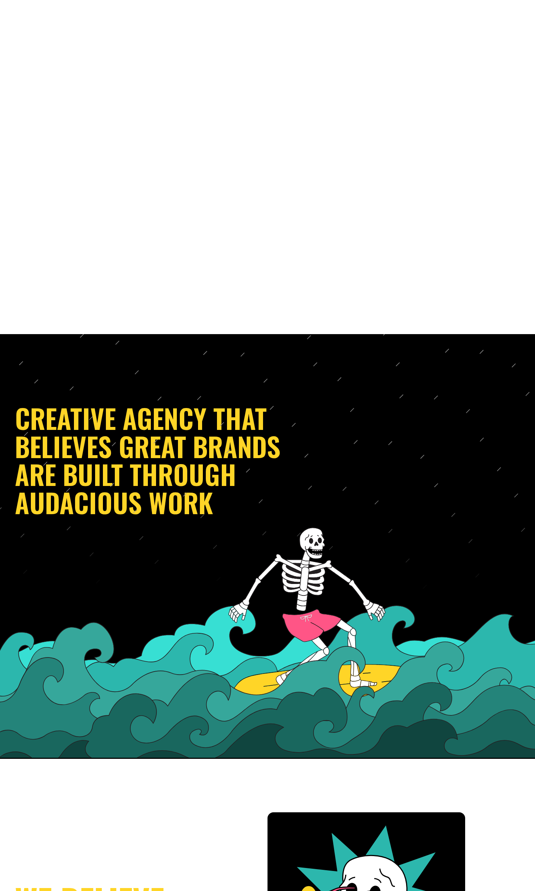
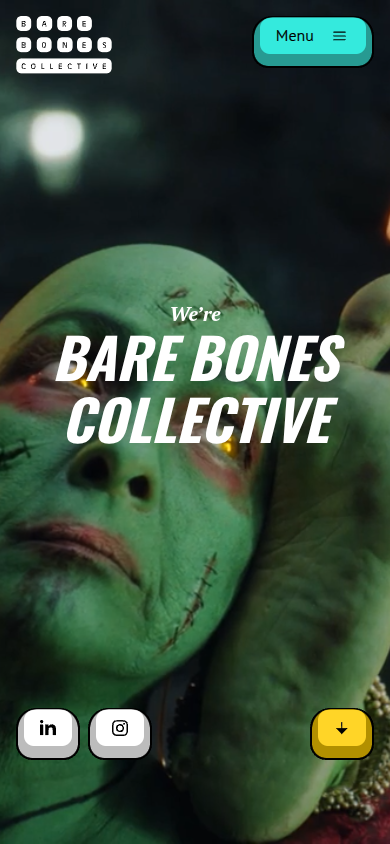

# UI Design System & Master Generation Blueprint: www-barebonescollective-com

> **Bare Bones Collective** (https://www.barebonescollective.com/) — We are a creative agency that believes great brands are built through audacious work



---

## 1. Executive Visual Persona & Design Archetype

- **Brand Essence & Persona**: **Bare Bones Collective** (`https://www.barebonescollective.com/`). We are a creative agency that believes great brands are built through audacious work
- **Capture Provenance**: Live browser capture (`tier2_webgl`, HTTP `200`, captured `2026-11-23`).
- **Visual Archetype**: **Light-Substrate Editorial & Modular Grid System (`#ffffff` canvas, `#333333` ink, `#0082f3` accent)**.
- **Anti-AI-Slop Differentiators**:
  - **Live-Computed Chromatic Polarity**: Anchors the viewport in `#ffffff` (live computed `body` `background-color` (`computed_styles.json`)) paired with `#333333` primary typography and `#0082f3` accents.
  - **Grounded Typographic Hierarchy**: Pairs `Oswald` for display copy (`BARE`) with `PT Serif` and not declared in live computed styles (uses primary stack / `ui-monospace`).
  - **Calibrated Spatial Grid & Motion**: Combines `100rem` container bounds (`gap: 16px`, padding `9px`) with `cubic-bezier(.165,.84,.44,1)` easing and Three.js / WebGL Canvas Pipeline, Lottie Vector Animation Player.

---

## 2. Spatial Architecture & Modular Grid Mathematics



### Viewport Allocation & Container Geometry
- **Captured Viewport Dimensions**: Desktop `1440×2400px` (`assets/desktop.png`, clamped at 2400px live multi-section capture), Mobile `390×844px` (`assets/mobile.png`, single-viewport 100vh live capture (844px)).
- **Master Container Bounds**: `100rem` (non-`@media` desktop container stylesheet rule).
- **Canvas Lateral Padding & Spacing**: `9px` lateral canvas padding with `16px` grid gap.
- **Border Radius Scale**: `24px 24px 18px 18px`, `3px`, `100%`, `50%`.

### Responsive Breakpoint Architecture
- **Desktop Layout**: Multi-column CSS Grid / Flexbox layout at `1440px` (`max-width: 100rem`, `gap: 16px`).
- **Mobile Layout**: Single-column vertical stack at `390px` viewport width with `9px` horizontal padding.
- **Extracted CSS Media Queries**: `@media screen and (max-width: 991px)`, `@media screen and (max-width: 767px)`, `@media screen and (max-width: 479px)`, `@media (min-width: 768px)`.

---

## 3. Color System, Materiality & Atmospheric Lighting

### Semantic Palette & Source Grounding
| Semantic Role | Ground-Truth Value | Extracted Live / CSS Source |
|---|---|---|
| **Primary Canvas Substrate** | `#ffffff` | live computed `body` `background-color` (`computed_styles.json`) |
| **Primary Typography Ink** | `#333333` | live computed `body` `color` (`computed_styles.json`) |
| **Elevated Surface / Card Substrate** | `#ffff00` | `mark { background: #ffff00 }` |
| **Interactive Accent / Highlight** | `#0082f3` | `.w-dropdown-link.w--current { color: #0082f3 }` |
| **Secondary / Muted Copy** | `#ffd527` | live computed `a` `color` (`computed_styles.json`) |
| **Structural Hairline Border** | `#e2e2e2` | `blockquote { border-left: #e2e2e2 }` |

### Sanitized Root CSS Variables (`ui-ux.md` Ground Truth)
| Variable Name | Extracted Value | Semantic Role |
|---|---|---|
| `--w-backdrop-animation` | `initial` | Motion / Easing Token |
| `--www-barebonescol-bg` | `#ffffff` | Canvas Substrate (from live computed `body` `background-color` (`computed_styles.json`)) |
| `--www-barebonescol-ink` | `#333333` | Primary Typography Ink (computed-derived) |
| `--www-barebonescol-surface` | `#ffff00` | Surface Substrate (computed-derived) |
| `--www-barebonescol-accent` | `#0082f3` | Interactive Accent (computed-derived) |
| `--www-barebonescol-muted` | `#ffd527` | Secondary Ink (computed-derived) |
| `--www-barebonescol-border` | `#e2e2e2` | Structural Border (computed-derived) |
| `--www-barebonescol-container` | `100rem` | Container Bound (computed-derived) |
| `--www-barebonescol-gap` | `16px` | Grid Gutter (computed-derived) |
| `--www-barebonescol-pad` | `9px` | Lateral Padding (computed-derived) |
| `--www-barebonescol-ease` | `cubic-bezier(.165,.84,.44,1)` | Primary Easing Function |
| `--www-barebonescol-radius` | `24px 24px 18px 18px` | Corner Radius (computed-derived) |
| `--www-barebonescol-fs-base` | `100px` | Observed Font Size Token |

---

## 4. Typographic Scale & Editorial Hierarchy

### Font Family Stacks
- **Display Typography**: `Oswald`.
- **Primary Body Stack**: `PT Serif`.
- **Technical / Metadata Stack**: not declared in live computed styles (uses primary stack / `ui-monospace`).

### Typographic Scale & Rules (Live Computed & Stylesheet Grounded)
- **Hero Display (`H1`)**: live computed `h1` (`font-size: 100px`, `line-height: 105px`, `font-weight: 700`); rule `h1` (`font-size: 2em`).
- **Section Heading (`H2`)**: live computed `h2` (`font-size: 72px`, `line-height: 75.6px`, `font-weight: 600`); rule `h2` (`font-size: 32px`, `line-height: 36px`).
- **Body Copy**: live computed `body` (`font-size: 16px`, `line-height: 17.6px`, `font-weight: 400`); rule `body` (`font-size: 14px`, `line-height: 20px`).
- **Metadata & Navigation Labels**: live computed `nav/a` (`font-size: 16px`, `line-height: 17.6px`, `font-weight: 400`); rule `small` (`font-size: 80%`).

---

## 5. Choreographed Motion & Interaction Physics

### Primary Easing Curves
- **Extracted Timing Functions**: `cubic-bezier(.165,.84,.44,1)`.

### Per-Element Transition & Choreography Rules
- **Selector `.w-webflow-badge > img`**: `transition: unset` extracted from `www-barebonescollective-com` stylesheet.
- **Selector `.w-slider-dot`**: `transition: background-color .1s, color .1s` extracted from `www-barebonescollective-com` stylesheet.
- **Selector `.w-lightbox-control`**: `transition: all .3s` extracted from `www-barebonescollective-com` stylesheet.
- **Extracted Easing Curve (`cubic-bezier(.165,.84,.44,1)`)**: Governs interactive state transitions across `<header.w-mod-js>` and `<section.logo_element>`.
- **Runtime Interaction Engine**: Integrates Three.js / WebGL Canvas Pipeline, Lottie Vector Animation Player with `prefers-reduced-motion: reduce` fallback guards.

---

## 6. Component Wireframe & Structural DOM Map

### Visual Layout Schematic — Desktop (`1440px`, Grounded in `dom.html` & Landmark Bounding Boxes)
```
┌────────────────────────────────────────────────────────────────────────┐
│ DESKTOP VIEWPORT (1440px) — Bare Bones Collective                      │
│ ====================================================================== │
│ [ <header.w-mod-js> (1440px)          | Menu · Work · Services · 360 ] │
│ ---------------------------------------------------------------------- │
│ | HERO STAGE: <section.menu_element> (w=1440px)                      | │
│ | H1: BARE                                                           | │
│ | Substrate: #ffffff | Ink: #333333 | Accent: #0082f3                | │
│ ---------------------------------------------------------------------- │
│ | SHOWCASE GRID (<section.logo_element>) max-w: 100rem               | │
│ | +------------------------------+  +------------------------------+ | │
│ | | Bare Bones Collective Primar |  | www-barebonescollective-com  | | │
│ | +------------------------------+  +------------------------------+ | │
│ ---------------------------------------------------------------------- │
│ | DETAIL MODULE (<section.section-hero>) — www-barebonescollecti     | │
│ ---------------------------------------------------------------------- │
│ [ FOOTER (<footer.wf-ptserif-n) | https://www.barebonescollective.com  │
└────────────────────────────────────────────────────────────────────────┘
```

### Visual Layout Schematic — Mobile Reflow (`390px`)
```
┌────────────────────────────────────────────────────────────────────────┐
│ MOBILE VIEWPORT REFLOW (390px) — Single-Column Stack (gap: 16px)       │
│ ====================================================================== │
│ [ HEADER BAR (<header.w-mod-js>       ) | Compact Menu (390px)         │
│ ---------------------------------------------------------------------- │
│ | HERO STAGE (<section.menu_element>) — 390px Vertical Lead          | │
│ | H1: BARE                                                           | │
│ ---------------------------------------------------------------------- │
│ | SHOWCASE STACK (<section.logo_element>) — 1-Col Stack              | │
│ | [ Item 1: Bare Bones Collective Primary Showcase                 ] | │
│ | [ Item 2: www-barebonescollective-com Interactive Matrix         ] | │
│ ---------------------------------------------------------------------- │
│ | DETAIL STACK (<section.section-hero>) — 1-Col (www-barebonescolle) | │
│ ---------------------------------------------------------------------- │
│ [ FOOTER (<footer.wf-ptserif-n) | Stacked 390px Colophon               │
└────────────────────────────────────────────────────────────────────────┘
```

### Granular DOM Region Breakdown
1. **Brand Header & Navigation Bar (<header.w-mod-js> — `www-barebonescollective-com`)**:
   - Landmark `<header class="w-mod-js">` (`1440px`) hosting `Bare Bones Collective` navigation (`Menu · Work · Services · 360° Campaigns · films`), DOM attributes (`data-wf-domain="www.barebonescollecti..."`, `data-wf-page="68358a988d15891f5e5e5ab6"`, `data-wf-site="68358a988d15891f5e5e5aad"`, `data-w-id="21dd915e-a730-31e5-d8..."`), and stylesheet rule `html { -webkit-text-size-adjust: 100%; -ms-text-size-adjust: 100%; font-family:... }`.
2. **Hero Stage & Focal Lead (<section.menu_element> — `BARE`)**:
   - Landmark `<section class="menu_element">` presenting display lead `BARE` and copy excerpt *"We are a creative agency that believes great brands are built thr"* over `#ffffff` canvas and `#333333` ink.
3. **Primary Showcase & Content Grid (<section.logo_element> — `Bare Bones Collective Primary Show`)**:
   - Landmark `<section class="logo_element">` rendering section `Bare Bones Collective Primary Showcase` with copy *"BARE"*, asset references (`cdn.prod.website-files.com`, `bare-bones-collective.webflow.sha...`, `fonts.googleapis.com`, `fonts.gstatic.com`), and grid rule `body { margin: 0; }`.
4. **Interactive Detail & Feature Matrix (<section.section-hero> — `www-barebonescollective-com Intera`)**:
   - Landmark `<section class="section-hero">` framing `www-barebonescollective-com Interactive Matrix` and `www-barebonescollective-com Archive & Directory` (*"Bare Bones Collective Primary Showcase"*) with `#ffff00` surface cards, `#0082f3` accents, and `summary { display: block; }`.
5. **Colophon & Global Directory Footer (<footer.wf-ptserif-n7-active> — `https://www.barebonescollective.com/`)**:
   - Landmark `<footer class="wf-ptserif-n7-active">` anchoring `Bare Bones Collective` footer links (`Menu · Work · Services · 360° Campaigns · films`), copy *"www-barebonescollective-com Interactive Matrix"*, and `#e2e2e2` structural dividers.

---

## 7. Master Zero-Shot AI Generation Prompt

```markdown
# Master Zero-Shot Frontend Generation Prompt: www-barebonescollective-com (Bare Bones Collective)

You are a principal frontend architect and design systems engineer. Build a complete, production-ready web application replicating the exact design system, DOM landmarks, typographic hierarchy, color tokens, and motion physics of `www-barebonescollective-com` (**Bare Bones Collective** — `https://www.barebonescollective.com/`).

### 1. Visual Archetype & Anti-AI-Slop Mandates
- **Archetype**: Light-Substrate Editorial & Modular Grid System (`#ffffff` canvas, `#333333` ink, `#0082f3` accent).
- **Identity & Domain Context**: We are a creative agency that believes great brands are built through audacious work
- **Primary Substrate**: `#ffffff` (live computed `body` `background-color` (`computed_styles.json`)), **Primary Ink**: `#333333`, **Accent / Highlight**: `#0082f3`.
- **Site-Specific Differentiators**:
  - **Live-Computed Chromatic Polarity**: Anchors the viewport in `#ffffff` (live computed `body` `background-color` (`computed_styles.json`)) paired with `#333333` primary typography and `#0082f3` accents.
  - **Grounded Typographic Hierarchy**: Pairs `Oswald` for display copy (`BARE`) with `PT Serif` and not declared in live computed styles (uses primary stack / `ui-monospace`).
  - **Calibrated Spatial Grid & Motion**: Combines `100rem` container bounds (`gap: 16px`, padding `9px`) with `cubic-bezier(.165,.84,.44,1)` easing and Three.js / WebGL Canvas Pipeline, Lottie Vector Animation Player.

### 2. Ground-Truth CSS Variables (`:root` Token Contract)
Declare and consume these exact custom properties extracted from `www-barebonescollective-com` in your global stylesheet:

:root {
  /* Bare Bones Collective (www-barebonescollective-com) — Live-Grounded CSS Variables */
  --w-backdrop-animation: initial; /* Motion / Easing Token (www-barebonescollective-com) */
  --www-barebonescol-bg: #ffffff; /* Canvas Substrate (from live computed `body` `background-color` (`computed_styles.json`)) (www-barebonescollective-com) */
  --www-barebonescol-ink: #333333; /* Primary Typography Ink (computed-derived) (www-barebonescollective-com) */
  --www-barebonescol-surface: #ffff00; /* Surface Substrate (computed-derived) (www-barebonescollective-com) */
  --www-barebonescol-accent: #0082f3; /* Interactive Accent (computed-derived) (www-barebonescollective-com) */
  --www-barebonescol-muted: #ffd527; /* Secondary Ink (computed-derived) (www-barebonescollective-com) */
  --www-barebonescol-border: #e2e2e2; /* Structural Border (computed-derived) (www-barebonescollective-com) */
  --www-barebonescol-container: 100rem; /* Container Bound (computed-derived) (www-barebonescollective-com) */
  --www-barebonescol-gap: 16px; /* Grid Gutter (computed-derived) (www-barebonescollective-com) */
  --www-barebonescol-pad: 9px; /* Lateral Padding (computed-derived) (www-barebonescollective-com) */
  --www-barebonescol-ease: cubic-bezier(.165,.84,.44,1); /* Primary Easing Function (www-barebonescollective-com) */
  --www-barebonescol-radius: 24px 24px 18px 18px; /* Corner Radius (computed-derived) (www-barebonescollective-com) */
  --www-barebonescol-fs-base: 100px; /* Observed Font Size Token (www-barebonescollective-com) */
}

### 3. Semantic Color & Materiality Contract
Map every surface, ink, and border strictly to these source-grounded tokens:
- **Primary Canvas Substrate**: `#ffffff` — grounded in live computed `body` `background-color` (`computed_styles.json`)
- **Primary Typography Ink**: `#333333` — grounded in live computed `body` `color` (`computed_styles.json`)
- **Elevated Surface / Card Substrate**: `#ffff00` — grounded in `mark { background: #ffff00 }`
- **Interactive Accent / Highlight**: `#0082f3` — grounded in `.w-dropdown-link.w--current { color: #0082f3 }`
- **Secondary / Muted Copy**: `#ffd527` — grounded in live computed `a` `color` (`computed_styles.json`)
- **Structural Hairline Border**: `#e2e2e2` — grounded in `blockquote { border-left: #e2e2e2 }`

### 4. Spatial Grid, Container Bounds & Responsive Breakpoints
- **Desktop Viewport Reference**: `1440×2400px` (clamped at 2400px live multi-section capture, `1440px` standard desktop width).
- **Mobile Viewport Reference**: `390×844px` (single-viewport 100vh live capture (844px), `390px` standard mobile width).
- **Container Max-Width**: `100rem` (non-`@media` desktop container stylesheet rule)
- **Padding & Gutters**: `9px` lateral canvas padding with `16px` grid gap
- **Desktop Grid**: Multi-column CSS Grid / Flexbox layout at `1440px` (`max-width: 100rem`, `gap: 16px`)
- **Mobile Adaptation**: Single-column vertical stack at `390px` viewport width with `9px` horizontal padding
- **Media Queries**: `@media screen and (max-width: 991px)`, `@media screen and (max-width: 767px)`, `@media screen and (max-width: 479px)`, `@media (min-width: 768px)`
- **Corner Radii**: `24px 24px 18px 18px`, `3px`, `100%`, `50%`

### 5. Typography & Editorial Scale Contract
- **Display Font Stack**: `Oswald`
- **Body Font Stack**: `PT Serif`
- **Monospace / Technical Font Stack**: not declared in live computed styles (uses primary stack / `ui-monospace`)
- **H1 Display Rule**: live computed `h1` (`font-size: 100px`, `line-height: 105px`, `font-weight: 700`); rule `h1` (`font-size: 2em`)
- **H2 Section Rule**: live computed `h2` (`font-size: 72px`, `line-height: 75.6px`, `font-weight: 600`); rule `h2` (`font-size: 32px`, `line-height: 36px`)
- **Body Copy Rule**: live computed `body` (`font-size: 16px`, `line-height: 17.6px`, `font-weight: 400`); rule `body` (`font-size: 14px`, `line-height: 20px`)
- **Metadata & Index Rule**: live computed `nav/a` (`font-size: 16px`, `line-height: 17.6px`, `font-weight: 400`); rule `small` (`font-size: 80%`)

### 6. Component Hierarchy, Verbatim Copy & Real DOM Landmarks
Scaffold `www-barebonescollective-com` (`Bare Bones Collective`) with these exact structural regions, extracted copy, and CSS rules from `dom.html`:
1. **Brand Header & Navigation Bar (<header.w-mod-js> — `www-barebonescollective-com`)**:
   - DOM & Selectors: Landmark `<header class="w-mod-js">` (`1440px`) hosting `Bare Bones Collective` navigation (`Menu · Work · Services · 360° Campaigns · films`), DOM attributes (`data-wf-domain="www.barebonescollecti..."`, `data-wf-page="68358a988d15891f5e5e5ab6"`, `data-wf-site="68358a988d15891f5e5e5aad"`, `data-w-id="21dd915e-a730-31e5-d8..."`), and stylesheet rule `html { -webkit-text-size-adjust: 100%; -ms-text-size-adjust: 100%; font-family:... }`.
   - Responsive Contract: Header `Brand Header & Navigation Bar (<header.w-mod-js> — `www-barebonescollective-com`)` (`www-barebonescollective-com`) adapts across `@media screen and (max-width: 991px)`, `@media screen and (max-width: 767px)`, `@media screen and (max-width: 479px)`, `@media (min-width: 768px)` with `cubic-bezier(.165,.84,.44,1)` transitions and links `Menu · Work · Services · 360° Campaigns · films`.
2. **Hero Stage & Focal Lead (<section.menu_element> — `BARE`)**:
   - DOM & Selectors: Landmark `<section class="menu_element">` presenting display lead `BARE` and copy excerpt *"We are a creative agency that believes great brands are built thr"* over `#ffffff` canvas and `#333333` ink.
   - Responsive Contract: Hero stage (`1440×2400px` desktop / `390×844px` mobile) sets `#ffffff` background with `#333333` headline `BARE`.
3. **Primary Showcase & Content Grid (<section.logo_element> — `Bare Bones Collective Primary Show`)**:
   - DOM & Selectors: Landmark `<section class="logo_element">` rendering section `Bare Bones Collective Primary Showcase` with copy *"BARE"*, asset references (`cdn.prod.website-files.com`, `bare-bones-collective.webflow.sha...`, `fonts.googleapis.com`, `fonts.gstatic.com`), and grid rule `body { margin: 0; }`.
   - Responsive Contract: Showcase grid `Primary Showcase & Content Grid (<section.logo_element> — `Bare Bones Collective Primary Show`)` applies Multi-column CSS Grid / Flexbox layout at `1440px` (`max-width: 100rem`, `gap: 16px`) on desktop and Single-column vertical stack at `390px` viewport width with `9px` horizontal padding on mobile.
4. **Interactive Detail & Feature Matrix (<section.section-hero> — `www-barebonescollective-com Intera`)**:
   - DOM & Selectors: Landmark `<section class="section-hero">` framing `www-barebonescollective-com Interactive Matrix` and `www-barebonescollective-com Archive & Directory` (*"Bare Bones Collective Primary Showcase"*) with `#ffff00` surface cards, `#0082f3` accents, and `summary { display: block; }`.
   - Responsive Contract: Detail module `Interactive Detail & Feature Matrix (<section.section-hero> — `www-barebonescollective-com Intera`)` uses `24px 24px 18px 18px`, `3px`, `100%`, `50%` radii, `#0082f3` highlights, and assets (cdn.prod.website-files.com, bare-bones-collective.webflow.sha..., fonts.googleapis.com).
5. **Colophon & Global Directory Footer (<footer.wf-ptserif-n7-active> — `https://www.barebonescollective.com/`)**:
   - DOM & Selectors: Landmark `<footer class="wf-ptserif-n7-active">` anchoring `Bare Bones Collective` footer links (`Menu · Work · Services · 360° Campaigns · films`), copy *"www-barebonescollective-com Interactive Matrix"*, and `#e2e2e2` structural dividers.
   - Responsive Contract: Footer `Colophon & Global Directory Footer (<footer.wf-ptserif-n7-active> — `https://www.barebonescollective.com/`)` aligns to `100rem` (non-`@media` desktop container stylesheet rule) with `9px` lateral canvas padding with `16px` grid gap and attributes (data-wf-domain="www.barebonescollecti...", data-wf-page="68358a988d15891f5e5e5ab6", data-wf-site="68358a988d15891f5e5e5aad").

#### Verbatim DOM Copy Excerpts (`dom.html`)
- Lead Copy: *"We are a creative agency that believes great brands are built through audacious work"*

### 7. Motion, Extracted Stylesheet Rules & Interaction Choreography
- **Primary Easing Functions**: `cubic-bezier(.165,.84,.44,1)`
- **Extracted Stylesheet Rules (`www-barebonescollective-com`)**:
- `html { -webkit-text-size-adjust: 100%; -ms-text-size-adjust: 100%; font-family:... }`
- `body { margin: 0; }`
- `summary { display: block; }`
- `video { vertical-align: baseline; display: inline-block; }`
- `template { display: none; }`
- **Per-Selector Transition Rules**:
- **Selector `.w-webflow-badge > img`**: `transition: unset` extracted from `www-barebonescollective-com` stylesheet.
- **Selector `.w-slider-dot`**: `transition: background-color .1s, color .1s` extracted from `www-barebonescollective-com` stylesheet.
- **Selector `.w-lightbox-control`**: `transition: all .3s` extracted from `www-barebonescollective-com` stylesheet.
- **Extracted Easing Curve (`cubic-bezier(.165,.84,.44,1)`)**: Governs interactive state transitions across `<header.w-mod-js>` and `<section.logo_element>`.
- **Runtime Interaction Engine**: Integrates Three.js / WebGL Canvas Pipeline, Lottie Vector Animation Player with `prefers-reduced-motion: reduce` fallback guards.

### 8. Technical Deliverables
- Implement in Next.js (App Router) with TypeScript and Tailwind CSS consuming the `:root` custom properties defined above for `www-barebonescollective-com`.
- Reproduce both the `1440px` desktop architecture and `390px` mobile breakpoint transitions, preserving semantic HTML5 landmarks (`<header>`, `<nav>`, `<main>`, `<section>`, `<footer>`) and `prefers-reduced-motion` accessibility guards.
```
