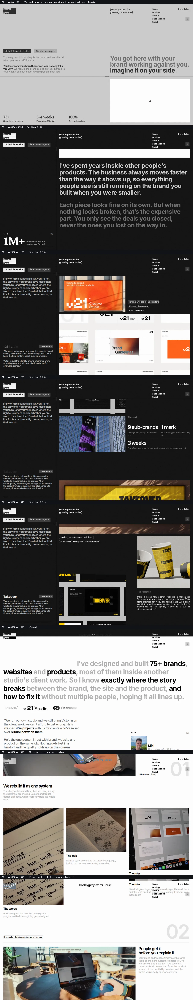
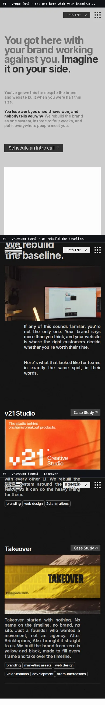

# UI Design System & Master Generation Blueprint: www-baseline-agency

> **Baseline · Brand identity systems, designed and built** (https://www.baseline.agency/) — Brand identity studio in Cluj-Napoca led by Victor Deaconu. Positioning, identity, rules and guidelines in 3 to 4 weeks, for brands that...





---

## 1. Executive Visual Persona & Design Archetype

- **Brand Essence & Persona**: **Baseline · Brand identity systems, designed and built** (`https://www.baseline.agency/`). Brand identity studio in Cluj-Napoca led by Victor Deaconu. Positioning, identity, rules and guidelines in 3 to 4 weeks, for brands that...
- **Capture Provenance**: Live browser capture (`tier1_fast`, HTTP `200`, captured `2026-11-24`).
- **Visual Archetype**: **Light-Gallery WebGL / Canvas Interactive Experience (`#ffffff` / `#000000`)**.
- **Anti-AI-Slop Differentiators**:
  - **Live-Computed Chromatic Polarity**: Anchors the viewport in `#ffffff` (live computed `body` `background-color` (`computed_styles.json`)) paired with `#000000` primary typography and `#000000` accents.
  - **Grounded Typographic Hierarchy**: Uses `Inter` across display (`You got here with your brand working`) and body copy, paired with `IBM Plex Mono` for monospace/code.
  - **Calibrated Spatial Grid & Motion**: Combines `96rem` container bounds (`gap: 2vw`, padding `.1875rem`) with `cubic-bezier(.4,0,1,1)` easing and Lenis Smooth Scroll (`data-lenis`), Three.js / WebGL Canvas Pipeline.

---

## 2. Spatial Architecture & Modular Grid Mathematics

### Viewport Allocation & Container Geometry
- **Captured Journey Filmstrips**: Desktop `1280×6624px` (`assets/desktop-journey.webp`, `8` keyframes up to `y=9350px` / doc `17185px`), Mobile `390×2616px` (`assets/mobile-journey.webp`, `3` keyframes).
- **Master Container Bounds**: `96rem` (non-`@media` desktop container stylesheet rule).
- **Canvas Lateral Padding & Spacing**: `.1875rem` lateral canvas padding with `2vw` grid gap.
- **Border Radius Scale**: `.25rem`, `.35625rem`, `.375rem`, `.9375rem`.

### Responsive Breakpoint Architecture
- **Desktop Layout**: Multi-column CSS Grid / Flexbox layout at `1440px` (`max-width: 96rem`, `gap: 2vw`).
- **Mobile Layout**: Single-column vertical stack at `390px` viewport width with `.1875rem` horizontal padding.
- **Extracted CSS Media Queries**: `@media (min-width:40rem)`, `@media (min-width:48rem)`, `@media (min-width:64rem)`, `@media (min-width:80rem)`.

---

## 3. Color System, Materiality & Atmospheric Lighting

### Semantic Palette & Source Grounding
| Semantic Role | Ground-Truth Value | Extracted Live / CSS Source |
|---|---|---|
| **Primary Canvas Substrate** | `#ffffff` | live computed `body` `background-color` (`computed_styles.json`) |
| **Primary Typography Ink** | `#000000` | live computed `body` `color` (`computed_styles.json`) |
| **Elevated Surface / Card Substrate** | `#d0d0d0` | `:focus { background-color: #d0d0d0 }` |
| **Interactive Accent / Highlight** | `#000000` | `.S6Hkya_link:hover { color: #000000 }` |
| **Secondary / Muted Copy** | `#0d0d0d` | `:focus-visible { color: #0d0d0d }` |
| **Structural Hairline Border** | `#cecece` | `25 { border-color: #cecece }` |

### Sanitized Root CSS Variables (`ui-ux.md` Ground Truth)
| Variable Name | Extracted Value | Semantic Role |
|---|---|---|
| `--background` | `#fff` | Canvas / Surface Token |
| `--foreground` | `#000` | Typography Ink Token |
| `--t-display` | `clamp(calc(34*1px),calc(30.1*1px) + 1.04vw,calc(48.07*1px))` | Dimension / Scale Token |
| `--t-heading` | `clamp(calc(24*1px),calc(22.9*1px) + .296vw,calc(28*1px))` | Typography Ink Token |
| `--t-body` | `clamp(calc(16*1px),calc(15.45*1px) + .148vw,calc(18*1px))` | Dimension / Scale Token |
| `--t-label` | `calc(14*1px)` | Dimension / Scale Token |
| `--edge` | `clamp(calc(17*1px),calc(14.5*1px) + .665vw,calc(26*1px))` | Dimension / Scale Token |
| `--gap` | `clamp(calc(16*1px),calc(13.2*1px) + .739vw,calc(26*1px))` | Layout / Spatial Grid Token |
| `--space-row` | `clamp(calc(48*1px),calc(34.7*1px) + 3.548vw,calc(96*1px))` | Layout / Spatial Grid Token |
| `--space-section` | `clamp(calc(96*1px),calc(72.7*1px) + 6.208vw,calc(180*1px))` | Layout / Spatial Grid Token |
| `--ink-light` | `0` | Canvas / Surface Token |
| `--duration-exit` | `.15s` | Motion / Easing Token |
| `--duration-enter` | `.21s` | Motion / Easing Token |
| `--duration-move` | `.4s` | Motion / Easing Token |
| `--font-inter` | `"Inter", "Inter Fallback"` | Typography / Scale Token |
| `--font-inter-tight` | `"Inter Tight", "Inter Tight Fallback"` | Typography / Scale Token |

---

## 4. Typographic Scale & Editorial Hierarchy

### Font Family Stacks
- **Display Typography**: `Inter`.
- **Primary Body Stack**: `Inter`.
- **Technical / Metadata Stack**: `IBM Plex Mono`.

### Typographic Scale & Rules (Live Computed & Stylesheet Grounded)
- **Hero Display (`H1`)**: live computed `h1` (`font-size: 46.5333px`, `line-height: 44.2067px`, `font-weight: 700`, `letter-spacing: -1.396px`); CSS variables `--t-display: clamp(calc(34*1px),calc(30.1*1px) + 1.04vw,calc(48.07*1px))`.
- **Section Heading (`H2`)**: live computed `h2` (`font-size: 53.48px`, `line-height: 53.48px`, `font-weight: 600`, `letter-spacing: -1.6044px`).
- **Body Copy**: live computed `body` (`font-size: 15.28px`, `line-height: 22.92px`, `font-weight: 400`); CSS variables `--t-body: clamp(calc(16*1px),calc(15.45*1px) + .148vw,calc(18*1px))`.
- **Metadata & Navigation Labels**: live computed `nav/a` (`font-size: 15.28px`, `line-height: 18.145px`, `font-weight: 700`, `letter-spacing: -0.6112px`); CSS variables `--t-label: calc(14*1px)`, `--default-mono-font-family: var(--font-mono)`, `--about-small: clamp(calc(11 * 1px), .88vw, calc(24 * 1px))`.

---

## 5. Choreographed Motion & Interaction Physics

### Primary Easing Curves
- **Extracted Timing Functions**: `cubic-bezier(.4,0,1,1)`, `cubic-bezier(0,0,.2,1)`, `cubic-bezier(.4,0,.2,1)`.

### Per-Element Transition & Choreography Rules
- **Selector `layer theme`**: `transition: .15s` extracted from `www-baseline-agency` stylesheet.
- **Selector `.transition`**: `transition: var(--tw-ease,var(--default-transition-timing-function))` extracted from `www-baseline-agency` stylesheet.
- **Selector `opacity\]`**: `transition: var(--tw-ease,var(--default-transition-timing-function))` extracted from `www-baseline-agency` stylesheet.
- **Extracted Easing Curve (`cubic-bezier(.4,0,1,1)`)**: Governs interactive state transitions across `<header.lenis>` and `<section.relative>`.
- **Runtime Interaction Engine**: Integrates Lenis Smooth Scroll (`data-lenis`), Three.js / WebGL Canvas Pipeline with `prefers-reduced-motion: reduce` fallback guards.
### Measured Runtime Scroll & Interaction Telemetry (`behavioral_journey_v2`)
- **Scroll Driver Mode**: `native` (max document height `17185px`, deepest scrollY reached `9350px` across `8` desktop keyframes).
- **Detected Scroll / Motion Libraries**: `Lenis`, `GSAP/ScrollTrigger`, `WebGL/Canvas`.
- **Route Transition Architecture**: First internal navigation (`/case-study/v21`) measured as `direct` in `13826ms`.

---

## 6. Component Wireframe & Structural DOM Map

### Visual Layout Schematic — Desktop (`1440px`, Grounded in `dom.html` & Landmark Bounding Boxes)
```
┌────────────────────────────────────────────────────────────────────────┐
│ DESKTOP VIEWPORT (1440px) — Baseline · Brand identity systems, designe │
│ ====================================================================== │
│ [ <header.lenis> (1440px)             | About > A b o u t            ] │
│ ---------------------------------------------------------------------- │
│ | HERO STAGE: <section.hero-drift> (w=1440px)                        | │
│ | H1: You got here with your brand working against you....           | │
│ | Substrate: #ffffff | Ink: #000000 | Accent: #000000                | │
│ ---------------------------------------------------------------------- │
│ | SHOWCASE GRID (<section.relative>) max-w: 96rem                    | │
│ | +------------------------------+  +------------------------------+ | │
│ | | You've grown this far despit |  | Baseline B a s e l i n e Stu | | │
│ | +------------------------------+  +------------------------------+ | │
│ ---------------------------------------------------------------------- │
│ | DETAIL MODULE (<article.flex>) — Baseline B a s e l i              | │
│ ---------------------------------------------------------------------- │
│ [ FOOTER (<footer.relative>   ) | https://www.baseline.agency/         │
└────────────────────────────────────────────────────────────────────────┘
```

### Visual Layout Schematic — Mobile Reflow (`390px`)
```
┌────────────────────────────────────────────────────────────────────────┐
│ MOBILE VIEWPORT REFLOW (390px) — Single-Column Stack (gap: 2vw)        │
│ ====================================================================== │
│ [ HEADER BAR (<header.lenis>          ) | Compact Menu (390px)         │
│ ---------------------------------------------------------------------- │
│ | HERO STAGE (<section.hero-drift>) — 390px Vertical Lead            | │
│ | H1: You got here with your brand working against you....           | │
│ ---------------------------------------------------------------------- │
│ | SHOWCASE STACK (<section.relative>) — 1-Col Stack                  | │
│ | [ Item 1: You've grown this far despite the brand and webs       ] | │
│ | [ Item 2: Baseline B a s e l i n e Studio S t u d i o            ] | │
│ ---------------------------------------------------------------------- │
│ | DETAIL STACK (<article.flex>) — 1-Col (Baseline B a s e l)         | │
│ ---------------------------------------------------------------------- │
│ [ FOOTER (<footer.relative>   ) | Stacked 390px Colophon               │
└────────────────────────────────────────────────────────────────────────┘
```

### Granular DOM Region Breakdown
1. **Brand Header & Navigation Bar (<header.lenis> — `www-baseline-agency`)**:
   - Landmark `<header class="lenis">` (`1440px`) hosting `Baseline · Brand identity systems, d` navigation (`About > A b o u t`), DOM attributes (`data-precedence="next"`, `data-precedence="next"`, `data-precedence="next"`, `data-sdkn="@vercel/analytics/next"`), and stylesheet rule `.LINzvG_className { font-family:Inter,Inter Fallback;font-style:normal }`.
2. **Hero Stage & Focal Lead (<section.hero-drift> — `You got here with your brand worki`)**:
   - Landmark `<section class="hero-drift relative">` presenting display lead `You got here with your brand working against you....` and copy excerpt *"You've grown this far despite the brand and website built when yo"* over `#ffffff` canvas and `#000000` ink.
3. **Primary Showcase & Content Grid (<section.relative> — `You've grown this far despite the `)**:
   - Landmark `<section class="relative text-white">` rendering section `You've grown this far despite the brand and webs` with copy *"Baseline B a s e l i n e Studio S t u d i o"*, asset references (`41q-9hyqnol8s.css`, `11vyltt-w7ouz.css`, `027ldshog-_ys.css`, `3ya-20k_dn7en.js`), and grid rule `.LINzvG_variable { --font-inter:"Inter", "Inter Fallback" }`.
4. **Interactive Detail & Feature Matrix (<article.flex> — `Baseline B a s e l i n e Studio S `)**:
   - Landmark `<article class="flex flex-col">` framing `Baseline B a s e l i n e Studio S t u d i o` and `Baseline B a s e l i n e` (*"Baseline B a s e l i n e"*) with `#d0d0d0` surface cards, `#000000` accents, and `.PJ4aQa_className { font-family:Inter Tight,Inter Tight Fallback;font-style:normal;font-weig... }`.
5. **Colophon & Global Directory Footer (<footer.relative> — `https://www.baseline.agency/`)**:
   - Landmark `<footer class="relative w-full">` anchoring `Baseline · Brand identity system` footer links (`About > A b o u t`), copy *"Studio S t u d i o"*, and `#cecece` structural dividers.
### Full Vertical Scroll Sequence (Desktop `1440×900` Keyframes)
- **Step 01** (`y=0px`, `0%`): Active landmark `You got here with your brand working against you....` · sticky/fixed elements: `5`
- **Step 02** (`y=850px`, `5%`): Active landmark `Section @ 5%` · sticky/fixed elements: `5`
- **Step 03** (`y=2550px`, `16%`): Active landmark `Section @ 16%` · sticky/fixed elements: `5`
- **Step 04** (`y=4250px`, `26%`): Active landmark `Section @ 26%` · sticky/fixed elements: `5`
- **Step 05** (`y=5100px`, `31%`): Active landmark `Section @ 31%` · sticky/fixed elements: `5`
- **Step 06** (`y=6800px`, `42%`): Active landmark `#about` · sticky/fixed elements: `3`
- **Step 07** (`y=8500px`, `52%`): Active landmark `We rebuild it as one system` · sticky/fixed elements: `3`
- **Step 08** (`y=9350px`, `57%`): Active landmark `People get it before you explain it` · sticky/fixed elements: `3`

### Multi-Page Internal Route Map
- **Detail Route (`/case-study/v21`)**: `https://www.baseline.agency/case-study/v21` — H1: `Repositioning a design studio for the founders it...`, scrollHeight `16029px`, transition `direct` (`13826ms`)
- **About Route (`/about`)**: `https://www.baseline.agency/about` — H1: `ABOUT BASELINE`, scrollHeight `8839px`, transition `direct` (`805ms`)
- **Detail Route (`/case-study/somnia`)**: `https://www.baseline.agency/case-study/somnia` — H1: `Rebranding a Layer 1 around its agentic vision.`, scrollHeight `19815px`, transition `direct` (`1289ms`)

---

## 7. Master Zero-Shot AI Generation Prompt

```markdown
# Master Zero-Shot Frontend Generation Prompt: www-baseline-agency (Baseline · Brand identity systems, designed and built)

You are a principal frontend architect and design systems engineer. Build a complete, production-ready web application replicating the exact design system, DOM landmarks, typographic hierarchy, color tokens, and motion physics of `www-baseline-agency` (**Baseline · Brand identity systems, designed and built** — `https://www.baseline.agency/`).

### 1. Visual Archetype & Anti-AI-Slop Mandates
- **Archetype**: Light-Gallery WebGL / Canvas Interactive Experience (`#ffffff` / `#000000`).
- **Identity & Domain Context**: Brand identity studio in Cluj-Napoca led by Victor Deaconu. Positioning, identity, rules and guidelines in 3 to 4 weeks, for brands that...
- **Primary Substrate**: `#ffffff` (live computed `body` `background-color` (`computed_styles.json`)), **Primary Ink**: `#000000`, **Accent / Highlight**: `#000000`.
- **Site-Specific Differentiators**:
  - **Live-Computed Chromatic Polarity**: Anchors the viewport in `#ffffff` (live computed `body` `background-color` (`computed_styles.json`)) paired with `#000000` primary typography and `#000000` accents.
  - **Grounded Typographic Hierarchy**: Uses `Inter` across display (`You got here with your brand working`) and body copy, paired with `IBM Plex Mono` for monospace/code.
  - **Calibrated Spatial Grid & Motion**: Combines `96rem` container bounds (`gap: 2vw`, padding `.1875rem`) with `cubic-bezier(.4,0,1,1)` easing and Lenis Smooth Scroll (`data-lenis`), Three.js / WebGL Canvas Pipeline.

### 2. Ground-Truth CSS Variables (`:root` Token Contract)
Declare and consume these exact custom properties extracted from `www-baseline-agency` in your global stylesheet:

:root {
  /* Baseline · Brand identity systems, designed and built (www-baseline-agency) — Live-Grounded CSS Variables */
  --background: #fff; /* Canvas / Surface Token (www-baseline-agency) */
  --foreground: #000; /* Typography Ink Token (www-baseline-agency) */
  --t-display: clamp(calc(34*1px),calc(30.1*1px) + 1.04vw,calc(48.07*1px)); /* Dimension / Scale Token (www-baseline-agency) */
  --t-heading: clamp(calc(24*1px),calc(22.9*1px) + .296vw,calc(28*1px)); /* Typography Ink Token (www-baseline-agency) */
  --t-body: clamp(calc(16*1px),calc(15.45*1px) + .148vw,calc(18*1px)); /* Dimension / Scale Token (www-baseline-agency) */
  --t-label: calc(14*1px); /* Dimension / Scale Token (www-baseline-agency) */
  --edge: clamp(calc(17*1px),calc(14.5*1px) + .665vw,calc(26*1px)); /* Dimension / Scale Token (www-baseline-agency) */
  --gap: clamp(calc(16*1px),calc(13.2*1px) + .739vw,calc(26*1px)); /* Layout / Spatial Grid Token (www-baseline-agency) */
  --space-row: clamp(calc(48*1px),calc(34.7*1px) + 3.548vw,calc(96*1px)); /* Layout / Spatial Grid Token (www-baseline-agency) */
  --space-section: clamp(calc(96*1px),calc(72.7*1px) + 6.208vw,calc(180*1px)); /* Layout / Spatial Grid Token (www-baseline-agency) */
  --ink-light: 0; /* Canvas / Surface Token (www-baseline-agency) */
  --duration-exit: .15s; /* Motion / Easing Token (www-baseline-agency) */
  --duration-enter: .21s; /* Motion / Easing Token (www-baseline-agency) */
  --duration-move: .4s; /* Motion / Easing Token (www-baseline-agency) */
  --font-inter: "Inter", "Inter Fallback"; /* Typography / Scale Token (www-baseline-agency) */
  --font-inter-tight: "Inter Tight", "Inter Tight Fallback"; /* Typography / Scale Token (www-baseline-agency) */
}

### 3. Semantic Color & Materiality Contract
Map every surface, ink, and border strictly to these source-grounded tokens:
- **Primary Canvas Substrate**: `#ffffff` — grounded in live computed `body` `background-color` (`computed_styles.json`)
- **Primary Typography Ink**: `#000000` — grounded in live computed `body` `color` (`computed_styles.json`)
- **Elevated Surface / Card Substrate**: `#d0d0d0` — grounded in `:focus { background-color: #d0d0d0 }`
- **Interactive Accent / Highlight**: `#000000` — grounded in `.S6Hkya_link:hover { color: #000000 }`
- **Secondary / Muted Copy**: `#0d0d0d` — grounded in `:focus-visible { color: #0d0d0d }`
- **Structural Hairline Border**: `#cecece` — grounded in `25 { border-color: #cecece }`

### 4. Spatial Grid, Container Bounds & Responsive Breakpoints
- **Desktop Viewport Reference**: `1280×6624px` (multi-frame vertical journey filmstrip (6624px), `1440px` standard desktop width).
- **Mobile Viewport Reference**: `390×2616px` (multi-frame vertical journey filmstrip (2616px), `390px` standard mobile width).
- **Container Max-Width**: `96rem` (non-`@media` desktop container stylesheet rule)
- **Padding & Gutters**: `.1875rem` lateral canvas padding with `2vw` grid gap
- **Desktop Grid**: Multi-column CSS Grid / Flexbox layout at `1440px` (`max-width: 96rem`, `gap: 2vw`)
- **Mobile Adaptation**: Single-column vertical stack at `390px` viewport width with `.1875rem` horizontal padding
- **Media Queries**: `@media (min-width:40rem)`, `@media (min-width:48rem)`, `@media (min-width:64rem)`, `@media (min-width:80rem)`
- **Corner Radii**: `.25rem`, `.35625rem`, `.375rem`, `.9375rem`

### 5. Typography & Editorial Scale Contract
- **Display Font Stack**: `Inter`
- **Body Font Stack**: `Inter`
- **Monospace / Technical Font Stack**: `IBM Plex Mono`
- **H1 Display Rule**: live computed `h1` (`font-size: 46.5333px`, `line-height: 44.2067px`, `font-weight: 700`, `letter-spacing: -1.396px`); CSS variables `--t-display: clamp(calc(34*1px),calc(30.1*1px) + 1.04vw,calc(48.07*1px))`
- **H2 Section Rule**: live computed `h2` (`font-size: 53.48px`, `line-height: 53.48px`, `font-weight: 600`, `letter-spacing: -1.6044px`)
- **Body Copy Rule**: live computed `body` (`font-size: 15.28px`, `line-height: 22.92px`, `font-weight: 400`); CSS variables `--t-body: clamp(calc(16*1px),calc(15.45*1px) + .148vw,calc(18*1px))`
- **Metadata & Index Rule**: live computed `nav/a` (`font-size: 15.28px`, `line-height: 18.145px`, `font-weight: 700`, `letter-spacing: -0.6112px`); CSS variables `--t-label: calc(14*1px)`, `--default-mono-font-family: var(--font-mono)`, `--about-small: clamp(calc(11 * 1px), .88vw, calc(24 * 1px))`

### 6. Component Hierarchy, Verbatim Copy & Real DOM Landmarks
Scaffold `www-baseline-agency` (`Baseline · Brand identity systems, designed and built`) with these exact structural regions, extracted copy, and CSS rules from `dom.html`:
1. **Brand Header & Navigation Bar (<header.lenis> — `www-baseline-agency`)**:
   - DOM & Selectors: Landmark `<header class="lenis">` (`1440px`) hosting `Baseline · Brand identity systems, d` navigation (`About > A b o u t`), DOM attributes (`data-precedence="next"`, `data-precedence="next"`, `data-precedence="next"`, `data-sdkn="@vercel/analytics/next"`), and stylesheet rule `.LINzvG_className { font-family:Inter,Inter Fallback;font-style:normal }`.
   - Responsive Contract: Header `Brand Header & Navigation Bar (<header.lenis> — `www-baseline-agency`)` (`www-baseline-agency`) adapts across `@media (min-width:40rem)`, `@media (min-width:48rem)`, `@media (min-width:64rem)`, `@media (min-width:80rem)` with `cubic-bezier(.4,0,1,1)`, `cubic-bezier(0,0,.2,1)`, `cubic-bezier(.4,0,.2,1)` transitions and links `About > A b o u t`.
2. **Hero Stage & Focal Lead (<section.hero-drift> — `You got here with your brand worki`)**:
   - DOM & Selectors: Landmark `<section class="hero-drift relative">` presenting display lead `You got here with your brand working against you....` and copy excerpt *"You've grown this far despite the brand and website built when yo"* over `#ffffff` canvas and `#000000` ink.
   - Responsive Contract: Hero stage (`1280×6624px` desktop / `390×2616px` mobile) sets `#ffffff` background with `#000000` headline `You got here with your brand working against you....`.
3. **Primary Showcase & Content Grid (<section.relative> — `You've grown this far despite the `)**:
   - DOM & Selectors: Landmark `<section class="relative text-white">` rendering section `You've grown this far despite the brand and webs` with copy *"Baseline B a s e l i n e Studio S t u d i o"*, asset references (`41q-9hyqnol8s.css`, `11vyltt-w7ouz.css`, `027ldshog-_ys.css`, `3ya-20k_dn7en.js`), and grid rule `.LINzvG_variable { --font-inter:"Inter", "Inter Fallback" }`.
   - Responsive Contract: Showcase grid `Primary Showcase & Content Grid (<section.relative> — `You've grown this far despite the `)` applies Multi-column CSS Grid / Flexbox layout at `1440px` (`max-width: 96rem`, `gap: 2vw`) on desktop and Single-column vertical stack at `390px` viewport width with `.1875rem` horizontal padding on mobile.
4. **Interactive Detail & Feature Matrix (<article.flex> — `Baseline B a s e l i n e Studio S `)**:
   - DOM & Selectors: Landmark `<article class="flex flex-col">` framing `Baseline B a s e l i n e Studio S t u d i o` and `Baseline B a s e l i n e` (*"Baseline B a s e l i n e"*) with `#d0d0d0` surface cards, `#000000` accents, and `.PJ4aQa_className { font-family:Inter Tight,Inter Tight Fallback;font-style:normal;font-weig... }`.
   - Responsive Contract: Detail module `Interactive Detail & Feature Matrix (<article.flex> — `Baseline B a s e l i n e Studio S `)` uses `.25rem`, `.35625rem`, `.375rem`, `.9375rem` radii, `#000000` highlights, and assets (41q-9hyqnol8s.css, 11vyltt-w7ouz.css, 027ldshog-_ys.css).
5. **Colophon & Global Directory Footer (<footer.relative> — `https://www.baseline.agency/`)**:
   - DOM & Selectors: Landmark `<footer class="relative w-full">` anchoring `Baseline · Brand identity system` footer links (`About > A b o u t`), copy *"Studio S t u d i o"*, and `#cecece` structural dividers.
   - Responsive Contract: Footer `Colophon & Global Directory Footer (<footer.relative> — `https://www.baseline.agency/`)` aligns to `96rem` (non-`@media` desktop container stylesheet rule) with `.1875rem` lateral canvas padding with `2vw` grid gap and attributes (data-precedence="next", data-precedence="next", data-precedence="next").

#### Verbatim DOM Copy Excerpts (`dom.html`)
- Copy Excerpt 1: *"You've grown this far despite the brand and website built when you were half this..."*
- Copy Excerpt 2: *"Baseline B a s e l i n e Studio S t u d i o"*
- Copy Excerpt 3: *"Baseline B a s e l i n e"*
- Copy Excerpt 4: *"Studio S t u d i o"*

### 7. Motion, Extracted Stylesheet Rules & Interaction Choreography
- **Primary Easing Functions**: `cubic-bezier(.4,0,1,1)`, `cubic-bezier(0,0,.2,1)`, `cubic-bezier(.4,0,.2,1)`
- **Extracted Stylesheet Rules (`www-baseline-agency`)**:
- `.LINzvG_className { font-family:Inter,Inter Fallback;font-style:normal }`
- `.LINzvG_variable { --font-inter:"Inter", "Inter Fallback" }`
- `.PJ4aQa_className { font-family:Inter Tight,Inter Tight Fallback;font-style:normal;font-weig... }`
- `.PJ4aQa_variable { --font-inter-tight:"Inter Tight", "Inter Tight Fallback" }`
- `.F7FJha_className { font-family:Hedvig Letters Serif,Hedvig Letters Serif Fallback;font-styl... }`
- **Per-Selector Transition Rules**:
- **Selector `layer theme`**: `transition: .15s` extracted from `www-baseline-agency` stylesheet.
- **Selector `.transition`**: `transition: var(--tw-ease,var(--default-transition-timing-function))` extracted from `www-baseline-agency` stylesheet.
- **Selector `opacity\]`**: `transition: var(--tw-ease,var(--default-transition-timing-function))` extracted from `www-baseline-agency` stylesheet.
- **Extracted Easing Curve (`cubic-bezier(.4,0,1,1)`)**: Governs interactive state transitions across `<header.lenis>` and `<section.relative>`.
- **Runtime Interaction Engine**: Integrates Lenis Smooth Scroll (`data-lenis`), Three.js / WebGL Canvas Pipeline with `prefers-reduced-motion: reduce` fallback guards.
### 7b. Full-Page Scroll Choreography, Interactive States & Multi-Page Routes
- **Scroll Mechanics**: Implement `native` vertical progression up to `17185px` across 8 distinct viewport chapters using Lenis, GSAP/ScrollTrigger, WebGL/Canvas.
- **Vertical Chapter Sequence**: You got here with your bran... (0%) -> Section @ 5% (5%) -> Section @ 16% (16%) -> Section @ 26% (26%) -> Section @ 31% (31%) -> #about (42%) -> We rebuild it as one system (52%) -> People get it before you ex... (57%).
- **Multi-Page Routes**: Scaffold internal routes `/case-study/v21` (detail, direct), `/about` (about, direct), `/case-study/somnia` (detail, direct) sharing the global header/footer shell and design tokens.

### 8. Technical Deliverables
- Implement in Next.js (App Router) with TypeScript and Tailwind CSS consuming the `:root` custom properties defined above for `www-baseline-agency`.
- Reproduce both the `1440px` desktop architecture and `390px` mobile breakpoint transitions, preserving semantic HTML5 landmarks (`<header>`, `<nav>`, `<main>`, `<section>`, `<footer>`) and `prefers-reduced-motion` accessibility guards.
```
---

## 8. Full-Page Scroll Journey, Interactive States & Subpage Inventory

### Desktop Scroll Keyframes (`1440×900` WebP)
| Step | Scroll Y | Progress | Active Landmark / Section | Sticky/Fixed | Visual Asset |
| :---: | :---: | :---: | :--- | :---: | :--- |
| `#01` | `0px` | `0%` | You got here with your brand working against... | `5` | [desktop-step-01.webp](assets/desktop-step-01.webp) |
| `#02` | `850px` | `5%` | Section @ 5% | `5` | [desktop-step-02.webp](assets/desktop-step-02.webp) |
| `#03` | `2550px` | `16%` | Section @ 16% | `5` | [desktop-step-03.webp](assets/desktop-step-03.webp) |
| `#04` | `4250px` | `26%` | Section @ 26% | `5` | [desktop-step-04.webp](assets/desktop-step-04.webp) |
| `#05` | `5100px` | `31%` | Section @ 31% | `5` | [desktop-step-05.webp](assets/desktop-step-05.webp) |
| `#06` | `6800px` | `42%` | #about | `3` | [desktop-step-06.webp](assets/desktop-step-06.webp) |
| `#07` | `8500px` | `52%` | We rebuild it as one system | `3` | [desktop-step-07.webp](assets/desktop-step-07.webp) |
| `#08` | `9350px` | `57%` | People get it before you explain it | `3` | [desktop-step-08.webp](assets/desktop-step-08.webp) |

### Mobile Condensed Keyframes (`390×844` WebP)
| Step | Scroll Y | Progress | Active Landmark | Visual Asset |
| :---: | :---: | :---: | :--- | :--- |
| `#01` | `0px` | `0%` | You got here with your brand working agai... | [mobile-step-01.webp](assets/mobile-step-01.webp) |
| `#02` | `1950px` | `50%` | We rebuild the baseline. | [mobile-step-02.webp](assets/mobile-step-02.webp) |
| `#03` | `3900px` | `100%` | Takeover | [mobile-step-03.webp](assets/mobile-step-03.webp) |

### Internal Subpage Filmstrips (`1080px` Wide WebP)
| # | Template | Route URL | H1 / Title | Scroll Height | Transition | Filmstrip Asset |
| :-: | :---: | :--- | :--- | :---: | :---: | :--- |
| `1` | `detail` | `https://www.baseline.agency/case-study/v21` | Repositioning a design studio for the... | `16029px` | `direct` (`13826ms`) | [subpage-01-case-study-v21.webp](assets/subpage-01-case-study-v21.webp) |
| `2` | `about` | `https://www.baseline.agency/about` | ABOUT BASELINE | `8839px` | `direct` (`805ms`) | [subpage-02-about.webp](assets/subpage-02-about.webp) |
| `3` | `detail` | `https://www.baseline.agency/case-study/somnia` | Rebranding a Layer 1 around its agent... | `19815px` | `direct` (`1289ms`) | [subpage-03-case-study-somnia.webp](assets/subpage-03-case-study-somnia.webp) |

