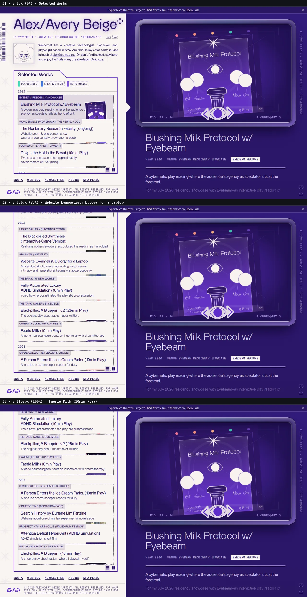
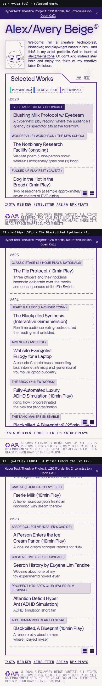

# UI Design System & Master Generation Blueprint: www-beige-zone

> **Alex/Avery Beige Artist, Playwright / Creative Technologist / Biohacker** (https://www.beige.zone) — Avery / Alex Beige is a freelance web developer, biohacker, and playwright based in NYC. They design speculative theater and digital expe...





---

## 1. Executive Visual Persona & Design Archetype

- **Brand Essence & Persona**: **Alex/Avery Beige Artist, Playwright / Creative Technologist / Biohacker** (`https://www.beige.zone`). Avery / Alex Beige is a freelance web developer, biohacker, and playwright based in NYC. They design speculative theater and digital expe...
- **Capture Provenance**: Live browser capture (`tier1_fast`, HTTP `200`, captured `2026-11-24`).
- **Visual Archetype**: **Dark-Substrate WebGL / Canvas Interactive Experience (`#2a1664` / `#0082f3`)**.
- **Anti-AI-Slop Differentiators**:
  - **Live-Computed Chromatic Polarity**: Anchors the viewport in `#2a1664` (live computed `body` `background-color` (`computed_styles.json`)) paired with `#f9f4f2` primary typography and `#0082f3` accents.
  - **Grounded Typographic Hierarchy**: Pairs `Avery Display` for display copy (`Alex/Avery Beige ©`) with `Avery` and `Avery Mono`.
  - **Calibrated Spatial Grid & Motion**: Combines `1480px` container bounds (`gap: 4px`, padding `6px`) with `cubic-bezier(0.07,0.83,0.33,0.97)` easing and Lenis Smooth Scroll (`data-lenis`), Three.js / WebGL Canvas Pipeline.

---

## 2. Spatial Architecture & Modular Grid Mathematics

### Viewport Allocation & Container Geometry
- **Captured Journey Filmstrips**: Desktop `1280×2484px` (`assets/desktop-journey.webp`, `3` keyframes up to `y=1157px` / doc `2057px`), Mobile `390×2616px` (`assets/mobile-journey.webp`, `3` keyframes).
- **Master Container Bounds**: `1480px` (non-`@media` desktop container stylesheet rule).
- **Canvas Lateral Padding & Spacing**: `6px` lateral canvas padding with `4px` grid gap.
- **Border Radius Scale**: `6px`, `4px`, `3px`, `var(--bezel-radius)`.

### Responsive Breakpoint Architecture
- **Desktop Layout**: Multi-column CSS Grid / Flexbox layout at `1440px` (`max-width: 1480px`, `gap: 4px`).
- **Mobile Layout**: Single-column vertical stack at `390px` viewport width with `6px` horizontal padding.
- **Extracted CSS Media Queries**: `@media (min-width: 1600px)`, `@media (max-width: 767px)`, `@media (min-width: 768px)`, `@media (max-width: 1000px)`.

---

## 3. Color System, Materiality & Atmospheric Lighting

### Semantic Palette & Source Grounding
| Semantic Role | Ground-Truth Value | Extracted Live / CSS Source |
|---|---|---|
| **Primary Canvas Substrate** | `#2a1664` | live computed `body` `background-color` (`computed_styles.json`) |
| **Primary Typography Ink** | `#f9f4f2` | live computed `p` `color` (`computed_styles.json`) |
| **Elevated Surface / Card Substrate** | `#311a7a` | `.bg-blurple { background: #311a7a }` |
| **Interactive Accent / Highlight** | `#0082f3` | `.w-dropdown-link.w--current { color: #0082f3 }` |
| **Secondary / Muted Copy** | `#999999` | `.w-select::placeholder { color: #999999 }` |
| **Structural Hairline Border** | `#f9f4f2` | `var(--light-border)` in `:root` |
| **Variable Token (`--light-purple`)** | `#e0d9e1` | `var(--light-purple)` in `:root` |
| **Variable Token (`--green`)** | `#42d5b6` | `var(--green)` in `:root` |
| **Variable Token (`--blue`)** | `#3f74de` | `var(--blue)` in `:root` |
| **Variable Token (`--tag-purple`)** | `#8055d9` | `var(--tag-purple)` in `:root` |
| **Variable Token (`--well-inner`)** | `#5e2cca` | `var(--well-inner)` in `:root` |
| **Variable Token (`--well-outer`)** | `#26145c` | `var(--well-outer)` in `:root` |
| **Variable Token (`--bezel-crown`)** | `#8e82bd` | `var(--bezel-crown)` in `:root` |
| **Variable Token (`--bezel-face`)** | `#55458c` | `var(--bezel-face)` in `:root` |
| **Variable Token (`--bezel-rail`)** | `#2f2160` | `var(--bezel-rail)` in `:root` |
| **Variable Token (`--bezel-bounce`)** | `#6a58a4` | `var(--bezel-bounce)` in `:root` |

### Sanitized Root CSS Variables (`ui-ux.md` Ground Truth)
| Variable Name | Extracted Value | Semantic Role |
|---|---|---|
| `--beige` | `#f9f4f2` | Color / Atmospheric Token |
| `--blurple` | `#2a1664` | Elevation / Border Token |
| `--purple` | `rgb(95, 44, 202)` | Color / Atmospheric Token |
| `--light-purple` | `#e0d9e1` | Canvas / Surface Token |
| `--green` | `#42d5b6` | Color / Atmospheric Token |
| `--blue` | `#3f74de` | Color / Atmospheric Token |
| `--tag-purple` | `#8055d9` | Color / Atmospheric Token |
| `--cat-playwriting` | `var(--green)` | Design System Custom Token |
| `--cat-creative-tech` | `var(--blue)` | Design System Custom Token |
| `--cat-performance` | `var(--tag-purple)` | Design System Custom Token |
| `--well-inner` | `#5e2cca91` | Color / Atmospheric Token |
| `--well-outer` | `#26145c` | Color / Atmospheric Token |
| `--bezel-crown` | `#8e82bd` | Color / Atmospheric Token |
| `--bezel-face` | `#55458c` | Color / Atmospheric Token |
| `--bezel-rail` | `#2f2160` | Color / Atmospheric Token |
| `--bezel-bounce` | `#6a58a4` | Color / Atmospheric Token |

---

## 4. Typographic Scale & Editorial Hierarchy

### Font Family Stacks
- **Display Typography**: `Avery Display`.
- **Primary Body Stack**: `Avery`.
- **Technical / Metadata Stack**: `Avery Mono`.

### Typographic Scale & Rules (Live Computed & Stylesheet Grounded)
- **Hero Display (`H1`)**: live computed `h1` (`font-size: 65.9123px`, `line-height: 65.9123px`, `font-weight: 700`); CSS variables `--avery-display: "Avery Display", "Avery", Arial, sans-serif`, `--display-w: 3`, `--display-h: 2`; rule `h1` (`font-size: 2em`).
- **Section Heading (`H2`)**: live computed `h2` (`font-size: 24px`, `line-height: 31.8px`, `font-weight: 700`); rule `h2` (`font-size: 1.5em`).
- **Body Copy**: live computed `body` (`font-size: 16px`, `line-height: 21.2px`, `font-weight: 400`); rule `body` (`font-size: 1rem`, `line-height: 1.325`).
- **Metadata & Navigation Labels**: live computed `nav/a` (`font-size: 14px`, `line-height: 18.2px`, `font-weight: 400`); CSS variables `--avery-mono: "Avery Mono", ui-monospace, monospace`, `--avery-mono-fw: "Avery Mono FW", "Avery Mono", ui-monospace, monospace`; rule `small` (`font-size: 80%`).

---

## 5. Choreographed Motion & Interaction Physics

### Primary Easing Curves
- **Extracted Timing Functions**: `cubic-bezier(0.07,0.83,0.33,0.97)`, `cubic-bezier(0.165,0.84,0.44,1)`, `cubic-bezier(.215,.61,.355,1)`.

### Per-Element Transition & Choreography Rules
- **Selector `.is-possessed`**: `transition: fill var(--possess-fade)` extracted from `www-beige-zone` stylesheet.
- **Selector `#eye-circle`**: `transition: fill var(--possess-fade), stroke var(--possess-fade), transfor...` extracted from `www-beige-zone` stylesheet.
- **Selector `.works_heading-wrap path`**: `transition: stroke var(--possess-fade)` extracted from `www-beige-zone` stylesheet.
- **Extracted Easing Curve (`cubic-bezier(0.07,0.83,0.33,0.97)`)**: Governs interactive state transitions across `<header.has-show-banner>` and `<main.pagewrapper:nth(2)>`.
- **Runtime Interaction Engine**: Integrates Lenis Smooth Scroll (`data-lenis`), Three.js / WebGL Canvas Pipeline, Swiper Touch Carousel Engine with `prefers-reduced-motion: reduce` fallback guards.
### Measured Runtime Scroll & Interaction Telemetry (`behavioral_journey_v2`)
- **Scroll Driver Mode**: `native` (max document height `2057px`, deepest scrollY reached `1157px` across `3` desktop keyframes).
- **Detected Scroll / Motion Libraries**: `Lenis`, `WebGL/Canvas`.
- **Hover Physics (`primary_cta` · `PLAYWRITING`)**: `backgroundColor`: `rgba(0, 0, 0, 0)` -> `rgb(224, 217, 225)` (`transition-duration: 0.3s, 0.3s, 0.3s, 0.3s`, `timing: cubic-bezier(0.165, 0.84, 0.44, 1), cubic-bezier(0.165, 0.84, 0.44, 1), cubic-bezier(0.165, 0.84, 0.44, 1), cubic-bezier(0.165, 0.84, 0.44, 1)`).
- **Hover Physics (`first_card` · `Blushing Milk Protocol w/ Eyebeam...`)**: Computed transition `0s` / `ease` (no static color/transform shift captured at rest).
- **Route Transition Architecture**: First internal navigation (`/nrf`) measured as `direct` in `1777ms`.

---

## 6. Component Wireframe & Structural DOM Map

### Visual Layout Schematic — Desktop (`1440px`, Grounded in `dom.html` & Landmark Bounding Boxes)
```
┌────────────────────────────────────────────────────────────────────────┐
│ DESKTOP VIEWPORT (1440px) — Alex/Avery Beige Artist, Playwright / Crea │
│ ====================================================================== │
│ [ <header.has-show-banne (1440px)     | Open Call · Oct 21st! · alex ] │
│ ---------------------------------------------------------------------- │
│ | HERO STAGE: <main.pagewrapper> (w=1440px)                          | │
│ | H1: Alex/Avery Beige ©                                             | │
│ | Substrate: #2a1664 | Ink: #f9f4f2 | Accent: #0082f3                | │
│ ---------------------------------------------------------------------- │
│ | SHOWCASE GRID (<main.pagewrapper:nth(2)>) max-w: 1480px            | │
│ | +------------------------------+  +------------------------------+ | │
│ | | Playwright / Creative Techno |  | Selected Works               | | │
│ | +------------------------------+  +------------------------------+ | │
│ ---------------------------------------------------------------------- │
│ | DETAIL MODULE (<main.pagewrapper:nth(3)>) — Blushing Milk Protoco  | │
│ ---------------------------------------------------------------------- │
│ [ FOOTER (<footer.show-banner>) | https://www.beige.zone               │
└────────────────────────────────────────────────────────────────────────┘
```

### Visual Layout Schematic — Mobile Reflow (`390px`)
```
┌────────────────────────────────────────────────────────────────────────┐
│ MOBILE VIEWPORT REFLOW (390px) — Single-Column Stack (gap: 4px)        │
│ ====================================================================== │
│ [ HEADER BAR (<header.has-show-banner>) | Compact Menu (390px)         │
│ ---------------------------------------------------------------------- │
│ | HERO STAGE (<main.pagewrapper>) — 390px Vertical Lead              | │
│ | H1: Alex/Avery Beige ©                                             | │
│ ---------------------------------------------------------------------- │
│ | SHOWCASE STACK (<main.pagewrapper:nth() — 1-Col Stack              | │
│ | [ Item 1: Playwright / Creative Technologist / Biohacker         ] | │
│ | [ Item 2: Selected Works                                         ] | │
│ ---------------------------------------------------------------------- │
│ | DETAIL STACK (<main.pagewrapper:nth(3)) — 1-Col (Blushing Milk Prot) │
│ ---------------------------------------------------------------------- │
│ [ FOOTER (<footer.show-banner>) | Stacked 390px Colophon               │
└────────────────────────────────────────────────────────────────────────┘
```

### Granular DOM Region Breakdown
1. **Brand Header & Navigation Bar (<header.has-show-banner> — `www-beige-zone`)**:
   - Landmark `<header class="has-show-banner">` (`1440px`) hosting `Alex/Avery Beige Artist, Playwright ` navigation (`Open Call · Oct 21st! · alex@beige.zone · Eyebeam · trailer here`), DOM attributes (`data-goatcounter="https://abeige.goatco..."`, `data-hide-after="2026-12-22T05:00:00.000Z"`, `data-key="2026-12-21T19:00:00-0..."`, `data-category="playwriting"`), and stylesheet rule `property --blurple { syntax: "<color>"; inherits: true; initial-value: 2a1664; }`.
2. **Hero Stage & Focal Lead (<main.pagewrapper> — `Alex/Avery Beige ©`)**:
   - Landmark `<main class="pagewrapper">` presenting display lead `Alex/Avery Beige ©` and copy excerpt *"HyperText Theatre Project: 120 Words, No Intermission Open Call"* over `#2a1664` canvas and `#f9f4f2` ink.
3. **Primary Showcase & Content Grid (<main.pagewrapper:nth(2)> — `Playwright / Creative Technologist`)**:
   - Landmark `<main class="pagewrapper">` rendering section `Playwright / Creative Technologist / Biohacker` with copy *"Under Construction!"*, asset references (`favicon.png`, `alex-beige-icon.png`, `Avery-Display-Regular.woff2`, `style.css`), and grid rule `property --purple { syntax: "<color>"; inherits: true; initial-value: 5f2cca; }`.
4. **Interactive Detail & Feature Matrix (<main.pagewrapper:nth(3)> — `Selected Works`)**:
   - Landmark `<main class="pagewrapper">` framing `Selected Works` and `Blushing Milk Protocol w/ Eyebeam` (*"I'm working on it! Right now! I'll be done by the end of October "*) with `#311a7a` surface cards, `#0082f3` accents, and `property --green { syntax: "<color>"; inherits: true; initial-value: 42d5b6; }`.
5. **Colophon & Global Directory Footer (<footer.show-banner> — `https://www.beige.zone`)**:
   - Landmark `<footer class="show-banner">` anchoring `Alex/Avery Beige Artist, Playwri` footer links (`Open Call · Oct 21st! · alex@beige.zone · Eyebeam · trailer here`), copy *"Avery / Alex Beige is a creative technologist, biohacker, an"*, and `#f9f4f2` structural dividers.
### Full Vertical Scroll Sequence (Desktop `1440×900` Keyframes)
- **Step 01** (`y=0px`, `0%`): Active landmark `Selected Works` · sticky/fixed elements: `4`
- **Step 02** (`y=850px`, `73%`): Active landmark `Website Evangelist: Eulogy for a Laptop` · sticky/fixed elements: `4`
- **Step 03** (`y=1157px`, `100%`): Active landmark `Faerie Milk (10min Play)` · sticky/fixed elements: `4`

### Multi-Page Internal Route Map
- **Other Route (`/nrf`)**: `https://www.beige.zone/nrf` — H1: `Nonbinary Research Facility (Alex Beige)`, scrollHeight `900px`, transition `direct` (`1777ms`)

---

## 7. Master Zero-Shot AI Generation Prompt

```markdown
# Master Zero-Shot Frontend Generation Prompt: www-beige-zone (Alex/Avery Beige Artist, Playwright / Creative Technologist / Biohacker)

You are a principal frontend architect and design systems engineer. Build a complete, production-ready web application replicating the exact design system, DOM landmarks, typographic hierarchy, color tokens, and motion physics of `www-beige-zone` (**Alex/Avery Beige Artist, Playwright / Creative Technologist / Biohacker** — `https://www.beige.zone`).

### 1. Visual Archetype & Anti-AI-Slop Mandates
- **Archetype**: Dark-Substrate WebGL / Canvas Interactive Experience (`#2a1664` / `#0082f3`).
- **Identity & Domain Context**: Avery / Alex Beige is a freelance web developer, biohacker, and playwright based in NYC. They design speculative theater and digital expe...
- **Primary Substrate**: `#2a1664` (live computed `body` `background-color` (`computed_styles.json`)), **Primary Ink**: `#f9f4f2`, **Accent / Highlight**: `#0082f3`.
- **Site-Specific Differentiators**:
  - **Live-Computed Chromatic Polarity**: Anchors the viewport in `#2a1664` (live computed `body` `background-color` (`computed_styles.json`)) paired with `#f9f4f2` primary typography and `#0082f3` accents.
  - **Grounded Typographic Hierarchy**: Pairs `Avery Display` for display copy (`Alex/Avery Beige ©`) with `Avery` and `Avery Mono`.
  - **Calibrated Spatial Grid & Motion**: Combines `1480px` container bounds (`gap: 4px`, padding `6px`) with `cubic-bezier(0.07,0.83,0.33,0.97)` easing and Lenis Smooth Scroll (`data-lenis`), Three.js / WebGL Canvas Pipeline.

### 2. Ground-Truth CSS Variables (`:root` Token Contract)
Declare and consume these exact custom properties extracted from `www-beige-zone` in your global stylesheet:

:root {
  /* Alex/Avery Beige Artist, Playwright / Creative Technologist / Biohacker (www-beige-zone) — Live-Grounded CSS Variables */
  --beige: #f9f4f2; /* Color / Atmospheric Token (www-beige-zone) */
  --blurple: #2a1664; /* Elevation / Border Token (www-beige-zone) */
  --purple: rgb(95, 44, 202); /* Color / Atmospheric Token (www-beige-zone) */
  --light-purple: #e0d9e1; /* Canvas / Surface Token (www-beige-zone) */
  --green: #42d5b6; /* Color / Atmospheric Token (www-beige-zone) */
  --blue: #3f74de; /* Color / Atmospheric Token (www-beige-zone) */
  --tag-purple: #8055d9; /* Color / Atmospheric Token (www-beige-zone) */
  --cat-playwriting: var(--green); /* Design System Custom Token (www-beige-zone) */
  --cat-creative-tech: var(--blue); /* Design System Custom Token (www-beige-zone) */
  --cat-performance: var(--tag-purple); /* Design System Custom Token (www-beige-zone) */
  --well-inner: #5e2cca91; /* Color / Atmospheric Token (www-beige-zone) */
  --well-outer: #26145c; /* Color / Atmospheric Token (www-beige-zone) */
  --bezel-crown: #8e82bd; /* Color / Atmospheric Token (www-beige-zone) */
  --bezel-face: #55458c; /* Color / Atmospheric Token (www-beige-zone) */
  --bezel-rail: #2f2160; /* Color / Atmospheric Token (www-beige-zone) */
  --bezel-bounce: #6a58a4; /* Color / Atmospheric Token (www-beige-zone) */
}

### 3. Semantic Color & Materiality Contract
Map every surface, ink, and border strictly to these source-grounded tokens:
- **Primary Canvas Substrate**: `#2a1664` — grounded in live computed `body` `background-color` (`computed_styles.json`)
- **Primary Typography Ink**: `#f9f4f2` — grounded in live computed `p` `color` (`computed_styles.json`)
- **Elevated Surface / Card Substrate**: `#311a7a` — grounded in `.bg-blurple { background: #311a7a }`
- **Interactive Accent / Highlight**: `#0082f3` — grounded in `.w-dropdown-link.w--current { color: #0082f3 }`
- **Secondary / Muted Copy**: `#999999` — grounded in `.w-select::placeholder { color: #999999 }`
- **Structural Hairline Border**: `#f9f4f2` — grounded in `var(--light-border)` in `:root`
- **Variable Token (`--light-purple`)**: `#e0d9e1` — grounded in `var(--light-purple)` in `:root`
- **Variable Token (`--green`)**: `#42d5b6` — grounded in `var(--green)` in `:root`
- **Variable Token (`--blue`)**: `#3f74de` — grounded in `var(--blue)` in `:root`
- **Variable Token (`--tag-purple`)**: `#8055d9` — grounded in `var(--tag-purple)` in `:root`
- **Variable Token (`--well-inner`)**: `#5e2cca` — grounded in `var(--well-inner)` in `:root`
- **Variable Token (`--well-outer`)**: `#26145c` — grounded in `var(--well-outer)` in `:root`
- **Variable Token (`--bezel-crown`)**: `#8e82bd` — grounded in `var(--bezel-crown)` in `:root`
- **Variable Token (`--bezel-face`)**: `#55458c` — grounded in `var(--bezel-face)` in `:root`
- **Variable Token (`--bezel-rail`)**: `#2f2160` — grounded in `var(--bezel-rail)` in `:root`
- **Variable Token (`--bezel-bounce`)**: `#6a58a4` — grounded in `var(--bezel-bounce)` in `:root`

### 4. Spatial Grid, Container Bounds & Responsive Breakpoints
- **Desktop Viewport Reference**: `1280×2484px` (multi-frame vertical journey filmstrip (2484px), `1440px` standard desktop width).
- **Mobile Viewport Reference**: `390×2616px` (multi-frame vertical journey filmstrip (2616px), `390px` standard mobile width).
- **Container Max-Width**: `1480px` (non-`@media` desktop container stylesheet rule)
- **Padding & Gutters**: `6px` lateral canvas padding with `4px` grid gap
- **Desktop Grid**: Multi-column CSS Grid / Flexbox layout at `1440px` (`max-width: 1480px`, `gap: 4px`)
- **Mobile Adaptation**: Single-column vertical stack at `390px` viewport width with `6px` horizontal padding
- **Media Queries**: `@media (min-width: 1600px)`, `@media (max-width: 767px)`, `@media (min-width: 768px)`, `@media (max-width: 1000px)`
- **Corner Radii**: `6px`, `4px`, `3px`, `var(--bezel-radius)`

### 5. Typography & Editorial Scale Contract
- **Display Font Stack**: `Avery Display`
- **Body Font Stack**: `Avery`
- **Monospace / Technical Font Stack**: `Avery Mono`
- **H1 Display Rule**: live computed `h1` (`font-size: 65.9123px`, `line-height: 65.9123px`, `font-weight: 700`); CSS variables `--avery-display: "Avery Display", "Avery", Arial, sans-serif`, `--display-w: 3`, `--display-h: 2`; rule `h1` (`font-size: 2em`)
- **H2 Section Rule**: live computed `h2` (`font-size: 24px`, `line-height: 31.8px`, `font-weight: 700`); rule `h2` (`font-size: 1.5em`)
- **Body Copy Rule**: live computed `body` (`font-size: 16px`, `line-height: 21.2px`, `font-weight: 400`); rule `body` (`font-size: 1rem`, `line-height: 1.325`)
- **Metadata & Index Rule**: live computed `nav/a` (`font-size: 14px`, `line-height: 18.2px`, `font-weight: 400`); CSS variables `--avery-mono: "Avery Mono", ui-monospace, monospace`, `--avery-mono-fw: "Avery Mono FW", "Avery Mono", ui-monospace, monospace`; rule `small` (`font-size: 80%`)

### 6. Component Hierarchy, Verbatim Copy & Real DOM Landmarks
Scaffold `www-beige-zone` (`Alex/Avery Beige Artist, Playwright / Creative Technologist / Biohacker`) with these exact structural regions, extracted copy, and CSS rules from `dom.html`:
1. **Brand Header & Navigation Bar (<header.has-show-banner> — `www-beige-zone`)**:
   - DOM & Selectors: Landmark `<header class="has-show-banner">` (`1440px`) hosting `Alex/Avery Beige Artist, Playwright ` navigation (`Open Call · Oct 21st! · alex@beige.zone · Eyebeam · trailer here`), DOM attributes (`data-goatcounter="https://abeige.goatco..."`, `data-hide-after="2026-12-22T05:00:00.000Z"`, `data-key="2026-12-21T19:00:00-0..."`, `data-category="playwriting"`), and stylesheet rule `property --blurple { syntax: "<color>"; inherits: true; initial-value: 2a1664; }`.
   - Responsive Contract: Header `Brand Header & Navigation Bar (<header.has-show-banner> — `www-beige-zone`)` (`www-beige-zone`) adapts across `@media (min-width: 1600px)`, `@media (max-width: 767px)`, `@media (min-width: 768px)`, `@media (max-width: 1000px)` with `cubic-bezier(0.07,0.83,0.33,0.97)`, `cubic-bezier(0.165,0.84,0.44,1)`, `cubic-bezier(.215,.61,.355,1)` transitions and links `Open Call · Oct 21st! · alex@beige.zone · Eyebeam · trailer here`.
2. **Hero Stage & Focal Lead (<main.pagewrapper> — `Alex/Avery Beige ©`)**:
   - DOM & Selectors: Landmark `<main class="pagewrapper">` presenting display lead `Alex/Avery Beige ©` and copy excerpt *"HyperText Theatre Project: 120 Words, No Intermission Open Call"* over `#2a1664` canvas and `#f9f4f2` ink.
   - Responsive Contract: Hero stage (`1280×2484px` desktop / `390×2616px` mobile) sets `#2a1664` background with `#f9f4f2` headline `Alex/Avery Beige ©`.
3. **Primary Showcase & Content Grid (<main.pagewrapper:nth(2)> — `Playwright / Creative Technologist`)**:
   - DOM & Selectors: Landmark `<main class="pagewrapper">` rendering section `Playwright / Creative Technologist / Biohacker` with copy *"Under Construction!"*, asset references (`favicon.png`, `alex-beige-icon.png`, `Avery-Display-Regular.woff2`, `style.css`), and grid rule `property --purple { syntax: "<color>"; inherits: true; initial-value: 5f2cca; }`.
   - Responsive Contract: Showcase grid `Primary Showcase & Content Grid (<main.pagewrapper:nth(2)> — `Playwright / Creative Technologist`)` applies Multi-column CSS Grid / Flexbox layout at `1440px` (`max-width: 1480px`, `gap: 4px`) on desktop and Single-column vertical stack at `390px` viewport width with `6px` horizontal padding on mobile.
4. **Interactive Detail & Feature Matrix (<main.pagewrapper:nth(3)> — `Selected Works`)**:
   - DOM & Selectors: Landmark `<main class="pagewrapper">` framing `Selected Works` and `Blushing Milk Protocol w/ Eyebeam` (*"I'm working on it! Right now! I'll be done by the end of October "*) with `#311a7a` surface cards, `#0082f3` accents, and `property --green { syntax: "<color>"; inherits: true; initial-value: 42d5b6; }`.
   - Responsive Contract: Detail module `Interactive Detail & Feature Matrix (<main.pagewrapper:nth(3)> — `Selected Works`)` uses `6px`, `4px`, `3px`, `var(--bezel-radius)` radii, `#0082f3` highlights, and assets (favicon.png, alex-beige-icon.png, Avery-Display-Regular.woff2).
5. **Colophon & Global Directory Footer (<footer.show-banner> — `https://www.beige.zone`)**:
   - DOM & Selectors: Landmark `<footer class="show-banner">` anchoring `Alex/Avery Beige Artist, Playwri` footer links (`Open Call · Oct 21st! · alex@beige.zone · Eyebeam · trailer here`), copy *"Avery / Alex Beige is a creative technologist, biohacker, an"*, and `#f9f4f2` structural dividers.
   - Responsive Contract: Footer `Colophon & Global Directory Footer (<footer.show-banner> — `https://www.beige.zone`)` aligns to `1480px` (non-`@media` desktop container stylesheet rule) with `6px` lateral canvas padding with `4px` grid gap and attributes (data-goatcounter="https://abeige.goatco...", data-hide-after="2026-12-22T05:00:00.000Z", data-key="2026-12-21T19:00:00-0...").

#### Verbatim DOM Copy Excerpts (`dom.html`)
- Copy Excerpt 1: *"HyperText Theatre Project: 120 Words, No Intermission Open Call"*
- Copy Excerpt 2: *"Under Construction!"*
- Copy Excerpt 3: *"I'm working on it! Right now! I'll be done by the end of October for SURE. Perform..."*
- Copy Excerpt 4: *"Avery / Alex Beige is a creative technologist, biohacker, and playwright based in..."*

### 7. Motion, Extracted Stylesheet Rules & Interaction Choreography
- **Primary Easing Functions**: `cubic-bezier(0.07,0.83,0.33,0.97)`, `cubic-bezier(0.165,0.84,0.44,1)`, `cubic-bezier(.215,.61,.355,1)`
- **Extracted Stylesheet Rules (`www-beige-zone`)**:
- `property --blurple { syntax: "<color>"; inherits: true; initial-value: 2a1664; }`
- `property --purple { syntax: "<color>"; inherits: true; initial-value: 5f2cca; }`
- `property --green { syntax: "<color>"; inherits: true; initial-value: 42d5b6; }`
- `property --blue { syntax: "<color>"; inherits: true; initial-value: 3f74de; }`
- `property --tag-purple { syntax: "<color>"; inherits: true; initial-value: 8055d9; }`
- **Per-Selector Transition Rules**:
- **Selector `.is-possessed`**: `transition: fill var(--possess-fade)` extracted from `www-beige-zone` stylesheet.
- **Selector `#eye-circle`**: `transition: fill var(--possess-fade), stroke var(--possess-fade), transfor...` extracted from `www-beige-zone` stylesheet.
- **Selector `.works_heading-wrap path`**: `transition: stroke var(--possess-fade)` extracted from `www-beige-zone` stylesheet.
- **Extracted Easing Curve (`cubic-bezier(0.07,0.83,0.33,0.97)`)**: Governs interactive state transitions across `<header.has-show-banner>` and `<main.pagewrapper:nth(2)>`.
- **Runtime Interaction Engine**: Integrates Lenis Smooth Scroll (`data-lenis`), Three.js / WebGL Canvas Pipeline, Swiper Touch Carousel Engine with `prefers-reduced-motion: reduce` fallback guards.
### 7b. Full-Page Scroll Choreography, Interactive States & Multi-Page Routes
- **Scroll Mechanics**: Implement `native` vertical progression up to `2057px` across 3 distinct viewport chapters using Lenis, WebGL/Canvas.
- **Vertical Chapter Sequence**: Selected Works (0%) -> Website Evangelist: Eulogy... (73%) -> Faerie Milk (10min Play) (100%).
- **Hover Micro-Interaction (`primary_cta`)**: Animate `backgroundColor` with `0.3s, 0.3s, 0.3s, 0.3s cubic-bezier(0.165, 0.84, 0.44, 1), cubic-bezier(0.165, 0.84, 0.44, 1), cubic-bezier(0.165, 0.84, 0.44, 1), cubic-bezier(0.165, 0.84, 0.44, 1)`.
- **Multi-Page Routes**: Scaffold internal routes `/nrf` (other, direct) sharing the global header/footer shell and design tokens.

### 8. Technical Deliverables
- Implement in Next.js (App Router) with TypeScript and Tailwind CSS consuming the `:root` custom properties defined above for `www-beige-zone`.
- Reproduce both the `1440px` desktop architecture and `390px` mobile breakpoint transitions, preserving semantic HTML5 landmarks (`<header>`, `<nav>`, `<main>`, `<section>`, `<footer>`) and `prefers-reduced-motion` accessibility guards.
```
---

## 8. Full-Page Scroll Journey, Interactive States & Subpage Inventory

### Desktop Scroll Keyframes (`1440×900` WebP)
| Step | Scroll Y | Progress | Active Landmark / Section | Sticky/Fixed | Visual Asset |
| :---: | :---: | :---: | :--- | :---: | :--- |
| `#01` | `0px` | `0%` | Selected Works | `4` | [desktop-step-01.webp](assets/desktop-step-01.webp) |
| `#02` | `850px` | `73%` | Website Evangelist: Eulogy for a Laptop | `4` | [desktop-step-02.webp](assets/desktop-step-02.webp) |
| `#03` | `1157px` | `100%` | Faerie Milk (10min Play) | `4` | [desktop-step-03.webp](assets/desktop-step-03.webp) |

### Mobile Condensed Keyframes (`390×844` WebP)
| Step | Scroll Y | Progress | Active Landmark | Visual Asset |
| :---: | :---: | :---: | :--- | :--- |
| `#01` | `0px` | `0%` | Selected Works | [mobile-step-01.webp](assets/mobile-step-01.webp) |
| `#02` | `696px` | `50%` | The Blackpilled Synthesis (Interactive Ga... | [mobile-step-02.webp](assets/mobile-step-02.webp) |
| `#03` | `1393px` | `100%` | A Person Enters the Ice Cream Parlor. (10... | [mobile-step-03.webp](assets/mobile-step-03.webp) |

### Internal Subpage Filmstrips (`1080px` Wide WebP)
| # | Template | Route URL | H1 / Title | Scroll Height | Transition | Filmstrip Asset |
| :-: | :---: | :--- | :--- | :---: | :---: | :--- |
| `1` | `other` | `https://www.beige.zone/nrf` | Nonbinary Research Facility (Alex Beige) | `900px` | `direct` (`1777ms`) | [subpage-01-nrf.webp](assets/subpage-01-nrf.webp) |

