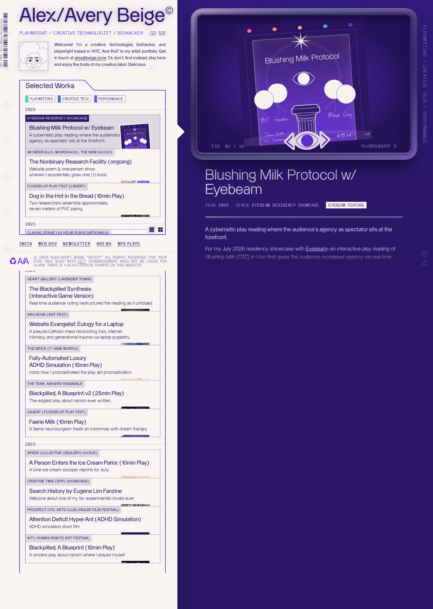
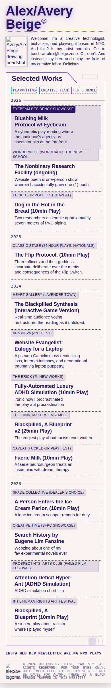

# UI Design System & Master Generation Blueprint: www-beige-zone

> **Alex/Avery Beige Artist, Playwright / Creative Technologist / Biohacker** (https://www.beige.zone) — Avery / Alex Beige is a freelance web developer, biohacker, and playwright based in NYC. They design speculative theater and digital expe...



---

## 1. Executive Visual Persona & Design Archetype

- **Brand Essence & Persona**: **Alex/Avery Beige Artist, Playwright / Creative Technologist / Biohacker** (`https://www.beige.zone`). Avery / Alex Beige is a freelance web developer, biohacker, and playwright based in NYC. They design speculative theater and digital expe...
- **Visual Archetype**: **Light-Gallery WebGL / Canvas Interactive Experience (`#f9f4f2` / `#42d5b6`)**.
- **Anti-AI-Slop Differentiators**:
  - **Source-Grounded Chromatic Polarity**: Anchors the viewport in `#f9f4f2` (`var(--beige)` in `:root`) paired with `#2a1664` primary typography and `#42d5b6` accents.
  - **Extracted Typographic Hierarchy**: Pairs `Avery` for display copy (`Alex/Avery Beige ©`) with `Avery Display` and `Avery Mono`.
  - **Calibrated Spatial Grid & Motion**: Combines `72ch` container bounds (`gap: 4px`, padding `6px`) with `cubic-bezier(0.07,0.83,0.33,0.97)` easing and Lenis Smooth Scroll (`data-lenis`), Three.js / WebGL Canvas Pipeline.

---

## 2. Spatial Architecture & Modular Grid Mathematics



### Viewport Allocation & Container Geometry
- **Captured Viewport Dimensions**: Desktop `1440×2025px` (`assets/desktop.png`, capped at 2400px multi-section capture), Mobile `390×2400px` (`assets/mobile.png`, capped at 2400px multi-section capture).
- **Master Container Bounds**: `72ch` extracted from `www-beige-zone` stylesheet.
- **Canvas Lateral Padding & Spacing**: `6px` lateral canvas padding with `4px` grid gap.
- **Border Radius Scale**: `6px`, `4px`, `3px`, `var(--bezel-radius)`.

### Responsive Breakpoint Architecture
- **Desktop Layout**: Multi-column CSS Grid / Flexbox layout at `1440px` (`max-width: 72ch`, `gap: 4px`).
- **Mobile Layout**: Single-column vertical stack at `390px` viewport width with `6px` horizontal padding.
- **Extracted CSS Media Queries**: `@media (min-width: 1600px)`, `@media (max-width: 767px)`, `@media (min-width: 768px)`, `@media (max-width: 1000px)`.

---

## 3. Color System, Materiality & Atmospheric Lighting

### Semantic Palette & Source Grounding
| Semantic Role | Ground-Truth Value | Extracted CSS Source / Selector |
|---|---|---|
| **Primary Canvas Substrate** | `#f9f4f2` | `var(--beige)` in `:root` |
| **Primary Typography Ink** | `#2a1664` | `var(--blurple)` in `:root` |
| **Elevated Surface / Card Substrate** | `#e0d9e1` | `var(--light-purple)` in `:root` |
| **Interactive Accent / Highlight** | `#42d5b6` | `var(--green)` in `:root` |
| **Secondary / Muted Copy** | `#3f74de` | `var(--blue)` in `:root` |
| **Structural Hairline Border** | `#8055d9` | `var(--tag-purple)` in `:root` |
| **Variable Token (`--well-inner`)** | `#5e2cca91` | `var(--well-inner)` in `:root` |
| **Variable Token (`--well-outer`)** | `#26145c` | `var(--well-outer)` in `:root` |
| **Variable Token (`--bezel-crown`)** | `#8e82bd` | `var(--bezel-crown)` in `:root` |
| **Variable Token (`--bezel-face`)** | `#55458c` | `var(--bezel-face)` in `:root` |
| **Variable Token (`--bezel-rail`)** | `#2f2160` | `var(--bezel-rail)` in `:root` |
| **Variable Token (`--bezel-bounce`)** | `#6a58a4` | `var(--bezel-bounce)` in `:root` |

### Sanitized Root CSS Variables (`ui-ux.md` Ground Truth)
| Variable Name | Extracted Value | Semantic Role |
|---|---|---|
| `--beige` | `#f9f4f2` | Color / Atmospheric Token |
| `--blurple` | `#2a1664` | Elevation / Border Token |
| `--purple` | `rgb(95, 44, 202)` | Color / Atmospheric Token |
| `--light-purple` | `#e0d9e1` | Canvas / Surface Token |
| `--green` | `#42d5b6` | Color / Atmospheric Token |
| `--blue` | `#3f74de` | Color / Atmospheric Token |
| `--tag-purple` | `#8055d9` | Color / Atmospheric Token |
| `--cat-playwriting` | `var(--green)` | Design System Custom Token |
| `--cat-creative-tech` | `var(--blue)` | Design System Custom Token |
| `--cat-performance` | `var(--tag-purple)` | Design System Custom Token |
| `--well-inner` | `#5e2cca91` | Color / Atmospheric Token |
| `--well-outer` | `#26145c` | Color / Atmospheric Token |
| `--bezel-crown` | `#8e82bd` | Color / Atmospheric Token |
| `--bezel-face` | `#55458c` | Color / Atmospheric Token |
| `--bezel-rail` | `#2f2160` | Color / Atmospheric Token |
| `--bezel-bounce` | `#6a58a4` | Color / Atmospheric Token |

---

## 4. Typographic Scale & Editorial Hierarchy

### Font Family Stacks
- **Display Typography**: `Avery`.
- **Primary Body Stack**: `Avery Display`.
- **Technical / Metadata Stack**: `Avery Mono`.

### Typographic Scale & Rules (Extracted from Stylesheet & Variables)
- **Hero Display (`H1`)**: CSS variables `--avery-display: "Avery Display", "Avery", Arial, sans-serif`, `--display-w: 3`, `--display-h: 2`.
- **Section Heading (`H2`)**: rule `h2` (`font-size: 1.5em`).
- **Body Copy**: rule `body` (`font-size: 1rem`, `line-height: 1.325`).
- **Metadata & Navigation Labels**: CSS variables `--avery-mono: "Avery Mono", ui-monospace, monospace`, `--avery-mono-fw: "Avery Mono FW", "Avery Mono", ui-monospace, monospace`.

---

## 5. Choreographed Motion & Interaction Physics

### Primary Easing Curves
- **Extracted Timing Functions**: `cubic-bezier(0.07,0.83,0.33,0.97)`, `cubic-bezier(0.165,0.84,0.44,1)`.

### Per-Element Transition & Choreography Rules
- **Selector `.is-possessed`**: `transition: fill var(--possess-fade)` extracted from `www-beige-zone` stylesheet.
- **Selector `#eye-circle`**: `transition: fill var(--possess-fade), stroke var(--possess-fade), transfor...` extracted from `www-beige-zone` stylesheet.
- **Selector `.works_heading-wrap path`**: `transition: stroke var(--possess-fade)` extracted from `www-beige-zone` stylesheet.
- **Extracted Easing Curve (`cubic-bezier(0.07,0.83,0.33,0.97)`)**: Governs interactive state transitions across `<header.has-custom-cursor>` and `<main.pagewrapper>`.
- **Runtime Interaction Engine**: Integrates Lenis Smooth Scroll (`data-lenis`), Three.js / WebGL Canvas Pipeline with `prefers-reduced-motion: reduce` fallback guards.

---

## 6. Component Wireframe & Structural DOM Map

### Visual Layout Schematic (Grounded in `dom.html` — `1440px` Desktop & `390px` Mobile Reflow)
```
┌────────────────────────────────────────────────────────────────────────┐
│ DESKTOP VIEWPORT (1440px) — Alex/Avery Beige Artist, Playwright / Crea │
│ ====================================================================== │
│ [ <header.has-custom-curso | Oct 21st! · alex@beige.zone · Eyebeam  ]  │
│ ---------------------------------------------------------------------- │
│ | HERO STAGE: <main.pagewrapper>                                   |   │
│ | H1: Alex/Avery Beige ©                                           |   │
│ | Substrate: #f9f4f2    | Ink: #2a1664    | Accent: #42d5b6        |   │
│ ---------------------------------------------------------------------- │
│ | SHOWCASE GRID (<main.pagewrapper>        ) max-w: 72ch           |   │
│ | +------------------------------+  +------------------------------+ | │
│ | | Playwright / Creative Techno |  | Selected Works               | | │
│ | +------------------------------+  +------------------------------+ | │
│ ---------------------------------------------------------------------- │
│ | MOBILE VIEWPORT REFLOW (390px) — Single-Column Stack (gap: 4px   ) | │
│ | [<header.has-custom] -> [<main.pagewrapper>] -> [<main.pagewrapper>] │
│ ---------------------------------------------------------------------- │
│ [ FOOTER (<footer.is-hidden>    ) | https://www.beige.zone             │
└────────────────────────────────────────────────────────────────────────┘
```

### Granular DOM Region Breakdown
1. **Brand Header & Navigation Bar (<header.has-custom-cursor> — `www-beige-zone`)**:
   - Landmark `<header class="has-custom-cursor">` hosting `Alex/Avery Beige Artist, Playwright ` navigation (`Oct 21st! · alex@beige.zone · Eyebeam · trailer here · Greg Lakhan`), DOM attributes (`data-goatcounter="https://abeige.goatco..."`, `data-category="playwriting"`, `data-category="creative-tech"`, `data-category="performance"`), and stylesheet rule `property --blurple { syntax: "<color>"; inherits: true; initial-value: 2a1664; }`.
2. **Hero Stage & Focal Lead (<main.pagewrapper> — `Alex/Avery Beige ©`)**:
   - Landmark `<main class="pagewrapper">` presenting display lead `Alex/Avery Beige ©` and copy excerpt *"Under Construction!"* over `#f9f4f2` canvas and `#2a1664` ink.
3. **Primary Showcase & Content Grid (<main.pagewrapper> — `Playwright / Creative Technologist`)**:
   - Landmark `<main class="pagewrapper">` rendering section `Playwright / Creative Technologist / Biohacker` with copy *"I'm working on it! Right now! I'll be done by the end of October "*, asset references (`favicon.png`, `alex-beige-icon.png`, `Avery-Display-Regular.woff2`, `style.css`), and grid rule `property --purple { syntax: "<color>"; inherits: true; initial-value: 5f2cca; }`.
4. **Interactive Detail & Feature Matrix (<main.pagewrapper> — `Selected Works`)**:
   - Landmark `<main class="pagewrapper">` framing `Selected Works` and `Blushing Milk Protocol w/ Eyebeam` (*"Avery / Alex Beige is a creative technologist, biohacker, and pla"*) with `#e0d9e1` surface cards, `#42d5b6` accents, and `property --green { syntax: "<color>"; inherits: true; initial-value: 42d5b6; }`.
5. **Colophon & Global Directory Footer (<footer.is-hidden> — `https://www.beige.zone`)**:
   - Landmark `<footer class="is-hidden">` anchoring `Alex/Avery Beige Artist, Playwri` footer links (`Oct 21st! · alex@beige.zone · Eyebeam · trailer here · Greg Lakhan`), copy *"Welcome! I'm a creative technologist, biohacker, and playwri"*, and `#8055d9` structural dividers.

---

## 7. Master Zero-Shot AI Generation Prompt

```markdown
# Master Zero-Shot Frontend Generation Prompt: www-beige-zone (Alex/Avery Beige Artist, Playwright / Creative Technologist / Biohacker)

You are a principal frontend architect and design systems engineer. Build a complete, production-ready web application replicating the exact design system, DOM landmarks, typographic hierarchy, color tokens, and motion physics of `www-beige-zone` (**Alex/Avery Beige Artist, Playwright / Creative Technologist / Biohacker** — `https://www.beige.zone`).

### 1. Visual Archetype & Anti-AI-Slop Mandates
- **Archetype**: Light-Gallery WebGL / Canvas Interactive Experience (`#f9f4f2` / `#42d5b6`).
- **Identity & Domain Context**: Avery / Alex Beige is a freelance web developer, biohacker, and playwright based in NYC. They design speculative theater and digital expe...
- **Primary Substrate**: `#f9f4f2` (`var(--beige)` in `:root`), **Primary Ink**: `#2a1664`, **Accent / Highlight**: `#42d5b6`.
- **Site-Specific Differentiators**:
  - **Source-Grounded Chromatic Polarity**: Anchors the viewport in `#f9f4f2` (`var(--beige)` in `:root`) paired with `#2a1664` primary typography and `#42d5b6` accents.
  - **Extracted Typographic Hierarchy**: Pairs `Avery` for display copy (`Alex/Avery Beige ©`) with `Avery Display` and `Avery Mono`.
  - **Calibrated Spatial Grid & Motion**: Combines `72ch` container bounds (`gap: 4px`, padding `6px`) with `cubic-bezier(0.07,0.83,0.33,0.97)` easing and Lenis Smooth Scroll (`data-lenis`), Three.js / WebGL Canvas Pipeline.

### 2. Ground-Truth CSS Variables (`:root` Token Contract)
Declare and consume these exact custom properties extracted from `www-beige-zone` in your global stylesheet:

:root {
  /* Alex/Avery Beige Artist, Playwright / Creative Technologist / Biohacker (www-beige-zone) — Ground-Truth Extracted CSS Variables */
  --beige: #f9f4f2; /* Color / Atmospheric Token (www-beige-zone) */
  --blurple: #2a1664; /* Elevation / Border Token (www-beige-zone) */
  --purple: rgb(95, 44, 202); /* Color / Atmospheric Token (www-beige-zone) */
  --light-purple: #e0d9e1; /* Canvas / Surface Token (www-beige-zone) */
  --green: #42d5b6; /* Color / Atmospheric Token (www-beige-zone) */
  --blue: #3f74de; /* Color / Atmospheric Token (www-beige-zone) */
  --tag-purple: #8055d9; /* Color / Atmospheric Token (www-beige-zone) */
  --cat-playwriting: var(--green); /* Design System Custom Token (www-beige-zone) */
  --cat-creative-tech: var(--blue); /* Design System Custom Token (www-beige-zone) */
  --cat-performance: var(--tag-purple); /* Design System Custom Token (www-beige-zone) */
  --well-inner: #5e2cca91; /* Color / Atmospheric Token (www-beige-zone) */
  --well-outer: #26145c; /* Color / Atmospheric Token (www-beige-zone) */
  --bezel-crown: #8e82bd; /* Color / Atmospheric Token (www-beige-zone) */
  --bezel-face: #55458c; /* Color / Atmospheric Token (www-beige-zone) */
  --bezel-rail: #2f2160; /* Color / Atmospheric Token (www-beige-zone) */
  --bezel-bounce: #6a58a4; /* Color / Atmospheric Token (www-beige-zone) */
}

### 3. Semantic Color & Materiality Contract
Map every surface, ink, and border strictly to these source-grounded tokens:
- **Primary Canvas Substrate**: `#f9f4f2` — grounded in `var(--beige)` in `:root`
- **Primary Typography Ink**: `#2a1664` — grounded in `var(--blurple)` in `:root`
- **Elevated Surface / Card Substrate**: `#e0d9e1` — grounded in `var(--light-purple)` in `:root`
- **Interactive Accent / Highlight**: `#42d5b6` — grounded in `var(--green)` in `:root`
- **Secondary / Muted Copy**: `#3f74de` — grounded in `var(--blue)` in `:root`
- **Structural Hairline Border**: `#8055d9` — grounded in `var(--tag-purple)` in `:root`
- **Variable Token (`--well-inner`)**: `#5e2cca91` — grounded in `var(--well-inner)` in `:root`
- **Variable Token (`--well-outer`)**: `#26145c` — grounded in `var(--well-outer)` in `:root`
- **Variable Token (`--bezel-crown`)**: `#8e82bd` — grounded in `var(--bezel-crown)` in `:root`
- **Variable Token (`--bezel-face`)**: `#55458c` — grounded in `var(--bezel-face)` in `:root`
- **Variable Token (`--bezel-rail`)**: `#2f2160` — grounded in `var(--bezel-rail)` in `:root`
- **Variable Token (`--bezel-bounce`)**: `#6a58a4` — grounded in `var(--bezel-bounce)` in `:root`

### 4. Spatial Grid, Container Bounds & Responsive Breakpoints
- **Desktop Viewport Reference**: `1440×2025px` (capped at 2400px multi-section capture, `1440px` standard desktop width).
- **Mobile Viewport Reference**: `390×2400px` (capped at 2400px multi-section capture, `390px` standard mobile width).
- **Container Max-Width**: `72ch` extracted from `www-beige-zone` stylesheet
- **Padding & Gutters**: `6px` lateral canvas padding with `4px` grid gap
- **Desktop Grid**: Multi-column CSS Grid / Flexbox layout at `1440px` (`max-width: 72ch`, `gap: 4px`)
- **Mobile Adaptation**: Single-column vertical stack at `390px` viewport width with `6px` horizontal padding
- **Media Queries**: `@media (min-width: 1600px)`, `@media (max-width: 767px)`, `@media (min-width: 768px)`, `@media (max-width: 1000px)`
- **Corner Radii**: `6px`, `4px`, `3px`, `var(--bezel-radius)`

### 5. Typography & Editorial Scale Contract
- **Display Font Stack**: `Avery`
- **Body Font Stack**: `Avery Display`
- **Monospace / Technical Font Stack**: `Avery Mono`
- **H1 Display Rule**: CSS variables `--avery-display: "Avery Display", "Avery", Arial, sans-serif`, `--display-w: 3`, `--display-h: 2`
- **H2 Section Rule**: rule `h2` (`font-size: 1.5em`)
- **Body Copy Rule**: rule `body` (`font-size: 1rem`, `line-height: 1.325`)
- **Metadata & Index Rule**: CSS variables `--avery-mono: "Avery Mono", ui-monospace, monospace`, `--avery-mono-fw: "Avery Mono FW", "Avery Mono", ui-monospace, monospace`

### 6. Component Hierarchy, Verbatim Copy & Real DOM Landmarks
Scaffold `www-beige-zone` (`Alex/Avery Beige Artist, Playwright / Creative Technologist / Biohacker`) with these exact structural regions, extracted copy, and CSS rules from `dom.html`:
1. **Brand Header & Navigation Bar (<header.has-custom-cursor> — `www-beige-zone`)**:
   - DOM & Selectors: Landmark `<header class="has-custom-cursor">` hosting `Alex/Avery Beige Artist, Playwright ` navigation (`Oct 21st! · alex@beige.zone · Eyebeam · trailer here · Greg Lakhan`), DOM attributes (`data-goatcounter="https://abeige.goatco..."`, `data-category="playwriting"`, `data-category="creative-tech"`, `data-category="performance"`), and stylesheet rule `property --blurple { syntax: "<color>"; inherits: true; initial-value: 2a1664; }`.
   - Responsive Contract: Header `Brand Header & Navigation Bar (<header.has-custom-cursor> — `www-beige-zone`)` (`www-beige-zone`) adapts across `@media (min-width: 1600px)`, `@media (max-width: 767px)`, `@media (min-width: 768px)`, `@media (max-width: 1000px)` with `cubic-bezier(0.07,0.83,0.33,0.97)`, `cubic-bezier(0.165,0.84,0.44,1)` transitions and links `Oct 21st! · alex@beige.zone · Eyebeam · trailer here · Greg Lakhan`.
2. **Hero Stage & Focal Lead (<main.pagewrapper> — `Alex/Avery Beige ©`)**:
   - DOM & Selectors: Landmark `<main class="pagewrapper">` presenting display lead `Alex/Avery Beige ©` and copy excerpt *"Under Construction!"* over `#f9f4f2` canvas and `#2a1664` ink.
   - Responsive Contract: Hero stage (`1440×2025px` desktop / `390×2400px` mobile) sets `#f9f4f2` background with `#2a1664` headline `Alex/Avery Beige ©`.
3. **Primary Showcase & Content Grid (<main.pagewrapper> — `Playwright / Creative Technologist`)**:
   - DOM & Selectors: Landmark `<main class="pagewrapper">` rendering section `Playwright / Creative Technologist / Biohacker` with copy *"I'm working on it! Right now! I'll be done by the end of October "*, asset references (`favicon.png`, `alex-beige-icon.png`, `Avery-Display-Regular.woff2`, `style.css`), and grid rule `property --purple { syntax: "<color>"; inherits: true; initial-value: 5f2cca; }`.
   - Responsive Contract: Showcase grid `Primary Showcase & Content Grid (<main.pagewrapper> — `Playwright / Creative Technologist`)` applies Multi-column CSS Grid / Flexbox layout at `1440px` (`max-width: 72ch`, `gap: 4px`) on desktop and Single-column vertical stack at `390px` viewport width with `6px` horizontal padding on mobile.
4. **Interactive Detail & Feature Matrix (<main.pagewrapper> — `Selected Works`)**:
   - DOM & Selectors: Landmark `<main class="pagewrapper">` framing `Selected Works` and `Blushing Milk Protocol w/ Eyebeam` (*"Avery / Alex Beige is a creative technologist, biohacker, and pla"*) with `#e0d9e1` surface cards, `#42d5b6` accents, and `property --green { syntax: "<color>"; inherits: true; initial-value: 42d5b6; }`.
   - Responsive Contract: Detail module `Interactive Detail & Feature Matrix (<main.pagewrapper> — `Selected Works`)` uses `6px`, `4px`, `3px`, `var(--bezel-radius)` radii, `#42d5b6` highlights, and assets (favicon.png, alex-beige-icon.png, Avery-Display-Regular.woff2).
5. **Colophon & Global Directory Footer (<footer.is-hidden> — `https://www.beige.zone`)**:
   - DOM & Selectors: Landmark `<footer class="is-hidden">` anchoring `Alex/Avery Beige Artist, Playwri` footer links (`Oct 21st! · alex@beige.zone · Eyebeam · trailer here · Greg Lakhan`), copy *"Welcome! I'm a creative technologist, biohacker, and playwri"*, and `#8055d9` structural dividers.
   - Responsive Contract: Footer `Colophon & Global Directory Footer (<footer.is-hidden> — `https://www.beige.zone`)` aligns to `72ch` extracted from `www-beige-zone` stylesheet with `6px` lateral canvas padding with `4px` grid gap and attributes (data-goatcounter="https://abeige.goatco...", data-category="playwriting", data-category="creative-tech").

#### Verbatim DOM Copy Excerpts (`dom.html`)
- Copy Excerpt 1: *"Under Construction!"*
- Copy Excerpt 2: *"I'm working on it! Right now! I'll be done by the end of October for SURE. Perform..."*
- Copy Excerpt 3: *"Avery / Alex Beige is a creative technologist, biohacker, and playwright based in..."*
- Copy Excerpt 4: *"Welcome! I'm a creative technologist, biohacker, and playwright based in NYC. And..."*

### 7. Motion, Extracted Stylesheet Rules & Interaction Choreography
- **Primary Easing Functions**: `cubic-bezier(0.07,0.83,0.33,0.97)`, `cubic-bezier(0.165,0.84,0.44,1)`
- **Extracted Stylesheet Rules (`www-beige-zone`)**:
- `property --blurple { syntax: "<color>"; inherits: true; initial-value: 2a1664; }`
- `property --purple { syntax: "<color>"; inherits: true; initial-value: 5f2cca; }`
- `property --green { syntax: "<color>"; inherits: true; initial-value: 42d5b6; }`
- `property --blue { syntax: "<color>"; inherits: true; initial-value: 3f74de; }`
- `property --tag-purple { syntax: "<color>"; inherits: true; initial-value: 8055d9; }`
- **Per-Selector Transition Rules**:
- **Selector `.is-possessed`**: `transition: fill var(--possess-fade)` extracted from `www-beige-zone` stylesheet.
- **Selector `#eye-circle`**: `transition: fill var(--possess-fade), stroke var(--possess-fade), transfor...` extracted from `www-beige-zone` stylesheet.
- **Selector `.works_heading-wrap path`**: `transition: stroke var(--possess-fade)` extracted from `www-beige-zone` stylesheet.
- **Extracted Easing Curve (`cubic-bezier(0.07,0.83,0.33,0.97)`)**: Governs interactive state transitions across `<header.has-custom-cursor>` and `<main.pagewrapper>`.
- **Runtime Interaction Engine**: Integrates Lenis Smooth Scroll (`data-lenis`), Three.js / WebGL Canvas Pipeline with `prefers-reduced-motion: reduce` fallback guards.

### 8. Technical Deliverables
- Implement in Next.js (App Router) with TypeScript and Tailwind CSS consuming the `:root` custom properties defined above for `www-beige-zone`.
- Reproduce both the `1440px` desktop architecture and `390px` mobile breakpoint transitions, preserving semantic HTML5 landmarks (`<header>`, `<nav>`, `<main>`, `<section>`, `<footer>`) and `prefers-reduced-motion` accessibility guards.
```
