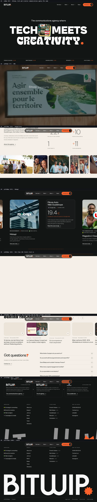
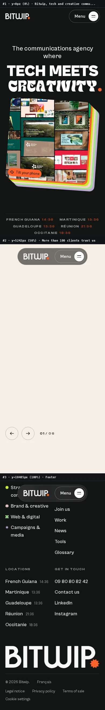

# UI Design System & Master Generation Blueprint: www-bitwip-fr_en

> **Communications consulting agency for Overseas France · Bitwip** (https://www.bitwip.fr/en) — Communications consulting agency in Overseas France and Occitanie: strategy, branding, web and campaigns. French Guiana, Martinique, Guad...





---

## 1. Executive Visual Persona & Design Archetype

- **Brand Essence & Persona**: **Communications consulting agency for Overseas France · Bitwip** (`https://www.bitwip.fr/en`). Communications consulting agency in Overseas France and Occitanie: strategy, branding, web and campaigns. French Guiana, Martinique, Guad...
- **Capture Provenance**: Live browser capture (`tier1_fast`, HTTP `200`, captured `2026-11-24`).
- **Visual Archetype**: **High-Contrast Obsidian / Atmospheric Design System (`#121414` canvas, `#ffffff` ink, `#fc622a` accent)**.
- **Anti-AI-Slop Differentiators**:
  - **Live-Computed Chromatic Polarity**: Anchors the viewport in `#121414` (live computed `body` `background-color` (`computed_styles.json`)) paired with `#ffffff` primary typography and `#fc622a` accents.
  - **Grounded Typographic Hierarchy**: Uses `Cabinet Grotesk` across display (`Bitwip, tech and creative communicat`) and body copy, paired with `SF Mono` for monospace/code.
  - **Calibrated Spatial Grid & Motion**: Combines `74em` container bounds (`gap: 31.68px`, padding `12px`) with `cubic-bezier(.16,1,.3,1)` easing and Three.js / WebGL Canvas Pipeline.

---

## 2. Spatial Architecture & Modular Grid Mathematics

### Viewport Allocation & Container Geometry
- **Captured Journey Filmstrips**: Desktop `1280×6624px` (`assets/desktop-journey.webp`, `8` keyframes up to `y=11342px` / doc `12242px`), Mobile `390×2616px` (`assets/mobile-journey.webp`, `3` keyframes).
- **Master Container Bounds**: `74em` (non-`@media` desktop container stylesheet rule).
- **Canvas Lateral Padding & Spacing**: `12px` lateral canvas padding with `31.68px` grid gap.
- **Border Radius Scale**: `50%`, `999px`, `6px`, `var(--pill)`.

### Responsive Breakpoint Architecture
- **Desktop Layout**: Multi-column CSS Grid / Flexbox layout at `1440px` (`max-width: 74em`, `gap: 31.68px`).
- **Mobile Layout**: Single-column vertical stack at `390px` viewport width with `12px` horizontal padding.
- **Extracted CSS Media Queries**: `@media (max-width:900px)`, `@media (max-width:760px)`, `@media (max-width:340px)`, `@media (prefers-reduced-motion:no-preference)`.

---

## 3. Color System, Materiality & Atmospheric Lighting

### Semantic Palette & Source Grounding
| Semantic Role | Ground-Truth Value | Extracted Live / CSS Source |
|---|---|---|
| **Primary Canvas Substrate** | `#121414` | live computed `body` `background-color` (`computed_styles.json`) |
| **Primary Typography Ink** | `#ffffff` | live computed `h1` `color` (`computed_styles.json`) |
| **Elevated Surface / Card Substrate** | `#0a0a0a` | `.nav__bar::before { background: #0a0a0a }` |
| **Interactive Accent / Highlight** | `#fc622a` | live computed `a` `background-color` (`computed_styles.json`) |
| **Secondary / Muted Copy** | `#b23c0b` | `var(--papaye-ink)` in `:root` |
| **Structural Hairline Border** | `#333535` | `var(--line)` in `:root` (`rgba(255,255,255,.14)`) |
| **Variable Token (`--noir`)** | `#000000` | `var(--noir)` in `:root` |
| **Variable Token (`--ink`)** | `#0b0b0b` | `var(--ink)` in `:root` |
| **Variable Token (`--ink-2`)** | `#141414` | `var(--ink-2)` in `:root` |
| **Variable Token (`--papaye-titre`)** | `#ee5520` | `var(--papaye-titre)` in `:root` |
| **Variable Token (`--papier`)** | `#f4efe7` | `var(--papier)` in `:root` |
| **Variable Token (`--papier-2`)** | `#eae3d8` | `var(--papier-2)` in `:root` |
| **Variable Token (`--encre`)** | `#121212` | `var(--encre)` in `:root` |

### Sanitized Root CSS Variables (`ui-ux.md` Ground Truth)
| Variable Name | Extracted Value | Semantic Role |
|---|---|---|
| `--noir` | `#000` | Color / Atmospheric Token |
| `--ink` | `#0B0B0B` | Typography Ink Token |
| `--ink-2` | `#141414` | Typography Ink Token |
| `--papaye` | `#FC622A` | Color / Atmospheric Token |
| `--papaye-titre` | `#EE5520` | Color / Atmospheric Token |
| `--papaye-ink` | `#B23C0B` | Typography Ink Token |
| `--etoile-y` | `-.015em` | Dimension / Scale Token |
| `--etoile-h` | `.26em` | Dimension / Scale Token |
| `--etoile-w` | `.28em` | Dimension / Scale Token |
| `--papier` | `#F4EFE7` | Color / Atmospheric Token |
| `--papier-2` | `#EAE3D8` | Color / Atmospheric Token |
| `--blanc` | `#FFF` | Color / Atmospheric Token |
| `--encre` | `#121212` | Color / Atmospheric Token |
| `--txt` | `#FFF` | Color / Atmospheric Token |
| `--txt-2` | `rgba(255,255,255,.74)` | Color / Atmospheric Token |
| `--txt-3` | `rgba(255,255,255,.54)` | Color / Atmospheric Token |

---

## 4. Typographic Scale & Editorial Hierarchy

### Font Family Stacks
- **Display Typography**: `Cabinet Grotesk`.
- **Primary Body Stack**: `Cabinet Grotesk`.
- **Technical / Metadata Stack**: `SF Mono`.

### Typographic Scale & Rules (Live Computed & Stylesheet Grounded)
- **Hero Display (`H1`)**: live computed `h1` (`font-size: 37.76px`, `line-height: 58.528px`, `font-weight: 400`); CSS variables `--t-h1: clamp(2.75rem,1.6rem + 4.6vw,6rem)`.
- **Section Heading (`H2`)**: live computed `h2` (`font-size: 91.84px`, `line-height: 90.0032px`, `font-weight: 500`, `letter-spacing: -3.6736px`); CSS variables `--t-h2: clamp(2.375rem,1.55rem + 3.4vw,5rem)`; rule `h2` (`font-size: var(--t-h3)`, `line-height: 1.12`, `letter-spacing: -.025em`, `font-weight: 500`).
- **Body Copy**: live computed `body` (`font-size: 18.88px`, `line-height: 29.264px`, `font-weight: 400`); CSS variables `--t-body: clamp(1.0625rem,1rem + .2vw,1.1875rem)`; rule `p` (`font-size: clamp(1.625rem,.9rem + 1.6vw,...`, `line-height: 1.16`, `letter-spacing: -.03em`).
- **Metadata & Navigation Labels**: live computed `nav/a` (`font-size: 18.88px`, `line-height: 29.264px`, `font-weight: 400`); CSS variables `--f-label: "Clash Display","Cabinet Grotesk","Helvetica Neue",Arial,sans-serif`, `--t-small: .9375rem`, `--t-label: .75rem`; rule `.label` (`font-size: .6875rem`).

---

## 5. Choreographed Motion & Interaction Physics

### Primary Easing Curves
- **Extracted Timing Functions**: `cubic-bezier(.16,1,.3,1)`, `cubic-bezier(.65,0,.35,1)`, `cubic-bezier(.22,1,.36,1)`.

### Per-Element Transition & Choreography Rules
- **Selector `.skip`**: `transition: top .2s` extracted from `www-bitwip-fr_en` stylesheet.
- **Selector `.sw__in .etoile)`**: `transition: none` extracted from `www-bitwip-fr_en` stylesheet.
- **Selector `.forme--fin`**: `transition: rotate .9s var(--ease)` extracted from `www-bitwip-fr_en` stylesheet.
- **Extracted Easing Curve (`cubic-bezier(.16,1,.3,1)`)**: Governs interactive state transitions across `<header.nav>` and `<section.sec>`.
- **Runtime Interaction Engine**: Integrates Three.js / WebGL Canvas Pipeline with `prefers-reduced-motion: reduce` fallback guards.
### Measured Runtime Scroll & Interaction Telemetry (`behavioral_journey_v2`)
- **Scroll Driver Mode**: `native` (max document height `12242px`, deepest scrollY reached `11342px` across `8` desktop keyframes).
- **Detected Scroll / Motion Libraries**: Native browser scroll / standard CSS transitions.
- **Nav / Drawer Probe (`Services submenu`)**: Triggered visual change (pixel diff `99.17`, captured in `assets/state-nav.webp`); revealed links: Strategy & consulting, View case study : Rac....
- **Hover Physics (`primary_cta` · `Strategy & consulting`)**: Computed transition `0.35s, 0.35s, 0.35s` / `ease, ease, ease` (no static color/transform shift captured at rest).
- **Interactive Control Probe (`tab` · `Launch my brand`)**: Triggered visual diff `7.907` (attr `false -> true`, captured in `assets/state-interactive.webp`).
- **Route Transition Architecture**: First internal navigation (`/en/work`) measured as `MPA` in `1455ms`.

---

## 6. Component Wireframe & Structural DOM Map

### Visual Layout Schematic — Desktop (`1440px`, Grounded in `dom.html` & Landmark Bounding Boxes)
```
┌────────────────────────────────────────────────────────────────────────┐
│ DESKTOP VIEWPORT (1440px) — Communications consulting agency for Overs │
│ ====================================================================== │
│ [ <header.nav> (721x76px)             | Services · All our services  ] │
│ ---------------------------------------------------------------------- │
│ | HERO STAGE: <section.hh> (w=1440px)                                | │
│ | H1: Bitwip, tech and creative communications agency T...           | │
│ | Substrate: #121414 | Ink: #ffffff | Accent: #fc622a                | │
│ ---------------------------------------------------------------------- │
│ | SHOWCASE GRID (<section.sec>) max-w: 74em                          | │
│ | +------------------------------+  +------------------------------+ | │
│ | | We believe in meaningful com |  | Our services                 | | │
│ | +------------------------------+  +------------------------------+ | │
│ ---------------------------------------------------------------------- │
│ | DETAIL MODULE (<section.sec:nth(2)>) — Strategy & consulting       | │
│ ---------------------------------------------------------------------- │
│ [ FOOTER (<footer.pied>       ) | https://www.bitwip.fr/en             │
└────────────────────────────────────────────────────────────────────────┘
```

### Visual Layout Schematic — Mobile Reflow (`390px`)
```
┌────────────────────────────────────────────────────────────────────────┐
│ MOBILE VIEWPORT REFLOW (390px) — Single-Column Stack (gap: 31.68px)    │
│ ====================================================================== │
│ [ HEADER BAR (<header.nav>            ) | Compact Menu (390px)         │
│ ---------------------------------------------------------------------- │
│ | HERO STAGE (<section.hh>) — 390px Vertical Lead                    | │
│ | H1: Bitwip, tech and creative communications agency T...           | │
│ ---------------------------------------------------------------------- │
│ | SHOWCASE STACK (<section.sec>) — 1-Col Stack                       | │
│ | [ Item 1: We believe in meaningful communication                 ] | │
│ | [ Item 2: Our services                                           ] | │
│ ---------------------------------------------------------------------- │
│ | DETAIL STACK (<section.sec:nth(2)>) — 1-Col (Strategy & consult)   | │
│ ---------------------------------------------------------------------- │
│ [ FOOTER (<footer.pied>       ) | Stacked 390px Colophon               │
└────────────────────────────────────────────────────────────────────────┘
```

### Granular DOM Region Breakdown
1. **Brand Header & Navigation Bar (<header.nav> — `www-bitwip-fr_en`)**:
   - Landmark `<header class="nav nav--allegee">` (`721x76px`) hosting `Communications consulting agency for` navigation (`Services · All our services · Work · View all work · Culture & tourism`), DOM attributes (`data-gdifilm="direct"`, `data-page="accueil"`, `data-variante="allegee"`, `data-entree`), and stylesheet rule `root { --gc-x:0px }`.
2. **Hero Stage & Focal Lead (<section.hh> — `Bitwip, tech and creative communic`)**:
   - Landmark `<section class="hh mj">` presenting display lead `Bitwip, tech and creative communications agency T...` and copy excerpt *"Bitwip supports impact-driven projects in Overseas France and acr"* over `#121414` canvas and `#ffffff` ink.
3. **Primary Showcase & Content Grid (<section.sec> — `We believe in meaningful communica`)**:
   - Landmark `<section class="sec papier">` rendering section `We believe in meaningful communication` with copy *"Bitwip, tech and creative communications agency"*, asset references (`mesure.js`, `consentement.js`, `favicon-b-fond-noir.webp`, `CabinetGrotesk-900.woff2`), and grid rule `after { box-sizing:border-box }`.
4. **Interactive Detail & Feature Matrix (<section.sec:nth(2)> — `Our services`)**:
   - Landmark `<section class="sec">` framing `Our services` and `Strategy & consulting` (*"The communications agency where"*) with `#0a0a0a` surface cards, `#fc622a` accents, and `html { -webkit-text-size-adjust:100%;text-size-adjust:100%;scroll-padding-top:1... }`.
5. **Colophon & Global Directory Footer (<footer.pied> — `https://www.bitwip.fr/en`)**:
   - Landmark `<footer class="pied">` anchoring `Communications consulting agency` footer links (`Services · All our services · Work · View all work · Culture & tourism`), copy *"c r e a t i v i t y"*, and `#333535` structural dividers.
### Full Vertical Scroll Sequence (Desktop `1440×900` Keyframes)
- **Step 01** (`y=0px`, `0%`): Active landmark `Bitwip, tech and creative communications agency T...` · sticky/fixed elements: `2`
- **Step 02** (`y=850px`, `7%`): Active landmark `#hh` · sticky/fixed elements: `2`
- **Step 03** (`y=2550px`, `22%`): Active landmark `#expertises` · sticky/fixed elements: `1`
- **Step 04** (`y=5100px`, `45%`): Active landmark `Mobapi` · sticky/fixed elements: `2`
- **Step 05** (`y=6800px`, `60%`): Active landmark `More than 100 clients trust us` · sticky/fixed elements: `2`
- **Step 06** (`y=9350px`, `82%`): Active landmark `14 stores, one territory: how we keep a brand con...` · sticky/fixed elements: `1`
- **Step 07** (`y=11050px`, `97%`): Active landmark `Footer` · sticky/fixed elements: `1`
- **Step 08** (`y=11342px`, `100%`): Active landmark `Footer` · sticky/fixed elements: `1`

### Multi-Page Internal Route Map
- **Detail Route (`/en/work`)**: `https://www.bitwip.fr/en/work` — H1: `Work`, scrollHeight `6121px`, transition `MPA` (`1455ms`)
- **Detail Route (`/en/about`)**: `https://www.bitwip.fr/en/about` — H1: `About`, scrollHeight `9286px`, transition `direct` (`326ms`)
- **Detail Route (`/en/news`)**: `https://www.bitwip.fr/en/news` — H1: `News`, scrollHeight `5097px`, transition `direct` (`713ms`)

---

## 7. Master Zero-Shot AI Generation Prompt

```markdown
# Master Zero-Shot Frontend Generation Prompt: www-bitwip-fr_en (Communications consulting agency for Overseas France · Bitwip)

You are a principal frontend architect and design systems engineer. Build a complete, production-ready web application replicating the exact design system, DOM landmarks, typographic hierarchy, color tokens, and motion physics of `www-bitwip-fr_en` (**Communications consulting agency for Overseas France · Bitwip** — `https://www.bitwip.fr/en`).

### 1. Visual Archetype & Anti-AI-Slop Mandates
- **Archetype**: High-Contrast Obsidian / Atmospheric Design System (`#121414` canvas, `#ffffff` ink, `#fc622a` accent).
- **Identity & Domain Context**: Communications consulting agency in Overseas France and Occitanie: strategy, branding, web and campaigns. French Guiana, Martinique, Guad...
- **Primary Substrate**: `#121414` (live computed `body` `background-color` (`computed_styles.json`)), **Primary Ink**: `#ffffff`, **Accent / Highlight**: `#fc622a`.
- **Site-Specific Differentiators**:
  - **Live-Computed Chromatic Polarity**: Anchors the viewport in `#121414` (live computed `body` `background-color` (`computed_styles.json`)) paired with `#ffffff` primary typography and `#fc622a` accents.
  - **Grounded Typographic Hierarchy**: Uses `Cabinet Grotesk` across display (`Bitwip, tech and creative communicat`) and body copy, paired with `SF Mono` for monospace/code.
  - **Calibrated Spatial Grid & Motion**: Combines `74em` container bounds (`gap: 31.68px`, padding `12px`) with `cubic-bezier(.16,1,.3,1)` easing and Three.js / WebGL Canvas Pipeline.

### 2. Ground-Truth CSS Variables (`:root` Token Contract)
Declare and consume these exact custom properties extracted from `www-bitwip-fr_en` in your global stylesheet:

:root {
  /* Communications consulting agency for Overseas France · Bitwip (www-bitwip-fr_en) — Live-Grounded CSS Variables */
  --noir: #000; /* Color / Atmospheric Token (www-bitwip-fr_en) */
  --ink: #0B0B0B; /* Typography Ink Token (www-bitwip-fr_en) */
  --ink-2: #141414; /* Typography Ink Token (www-bitwip-fr_en) */
  --papaye: #FC622A; /* Color / Atmospheric Token (www-bitwip-fr_en) */
  --papaye-titre: #EE5520; /* Color / Atmospheric Token (www-bitwip-fr_en) */
  --papaye-ink: #B23C0B; /* Typography Ink Token (www-bitwip-fr_en) */
  --etoile-y: -.015em; /* Dimension / Scale Token (www-bitwip-fr_en) */
  --etoile-h: .26em; /* Dimension / Scale Token (www-bitwip-fr_en) */
  --etoile-w: .28em; /* Dimension / Scale Token (www-bitwip-fr_en) */
  --papier: #F4EFE7; /* Color / Atmospheric Token (www-bitwip-fr_en) */
  --papier-2: #EAE3D8; /* Color / Atmospheric Token (www-bitwip-fr_en) */
  --blanc: #FFF; /* Color / Atmospheric Token (www-bitwip-fr_en) */
  --encre: #121212; /* Color / Atmospheric Token (www-bitwip-fr_en) */
  --txt: #FFF; /* Color / Atmospheric Token (www-bitwip-fr_en) */
  --txt-2: rgba(255,255,255,.74); /* Color / Atmospheric Token (www-bitwip-fr_en) */
  --txt-3: rgba(255,255,255,.54); /* Color / Atmospheric Token (www-bitwip-fr_en) */
}

### 3. Semantic Color & Materiality Contract
Map every surface, ink, and border strictly to these source-grounded tokens:
- **Primary Canvas Substrate**: `#121414` — grounded in live computed `body` `background-color` (`computed_styles.json`)
- **Primary Typography Ink**: `#ffffff` — grounded in live computed `h1` `color` (`computed_styles.json`)
- **Elevated Surface / Card Substrate**: `#0a0a0a` — grounded in `.nav__bar::before { background: #0a0a0a }`
- **Interactive Accent / Highlight**: `#fc622a` — grounded in live computed `a` `background-color` (`computed_styles.json`)
- **Secondary / Muted Copy**: `#b23c0b` — grounded in `var(--papaye-ink)` in `:root`
- **Structural Hairline Border**: `#333535` — grounded in `var(--line)` in `:root` (`rgba(255,255,255,.14)`)
- **Variable Token (`--noir`)**: `#000000` — grounded in `var(--noir)` in `:root`
- **Variable Token (`--ink`)**: `#0b0b0b` — grounded in `var(--ink)` in `:root`
- **Variable Token (`--ink-2`)**: `#141414` — grounded in `var(--ink-2)` in `:root`
- **Variable Token (`--papaye-titre`)**: `#ee5520` — grounded in `var(--papaye-titre)` in `:root`
- **Variable Token (`--papier`)**: `#f4efe7` — grounded in `var(--papier)` in `:root`
- **Variable Token (`--papier-2`)**: `#eae3d8` — grounded in `var(--papier-2)` in `:root`
- **Variable Token (`--encre`)**: `#121212` — grounded in `var(--encre)` in `:root`

### 4. Spatial Grid, Container Bounds & Responsive Breakpoints
- **Desktop Viewport Reference**: `1280×6624px` (multi-frame vertical journey filmstrip (6624px), `1440px` standard desktop width).
- **Mobile Viewport Reference**: `390×2616px` (multi-frame vertical journey filmstrip (2616px), `390px` standard mobile width).
- **Container Max-Width**: `74em` (non-`@media` desktop container stylesheet rule)
- **Padding & Gutters**: `12px` lateral canvas padding with `31.68px` grid gap
- **Desktop Grid**: Multi-column CSS Grid / Flexbox layout at `1440px` (`max-width: 74em`, `gap: 31.68px`)
- **Mobile Adaptation**: Single-column vertical stack at `390px` viewport width with `12px` horizontal padding
- **Media Queries**: `@media (max-width:900px)`, `@media (max-width:760px)`, `@media (max-width:340px)`, `@media (prefers-reduced-motion:no-preference)`
- **Corner Radii**: `50%`, `999px`, `6px`, `var(--pill)`

### 5. Typography & Editorial Scale Contract
- **Display Font Stack**: `Cabinet Grotesk`
- **Body Font Stack**: `Cabinet Grotesk`
- **Monospace / Technical Font Stack**: `SF Mono`
- **H1 Display Rule**: live computed `h1` (`font-size: 37.76px`, `line-height: 58.528px`, `font-weight: 400`); CSS variables `--t-h1: clamp(2.75rem,1.6rem + 4.6vw,6rem)`
- **H2 Section Rule**: live computed `h2` (`font-size: 91.84px`, `line-height: 90.0032px`, `font-weight: 500`, `letter-spacing: -3.6736px`); CSS variables `--t-h2: clamp(2.375rem,1.55rem + 3.4vw,5rem)`; rule `h2` (`font-size: var(--t-h3)`, `line-height: 1.12`, `letter-spacing: -.025em`, `font-weight: 500`)
- **Body Copy Rule**: live computed `body` (`font-size: 18.88px`, `line-height: 29.264px`, `font-weight: 400`); CSS variables `--t-body: clamp(1.0625rem,1rem + .2vw,1.1875rem)`; rule `p` (`font-size: clamp(1.625rem,.9rem + 1.6vw,...`, `line-height: 1.16`, `letter-spacing: -.03em`)
- **Metadata & Index Rule**: live computed `nav/a` (`font-size: 18.88px`, `line-height: 29.264px`, `font-weight: 400`); CSS variables `--f-label: "Clash Display","Cabinet Grotesk","Helvetica Neue",Arial,sans-serif`, `--t-small: .9375rem`, `--t-label: .75rem`; rule `.label` (`font-size: .6875rem`)

### 6. Component Hierarchy, Verbatim Copy & Real DOM Landmarks
Scaffold `www-bitwip-fr_en` (`Communications consulting agency for Overseas France · Bitwip`) with these exact structural regions, extracted copy, and CSS rules from `dom.html`:
1. **Brand Header & Navigation Bar (<header.nav> — `www-bitwip-fr_en`)**:
   - DOM & Selectors: Landmark `<header class="nav nav--allegee">` (`721x76px`) hosting `Communications consulting agency for` navigation (`Services · All our services · Work · View all work · Culture & tourism`), DOM attributes (`data-gdifilm="direct"`, `data-page="accueil"`, `data-variante="allegee"`, `data-entree`), and stylesheet rule `root { --gc-x:0px }`.
   - Responsive Contract: Header `Brand Header & Navigation Bar (<header.nav> — `www-bitwip-fr_en`)` (`www-bitwip-fr_en`) adapts across `@media (max-width:900px)`, `@media (max-width:760px)`, `@media (max-width:340px)`, `@media (prefers-reduced-motion:no-preference)` with `cubic-bezier(.16,1,.3,1)`, `cubic-bezier(.65,0,.35,1)`, `cubic-bezier(.22,1,.36,1)` transitions and links `Services · All our services · Work · View all work · Culture & tourism`.
2. **Hero Stage & Focal Lead (<section.hh> — `Bitwip, tech and creative communic`)**:
   - DOM & Selectors: Landmark `<section class="hh mj">` presenting display lead `Bitwip, tech and creative communications agency T...` and copy excerpt *"Bitwip supports impact-driven projects in Overseas France and acr"* over `#121414` canvas and `#ffffff` ink.
   - Responsive Contract: Hero stage (`1280×6624px` desktop / `390×2616px` mobile) sets `#121414` background with `#ffffff` headline `Bitwip, tech and creative communications agency T...`.
3. **Primary Showcase & Content Grid (<section.sec> — `We believe in meaningful communica`)**:
   - DOM & Selectors: Landmark `<section class="sec papier">` rendering section `We believe in meaningful communication` with copy *"Bitwip, tech and creative communications agency"*, asset references (`mesure.js`, `consentement.js`, `favicon-b-fond-noir.webp`, `CabinetGrotesk-900.woff2`), and grid rule `after { box-sizing:border-box }`.
   - Responsive Contract: Showcase grid `Primary Showcase & Content Grid (<section.sec> — `We believe in meaningful communica`)` applies Multi-column CSS Grid / Flexbox layout at `1440px` (`max-width: 74em`, `gap: 31.68px`) on desktop and Single-column vertical stack at `390px` viewport width with `12px` horizontal padding on mobile.
4. **Interactive Detail & Feature Matrix (<section.sec:nth(2)> — `Our services`)**:
   - DOM & Selectors: Landmark `<section class="sec">` framing `Our services` and `Strategy & consulting` (*"The communications agency where"*) with `#0a0a0a` surface cards, `#fc622a` accents, and `html { -webkit-text-size-adjust:100%;text-size-adjust:100%;scroll-padding-top:1... }`.
   - Responsive Contract: Detail module `Interactive Detail & Feature Matrix (<section.sec:nth(2)> — `Our services`)` uses `50%`, `999px`, `6px`, `var(--pill)` radii, `#fc622a` highlights, and assets (mesure.js, consentement.js, favicon-b-fond-noir.webp).
5. **Colophon & Global Directory Footer (<footer.pied> — `https://www.bitwip.fr/en`)**:
   - DOM & Selectors: Landmark `<footer class="pied">` anchoring `Communications consulting agency` footer links (`Services · All our services · Work · View all work · Culture & tourism`), copy *"c r e a t i v i t y"*, and `#333535` structural dividers.
   - Responsive Contract: Footer `Colophon & Global Directory Footer (<footer.pied> — `https://www.bitwip.fr/en`)` aligns to `74em` (non-`@media` desktop container stylesheet rule) with `12px` lateral canvas padding with `31.68px` grid gap and attributes (data-gdifilm="direct", data-page="accueil", data-variante="allegee").

#### Verbatim DOM Copy Excerpts (`dom.html`)
- Copy Excerpt 1: *"Bitwip supports impact-driven projects in Overseas France and across the French-sp..."*
- Copy Excerpt 2: *"Bitwip, tech and creative communications agency"*
- Copy Excerpt 3: *"The communications agency where"*
- Copy Excerpt 4: *"c r e a t i v i t y"*

### 7. Motion, Extracted Stylesheet Rules & Interaction Choreography
- **Primary Easing Functions**: `cubic-bezier(.16,1,.3,1)`, `cubic-bezier(.65,0,.35,1)`, `cubic-bezier(.22,1,.36,1)`
- **Extracted Stylesheet Rules (`www-bitwip-fr_en`)**:
- `root { --gc-x:0px }`
- `after { box-sizing:border-box }`
- `html { -webkit-text-size-adjust:100%;text-size-adjust:100%;scroll-padding-top:1... }`
- `html.is-geste:root { scroll-behavior:smooth }`
- `main { background:var(--noir) }`
- **Per-Selector Transition Rules**:
- **Selector `.skip`**: `transition: top .2s` extracted from `www-bitwip-fr_en` stylesheet.
- **Selector `.sw__in .etoile)`**: `transition: none` extracted from `www-bitwip-fr_en` stylesheet.
- **Selector `.forme--fin`**: `transition: rotate .9s var(--ease)` extracted from `www-bitwip-fr_en` stylesheet.
- **Extracted Easing Curve (`cubic-bezier(.16,1,.3,1)`)**: Governs interactive state transitions across `<header.nav>` and `<section.sec>`.
- **Runtime Interaction Engine**: Integrates Three.js / WebGL Canvas Pipeline with `prefers-reduced-motion: reduce` fallback guards.
### 7b. Full-Page Scroll Choreography, Interactive States & Multi-Page Routes
- **Scroll Mechanics**: Implement `native` vertical progression up to `12242px` across 8 distinct viewport chapters.
- **Vertical Chapter Sequence**: Bitwip, tech and creative c... (0%) -> #hh (7%) -> #expertises (22%) -> Mobapi (45%) -> More than 100 clients trust us (60%) -> 14 stores, one territory: h... (82%) -> Footer (97%) -> Footer (100%).
- **Navigation Drawer / Menu State**: Replicate interactive menu toggle (`Services submenu`) with Escape-to-close keyboard handling.
- **Multi-Page Routes**: Scaffold internal routes `/en/work` (detail, MPA), `/en/about` (detail, direct), `/en/news` (detail, direct) sharing the global header/footer shell and design tokens.

### 8. Technical Deliverables
- Implement in Next.js (App Router) with TypeScript and Tailwind CSS consuming the `:root` custom properties defined above for `www-bitwip-fr_en`.
- Reproduce both the `1440px` desktop architecture and `390px` mobile breakpoint transitions, preserving semantic HTML5 landmarks (`<header>`, `<nav>`, `<main>`, `<section>`, `<footer>`) and `prefers-reduced-motion` accessibility guards.
```
---

## 8. Full-Page Scroll Journey, Interactive States & Subpage Inventory

### Desktop Scroll Keyframes (`1440×900` WebP)
| Step | Scroll Y | Progress | Active Landmark / Section | Sticky/Fixed | Visual Asset |
| :---: | :---: | :---: | :--- | :---: | :--- |
| `#01` | `0px` | `0%` | Bitwip, tech and creative communications agen... | `2` | [desktop-step-01.webp](assets/desktop-step-01.webp) |
| `#02` | `850px` | `7%` | #hh | `2` | [desktop-step-02.webp](assets/desktop-step-02.webp) |
| `#03` | `2550px` | `22%` | #expertises | `1` | [desktop-step-03.webp](assets/desktop-step-03.webp) |
| `#04` | `5100px` | `45%` | Mobapi | `2` | [desktop-step-04.webp](assets/desktop-step-04.webp) |
| `#05` | `6800px` | `60%` | More than 100 clients trust us | `2` | [desktop-step-05.webp](assets/desktop-step-05.webp) |
| `#06` | `9350px` | `82%` | 14 stores, one territory: how we keep a brand... | `1` | [desktop-step-06.webp](assets/desktop-step-06.webp) |
| `#07` | `11050px` | `97%` | Footer | `1` | [desktop-step-07.webp](assets/desktop-step-07.webp) |
| `#08` | `11342px` | `100%` | Footer | `1` | [desktop-step-08.webp](assets/desktop-step-08.webp) |

### Mobile Condensed Keyframes (`390×844` WebP)
| Step | Scroll Y | Progress | Active Landmark | Visual Asset |
| :---: | :---: | :---: | :--- | :--- |
| `#01` | `0px` | `0%` | Bitwip, tech and creative communications... | [mobile-step-01.webp](assets/mobile-step-01.webp) |
| `#02` | `5242px` | `50%` | More than 100 clients trust us | [mobile-step-02.webp](assets/mobile-step-02.webp) |
| `#03` | `10485px` | `100%` | Footer | [mobile-step-03.webp](assets/mobile-step-03.webp) |

### Interactive UI State Captures (`1440×900` WebP)
| State Type | Trigger / Observation | Visual Asset |
| :--- | :--- | :--- |
| `nav_menu` | Nav/Menu opened (`Services submenu`, diff `99.17`) | [state-nav.webp](assets/state-nav.webp) |
| `interactive_control` | Control `tab` (`Launch my brand`, diff `7.907`) | [state-interactive.webp](assets/state-interactive.webp) |

### Internal Subpage Filmstrips (`1080px` Wide WebP)
| # | Template | Route URL | H1 / Title | Scroll Height | Transition | Filmstrip Asset |
| :-: | :---: | :--- | :--- | :---: | :---: | :--- |
| `1` | `detail` | `https://www.bitwip.fr/en/work` | Work | `6121px` | `MPA` (`1455ms`) | [subpage-01-en-work.webp](assets/subpage-01-en-work.webp) |
| `2` | `detail` | `https://www.bitwip.fr/en/about` | About | `9286px` | `direct` (`326ms`) | [subpage-02-en-about.webp](assets/subpage-02-en-about.webp) |
| `3` | `detail` | `https://www.bitwip.fr/en/news` | News | `5097px` | `direct` (`713ms`) | [subpage-03-en-news.webp](assets/subpage-03-en-news.webp) |

