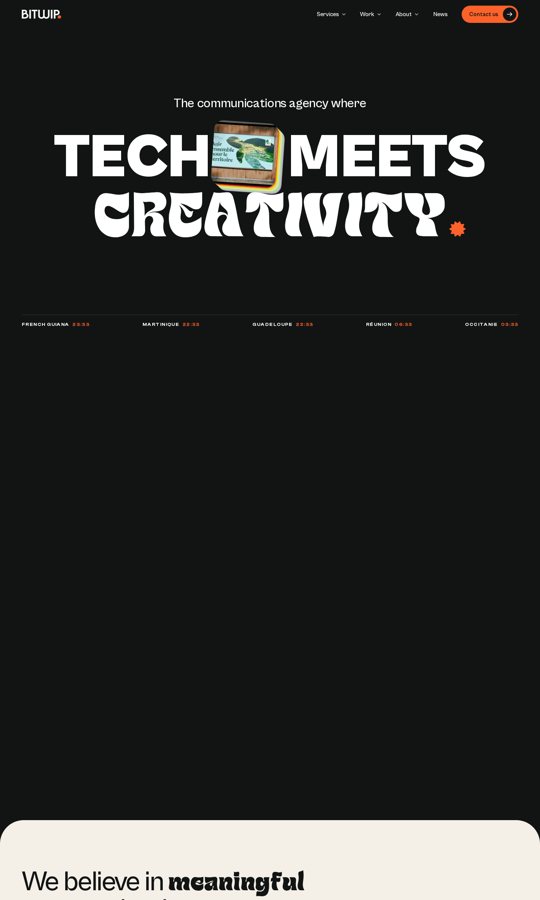
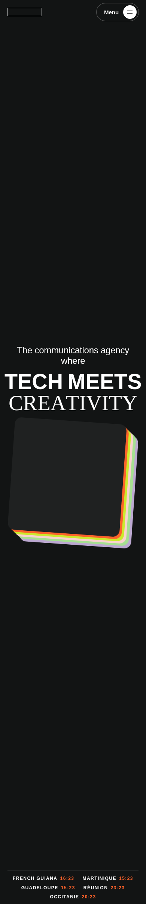

# UI Design System & Master Generation Blueprint: www-bitwip-fr_en

> **Communications consulting agency for Overseas France · Bitwip** (https://www.bitwip.fr/en) — Communications consulting agency in Overseas France and Occitanie: strategy, branding, web and campaigns. French Guiana, Martinique, Guad...



---

## 1. Executive Visual Persona & Design Archetype

- **Brand Essence & Persona**: **Communications consulting agency for Overseas France · Bitwip** (`https://www.bitwip.fr/en`). Communications consulting agency in Overseas France and Occitanie: strategy, branding, web and campaigns. French Guiana, Martinique, Guad...
- **Visual Archetype**: **High-Contrast Obsidian / Atmospheric Design System (`#000` canvas, `#FC622A` ink, `#FC622A` accent)**.
- **Anti-AI-Slop Differentiators**:
  - **Source-Grounded Chromatic Polarity**: Anchors the viewport in `#000` (`var(--noir)` in `:root`) paired with `#FC622A` primary typography and `#FC622A` accents.
  - **Extracted Typographic Hierarchy**: Pairs `Cabinet Grotesk` for display copy (`Bitwip, tech and creative communicat`) with `Clash Display` and `SF Mono`.
  - **Calibrated Spatial Grid & Motion**: Combines `900px` container bounds (`gap: var(--g)`, padding `12px`) with `cubic-bezier(.16,1,.3,1)` easing and Three.js / WebGL Canvas Pipeline.

---

## 2. Spatial Architecture & Modular Grid Mathematics



### Viewport Allocation & Container Geometry
- **Captured Viewport Dimensions**: Desktop `1440×12242px` (`assets/desktop.png`, full-page scroll capture), Mobile `390×2400px` (`assets/mobile.png`, capped at 2400px multi-section capture).
- **Master Container Bounds**: `900px` extracted from `www-bitwip-fr_en` stylesheet.
- **Canvas Lateral Padding & Spacing**: `12px` lateral canvas padding with `var(--g)` grid gap.
- **Border Radius Scale**: `6px`, `var(--pill)`, `50%`, `var(--r)`.

### Responsive Breakpoint Architecture
- **Desktop Layout**: Multi-column CSS Grid / Flexbox layout at `1440px` (`max-width: 900px`, `gap: var(--g)`).
- **Mobile Layout**: Single-column vertical stack at `390px` viewport width with `12px` horizontal padding.
- **Extracted CSS Media Queries**: `@media (max-width:900px)`, `@media (max-width:760px)`, `@media (max-width:340px)`, `@media (prefers-reduced-motion:no-preference)`.

---

## 3. Color System, Materiality & Atmospheric Lighting

### Semantic Palette & Source Grounding
| Semantic Role | Ground-Truth Value | Extracted CSS Source / Selector |
|---|---|---|
| **Primary Canvas Substrate** | `#000` | `var(--noir)` in `:root` |
| **Primary Typography Ink** | `#0B0B0B` | `var(--ink)` in `:root` |
| **Elevated Surface / Card Substrate** | `#141414` | `var(--ink-2)` in `:root` |
| **Interactive Accent / Highlight** | `#FC622A` | `var(--papaye)` in `:root` |
| **Secondary / Muted Copy** | `#EE5520` | `var(--papaye-titre)` in `:root` |
| **Structural Hairline Border** | `#B23C0B` | `var(--papaye-ink)` in `:root` |
| **Variable Token (`--papier`)** | `#F4EFE7` | `var(--papier)` in `:root` |
| **Variable Token (`--papier-2`)** | `#EAE3D8` | `var(--papier-2)` in `:root` |
| **Variable Token (`--blanc`)** | `#FFF` | `var(--blanc)` in `:root` |
| **Variable Token (`--encre`)** | `#121212` | `var(--encre)` in `:root` |

### Sanitized Root CSS Variables (`ui-ux.md` Ground Truth)
| Variable Name | Extracted Value | Semantic Role |
|---|---|---|
| `--noir` | `#000` | Color / Atmospheric Token |
| `--ink` | `#0B0B0B` | Typography Ink Token |
| `--ink-2` | `#141414` | Typography Ink Token |
| `--papaye` | `#FC622A` | Color / Atmospheric Token |
| `--papaye-titre` | `#EE5520` | Color / Atmospheric Token |
| `--papaye-ink` | `#B23C0B` | Typography Ink Token |
| `--etoile-y` | `-.015em` | Dimension / Scale Token |
| `--etoile-h` | `.26em` | Dimension / Scale Token |
| `--etoile-w` | `.28em` | Dimension / Scale Token |
| `--papier` | `#F4EFE7` | Color / Atmospheric Token |
| `--papier-2` | `#EAE3D8` | Color / Atmospheric Token |
| `--blanc` | `#FFF` | Color / Atmospheric Token |
| `--encre` | `#121212` | Color / Atmospheric Token |
| `--txt` | `#FFF` | Color / Atmospheric Token |
| `--txt-2` | `rgba(255,255,255,.74)` | Color / Atmospheric Token |
| `--txt-3` | `rgba(255,255,255,.54)` | Color / Atmospheric Token |

---

## 4. Typographic Scale & Editorial Hierarchy

### Font Family Stacks
- **Display Typography**: `Cabinet Grotesk`.
- **Primary Body Stack**: `Clash Display`.
- **Technical / Metadata Stack**: `SF Mono`.

### Typographic Scale & Rules (Extracted from Stylesheet & Variables)
- **Hero Display (`H1`)**: CSS variables `--t-h1: clamp(2.75rem,1.6rem + 4.6vw,6rem)`.
- **Section Heading (`H2`)**: CSS variables `--t-h2: clamp(2.375rem,1.55rem + 3.4vw,5rem)`; rule `h2` (`font-size: var(--t-h3)`, `line-height: 1.12`, `letter-spacing: -.025em`, `font-weight: 500`).
- **Body Copy**: CSS variables `--t-body: clamp(1.0625rem,1rem + .2vw,1.1875rem)`; rule `p` (`font-size: clamp(1.625rem,.9rem + 1.6vw,...`, `line-height: 1.16`, `letter-spacing: -.03em`).
- **Metadata & Navigation Labels**: CSS variables `--f-label: "Clash Display","Cabinet Grotesk","Helvetica Neue",Arial,sans-serif`, `--t-small: .9375rem`, `--t-label: .75rem`; rule `.label` (`font-size: .6875rem`).

---

## 5. Choreographed Motion & Interaction Physics

### Primary Easing Curves
- **Extracted Timing Functions**: `cubic-bezier(.16,1,.3,1)`, `cubic-bezier(.65,0,.35,1)`, `cubic-bezier(.22,1,.36,1)`.

### Per-Element Transition & Choreography Rules
- **Selector `.skip`**: `transition: top .2s` extracted from `www-bitwip-fr_en` stylesheet.
- **Selector `.sw__in .etoile)`**: `transition: none` extracted from `www-bitwip-fr_en` stylesheet.
- **Selector `.forme--fin`**: `transition: rotate .9s var(--ease)` extracted from `www-bitwip-fr_en` stylesheet.
- **Extracted Easing Curve (`cubic-bezier(.16,1,.3,1)`)**: Governs interactive state transitions across `<header.nav>` and `<section.sec>`.
- **Runtime Interaction Engine**: Integrates Three.js / WebGL Canvas Pipeline with `prefers-reduced-motion: reduce` fallback guards.

---

## 6. Component Wireframe & Structural DOM Map

### Visual Layout Schematic (Grounded in `dom.html` — `1440px` Desktop & `390px` Mobile Reflow)
```
┌────────────────────────────────────────────────────────────────────────┐
│ DESKTOP VIEWPORT (1440px) — Communications consulting agency for Overs │
│ ====================================================================== │
│ [ <header.nav>             | Services · All our services · Work · V ]  │
│ ---------------------------------------------------------------------- │
│ | HERO STAGE: <section.hh>                                         |   │
│ | H1: Bitwip, tech and creative communications agency T...         |   │
│ | Substrate: #000       | Ink: #FC622A    | Accent: #FC622A        |   │
│ ---------------------------------------------------------------------- │
│ | SHOWCASE GRID (<section.sec>             ) max-w: 900px          |   │
│ | +------------------------------+  +------------------------------+ | │
│ | | We believe in meaningful com |  | Our services                 | | │
│ | +------------------------------+  +------------------------------+ | │
│ ---------------------------------------------------------------------- │
│ | MOBILE VIEWPORT REFLOW (390px) — Single-Column Stack (gap: var(--) | │
│ | [<header.nav>] -> [<section.hh>] -> [<section.sec>] |                │
│ ---------------------------------------------------------------------- │
│ [ FOOTER (<footer.pied>         ) | https://www.bitwip.fr/en           │
└────────────────────────────────────────────────────────────────────────┘
```

### Granular DOM Region Breakdown
1. **Brand Header & Navigation Bar (<header.nav> — `www-bitwip-fr_en`)**:
   - Landmark `<header class="nav nav--allegee">` hosting `Communications consulting agency for` navigation (`Services · All our services · Work · View all work · Culture & tourism`), DOM attributes (`data-gdifilm="direct"`, `data-page="accueil"`, `data-variante="allegee"`, `data-entree`), and stylesheet rule `root { --gc-x:0px }`.
2. **Hero Stage & Focal Lead (<section.hh> — `Bitwip, tech and creative communic`)**:
   - Landmark `<section class="hh mj">` presenting display lead `Bitwip, tech and creative communications agency T...` and copy excerpt *"Four disciplines, one team"* over `#000` canvas and `#FC622A` ink.
3. **Primary Showcase & Content Grid (<section.sec> — `We believe in meaningful communica`)**:
   - Landmark `<section class="sec papier">` rendering section `We believe in meaningful communication` with copy *"Strategy & consulting Give your communications a clear structure"*, asset references (`mesure.js`, `consentement.js`, `favicon-b-fond-noir.webp`, `CabinetGrotesk-900.woff2`), and grid rule `after { box-sizing:border-box }`.
4. **Interactive Detail & Feature Matrix (<section.sec> — `Our services`)**:
   - Landmark `<section class="sec">` framing `Our services` and `Strategy & consulting` (*"Strategy & consulting"*) with `#141414` surface cards, `#FC622A` accents, and `html { -webkit-text-size-adjust:100%;text-size-adjust:100%;scroll-padding-top:1... }`.
5. **Colophon & Global Directory Footer (<footer.pied> — `https://www.bitwip.fr/en`)**:
   - Landmark `<footer class="pied">` anchoring `Communications consulting agency` footer links (`Services · All our services · Work · View all work · Culture & tourism`), copy *"Give your communications a clear structure"*, and `#B23C0B` structural dividers.

---

## 7. Master Zero-Shot AI Generation Prompt

```markdown
# Master Zero-Shot Frontend Generation Prompt: www-bitwip-fr_en (Communications consulting agency for Overseas France · Bitwip)

You are a principal frontend architect and design systems engineer. Build a complete, production-ready web application replicating the exact design system, DOM landmarks, typographic hierarchy, color tokens, and motion physics of `www-bitwip-fr_en` (**Communications consulting agency for Overseas France · Bitwip** — `https://www.bitwip.fr/en`).

### 1. Visual Archetype & Anti-AI-Slop Mandates
- **Archetype**: High-Contrast Obsidian / Atmospheric Design System (`#000` canvas, `#FC622A` ink, `#FC622A` accent).
- **Identity & Domain Context**: Communications consulting agency in Overseas France and Occitanie: strategy, branding, web and campaigns. French Guiana, Martinique, Guad...
- **Primary Substrate**: `#000` (`var(--noir)` in `:root`), **Primary Ink**: `#FC622A`, **Accent / Highlight**: `#FC622A`.
- **Site-Specific Differentiators**:
  - **Source-Grounded Chromatic Polarity**: Anchors the viewport in `#000` (`var(--noir)` in `:root`) paired with `#FC622A` primary typography and `#FC622A` accents.
  - **Extracted Typographic Hierarchy**: Pairs `Cabinet Grotesk` for display copy (`Bitwip, tech and creative communicat`) with `Clash Display` and `SF Mono`.
  - **Calibrated Spatial Grid & Motion**: Combines `900px` container bounds (`gap: var(--g)`, padding `12px`) with `cubic-bezier(.16,1,.3,1)` easing and Three.js / WebGL Canvas Pipeline.

### 2. Ground-Truth CSS Variables (`:root` Token Contract)
Declare and consume these exact custom properties extracted from `www-bitwip-fr_en` in your global stylesheet:

:root {
  /* Communications consulting agency for Overseas France · Bitwip (www-bitwip-fr_en) — Ground-Truth Extracted CSS Variables */
  --noir: #000; /* Color / Atmospheric Token (www-bitwip-fr_en) */
  --ink: #0B0B0B; /* Typography Ink Token (www-bitwip-fr_en) */
  --ink-2: #141414; /* Typography Ink Token (www-bitwip-fr_en) */
  --papaye: #FC622A; /* Color / Atmospheric Token (www-bitwip-fr_en) */
  --papaye-titre: #EE5520; /* Color / Atmospheric Token (www-bitwip-fr_en) */
  --papaye-ink: #B23C0B; /* Typography Ink Token (www-bitwip-fr_en) */
  --etoile-y: -.015em; /* Dimension / Scale Token (www-bitwip-fr_en) */
  --etoile-h: .26em; /* Dimension / Scale Token (www-bitwip-fr_en) */
  --etoile-w: .28em; /* Dimension / Scale Token (www-bitwip-fr_en) */
  --papier: #F4EFE7; /* Color / Atmospheric Token (www-bitwip-fr_en) */
  --papier-2: #EAE3D8; /* Color / Atmospheric Token (www-bitwip-fr_en) */
  --blanc: #FFF; /* Color / Atmospheric Token (www-bitwip-fr_en) */
  --encre: #121212; /* Color / Atmospheric Token (www-bitwip-fr_en) */
  --txt: #FFF; /* Color / Atmospheric Token (www-bitwip-fr_en) */
  --txt-2: rgba(255,255,255,.74); /* Color / Atmospheric Token (www-bitwip-fr_en) */
  --txt-3: rgba(255,255,255,.54); /* Color / Atmospheric Token (www-bitwip-fr_en) */
}

### 3. Semantic Color & Materiality Contract
Map every surface, ink, and border strictly to these source-grounded tokens:
- **Primary Canvas Substrate**: `#000` — grounded in `var(--noir)` in `:root`
- **Primary Typography Ink**: `#0B0B0B` — grounded in `var(--ink)` in `:root`
- **Elevated Surface / Card Substrate**: `#141414` — grounded in `var(--ink-2)` in `:root`
- **Interactive Accent / Highlight**: `#FC622A` — grounded in `var(--papaye)` in `:root`
- **Secondary / Muted Copy**: `#EE5520` — grounded in `var(--papaye-titre)` in `:root`
- **Structural Hairline Border**: `#B23C0B` — grounded in `var(--papaye-ink)` in `:root`
- **Variable Token (`--papier`)**: `#F4EFE7` — grounded in `var(--papier)` in `:root`
- **Variable Token (`--papier-2`)**: `#EAE3D8` — grounded in `var(--papier-2)` in `:root`
- **Variable Token (`--blanc`)**: `#FFF` — grounded in `var(--blanc)` in `:root`
- **Variable Token (`--encre`)**: `#121212` — grounded in `var(--encre)` in `:root`

### 4. Spatial Grid, Container Bounds & Responsive Breakpoints
- **Desktop Viewport Reference**: `1440×12242px` (full-page scroll capture, `1440px` standard desktop width).
- **Mobile Viewport Reference**: `390×2400px` (capped at 2400px multi-section capture, `390px` standard mobile width).
- **Container Max-Width**: `900px` extracted from `www-bitwip-fr_en` stylesheet
- **Padding & Gutters**: `12px` lateral canvas padding with `var(--g)` grid gap
- **Desktop Grid**: Multi-column CSS Grid / Flexbox layout at `1440px` (`max-width: 900px`, `gap: var(--g)`)
- **Mobile Adaptation**: Single-column vertical stack at `390px` viewport width with `12px` horizontal padding
- **Media Queries**: `@media (max-width:900px)`, `@media (max-width:760px)`, `@media (max-width:340px)`, `@media (prefers-reduced-motion:no-preference)`
- **Corner Radii**: `6px`, `var(--pill)`, `50%`, `var(--r)`

### 5. Typography & Editorial Scale Contract
- **Display Font Stack**: `Cabinet Grotesk`
- **Body Font Stack**: `Clash Display`
- **Monospace / Technical Font Stack**: `SF Mono`
- **H1 Display Rule**: CSS variables `--t-h1: clamp(2.75rem,1.6rem + 4.6vw,6rem)`
- **H2 Section Rule**: CSS variables `--t-h2: clamp(2.375rem,1.55rem + 3.4vw,5rem)`; rule `h2` (`font-size: var(--t-h3)`, `line-height: 1.12`, `letter-spacing: -.025em`, `font-weight: 500`)
- **Body Copy Rule**: CSS variables `--t-body: clamp(1.0625rem,1rem + .2vw,1.1875rem)`; rule `p` (`font-size: clamp(1.625rem,.9rem + 1.6vw,...`, `line-height: 1.16`, `letter-spacing: -.03em`)
- **Metadata & Index Rule**: CSS variables `--f-label: "Clash Display","Cabinet Grotesk","Helvetica Neue",Arial,sans-serif`, `--t-small: .9375rem`, `--t-label: .75rem`; rule `.label` (`font-size: .6875rem`)

### 6. Component Hierarchy, Verbatim Copy & Real DOM Landmarks
Scaffold `www-bitwip-fr_en` (`Communications consulting agency for Overseas France · Bitwip`) with these exact structural regions, extracted copy, and CSS rules from `dom.html`:
1. **Brand Header & Navigation Bar (<header.nav> — `www-bitwip-fr_en`)**:
   - DOM & Selectors: Landmark `<header class="nav nav--allegee">` hosting `Communications consulting agency for` navigation (`Services · All our services · Work · View all work · Culture & tourism`), DOM attributes (`data-gdifilm="direct"`, `data-page="accueil"`, `data-variante="allegee"`, `data-entree`), and stylesheet rule `root { --gc-x:0px }`.
   - Responsive Contract: Header `Brand Header & Navigation Bar (<header.nav> — `www-bitwip-fr_en`)` (`www-bitwip-fr_en`) adapts across `@media (max-width:900px)`, `@media (max-width:760px)`, `@media (max-width:340px)`, `@media (prefers-reduced-motion:no-preference)` with `cubic-bezier(.16,1,.3,1)`, `cubic-bezier(.65,0,.35,1)`, `cubic-bezier(.22,1,.36,1)` transitions and links `Services · All our services · Work · View all work · Culture & tourism`.
2. **Hero Stage & Focal Lead (<section.hh> — `Bitwip, tech and creative communic`)**:
   - DOM & Selectors: Landmark `<section class="hh mj">` presenting display lead `Bitwip, tech and creative communications agency T...` and copy excerpt *"Four disciplines, one team"* over `#000` canvas and `#FC622A` ink.
   - Responsive Contract: Hero stage (`1440×12242px` desktop / `390×2400px` mobile) sets `#000` background with `#FC622A` headline `Bitwip, tech and creative communications agency T...`.
3. **Primary Showcase & Content Grid (<section.sec> — `We believe in meaningful communica`)**:
   - DOM & Selectors: Landmark `<section class="sec papier">` rendering section `We believe in meaningful communication` with copy *"Strategy & consulting Give your communications a clear structure"*, asset references (`mesure.js`, `consentement.js`, `favicon-b-fond-noir.webp`, `CabinetGrotesk-900.woff2`), and grid rule `after { box-sizing:border-box }`.
   - Responsive Contract: Showcase grid `Primary Showcase & Content Grid (<section.sec> — `We believe in meaningful communica`)` applies Multi-column CSS Grid / Flexbox layout at `1440px` (`max-width: 900px`, `gap: var(--g)`) on desktop and Single-column vertical stack at `390px` viewport width with `12px` horizontal padding on mobile.
4. **Interactive Detail & Feature Matrix (<section.sec> — `Our services`)**:
   - DOM & Selectors: Landmark `<section class="sec">` framing `Our services` and `Strategy & consulting` (*"Strategy & consulting"*) with `#141414` surface cards, `#FC622A` accents, and `html { -webkit-text-size-adjust:100%;text-size-adjust:100%;scroll-padding-top:1... }`.
   - Responsive Contract: Detail module `Interactive Detail & Feature Matrix (<section.sec> — `Our services`)` uses `6px`, `var(--pill)`, `50%`, `var(--r)` radii, `#FC622A` highlights, and assets (mesure.js, consentement.js, favicon-b-fond-noir.webp).
5. **Colophon & Global Directory Footer (<footer.pied> — `https://www.bitwip.fr/en`)**:
   - DOM & Selectors: Landmark `<footer class="pied">` anchoring `Communications consulting agency` footer links (`Services · All our services · Work · View all work · Culture & tourism`), copy *"Give your communications a clear structure"*, and `#B23C0B` structural dividers.
   - Responsive Contract: Footer `Colophon & Global Directory Footer (<footer.pied> — `https://www.bitwip.fr/en`)` aligns to `900px` extracted from `www-bitwip-fr_en` stylesheet with `12px` lateral canvas padding with `var(--g)` grid gap and attributes (data-gdifilm="direct", data-page="accueil", data-variante="allegee").

#### Verbatim DOM Copy Excerpts (`dom.html`)
- Copy Excerpt 1: *"Four disciplines, one team"*
- Copy Excerpt 2: *"Strategy & consulting Give your communications a clear structure"*
- Copy Excerpt 3: *"Strategy & consulting"*
- Copy Excerpt 4: *"Give your communications a clear structure"*

### 7. Motion, Extracted Stylesheet Rules & Interaction Choreography
- **Primary Easing Functions**: `cubic-bezier(.16,1,.3,1)`, `cubic-bezier(.65,0,.35,1)`, `cubic-bezier(.22,1,.36,1)`
- **Extracted Stylesheet Rules (`www-bitwip-fr_en`)**:
- `root { --gc-x:0px }`
- `after { box-sizing:border-box }`
- `html { -webkit-text-size-adjust:100%;text-size-adjust:100%;scroll-padding-top:1... }`
- `html.is-geste:root { scroll-behavior:smooth }`
- `main { background:var(--noir) }`
- **Per-Selector Transition Rules**:
- **Selector `.skip`**: `transition: top .2s` extracted from `www-bitwip-fr_en` stylesheet.
- **Selector `.sw__in .etoile)`**: `transition: none` extracted from `www-bitwip-fr_en` stylesheet.
- **Selector `.forme--fin`**: `transition: rotate .9s var(--ease)` extracted from `www-bitwip-fr_en` stylesheet.
- **Extracted Easing Curve (`cubic-bezier(.16,1,.3,1)`)**: Governs interactive state transitions across `<header.nav>` and `<section.sec>`.
- **Runtime Interaction Engine**: Integrates Three.js / WebGL Canvas Pipeline with `prefers-reduced-motion: reduce` fallback guards.

### 8. Technical Deliverables
- Implement in Next.js (App Router) with TypeScript and Tailwind CSS consuming the `:root` custom properties defined above for `www-bitwip-fr_en`.
- Reproduce both the `1440px` desktop architecture and `390px` mobile breakpoint transitions, preserving semantic HTML5 landmarks (`<header>`, `<nav>`, `<main>`, `<section>`, `<footer>`) and `prefers-reduced-motion` accessibility guards.
```
