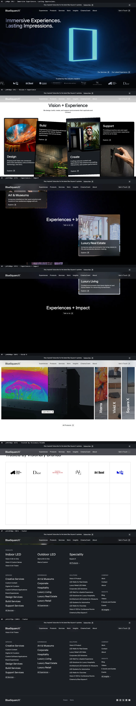
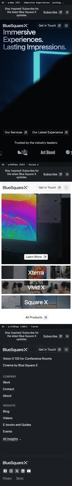

# UI Design System & Master Generation Blueprint: www-bluesqx-com

> **Blue Square X – Premium LED Displays & Immersive Digital Experiences** (https://www.bluesqx.com/) — We design and deliver high-end LED display systems and immersive digital experiences for luxury brands, retail spaces, and iconic environ...





---

## 1. Executive Visual Persona & Design Archetype

- **Brand Essence & Persona**: **Blue Square X – Premium LED Displays & Immersive Digital Experiences** (`https://www.bluesqx.com/`). We design and deliver high-end LED display systems and immersive digital experiences for luxury brands, retail spaces, and iconic environ...
- **Capture Provenance**: Live browser capture (`tier1_fast`, HTTP `200`, captured `2026-11-24`).
- **Visual Archetype**: **Light-Gallery WebGL / Canvas Interactive Experience (`#ffffff` / `#0000ff`)**.
- **Anti-AI-Slop Differentiators**:
  - **Live-Computed Chromatic Polarity**: Anchors the viewport in `#ffffff` (live computed `body` `background-color` (`computed_styles.json`)) paired with `#1b1e24` primary typography and `#0000ff` accents.
  - **Grounded Typographic Hierarchy**: Uses `Beausite Classic` across display (`Immersive Experiences. Lasting Impre`) and body copy, paired with `Fira Sans` for monospace/code.
  - **Calibrated Spatial Grid & Motion**: Combines `86rem` container bounds (`gap: 16px`, padding `9px`) with `cubic-bezier(.165,.84,.44,1)` easing and Lenis Smooth Scroll (`data-lenis`), GSAP Timeline & ScrollTrigger.

---

## 2. Spatial Architecture & Modular Grid Mathematics

### Viewport Allocation & Container Geometry
- **Captured Journey Filmstrips**: Desktop `1280×6624px` (`assets/desktop-journey.webp`, `8` keyframes up to `y=11277px` / doc `12177px`), Mobile `390×2616px` (`assets/mobile-journey.webp`, `3` keyframes).
- **Master Container Bounds**: `86rem` (non-`@media` desktop container stylesheet rule).
- **Canvas Lateral Padding & Spacing**: `9px` lateral canvas padding with `16px` grid gap.
- **Border Radius Scale**: `8px`, `4px`, `3px`, `100%`.

### Responsive Breakpoint Architecture
- **Desktop Layout**: Multi-column CSS Grid / Flexbox layout at `1440px` (`max-width: 86rem`, `gap: 16px`).
- **Mobile Layout**: Single-column vertical stack at `390px` viewport width with `9px` horizontal padding.
- **Extracted CSS Media Queries**: `@media screen and (max-width:991px)`, `@media screen and (max-width:767px)`, `@media screen and (max-width:479px)`, `@media (min-width:768px)`.

---

## 3. Color System, Materiality & Atmospheric Lighting

### Semantic Palette & Source Grounding
| Semantic Role | Ground-Truth Value | Extracted Live / CSS Source |
|---|---|---|
| **Primary Canvas Substrate** | `#ffffff` | live computed `body` `background-color` (`computed_styles.json`) |
| **Primary Typography Ink** | `#1b1e24` | live computed `h1` `color` (`computed_styles.json`) |
| **Elevated Surface / Card Substrate** | `#ffff00` | `mark { background: #ffff00 }` |
| **Interactive Accent / Highlight** | `#0000ff` | `.button.is-alternate.is-form:hover { color: blue }` (`#0000ff`) |
| **Secondary / Muted Copy** | `#fd7070` | `.news-category { color: #fd7070 }` |
| **Structural Hairline Border** | `#e2e2e2` | `blockquote { border-left: #e2e2e2 }` |
| **Variable Token (`--_primitives---colors--neutral`)** | `#7d8086` | `var(--_primitives---colors--neutral)` in `:root` |
| **Variable Token (`--_primitives---opacity--transparent`)** | `#fff0` | `var(--_primitives---opacity--transparent)` in `:root` |

### Sanitized Root CSS Variables (`ui-ux.md` Ground Truth)
| Variable Name | Extracted Value | Semantic Role |
|---|---|---|
| `--_primitives---colors--white` | `#fff` | Canvas / Surface Token |
| `--_typography---font-styles--body` | `"Beausite Classic",Arial,sans-serif` | Typography / Scale Token |
| `--_primitives---colors--neutral-darkest` | `#1b1e24` | Canvas / Surface Token |
| `--_typography---font-styles--heading` | `"Beausite Classic",Arial,sans-serif` | Typography Ink Token |
| `--outline-button--text` | `var(--_primitives---colors--neutral-darkest)` | Typography Ink Token |
| `--header--link-color-hover` | `var(--_primitives---colors--blue-accent)` | Typography Ink Token |
| `--_primitives---colors--neutral` | `#7d8086` | Brand / Palette Token |
| `--_primitives---colors--neutral-darker` | `#1b1e24` | Canvas / Surface Token |
| `--_ui-styles---radius--xxsmall` | `.125rem` | Elevation / Border Token |
| `--button--border` | `var(--_primitives---colors--neutral-darkest)` | Elevation / Border Token |
| `--button--background` | `var(--_primitives---colors--neutral-darkest)` | Canvas / Surface Token |
| `--button--text` | `var(--_primitives---colors--white)` | Typography Ink Token |
| `--_primitives---opacity--transparent` | `#fff0` | Color / Atmospheric Token |
| `--_primitives---opacity--neutral-darkest-15` | `#1b1e2426` | Canvas / Surface Token |
| `--outline-button--border` | `var(--_primitives---opacity--neutral-darkest-15)` | Elevation / Border Token |
| `--outline-button--background` | `var(--_primitives---opacity--transparent)` | Canvas / Surface Token |

---

## 4. Typographic Scale & Editorial Hierarchy

### Font Family Stacks
- **Display Typography**: `Beausite Classic`.
- **Primary Body Stack**: `Beausite Classic`.
- **Technical / Metadata Stack**: `Fira Sans`.

### Typographic Scale & Rules (Live Computed & Stylesheet Grounded)
- **Hero Display (`H1`)**: live computed `h1` (`font-size: 56px`, `line-height: 56px`, `font-weight: 500`, `letter-spacing: -2px`).
- **Section Heading (`H2`)**: live computed `h2` (`font-size: 56px`, `line-height: 56px`, `font-weight: 500`, `letter-spacing: -2px`); rule `h2` (`letter-spacing: -.125rem`).
- **Body Copy**: live computed `body` (`font-size: 16px`, `line-height: 20px`, `font-weight: 400`); CSS variables `--_typography---font-styles--body: "Beausite Classic",Arial,sans-serif`.
- **Metadata & Navigation Labels**: live computed `nav/a` (`font-size: 16px`, `line-height: 20px`, `font-weight: 400`); CSS variables `--_ui-styles---radius--xxsmall: .125rem`, `--_ui-styles---radius--small: .25rem`; rule `.label` (`font-size: 0.75rem`, `font-weight: 400`).

---

## 5. Choreographed Motion & Interaction Physics

### Primary Easing Curves
- **Extracted Timing Functions**: `cubic-bezier(.165,.84,.44,1)`, `cubic-bezier(.55,.055,.675,.19)`, `cubic-bezier(.215,.61,.355,1)`.

### Per-Element Transition & Choreography Rules
- **Selector `.w-webflow-badge>img`**: `transition: unset` extracted from `www-bluesqx-com` stylesheet.
- **Selector `.w-slider-dot`**: `transition: background-color .1s,color .1s` extracted from `www-bluesqx-com` stylesheet.
- **Selector `.w-lightbox-control`**: `transition: all .3s` extracted from `www-bluesqx-com` stylesheet.
- **Extracted Easing Curve (`cubic-bezier(.165,.84,.44,1)`)**: Governs interactive state transitions across `<nav.navbar_menu>` and `<section.section_header>`.
- **Runtime Interaction Engine**: Integrates Lenis Smooth Scroll (`data-lenis`), GSAP Timeline & ScrollTrigger, Three.js / WebGL Canvas Pipeline with `prefers-reduced-motion: reduce` fallback guards.
### Measured Runtime Scroll & Interaction Telemetry (`behavioral_journey_v2`)
- **Scroll Driver Mode**: `native` (max document height `12177px`, deepest scrollY reached `11277px` across `8` desktop keyframes).
- **Detected Scroll / Motion Libraries**: `Lenis`, `GSAP/ScrollTrigger`, `WebGL/Canvas`.
- **Hover Physics (`primary_cta` · `Get in Touch`)**: `backgroundColor`: `rgba(255, 255, 255, 0)` -> `rgb(255, 255, 255)` (`transition-duration: 0s`, `timing: ease`).
- **Interactive Control Probe (`tab` · `Gaylord`)**: Triggered visual diff `47.795` (attr `false -> true`, captured in `assets/state-interactive.webp`).
- **Route Transition Architecture**: First internal navigation (`/work`) measured as `MPA` in `2245ms`.

---

## 6. Component Wireframe & Structural DOM Map

### Visual Layout Schematic — Desktop (`1440px`, Grounded in `dom.html` & Landmark Bounding Boxes)
```
┌────────────────────────────────────────────────────────────────────────┐
│ DESKTOP VIEWPORT (1440px) — Blue Square X – Premium LED Displays & Imm │
│ ====================================================================== │
│ [ <nav.navbar_menu> (636x35px)        | Art & Museums · Corporate ·  ] │
│ ---------------------------------------------------------------------- │
│ | HERO STAGE: <section.banner_component> (w=1440px)                  | │
│ | H1: Immersive Experiences. Lasting Impressions.                    | │
│ | Substrate: #ffffff | Ink: #1b1e24 | Accent: #0000ff                | │
│ ---------------------------------------------------------------------- │
│ | SHOWCASE GRID (<section.section_header>) max-w: 86rem              | │
│ | +------------------------------+  +------------------------------+ | │
│ | | Build Your Immersive Experie |  | Discover LED Indoor and Outd | | │
│ | +------------------------------+  +------------------------------+ | │
│ ---------------------------------------------------------------------- │
│ | DETAIL MODULE (<section.section_services-) — Vision + Experience   | │
│ ---------------------------------------------------------------------- │
│ [ FOOTER (<footer.footer>     ) | https://www.bluesqx.com/             │
└────────────────────────────────────────────────────────────────────────┘
```

### Visual Layout Schematic — Mobile Reflow (`390px`)
```
┌────────────────────────────────────────────────────────────────────────┐
│ MOBILE VIEWPORT REFLOW (390px) — Single-Column Stack (gap: 16px)       │
│ ====================================================================== │
│ [ HEADER BAR (<nav.navbar_menu>       ) | Compact Menu (390px)         │
│ ---------------------------------------------------------------------- │
│ | HERO STAGE (<section.banner_componen) — 390px Vertical Lead        | │
│ | H1: Immersive Experiences. Lasting Impressions.                    | │
│ ---------------------------------------------------------------------- │
│ | SHOWCASE STACK (<section.section_heade) — 1-Col Stack              | │
│ | [ Item 1: Build Your Immersive Experiences                       ] | │
│ | [ Item 2: Discover LED Indoor and Outdoor Products               ] | │
│ ---------------------------------------------------------------------- │
│ | DETAIL STACK (<section.section_service) — 1-Col (Vision + Experienc) │
│ ---------------------------------------------------------------------- │
│ [ FOOTER (<footer.footer>     ) | Stacked 390px Colophon               │
└────────────────────────────────────────────────────────────────────────┘
```

### Granular DOM Region Breakdown
1. **Brand Header & Navigation Bar (<nav.navbar_menu> — `www-bluesqx-com`)**:
   - Landmark `<nav class="navbar_menu w-nav-menu">` (`636x35px`) hosting `Blue Square X – Premium LED Displays` navigation (`Art & Museums · Corporate · Hospitality · Luxury Living · Luxury Real Estate`), DOM attributes (`data-wf-domain="www.bluesqx.com"`, `data-wf-page="69272aa8c1734eeb3d97ece3"`, `data-wf-site="69272aa5c1734eeb3d97e49c"`, `data-lenis-prevent="true"`), and stylesheet rule `html { -webkit-text-size-adjust:100%;-ms-text-size-adjust:100%;font-family:sans... }`.
2. **Hero Stage & Focal Lead (<section.banner_component> — `Immersive Experiences. Lasting Imp`)**:
   - Landmark `<section class="banner_component dark">` presenting display lead `Immersive Experiences. Lasting Impressions.` and copy excerpt *"Stay Inspired! Subscribe for the latest Blue Square X updates."* over `#ffffff` canvas and `#1b1e24` ink.
3. **Primary Showcase & Content Grid (<section.section_header> — `Build Your Immersive Experiences`)**:
   - Landmark `<section class="section_header dark">` rendering section `Build Your Immersive Experiences` with copy *"Trusted by the industry leaders:"*, asset references (`cdn.prod.website-files.com`, `bluesquarex.webflow.shared.3fa960...`, `data.js`, `recaptcha__en.js`), and grid rule `summary { display:block }`.
4. **Interactive Detail & Feature Matrix (<section.section_services-cards> — `Discover LED Indoor and Outdoor Pr`)**:
   - Landmark `<section class="section_services-cards base">` framing `Discover LED Indoor and Outdoor Products` and `Vision + Experience` (*"We design, build, create, and support environments that captivate"*) with `#ffff00` surface cards, `#0000ff` accents, and `video { vertical-align:baseline;display:inline-block }`.
5. **Colophon & Global Directory Footer (<footer.footer> — `https://www.bluesqx.com/`)**:
   - Landmark `<footer class="footer dark">` anchoring `Blue Square X – Premium LED Disp` footer links (`Art & Museums · Corporate · Hospitality · Luxury Living · Luxury Real Estate`), copy *"Shaping bold ideas into immersive plans that seamlessly unit"*, and `#e2e2e2` structural dividers.
### Full Vertical Scroll Sequence (Desktop `1440×900` Keyframes)
- **Step 01** (`y=0px`, `0%`): Active landmark `Immersive Experiences. Lasting Impressions.` · sticky/fixed elements: `1`
- **Step 02** (`y=850px`, `8%`): Active landmark `Vision + Experience` · sticky/fixed elements: `1`
- **Step 03** (`y=2550px`, `23%`): Active landmark `Experiences + Impact` · sticky/fixed elements: `1`
- **Step 04** (`y=5100px`, `45%`): Active landmark `Experiences + Impact` · sticky/fixed elements: `1`
- **Step 05** (`y=6800px`, `60%`): Active landmark `Vivid X` · sticky/fixed elements: `1`
- **Step 06** (`y=9350px`, `83%`): Active landmark `Trusted by Visionary Brands` · sticky/fixed elements: `1`
- **Step 07** (`y=11050px`, `98%`): Active landmark `Footer` · sticky/fixed elements: `1`
- **Step 08** (`y=11277px`, `100%`): Active landmark `Footer` · sticky/fixed elements: `1`

### Multi-Page Internal Route Map
- **Listing Route (`/work`)**: `https://www.bluesqx.com/work` — H1: `Created to Captivate, Designed to Immerse, and Bu...`, scrollHeight `3506px`, transition `MPA` (`2245ms`)
- **Detail Route (`/events/vision-x-cinema-private-demo`)**: `https://www.bluesqx.com/events/vision-x-cinema-private-demo` — H1: `Experience Private Cinema at Its Finest.`, scrollHeight `4367px`, transition `direct` (`1974ms`)
- **About Route (`/about`)**: `https://www.bluesqx.com/about` — H1: `Where Stories Become Experiences`, scrollHeight `11172px`, transition `direct` (`1578ms`)

---

## 7. Master Zero-Shot AI Generation Prompt

```markdown
# Master Zero-Shot Frontend Generation Prompt: www-bluesqx-com (Blue Square X – Premium LED Displays & Immersive Digital Experiences)

You are a principal frontend architect and design systems engineer. Build a complete, production-ready web application replicating the exact design system, DOM landmarks, typographic hierarchy, color tokens, and motion physics of `www-bluesqx-com` (**Blue Square X – Premium LED Displays & Immersive Digital Experiences** — `https://www.bluesqx.com/`).

### 1. Visual Archetype & Anti-AI-Slop Mandates
- **Archetype**: Light-Gallery WebGL / Canvas Interactive Experience (`#ffffff` / `#0000ff`).
- **Identity & Domain Context**: We design and deliver high-end LED display systems and immersive digital experiences for luxury brands, retail spaces, and iconic environ...
- **Primary Substrate**: `#ffffff` (live computed `body` `background-color` (`computed_styles.json`)), **Primary Ink**: `#1b1e24`, **Accent / Highlight**: `#0000ff`.
- **Site-Specific Differentiators**:
  - **Live-Computed Chromatic Polarity**: Anchors the viewport in `#ffffff` (live computed `body` `background-color` (`computed_styles.json`)) paired with `#1b1e24` primary typography and `#0000ff` accents.
  - **Grounded Typographic Hierarchy**: Uses `Beausite Classic` across display (`Immersive Experiences. Lasting Impre`) and body copy, paired with `Fira Sans` for monospace/code.
  - **Calibrated Spatial Grid & Motion**: Combines `86rem` container bounds (`gap: 16px`, padding `9px`) with `cubic-bezier(.165,.84,.44,1)` easing and Lenis Smooth Scroll (`data-lenis`), GSAP Timeline & ScrollTrigger.

### 2. Ground-Truth CSS Variables (`:root` Token Contract)
Declare and consume these exact custom properties extracted from `www-bluesqx-com` in your global stylesheet:

:root {
  /* Blue Square X – Premium LED Displays & Immersive Digital Experiences (www-bluesqx-com) — Live-Grounded CSS Variables */
  --_primitives---colors--white: #fff; /* Canvas / Surface Token (www-bluesqx-com) */
  --_typography---font-styles--body: "Beausite Classic",Arial,sans-serif; /* Typography / Scale Token (www-bluesqx-com) */
  --_primitives---colors--neutral-darkest: #1b1e24; /* Canvas / Surface Token (www-bluesqx-com) */
  --_typography---font-styles--heading: "Beausite Classic",Arial,sans-serif; /* Typography Ink Token (www-bluesqx-com) */
  --outline-button--text: var(--_primitives---colors--neutral-darkest); /* Typography Ink Token (www-bluesqx-com) */
  --header--link-color-hover: var(--_primitives---colors--blue-accent); /* Typography Ink Token (www-bluesqx-com) */
  --_primitives---colors--neutral: #7d8086; /* Brand / Palette Token (www-bluesqx-com) */
  --_primitives---colors--neutral-darker: #1b1e24; /* Canvas / Surface Token (www-bluesqx-com) */
  --_ui-styles---radius--xxsmall: .125rem; /* Elevation / Border Token (www-bluesqx-com) */
  --button--border: var(--_primitives---colors--neutral-darkest); /* Elevation / Border Token (www-bluesqx-com) */
  --button--background: var(--_primitives---colors--neutral-darkest); /* Canvas / Surface Token (www-bluesqx-com) */
  --button--text: var(--_primitives---colors--white); /* Typography Ink Token (www-bluesqx-com) */
  --_primitives---opacity--transparent: #fff0; /* Color / Atmospheric Token (www-bluesqx-com) */
  --_primitives---opacity--neutral-darkest-15: #1b1e2426; /* Canvas / Surface Token (www-bluesqx-com) */
  --outline-button--border: var(--_primitives---opacity--neutral-darkest-15); /* Elevation / Border Token (www-bluesqx-com) */
  --outline-button--background: var(--_primitives---opacity--transparent); /* Canvas / Surface Token (www-bluesqx-com) */
}

### 3. Semantic Color & Materiality Contract
Map every surface, ink, and border strictly to these source-grounded tokens:
- **Primary Canvas Substrate**: `#ffffff` — grounded in live computed `body` `background-color` (`computed_styles.json`)
- **Primary Typography Ink**: `#1b1e24` — grounded in live computed `h1` `color` (`computed_styles.json`)
- **Elevated Surface / Card Substrate**: `#ffff00` — grounded in `mark { background: #ffff00 }`
- **Interactive Accent / Highlight**: `#0000ff` — grounded in `.button.is-alternate.is-form:hover { color: blue }` (`#0000ff`)
- **Secondary / Muted Copy**: `#fd7070` — grounded in `.news-category { color: #fd7070 }`
- **Structural Hairline Border**: `#e2e2e2` — grounded in `blockquote { border-left: #e2e2e2 }`
- **Variable Token (`--_primitives---colors--neutral`)**: `#7d8086` — grounded in `var(--_primitives---colors--neutral)` in `:root`
- **Variable Token (`--_primitives---opacity--transparent`)**: `#fff0` — grounded in `var(--_primitives---opacity--transparent)` in `:root`

### 4. Spatial Grid, Container Bounds & Responsive Breakpoints
- **Desktop Viewport Reference**: `1280×6624px` (multi-frame vertical journey filmstrip (6624px), `1440px` standard desktop width).
- **Mobile Viewport Reference**: `390×2616px` (multi-frame vertical journey filmstrip (2616px), `390px` standard mobile width).
- **Container Max-Width**: `86rem` (non-`@media` desktop container stylesheet rule)
- **Padding & Gutters**: `9px` lateral canvas padding with `16px` grid gap
- **Desktop Grid**: Multi-column CSS Grid / Flexbox layout at `1440px` (`max-width: 86rem`, `gap: 16px`)
- **Mobile Adaptation**: Single-column vertical stack at `390px` viewport width with `9px` horizontal padding
- **Media Queries**: `@media screen and (max-width:991px)`, `@media screen and (max-width:767px)`, `@media screen and (max-width:479px)`, `@media (min-width:768px)`
- **Corner Radii**: `8px`, `4px`, `3px`, `100%`

### 5. Typography & Editorial Scale Contract
- **Display Font Stack**: `Beausite Classic`
- **Body Font Stack**: `Beausite Classic`
- **Monospace / Technical Font Stack**: `Fira Sans`
- **H1 Display Rule**: live computed `h1` (`font-size: 56px`, `line-height: 56px`, `font-weight: 500`, `letter-spacing: -2px`)
- **H2 Section Rule**: live computed `h2` (`font-size: 56px`, `line-height: 56px`, `font-weight: 500`, `letter-spacing: -2px`); rule `h2` (`letter-spacing: -.125rem`)
- **Body Copy Rule**: live computed `body` (`font-size: 16px`, `line-height: 20px`, `font-weight: 400`); CSS variables `--_typography---font-styles--body: "Beausite Classic",Arial,sans-serif`
- **Metadata & Index Rule**: live computed `nav/a` (`font-size: 16px`, `line-height: 20px`, `font-weight: 400`); CSS variables `--_ui-styles---radius--xxsmall: .125rem`, `--_ui-styles---radius--small: .25rem`; rule `.label` (`font-size: 0.75rem`, `font-weight: 400`)

### 6. Component Hierarchy, Verbatim Copy & Real DOM Landmarks
Scaffold `www-bluesqx-com` (`Blue Square X – Premium LED Displays & Immersive Digital Experiences`) with these exact structural regions, extracted copy, and CSS rules from `dom.html`:
1. **Brand Header & Navigation Bar (<nav.navbar_menu> — `www-bluesqx-com`)**:
   - DOM & Selectors: Landmark `<nav class="navbar_menu w-nav-menu">` (`636x35px`) hosting `Blue Square X – Premium LED Displays` navigation (`Art & Museums · Corporate · Hospitality · Luxury Living · Luxury Real Estate`), DOM attributes (`data-wf-domain="www.bluesqx.com"`, `data-wf-page="69272aa8c1734eeb3d97ece3"`, `data-wf-site="69272aa5c1734eeb3d97e49c"`, `data-lenis-prevent="true"`), and stylesheet rule `html { -webkit-text-size-adjust:100%;-ms-text-size-adjust:100%;font-family:sans... }`.
   - Responsive Contract: Header `Brand Header & Navigation Bar (<nav.navbar_menu> — `www-bluesqx-com`)` (`www-bluesqx-com`) adapts across `@media screen and (max-width:991px)`, `@media screen and (max-width:767px)`, `@media screen and (max-width:479px)`, `@media (min-width:768px)` with `cubic-bezier(.165,.84,.44,1)`, `cubic-bezier(.55,.055,.675,.19)`, `cubic-bezier(.215,.61,.355,1)` transitions and links `Art & Museums · Corporate · Hospitality · Luxury Living · Luxury Real Estate`.
2. **Hero Stage & Focal Lead (<section.banner_component> — `Immersive Experiences. Lasting Imp`)**:
   - DOM & Selectors: Landmark `<section class="banner_component dark">` presenting display lead `Immersive Experiences. Lasting Impressions.` and copy excerpt *"Stay Inspired! Subscribe for the latest Blue Square X updates."* over `#ffffff` canvas and `#1b1e24` ink.
   - Responsive Contract: Hero stage (`1280×6624px` desktop / `390×2616px` mobile) sets `#ffffff` background with `#1b1e24` headline `Immersive Experiences. Lasting Impressions.`.
3. **Primary Showcase & Content Grid (<section.section_header> — `Build Your Immersive Experiences`)**:
   - DOM & Selectors: Landmark `<section class="section_header dark">` rendering section `Build Your Immersive Experiences` with copy *"Trusted by the industry leaders:"*, asset references (`cdn.prod.website-files.com`, `bluesquarex.webflow.shared.3fa960...`, `data.js`, `recaptcha__en.js`), and grid rule `summary { display:block }`.
   - Responsive Contract: Showcase grid `Primary Showcase & Content Grid (<section.section_header> — `Build Your Immersive Experiences`)` applies Multi-column CSS Grid / Flexbox layout at `1440px` (`max-width: 86rem`, `gap: 16px`) on desktop and Single-column vertical stack at `390px` viewport width with `9px` horizontal padding on mobile.
4. **Interactive Detail & Feature Matrix (<section.section_services-cards> — `Discover LED Indoor and Outdoor Pr`)**:
   - DOM & Selectors: Landmark `<section class="section_services-cards base">` framing `Discover LED Indoor and Outdoor Products` and `Vision + Experience` (*"We design, build, create, and support environments that captivate"*) with `#ffff00` surface cards, `#0000ff` accents, and `video { vertical-align:baseline;display:inline-block }`.
   - Responsive Contract: Detail module `Interactive Detail & Feature Matrix (<section.section_services-cards> — `Discover LED Indoor and Outdoor Pr`)` uses `8px`, `4px`, `3px`, `100%` radii, `#0000ff` highlights, and assets (cdn.prod.website-files.com, bluesquarex.webflow.shared.3fa960..., data.js).
5. **Colophon & Global Directory Footer (<footer.footer> — `https://www.bluesqx.com/`)**:
   - DOM & Selectors: Landmark `<footer class="footer dark">` anchoring `Blue Square X – Premium LED Disp` footer links (`Art & Museums · Corporate · Hospitality · Luxury Living · Luxury Real Estate`), copy *"Shaping bold ideas into immersive plans that seamlessly unit"*, and `#e2e2e2` structural dividers.
   - Responsive Contract: Footer `Colophon & Global Directory Footer (<footer.footer> — `https://www.bluesqx.com/`)` aligns to `86rem` (non-`@media` desktop container stylesheet rule) with `9px` lateral canvas padding with `16px` grid gap and attributes (data-wf-domain="www.bluesqx.com", data-wf-page="69272aa8c1734eeb3d97ece3", data-wf-site="69272aa5c1734eeb3d97e49c").

#### Verbatim DOM Copy Excerpts (`dom.html`)
- Copy Excerpt 1: *"Stay Inspired! Subscribe for the latest Blue Square X updates."*
- Copy Excerpt 2: *"Trusted by the industry leaders:"*
- Copy Excerpt 3: *"We design, build, create, and support environments that captivate and connect."*
- Copy Excerpt 4: *"Shaping bold ideas into immersive plans that seamlessly unite architecture, techno..."*

### 7. Motion, Extracted Stylesheet Rules & Interaction Choreography
- **Primary Easing Functions**: `cubic-bezier(.165,.84,.44,1)`, `cubic-bezier(.55,.055,.675,.19)`, `cubic-bezier(.215,.61,.355,1)`
- **Extracted Stylesheet Rules (`www-bluesqx-com`)**:
- `html { -webkit-text-size-adjust:100%;-ms-text-size-adjust:100%;font-family:sans... }`
- `summary { display:block }`
- `video { vertical-align:baseline;display:inline-block }`
- `template { display:none }`
- `strong { font-weight:700 }`
- **Per-Selector Transition Rules**:
- **Selector `.w-webflow-badge>img`**: `transition: unset` extracted from `www-bluesqx-com` stylesheet.
- **Selector `.w-slider-dot`**: `transition: background-color .1s,color .1s` extracted from `www-bluesqx-com` stylesheet.
- **Selector `.w-lightbox-control`**: `transition: all .3s` extracted from `www-bluesqx-com` stylesheet.
- **Extracted Easing Curve (`cubic-bezier(.165,.84,.44,1)`)**: Governs interactive state transitions across `<nav.navbar_menu>` and `<section.section_header>`.
- **Runtime Interaction Engine**: Integrates Lenis Smooth Scroll (`data-lenis`), GSAP Timeline & ScrollTrigger, Three.js / WebGL Canvas Pipeline with `prefers-reduced-motion: reduce` fallback guards.
### 7b. Full-Page Scroll Choreography, Interactive States & Multi-Page Routes
- **Scroll Mechanics**: Implement `native` vertical progression up to `12177px` across 8 distinct viewport chapters using Lenis, GSAP/ScrollTrigger, WebGL/Canvas.
- **Vertical Chapter Sequence**: Immersive Experiences. Last... (0%) -> Vision + Experience (8%) -> Experiences + Impact (23%) -> Experiences + Impact (45%) -> Vivid X (60%) -> Trusted by Visionary Brands (83%) -> Footer (98%) -> Footer (100%).
- **Hover Micro-Interaction (`primary_cta`)**: Animate `backgroundColor` with `0s ease`.
- **Multi-Page Routes**: Scaffold internal routes `/work` (listing, MPA), `/events/vision-x-cinema-private-demo` (detail, direct), `/about` (about, direct) sharing the global header/footer shell and design tokens.

### 8. Technical Deliverables
- Implement in Next.js (App Router) with TypeScript and Tailwind CSS consuming the `:root` custom properties defined above for `www-bluesqx-com`.
- Reproduce both the `1440px` desktop architecture and `390px` mobile breakpoint transitions, preserving semantic HTML5 landmarks (`<header>`, `<nav>`, `<main>`, `<section>`, `<footer>`) and `prefers-reduced-motion` accessibility guards.
```
---

## 8. Full-Page Scroll Journey, Interactive States & Subpage Inventory

### Desktop Scroll Keyframes (`1440×900` WebP)
| Step | Scroll Y | Progress | Active Landmark / Section | Sticky/Fixed | Visual Asset |
| :---: | :---: | :---: | :--- | :---: | :--- |
| `#01` | `0px` | `0%` | Immersive Experiences. Lasting Impressions. | `1` | [desktop-step-01.webp](assets/desktop-step-01.webp) |
| `#02` | `850px` | `8%` | Vision + Experience | `1` | [desktop-step-02.webp](assets/desktop-step-02.webp) |
| `#03` | `2550px` | `23%` | Experiences + Impact | `1` | [desktop-step-03.webp](assets/desktop-step-03.webp) |
| `#04` | `5100px` | `45%` | Experiences + Impact | `1` | [desktop-step-04.webp](assets/desktop-step-04.webp) |
| `#05` | `6800px` | `60%` | Vivid X | `1` | [desktop-step-05.webp](assets/desktop-step-05.webp) |
| `#06` | `9350px` | `83%` | Trusted by Visionary Brands | `1` | [desktop-step-06.webp](assets/desktop-step-06.webp) |
| `#07` | `11050px` | `98%` | Footer | `1` | [desktop-step-07.webp](assets/desktop-step-07.webp) |
| `#08` | `11277px` | `100%` | Footer | `1` | [desktop-step-08.webp](assets/desktop-step-08.webp) |

### Mobile Condensed Keyframes (`390×844` WebP)
| Step | Scroll Y | Progress | Active Landmark | Visual Asset |
| :---: | :---: | :---: | :--- | :--- |
| `#01` | `0px` | `0%` | Immersive Experiences. Lasting Impressions. | [mobile-step-01.webp](assets/mobile-step-01.webp) |
| `#02` | `6997px` | `50%` | Vision X | [mobile-step-02.webp](assets/mobile-step-02.webp) |
| `#03` | `13995px` | `100%` | Footer | [mobile-step-03.webp](assets/mobile-step-03.webp) |

### Interactive UI State Captures (`1440×900` WebP)
| State Type | Trigger / Observation | Visual Asset |
| :--- | :--- | :--- |
| `interactive_control` | Control `tab` (`Gaylord`, diff `47.795`) | [state-interactive.webp](assets/state-interactive.webp) |

### Internal Subpage Filmstrips (`1080px` Wide WebP)
| # | Template | Route URL | H1 / Title | Scroll Height | Transition | Filmstrip Asset |
| :-: | :---: | :--- | :--- | :---: | :---: | :--- |
| `1` | `listing` | `https://www.bluesqx.com/work` | Created to Captivate, Designed to Imm... | `3506px` | `MPA` (`2245ms`) | [subpage-01-work.webp](assets/subpage-01-work.webp) |
| `2` | `detail` | `https://www.bluesqx.com/events/vision-x-cinema-private-demo` | Experience Private Cinema at Its Finest. | `4367px` | `direct` (`1974ms`) | [subpage-02-events-vision-x-cinema-private-demo.webp](assets/subpage-02-events-vision-x-cinema-private-demo.webp) |
| `3` | `about` | `https://www.bluesqx.com/about` | Where Stories Become Experiences | `11172px` | `direct` (`1578ms`) | [subpage-03-about.webp](assets/subpage-03-about.webp) |

