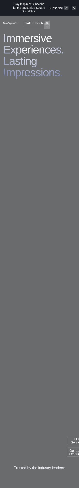

# UI Design System & Master Generation Blueprint: www-bluesqx-com

> **Blue Square X – Premium LED Displays & Immersive Digital Experiences** (https://www.bluesqx.com/) — We design and deliver high-end LED display systems and immersive digital experiences for luxury brands, retail spaces, and iconic environ...


---

## 1. Executive Visual Persona & Design Archetype

- **Brand Essence & Persona**: **Blue Square X – Premium LED Displays & Immersive Digital Experiences** (`https://www.bluesqx.com/`). We design and deliver high-end LED display systems and immersive digital experiences for luxury brands, retail spaces, and iconic environ...
- **Visual Archetype**: **Light-Gallery WebGL / Canvas Interactive Experience (`#fff` / `#fff0`)**.
- **Anti-AI-Slop Differentiators**:
  - **Source-Grounded Chromatic Polarity**: Anchors the viewport in `#fff` (`var(--_primitives---colors--white)` in `:root`) paired with `#1b1e24` primary typography and `#fff0` accents.
  - **Extracted Typographic Hierarchy**: Pairs `Beausite Classic` for display copy (`Let’s Be in Touch`) with `Arial` and not declared in static CSS (uses primary stack / `ui-monospace`).
  - **Calibrated Spatial Grid & Motion**: Combines `940px` container bounds (`gap: 16px`, padding `9px`) with `cubic-bezier(.165,.84,.44,1)` easing and Lenis Smooth Scroll (`data-lenis`), GSAP Timeline & ScrollTrigger.

---

## 2. Spatial Architecture & Modular Grid Mathematics



### Viewport Allocation & Container Geometry
- **Captured Viewport Dimensions**: Desktop `1440×11949px` (`assets/desktop.png`, full-page scroll capture), Mobile `390×2400px` (`assets/mobile.png`, capped at 2400px multi-section capture).
- **Master Container Bounds**: `940px` extracted from `www-bluesqx-com` stylesheet.
- **Canvas Lateral Padding & Spacing**: `9px` lateral canvas padding with `16px` grid gap.
- **Border Radius Scale**: `3px`, `100%`, `50%`, `2px`.

### Responsive Breakpoint Architecture
- **Desktop Layout**: Multi-column CSS Grid / Flexbox layout at `1440px` (`max-width: 940px`, `gap: 16px`).
- **Mobile Layout**: Single-column vertical stack at `390px` viewport width with `9px` horizontal padding.
- **Extracted CSS Media Queries**: `@media screen and (max-width:991px)`, `@media screen and (max-width:767px)`, `@media screen and (max-width:479px)`, `@media (min-width:768px)`.

---

## 3. Color System, Materiality & Atmospheric Lighting

### Semantic Palette & Source Grounding
| Semantic Role | Ground-Truth Value | Extracted CSS Source / Selector |
|---|---|---|
| **Primary Canvas Substrate** | `#fff` | `var(--_primitives---colors--white)` in `:root` |
| **Primary Typography Ink** | `#1b1e24` | `var(--_primitives---colors--neutral-darkest)` in `:root` |
| **Elevated Surface / Card Substrate** | `#7d8086` | `var(--_primitives---colors--neutral)` in `:root` |
| **Interactive Accent / Highlight** | `#fff0` | `var(--_primitives---opacity--transparent)` in `:root` |
| **Secondary / Muted Copy** | `#fff3` | `var(--_primitives---opacity--white-20)` in `:root` |
| **Structural Hairline Border** | `#0229d5` | `var(--_primitives---colors--blue-accent)` in `:root` |
| **Variable Token (`--_primitives---opacity--neutral-darkest-15`)** | `#1b1e2426` | `var(--_primitives---opacity--neutral-darkest-15)` in `:root` |

### Sanitized Root CSS Variables (`ui-ux.md` Ground Truth)
| Variable Name | Extracted Value | Semantic Role |
|---|---|---|
| `--w-backdrop-animation` | `initial` | Motion / Easing Token |
| `--_primitives---colors--white` | `#fff` | Canvas / Surface Token |
| `--_typography---font-styles--body` | `"Beausite Classic",Arial,sans-serif` | Typography / Scale Token |
| `--_primitives---colors--neutral-darkest` | `#1b1e24` | Canvas / Surface Token |
| `--_typography---font-styles--heading` | `"Beausite Classic",Arial,sans-serif` | Typography Ink Token |
| `--outline-button--text` | `var(--_primitives---colors--neutral-darkest)` | Typography Ink Token |
| `--header--link-color-hover` | `var(--_primitives---colors--blue-accent)` | Typography Ink Token |
| `--_primitives---colors--neutral` | `#7d8086` | Brand / Palette Token |
| `--_primitives---colors--neutral-darker` | `#1b1e24` | Canvas / Surface Token |
| `--_ui-styles---radius--xxsmall` | `.125rem` | Elevation / Border Token |
| `--button--border` | `var(--_primitives---colors--neutral-darkest)` | Elevation / Border Token |
| `--button--background` | `var(--_primitives---colors--neutral-darkest)` | Canvas / Surface Token |
| `--button--text` | `var(--_primitives---colors--white)` | Typography Ink Token |
| `--_primitives---opacity--transparent` | `#fff0` | Color / Atmospheric Token |
| `--_primitives---opacity--neutral-darkest-15` | `#1b1e2426` | Canvas / Surface Token |
| `--outline-button--border` | `var(--_primitives---opacity--neutral-darkest-15)` | Elevation / Border Token |

---

## 4. Typographic Scale & Editorial Hierarchy

### Font Family Stacks
- **Display Typography**: `Beausite Classic`.
- **Primary Body Stack**: `Arial`.
- **Technical / Metadata Stack**: not declared in static CSS (uses primary stack / `ui-monospace`).

### Typographic Scale & Rules (Extracted from Stylesheet & Variables)
- **Hero Display (`H1`)**: not explicitly declared on tag in static CSS (stylesheet font-size ladder: `2em`, `80%`, `75%`, `1em`, `14px`).
- **Section Heading (`H2`)**: rule `h2` (`letter-spacing: -.125rem`).
- **Body Copy**: CSS variables `--_typography---font-styles--body: "Beausite Classic",Arial,sans-serif`.
- **Metadata & Navigation Labels**: CSS variables `--_ui-styles---radius--xxsmall: .125rem`, `--_ui-styles---radius--small: .25rem`; rule `.label` (`font-size: 0.75rem`, `font-weight: 400`).

---

## 5. Choreographed Motion & Interaction Physics

### Primary Easing Curves
- **Extracted Timing Functions**: `cubic-bezier(.165,.84,.44,1)`, `cubic-bezier(.55,.055,.675,.19)`, `cubic-bezier(.215,.61,.355,1)`.

### Per-Element Transition & Choreography Rules
- **Selector `.w-webflow-badge>img`**: `transition: unset` extracted from `www-bluesqx-com` stylesheet.
- **Selector `.w-slider-dot`**: `transition: background-color .1s,color .1s` extracted from `www-bluesqx-com` stylesheet.
- **Selector `.w-lightbox-control`**: `transition: all .3s` extracted from `www-bluesqx-com` stylesheet.
- **Extracted Easing Curve (`cubic-bezier(.165,.84,.44,1)`)**: Governs interactive state transitions across `<nav.navbar_menu>` and `<section.section_header>`.
- **Runtime Interaction Engine**: Integrates Lenis Smooth Scroll (`data-lenis`), GSAP Timeline & ScrollTrigger, Three.js / WebGL Canvas Pipeline with `prefers-reduced-motion: reduce` fallback guards.

---

## 6. Component Wireframe & Structural DOM Map

### Visual Layout Schematic (Grounded in `dom.html` — `1440px` Desktop & `390px` Mobile Reflow)
```
┌────────────────────────────────────────────────────────────────────────┐
│ DESKTOP VIEWPORT (1440px) — Blue Square X – Premium LED Displays & Imm │
│ ====================================================================== │
│ [ <nav.navbar_menu>        | Art & Museums · Corporate · Hospitalit ]  │
│ ---------------------------------------------------------------------- │
│ | HERO STAGE: <section.banner_component>                           |   │
│ | H1: Let’s Be in Touch                                            |   │
│ | Substrate: #fff       | Ink: #1b1e24    | Accent: #fff0          |   │
│ ---------------------------------------------------------------------- │
│ | SHOWCASE GRID (<section.section_header>  ) max-w: 940px          |   │
│ | +------------------------------+  +------------------------------+ | │
│ | | Stay Inspired                |  | Build Your Immersive Experie | | │
│ | +------------------------------+  +------------------------------+ | │
│ ---------------------------------------------------------------------- │
│ | MOBILE VIEWPORT REFLOW (390px) — Single-Column Stack (gap: 16px  ) | │
│ | [<nav.navbar_menu>] -> [<section.banner_co] -> [<section.section_h]  │
│ ---------------------------------------------------------------------- │
│ [ FOOTER (<footer.footer>       ) | https://www.bluesqx.com/           │
└────────────────────────────────────────────────────────────────────────┘
```

### Granular DOM Region Breakdown
1. **Brand Header & Navigation Bar (<nav.navbar_menu> — `www-bluesqx-com`)**:
   - Landmark `<nav class="navbar_menu w-nav-menu">` hosting `Blue Square X – Premium LED Displays` navigation (`Art & Museums · Corporate · Hospitality · Luxury Living · Luxury Real Estate`), DOM attributes (`data-wf-domain="www.bluesqx.com"`, `data-wf-page="69272aa8c1734eeb3d97ece3"`, `data-wf-site="69272aa5c1734eeb3d97e49c"`, `data-lenis-prevent="true"`), and stylesheet rule `html { -webkit-text-size-adjust:100%;-ms-text-size-adjust:100%;font-family:sans... }`.
2. **Hero Stage & Focal Lead (<section.banner_component> — `Let’s Be in Touch`)**:
   - Landmark `<section class="banner_component dark">` presenting display lead `Let’s Be in Touch` and copy excerpt *"By submitting this form, you agree to receive promotional emails "* over `#fff` canvas and `#1b1e24` ink.
3. **Primary Showcase & Content Grid (<section.section_header> — `Stay Inspired`)**:
   - Landmark `<section class="section_header dark">` rendering section `Stay Inspired` with copy *"Get the latest insights, projects, and innovations from Blue Squa"*, asset references (`cdn.prod.website-files.com`, `bluesquarex.webflow.shared.e27118...`, `pixel.gif`, `data.js`), and grid rule `summary { display:block }`.
4. **Interactive Detail & Feature Matrix (<section.section_services-cards> — `Build Your Immersive Experiences`)**:
   - Landmark `<section class="section_services-cards base">` framing `Build Your Immersive Experiences` and `Discover LED Indoor and Outdoor Products` (*"Stay Inspired! Subscribe for the latest Blue Square X updates."*) with `#7d8086` surface cards, `#fff0` accents, and `video { vertical-align:baseline;display:inline-block }`.
5. **Colophon & Global Directory Footer (<footer.footer> — `https://www.bluesqx.com/`)**:
   - Landmark `<footer class="footer dark">` anchoring `Blue Square X – Premium LED Disp` footer links (`Art & Museums · Corporate · Hospitality · Luxury Living · Luxury Real Estate`), copy *"Luxury Real Estate"*, and `#0229d5` structural dividers.

---

## 7. Master Zero-Shot AI Generation Prompt

```markdown
# Master Zero-Shot Frontend Generation Prompt: www-bluesqx-com (Blue Square X – Premium LED Displays & Immersive Digital Experiences)

You are a principal frontend architect and design systems engineer. Build a complete, production-ready web application replicating the exact design system, DOM landmarks, typographic hierarchy, color tokens, and motion physics of `www-bluesqx-com` (**Blue Square X – Premium LED Displays & Immersive Digital Experiences** — `https://www.bluesqx.com/`).

### 1. Visual Archetype & Anti-AI-Slop Mandates
- **Archetype**: Light-Gallery WebGL / Canvas Interactive Experience (`#fff` / `#fff0`).
- **Identity & Domain Context**: We design and deliver high-end LED display systems and immersive digital experiences for luxury brands, retail spaces, and iconic environ...
- **Primary Substrate**: `#fff` (`var(--_primitives---colors--white)` in `:root`), **Primary Ink**: `#1b1e24`, **Accent / Highlight**: `#fff0`.
- **Site-Specific Differentiators**:
  - **Source-Grounded Chromatic Polarity**: Anchors the viewport in `#fff` (`var(--_primitives---colors--white)` in `:root`) paired with `#1b1e24` primary typography and `#fff0` accents.
  - **Extracted Typographic Hierarchy**: Pairs `Beausite Classic` for display copy (`Let’s Be in Touch`) with `Arial` and not declared in static CSS (uses primary stack / `ui-monospace`).
  - **Calibrated Spatial Grid & Motion**: Combines `940px` container bounds (`gap: 16px`, padding `9px`) with `cubic-bezier(.165,.84,.44,1)` easing and Lenis Smooth Scroll (`data-lenis`), GSAP Timeline & ScrollTrigger.

### 2. Ground-Truth CSS Variables (`:root` Token Contract)
Declare and consume these exact custom properties extracted from `www-bluesqx-com` in your global stylesheet:

:root {
  /* Blue Square X – Premium LED Displays & Immersive Digital Experiences (www-bluesqx-com) — Ground-Truth Extracted CSS Variables */
  --w-backdrop-animation: initial; /* Motion / Easing Token (www-bluesqx-com) */
  --_primitives---colors--white: #fff; /* Canvas / Surface Token (www-bluesqx-com) */
  --_typography---font-styles--body: "Beausite Classic",Arial,sans-serif; /* Typography / Scale Token (www-bluesqx-com) */
  --_primitives---colors--neutral-darkest: #1b1e24; /* Canvas / Surface Token (www-bluesqx-com) */
  --_typography---font-styles--heading: "Beausite Classic",Arial,sans-serif; /* Typography Ink Token (www-bluesqx-com) */
  --outline-button--text: var(--_primitives---colors--neutral-darkest); /* Typography Ink Token (www-bluesqx-com) */
  --header--link-color-hover: var(--_primitives---colors--blue-accent); /* Typography Ink Token (www-bluesqx-com) */
  --_primitives---colors--neutral: #7d8086; /* Brand / Palette Token (www-bluesqx-com) */
  --_primitives---colors--neutral-darker: #1b1e24; /* Canvas / Surface Token (www-bluesqx-com) */
  --_ui-styles---radius--xxsmall: .125rem; /* Elevation / Border Token (www-bluesqx-com) */
  --button--border: var(--_primitives---colors--neutral-darkest); /* Elevation / Border Token (www-bluesqx-com) */
  --button--background: var(--_primitives---colors--neutral-darkest); /* Canvas / Surface Token (www-bluesqx-com) */
  --button--text: var(--_primitives---colors--white); /* Typography Ink Token (www-bluesqx-com) */
  --_primitives---opacity--transparent: #fff0; /* Color / Atmospheric Token (www-bluesqx-com) */
  --_primitives---opacity--neutral-darkest-15: #1b1e2426; /* Canvas / Surface Token (www-bluesqx-com) */
  --outline-button--border: var(--_primitives---opacity--neutral-darkest-15); /* Elevation / Border Token (www-bluesqx-com) */
}

### 3. Semantic Color & Materiality Contract
Map every surface, ink, and border strictly to these source-grounded tokens:
- **Primary Canvas Substrate**: `#fff` — grounded in `var(--_primitives---colors--white)` in `:root`
- **Primary Typography Ink**: `#1b1e24` — grounded in `var(--_primitives---colors--neutral-darkest)` in `:root`
- **Elevated Surface / Card Substrate**: `#7d8086` — grounded in `var(--_primitives---colors--neutral)` in `:root`
- **Interactive Accent / Highlight**: `#fff0` — grounded in `var(--_primitives---opacity--transparent)` in `:root`
- **Secondary / Muted Copy**: `#fff3` — grounded in `var(--_primitives---opacity--white-20)` in `:root`
- **Structural Hairline Border**: `#0229d5` — grounded in `var(--_primitives---colors--blue-accent)` in `:root`
- **Variable Token (`--_primitives---opacity--neutral-darkest-15`)**: `#1b1e2426` — grounded in `var(--_primitives---opacity--neutral-darkest-15)` in `:root`

### 4. Spatial Grid, Container Bounds & Responsive Breakpoints
- **Desktop Viewport Reference**: `1440×11949px` (full-page scroll capture, `1440px` standard desktop width).
- **Mobile Viewport Reference**: `390×2400px` (capped at 2400px multi-section capture, `390px` standard mobile width).
- **Container Max-Width**: `940px` extracted from `www-bluesqx-com` stylesheet
- **Padding & Gutters**: `9px` lateral canvas padding with `16px` grid gap
- **Desktop Grid**: Multi-column CSS Grid / Flexbox layout at `1440px` (`max-width: 940px`, `gap: 16px`)
- **Mobile Adaptation**: Single-column vertical stack at `390px` viewport width with `9px` horizontal padding
- **Media Queries**: `@media screen and (max-width:991px)`, `@media screen and (max-width:767px)`, `@media screen and (max-width:479px)`, `@media (min-width:768px)`
- **Corner Radii**: `3px`, `100%`, `50%`, `2px`

### 5. Typography & Editorial Scale Contract
- **Display Font Stack**: `Beausite Classic`
- **Body Font Stack**: `Arial`
- **Monospace / Technical Font Stack**: not declared in static CSS (uses primary stack / `ui-monospace`)
- **H1 Display Rule**: not explicitly declared on tag in static CSS (stylesheet font-size ladder: `2em`, `80%`, `75%`, `1em`, `14px`)
- **H2 Section Rule**: rule `h2` (`letter-spacing: -.125rem`)
- **Body Copy Rule**: CSS variables `--_typography---font-styles--body: "Beausite Classic",Arial,sans-serif`
- **Metadata & Index Rule**: CSS variables `--_ui-styles---radius--xxsmall: .125rem`, `--_ui-styles---radius--small: .25rem`; rule `.label` (`font-size: 0.75rem`, `font-weight: 400`)

### 6. Component Hierarchy, Verbatim Copy & Real DOM Landmarks
Scaffold `www-bluesqx-com` (`Blue Square X – Premium LED Displays & Immersive Digital Experiences`) with these exact structural regions, extracted copy, and CSS rules from `dom.html`:
1. **Brand Header & Navigation Bar (<nav.navbar_menu> — `www-bluesqx-com`)**:
   - DOM & Selectors: Landmark `<nav class="navbar_menu w-nav-menu">` hosting `Blue Square X – Premium LED Displays` navigation (`Art & Museums · Corporate · Hospitality · Luxury Living · Luxury Real Estate`), DOM attributes (`data-wf-domain="www.bluesqx.com"`, `data-wf-page="69272aa8c1734eeb3d97ece3"`, `data-wf-site="69272aa5c1734eeb3d97e49c"`, `data-lenis-prevent="true"`), and stylesheet rule `html { -webkit-text-size-adjust:100%;-ms-text-size-adjust:100%;font-family:sans... }`.
   - Responsive Contract: Header `Brand Header & Navigation Bar (<nav.navbar_menu> — `www-bluesqx-com`)` (`www-bluesqx-com`) adapts across `@media screen and (max-width:991px)`, `@media screen and (max-width:767px)`, `@media screen and (max-width:479px)`, `@media (min-width:768px)` with `cubic-bezier(.165,.84,.44,1)`, `cubic-bezier(.55,.055,.675,.19)`, `cubic-bezier(.215,.61,.355,1)` transitions and links `Art & Museums · Corporate · Hospitality · Luxury Living · Luxury Real Estate`.
2. **Hero Stage & Focal Lead (<section.banner_component> — `Let’s Be in Touch`)**:
   - DOM & Selectors: Landmark `<section class="banner_component dark">` presenting display lead `Let’s Be in Touch` and copy excerpt *"By submitting this form, you agree to receive promotional emails "* over `#fff` canvas and `#1b1e24` ink.
   - Responsive Contract: Hero stage (`1440×11949px` desktop / `390×2400px` mobile) sets `#fff` background with `#1b1e24` headline `Let’s Be in Touch`.
3. **Primary Showcase & Content Grid (<section.section_header> — `Stay Inspired`)**:
   - DOM & Selectors: Landmark `<section class="section_header dark">` rendering section `Stay Inspired` with copy *"Get the latest insights, projects, and innovations from Blue Squa"*, asset references (`cdn.prod.website-files.com`, `bluesquarex.webflow.shared.e27118...`, `pixel.gif`, `data.js`), and grid rule `summary { display:block }`.
   - Responsive Contract: Showcase grid `Primary Showcase & Content Grid (<section.section_header> — `Stay Inspired`)` applies Multi-column CSS Grid / Flexbox layout at `1440px` (`max-width: 940px`, `gap: 16px`) on desktop and Single-column vertical stack at `390px` viewport width with `9px` horizontal padding on mobile.
4. **Interactive Detail & Feature Matrix (<section.section_services-cards> — `Build Your Immersive Experiences`)**:
   - DOM & Selectors: Landmark `<section class="section_services-cards base">` framing `Build Your Immersive Experiences` and `Discover LED Indoor and Outdoor Products` (*"Stay Inspired! Subscribe for the latest Blue Square X updates."*) with `#7d8086` surface cards, `#fff0` accents, and `video { vertical-align:baseline;display:inline-block }`.
   - Responsive Contract: Detail module `Interactive Detail & Feature Matrix (<section.section_services-cards> — `Build Your Immersive Experiences`)` uses `3px`, `100%`, `50%`, `2px` radii, `#fff0` highlights, and assets (cdn.prod.website-files.com, bluesquarex.webflow.shared.e27118..., pixel.gif).
5. **Colophon & Global Directory Footer (<footer.footer> — `https://www.bluesqx.com/`)**:
   - DOM & Selectors: Landmark `<footer class="footer dark">` anchoring `Blue Square X – Premium LED Disp` footer links (`Art & Museums · Corporate · Hospitality · Luxury Living · Luxury Real Estate`), copy *"Luxury Real Estate"*, and `#0229d5` structural dividers.
   - Responsive Contract: Footer `Colophon & Global Directory Footer (<footer.footer> — `https://www.bluesqx.com/`)` aligns to `940px` extracted from `www-bluesqx-com` stylesheet with `9px` lateral canvas padding with `16px` grid gap and attributes (data-wf-domain="www.bluesqx.com", data-wf-page="69272aa8c1734eeb3d97ece3", data-wf-site="69272aa5c1734eeb3d97e49c").

#### Verbatim DOM Copy Excerpts (`dom.html`)
- Copy Excerpt 1: *"By submitting this form, you agree to receive promotional emails from Blue Square..."*
- Copy Excerpt 2: *"Get the latest insights, projects, and innovations from Blue Square X straight to..."*
- Copy Excerpt 3: *"Stay Inspired! Subscribe for the latest Blue Square X updates."*
- Copy Excerpt 4: *"Luxury Real Estate"*

### 7. Motion, Extracted Stylesheet Rules & Interaction Choreography
- **Primary Easing Functions**: `cubic-bezier(.165,.84,.44,1)`, `cubic-bezier(.55,.055,.675,.19)`, `cubic-bezier(.215,.61,.355,1)`
- **Extracted Stylesheet Rules (`www-bluesqx-com`)**:
- `html { -webkit-text-size-adjust:100%;-ms-text-size-adjust:100%;font-family:sans... }`
- `summary { display:block }`
- `video { vertical-align:baseline;display:inline-block }`
- `template { display:none }`
- `strong { font-weight:700 }`
- **Per-Selector Transition Rules**:
- **Selector `.w-webflow-badge>img`**: `transition: unset` extracted from `www-bluesqx-com` stylesheet.
- **Selector `.w-slider-dot`**: `transition: background-color .1s,color .1s` extracted from `www-bluesqx-com` stylesheet.
- **Selector `.w-lightbox-control`**: `transition: all .3s` extracted from `www-bluesqx-com` stylesheet.
- **Extracted Easing Curve (`cubic-bezier(.165,.84,.44,1)`)**: Governs interactive state transitions across `<nav.navbar_menu>` and `<section.section_header>`.
- **Runtime Interaction Engine**: Integrates Lenis Smooth Scroll (`data-lenis`), GSAP Timeline & ScrollTrigger, Three.js / WebGL Canvas Pipeline with `prefers-reduced-motion: reduce` fallback guards.

### 8. Technical Deliverables
- Implement in Next.js (App Router) with TypeScript and Tailwind CSS consuming the `:root` custom properties defined above for `www-bluesqx-com`.
- Reproduce both the `1440px` desktop architecture and `390px` mobile breakpoint transitions, preserving semantic HTML5 landmarks (`<header>`, `<nav>`, `<main>`, `<section>`, `<footer>`) and `prefers-reduced-motion` accessibility guards.
```
