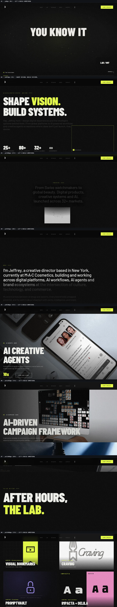
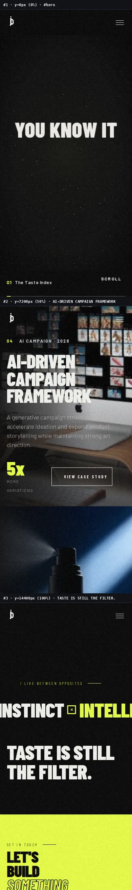

# UI Design System & Master Generation Blueprint: www-blumjeffrey-com

> **Jeffrey Blum — AI Digital Creative Director** (https://www.blumjeffrey.com) — Jeffrey Blum is a New York-based AI Digital Creative Director building creative systems, intelligent workflows, brand platforms, and digi...





---

## 1. Executive Visual Persona & Design Archetype

- **Brand Essence & Persona**: **Jeffrey Blum — AI Digital Creative Director** (`https://www.blumjeffrey.com`). Jeffrey Blum is a New York-based AI Digital Creative Director building creative systems, intelligent workflows, brand platforms, and digi...
- **Final Redirected URL**: [https://blumjeffrey.com/](https://blumjeffrey.com/)
- **Capture Provenance**: Live browser capture (`tier1_fast`, HTTP `200`, captured `2026-11-24`).
- **Visual Archetype**: **High-Contrast Obsidian / Atmospheric Design System (`#080808` canvas, `#f5f5f0` ink, `#378ef0` accent)**.
- **Anti-AI-Slop Differentiators**:
  - **Live-Computed Chromatic Polarity**: Anchors the viewport in `#080808` (live computed `body` `background-color` (`computed_styles.json`)) paired with `#f5f5f0` primary typography and `#378ef0` accents.
  - **Grounded Typographic Hierarchy**: Pairs `Barlow Condensed` for display copy (`SHAPE VISION. BUILD SYSTEMS.`) with `Barlow` and `JetBrains Mono`.
  - **Calibrated Spatial Grid & Motion**: Combines `1320px` container bounds (`gap: 32px`, padding `48px`) with `cubic-bezier(.16,1,.3,1)` easing and Lenis Smooth Scroll (`data-lenis`), GSAP Timeline & ScrollTrigger.

---

## 2. Spatial Architecture & Modular Grid Mathematics

### Viewport Allocation & Container Geometry
- **Captured Journey Filmstrips**: Desktop `1280×6624px` (`assets/desktop-journey.webp`, `8` keyframes up to `y=14400px` / doc `20823px`), Mobile `390×2616px` (`assets/mobile-journey.webp`, `3` keyframes).
- **Master Container Bounds**: `1320px` (non-`@media` desktop container stylesheet rule).
- **Canvas Lateral Padding & Spacing**: `48px` lateral canvas padding with `32px` grid gap.
- **Border Radius Scale**: `50%`.

### Responsive Breakpoint Architecture
- **Desktop Layout**: Multi-column CSS Grid / Flexbox layout at `1440px` (`max-width: 1320px`, `gap: 32px`).
- **Mobile Layout**: Single-column vertical stack at `390px` viewport width with `48px` horizontal padding.
- **Extracted CSS Media Queries**: `@media (max-width:1024px)`, `@media (max-width:640px)`, `@media (prefers-reduced-motion:reduce)`, `@media (min-width:1024px)`.

---

## 3. Color System, Materiality & Atmospheric Lighting

### Semantic Palette & Source Grounding
| Semantic Role | Ground-Truth Value | Extracted Live / CSS Source |
|---|---|---|
| **Primary Canvas Substrate** | `#080808` | live computed `body` `background-color` (`computed_styles.json`) |
| **Primary Typography Ink** | `#f5f5f0` | live computed `h1` `color` (`computed_styles.json`) |
| **Elevated Surface / Card Substrate** | `#070707` | live computed `section` `background-color` (`computed_styles.json`) |
| **Interactive Accent / Highlight** | `#378ef0` | `.home-v2 .damBtn { background: #378ef0 }` |
| **Secondary / Muted Copy** | `#888888` | live computed `button` `color` (`computed_styles.json`) |
| **Structural Hairline Border** | `#2a2a2a` | `var(--border)` in `:root` |

### Sanitized Root CSS Variables (`ui-ux.md` Ground Truth)
| Variable Name | Extracted Value | Semantic Role |
|---|---|---|
| `--motion-instant` | `.12s` | Motion / Easing Token |
| `--motion-fast` | `.2s` | Motion / Easing Token |
| `--motion-medium` | `.3s` | Motion / Easing Token |
| `--motion-slow` | `.4s` | Motion / Easing Token |
| `--motion-reveal` | `.8s` | Motion / Easing Token |
| `--motion-hero` | `.9s` | Motion / Easing Token |
| `--motion-counter` | `1.1s` | Motion / Easing Token |
| `--motion-marquee` | `28s` | Motion / Easing Token |
| `--ease-standard` | `ease` | Motion / Easing Token |
| `--ease-linear` | `linear` | Motion / Easing Token |
| `--ease-pulse` | `ease-in-out` | Motion / Easing Token |
| `--ease-expressive` | `cubic-bezier(.16,1,.3,1)` | Motion / Easing Token |
| `--motion-shift-xs` | `4px` | Motion / Easing Token |
| `--motion-shift-sm` | `8px` | Motion / Easing Token |
| `--motion-shift-md` | `20px` | Motion / Easing Token |
| `--motion-shift-lg` | `32px` | Motion / Easing Token |

---

## 4. Typographic Scale & Editorial Hierarchy

### Font Family Stacks
- **Display Typography**: `Barlow Condensed`.
- **Primary Body Stack**: `Barlow`.
- **Technical / Metadata Stack**: `JetBrains Mono`.

### Typographic Scale & Rules (Live Computed & Stylesheet Grounded)
- **Hero Display (`H1`)**: live computed `h1` (`font-size: 138.24px`, `line-height: 121.651px`, `font-weight: 900`, `letter-spacing: -2.7648px`); rule `h1` (`font-size: clamp(64px,9.6vw,180px)`).
- **Section Heading (`H2`)**: live computed `h2` (`font-size: 158.4px`, `line-height: 139.392px`, `font-weight: 900`, `letter-spacing: -3.168px`); rule `h2` (`font-size: clamp(64px,9vw,170px)`).
- **Body Copy**: live computed `body` (`font-size: 16px`, `line-height: 25.6px`, `font-weight: 300`); rule `p` (`font-size: clamp(2rem,4vw,4rem)`, `line-height: .9`, `font-weight: 900`).
- **Metadata & Navigation Labels**: live computed `nav/a` (`font-size: 16px`, `line-height: 25.6px`, `font-weight: 300`); CSS variables `--mono: "JetBrains Mono",ui-monospace,monospace`, `--ho-mono: "Barlow",sans-serif`; rule `small` (`font-size: .6rem`, `letter-spacing: .22em`, `font-weight: 600`).

---

## 5. Choreographed Motion & Interaction Physics

### Primary Easing Curves
- **Extracted Timing Functions**: `cubic-bezier(.16,1,.3,1)`, `cubic-bezier(.3,1.35,.5,1)`, `cubic-bezier(.3,0,0,1)`.

### Per-Element Transition & Choreography Rules
- **Selector `.cursor-ring`**: `transition: width .3s,height .3s,background .3s,border-color .3s,opacity ....` extracted from `www-blumjeffrey-com` stylesheet.
- **Selector `nav`**: `transition: all .4s` extracted from `www-blumjeffrey-com` stylesheet.
- **Selector `nav.ho-idx`**: `transition: none` extracted from `www-blumjeffrey-com` stylesheet.
- **Extracted Easing Curve (`cubic-bezier(.16,1,.3,1)`)**: Governs interactive state transitions across `<header.cs-hero>` and `<section.home-v2>`.
- **Runtime Interaction Engine**: Integrates Lenis Smooth Scroll (`data-lenis`), GSAP Timeline & ScrollTrigger with `prefers-reduced-motion: reduce` fallback guards.
### Measured Runtime Scroll & Interaction Telemetry (`behavioral_journey_v2`)
- **Scroll Driver Mode**: `native` (max document height `20823px`, deepest scrollY reached `14400px` across `8` desktop keyframes).
- **Detected Scroll / Motion Libraries**: `Lenis`.
- **Hover Physics (`primary_cta` · `SEND MESSAGE →`)**: Computed transition `0.3s` / `cubic-bezier(0.16, 1, 0.3, 1)` (no static color/transform shift captured at rest).
- **Route Transition Architecture**: First internal navigation (`/work`) measured as `MPA` in `1425ms`.

---

## 6. Component Wireframe & Structural DOM Map

### Visual Layout Schematic — Desktop (`1440px`, Grounded in `dom.html` & Landmark Bounding Boxes)
```
┌────────────────────────────────────────────────────────────────────────┐
│ DESKTOP VIEWPORT (1440px) — Jeffrey Blum — AI Digital Creative Directo │
│ ====================================================================== │
│ [ <header.cs-hero> (1440px)           | Work · Lab · Speaking · Abou ] │
│ ---------------------------------------------------------------------- │
│ | HERO STAGE: <section.home> (w=1440px)                              | │
│ | H1: SHAPE VISION. BUILD SYSTEMS.                                   | │
│ | Substrate: #080808 | Ink: #f5f5f0 | Accent: #378ef0                | │
│ ---------------------------------------------------------------------- │
│ | SHOWCASE GRID (<section.home-v2>) max-w: 1320px                    | │
│ | +------------------------------+  +------------------------------+ | │
│ | | Shape vision. Build systems. |  | Recent projects              | | │
│ | +------------------------------+  +------------------------------+ | │
│ ---------------------------------------------------------------------- │
│ | DETAIL MODULE (<section.clients-scene>) — M·A·C Design System      | │
│ ---------------------------------------------------------------------- │
│ [ FOOTER (<footer.ft>         ) | https://www.blumjeffrey.com          │
└────────────────────────────────────────────────────────────────────────┘
```

### Visual Layout Schematic — Mobile Reflow (`390px`)
```
┌────────────────────────────────────────────────────────────────────────┐
│ MOBILE VIEWPORT REFLOW (390px) — Single-Column Stack (gap: 32px)       │
│ ====================================================================== │
│ [ HEADER BAR (<header.cs-hero>        ) | Compact Menu (390px)         │
│ ---------------------------------------------------------------------- │
│ | HERO STAGE (<section.home>) — 390px Vertical Lead                  | │
│ | H1: SHAPE VISION. BUILD SYSTEMS.                                   | │
│ ---------------------------------------------------------------------- │
│ | SHOWCASE STACK (<section.home-v2>) — 1-Col Stack                   | │
│ | [ Item 1: Shape vision. Build systems.                           ] | │
│ | [ Item 2: Recent projects                                        ] | │
│ ---------------------------------------------------------------------- │
│ | DETAIL STACK (<section.clients-scene>) — 1-Col (M·A·C Design Syste)  │
│ ---------------------------------------------------------------------- │
│ [ FOOTER (<footer.ft>         ) | Stacked 390px Colophon               │
└────────────────────────────────────────────────────────────────────────┘
```

### Granular DOM Region Breakdown
1. **Brand Header & Navigation Bar (<header.cs-hero> — `www-blumjeffrey-com`)**:
   - Landmark `<header class="cs-hero">` (`1440px`) hosting `Jeffrey Blum — AI Digital Creative D` navigation (`Work · Lab · Speaking · About · Contact`), DOM attributes (`data-precedence="next"`, `data-precedence="next"`, `data-precedence="next"`, `data-motion="gsap"`), and stylesheet rule `rlow_f90c7aff-module__zTBjaq__cla... { font-family:Barlow,Barlow Fallback;font-style:normal }`.
2. **Hero Stage & Focal Lead (<section.home> — `SHAPE VISION. BUILD SYSTEMS.`)**:
   - Landmark `<section class="home">` presenting display lead `SHAPE VISION. BUILD SYSTEMS.` and copy excerpt *"AI DIGITAL CREATIVE DIRECTOR · NEW YORK"* over `#080808` canvas and `#f5f5f0` ink.
3. **Primary Showcase & Content Grid (<section.home-v2> — `Shape vision. Build systems.`)**:
   - Landmark `<section class="home-v2">` rendering section `Shape vision. Build systems.` with copy *"AI Digital Creative Director · New York"*, asset references (`235a0ef330592118-s.p.b3cd1641.woff2`, `303804218d80822e-s.p.9b40bd6c.woff2`, `4f530f52d514af96-s.p.52297690.woff2`, `81cef6a21128489e-s.p.6cf41120.woff2`), and grid rule `arlow_f90c7aff-module__zTBjaq__va... { --fb:"Barlow","Barlow Fallback" }`.
4. **Interactive Detail & Feature Matrix (<section.clients-scene> — `Recent projects`)**:
   - Landmark `<section class="clients-scene">` framing `Recent projects` and `M·A·C Design System` (*"Hey, Jeffrey here. I design digital experiences and the intellige"*) with `#070707` surface cards, `#378ef0` accents, and `nsed_96399e51-module__mcdnOa__cla... { font-family:Barlow Condensed,Barlow Condensed Fallback;font-style:normal }`.
5. **Colophon & Global Directory Footer (<footer.ft> — `https://www.blumjeffrey.com`)**:
   - Landmark `<footer class="ft fixed">` anchoring `Jeffrey Blum — AI Digital Creati` footer links (`Work · Lab · Speaking · About · Contact`), copy *"From Swiss watchmakers to global beauty. Digital products, c"*, and `#2a2a2a` structural dividers.
### Full Vertical Scroll Sequence (Desktop `1440×900` Keyframes)
- **Step 01** (`y=0px`, `0%`): Active landmark `LET'S BUILD SOMETHING` · sticky/fixed elements: `1`
- **Step 02** (`y=850px`, `4%`): Active landmark `SHAPE VISION. BUILD SYSTEMS.` · sticky/fixed elements: `2`
- **Step 03** (`y=3400px`, `17%`): Active landmark `LET'S BUILD SOMETHING` · sticky/fixed elements: `3`
- **Step 04** (`y=5950px`, `30%`): Active landmark `LET'S BUILD SOMETHING` · sticky/fixed elements: `2`
- **Step 05** (`y=8500px`, `43%`): Active landmark `LET'S BUILD SOMETHING` · sticky/fixed elements: `1`
- **Step 06** (`y=11050px`, `55%`): Active landmark `LET'S BUILD SOMETHING` · sticky/fixed elements: `1`
- **Step 07** (`y=13600px`, `68%`): Active landmark `LET'S BUILD SOMETHING` · sticky/fixed elements: `1`
- **Step 08** (`y=14400px`, `72%`): Active landmark `LET'S BUILD SOMETHING` · sticky/fixed elements: `1`

### Multi-Page Internal Route Map
- **Listing Route (`/work`)**: `https://blumjeffrey.com/work` — H1: `SELECTED WORK.`, scrollHeight `1885px`, transition `MPA` (`1425ms`)
- **Detail Route (`/lab/taste-index`)**: `https://blumjeffrey.com/lab/taste-index` — H1: `TEACH AI YOUR EYE.`, scrollHeight `17298px`, transition `direct` (`1696ms`)
- **About Route (`/about`)**: `https://blumjeffrey.com/about` — H1: `I MAKE CREATIVITY BEHAVE AT SCALE.`, scrollHeight `23755px`, transition `direct` (`719ms`)

---

## 7. Master Zero-Shot AI Generation Prompt

```markdown
# Master Zero-Shot Frontend Generation Prompt: www-blumjeffrey-com (Jeffrey Blum — AI Digital Creative Director)

You are a principal frontend architect and design systems engineer. Build a complete, production-ready web application replicating the exact design system, DOM landmarks, typographic hierarchy, color tokens, and motion physics of `www-blumjeffrey-com` (**Jeffrey Blum — AI Digital Creative Director** — `https://www.blumjeffrey.com`).

### 1. Visual Archetype & Anti-AI-Slop Mandates
- **Archetype**: High-Contrast Obsidian / Atmospheric Design System (`#080808` canvas, `#f5f5f0` ink, `#378ef0` accent).
- **Identity & Domain Context**: Jeffrey Blum is a New York-based AI Digital Creative Director building creative systems, intelligent workflows, brand platforms, and digi...
- **Primary Substrate**: `#080808` (live computed `body` `background-color` (`computed_styles.json`)), **Primary Ink**: `#f5f5f0`, **Accent / Highlight**: `#378ef0`.
- **Site-Specific Differentiators**:
  - **Live-Computed Chromatic Polarity**: Anchors the viewport in `#080808` (live computed `body` `background-color` (`computed_styles.json`)) paired with `#f5f5f0` primary typography and `#378ef0` accents.
  - **Grounded Typographic Hierarchy**: Pairs `Barlow Condensed` for display copy (`SHAPE VISION. BUILD SYSTEMS.`) with `Barlow` and `JetBrains Mono`.
  - **Calibrated Spatial Grid & Motion**: Combines `1320px` container bounds (`gap: 32px`, padding `48px`) with `cubic-bezier(.16,1,.3,1)` easing and Lenis Smooth Scroll (`data-lenis`), GSAP Timeline & ScrollTrigger.

### 2. Ground-Truth CSS Variables (`:root` Token Contract)
Declare and consume these exact custom properties extracted from `www-blumjeffrey-com` in your global stylesheet:

:root {
  /* Jeffrey Blum — AI Digital Creative Director (www-blumjeffrey-com) — Live-Grounded CSS Variables */
  --motion-instant: .12s; /* Motion / Easing Token (www-blumjeffrey-com) */
  --motion-fast: .2s; /* Motion / Easing Token (www-blumjeffrey-com) */
  --motion-medium: .3s; /* Motion / Easing Token (www-blumjeffrey-com) */
  --motion-slow: .4s; /* Motion / Easing Token (www-blumjeffrey-com) */
  --motion-reveal: .8s; /* Motion / Easing Token (www-blumjeffrey-com) */
  --motion-hero: .9s; /* Motion / Easing Token (www-blumjeffrey-com) */
  --motion-counter: 1.1s; /* Motion / Easing Token (www-blumjeffrey-com) */
  --motion-marquee: 28s; /* Motion / Easing Token (www-blumjeffrey-com) */
  --ease-standard: ease; /* Motion / Easing Token (www-blumjeffrey-com) */
  --ease-linear: linear; /* Motion / Easing Token (www-blumjeffrey-com) */
  --ease-pulse: ease-in-out; /* Motion / Easing Token (www-blumjeffrey-com) */
  --ease-expressive: cubic-bezier(.16,1,.3,1); /* Motion / Easing Token (www-blumjeffrey-com) */
  --motion-shift-xs: 4px; /* Motion / Easing Token (www-blumjeffrey-com) */
  --motion-shift-sm: 8px; /* Motion / Easing Token (www-blumjeffrey-com) */
  --motion-shift-md: 20px; /* Motion / Easing Token (www-blumjeffrey-com) */
  --motion-shift-lg: 32px; /* Motion / Easing Token (www-blumjeffrey-com) */
}

### 3. Semantic Color & Materiality Contract
Map every surface, ink, and border strictly to these source-grounded tokens:
- **Primary Canvas Substrate**: `#080808` — grounded in live computed `body` `background-color` (`computed_styles.json`)
- **Primary Typography Ink**: `#f5f5f0` — grounded in live computed `h1` `color` (`computed_styles.json`)
- **Elevated Surface / Card Substrate**: `#070707` — grounded in live computed `section` `background-color` (`computed_styles.json`)
- **Interactive Accent / Highlight**: `#378ef0` — grounded in `.home-v2 .damBtn { background: #378ef0 }`
- **Secondary / Muted Copy**: `#888888` — grounded in live computed `button` `color` (`computed_styles.json`)
- **Structural Hairline Border**: `#2a2a2a` — grounded in `var(--border)` in `:root`

### 4. Spatial Grid, Container Bounds & Responsive Breakpoints
- **Desktop Viewport Reference**: `1280×6624px` (multi-frame vertical journey filmstrip (6624px), `1440px` standard desktop width).
- **Mobile Viewport Reference**: `390×2616px` (multi-frame vertical journey filmstrip (2616px), `390px` standard mobile width).
- **Container Max-Width**: `1320px` (non-`@media` desktop container stylesheet rule)
- **Padding & Gutters**: `48px` lateral canvas padding with `32px` grid gap
- **Desktop Grid**: Multi-column CSS Grid / Flexbox layout at `1440px` (`max-width: 1320px`, `gap: 32px`)
- **Mobile Adaptation**: Single-column vertical stack at `390px` viewport width with `48px` horizontal padding
- **Media Queries**: `@media (max-width:1024px)`, `@media (max-width:640px)`, `@media (prefers-reduced-motion:reduce)`, `@media (min-width:1024px)`
- **Corner Radii**: `50%`

### 5. Typography & Editorial Scale Contract
- **Display Font Stack**: `Barlow Condensed`
- **Body Font Stack**: `Barlow`
- **Monospace / Technical Font Stack**: `JetBrains Mono`
- **H1 Display Rule**: live computed `h1` (`font-size: 138.24px`, `line-height: 121.651px`, `font-weight: 900`, `letter-spacing: -2.7648px`); rule `h1` (`font-size: clamp(64px,9.6vw,180px)`)
- **H2 Section Rule**: live computed `h2` (`font-size: 158.4px`, `line-height: 139.392px`, `font-weight: 900`, `letter-spacing: -3.168px`); rule `h2` (`font-size: clamp(64px,9vw,170px)`)
- **Body Copy Rule**: live computed `body` (`font-size: 16px`, `line-height: 25.6px`, `font-weight: 300`); rule `p` (`font-size: clamp(2rem,4vw,4rem)`, `line-height: .9`, `font-weight: 900`)
- **Metadata & Index Rule**: live computed `nav/a` (`font-size: 16px`, `line-height: 25.6px`, `font-weight: 300`); CSS variables `--mono: "JetBrains Mono",ui-monospace,monospace`, `--ho-mono: "Barlow",sans-serif`; rule `small` (`font-size: .6rem`, `letter-spacing: .22em`, `font-weight: 600`)

### 6. Component Hierarchy, Verbatim Copy & Real DOM Landmarks
Scaffold `www-blumjeffrey-com` (`Jeffrey Blum — AI Digital Creative Director`) with these exact structural regions, extracted copy, and CSS rules from `dom.html`:
1. **Brand Header & Navigation Bar (<header.cs-hero> — `www-blumjeffrey-com`)**:
   - DOM & Selectors: Landmark `<header class="cs-hero">` (`1440px`) hosting `Jeffrey Blum — AI Digital Creative D` navigation (`Work · Lab · Speaking · About · Contact`), DOM attributes (`data-precedence="next"`, `data-precedence="next"`, `data-precedence="next"`, `data-motion="gsap"`), and stylesheet rule `rlow_f90c7aff-module__zTBjaq__cla... { font-family:Barlow,Barlow Fallback;font-style:normal }`.
   - Responsive Contract: Header `Brand Header & Navigation Bar (<header.cs-hero> — `www-blumjeffrey-com`)` (`www-blumjeffrey-com`) adapts across `@media (max-width:1024px)`, `@media (max-width:640px)`, `@media (prefers-reduced-motion:reduce)`, `@media (min-width:1024px)` with `cubic-bezier(.16,1,.3,1)`, `cubic-bezier(.3,1.35,.5,1)`, `cubic-bezier(.3,0,0,1)` transitions and links `Work · Lab · Speaking · About · Contact`.
2. **Hero Stage & Focal Lead (<section.home> — `SHAPE VISION. BUILD SYSTEMS.`)**:
   - DOM & Selectors: Landmark `<section class="home">` presenting display lead `SHAPE VISION. BUILD SYSTEMS.` and copy excerpt *"AI DIGITAL CREATIVE DIRECTOR · NEW YORK"* over `#080808` canvas and `#f5f5f0` ink.
   - Responsive Contract: Hero stage (`1280×6624px` desktop / `390×2616px` mobile) sets `#080808` background with `#f5f5f0` headline `SHAPE VISION. BUILD SYSTEMS.`.
3. **Primary Showcase & Content Grid (<section.home-v2> — `Shape vision. Build systems.`)**:
   - DOM & Selectors: Landmark `<section class="home-v2">` rendering section `Shape vision. Build systems.` with copy *"AI Digital Creative Director · New York"*, asset references (`235a0ef330592118-s.p.b3cd1641.woff2`, `303804218d80822e-s.p.9b40bd6c.woff2`, `4f530f52d514af96-s.p.52297690.woff2`, `81cef6a21128489e-s.p.6cf41120.woff2`), and grid rule `arlow_f90c7aff-module__zTBjaq__va... { --fb:"Barlow","Barlow Fallback" }`.
   - Responsive Contract: Showcase grid `Primary Showcase & Content Grid (<section.home-v2> — `Shape vision. Build systems.`)` applies Multi-column CSS Grid / Flexbox layout at `1440px` (`max-width: 1320px`, `gap: 32px`) on desktop and Single-column vertical stack at `390px` viewport width with `48px` horizontal padding on mobile.
4. **Interactive Detail & Feature Matrix (<section.clients-scene> — `Recent projects`)**:
   - DOM & Selectors: Landmark `<section class="clients-scene">` framing `Recent projects` and `M·A·C Design System` (*"Hey, Jeffrey here. I design digital experiences and the intellige"*) with `#070707` surface cards, `#378ef0` accents, and `nsed_96399e51-module__mcdnOa__cla... { font-family:Barlow Condensed,Barlow Condensed Fallback;font-style:normal }`.
   - Responsive Contract: Detail module `Interactive Detail & Feature Matrix (<section.clients-scene> — `Recent projects`)` uses `50%` radii, `#378ef0` highlights, and assets (235a0ef330592118-s.p.b3cd1641.woff2, 303804218d80822e-s.p.9b40bd6c.woff2, 4f530f52d514af96-s.p.52297690.woff2).
5. **Colophon & Global Directory Footer (<footer.ft> — `https://www.blumjeffrey.com`)**:
   - DOM & Selectors: Landmark `<footer class="ft fixed">` anchoring `Jeffrey Blum — AI Digital Creati` footer links (`Work · Lab · Speaking · About · Contact`), copy *"From Swiss watchmakers to global beauty. Digital products, c"*, and `#2a2a2a` structural dividers.
   - Responsive Contract: Footer `Colophon & Global Directory Footer (<footer.ft> — `https://www.blumjeffrey.com`)` aligns to `1320px` (non-`@media` desktop container stylesheet rule) with `48px` lateral canvas padding with `32px` grid gap and attributes (data-precedence="next", data-precedence="next", data-precedence="next").

#### Verbatim DOM Copy Excerpts (`dom.html`)
- Copy Excerpt 1: *"AI DIGITAL CREATIVE DIRECTOR · NEW YORK"*
- Copy Excerpt 2: *"AI Digital Creative Director · New York"*
- Copy Excerpt 3: *"Hey, Jeffrey here. I design digital experiences and the intelligent systems behind..."*
- Copy Excerpt 4: *"From Swiss watchmakers to global beauty. Digital products, creative systems and AI..."*

### 7. Motion, Extracted Stylesheet Rules & Interaction Choreography
- **Primary Easing Functions**: `cubic-bezier(.16,1,.3,1)`, `cubic-bezier(.3,1.35,.5,1)`, `cubic-bezier(.3,0,0,1)`
- **Extracted Stylesheet Rules (`www-blumjeffrey-com`)**:
- `rlow_f90c7aff-module__zTBjaq__cla... { font-family:Barlow,Barlow Fallback;font-style:normal }`
- `arlow_f90c7aff-module__zTBjaq__va... { --fb:"Barlow","Barlow Fallback" }`
- `nsed_96399e51-module__mcdnOa__cla... { font-family:Barlow Condensed,Barlow Condensed Fallback;font-style:normal }`
- `ensed_96399e51-module__mcdnOa__va... { --fd:"Barlow Condensed","Barlow Condensed Fallback" }`
- `nter_16f1d632-module__AgB7uG__cla... { font-family:Inter,Inter Fallback;font-style:normal }`
- **Per-Selector Transition Rules**:
- **Selector `.cursor-ring`**: `transition: width .3s,height .3s,background .3s,border-color .3s,opacity ....` extracted from `www-blumjeffrey-com` stylesheet.
- **Selector `nav`**: `transition: all .4s` extracted from `www-blumjeffrey-com` stylesheet.
- **Selector `nav.ho-idx`**: `transition: none` extracted from `www-blumjeffrey-com` stylesheet.
- **Extracted Easing Curve (`cubic-bezier(.16,1,.3,1)`)**: Governs interactive state transitions across `<header.cs-hero>` and `<section.home-v2>`.
- **Runtime Interaction Engine**: Integrates Lenis Smooth Scroll (`data-lenis`), GSAP Timeline & ScrollTrigger with `prefers-reduced-motion: reduce` fallback guards.
### 7b. Full-Page Scroll Choreography, Interactive States & Multi-Page Routes
- **Scroll Mechanics**: Implement `native` vertical progression up to `20823px` across 8 distinct viewport chapters using Lenis.
- **Vertical Chapter Sequence**: LET'S BUILD SOMETHING (0%) -> SHAPE VISION. BUILD SYSTEMS. (4%) -> LET'S BUILD SOMETHING (17%) -> LET'S BUILD SOMETHING (30%) -> LET'S BUILD SOMETHING (43%) -> LET'S BUILD SOMETHING (55%) -> LET'S BUILD SOMETHING (68%) -> LET'S BUILD SOMETHING (72%).
- **Multi-Page Routes**: Scaffold internal routes `/work` (listing, MPA), `/lab/taste-index` (detail, direct), `/about` (about, direct) sharing the global header/footer shell and design tokens.

### 8. Technical Deliverables
- Implement in Next.js (App Router) with TypeScript and Tailwind CSS consuming the `:root` custom properties defined above for `www-blumjeffrey-com`.
- Reproduce both the `1440px` desktop architecture and `390px` mobile breakpoint transitions, preserving semantic HTML5 landmarks (`<header>`, `<nav>`, `<main>`, `<section>`, `<footer>`) and `prefers-reduced-motion` accessibility guards.
```
---

## 8. Full-Page Scroll Journey, Interactive States & Subpage Inventory

### Desktop Scroll Keyframes (`1440×900` WebP)
| Step | Scroll Y | Progress | Active Landmark / Section | Sticky/Fixed | Visual Asset |
| :---: | :---: | :---: | :--- | :---: | :--- |
| `#01` | `0px` | `0%` | LET'S BUILD SOMETHING | `1` | [desktop-step-01.webp](assets/desktop-step-01.webp) |
| `#02` | `850px` | `4%` | SHAPE VISION. BUILD SYSTEMS. | `2` | [desktop-step-02.webp](assets/desktop-step-02.webp) |
| `#03` | `3400px` | `17%` | LET'S BUILD SOMETHING | `3` | [desktop-step-03.webp](assets/desktop-step-03.webp) |
| `#04` | `5950px` | `30%` | LET'S BUILD SOMETHING | `2` | [desktop-step-04.webp](assets/desktop-step-04.webp) |
| `#05` | `8500px` | `43%` | LET'S BUILD SOMETHING | `1` | [desktop-step-05.webp](assets/desktop-step-05.webp) |
| `#06` | `11050px` | `55%` | LET'S BUILD SOMETHING | `1` | [desktop-step-06.webp](assets/desktop-step-06.webp) |
| `#07` | `13600px` | `68%` | LET'S BUILD SOMETHING | `1` | [desktop-step-07.webp](assets/desktop-step-07.webp) |
| `#08` | `14400px` | `72%` | LET'S BUILD SOMETHING | `1` | [desktop-step-08.webp](assets/desktop-step-08.webp) |

### Mobile Condensed Keyframes (`390×844` WebP)
| Step | Scroll Y | Progress | Active Landmark | Visual Asset |
| :---: | :---: | :---: | :--- | :--- |
| `#01` | `0px` | `0%` | #hero | [mobile-step-01.webp](assets/mobile-step-01.webp) |
| `#02` | `7200px` | `50%` | AI-DRIVEN CAMPAIGN FRAMEWORK | [mobile-step-02.webp](assets/mobile-step-02.webp) |
| `#03` | `14400px` | `100%` | TASTE IS STILL THE FILTER. | [mobile-step-03.webp](assets/mobile-step-03.webp) |

### Internal Subpage Filmstrips (`1080px` Wide WebP)
| # | Template | Route URL | H1 / Title | Scroll Height | Transition | Filmstrip Asset |
| :-: | :---: | :--- | :--- | :---: | :---: | :--- |
| `1` | `listing` | `https://blumjeffrey.com/work` | SELECTED WORK. | `1885px` | `MPA` (`1425ms`) | [subpage-01-work.webp](assets/subpage-01-work.webp) |
| `2` | `detail` | `https://blumjeffrey.com/lab/taste-index` | TEACH AI YOUR EYE. | `17298px` | `direct` (`1696ms`) | [subpage-02-lab-taste-index.webp](assets/subpage-02-lab-taste-index.webp) |
| `3` | `about` | `https://blumjeffrey.com/about` | I MAKE CREATIVITY BEHAVE AT SCALE. | `23755px` | `direct` (`719ms`) | [subpage-03-about.webp](assets/subpage-03-about.webp) |

